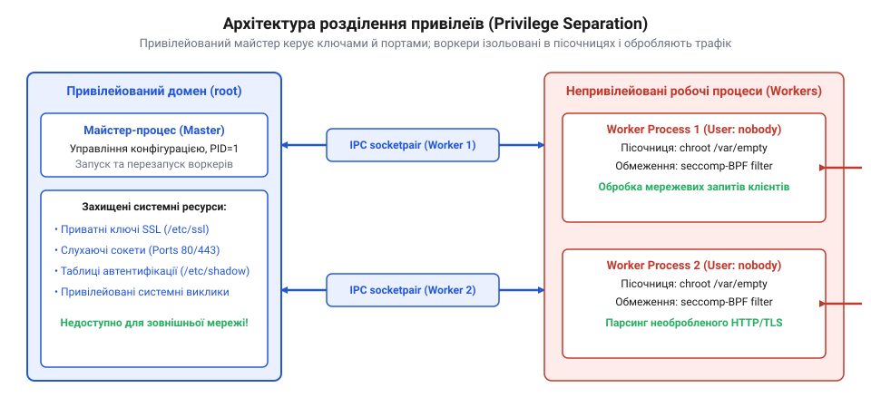
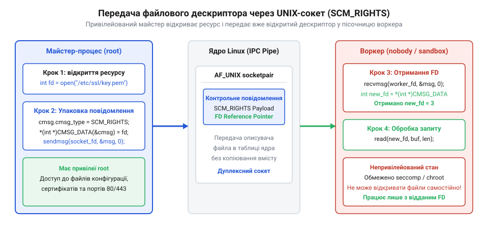

# Розділення привілеїв у системній архітектурі

## Небезпека монолітних привілейованих процесів

Коли програма приймає з'єднання з мережі, вона ніколи не знає наперед, чи надійні дані їй надсилають клієнти. У традиційній моделі операційних систем сімейства Unix системний демон (наприклад, вебсервер, поштовий сервер або сервер доступу по SSH) запускається від імені суперкористувача. Це необхідно для того, щоб програма могла відкрити привілейований мережевий порт (з номером до 1024, як-от порт 80 для HTTP) або прочитати закритий конфігураційний файл із секретними ключами шифрування, до якого звичайні користувачі не мають доступу.

Проблема виникає, коли такий процес залишається монолітним. У монолітній архітектурі одна й та сама програма в єдиному адресному просторі і відкриває порти, і безпосередньо обробляє клієнтські запити. Операційна система не відрізняє критичну дію (відкриття системного файлу) від рутинної (парсинг заголовка запиту) — усі дії виконуються з однаковими максимальними правами. Отже, будь-яка помилка програміста в коді обробки даних стає фатальною.

Уявіть, що код, який розбирає вхідний мережевий пакет, має класичну вразливість — переповнення буфера. Зловмисник навмисно надсилає спеціально сформовані дані, які перевищують розмір виділеної пам'яті. Ці дані переписують адресу повернення у стеку викликів, і коли функція завершується, процесор починає виконувати код, який надіслав зловмисник. Оскільки весь процес працює з максимальними правами суперкористувача (ідентифікатор користувача UID дорівнює нулю), цей шкідливий код автоматично отримує ті самі привілеї. На практиці такий експлойт найчастіше виконує системний виклик для запуску командної оболонки, наприклад `/bin/sh`. Отримавши привілейовану оболонку, нападник миттєво здобуває повний контроль над усією операційною системою: він може вільно встановлювати бекдори, читати будь-які закриті файли чи безповоротно знищувати дані.

Історично саме так працювала більшість системних демонів, що регулярно призводило до серйозних наслідків і масових зламів серверів. Ситуація почала змінюватися, коли розробники усвідомили потребу у відокремленні небезпечної роботи від привілейованої. Яскравим прикладом є історія впровадження розділення привілеїв (@@en|Privilege Separation@@) в OpenSSH. Після виявлення низки критичних вразливостей, розробник Нільс Провос у 2002 році змінив архітектуру демона. Метою було ізолювати код, що обробляє ненадійні вхідні дані, від коду, який виконує криптографічні та системні операції. Цей крок суттєво зменшив кількість успішних експлойтів, адже тепер злам обробника не давав доступу до системи.

Принцип найменших привілеїв (@@en|Principle of Least Privilege@@) диктує, що кожна частина програми повинна працювати виключно з тим мінімальним набором прав, який необхідний для виконання її задачі. Код, який парсить введення від неперевірених джерел, є найбільш ризикованим, тому він не повинен мати жодного доступу до критичних ресурсів операційної системи. Якщо такий ізольований обробник буде скомпрометовано, нападник опиниться в середовищі, де його можливості жорстко обмежені, і не зможе заподіяти шкоди системі.

## Архітектура майстер-процесу та воркерів

Щоб обмежити права коду, який працює з клієнтами, монолітну програму декомпозують на два різних типи процесів: один малий привілейований і кілька більших, але повністю ізольованих непривілейованих. Ця архітектурна модель отримала назву «майстер-воркер». Вона дозволяє розбити систему так, щоб робота з мережею та складні обчислення відбувалися поза зоною високого ризику.

*Привілейований майстер-процес керує системними ресурсами, тоді як ізольовані робочі процеси безпосередньо взаємодіють із зовнішнім світом.*

Майстер-процес завжди стартує першим і від імені суперкористувача. Його першочергове завдання — виконати початкову ініціалізацію, яка вимагає високих привілеїв. Він читає закриті конфігураційні файли, завантажує секретні ключі в оперативну пам'ять і звертається до ядра операційної системи, щоб відкрити системні ресурси (наприклад, зарезервувати мережевий порт 80 або 443). Головне правило майстер-процесу — він ніколи не читає і не парсить дані, що надходять безпосередньо від зовнішніх користувачів. Його вихідний код має бути максимально коротким, простим і ретельно перевіреним аудиторами безпеки, адже саме ця мала частина програми зберігає повний контроль над операційною системою.

Отримавши всі необхідні ресурси, майстер породжує робочі процеси (воркери) за допомогою системного виклику `fork()`. У системах сімейства Unix цей виклик створює точну копію поточного процесу. Важливою деталлю цієї копії є те, що ядро дублює таблицю відкритих файлових дескрипторів. Завдяки цьому механізму успадкування воркер автоматично отримує доступ до мережевого порту, який вже був відкритий майстром. Дочірньому процесу не потрібно самостійно запитувати в ядра права на відкриття привілейованого порту — він просто використовує готовий дескриптор. Це і є той архітектурний міст, який дозволяє непривілейованому коду працювати з захищеними ресурсами.

Проте одразу після системного виклику `fork()` дочірній процес усе ще є повноправною копією майстра і працює від імені суперкористувача. Тому його першим кроком є навмисне та безповоротне скидання своїх привілеїв. Спочатку процес очищає список додаткових груп за допомогою виклику `setgroups()`, щоб випадково не залишити собі доступ до специфічних системних каталогів. Потім він викликає `setgid()` для зміни своєї основної групи на непривілейовану. Зрештою, він робить найважливіший виклик — `setuid()`, змінюючи свій ідентифікатор користувача на спеціально створений порожній обліковий запис (наприклад, `www-data` або `nobody`), який не має доступу до жодних системних файлів.

Механіка виклику `setuid()` для суперкористувача є особливою: ядро не просто змінює ефективний ідентифікатор для перевірки прав доступу, а одночасно переписує реальний ідентифікатор та збережений ідентифікатор (@@en|saved set-user-ID@@). Це означає, що ядро стирає будь-яку згадку про те, що цей процес колись був привілейованим. З цього моменту воркер фізично не може відновити права суперкористувача, навіть якщо він викличе `setuid(0)`, оскільки ядро відхилить такий запит від звичайного користувача.

Тільки після того, як усі права скинуто, воркер переходить до своєї основної роботи. Уся складна і потенційно небезпечна логіка програми — наприклад, розбір HTTP-запитів, розтиснення даних, криптографічне узгодження з'єднання та обробка користувацького введення — відбувається саме в цьому непривілейованому середовищі. Якщо зловмисник знайде вразливість у цій складній логіці і перехопить керування воркером, операційна система обмежить його дії рамками користувача `nobody`.

Такий підхід дозволяє чітко архітектурно розділити обов'язки в системних демонах. Майстер відповідає за управління ресурсами та життєвим циклом воркерів, а самі воркери беруть на себе всю обробку брудних даних. Якщо ж робочому процесу раптово знадобиться доступ до додаткового закритого ресурсу під час роботи (наприклад, перевірити правильність пароля клієнта у системному файлі тіней), він не зможе зробити це самостійно. Замість цього він має надіслати стандартизований запит своєму майстру через спеціально створений безпечний канал зв'язку. Привілейований майстер перевірить формат і правомірність запиту і, якщо він легітимний, виконає дію від імені воркера. Практичну [реалізацію моделі майстер-воркер](root:sf-security/privilege-separation/proj-nginx-worker-model.md) на рівні коду C можна розглянути детально, щоб побачити цю взаємодію наживо та перевірити правильний порядок системних викликів. Таким чином, межа привілеїв проходить не навколо всієї програми, а всередині неї, відділяючи компактне надійне ядро від небезпечної периферії.

## Ізоляція середовища робочих процесів

Самого лише скидання ідентифікатора користувача недостатньо для повної безпеки. Якщо зловмисник захопить контроль над непривілейованим робочим процесом, він усе ще зможе бачити файлову систему, читати загальнодоступні файли (наприклад, конфігурації системи в `/etc`) і, що найгірше, викликати будь-які функції ядра операційної системи. Щоб запобігти цьому, навколо скомпрометованого воркера будують жорстку пісочницю (@@en|sandbox@@), яка фізично обмежує його можливості.

Першим рівнем захисту є ізоляція файлової системи. Перед тим як почати обробляти дані, робочий процес змінює свій кореневий каталог за допомогою системного виклику `chroot()`. Він переходить у спеціально створену порожню директорію, наприклад `/var/empty`, з якої неможливо вийти назовні. Тепер, навіть якщо зловмисник спробує відкрити файл `/etc/passwd` або запустити командну оболонку, він просто не знайде їх у своєму новому обмеженому світі. Детальніше про [ізоляцію файлової системи: chroot та простори імен](root:sf-security/chroot-jails-and-namespaces) можна дізнатися в окремій темі.

Другим, і найбільш потужним, рівнем є обмеження системних викликів. Зазвичай процес може звертатися до ядра з проханням створити новий процес, виділити пам'ять або відкрити мережеве з'єднання. Але нашому ізольованому воркеру більшість із цього не потрібна: він має лише читати дані з уже відкритого сокета, обробляти їх і писати відповідь назад. У Linux для цього застосовують механізм @@en|Secure Computing Mode@@, або `seccomp`. Він дозволяє процесу добровільно відмовитися від права робити будь-які непередбачені системні виклики. Повну [довідку з системного виклику seccomp та BPF-фільтрів](root:sf-security/privilege-separation/api-linux-seccomp-bpf.md) варто мати під рукою при написанні коду.

За допомогою BPF-фільтрів програміст створює список дозволених операцій. Якщо скомпрометований воркер спробує виконати системний виклик для запуску шкідливої програми, ядро операційної системи миттєво вб'є цей процес. Глибока [ізоляція за допомогою seccomp та BPF](root:sf-security/linux-seccomp-isolation) перетворює воркер на обчислювальну капсулу, з якої неможливо атакувати ядро. Крім того, на етапі ініціалізації розробники часто скидають усі додаткові права процесу, використовуючи [модель Linux Capabilities](root:sf-security/unix-capabilities-model), щоб гарантувати відсутність прихованих лазівок. Таким чином, межа привілеїв стає фізичною перепоною, яку зловмисник не може подолати.

## Передача дескрипторів через безпечний IPC

Коли воркер надійно заблокований у порожній директорії і позбавлений права відкривати нові файли, виникає архітектурна проблема: як йому працювати, якщо раптово знадобиться новий ресурс? Наприклад, під час розбору запиту воркер зрозумів, що йому потрібно прочитати файл із даними конкретного клієнта. Оскільки сам воркер цього зробити не може, він звертається до свого привілейованого майстра через міжпроцесну взаємодію, або IPC (@@en|Inter-Process Communication@@).

*IPC-канал дозволяє привілейованому майстру безпечно передати відкритий ресурс ізольованому воркеру, зберігаючи межу привілеїв.*

Цей канал зв'язку створюється ще до розгалуження процесів. Майстер викликає функцію `socketpair()`, яка створює два з'єднані між собою сокети. Один кінець залишається в майстра, інший — у воркера. Коли воркеру потрібен файл, він надсилає через цей канал звичайне текстове або бінарне повідомлення із запитом. Майстер, який усе ще має права суперкористувача, перевіряє запит. Якщо доступ дозволено, майстер відкриває файл.

Однак майстер не може просто надіслати воркеру число, яке позначає номер відкритого файлового дескриптора. У кожному процесі операційна система веде власну таблицю дескрипторів, тому число для майстра і число для воркера вказуватимуть на абсолютно різні ресурси. Щоб передати сам відкритий файл, використовується спеціальний механізм системного виклику `sendmsg()`. Разом із звичайними даними він дозволяє надсилати допоміжні керівні повідомлення. Детальна [довідка з socketpair() та sendmsg() для передачі дескрипторів](root:sf-security/privilege-separation/api-unix-ipc-socketpair.md) показує, як саме формуються ці структури в пам'яті.

Коли ядро операційної системи бачить такий спеціальний IPC-запит, воно бере відкритий файл із таблиці майстра, дублює його в таблицю воркера під новим вільним номером і лише тоді віддає керування воркеру. Тепер ізольований процес має доступ до конкретного файлу, не маючи при цьому загальних прав на відкриття файлів у системі. Завдяки цій технології розробники будують повністю керований канал зв'язку всередині розділеної програми, гарантуючи, що жоден ресурс не потрапить до рук воркера без явної перевірки з боку привілейованого процесу.

## Практичні реалізації в відомих демонах

Розділення привілеїв (@@en|Privilege Separation@@) не є абстрактною теоретичною моделлю — це стандарт для сучасного системного програмного забезпечення. Розглянемо, як цей підхід реалізовано в трьох популярних системних службах, кожна з яких має власні архітектурні особливості та вимоги до безпеки.

**Захист процесу автентифікації в OpenSSH**
@@en|OpenSSH@@ був одним із перших проектів, де масово впровадили цю архітектуру. Його майстер-процес запускається від імені суперкористувача, відкриває стандартний порт доступу та завантажує закритий ключ сервера. Коли надходить нове мережеве з'єднання, майстер породжує дочірній процес. Цей процес миттєво скидає свої права до непривілейованого користувача та замикається в ізольованій порожній директорії за допомогою системного виклику `chroot()`.

Саме цей ізольований робочий процес спілкується з клієнтом по мережі: розбирає вхідні пакети, узгоджує алгоритми шифрування та проводить обмін ключами. Оскільки воркер працює в жорсткій пісочниці, навіть успішна атака на етапі до авторизації клієнта не дасть нападнику доступу до файлів системи. Лише коли клієнт успішно доведе свою особу, воркер надішле через канал міжпроцесної взаємодії (@@en|Inter-Process Communication@@) запит до майстра з проханням створити нову повноцінну сесію. Майстер-процес, залишаючись привілейованим, перевіряє правомірність запиту і породжує фінальний процес командної оболонки від імені користувача, який успішно увійшов у систему.

**Ізоляція системного годинника в OpenNTPD**
Сервер точного часу @@en|OpenNTPD@@, розроблений командою операційної системи @@en|OpenBSD@@, є еталоном жорсткої мінімізації привілеїв для вузькоспеціалізованої задачі. Цей демон виконує дві головні дії: отримує точний час із зовнішніх серверів та підводить системний годинник комп'ютера. Зміна системного часу є критичною дією, яка вимагає максимальних прав.

Архітектура @@en|OpenNTPD@@ чітко розмежовує ці ролі. Привілейований майстер ніколи не звертається до зовнішньої мережі; він лише чекає на команди зсередини. Непривілейований воркер працює в пісочниці й опитує зовнішні сервери часу. Він виконує всю складну математику для обчислення похибки годинника. Коли воркер розуміє, що час треба скоригувати, він фізично не може зробити це сам. Замість цього він формує повідомлення з вирахуваним зміщенням і відправляє його майстру. Майстер отримує зміщення, перевіряє його на адекватність і застосовує до системного годинника. Таким чином, потенційно вразливий мережевий парсер повністю позбавлений системних повноважень.

**Продуктивність і балансування в NGINX**
Вебсервер @@en|NGINX@@ демонструє, як архітектура розділення привілеїв поєднується з високою продуктивністю. Майстер-процес @@en|NGINX@@ працює з максимальними правами. Це необхідно для відкриття стандартних вебпортів, а також для початкового читання сертифікатів шифрування із захищених каталогів. Після цього майстер породжує цілий пул із кількох робочих процесів, зазвичай по одному на кожне ядро процесора.

Усі воркери одразу скидають свої права до непривілейованого користувача. На відміну від @@en|OpenSSH@@, де для кожного клієнта створюється власний процес, воркери @@en|NGINX@@ живуть довго і спільно прослуховують успадковані від майстра мережеві дескриптори. Вони самостійно приймають нові з'єднання, розбирають заголовки запитів, виконують розшифрування трафіку та читають статичні файли вебсайту. Майстер-процес більше не бере участі в обробці цих запитів. Його роль зводиться до моніторингу життєвого циклу воркерів: якщо робочий процес раптово завершиться через програмну помилку, привілейований майстер негайно породить новий. Це забезпечує безперебійну роботу вебсервера без зниження рівня безпеки.

Ці реальні приклади доводять, що будь-який складний системний сервіс можна успішно декомпозувати на надійне привілейоване ядро та ізольовану периферію. Такий підхід мінімізує поверхню атаки, дозволяючи зберегти при цьому повноцінну функціональність і високу швидкість обробки даних клієнтів.