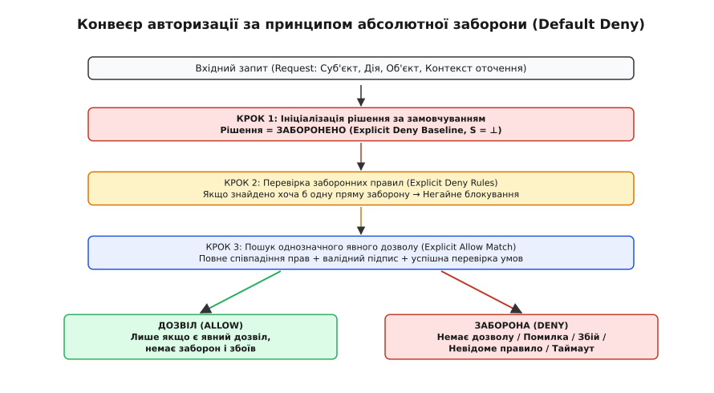

# ⚙️ Реалізація авторизаційного рушія з гарантованою безпечною відмовою

У розподілених сервісах та системах контролю доступу найнебезпечнішою точкою відмови є обробник виняткових ситуацій у модулі прийняття рішень (Policy Decision Point, PDP). Якщо через переповнення черги, таймаут мережевого сокета, збій виділення пам'яті або помилку парсера токена функція перевірки прав повертає неперевірений результат або завершується аварійно без блокування, зловмисник отримує прямий доступ до захищеного контенту.

Розглянемо проектування та практичну реалізацію високопродуктивного вбудованого рушія авторизації, архітектура якого унеможливлює стан Fail-Open на рівні структури даних, типів та послідовності оцінки правил.

## Архітектурні вимоги та модель станів

Проектування захищеного рушія базується на п'яти фундаментальних вимогах:

1. **Explicit Deny Baseline (Базова заборона)**: початковий стан змінної вердикту завжди ініціалізується значенням `DENY`. Жодна гілка коду не може повернути дозвіл, якщо не знайдено точного позитивного збігу з правилом явного дозволу;
2. **Deny Overrides Everything (Абсолютний пріоритет заборони)**: якщо хоча б одне правило вказує на явну заборону (`Explicit Deny`), оцінка негайно зупиняється, а запит блокується незалежно від наявності інших дозволів;
3. **Fail-Closed on Exception (Захисна зупинка при збоях)**: будь-яка внутрішня помилка (помилка парсера, відсутність обов'язкових полів запиту, таймаут звернення до бази правил) переводить конвеєр у термінальний стан блокування;
4. **Структурований аудит кожної відмови**: будь-яке блокування запиту супроводжується точним кодом причини (Reason Code), що дозволяє команді безпеки відрізняти спроби атак від технічних збоїв;
5. **Ізоляція пам'яті та нульові копіювання**: безпечна робота з рядковими представленнями без ризиків переповнення буфера або витоків пам'яті.

*Архітектурний конвеєр перевірки доступу: будь-який збій, таймаут або невідомий атрибут скидає конвеєр у базовий стан абсолютної заборони.*

## Організація пам'яті та структур даних

Для забезпечення передбачуваної продуктивності та усунення ризиків вичерпання динамічної пам'яті (Heap Exhaustion Denial of Service), рушій використовує фіксовані структури даних на базі статично алокованих масивів правил та неблокуючих перевірок:
- Правило авторизації `AccessRule` містить роль суб'єкта, дію, префікс шляху ресурсу та тип ефекту (`EFFECT_DENY` або `EFFECT_ALLOW`);
- Запит на перевірку прав `AuthRequest` інкапсулює контекст ініціатора операції, включаючи часову мітку створення запиту для відсікання застарілих пакетів;
- Результат оцінки `AuthResult` складається з бінарного вердикту (`AUTH_DECISION_DENY` / `AUTH_DECISION_ALLOW`), розширеного коду причини блокування `AuthReasonCode` та вказівника на правило, що спричинило спрацювання.

## Повна реалізація рушія

:::tabs
:::code proj-failsafe-auth-engine/c/main.c
:::code proj-failsafe-auth-engine/cpp/main.cpp
:::

## Покроковий розбір виконання для критичних сценаріїв

Проаналізуємо поведінку рушія у чотирьох граничних випадках:

### Сценарій 1: Порожній набір правил (холодний старт)
При старті системи або перезавантаженні сховища конфігурацій база правил є порожньою (`rule_count = 0`).
- Запит: роль `guest`, дія `read`, ресурс `/api/products`;
- Хід виконання: цикл оцінки правил не виконує жодної ітерації. Змінна `explicit_allow_found` залишається `false`;
- Результат: `AUTH_DECISION_DENY` з кодом причини `AUTH_REASON_DEFAULT_DENY`. 
- **Висновок**: система залишається повністю захищеною навіть тоді, коли конфігурація ще не завантажилася.

### Сценарій 2: Конфлікт правил (дозвіл та заборона)
У базі правил існують два записи:
1. Дозволити ролі `finance_user` доступ до префіксу `/api/finance/`;
2. Заборонити ролі `finance_user` доступ до префіксу `/api/finance/salaries`.
- Запит: роль `finance_user`, дія `read`, ресурс `/api/finance/salaries/ceo`;
- Хід виконання: під час ітерації рушій зіставляє друге правило. Оскільки його ефект `EFFECT_DENY`, функція негайно повертає результат, не оцінюючи наступні правила;
- Результат: `AUTH_DECISION_DENY` з кодом причини `AUTH_REASON_EXPLICIT_DENY`.
- **Висновок**: правило прямої заборони має абсолютний пріоритет.

### Сценарій 3: Пошкоджений запит або помилка пам'яті
Клієнт надіслав запит із порожнім значенням поля ролі через помилку JSON-десеріалізатора.
- Запит: `subject_role = ""`, `action = "read"`, `resource = "/admin"`;
- Хід виконання: валідація на початку функції фіксує порушення контракту цілісності `req->subject_role[0] == '\0'`;
- Результат: `AUTH_DECISION_DENY` з кодом причини `AUTH_REASON_PARSE_ERROR`.
- **Висновок**: збійний запит блокується до початку виконання будь-яких обчислень.

### Сценарій 4: Таймаут оцінки у розподіленому середовищі
У разі затримки відповіді зовнішнього провайдера атрибутів (LDAP / Keycloak), таймер контролю виконання фіксує перевищення порогу `timeout_ms`.
- Результат: конвеєр обриває з'єднання і повертає `AUTH_DECISION_DENY` з кодом причини `AUTH_REASON_TIMEOUT`.

## Інтеграція у високонавантажений шлюз (Middleware Integration)

У реальних виробничих середовищах цей авторизаційний рушій вбудовується як фільтр зворотного проксі (Envoy C++ Filter або NGINX Module). Кожен вхідний HTTP-запит проходить наступний конвеєр:

1. **Етап нормалізації (Pre-Auth Normalization)**:
   - Декодування URL-символів (URL Unescaping);
   - Усунення відносних переходів шляху (`/static/../admin` → `/admin`);
   - Приведення шляху до нижнього регістру (за потреби файлової системи);
2. **Етап вилучення атрибутів (Context Extraction)**:
   - Валідація криптографічного підпису JWT-токена за відкритим ключем;
   - Перевірка терміну придатності токена (`exp` claim);
   - Вилучення ролей та ідентифікатора суб'єкта;
3. **Етап виконання конвеєра (PDP Evaluation)**:
   - Виклик функції `auth_engine_evaluate()`;
   - Якщо результат `AUTH_DECISION_ALLOW` — запит передається далі за ланцюжком обробників до бекенду;
   - Якщо результат `AUTH_DECISION_DENY` — конвеєр негайно формує HTTP-відповідь `403 Forbidden` із JSON-тілом, що містить ідентифікатор запиту (Request ID) для подальшого аудиту.

## Типові інженерні пастки реалізації авторизації

1. **Пастка оптимістичного булевого прапорця**:
   Ініціалізація змінної результатом `bool is_allowed = true;` з наступними спробами знайти причини для блокування. Будь-який пропущений `break` у розгалуженні `switch` або неопрацьована гілка `else` призводить до несанкціонованого надання доступу.

2. **Неповна нормалізація шляхів ресурсів (Path Traversal Bypass)**:
   Перевірка префіксу `/admin` без попередньої канонізації рядка дозволяє зловмиснику обійти фільтр через URL-кодування `/%61dmin`, подвійні слеші `//admin` або відносні переходи `/public/../admin`. Безпечний дефолт вимагає нормалізації шляху ДО передачі в авторизаційний рушій.

3. **Неточне зіставлення ролей через підрядки**:
   Використання функції `strstr(user_roles, "admin")` замість суворого поелементного порівняння призводить до того, що користувач із роллю `guest_admin_viewer` помилково отримує повні адміністративні права.

4. **Стан перегонів під час динамічного оновлення правил (Race Conditions)**:
   Модифікація масиву правил `rules` без використання блокувань читання/запису (R/W Locks) або атомарної заміни вказівника (RCU — Read-Copy-Update) під час роботи робочих потоків призводить до читання частково ініціалізованих структур і стану Fail-Open.
