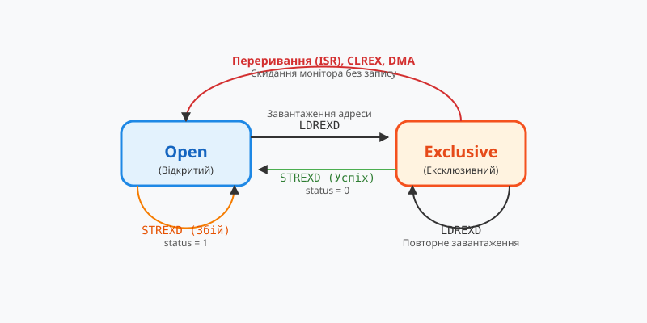

## Початкові концепції та фізичні принципи

У високопродуктивних вбудованих системах та багатопотокових додатках операційної системи реального часу @@en|RTOS@@ (з англ. *Real-Time Operating System* — операційна система реального часу) обробка даних вимагає суворих детермінованих гарантій затримки. Традиційні механізми синхронізації, що спираються на м'ютекси або критичні секції, провокують непередбачуваний overhead через перемикання контексту процесора, підвищують @@en|interrupt latency@@ (з англ. *interrupt* — переривання, *latency* — затримка) та можуть викликати @@en|priority inversion@@ (з англ. *priority* — пріоритет, *inversion* — інверсія), коли високологічний потік блокується низькопріоритетною задачею. Щоб уникнути цих обмежень, розробники застосовують алгоритми з @@en|lock-free@@ (з англ. *lock* — замок, *free* — вільний) гарантіями, керуючи [безблоковими структурами даних](root:sf-tasks/lock-free-basics) безпосередньо на рівні атомарних інструкцій мікропроцесора.

Фізична реалізація безблокової синхронізації спирається на апаратну підтримку атомарних операцій контролером шини пам'яті та кеш-когерентними протоколами процесорних ядер (такими як MESI або MOESI). Основним прикметником атомарності в багатьох архітектурах є інструкція @@en|Compare-And-Swap@@ (з англ. *compare* — порівнювати, *swap* — обмінювати), або @@en|CAS@@. На фізичному рівні під час виконання @@en|CAS@@ ядро процесора захоплює ексклюзивні права на відповідний @@en|cache line@@ (з англ. *cache* — кеш, *line* — рядок) пам'яті. Інструкція порівнює поточне бітове значення за вказаною адресою з очікуваним значенням, збереженим у регістрі процесора. Якщо значення ідентичні, процесор записує нове значення за цією адресою та повертає прапор успіху; якщо значення відрізняються, комірка пам'яті залишається недоторканою, а операція повертає помилку.

Попри атомарну точність виконання інструкцій на шині пам'яті, фундаментальною уразливістю безблокових алгоритмів є @@en|ABA problem@@ (з англ. *ABA problem*). Ця ситуація виникає тоді, коли між моментом читання адреси або стану об'єкта та моментом виконання атомарної операції @@en|CAS@@ значення в пам'яті змінюється з `A` на `B`, а потім повертається назад до `A`.

Для розуміння фізичної природи проблеми розглянемо алгоритм роботи безблокового стека в прошивці мікроконтролера. Нехай стек зберігає вказівник на верхівку `Top`, яка в початковий момент часу вказує на вузол `A`. Вузол `A` містить вказівник на наступний елемент `B`.

1. Перший потік (або обробник переривання) читає вказувач `Top`, отримуючи адресу вузла `A`.
2. Потік читає наступну адресу `A->next`, яка дорівнює `B`.
3. Перед тим як перший потік встигає виконати атомарну інструкцію `CAS(&Top, A, B)`, його виконання переривається вищим за пріоритетом другим потоком.
4. Другий потік вилучає вузол `A` зі стека (тепер `Top` вказує на `B`).
5. Другий потік вилучає вузол `B` зі стека (тепер `Top` вказує на наступний вузол `C`).
6. Другий потік звільняє пам'ять вузла `B` або використовує її в іншій підсистемі.
7. Другий потік повертає вузол `A` у динамічний @@en|free list@@ (з англ. *free* — вільний, *list* — список) пам'яті. У мікроконтролерних системах через обмеженість ресурсів часто використовується спеціалізований @@en|memory pool@@ (з англ. *memory* — пам'ять, *pool* — пул). Аллокатор пам'яті виділяє той самий фізичний блок для нового елемента, і другий потік знову додає вузол `A` на верхівку стека. Вказівник `Top` знову набуває значення `A`.
8. Перший потік відновлює виконання та запускає підготовлену операцію `CAS(&Top, A, B)`.
9. Процесор порівнює поточне значення `Top` із зафіксованим раніше `A`. Оскільки адреси збігаються, `CAS` успішно перезаписує `Top` значенням `B`.

У результаті виконання цієї послідовності верхівка стека `Top` вказує на вузол `B`, який вже був вилучений із вжитку та, можливо, утилізований або зіпсований іншими процесами. Це призводить до фатального пошкодження структури даних у пам'яті, невизначеної поведінки прошивки та хаотичних збоїв під час адресації.

Апаратні процесорні архітектури оцінюють еквівалентність виключно за бітовим збігом бінарного значення у комірці пам'яті, тоді як паралельний алгоритм потребує гарантії семантичної та часової незмінності об'єкта. Розглядаючи [проблему ABA в неблокувальних структурах](root:sf-tasks/aba-problem), важливо усвідомити, що повторне використання фізичних адрес у пам'яті є головним каталізатором руйнування цілісності безблокових алгоритмів.

На відміну від архітектур з інструкцією @@en|CAS@@, деякі мікропроцесорні архітектури (зокрема ARM Cortex-M/A та RISC-V) використовують альтернативні [атомарними інструкціями](root:sf-tasks/lock-free-atomic-primitives). Вони реалізують [архітектуру LL/SC](root:sf-tasks/ll-sc-architecture) за допомогою парних інструкцій @@en|Load-Link/Store-Conditional@@ (з англ. *load-link* — завантаження із зв'язуванням, *store-conditional* — умовне збереження), або @@en|LL/SC@@. Інструкція `LDREX` (Load-Register Exclusive) завантажує значення з пам'яті й активує апаратний монітор адреси для даного ядра. Якщо інший потік або переривання здійснює запис за цією адресою чи викликає збій кеш-лінії, прапор монітора скидається. Наступна інструкція `STREX` (Store-Register Exclusive) виконає запис лише за умови, що апаратний монітор залишається активним. Це надає вроджений апаратний захист від певних форм модифікації пам'яті між читанням та записом, хоча й висуває власні вимоги до аналізу [поступу паралельних алгоритмів](root:sf-tasks/wait-free-and-lock-free-classification) через можливість помилкових скидань монітора при міжядерних конфліктах.

## Внутрішня будова та алгоритми роботи

Для подолання проблеми ABA та гарантування безпечного повторного використання пам'яті в неблокувальних структурах розроблено серію архітектурних паттернів та алгоритмічних підходів. Основними класичними методами є версіонування вказівників (тегані вказівники) та системи безпечного звільнення пам'яті @@en|Safe Memory Reclamation@@ (з англ. *safe* — безпечний, *memory* — пам'ять, *reclamation* — повернення/звільнення).

Перший класичний підхід полягає у використанні @@en|Tagged Pointers@@ (з англ. *tag* — мітка, *pointer* — вказівник) або @@en|Versioned References@@ (з англ. *versioned* — версіонований, *reference* — посилання). Ідея полягає в тому, щоб об'єднати фізичну адресу вказівника з монотонно зростаючим лічильником модифікацій (версією) в єдине атомарне слово.

Кожного разу, коли вузол модифікується або повертається у структуру даних, лічильник версій інкрементується:

```
[ Початковий стан ] : TaggedPointer = { Address: 0x20001000, Version: 1 }
[ Вилучення та повернення ] : TaggedPointer = { Address: 0x20001000, Version: 2 }
```

Коли перший потік зчитує `Top`, він отримує структуру `{ 0x20001000, 1 }`. Навіть якщо другий потік вилучить вузол `A`, поверне його за тією ж адресою `0x20001000` і збільшить лічильник до `2`, під час спроби першого потоку виконати `CAS` зі значенням `{ 0x20001000, 1 }` порівняння завершиться невдачею, оскільки поточна версія у пам'яті дорівнює `2`.

Для реалізації теганих вказівників потрібна атомарна операція подвійної ширини — @@en|double-word CAS@@ (з англ. *double-word* — подвійне слово, *compare-and-swap* — порівняння із заміною), або @@en|DWCAS@@. На 32-бітних мікроконтролерах (таких як ARM Cortex-M) `DWCAS` оперує 64-бітними значеннями (адреса 32 біти + лічильник 32 біти), використовуючи інструкції `LDREXD`/`STREXD` або `CMPXCHG8B` на x86. На 64-бітних архітектурах застосовується 128-бітна інструкція `CMPXCHG16B`. Якщо апаратура не підтримує `DWCAS`, застосовують упакування версії в невикористовувані молодші біти вирівняної адреси (оскільки адреси структури вирівняні по 4 або 8 байтах, 2-3 молодші біти завжди дорівнюють нулю) або у старші біти 64-бітного віртуального адресного простору.

Другим критичним аспектом функціонування є безпечне звільнення пам'яті. Навіть якщо проблему ABA розв'язано тегуванням, виникає небезпека читання вилученої пам'яті: якщо потік зчитав вказівник на вузол, а інший потік вилучив і звільнив цей вузол через `free()`, перший потік отримає збій звернення до пам'яті (Segment Fault / HardFault).

Для безпечної утилізації вузлів застосовують такі алгоритми:

1. **Захисні вказівники** — @@en|Hazard Pointers@@ (з англ. *hazard* — небезпека, *pointer* — вказівник). Кожен потік перед розімкненням вказівника оголошує його адресу в глобальному масиві захисних вказівників. Потік-утилізатор перед видаленням вузла перевіряє цей масив. Якщо адреса вузла знаходиться в масиві хоча б одного читача, видалення відкладається у локальний список відкладеного звільнення. Це інтегрується з концепцією, що описує [захисні вказівники](root:sf-tasks/hazard-pointers-memory-reclamation).
2. **Епохальне звільнення пам'яті** — @@en|Epoch-Based Reclamation@@ (з англ. *epoch* — епоха, *based* — базований, *reclamation* — звільнення). Система підтримує глобальний лічильник епох. Потоки реєструють поточну епоху під час входу в безблокову операцію. Пам'ять вузлів, вилучених в епоху `E`, фізично звільняється лише тоді, коли всі активні потоки перейдуть в епоху `E + 1` або вищу. Детальніше цей механізм розглядається як [епохальне звільнення пам'яті](root:sf-tasks/epoch-based-reclamation-concurrency).
3. **Read-Copy-Update** — @@en|Read-Copy-Update@@ (з англ. *read* — читати, *copy* — копіювати, *update* — оновлювати), або @@en|RCU@@. Читачі виконують доступ без жодних атомарних записів, а модифікатор створює копію даних, оновлює вказівник і чекає завершення льоту всіх читачів (grace period) перед звільненням старої версії. Розробники застосовують [технологію RCU](root:sf-tasks/read-copy-update) для структур із перевагою читання.
4. **Seqlocks** — @@en|Seqlock@@ (з англ. *sequential lock* — послідовний замок). Читач перевіряє лічильник послідовності до та після читання. Якщо лічильник непарний або змінився, читання повторюється, що описує [механізм seqlock](root:sf-tasks/seqlock).

У класичних фундаментальних структурах даних, таких як [стек Трейбера та чергу Майкла-Скотта](root:sf-tasks/treiber-stack-and-michael-scott-queue), інтеграція теганих вказівників забезпечує коректне [безблокувальне оновлення стану](root:sf-tasks/cas-lock-free). Для підтримання впорядкованості операцій процесорного ядра в код обов'язково вбудовуються [бар'єри пам'яті](root:sf-tasks/memory-barriers-and-atomic-sequencing), які запобігають спекулятивному переупорядкуванню інструкцій читання та запису. На архітектурах ARM альтернативою виступають [парні інструкції LL/SC](root:sf-tasks/load-link-store-conditional-primitives).

Нижче наведено практичну реалізацію безблокового стека з тегованими вказівниками для мікроконтролерних систем на базі архітектури ARM Cortex-M (STM32).

:::tabs
```c|stm32
#include <stdint.h>
#include <stdbool.h>
#include <stddef.h>

/* Структура вузла стека */
typedef struct Node {
    uint32_t data;
    struct Node* next;
} Node_t;

/* Тегований вказівник для запобігання ABA (64-бітне вирівняне слово) */
typedef struct {
    Node_t* ptr;
    uint32_t tag;
} __attribute__((aligned(8))) TaggedPointer_t;

/* Голова стека */
typedef struct {
    volatile TaggedPointer_t head;
} LockFreeStack_t;

/* Ініціалізація стека */
void lockfree_stack_init(LockFreeStack_t* stack) {
    stack->head.ptr = NULL;
    stack->head.tag = 0;
}

/* Атомарна операція CAS над 64-бітним тегованим вказівником для ARM Cortex-M */
static inline bool atomic_cas_tagged(volatile TaggedPointer_t* target, 
                                    TaggedPointer_t old_val, 
                                    TaggedPointer_t new_val) {
    uint32_t status;
    uint32_t dummy1, dummy2;

    /* Використання парних інструкцій LDREXD / STREXD для атомарного порівняння та заміни */
    __asm__ volatile (
        "1: LDREXD %0, %1, [%3]\n"       /* Завантажити 64-бітне значення (ptr, tag) */
        "   CMP    %0, %4\n"             /* Порівняти ptr з old_val.ptr */
        "   IT     EQ\n"
        "   CMPEQ  %1, %5\n"             /* Якщо ptr однакові, порівняти tag з old_val.tag */
        "   BNE    2f\n"                 /* Якщо не рівні — вихід з помилкою */
        "   STREXD %2, %6, %7, [%3]\n"   /* Спробувати записати new_val (ptr, tag) */
        "   CMP    %2, #0\n"             /* Перевірити успішність STREXD */
        "   BNE    1b\n"                 /* Якщо конфлікт шини — повторити цикл */
        "   MOV    %2, #0\n"             /* Успіх */
        "   B      3f\n"
        "2: CLREX\n"                     /* Скинути монітор ексклюзивного доступу */
        "   MOV    %2, #1\n"             /* Помилка порівняння */
        "3:\n"
        : "=&r" (dummy1), "=&r" (dummy2), "=&r" (status)
        : "r" (target), "r" (old_val.ptr), "r" (old_val.tag), 
          "r" (new_val.ptr), "r" (new_val.tag)
        : "cc", "memory"
    );

    return (status == 0);
}

/* Безблокове додавання елемента на верхівку стека (Push) */
void lockfree_stack_push(LockFreeStack_t* stack, Node_t* new_node) {
    TaggedPointer_t old_head;
    TaggedPointer_t new_head;

    do {
        old_head.ptr = stack->head.ptr;
        old_head.tag = stack->head.tag;

        new_node->next = old_head.ptr;
        
        new_head.ptr = new_node;
        new_head.tag = old_head.tag + 1; /* Збільшуємо тег версії */

        __dmb(0xF); /* Бар'єр пам'яті для гарантування впорядкованості запису next */
    } while (!atomic_cas_tagged(&stack->head, old_head, new_head));
}

/* Безблокове вилучення елемента з верхівки стека (Pop) */
Node_t* lockfree_stack_pop(LockFreeStack_t* stack) {
    TaggedPointer_t old_head;
    TaggedPointer_t new_head;
    Node_t* node = NULL;

    do {
        old_head.ptr = stack->head.ptr;
        old_head.tag = stack->head.tag;

        if (old_head.ptr == NULL) {
            return NULL; /* Стек порожній */
        }

        node = old_head.ptr;
        new_head.ptr = node->next;
        new_head.tag = old_head.tag + 1; /* Збільшуємо тег версії для запобігання ABA */

    } while (!atomic_cas_tagged(&stack->head, old_head, new_head));

    return node;
}
```
```cpp|stm32
#include <atomic>
#include <cstdint>
#include <cstddef>

template<typename T>
class LockFreeStack {
private:
    struct Node {
        T data;
        Node* next;

        Node(const T& val) : data(val), next(nullptr) {}
    };

    struct TaggedPointer {
        Node* ptr;
        uint32_t tag;
    };

    /* Атомарне 64-бітне слово для подвійного CAS у C++11/17 */
    alignas(8) std::atomic<TaggedPointer> head;

public:
    LockFreeStack() {
        head.store(TaggedPointer{nullptr, 0}, std::memory_order_relaxed);
    }

    void push(const T& value) {
        Node* new_node = new Node(value);
        TaggedPointer old_head = head.load(std::memory_order_relaxed);
        TaggedPointer new_head;

        do {
            new_node->next = old_head.ptr;
            new_head.ptr = new_node;
            new_head.tag = old_head.tag + 1; /* Монотонне збільшення версії */
        } while (!head.compare_exchange_weak(
            old_head, 
            new_head, 
            std::memory_order_release, 
            std::memory_order_relaxed));
    }

    bool pop(T& result) {
        TaggedPointer old_head = head.load(std::memory_order_acquire);
        TaggedPointer new_head;

        do {
            if (old_head.ptr == nullptr) {
                return false; /* Стек порожній */
            }
            new_head.ptr = old_head.ptr->next;
            new_head.tag = old_head.tag + 1; /* Захист від ABA за допомогою унікального тегу */
        } while (!head.compare_exchange_weak(
            old_head, 
            new_head, 
            std::memory_order_acquire, 
            std::memory_order_relaxed));

        result = old_head.ptr->data;
        delete old_head.ptr; /* Примітка: у реальному RTOS тут використовується Hazard Pointers */
        return true;
    }
};
```
:::

## Апаратна реалізація та низькорівневий C/C++ код

Апаратна реалізація безблокових алгоритмів у мікроконтролерних системах спирається на специфіку шинної архітектури процесорного ядра та спеціалізовані інструкції розширення атомарності. На відміну від настільних процесорів архітектури x86, де префікс `LOCK` блокує системну шину пам'яті або локалізує кеш-рядок на рівні протоколу @@en|MOESI@@, мікроконтролери на базі архітектур ARM Cortex-M (зокрема серій Cortex-M3, M4, M7 та M33) та RISC-V реалізують неблокувальний доступ через пару інструкцій завантаження та збереження з ексклюзивним моніторингом.

В архітектурі ARM Cortex-M основними атомарними примітивами є інструкції `LDREX` (Load-Register Exclusive) та `STREX` (Store-Register Exclusive). Для обробки тегованих вказівників, що вимагають одночасного порівняння адреси та лічильника модифікацій, застосовуються їхні 64-бітні розширення — `LDREXD` та `STREXD`. Механізм їхньої роботи забезпечується апаратним блоком, який має назву @@en|exclusive monitor@@ (з англ. *exclusive* — винятковий/ексклюзивний, *monitor* — монітор/спостерігач). Цей монітор вбудовано безпосередньо в матрицю шин @@en|bus matrix@@ (з англ. *bus* — шина, *matrix* — матриця) мікроконтролера та процесорне ядро.

Коли потік виконує інструкцію `LDREXD`, ядро завантажує 64-бітний стан (32 біти адреси вказівника та 32 біти версійного тегу) у пару регістрів і переводить локальний ексклюзивний монітор у стан *Exclusive* для вказаної фізичної адреси. Якщо протягом інтервалу між завантаженням та збереженням інший потік, периферійний модуль через @@en|DMA@@ (з англ. *Direct Memory Access* — прямий доступ до пам'яті) або обробник переривання @@en|ISR@@ (з англ. *Interrupt Service Routine* — процедура обслуговування переривання) виконує запис за цією адресою, монітор автоматично скидає свій стан у *Open*.

Під час виклику інструкції `STREXD` процесор перевіряє стан ексклюзивного монітора. Якщо монітор перебуває у стані *Exclusive*, запис 64-бітного значення у пам'ять виконується атомарно, монітор скидається в *Open*, а інструкція повертає значення `0` у цільовий регістр прапорця успіху. Якщо ж монітор опинився у стані *Open*, запис у пам'ять блокується, значення в комірці залишається незмінним, а `STREXD` повертає `1`, сповіщаючи алгоритм про необхідність повторення циклу.


*Принцип скидання станів ексклюзивного монітора з Exclusive в Open при виконанні переривання ISR або інструкції CLREX.*

Критичним моментом низькорівневої реалізації є поведінка апаратного монітора під час перемикання контексту. Будь-яке апаратне переривання або виклик процедури `CLREX` (Clear Exclusive) примусово скидає ексклюзивний монітор. Це гарантує, що якщо переривання викличе зміну структури даних, фоновий потік після відновлення виконання виявить збій інструкції `STREXD` і не пошкодить пам'ять.

Для коректного функціонування 64-бітних атомарних інструкцій висуваються жорсткі вимоги до адресації пам'яті. Використання інструкцій `LDREXD` та `STREXD` вимагає суворого 8-байтового вирівнювання даних, що позначається як @@en|alignment fault@@ (з англ. *alignment* — вирівнювання, *fault* — збій). Якщо адреса тегованого вказівника у RAM не кратна 8 байтам, процесор негайно згенерує апаратне виключення @@en|HardFault@@ (з англ. *hard* — важкий, *fault* — збій) або @@en|UsageFault@@. Оскільки за замовчуванням 32-бітний C/C++ компілятор може вирівнювати структури по межі 4 байтів, розробник зобов'язаний явно вказувати атрибути вирівнювання `__attribute__((aligned(8)))` для всіх тегованих структур. Упакування структур за допомогою `__attribute__((packed))` для неблокувальних вузлів суворо заборонено.

Окрім апаратної атомарності інструкцій шини, висуваються вимоги до впорядкування інструкцій у процесорному конвеєрі та кеш-пам'яті. Сучасні високоефективні мікроконтролери (наприклад, ARM Cortex-M7) мають глибокі конвеєри та можуть виконувати спекулятивне переупорядкування читань і записів. Щоб запобігти ситуації, коли прочитаний вказівник розімкнеться раніше, ніж завершиться атомарна перевірка стану, необхідно вбудовувати [бар'єри пам'яті та моделі](root:sf-tasks/memory-barriers-and-atomic-sequencing) впорядкування операцій.

На апаратному рівні ARM надає три основні інструкції бар'єрів:
1. `DMB` (Data Memory Barrier) — гарантує, що всі операції доступу до пам'яті, вказані до бар'єра, стануть видимими для інших компонентів раніше за операції, вказані після бар'єра.
2. `DSB` (Data Synchronization Barrier) — зупиняє виконання будь-яких наступних інструкцій процесора до повного завершення всіх попередніх операцій читання та запису в пам'ять.
3. `ISB` (Instruction Synchronization Barrier) — очищає конвеєр процесора, примушуючи його повторно зчитувати інструкції з кешу або FLASH-пам'яті.

У мовах C та C++11 апаратні бар'єри відображаються на абстрактну модель пам'яті через семантику `std::memory_order`. При реалізації безблокового вилучення елемента операція зчитування тегованого вказівника повинна використовувати семантику @@en|memory_order_acquire@@ (з англ. *acquire* — набувати), що запобігає переупорядкуванню наступних читань полів вузла вище точки зчитування. Операція атомарного запису при додаванні елемента повинна використовувати @@en|memory_order_release@@ (з англ. *release* — звільняти), що гарантує завершення всіх записів у поля вузла до того, як вказівник стане видимим для інших потоків.

У системному програмуванні вбудованих систем операційної системи реального часу @@en|RTOS@@ динамічне виділення пам'яті через класичні функції `malloc()` та `free()` не застосовується через недетермінованість часу виконання та ризик фрагментації купи. Замість цього розробники поєднують безблокові структури з фіксованими пулами пам'яті. У цій архітектурі всі вузли розміщуються у статично виділеному масиві, який позначається як @@en|static memory pool@@ (з англ. *static* — статичний, *memory pool* — пул пам'яті).

Повернення та вилучення вузлів виконується через безблоковий список вільних блоків @@en|free list@@ (з англ. *free* — вільний, *list* — список). Застосування тегованих вказівників у такій конструкції є обов'язковим, оскільки в обмеженому пулі пам'яті фізичні адреси вузлів повторно використовуються з високою частотою. Реалізація списку вільних блоків спирається на алгоритми [безблокового стека Трейбера](root:sf-tasks/treiber-stack-and-michael-scott-queue), де кожен виклик вилучення та повернення здійснює [безблокувальне оновлення стану](root:sf-tasks/cas-lock-free) через атомарний цикл порівняння із заміною.

Нижче наведено повну реалізацію неблокувального стека з тегованими вказівниками для мікроконтролерних систем ARM Cortex-M мовами C та C++.

:::tabs
```c|stm32
#include <stdint.h>
#include <stdbool.h>
#include <stddef.h>

/* Вимога суворого 8-байтового вирівнювання для 64-бітної інструкції LDREXD/STREXD */
typedef struct Node {
    uint32_t value;
    struct Node* next;
} Node_t;

/* Тегований вказівник: адреса (32 біти) + версійна мітка (32 біти) */
typedef struct {
    Node_t* ptr;
    uint32_t tag;
} __attribute__((aligned(8))) TaggedPtr_t;

/* Структурна голова стека */
typedef struct {
    volatile TaggedPtr_t head;
} LockFreeStack_t;

/* Бар'єр пам'яті DMB для ARM Cortex-M */
static inline void memory_barrier(void) {
    __asm__ volatile ("dmb 0xF" ::: "memory");
}

/* Низькорівнева реалізація DWCAS через LDREXD / STREXD */
static inline bool atomic_cas_tagged(volatile TaggedPtr_t* target, TaggedPtr_t expected, TaggedPtr_t desired) {
    uint32_t status;
    TaggedPtr_t current;

    __asm__ volatile (
        "1: LDREXD  %0, %1, [%3]\n"       /* Зчитуємо 64 біти: ptr у %0, tag у %1 */
        "   CMP     %0, %4\n"             /* Порівнюємо поточний ptr з очікуваним ptr */
        "   BNE     2f\n"                 /* Якщо не рівні — вихід */
        "   CMP     %1, %5\n"             /* Порівнюємо поточний tag з очікуваним tag */
        "   BNE     2f\n"                 /* Якщо не рівні — вихід */
        "   STREXD  %2, %6, %7, [%3]\n"   /* Спроба атомарного запису desired у target */
        "   CMP     %2, #0\n"             /* Перевірка прапорця успіху STREXD (0 = success) */
        "   BNE     1b\n"                 /* Якщо збій через переривання — повторюємо спробу */
        "   MOV     %2, #1\n"             /* Успішна заміна, status = 1 */
        "   B       3f\n"
        "2: CLREX\n"                      /* Скидаємо ексклюзивний монітор при незбігу */
        "   MOV     %2, #0\n"             /* status = 0 */
        "3:\n"
        : "=&r" (current.ptr), "=&r" (current.tag), "=&r" (status)
        : "r" (target), "r" (expected.ptr), "r" (expected.tag), "r" (desired.ptr), "r" (desired.tag)
        : "cc", "memory"
    );

    return (status != 0);
}

void lockfree_stack_init(LockFreeStack_t* stack) {
    stack->head.ptr = NULL;
    stack->head.tag = 0;
}

void lockfree_stack_push(LockFreeStack_t* stack, Node_t* node) {
    TaggedPtr_t old_head, new_head;
    do {
        old_head = stack->head;
        memory_barrier();
        node->next = old_head.ptr;
        new_head.ptr = node;
        new_head.tag = old_head.tag + 1; /* Збільшуємо тег версії */
        memory_barrier();
    } while (!atomic_cas_tagged(&stack->head, old_head, new_head));
}

Node_t* lockfree_stack_pop(LockFreeStack_t* stack) {
    TaggedPtr_t old_head, new_head;
    Node_t* node;
    do {
        old_head = stack->head;
        memory_barrier();
        if (old_head.ptr == NULL) {
            return NULL;
        }
        node = old_head.ptr;
        new_head.ptr = node->next;
        new_head.tag = old_head.tag + 1; /* Збільшуємо тег версії */
        memory_barrier();
    } while (!atomic_cas_tagged(&stack->head, old_head, new_head));

    return node;
}
```

```cpp|stm32
#include <atomic>
#include <cstdint>
#include <cstddef>

template <typename T>
struct Node {
    T data;
    Node* next;
};

/* 8-байтове вирівнювання тегованої структури у C++11 */
template <typename T>
struct alignas(8) TaggedPtr {
    Node<T>* ptr;
    uint32_t tag;

    bool operator==(const TaggedPtr& other) const noexcept {
        return ptr == other.ptr && tag == other.tag;
    }
};

template <typename T, size_t Capacity>
class LockFreeStack {
private:
    std::atomic<TaggedPtr<T>> head;
    Node<T> node_pool[Capacity];
    std::atomic<TaggedPtr<T>> free_list;

public:
    LockFreeStack() {
        TaggedPtr<T> initial_head{nullptr, 0};
        head.store(initial_head, std::memory_order_relaxed);

        /* Ініціалізація статичного пулу пам'яті */
        TaggedPtr<T> initial_free{&node_pool[0], 0};
        for (size_t i = 0; i < Capacity - 1; ++i) {
            node_pool[i].next = &node_pool[i + 1];
        }
        node_pool[Capacity - 1].next = nullptr;
        free_list.store(initial_free, std::memory_order_relaxed);
    }

    Node<T>* allocate_node() {
        TaggedPtr<T> old_free = free_list.load(std::memory_order_acquire);
        TaggedPtr<T> new_free;
        do {
            if (old_free.ptr == nullptr) {
                return nullptr; /* Пул вичерпано */
            }
            new_free.ptr = old_free.ptr->next;
            new_free.tag = old_free.tag + 1;
        } while (!free_list.compare_exchange_weak(
            old_free, new_free,
            std::memory_order_release,
            std::memory_order_acquire));

        return old_free.ptr;
    }

    void free_node(Node<T>* node) {
        TaggedPtr<T> old_free = free_list.load(std::memory_order_acquire);
        TaggedPtr<T> new_free;
        do {
            node->next = old_free.ptr;
            new_free.ptr = node;
            new_free.tag = old_free.tag + 1;
        } while (!free_list.compare_exchange_weak(
            old_free, new_free,
            std::memory_order_release,
            std::memory_order_acquire));
    }

    void push(const T& value) {
        Node<T>* node = allocate_node();
        if (!node) return;
        node->data = value;

        TaggedPtr<T> old_head = head.load(std::memory_order_acquire);
        TaggedPtr<T> new_head;
        do {
            node->next = old_head.ptr;
            new_head.ptr = node;
            new_head.tag = old_head.tag + 1;
        } while (!head.compare_exchange_weak(
            old_head, new_head,
            std::memory_order_release,
            std::memory_order_acquire));
    }

    bool pop(T& result) {
        TaggedPtr<T> old_head = head.load(std::memory_order_acquire);
        TaggedPtr<T> new_head;
        do {
            if (old_head.ptr == nullptr) {
                return false;
            }
            new_head.ptr = old_head.ptr->next;
            new_head.tag = old_head.tag + 1;
        } while (!head.compare_exchange_weak(
            old_head, new_head,
            std::memory_order_release,
            std::memory_order_acquire));

        result = old_head.ptr->data;
        free_node(old_head.ptr);
        return true;
    }
};
```
:::

Представлений код демонструє точне узгодження інструкцій атомарного порівняння з вимогами впорядкування пам'яті. Завдяки статичному виділенню вузлів та версіонуванню тегів, система забезпечує повний імунітет до руйнування пам'яті при збереженні детермінованого часу виконання.

## Практичне застосування та відлагодження

Практичне застосування неблокувальних структур даних у прошивках реального часу вимагає глибокого аналізу граничних випадків, апаратних обмежень мікроконтролерів та спеціалізованих методик відлагодження. Навіть математично доведений алгоритм може викликати збій системи через переповнення лічильників, специфіку обробки переривань або непередбачену взаємодію з периферійними модулями.

Першим граничним випадком тегованих вказівників є переповнення лічильника версій (wrap-around). Якщо тег версії реалізовано як 16-бітне або 32-бітне ціле число, після виконання $2^{16}$ або $2^{32}$ модифікацій лічильник обнулиться і повернеться до початкового значення `0`. Якщо вузол був вилучений із додатка, але якийсь фоновий потік затримав своє виконання на час, за який відбулося точно $2^{32}$ операцій запису та повернення цього ж вузла на той самий слот, тег набуде початкового значення. Атомарна інструкція `CAS` сприйме таку комбінацію як відсутність змін, що призведе до повторного прояву [проблеми ABA у безблокувальних](root:sf-tasks/aba-problem-basics) алгоритмах.

У високопродуктивних мікроконтролерах із частотою обробки переривань у сотні тисяч подій на секунду 16-бітний тег переповнюється за лічені частки секунди. Тому для 32-бітних архітектур єдиним надійним вибором є використання повного 32-бітного тегу в складі 64-бітного слова `DWCAS`. Імовірність затримки одного потоку рівно на $4\,294\,967\,296$ атомарних операцій інших потоків у реальних RTOS є зневажливо малою, що робить 32-бітне тегування практично абсолютним захистом.

Другим критичним фактором вбудованих систем є взаємодія з процедурами обслуговування переривань `ISR`. Якщо фоновий потік із низьким пріоритетом виконує атомарну операцію, а високопріоритетне переривання виникає між інструкціями `LDREXD` та `STREXD`, апаратний ексклюзивний монітор скидається. Якщо частота виклику переривання перевищує швидкість виконання циклу `CAS`, фоновий потік опиниться в стані голодування (starvation) та не зможе завершити модифікацію. Ця ситуація позначається як @@en|livelock@@ (з англ. *live* — живий, *lock* — замок) — стан, коли потік активно виконує інструкції циклу, але не здійснює корисної роботи.

Для запобігання голодуванню та дотримання жорстких [гарантій поступу алгоритмів](root:sf-tasks/wait-free-and-lock-free-classification) у реальному часі застосовують підхід обмежених повторів (bounded retries). Якщо кількість невдалих спроб `CAS` перевищує заданий поріг (наприклад, 100 спроб), алгоритм тимчасово передає управління операційній системі або тимчасово маскує переривання через критичну секцію, запобігаючи нескінченному зацикленню.

Окрім переривань, несподівані скидання ексклюзивних моніторів можуть викликатися спазматичними збоями, відомими як @@en|spurious failure@@ (з англ. *spurious* — хибний, *failure* — збій). На апаратному рівні монітор може скинути стан через шинний конфлікт із модулем DMA, витіснення рядка кешу або міжядерну інвалідність у багатоядерних системах. Алгоритми на базі парних інструкцій завантаження та збереження зобов'язані сприймати збій `STREXD` як нормальну робочу подію та коректно повторювати цикл без виклику аварійних зупинок.

У складних системах, де теговані вказівники не спроможні захистити від читання недійсної пам'яті (у разі повного вилучення вузла з адресного простору), застосовуються інші класичні стратегії безпечного звільнення пам'яті:
- [Захисні вказівники (Hazard Pointers)](root:sf-tasks/hazard-pointers-memory-reclamation), де потоки оголошують адреси активних вузлів у глобальному списку, унеможливлюючи їхнє видалення іншими потоками до завершення читання.
- Застосування [епохального звільнення пам'яті](root:sf-tasks/epoch-based-reclamation-concurrency), де пам'ять вилучених вузлів пакетно утилізується лише після зміни глобальної епохи виконання.
- Використання [підходу Read-Copy-Update](root:sf-tasks/read-copy-update) (RCU), що забезпечує нульові затримки для потоків-читачів шляхом створення софтверних копій об'єктів під час оновлення.
- Застосування [механізму Seqlock](root:sf-tasks/seqlock) для узгодженого читання послідовних даних без блокування читача.

Відлагодження неблокувальних алгоритмів у C/C++ ускладнюється тим, що помилки перегонів даних @@en|data race@@ (з англ. *data* — дані, *race* — перегони) виникають випадковим чином залежно від таймінгів виконання. Для виявлення цих дефектів на етапі розробки застосовується двохетапне тестування.

На першому етапі реалізується @@en|SIL testing@@ (з англ. *Software-In-the-Loop* — софт у контурі) на настільній операційній системі або емуляторі QEMU з підключенням інструментів динамічного аналізу:
1. @@en|ThreadSanitizer@@ (з англ. *thread* — потік, *sanitizer* — дезінфектор/засіб очищення), або `TSan` — виявляє неузгоджені атомарні доступи, відсутність необхідних бар'єрів пам'яті та конфлікти доступу до полів вузлів між потоками.
2. @@en|AddressSanitizer@@ (з англ. *address* — адреса, *sanitizer* — засіб очищення), або `ASan` — локалізує спроби звернення до звільненої пам'яті (use-after-free) та виходи за межі масивів статичних пулів.

На другому етапі застосовується верифікація алгоритмів шляхом [перевірки моделей неблокувальних](root:sf-tasks/model-checking-lock-free) структур (Model Checking). Спеціалізовані інструменти (такі як CDSChecker або Spin) здійснюють повний перебір усіх можливих переплетувань потоків та інструкцій пам'яті, математично доводячи відсутність ABA-ситуацій та стан заклинювання.

При виникненні аварійних збоїв безпосередньо у прошивці мікроконтролера процесор фіксує помилку адресації та переходить у переривання `HardFault_Handler`. Локалізація причин збою виконується шляхом зчитування регістрів статусу збоїв @@en|Fault Status Register@@ (з англ. *fault* — збій, *status* — стан, *register* — регістр):
- `CFSR` (Configurable Fault Status Register) — позначає точну причину помилки (наприклад, спроба виконання незарівняного доступу `UNALIGNED` або звернення до недійсної адреси `PRECISERR`).
- `BFAR` (BusFault Address Register) — зберігає точну фізичну адресу пам'яті, під час звернення до якої виник збій шини.

Для аналізу стану стекового кадру в момент збою у налагоджувачі @@en|GDB@@ (з англ. *GNU Debugger* — налагоджувач GNU) витягуються збережені значення регістрів `R0`-`R3`, `R12`, `LR` (Link Register) та `PC` (Program Counter) зі стека `MSP` або `PSP`. Це дозволяє встановити конкретний рядок ассемблерного коду `LDREXD`/`STREXD` або розімкнення недійсного вказівника, який викликав апаратний збій.

Додатково для моніторингу роботи неблокувальних структур у реальному часі без внесення часових затримок використовують інструментальний макроосередок трасування @@en|ITM trace@@ (з англ. *Instrumentation Trace Macrocell* — інструментальний макроосередок трасування). Запис діагностичних подій через апаратний порт SWO (Serial Wire Output) дозволяє фіксувати кількість повторів циклів `CAS` та випадки спазматичних збоїв без порушення атомарних таймінгів процесорного ядра.

Використання системного комплексу, що поєднує теговані вказівники, апаратні монітори ARM Cortex-M, бар'єри пам'яті та строгий інструментальний контроль, дозволяє створювати високонадійні безблокові структури даних із повністю передбачуваною поведінкою у прошивках будь-якої складності.
