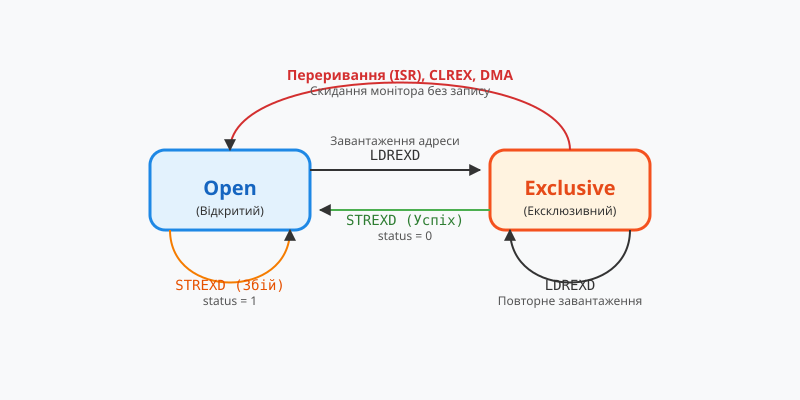

# Проблема ABA та класичні методи її розв'язання в неблокувальних структурах

<preknowlist>
- [Без замків](root:sf-tasks/lock-free-basics) — Базові поняття неблокувальних структур та гарантій прогресу.
- [Архітектура Load-Link/Store-Conditional](root:sf-tasks/ll-sc-architecture) — Альтернативні апаратні примітиви забезпечення атомарності.
- [Безблокові стек Трейбера та черга Майкла-Скотта](root:sf-tasks/treiber-stack-and-michael-scott-queue) — Практичні приклади використання тегованих вказівників та керування пам'яттю.
</preknowlist>

## Фізична природа та небезпека проблеми ABA

У багатопотокових середовищах потоки звертаються до спільних комірок пам'яті, виконуючи атомарні операції для модифікації вказівників. Розглянемо ситуацію, коли потік А читає значення `A` зі спільної адреси, маючи намір оновити його за допомогою операції порівняння з обміном, яка вказує очікуване значення `A` та нове значення `C`. Перш ніж потік А встигає виконати цю перевірку, його витісняє інший потік, повністю змінивши стан: спочатку значення стає `B`, а потім знову повертається до `А`. Коли потік А відновлює виконання, операція порівняння з обміном порівнює поточне значення з очікуваним `A`. Оскільки значення збігається, апаратний примітив вважає, що нічого не змінилося, і успішно замінює його на `C`, ігноруючи проміжну зміну стану та знищуючи цілісність структур даних. Ця аномалія отримала назву @@en|ABA problem@@ (проблема ABA), оскільки видимий стан комірки повертається до початкового, приховуючи руйнівні модифікації.

У динамічному розподілі пам'яті ця проблема загострюється через повторне використання адрес: поки потік спав, вузол міг бути видалений і виділений повторно для іншого об'єкта зі збереженням адреси, але з іншим вмістом, що призводить до збоїв. Альтернативні апаратні механізми на кшталт @@en|Load-Link/Store-Conditional@@ (завантаження за посиланням та умовне збереження) описані в матеріалі архітектура Load-Link/Store-Conditional (root:sf-tasks/ll-sc-architecture), а гарантії — у розділі базові поняття неблокувальних структур та гарантій прогресу (root:sf-tasks/lock-free-basics). Захист вимагає розширення атомарних примітивів або використання безпечних схем звільнення пам'яті: захисні вказівники у безблокових алгоритмах (root:sf-tasks/hazard-pointers-memory-reclamation) та епохальне звільнення пам'яті (root:sf-tasks/epoch-based-reclamation-concurrency).

*На схемі показано послідовність роботи апаратного ексклюзивного монітора на процесорах ARM під час виконання парних операцій Load-Link та Store-Conditional, з якої видно перехід станів резервування пам'яті.*

## Тегані вказівники та апаратний подвійний CAS

Щоб усунути небезпеку хибних спрацьовувань, коли значення вказівника повертається до початкового стану, застосовують метод версіонування посилань за допомогою тегів та інструкцій подвійної ширини. До вказівника додають лічильник версій, формуючи єдине складене значення, яке атомарно оновлюється за допомогою інструкції @@en|Double-Word CAS@@ (подвійний CAS, DWCAS). Це гарантує, що навіть якщо адресне значення повернеться до попереднього `A`, лічильник версій гарантовано зміниться, роблячи поточний стан унікальним для апаратного примітиву.

Операція атомарного порівняння перевіряє як адресне поле, так і лічильник модифікацій, унеможливлюючи успіх операції, якщо між читанням і записом відбулася хоча б одна проміжна модифікація. Детальніше про апаратні особливості платформи див. апаратні атомарні примітиви (root:sf-tasks/lock-free-atomic-primitives). Застосування тегованих вказівників дозволяє безпечно будувати такі структури, як безблоковий стек Трейбера та черга Майкла-Скотта (root:sf-tasks/treiber-stack-and-michael-scott-queue).

## Безпечне звільнення пам'яті в реальному часі

Навіть за умови використання тегованих вказівників, які запобігають проблемі @@en|ABA@@ на рівні посилань, залишається проблема безпечного звільнення пам'яті в середовищах із жорсткими обмеженнями реального часу @@en|RTOS@@. Коли один потік видаляє вузол зі спільної неблокувальної структури даних, він не може одразу повернути цю пам'ять системному розподільнику, оскільки інший потік або переривання все ще може утримувати застаріле посилання на цей же вузол. Передчасне видалення призводить до читання пошкоджених даних або аварійного завершення через звернення до звільнених сторінок.

Для розв'язання цієї проблеми використовуються спеціальні архітектурні патерни утилізації вузлів, які запобігають знищенню об'єктів до завершення всіх активних читань. Одним із таких підходів є @@en|hazard pointers@@ (захисні вказівники), де кожен потік перед зверненням до спільного вузла публікує свій локальний вказівник у загальнодоступному масиві ( root:sf-tasks/hazard-pointers-memory-reclamation ). Альтернативним підходом є @@en|epoch-based reclamation@@ (епохальне керування пам'яттю), за якого час виконання програми поділяється на дискретні часові інтервали, а звільнення вузлів відкладається доти, доки всі потоки не покинуть поточну епоху ( root:sf-tasks/epoch-based-reclamation-concurrency ). У випадках, коли динамічне виділення пам'яті повністю заборонене стандартами надійності, розробники застосовують стабільні статичні пули пам'яті ( root:sf-tasks/static-memory-pool-embedded ).