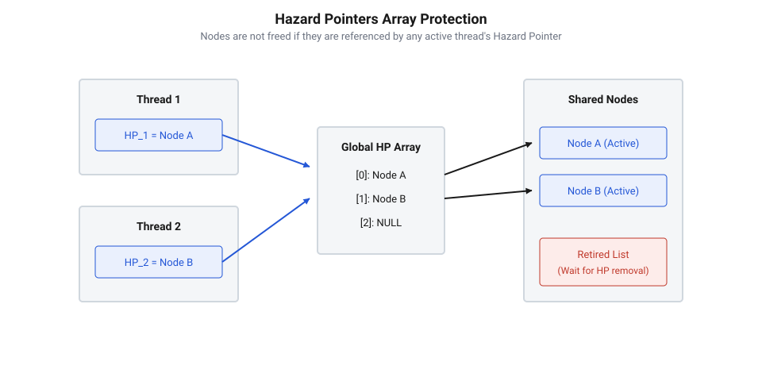
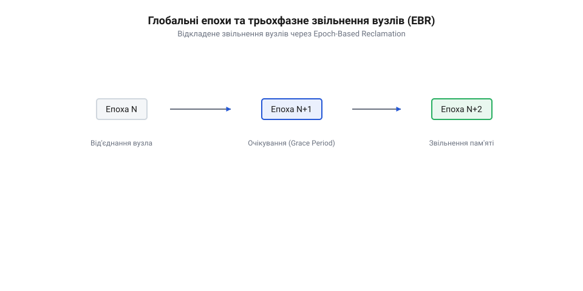

# Проблема ABA в неблокувальних структурах

<preknowlist>
- [Безблокувальне оновлення стану за допомогою інструкції CAS](root:sf-tasks/cas-lock-free) — механіку атомарної інструкції порівняння з обміном та побудову циклів CAS-loop
- [Без замків](root:sf-tasks/lock-free-basics) — загальні принципи та гарантії неблокувальних структур даних
</preknowlist>

## Невидима підміна вузлів у неблокувальному стеку

У паралельному програмуванні прагнення позбутися важких системних замків спонукає розробників будувати структури даних на основі атомарних інструкцій. Коли декілька потоків одночасно звертаються до спільного ресурсу, стандартний підхід полягає в тому, щоб зчитати поточний стан, підготувати нові дані у локальній пам'яті та атомарно замінити вказівник. Однак саме в цій простій на перший погляд схемі криється фундаментальна пастка.

Уявімо класичний [безблоковий стек Трейбера](root:sf-tasks/treiber-stack-and-michael-scott-queue), у якому елементи зв'язані в односпрямований список, а верхівка вказує на перший вузол. Коли потік намагається вилучити елемент за допомогою операції @@en|Pop@@ (від англ. *pop* — вискакувати), він має зчитати вказівник на верхівку, дізнатися адресу наступного вузла та атомарно переставити верхівку на цей наступний вузол. Щоб виконувати [безблокове оновлення стану](root:sf-tasks/cas-lock-free) безпечно, програма застосовує атомарну інструкцію @@en|Compare-And-Swap@@ (від англ. *compare* — порівнювати, *swap* — міняти місцями), або @@en|CAS@@.

Нижче наведено базову реалізацію операцій неблокувального стека, у якій криється прихована вразливість.

:::tabs
:::code root\eng\sf-tasks\aba-problem/aba-problem-d/cpp/lockfreestack.cpp cpp
::: EКВІВАЛЕНТ С :::
:::code root\eng\sf-tasks\aba-problem/aba-problem-d/c/node.c c
:::

Щоб побачити руйнування структури в дії, простежимо покроковий сценарій паралельного виконання операцій двома потоками.

Нехай початковий стан стека має вигляд: `Top -> [A] -> [B] -> [C] -> nullptr`.

1. **Перший потік починає операцію @@en|Pop@@**: Він зчитує `old_top = A` і далі зчитує `next_node = B` (оскільки `A->next` вказує на `B`). Тільки-но перший потік вирахував адресу `B`, операційна система призупиняє його виконання прямо перед інструкцією @@en|CAS@@. Перший потік запам'ятав у своїх локальних регістрах: «я очікую, що верхівка це `A`, і хочу замінити її на `B`». 2. **Другий потік виконує серію операцій**:
   - Другий потік викликає @@en|Pop@@ і успішно вилучає вузол `A`. Пам'ять за адресою `A` звільняється оператором `delete` або функцією `free`. - Другий потік повторно викликає @@en|Pop@@ і успішно вилучає вузол `B`. Пам'ять за адресою `B` також звільняється. - Другий потік викликає операцію @@en|Push@@ (від англ. *push* — штовхати), повертаючи вузол `A`. Стек тепер містить: `Top -> [D] -> [C] -> nullptr`. - Другий потік знову викликає @@en|Push@@ з новим вузлом `E`. Динамічний аллокатор пам'яті для підвищення продуктивності повторно використовує щойно звільнену адресу `A` для розміщення вузла `E`. Стек набуває вигляду: `Top -> [A (новий вузол E)] -> [D] -> [C] -> nullptr`. 3. **Перший потік відновлює роботу**: Він виконує затриману інструкцію @@en|CAS@@, порівнюючи поточне значення вказівника `Top` зі збереженим у локальній пам'яті `old_top`. Оскільки вказівник `Top` знову містить числову адресу `A`, інструкція @@en|CAS@@ вважає, що стан пам'яті не змінювався! Вона успішно перезаписує `Top` значенням `next_node`, яке перший потік зберіг ще на першому кроці — тобто адресою `B`.


*Схема показує, як невидима підміна верхівки стека призводить до втрати елементів зв'язаного списку.*

У результаті цього хибного успіху виникає катастрофічний збій:
- Вказівник `Top` тепер вказує на вузол `B`, який вже був вилучений і звільнений у пам'яті. Це створює @@en|dangling pointer@@ (від англ. *dangling* — що висить, *pointer* — вказівник). - Елементи `D` та `C`, які дійсно перебували у стеку, безповоротно губляться разом із втраченими посиланнями. - Будь-яка наступна спроба прочитати або вилучити елемент зі стека призведе до помилки @@en|use-after-free@@ (від англ. *use after free* — використання після звільнення) та падіння процесу.

Щоб відтворити цей сценарій гонки на практиці, перегляньте [проєкт демонстрації вразливості стека](root:sf-tasks/aba-problem/proj-treiber-stack-aba-demo.md) з прикладами коду.

Фундаментальна причина цієї катастрофи полягає в тому, що атомарна інструкція перевіряє виключно поточне числове значення адреси в комірці пам'яті.Вона засліплена до історії модифікацій: інструкція не знає, що між її прочитанням і обміном вузол `A` був вилучений, знищений, повернутий аллокатору і створений заново.

## Анатомія та природа проблеми ABA

Проблема @@en|ABA@@ (від англ. *ABA problem*) — це фундаментальна аномалія в синхронізації без замків, яка виникає при спробі перевірити цілісність стану через порівняння значень замість перевірки історії модифікацій.

Формально проблему можна визначити так: якщо потік $T_1$ зчитує зі спільної комірки пам'яті значення $A$, після чого потік $T_2$ змінює це значення з $A$ на $B$, а потім інший потік (або той самий $T_2$) повертає значення з $B$ назад на $A$, то потік $T_1$ під час виконання інструкції @@en|CAS@@ сприйме комірку як таку, що не зазнала жодних змін між читанням і записом.

Для виникнення аномалії @@en|ABA@@ необхідні три одночасні умови:
1. **Операція читання-модифікації-запису**: Алгоритм покладається на атомарну перевірку локальної копії стану з його актуальним значенням у пам'яті. 2. **Пауза або затримка між кроками**: Один із потоків призупиняється після зчитування стану, але до виконання інструкції @@en|CAS@@. 3. **Повторне використання ресурсів**: Аллокатор пам'яті або алгоритм перевикористовує те саме значення (адресу пам'яті чи ідентифікатор) для позначення нового об'єкта.

Походження проблеми @@en|ABA@@ сягає 1970-х років, коли компанія @@en|IBM@@ уперше представила апаратну інструкцію @@en|Compare-And-Swap@@ в архітектурі @@en|IBM System/370@@. Поява @@en|CAS@@ відкрила можливість будувати @@en|lock-free@@ структури даних без системних залоків, однак перші спроби практичного застосування одразу виявили фундаментальну вразливість порівняння за значенням. Це спонукало розробників шукати нові шляхи — від апаратного розширення атомарного слова у вигляді @@en|Double-Word CAS@@ (або @@en|DW-CAS@@) до програмних концепцій безпечного керування пам'яттю.

Часова діаграма нижче наочно ілюструє хибне сприйняття незмінності стану під час виконання операцій двома потоками.


*Діаграма демонструє, чому атомарна інструкція CAS не здатна виявити проміжні модифікації без додаткового лічильника версій.*

Головний ризик полягає у відсутності інформації про версію. Апаратні інструкції не зберігають метаданих про кількість змін комірки. Для процесора адреса `0x7fff5fbff710` після десяти перезаписів є абсолютно тотожною тій самій адресі до початку модифікацій.

Для розв'язання цієї проблеми в архітектурі безблокових систем було розроблено декілька основних підходів:

1. **Версіонування та теговані вказівники (`@@en|tagged pointer@@` або `@@en|stamped reference@@`)**:
   До адреси пам'яті додається атомарний лічильник модифікацій (тег). При кожній зміні значення лічильник інкрементується. Інструкція @@en|CAS@@ порівнює одночасно і адресу, і версію. Навіть якщо адреса вузла повторно стає `A`, значення версії змінюється (наприклад, з `A:v1` на `A:v2`), що змушує @@en|CAS@@ завершитися з помилкою. Низькорівневі сигнатури версіонованих контейнерів розкрито у [довіднику атомарних операцій](root:sf-tasks/aba-problem/api-atomic-cas-primitives.md), де показано роботу з подвійним атомарним словом.


*Схема ілюструє утворення унікального тегованого значення для запобігання хибному збігу при виконанні CAS.*

2. **Захисні вказівники (`@@en|Hazard Pointers@@`)**:
   Потік оголошує вказівник, із яким він працює, у спеціальному масиві захищених адрес. Пам'ять вузла не може бути фізично звільнена чи виділена повторно доти, доки хоча б один потік утримує на неї захисне посилання. Для детального розбору безпечного вилучення вузлів перегляньте матеріал про використання [захисних вказівників у безблокових](root:sf-tasks/hazard-pointers-memory-reclamation) алгоритмах та опануйте [проєкт відкладеного видалення](root:sf-tasks/aba-problem/proj-hazard-pointers-stack.md) пам'яті.

3. **Відкладене звільнення пам'яті на основі епох (`@@en|RCU@@` та `@@en|EBR@@`)**:
   Методи @@en|Read-Copy Update@@ (від англ. *read, copy, update* — читати, копіювати, оновлювати) та @@en|Epoch-Based Reclamation@@ (від англ. *epoch-based reclamation* — повернення пам'яті на основі епох) гарантують, що звільнення вузла відкладається до завершення періоду відстрочки, коли всі паралельні читачі гарантовано гарантують вихід з критичної секції. Фундаментальні принципи керування епохами викладено в огляді про [відкладене звільнення пам'яті](root:sf-tasks/epoch-based-reclamation-concurrency), а специфіку синхронізації читачів розкрито у статті про [період відстрочки RCU](root:sf-tasks/read-copy-update). Крім того, корисно порівняти ці підходи з тим, як виконується [узгоджене читання без блокування](root:sf-tasks/seqlock) у структурах Seqlock та як використовуються [неблокуючі лічильники LongAdder](root:sf-tasks/cas-and-longadder-counters) для атомарного обліку подій.

Таким чином, розпізнавання сценаріїв ABA є критично важливим навиком при розробці неблокувальних алгоритмів, оскільки звичайні атомарні операції гарантують лише атомарність окремого читання чи запису, але не цілісність логічного стану структури в часі.

## Версіонування вказівників та stamped references

Класична інструкція `@@en|Compare-And-Swap@@` (атомарне порівняння з обміном, від англ. *compare* — порівнювати, *swap* — обмінювати) виконує перевірку суто за порівнянням значень у комірці пам'яті. У разі роботи з вказівниками це означає перевірку збігу числових адрес. Якщо потік зчитує вказівник на вузол `A`, а потім його виконання призупиняється, інші потоки можуть вилучити `A`, звільнити його пам'ять, агоністично виділити новий вузол з тією ж адресою `A` та повернути його в структуру. Коли перший потік відновлює роботу, операція CAS бачить очікувану адресу `A` і повертає успіх. Проте внутрішні посилання вузла або загальний стан списку вже змінилися. Таке невидиме для CAS перевикористання адреси робить [атомарні операції CAS](root:sf-tasks/cas-lock-free) уразливими до руйнування вказівників.

Щоб CAS міг відрізнити початковий вузол від нового вузла з тією ж адресою, необхідно відстежувати не лише поточне значення адреси, а й історію її модифікацій. Для цього адресу вказівника об'єднують із монотонно зростаючим лічильником змін — так званим штампом або тегом (від англ. *stamp* — відтиск, мітка). Поєднана структура називається версіонованим вказівником (`@@en|stamped reference@@`, від англ. *stamp* — штамп, *reference* — посилання).

Кожна операція модифікації комірки пам'яті зобов'язана одночасно оновлювати вказівник та збільшувати на одиницю значення лічильника версії. У пам'яті версіоноване посилання представляється як упакована пара значень:

```
StampedPtr = (Pointer, Version)
```

Під час читання потік копіює всю пару `(Pointer, Version)`. Коли наступає етап атомарного запису, CAS перевіряє рівність обох компонентів. Якщо між зчитуванням і записом інший потік вилучив і повернув вузол `A`, версія комірки зросте:

```
Початковий стан пам'яті:   (A, 100)
Стан після дій потоку 2:  (A, 102)
Очікувана пара потоку 1:   (A, 100)
```

Під час виконання атомарного порівняння умова `(A, 100) == (A, 102)` повертає хибу. Операція CAS зазнає невдачі, запобігаючи використанню застарілих даних. Перший потік виявляє зміну версії та безпечно повторює цикл читання у [базових неблокувальних структурах](root:sf-tasks/lock-free-basics).

На апаратному рівні атомарне оновлення пари `(Pointer, Version)` реалізують двома основними архітектурними способами:

1. **Подвійна атомарна ширина (`@@en|double-width CAS@@` / `@@en|DW-CAS@@`)**: Процесор надає інструкцію для атомарної зміни двох суміжних слів пам'яті (наприклад, `@@en|cmpxchg16b@@` в архітектурі x86_64). Це дозволяє зберігати повноцінний 64-бітний вказівник поруч із 64-бітним лічильником версій. Розмір лічильника у 64 біти гарантує, що значення не переповниться за весь час роботи програми. 2. **Упаковка версії у вказівник (`@@en|tagged pointer@@`)**: В 64-бітних архітектурах віртуальна адресація насправді використовує лише молодші 48 біт. Старші 16 біт залишаються вільними. Крім того, вирівнювання вузлів у пам'яті (наприклад, на 8 або 16 байт) залишає 3 або 4 молодших біти завжди нульовими. Це дає змогу пакувати 16-бітний лічильник версії безпосередньо у старші або молодші біти одного 64-бітного слова `uintptr_t`. Атомарне оновлення виконується звичайною 64-бітною інструкцією CAS.

Практичне виконання системних викликів та контейнерів версіонування описано в [примітивах атомарного CAS](root:sf-tasks/aba-problem/api-atomic-cas-primitives.md). 

Нижче наведено приклад реалізації версіонованого вказівника та його використання для усунення ABA в безблоковому стеку:

:::tabs
@tab C++
:::code root\eng\sf-tasks\aba-problem/aba-problem-d/cpp/node.cpp cpp
@tab C
:::code root\eng\sf-tasks\aba-problem/aba-problem-d/c/node-2.c c
:::

Відтворення гонки потоків та практичний аналіз усунення уразливості наведено в навчальній [практичній демонстрації стека](root:sf-tasks/aba-problem/proj-treiber-stack-aba-demo.md).

Попри ефективність, версіонування має чітко окреслені межі застосування. Скорочений розмір лічильника в упакованих вказівниках (`@@en|tagged pointer@@`) теоретично може призвести до переповнення при тривалій паузі потоку. Однак головним обмеженням є те, що версіонування усуває лише логічну помилку CAS, але не захищає від помилок доступу до пам'яті `@@en|Use-After-Free@@` (від англ. *use* — використовувати, *after* — після, *free* — звільняти). Якщо потік 1 прочитав `current.ptr`, після чого потік 2 вилучив цей вузол і викликав `free(current.ptr)`, спроба потоку 1 прочитати `current.ptr->next` призведе до аварійного завершення програми (Segmentation Fault) іще до виклику інструкції CAS.

Для повного вирішення проблеми вилучення пам'яті версіонування поєднують із підходами захищеного володіння вказівниками.

## Захисні вказівники та безпечне вилучення пам'яті

Застосування версіонування вказівників запобігає пошкодженню стану неблокувальної структури даних під час виконання CAS. Проте воно не усуває небезпеку виклику недійсного розіменування вказівника (англ. *dereference*). Коли потік намагається зчитати поле `current.ptr->next`, немає жодної гарантії, що вузол `current.ptr` у цей момент ще не звільнений іншим паралельним потоком.

Для гарантування безпеки пам'яті необхідно дотримуватися фундаментального правила: **жоден вузол не може бути фізично знищений і звільнений у heap, доки бодай один потік у системі утримує активне посилання на нього для читання**.

Один із найбільш розповсюджених методів забезпечення цього правила — захисні вказівники (`@@en|Hazard Pointers@@`, від англ. *hazard* — небезпека, *pointer* — вказівник). Ідея алгоритму полягає в тому, що кожен потік-читач перед розіменуванням вузла «публікує» його адресу в глобально видному масиві захисних слотів.

Алгоритм читання з використанням захисних вказівників складається з трьох послідовних кроків:

1. **Зчитування та публікація**: Потік копіює адреси вказівника (наприклад, `head`) і записує її у свій персональний слот глобального масиву `Hazard Pointers`. 2. **Підтвердження узгодженості**: Потік виконує бар'єр пам'яті та повторно перевіряє, чи не змінився `head`. Якщо джерельний вказівник змінився, це означає, що вузол могли вилучити до того, як публікація захисту стала видимою іншим потокам. У такому разі потік очищає захисний слот і повторює спробу. 3. **Безпечне читання**: Якщо повторна перевірка підтверджує збіг адрес, вузол вважається захищеним. Жоден потік-видаляч не має права звільнити пам'ять цього вузла, поки слот залишається активним.

Під час вилучення вузла із неблокувального стека потік від'єднує його за допомогою CAS, але **не звільняє пам'ять одразу**. Замість цього вузол додається до локального списку відкладеного видалення потоку (англ. *retired list*).

Коли кількість відкладених вузлів у локальному списку досягає встановленого ліміту, потік виконує процедуру очищення: він сканує глобальний масив `Hazard Pointers` усіх інших потоків. Якщо адреса відкладеного вузла відсутня в масиві захисних вказівників, її пам'ять безпечно звільняється викликом `delete` або `free()`. Якщо ж адреса присутня у списку захищених, видалення вузла відкладається до наступного циклу очищення.


*Схема функціонування Hazard Pointers: потік-читач публікує адресу вузла в глобальному масиві, що блокує його фізичне вилучення потоком-видалячем до завершення читання.*

Як продемонстровано на схемі, потік-читач фіксує вказівник `N1` у глобальному масиві захисних слотів `HP`. Завдяки цьому, навіть коли потік-видаляч успішно від'єднує `N1` від голови стека, перевірка глобального масиву показує наявність активного захисту. Фізичне вилучення вузла `N1` відкладається до моменту, коли читач завершить роботу з даними й скине свій захисний слот.

Окрім захисних вказівників, у неблокувальному програмуванні застосовують інші архітектурні концепції безпечного вилучення пам'яті:

*   **Hazard Pointers**: Забезпечують точковий захист на рівні окремих вузлів. Гарантують сувору верхню межу накопичення незвільненої пам'яті. Проте вимагають виконання атомарних записів і бар'єрів пам'яті під час кожного читання. Детальніше див. у матеріалі про [захисні вказівники у безблокових алгоритмах](root:sf-tasks/hazard-pointers-memory-reclamation). *   **RCU (`@@en|Read-Copy-Update@@`)**: Оптимізовано для інтенсивного читання. Читачі не виконують жодних атомарних записів чи бар'єрів, досягаючи максимальної швидкодії. Видалення пам'яті відкладається до завершення періоду відстрочки (англ. *grace period*), протягом якого всі потоки проходять точку збереження контексту. Механізми RCU детально описані в описі [RCU та читання без замків](root:sf-tasks/read-copy-update). *   **EBR (`@@en|Epoch-Based Reclamation@@`)**: Використовує глобальні епохи (часові інтервали). Потоки фіксують поточну епоху під час входу в критичну секцію. Пам'ять вилучається групами після того, як усі потоки переходять у нову епоху. EBR демонструє нижчі накладні витрати на читання, ніж Hazard Pointers, проте затримка одного потоку блокує очищення всієї пам'яті епохи. Подробиці викладено у розділі про [відкладене звільнення пам'яті на основі епох](root:sf-tasks/epoch-based-reclamation-concurrency). *   За необхідності узгодженого читання без блокування записів у спеціалізованих структурах також застосовують [патерн Seqlock](root:sf-tasks/seqlock).

Приклад побудови системи відкладеного видалення на C++ із застосуванням Hazard Pointers:

:::tabs
@tab C++
:::code root\eng\sf-tasks\aba-problem/aba-problem-d/cpp/hazardpointer.cpp cpp
@tab C
:::code root\eng\sf-tasks\aba-problem/aba-problem-d/c/acquire-hp-slot.c c
:::

Повний приклад побудови безблокового стека з механізмом відкладеного вилучення міститься в матеріалі про [реалізацію захисних вказівників](root:sf-tasks/aba-problem/proj-hazard-pointers-stack.md), а порівняти його з класичними структурами можна в огляді [моделей стека Трейбера](root:sf-tasks/treiber-stack-and-michael-scott-queue).

Таким чином, комбінація версіонування вказівників та алгоритмів безпечного вилучення пам'яті повністю нівелює проблему ABA, забезпечуючи надійну й коректну роботу неблокувальних структур у багатопотоковому середовищі.

## Відкладене звільнення через RCU та EBR

Точковий захист окремих вузлів за допомогою механізму `@@en|Hazard Pointers@@` гарантує суворий контроль пам'яті, проте створює помітні накладні витрати на шляху читання. Під час кожного звернення потік повинен атомарно опублікувати адреси читаних об'єктів та примусово виконати міжпроцесорний бар'єр впорядкування пам'яті. У висококонкурентних системах це призводить до частої синхронізації кеш-ліній між ядрами (явище `@@en|cache line bouncing@@`). Виникає архітектурна потреба у підході, який дозволив би читачам взагалі не робити записів у спільну пам'ять, але при цьому гарантував би повний захист від повторного виділення адреси під час виконання атомарної операції `@@en|Compare-And-Swap@@`.

Альтернативою точковому відстеженню виступають алгоритми відкладеного групового звільнення пам'яті. Їхня фундаментальна ідея полягає в тому, щоб не повертати пам'ять вилученого з неблокувальної структури вузла системному оператору `delete` або `free` негайно. Замість цього видалений вузол переводиться у тимчасовий стан очікування. Фізичне руйнування об'єкта та повернення його адреси операційній системі відбувається лише тоді, коли гарантовано завершаться всі критичні секції потоків, які могли бачити цей вузол у структурі. Оскільки адреса вузла A не повертається у загальний пул пам'яті під час активних читань, вона не може бути знову виділена для нового вузла під час паралельної операції вставки. Це повністю ліквідує передумови для прояву вразливості `@@en|Use-After-Free@@` та унеможливлює проблему ABA під час викликів `@@en|Compare-And-Swap@@`.

Один із найбільш ефективних алгоритмів цього класу — `@@en|Epoch-Based Reclamation@@` (з англ. *epoch* — епоха, *reclaim* — повертати/звільнити), або EBR. В основі EBR лежить концепція глобального лічильника епох `global_epoch`, значення якого циклічно змінюється (найчастіше за модулем 3: 0, 1, 2). Крім глобального лічильника, кожен потік у системі підтримує власні локальні змінні: прапорець активності `active` та локальне значення епохи `local_epoch`.

Коли потік має намір виконати читання або обхід безблокової структури даних, він оголошує про вхід у критичну секцію: виставляє `active = true` та зчитує поточне значення `global_epoch` у свій `local_epoch`. З цього моменту потік вважається захищеним. Якщо під час його читання інший потік вилучає вузол зі структури (наприклад, через успішний виклик `@@en|Compare-And-Swap@@` у [безблоковими структурами даних](root:sf-tasks/lock-free-basics)), цей вузол не знищується, а додається у спеціальну чергу відстроченого видалення `@@en|limbo list@@` (з англ. *limbo* — стан невизначеності), прив'язану до поточної глобальної епохи `e`.

Просування глобальної епохи з `e` до `(e + 1) mod 3` відбувається тоді, коли в чергах відстрочки накопичується достатня кількість вилучених об'єктів. Проте глобальний лічильник не може просунутися довільно: алгоритм перевіряє стан усіх потоків. Епоха збільшується лише після того, як кожен активний потік підтвердить, що його `local_epoch` наздогнала поточну глобальну епоху `e`.


*Три фази роботи алгоритму EBR: глобальна епоха просувається лише після того, як усі активні потоки завершать свої критичні секції в старій епосі.*

Використання трьох фаз епох (поточна епоха `e`, попередня `e-1` та застаріла `e-2`) забезпечує математичну гарантію безпеки. Потік, який увійшов у критичну секцію за глобальної епохи `e`, міг отримати вказівники лише на вузли, що існували в структурі на момент його входу або були вилучені в епосі `e` чи `e-1`. Він фундаментально не може мати посилань на вузли, які були додані до `@@en|limbo list@@` в епосі `e-2` або раніше. Отже, у момент просування глобальної епохи до значення `e`, усі вузли з накопичувального списку епохи `e-2` можна безпечно масово звільнити через фізичний виклик `delete`.

Паралельно з EBR у системному програмуванні застосовується підхід `@@en|Read-Copy-Update@@` (з англ. *read* — читати, *copy* — копіювати, *update* — оновлювати), або RCU. В алгоритмах RCU читачі взагалі не роблять важких атомарних операцій чи міжпроцесорних бар'єрів. Вони лише позначають межі критичної секції (наприклад, через виклики `rcu_read_lock()` та `rcu_read_unlock()`). Потік-модифікатор створює копію даних, атомарно підміняє вказівник у головній структурі, після чого очікує завершення так званого періоду відстрочки — `@@en|grace period@@` (з англ. *grace* — відстрочка). Під час `@@en|grace period@@` очікується, що кожен потік у системі бодай один раз пройде через `@@en|quiescent state@@` (з латинської *quiescere* — перебувати в стані спокою) — стан спокою, поза критичною секцією читання. Після цього старий вузол безпечно видаляється. Більш детально цей механізм розглянуто у матеріалі про [період відстрочки та читання без блокування](root:sf-tasks/read-copy-update), а також у довіднику про [відкладене звільнення пам'яті](root:sf-tasks/epoch-based-reclamation-concurrency).

Порівнюючи EBR та RCU з механізмом `@@en|Hazard Pointers@@`, слід відзначити принциповий компроміс між продуктивністю читання та споживанням пам'яті. У підходах EBR та RCU читання здійснюється з найвищою можливою швидкістю, адже читачі не модифікують загальні кеш-лінії. Проте, якщо один із потоків оновлення застрягне у критичній секції (наприклад, призупиниться через витіснення операційною системою або обробку важкого переривання), просування епох зупиняється. Вузли у черзі `@@en|limbo list@@` продовжуватимуть накопичуватися, що створює ризик тимчасового роздування пам'яті.

Нижче наведено приклад реалізації менеджера епох та відкладеного звільнення вузлів мовами C++ та C:

:::tabs
:::code root\eng\sf-tasks\aba-problem/aba-problem-d/cpp/node-2.cpp cpp
:::code root\eng\sf-tasks\aba-problem/aba-problem-d/c/node-3.c c
:::

Завдяки груповому відстроченню повернення пам'яті у системний пул, операція `@@en|Compare-And-Swap@@` повністю захищена від ситуацій, коли адреса A раптово виділяється повторно під час активного виконання атомарного циклу. Практичну реалізацію даного підходу можна порівняти з точковим захистом у [проєкті із захисними вказівниками](root:sf-tasks/aba-problem/proj-hazard-pointers-stack.md), де детально показано відмінності в керуванні пам'яттю.

## Межі застосування CAS та діагностика вразливостей

Проблема ABA у неблокувальних структурах даних демонструє фундаментальне обмеження примітива `@@en|Compare-And-Swap@@`: інструкція CAS порівнює атомарну комірку пам'яті за її поточним значенням, а не за історією її модифікацій. Для побудови надійного програмного забезпечення розробник повинен чітко розуміти межі застосовності кожного із методів нівелювання ABA та володіти інструментарієм для діагностики прихованих гонок.

Вибір архітектурного рішення базується на порівняльному аналізі продуктивності, мовних гарантій та апаратних обмежень.

Перший метод — версіонування вказівників, або `@@en|tagged pointer@@` (штамповані посилання). Він базується на упаковці лічильника модифікацій у саму атомарну адресу або використанні атомарних інструкцій подвійної ширини (`@@en|Double-Width Compare-And-Swap@@`, DW-CAS). Головна перевага цього підходу — нульове затримання пам'яті та відсутність додаткових списків відкладеного знищення. Проте версіонування має суворі обмеження:
1. **Апаратні вимоги:** Потрібна підтримка 128-бітних атомарних інструкцій (наприклад, `CMPXCHG16B` на архітектурі x86-64 або `CASP` на ARM64). Детальніше низькорівневі інструкції розібрано у [довіднику атомарних операцій CAS](root:sf-tasks/aba-problem/api-atomic-cas-primitives.md). 2. **Ризик переповнення лічильника:** Якщо розмір розрядів під штамп обмежений (наприклад, при пакуванні 16 біт тегу в 64-бітну адресу), у надшвидких циклах Push/Pop лічильник може зробити повне коло й повернутися до початкового значення, знову спричинивши ABA. 3. **Відсутність захисту від `@@en|Use-After-Free@@`:** Це головна пастка версіонування. Версіонований CAS упереджує хибну підміну адреси під час самого обміну, але **не захищає читача від збою пам'яті**, якщо читач розіменовує вказівник `old_top->next` у момент, коли вузол `old_top` вже був вилучений та звільнений іншим потоком.

Другий метод — `@@en|Hazard Pointers@@`. Він гарантує суворий та детермінований верхній бар'єр для кількості затриманих вузлів у пам'яті (не більше `O(H * N)` об'єктів). Це робить його ідеальним для систем реального часу та середовищ без автоматичного збирання сміття. Проте накладні витрати на атомарний запис у слоти захисту та синхронізацію бар'єрів пам'яті під час кожного читання знижують загальну пропускну здатність.

Третій метод — системні алгоритми відкладеного звільнення EBR та RCU. Вони забезпечують максимальну швидкість читання завдяки відсутності модифікації загальних кеш-ліній читачами. Основний ризик полягає у можливому роздуванні споживання пам'яті при затримках окремих потоків.

Четвертий варіант — керування пам'яттю у мовах із автоматичним збиранням сміття (`@@en|garbage collection@@`, GC), таких як Java, Go або C#. У цих середовищах збирач сміття гарантує, що пам'ять під об'єктом не буде вивільнена та перевиділена за тією ж адресою, поки на об'єкт існує хоча б одна активна посилання. На рівні адрес пам'яті проблема ABA в середовищах GC фундаментально відсутня. Проте розробники часто потрапляють у приховану пастку: якщо для оптимізації продуктивності застосовується власний пул об'єктів (object pool) або індексація у масиві, адреси або індекси елементів починають перевикористовуватися повторно. У цьому разі проблема ABA повертається на **логічному рівні**, руйнуючи цілісність безблокової структури даних.

Діагностика та аудит коду на наявність вразливості ABA вимагають виявлення характерного шаблону гонки. Розглянемо класичний приклад небезпечного CAS-циклу у [покроковому демонстраційному стеку Трейбера](root:sf-tasks/aba-problem/proj-treiber-stack-aba-demo.md):

:::code root\eng\sf-tasks\aba-problem/aba-problem-d/cpp/snippet-9.cpp cpp

У наведеному коді критична точка гонки знаходиться між рядком зчитування `old_top->next` та виконанням атомарної інструкції `compare_exchange_weak`. Якщо потік переривається після зчитування `next_node`, а інші потоки встигають вилучити `old_top`, звільнити його, створити новий вузол за тією ж адресою A і помістити його назад у стек, CAS успішно спрацює. Але значення `next_node` міститиме застарілий або згодом пошкоджений вказівник.

Виявлення подібних помилок під час звичайного юніт-тестування є вкрай складним, оскільки часове вікно гонки становить лічені наносекунди. Для діагностики застосовуються три основні практики:

1. **Інструментальні санітайзери:** Використання `@@en|ThreadSanitizer@@` (TSan) або Valgrind (Helgrind/DRD). TSan фіксує несинхронізовані записи та читання в пам'яті (data races). Хоча санітайзер не завжди виявляє логічну підміну значення в ABA, він надійно фіксує супутнє розіменування звільненої пам'яті (`@@en|Use-After-Free@@`). 2. **Фазинг та ін'єкція затримок (`@@en|fault injection@@`):** Навмисне вставлення викликів `std::this_thread::yield()` або випадкових пауз між читанням стану та викликом CAS у тестових збірках. Це розширює часове вікно гонки з наносекунд до мілісекунд, що змушує вразливість ABA стабільно проявлятися під час навантажувальних юніт-тестів. 3. **Формальна верифікація та модель-чекери:** Застосування спеціалізованих інструментів перевірки моделей, таких як `@@en|Relacy Race Detector@@` або фреймворків для системного аналізу переплетень потоків. Про це детальніше розказано в матеріалі про [інструменті перевірки моделей](root:sf-tasks/model-checking-lock-free), де подано принципи повного перебору порядків виконання атомарних операцій.

Упевненість у безпеці безблокового алгоритму досягається лише тоді, коли вибір механізму пам'яті підкріплений розумінням гарантій мовної платформи, а відсутність умов гонки підтверджена інструментальним аналізом.