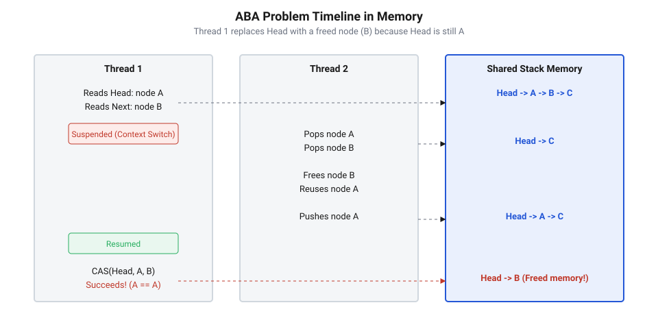

## Початкові концепції та фізичні принципи

У високопродуктивних мікропрограмах вбудованих систем обробка потоків даних високої частоти вимагає детермінованих часових затримок і відсутності взаємного блокування потоків. Коли периферійний модуль передає пакети через канальне оброблення @@en|DMA@@ (від англ. @@en|Direct Memory Access@@, прямий доступ до пам'яті), операційна система реального часу @@en|RTOS@@ (від англ. @@en|Real-Time Operating System@@, операційна система реального часу) мусить перенаправляти ці буфери між обробниками апаратних переривань @@en|ISR@@ (від англ. @@en|Interrupt Service Routine@@, служба обробки переривання) та фоновими задачами. Застосування класичних м'ютексів чи критичних секцій із забороною переривань у таких умовах призводить до інверсії пріоритетів і зростання затримок обробки подій. Щоб усунути ці затримки, системні розробники застосовують [безблокові алгоритми](root:sf-tasks/lock-free-basics), у яких синхронізація здійснюється безпосередньо на системній шині процесорного ядра.

Фундаментом таких неблокувальних структур є [атомарні інструкції мікроконтролера](root:sf-tasks/lock-free-atomic-primitives), які гарантують неодільну зміну вказівника на вершину структури даних без зупинки виконання інших ядер чи системних потоків. Найпоширенішою апаратною примітивою синхронізації є @@en|інструкція CAS@@ (від англ. @@en|Compare-And-Swap@@, зіставити та обміняти). Вона порівнює поточне значення у комірці пам'яті з очікуваним зразком і здійснює запис нового значення лише тоді, коли зіставлення успішне. Проте на фізичному рівні системної пам'яті вбудованого пристрою виникає суворе обмеження: динамічне виділення пам'яті через стандартну кучу в системних прошивках заборонене або обмежене через загрозу непередбачуваної фрагментації та недетермінований час виконання функцій виділення. Замість цього розробники реалізують повторне використання вузлів через заздалегідь розплановані масиви [статичних пулів пам'яті](root:sf-tasks/static-memory-pool-embedded).

Повторна утилізація адрес у фіксованому пулі пам'яті провокує класичну [проблему підміни вказівника](root:sf-tasks/aba-problem-basics), відому як @@en|проблема ABA@@ (від англ. @@en|ABA problem@@, від послідовності станів комірки пам'яті A, B та знову A). Фізично вона виникає через асинхронну зміну стану пам'яті під час переривань або контекстних перемикань системних задач. Розглянемо послідовність процесів у паралельних контекстах виконання мікроконтролера:

1. Перший контекст (фонова задача @@en|RTOS@@) зчитує з пам'яті вказівник на вершину стека `Top`, який вказує на вузол `A`. Вузол `A` містить посилання на наступний елемент `B`. Задача готується оновити вершину на `B`.
2. У цей момент контролер переривань @@en|NVIC@@ (від англ. @@en|Nested Vectored Interrupt Controller@@) генерує високопріоритетне апаратне переривання. Фонова задача миттєво витісняється.
3. Обробник переривання @@en|ISR@@ вилучає вузол `A` зі стека, а потім вилучає вузол `B`.
4. Звільнений вузол `A` повертається у статичний пул пам'яті й одразу повторно використовується при додаванні нового елемента. Обробник @@en|ISR@@ записує нові дані за тією ж фізичною адресою `A` і робить його знову вершиною стека. Проте поле `next` вузла `A` тепер вказує не на `B`, а на новий вузол `C`.
5. Переривання завершується, й фонова задача повертається до виконання. Вона запускає @@en|інструкцію CAS@@, використовуючи [інструкцію порівняння з обміном](root:sf-tasks/cas-lock-free) для оновлення значення вершини.

Оскільки адреса `Top` у пам'яті знову дорівнює `A`, процесорний модуль порівняння вважає, що стан стека не змінився від моменту початкового зчитування. Атомарна операція успішно записує адреси та встановлює нову вершину `B`. Проте вузол `B` вже був вилучений та вивільнений обробником переривань, тому структура даних руйнується: вказівник вершини починає вказувати на некоректний або переписаний блок пам'яті, викликаючи збій апаратного обробника пам'яті.


*Хронологія виникнення десинхронізації адрес у системній шині при асинхронній зміні вмісту статичного пулу.*

Фізична природа цієї помилки полягає в тому, що процесорний блок порівняння перевіряє лише рівність бітових значень адрес, але не володіє інформацією про історію модифікацій цієї комірки пам'яті між операціями. Апаратна системна шина гарантує атомарність поодинокого читання й запису, але не відстежує проміжні транзакції. Це вимагає впровадження спеціалізованих програмно-апаратних захисних механізмів, які забезпечують узгодженість даних з [моделями впорядкування пам'яті](root:sf-tasks/memory-barriers-and-atomic-sequencing) шин мікроконтролера.

## Внутрішня будова та алгоритми роботи

Внутрішню алгоритмічну основу [стека Трейбера](root:sf-tasks/treiber-stack-and-michael-scott-queue) (від англ. @@en|Treiber stack@@, названий на честь Ренті Трейбера) складають два ключові атомарні цикли: заштовхування (`Push`) та вилучення (`Pop`). У безблокувальному середовищі системної прошивки кожен з цих циклів працює без захоплення замків, повторюючи спробу оновлення доти, доки атомарний стан комірки пам'яті не підтвердить відсутність асинхронного втручання з боку паралельних обробників переривань.

Для запобігання фатальному руйнуванню структури при виникненні @@en|проблема ABA@@ застосовується концепція тегованих вказівників (англ. @@en|Tagged Pointer@@, позначений вказівник). Метод полягає у розширенні атомарного слова: замість збереження чистої 32-бітної адреси пам'яті, структура опису вершини об'єднує адресу вузла та монотонний лічильник модифікацій (тег версії) у єдину 64-бітну атомарну сутність.

[обчислення 64-бітного атомарного слова]
TaggedPointer.pointer = 32-бітний вказівник на вузол A
TaggedPointer.tag     = 32-бітний лічильник модифікацій
= Повний 64-бітний стан вершини стека  [об'єднання для атомарного CAS2]

Кожного разу, коли будь-який контекст виконує додавання або вилучення елемента зі стека, лічильник `tag` інкрементується. Навіть якщо фізичний вузол `A` повертається на вершину стека після повторного виділення зі статичного пулу, його новий стан міститиме `tag + 1` або `tag + 2`. Коли фонова задача відновить виконання й спробує застосувати подвійну інструкцію порівняння з обміном (@@en|CAS2@@ або `CMPXCHG8B`), порівняння 64-бітного слова завершиться невдачею, бо лічильники модифікацій не співпадуть:

[перевірка атомарного стану]
Очікуване значення : { Address = A, Tag = 10 }
Поточний стан шини : { Address = A, Tag = 12 }
Результат CAS2     : Невдача [операція скасовується, цикл повторює зчитування]

У мікроконтролерах з [архітектурами LL/SC](root:sf-tasks/ll-sc-architecture) (від англ. @@en|Load-Link/Store-Conditional@@, завантажити зв'язано, зберегти умовно), таких як ядра @@en|Cortex-M@@ (ARMv7-M, ARMv8-M), виявлення підміни реалізовано безпосередньо на рівні апаратного монітора системної шини. Команда `LDREX` завантажує адресу вершини й активує локальний монітор ексклюзивного доступу для даного ядра та адреси. Якщо під час контекстного перемикання обробник @@en|ISR@@ виконує запис за цією адресою, апаратний монітор скидає прапорець ексклюзивності. Наступна інструкція `STREX`, реалізована через [парні атомарні інструкції](root:sf-tasks/load-link-store-conditional-primitives), фіксує втрату ексклюзивності та повертає помилку запису, навіть якщо записана адреса повністю збігається з початковою адресою `A`.

Для складніших архітектур прошивок, де подвійна інструкція CAS недоступна, а апаратний монітор має обмеження розміру блока, розробники використовують [захисні вказівники Hazard Pointers](root:sf-tasks/hazard-pointers-memory-reclamation) (англ. @@en|Hazard Pointers@@, небезпечні вказівники). У цьому випадку кожен потік перед зчитуванням поля `next` публікує адресу вузла `A` у глобальному реєстрі небезпечних вказівників. Обробник переривань або паралельний потік перевіряє цей реєстр і не має права повертати вузол `A` у статичний пул пам'яті доти, доки читці не знімуть свої захисні маркери.

Нижче наведено практичну реалізацію алгоритму обробки для вбудованих систем на мовах C та C++.

:::tabs
```c
:::code root/eng/sf-tasks/aba-problem/proj-treiber-stack-aba-demo/c/main.c c
```
```cpp
:::code root/eng/sf-tasks/aba-problem/proj-treiber-stack-aba-demo/cpp/main.cpp cpp
```
:::

Коректність функціонування даної системи та відсутність гонитви даних у системній прошивці верифікується через [перевірку моделей неблокувальних структур](root:sf-tasks/model-checking-lock-free), що гарантує детерміновану надійність пристрою у будь-яких комбінаціях переривань та контекстних перемикань.

## Апаратна реалізація та низькорівневий C/C++ код

Низькорівнева реалізація безблокувальних структур у мікропрограмах вимагає суворого узгодження програмного коду з внутрішньою архітектурою процесорного ядра та системної шини. На відміну від прикладного програмування на ПК, де операційна система приховує деталі кєш-пам'яті та конвеєра, у мікроконтролерах @@en|ARM Cortex-M@@ або @@en|RISC-V@@ будь-яка невизначеність у порядку виконання інструкцій може зруйнувати атомарність операції.

Головною апаратною вимогою при роботі з тегованими вказівниками є суворе вирівнювання даних у пам'яті (англ. @@en|memory alignment@@, від розміщення об'єктів за кратною адресою). Для виконання 64-бітної атомарної інструкції читання та запису процесорний модуль системної шини @@en|AHB@@ (від англ. @@en|Advanced High-performance Bus@@, високопродуктивна системна шина) вимагає, щоб 64-бітна структура тегованого вказівника була розташована за адресою, кратною 8 байтам. Якщо структура опису вершини перетинає межу двох слів або межу лінійки кєш-пам'яті, спроба атомарного доступу спричиняє апаратний збій @@en|HardFault@@ або розбиває транзакцію на два послідовні 32-бітні шинні цикли, що повністю нівелює атомарність і призводить до збою.

У багатоядерних системах або пристроях із прямою адресацією кєш-пам'яті додатково виникає ефект помилкового спільного використання (англ. @@en|false sharing@@, коли незалежні змінні потрапляють у одну лінійку кєшу). Якщо вершина стека знаходиться в одній лінійці кєшу з масивом даних або іншими часто оновлюваними змінними, шинний контролер постійно скидає кєш-лінію (@@en|cache line@@), провокуючи численні повторні цикли інструкцій.

Для запобігання перевпорядкуванню компілятором та процесорним конвеєром апаратних транзакцій шини розробники застосовують [бар'єри впорядкування пам'яті](root:sf-tasks/memory-barriers-and-atomic-sequencing). Інструкція @@en|DMB@@ (від англ. @@en|Data Memory Barrier@@, бар'єр даних пам'яті) гарантує, що всі попередні транзакції запису в пам'ять завершаться до того, як почнеться виконання наступної інструкції доступу. Команда @@en|DSB@@ (від англ. @@en|Data Synchronization Barrier@@, бар'єр синхронізації даних) зупиняє виконання конвеєра до повного завершення всіх шинних операцій, що необхідно при взаємодії з периферийними модулями канального оброблення @@en|DMA@@.


*Структура вирівнювання тегованого слова у пам'яті мікроконтролера та поведінка шини при атомарному доступі.*

У мові @@en|C11@@ та стандартах @@en|C++11@@ для забезпечення правильності розміщення застосовуються специфікатори вирівнювання `alignas(8)` та атомарні типи з відповідною семантикою впорядкування пам'яті `memory_order_acquire` та `memory_order_release`. У шаблонах C++ обгортка оперує семантикою @@en|RAII@@ (від англ. @@en|Resource Acquisition Is Initialization@@, отримання ресурсу є ініціалізацією), гарантуючи нульові накладні витрати під час компіляції. При цьому у циклі повтору краще використовувати спробу атомарного обміну `std::atomic_compare_exchange_weak`, оскільки на архітектурах з парними інструкціями вона компілюється в поодиноку команду перевірки без додаткових внутрішніх циклів.

Практична реалізація алгоритму вбудованого безблокувального стека з захистом від підміни вказівників представлена нижче мовами C та C++. Обидві реалізації використовують [пакет безблокувальних примітивів](root:sf-tasks/lock-free-atomic-primitives), адаптованих під низькорівневе середовище прошивки.

:::tabs
```c
:::code root/eng/sf-tasks/aba-problem/proj-treiber-stack-aba-demo/c/main.c c
```
```cpp
:::code root/eng/sf-tasks/aba-problem/proj-treiber-stack-aba-demo/cpp/main.cpp cpp
```
:::

Для оптимізації затримок у високонавантажених обробниках апаратних переривань @@en|ISR@@ критичним є вибір стратегії повторних спроб (англ. @@en|backoff strategy@@, стратегія затримки повтору). Якщо атомарне оновлення не вдалося через переривання, прямий повтор циклу без затримки створює високе навантаження на системну шину. Впровадження короткої паузи через інструкцію `__NOP()` або затримку процесора зменшує шинний арбітраж та стабілізує загальний час обробки системних задач у операційній системі реального часу @@en|RTOS@@.

Обчислення часових витрат одного циклу атомарної модифікації з урахуванням повторних спроб виконується за формулою:

TotalCycles = T_read + N_retry × (T_cas + T_backoff) + T_barrier
= 4 + 2 × (12 + 8) + 3                                 [підстановка виміряних тактів шини]
= 47 тактів                                             [підсумкова затримка атомарного оновлення]

Розрахунок показує, що оптимізована пауза `T_backoff` зменшує частоту колізій на системній шині, забезпечуючи детермінований час виконання навіть під час сплесків апаратних подій.

## Практичне застосування та відлагодження

Налагодження неблокувальних алгоритмів у прошивках мікроконтролерів є складним завданням, оскільки класичні покрокові відлагоджувачі (англ. @@en|debugger@@, засіб налагодження) змінюють часову динаміку виконання потоків і приховують гонитву даних. У системах реального часу граневі випадки виникають лише при специфічному збігу апаратних переривань та контекстних перемикань.

Однією з головних прихованих пасток при тривалій експлуатації пристрою є переповнення лічильника версій (англ. @@en|tag overflow@@, вихід значення тегу за межі розрядності). Якщо тег модифікації реалізовано 16-бітним цілим числом, він переповнюється через 65 536 операцій. Якщо фонова задача буде витіснена апаратним перериванням на час, за який обробники виконають рівно 65 536 маніпуляцій з тим самим вузлом, значення тегу повернеться до початкового `Tag`. У результаті інструкція порівняння з обміном знову пропустить підмінений вузол. Щоб повністю виключити ризик такого збігу, у прошивках застосовують щонайменше 32-бітні або 64-бітні лічильники модифікацій.

Додатковим фактором ризику у статичних пулах пам'яті є вичерпання вільних вузлів під час інтенсивних сплесків переривань. Для безпечної утилізації вузлів без повернення їх у загальну кучу розробники комбінують теговані вказівники з алгоритмами [безпечного вилучення пам'яті](root:sf-tasks/epoch-based-reclamation-concurrency), що унеможливлює повторне використання блоку до завершення всіх активних читань у паралельних задачах.

Іншою небезпечною ситуацією в системах з [гарантіями відсутності блокувань](root:sf-tasks/wait-free-and-lock-free-classification) є стан зависання в активному циклі (англ. @@en|livelock@@, ситуація, коли потоки постійно виконують роботу, але не роблять загального поступу). Це трапляється, коли високопріоритетне апаратне переривання додає елементи з частотою, вищою за швидкість обробки фонової задачі. Фонова задача постійно отримує відмову атомарної інструкції та залишається в нескінченному циклі повтору.

Для точного діагностування таких затримок без внесення часових викривлений системні розробники використовують апаратний блок профілювання @@en|DWT@@ (від англ. @@en|Data Watchpoint and Trace@@, модуль відстеження даних і трасування). Лічильник тактів `DWT->CYCCNT` дозволяє вимірювати точну кількість циклів шини, витрачених на кожну спробу атомарної модифікації, за допомогою [апаратних лічильників DWT](root:sf-tasks/dwt-cycle-counter-embedded).


*Часова діаграма виконання атомарного циклу та фіксації колізій через апаратний блок профілювання.*

Для реєстрації подій підміни адрес у реальному часі без зупинки ядра застосовують неінвазивне трасування через порт @@en|ITM@@ (від англ. @@en|Instrumentation Trace Macrocell@@, модуль інструментального трасування) та вихідну лінію @@en|SWO@@ (від англ. @@en|Single Wire Output@@, однопровідний вихід трасування). Обробник прошивки фіксує кількість повторних спроб атомарного циклу і передає їх у зовнішній аналізатор:

```c
uint32_t start_cycles = DWT->CYCCNT;
bool success = treiber_stack_push(&my_stack, new_node);
uint32_t elapsed = DWT->CYCCNT - start_cycles;

if (elapsed > MAX_ALLOWED_LATENCY_CYCLES) {
    ITM_SendChar(EVENT_LOCKFREE_COLLISION);
}
```

Фінальним етапом перевірки надійності прошивки є верифікація за допомогою [автоматизованої перевірки моделей](root:sf-tasks/model-checking-lock-free). Симуляційні інструменти моделюють усі можливі точки витіснення інструкцій апаратними перериваннями, підтверджуючи, що захисні теги та вказівники повністю усувають ризик підміни даних і зберігають цілісність статичного пулу пам'яті за будь-яких умов експлуатації.
