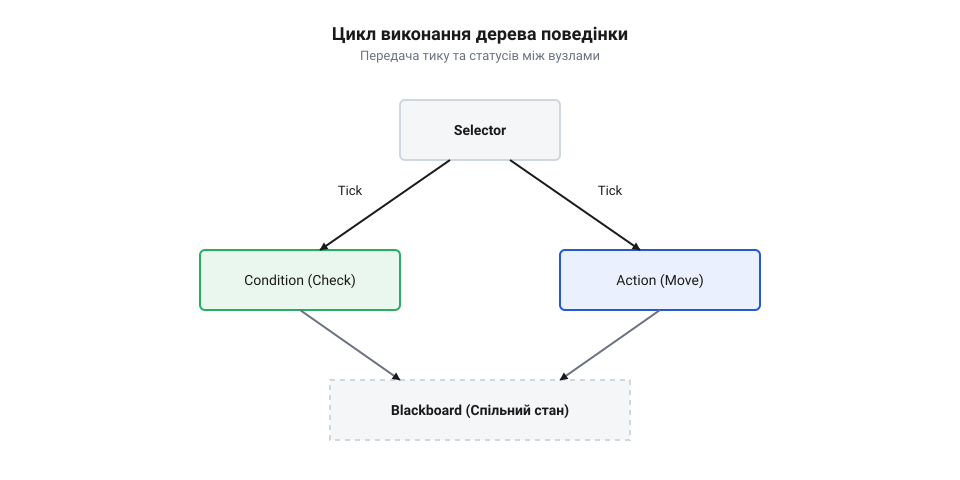
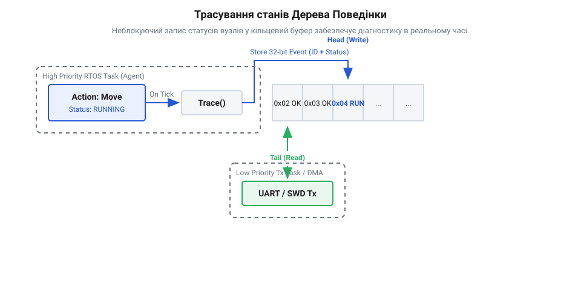

## Початкові концепції та фізичні принципи

У розробці автономних вбудованих агентів — таких як мобільні роботи, безпілотні літальні апарати, системи промислової автоматизації та інтелектуальні контролери керування живленням — ключовою задачею є побудова детермінованої системи прийняття рішень. На відміну від багатопотокових програм для настільних операційних систем, де планувальник використовує евристичні алгоритми квантування часу, керування автономним агентом спирається на жорсткий часовий детермінізм, для чого розробники зіставляють [потоки настільної ОС проти задач RTOS](root:sf-tasks/potoky-nastilnoi-os-proty-zadach-rtos). Традиційні підходи до проектування логіки прийняття рішень тривалий час спиралися на скінченні автомати — @@en|FSM@@ (з англ. *Finite State Machine* — скінченний автомат). Проте у складних автономних системах керування класичні автомати швидко втрачають масштабованість.

Головний фізичний та архітектурний недолік @@en|FSM@@ полягає в щільній зв'язаності станів та переходів. Якщо система має `N` станів, кількість потенційно можливих дуг переходів між ними зростає за квадратичною залежністю `N × (N - 1)`. Додавання нового стану вимагає перегляду та модифікації умов переходу у багатьох існуючих станах, що призводить до виникнення складного та схильного до помилок коду (так званого @@en|spaghetti code@@). Спроба вирішити цю проблему за допомогою ієрархічних автоматів — @@en|HFSM@@ (з англ. *Hierarchical Finite State Machine* — ієрархічний скінченний автомат) — частково ізолює стани у підсистеми, але не усуває явні переходи між гілками, руйнуючи модульність та роблячи повторне використання окремих блоків поведінки практично неможливим.

Альтернативним розв'язком, що кардинально змінює парадигму керування автономними агентами, є Дерева Поведінки — @@en|Behavior Tree@@ (з англ. *behavior* — поведінка, *tree* — дерево), або @@en|BT@@. Головна відмінність @@en|Behavior Tree@@ від скінченного автомата полягає в повному розділенні логіки переходу та логіки стану. У Дереві Поведінки немає прямих зв'язків чи переходів між окремими вузлами. Замість цього потік керування задається ієрархічною древовидною структурою, яка періодично або за подією обходиться згори вниз, від кореневого вузла (`@@en|Root Node@@`) до листя.

Фундаментальним механізмом функціонування @@en|Behavior Tree@@ у реальному часі є обхід дерева за допомогою сигналу тику — @@en|Tick@@ (з англ. *tick* — цокання/такт). Сигнал @@en|Tick@@ є дискретним імпульсом керування, який відправляється кореневому вузлу з заданою частотою або при настанні системної події. Кожен вузол дерева, отримавши @@en|Tick@@, виконує свою локальну обчислювальну логіку та негайно повертає своєму батьківському вузлу один із трьох дискретних статусів виконання (@@en|Status Code@@):
1. `@@en|SUCCESS@@` — вузол успішно виконав своє завдання або підтвердив виконання умови.
2. `@@en|FAILURE@@` — вузол не зміг виконати завдання або вказана умова є хибною.
3. `@@en|RUNNING@@` — вузол розпочав виконання асинхронної операції, яка ще триває у часі й потребує додаткових тактів процесора.

Апаратна та програмна реалізація сигналу @@en|Tick@@ у прошивках мікроконтролерів тісно пов'язана з часовою моделлю операційної системи реального часу @@en|RTOS@@ (з англ. *Real-Time Operating System* — операційна система реального часу). У системі реального часу виконання обходу Дерева Поведінки зазвичай виділяється в окрему задачу @@en|RTOS Task@@ з фіксованим пріоритетом. Періодичність обходу (наприклад, 10 Гц, 50 Гц або 100 Гц) забезпечується апаратним таймером мікроконтролера. Правильне налаштування часових інтервалів спирається на [тик планувальника й режим без тику (tickless)](root:sf-tasks/tyk-planuvalnyka-i-rezhym-bez-tyku-tickless), що дозволяє узгодити виконання виконавчих алгоритмів агента з загальним квантуванням часу в системі.

Коли агент перебуває у стані очікування або всі підсистеми завершили свої дії повернувши `@@en|SUCCESS@@` чи `@@en|FAILURE@@`, неперервне опитування дерева в порожньому циклі призводило б до невиправданого витрачання енергії акумулятора та перегріву кристала мікроконтролера. У таких сценаріях задачу обходу дерева переводять у заблокований стан, активуючи [сон під RTOS: tickless і задача, яка нічого не робить](root:sf-tasks/son-pid-rtos). Задача Дерева Поведінки пробуджується лише тоді, коли апаратне переривання від датчика чи таймера генерує новий подієвий @@en|Tick@@.

З точки зору детермінізму та розрахунку затримок виконання, обхід @@en|Behavior Tree@@ на мікроконтролері висуває жорсткі вимоги до часу виконання у найгіршому випадку — @@en|WCET@@ (з англ. *Worst-Case Execution Time* — найгірший час виконання). Якщо дерево містить `N` вузлів з максимальною глибиною `D`, обхід кожного вузла під час одного тику має відбуватися за фіксований підрахунковий час. Для забезпечення детермінованості обчислень у вбудованих системах категорично забороняється використовувати динамічний розподіл пам'яті (`malloc`/`free` у C або `new`/`delete` у C++) безпосередньо під час обходу @@en|Tick@@. Динамічний виділ пам'яті викликає фрагментацію оперативної пам'яті @@en|RAM@@ (з англ. *Random Access Memory* — оперативна пам'ять) та створює непередбачувані затримки аллокації. Замість цього вся структура @@en|Behavior Tree@@, включаючи масиви вказівників на дочірні вузли та внутрішні стани, стабільно розміщується в статичній пам'яті @@en|RAM@@ або у постійній флеш-пам'яті @@en|Flash Memory@@ на етапі компіляції.

## Внутрішня будова та алгоритми роботи

Архітектура Дерева Поведінки спирається на чітку класифікацію вузлів за їхніми функціональними обов'язками. Всі вузли поділяються на дві основні категорії: листи (@@en|Leaf Node@@ — з англ. *leaf* — листок, *node* — вузол), які безпосередньо взаємодіють з апаратурою чи перевіряють дані, та керуючі вузли (@@en|Control Flow Node@@ — з англ. *control flow* — потік керування), які спрямовують потік виконання @@en|Tick@@ залежно від статусів дочірніх елементів.

Листові вузли розрізняють двох типів:
1. **Вузол дій** — @@en|Action Node@@ (з англ. *action* — дія). Виконує активну роботу: вмикає периферійний модуль @@en|PWM@@ для двигуна, надсилає команду по шині @@en|CAN@@ або ініціалізує передачу даних через @@en|SPI@@/@@en|DMA@@ (з англ. *Direct Memory Access* — прямий доступ до пам'яті). На відміну від інших вузлів, @@en|Action Node@@ може повертати статус `@@en|RUNNING@@`, якщо дія вимагає кількох тактів системного часу для завершення.
2. **Вузол умов** — @@en|Condition Node@@ (з англ. *condition* — умова). Перевіряє поточний стан середовища чи показники датчиків (наприклад, `IsBatteryVoltageOk()` або `IsObstaclePresent()`). Вузол умови є атомарним та миттєвим: він повертає лише `@@en|SUCCESS@@` або `@@en|FAILURE@@` і ніколи не повертає `@@en|RUNNING@@`.

Керуючі вузли (@@en|Control Flow Node@@) визначають алгоритм вибору дій та реалізують комбінаторну логіку:
1. **Вузол послідовності** — @@en|Sequence Node@@ (з англ. *sequence* — послідовність). Працює за принципом логічного І (AND). Він передає @@en|Tick@@ дочірнім вузлам зліва направо по черзі. Якщо дочірній вузол повертає `@@en|SUCCESS@@`, @@en|Sequence Node@@ на цьому ж тику або на наступній ітерації переходить до наступної дитини. Якщо дитина повертає `@@en|RUNNING@@`, @@en|Sequence Node@@ припиняє обхід та негайно повертає `@@en|RUNNING@@` нагору. Якщо ж дитина повертає `@@en|FAILURE@@`, @@en|Sequence Node@@ перериває процес і повертає `@@en|FAILURE@@`. Лише після того, як всі дочірні вузли повернуть `@@en|SUCCESS@@`, сам @@en|Sequence Node@@ повертає `@@en|SUCCESS@@`.
2. **Вузол селектора (або фолбека)** — @@en|Selector Node@@ (з англ. *selector* — селектор) або @@en|Fallback Node@@. Працює за принципом логічного АБО (OR). Він активує дочірні вузли по порядку зліва направо, шукаючи перший вузол, який зможе успішно виконати завдання. Якщо дочірній вузол повертає `@@en|SUCCESS@@` або `@@en|RUNNING@@`, @@en|Selector Node@@ негайно повертає цей статус нагору. Якщо дитина повертає `@@en|FAILURE@@`, селектор переходить до наступної дитини. Лише коли всі дочірні вузли повернули `@@en|FAILURE@@`, @@en|Selector Node@@ повертає `@@en|FAILURE@@`.
3. **Паралельний вузол** — @@en|Parallel Node@@ (з англ. *parallel* — паралельний). Надсилає @@en|Tick@@ усім своїм дочірнім вузлам одночасно (у межах одного тику). Він повертає `@@en|SUCCESS@@`, якщо задана кількість `M` з `N` дочірніх вузлів повернула успіх.
4. **Вузол декоратора** — @@en|Decorator Node@@ (з англ. *decorator* — декоратор). Має лише одного дочірнього вузла та трансформує його результат (наприклад, @@en|Inverter Node@@ інвертує `@@en|SUCCESS@@` на `@@en|FAILURE@@`, а @@en|Retry Node@@ повторює спроби виконання).

Для забезпечення високої реактивності у робототехнічних системах реального часу застосовуються реактивні варіанти керуючих вузлів (@@en|Reactive Sequence@@ та @@en|Reactive Selector@@). У звичайному (пасивному) Дереві Поведінки, коли дія повертає `@@en|RUNNING@@`, наступні тики одразу відновлюють виконання цієї ж дії, оминаючи попередні перевірки умов. У реактивному ж дереві **кожен новий такт @@en|Tick@@ розпочинає обхід заново від кореня**. Це означає, що передумови виконання дії перевіряються на кожному тику. Якщо під час тривалого виконання дії (status `@@en|RUNNING@@`) критична умова безпеки раптово змінюється й повертає `@@en|FAILURE@@`, реактивний селектор або послідовність негайно надсилає сигнали зупинки (@@en|Halt Signal@@) діючому вузлу та перемикає агента на аварійну гілку поведінки.

Оскільки вузли Дерева Поведінки ізольовані й не мають прямих посилань один на одного, обмін даними між ними (наприклад, передача координат цілі від вузла навігації до вузла приводу) здійснюється через спеціальну структуру даних — Класну Дошку або @@en|Blackboard@@ (з англ. *blackboard* — класна дошка/спільна пам'ять). @@en|Blackboard@@ є потокобезпечним сховищем ключ-значення у пам'яті. Оскільки до даних на @@en|Blackboard@@ можуть звертатися різні задачі або переривання, захист цілісності записаних змін реалізується через [багатозадачність, семафори та м'ютекси у FreeRTOS](root:sf-tasks/freertos-tasks-mutexes).

Інтеграція @@en|Behavior Tree@@ з апаратурним рівнем мікроконтролера вимагає ефективної асинхронної взаємодії. Якщо вузол дій ініціює тривалий апаратний процес (наприклад, прийом кадру по шині @@en|CAN@@ чи розрахунок траєкторії через @@en|DMA@@), він повертає `@@en|RUNNING@@` і переводить задачу дерева у стан очікування семафора. Після завершення передачі апаратний обробник переривання викликає відповідні API функції [виклики RTOS із переривання (FromISR)](root:sf-tasks/vyklyky-rtos-iz-pereryvannia-fromisr), надсилаючи сповіщення задачі та розблоковуючи її для наступного тику.

У високопродуктивних двоядерних мікроконтролерах (таких як @@en|ESP32@@ або @@en|RP2040@@) розробники відокремлюють обчислення алгоритмів штучного інтелекту й Дерева Поведінки від задач мережевого стеку чи введення-виведення. Для уникнення взаємного впливу застосовується [прив'язка задач до ядер FreeRTOS у двоядерних системах](root:sf-tasks/freertos-task-pinning), де задача обходу Дерева Поведінки жорстко закріплюється за окремим процесорним ядром.


*Структура виконання тику в дереві поведінки: керуючі вузли (Selector, Sequence) передають сигнал оцінки до листівок (Condition, Action), оновлюючи спільний стан у Blackboard.*

Нижче наведено практичну реалізацію стабільного, бездинамічного рушія Дерева Поведінки для вбудованих систем на базі мікроконтролера STM32 / ESP32 під керуванням FreeRTOS.

:::tabs
```c|esp-idf
#include <stdio.h>
#include <stdbool.h>
#include <stdint.h>
#include "freertos/FreeRTOS.h"
#include "freertos/task.h"
#include "freertos/semphr.h"

/* Статуси виконання вузла дерева поведінки */
typedef enum {
    BT_STATUS_SUCCESS,
    BT_STATUS_FAILURE,
    BT_STATUS_RUNNING
} bt_status_t;

/* Типи вузлів */
typedef enum {
    BT_NODE_TYPE_ACTION,
    BT_NODE_TYPE_CONDITION,
    BT_NODE_TYPE_SEQUENCE,
    BT_NODE_TYPE_SELECTOR
} bt_node_type_t;

/* Форвард проголошення структури вузла */
struct bt_node;

/* Вказівник на функцію виконання вузла */
typedef bt_status_t (*bt_node_fn)(struct bt_node* self, void* context);

/* Максимальна кількість дітей у керуючому вузлі без використання кучі */
#define BT_MAX_CHILDREN 4

/* Структура вузла Дерева Поведінки */
typedef struct bt_node {
    bt_node_type_t type;
    bt_node_fn execute;
    struct bt_node* children[BT_MAX_CHILDREN];
    uint8_t children_count;
    uint8_t current_running_child;
} bt_node_t;

/* Структура Blackboard для збереження стану агента */
typedef struct {
    uint32_t battery_level;
    bool obstacle_detected;
    SemaphoreHandle_t lock;
} agent_blackboard_t;

/* Реалізація обходу Sequence (Послідовність) */
bt_status_t bt_sequence_execute(bt_node_t* self, void* context) {
    for (uint8_t i = self->current_running_child; i < self->children_count; i++) {
        bt_status_t status = self->children[i]->execute(self->children[i], context);
        if (status == BT_STATUS_RUNNING) {
            self->current_running_child = i;
            return BT_STATUS_RUNNING;
        }
        if (status == BT_STATUS_FAILURE) {
            self->current_running_child = 0;
            return BT_STATUS_FAILURE;
        }
    }
    self->current_running_child = 0;
    return BT_STATUS_SUCCESS;
}

/* Реалізація обходу Selector (Селектор) */
bt_status_t bt_selector_execute(bt_node_t* self, void* context) {
    for (uint8_t i = self->current_running_child; i < self->children_count; i++) {
        bt_status_t status = self->children[i]->execute(self->children[i], context);
        if (status == BT_STATUS_RUNNING) {
            self->current_running_child = i;
            return BT_STATUS_RUNNING;
        }
        if (status == BT_STATUS_SUCCESS) {
            self->current_running_child = 0;
            return BT_STATUS_SUCCESS;
        }
    }
    self->current_running_child = 0;
    return BT_STATUS_FAILURE;
}

/* Приклад Condition node: Перевірка заряду батареї */
bt_status_t condition_check_battery(bt_node_t* self, void* context) {
    agent_blackboard_t* bb = (agent_blackboard_t*)context;
    bool ok = false;
    if (xSemaphoreTake(bb->lock, pdMS_TO_TICKS(10)) == pdTRUE) {
        ok = (bb->battery_level > 20);
        xSemaphoreGive(bb->lock);
    }
    return ok ? BT_STATUS_SUCCESS : BT_STATUS_FAILURE;
}

/* Приклад Action node: Рух вперед */
bt_status_t action_move_forward(bt_node_t* self, void* context) {
    printf("[BT Agent] Рух вперед виконується...\n");
    return BT_STATUS_SUCCESS;
}

/* Основна задача обходу Дерева Поведінки під FreeRTOS */
void bt_agent_task(void* pvParameters) {
    agent_blackboard_t* bb = (agent_blackboard_t*)pvParameters;

    /* Статичне оголошення вузлів дерева без dynamic allocation */
    bt_node_t cond_node = { .type = BT_NODE_TYPE_CONDITION, .execute = condition_check_battery, .children_count = 0 };
    bt_node_t act_node  = { .type = BT_NODE_TYPE_ACTION,    .execute = action_move_forward,     .children_count = 0 };

    bt_node_t root_seq  = {
        .type = BT_NODE_TYPE_SEQUENCE,
        .execute = bt_sequence_execute,
        .children = { &cond_node, &act_node },
        .children_count = 2,
        .current_running_child = 0
    };

    TickType_t xLastWakeTime = xTaskGetTickCount();
    const TickType_t xFrequency = pdMS_TO_TICKS(100); // 10 Гц тикування

    while (1) {
        /* Запуск виконання тику від кореневого вузла */
        bt_status_t result = root_seq.execute(&root_seq, bb);
        (void)result;

        vTaskDelayUntil(&xLastWakeTime, xFrequency);
    }
}
```

```cpp|arduino
#include <Arduino.h>
#include <array>
#include <freertos/FreeRTOS.h>
#include <freertos/task.h>
#include <freertos/semphr.h>

// Перелічення статусів виконання вузла Дерева Поведінки
enum class NodeStatus {
    Success,
    Failure,
    Running
};

// Базовий абстрактний клас вузла без динамічної пам'яті
class BehaviorNode {
public:
    virtual NodeStatus tick(void* context) = 0;
    virtual void halt() {}
    virtual ~BehaviorNode() = default;
};

// Керуючий вузол Послідовності (Sequence Node)
template <size_t N>
class SequenceNode : public BehaviorNode {
private:
    std::array<BehaviorNode*, N> children;
    size_t currentChild = 0;

public:
    SequenceNode(const std::array<BehaviorNode*, N>& childNodes) : children(childNodes) {}

    NodeStatus tick(void* context) override {
        while (currentChild < N) {
            NodeStatus status = children[currentChild]->tick(context);
            if (status == NodeStatus::Running) {
                return NodeStatus::Running;
            }
            if (status == NodeStatus::Failure) {
                currentChild = 0;
                return NodeStatus::Failure;
            }
            currentChild++;
        }
        currentChild = 0;
        return NodeStatus::Success;
    }

    void halt() override {
        if (currentChild < N) {
            children[currentChild]->halt();
        }
        currentChild = 0;
    }
};

// Вузол умови перевірки датчика
class BatteryCheckNode : public BehaviorNode {
public:
    NodeStatus tick(void* context) override {
        int batteryLevel = analogRead(A0);
        if (batteryLevel > 500) {
            return NodeStatus::Success;
        }
        return NodeStatus::Failure;
    }
};

// Вузол дії приводу
class DriveActionNode : public BehaviorNode {
public:
    NodeStatus tick(void* context) override {
        digitalWrite(LED_BUILTIN, HIGH);
        return NodeStatus::Success;
    }

    void halt() override {
        digitalWrite(LED_BUILTIN, LOW);
    }
};
```
:::

## Апаратна реалізація та низькорівневий C/C++ код

Динамічний розподіл оперативної пам’яті `@@en|RAM@@` (англ. @@en|Random Access Memory@@, від *random access* — довільний доступ, *memory* — пам'ять) через купу `@@en|Heap@@` (від англ. *heap* — купа) у прошивках реального часу викликає фрагментацію та невизначеність часу виконання. Якщо автономний агент будує або модифікує дерево поведінки `@@en|Behavior Tree@@` (від англ. *behavior* — поведінка, *tree* — дерево) під час роботи через динамічні вказівники, черговий виклик створення вузла може заблокувати потік або завершитися аварійно через брак пам’яті. На відміну від обчислювальних систем, де функціонують [потоки настільної ОС](root:sf-tasks/potoky-nastilnoi-os-proty-zadach-rtos), мікроконтролер вимагає повністю детермінованого розташування структур у статичній пам’яті ще на етапі компіляції.

Традиційне представлення дерев у вигляді зв'язаних об'єктів через вказівники призводить до розкидання вузлів по різних адресах пам'яті. Це спричиняє промахи кеш-рядків `@@en|Cache Line@@` (від англ. *cache* — хованка, тайник, *line* — рядок) у процесорах із кеш-пам'яттю та збільшує накладні витрати на збереження самих вказівників. Оптимальним рішенням для вбудованих систем є лінійний масив `@@en|Flat Memory Layout@@` (від англ. *flat* — плаский, *memory* — пам'ять, *layout* — компонування). У такому масиві кожен вузол зберігає відносні індекси своїх дочірніх та батьківських елементів замість 32-бітних або 64-бітних абсолютних адрес. Це не лише скорочує обсяг споживаної оперативної пам'яті, а й дозволяє завантажувати структури дерев безпосередньо з флеш-пам’яті без динамічного збирання.

Використання класичного об'єктно-орієнтованого підходу з віртуальними функціями у C++ передбачає наявність таблиці віртуальних методів `@@en|Virtual Table@@` (від лат. *virtualis* — можливий, *tabula* — дошка, скорочено `@@en|vtable@@`). Кожен обхід вузла за допомогою віртуального методу потребує додаткового розіменування вказівника на `@@en|vtable@@`, що створює затримку в кілька тактів процесора та унеможливлює агресивне вбудовування функцій `@@en|inlining@@` (від англ. *inlining* — вбудовування). Для критичних до швидкодії задач застосовують статичну диспетчеризацію через таблиці функціональних вказівників або переліки `@@en|enum@@` у сполученні зі `@@en|switch-case@@` конструкціями в C або шаблонами у C++.

Рекурсивний обхід дерева під час виконання кванту часу `@@en|Tick@@` (від англ. *tick* — цокання годинника, квант часу) приховує в собі небезпеку переповнення стека `@@en|Stack@@` (від англ. *stack* — стопка, стос) задач оперативної системи. Оскільки розмір стека RTOS-задачі суворо обмежений, кожна глибина рекурсії додає новий стек-фрейм із локальними змінними та адресою повернення. Для забезпечення верхньої межі найгіршого часу виконання `@@en|Worst-Case Execution Time@@` (від *worst-case* — найгірший випадок, *execution time* — час виконання; скорочено `@@en|WCET@@`) алгоритм обходу реалізують як ітеративний цикл із явним зовнішнім стеком оцінки на основі фіксованого лінійного масиву.

Загальний обсяг оперативної пам'яті, необхідний для збереження та обходу дерева поведінки, можна розрахувати на основі кількості вузлів та максимальної глибини дерева. Нехай `N_nodes` — загальна кількість вузлів у дереві, `S_node` — розмір структури одного вузла у байтах, `D_max` — максимальна глибина дерева, а `S_stack` — розмір одного елемента зовнішнього стека обходу.

Обсяг пам'яті визначається формулою:

M_total
= N_nodes × S_node + D_max × S_stack  [сумарний обсяг пам'яті дерева поведінки]
= N_nodes × 16 + D_max × 4            [підстановка розмірів для 32-бітного мікроконтролера]

Отриманий результат показує, що споживання пам'яті масштабується лінійно від кількості вузлів та глибини, повністю усуваючи невизначеність під час виконання програмою операцій на мікроконтролері.

Обмін даними між вузлами виконується через спільну дошку даних `@@en|Blackboard@@` (від англ. *blackboard* — шкільна дошка). Щоб запобігти конфліктам під час паралельного читання та запису даних різними задачами, застосовують [багатозадачність та м'ютекси](root:sf-tasks/freertos-tasks-mutexes) або атомарні операції `@@en|Atomic Operation@@` (від грец. *ἄтоμος* — неподільний, лат. *operatio* — дія). На мікроконтролерах `@@en|Blackboard@@` реалізують як вирівняну за кордонами слів структуру даних із фіксованими зміщеннями, що мінімізує затримки доступу.

У разі виконання обчислень на сучасних двоядерних контролерах корисним рішенням стає [прив'язка задач до ядер](root:sf-tasks/freertos-task-pinning), де обхід керуючих вузлів, таких як послідовний вузол `@@en|Sequence Node@@` (від англ. *sequence* — послідовність, *node* — вузол) або селекторний вузол `@@en|Selector Node@@` (від англ. *selector* — вибирач), виконується на одному ядрі, а виконання важких обчислень листових вузлів `@@en|Leaf Node@@` (від англ. *leaf* — листок) — на іншому.

:::tabs
```cpp|esp-idf
#include <cstdint>
#include <array>
#include <atomic>
#include "freertos/FreeRTOS.h"
#include "freertos/semphr.h"

// Коди станів вузлів дерева поведінки
enum class NodeStatus : uint8_t {
    FAILURE = 0,
    SUCCESS = 1,
    RUNNING = 2
};

// Типи вузлів для статичної диспетчеризації
enum class NodeType : uint8_t {
    SEQUENCE,
    SELECTOR,
    ACTION_CHECK_BATTERY,
    ACTION_MOVE_TO_GOAL
};

// Структура вузла у пласкому масиві (без динамічних вказівників)
struct BTNode {
    NodeType type;
    uint8_t child_start;
    uint8_t child_count;
};

// Дошка даних (Blackboard) із потокобезпечним доступом
struct Blackboard {
    std::atomic<uint16_t> battery_level_mv{4200};
    std::atomic<bool> obstacle_detected{false};
    SemaphoreHandle_t mutex;

    void init() {
        mutex = xSemaphoreCreateMutex();
    }
};

static constexpr size_t MAX_NODES = 16;
static constexpr size_t MAX_DEPTH = 8;

class BehaviorTreeEngine {
private:
    std::array<BTNode, MAX_NODES> nodes_;
    Blackboard& blackboard_;

    NodeStatus execute_action(NodeType type) {
        if (type == NodeType::ACTION_CHECK_BATTERY) {
            return (blackboard_.battery_level_mv.load() > 3300) 
                   ? NodeStatus::SUCCESS 
                   : NodeStatus::FAILURE;
        }
        if (type == NodeType::ACTION_MOVE_TO_GOAL) {
            if (blackboard_.obstacle_detected.load()) {
                return NodeStatus::FAILURE;
            }
            return NodeStatus::RUNNING;
        }
        return NodeStatus::FAILURE;
    }

public:
    BehaviorTreeEngine(const std::array<BTNode, MAX_NODES>& nodes, Blackboard& bb)
        : nodes_(nodes), blackboard_(bb) {}

    // Ітеративний обхід дерева без рекурсії
    NodeStatus tick(uint8_t root_idx) {
        struct StackFrame {
            uint8_t node_idx;
            uint8_t current_child;
        };

        StackFrame eval_stack[MAX_DEPTH];
        int8_t stack_ptr = 0;

        eval_stack[0] = {root_idx, 0};

        while (stack_ptr >= 0) {
            StackFrame& frame = eval_stack[stack_ptr];
            const BTNode& node = nodes_[frame.node_idx];

            if (node.type == NodeType::SEQUENCE) {
                if (frame.current_child >= node.child_count) {
                    stack_ptr--;
                    if (stack_ptr >= 0) {
                        eval_stack[stack_ptr].current_child++;
                    } else {
                        return NodeStatus::SUCCESS;
                    }
                    continue;
                }

                uint8_t child_idx = node.child_start + frame.current_child;
                const BTNode& child = nodes_[child_idx];

                if (child.type == NodeType::SEQUENCE || child.type == NodeType::SELECTOR) {
                    if (stack_ptr + 1 < static_cast<int8_t>(MAX_DEPTH)) {
                        stack_ptr++;
                        eval_stack[stack_ptr] = {child_idx, 0};
                    } else {
                        return NodeStatus::FAILURE;
                    }
                } else {
                    NodeStatus status = execute_action(child.type);
                    if (status == NodeStatus::FAILURE) {
                        return NodeStatus::FAILURE;
                    }
                    if (status == NodeStatus::RUNNING) {
                        return NodeStatus::RUNNING;
                    }
                    frame.current_child++;
                }
            }
        }
        return NodeStatus::SUCCESS;
    }
};
```
```c|stm32
#include <stdint.h>
#include <stdbool.h>
#include "stm32f4xx_hal.h"

typedef enum {
    BT_STATUS_FAILURE = 0,
    BT_STATUS_SUCCESS = 1,
    BT_STATUS_RUNNING = 2
} bt_status_t;

typedef enum {
    BT_NODE_SEQUENCE,
    BT_NODE_SELECTOR,
    BT_NODE_ACTION_CHECK_BATTERY,
    BT_NODE_ACTION_MOVE_TO_GOAL
} bt_node_type_t;

typedef struct {
    bt_node_type_t type;
    uint8_t child_start;
    uint8_t child_count;
} bt_node_t;

typedef struct {
    volatile uint16_t battery_level_mv;
    volatile bool obstacle_detected;
} bt_blackboard_t;

#define BT_MAX_NODES 16
#define BT_MAX_DEPTH 8

typedef struct {
    uint8_t node_idx;
    uint8_t current_child;
} bt_stack_frame_t;

static bt_status_t bt_execute_action(bt_node_type_t type, bt_blackboard_t *bb) {
    if (type == BT_NODE_ACTION_CHECK_BATTERY) {
        return (bb->battery_level_mv > 3300) ? BT_STATUS_SUCCESS : BT_STATUS_FAILURE;
    }
    if (type == BT_NODE_ACTION_MOVE_TO_GOAL) {
        if (bb->obstacle_detected) {
            return BT_STATUS_FAILURE;
        }
        return BT_STATUS_RUNNING;
    }
    return BT_STATUS_FAILURE;
}

bt_status_t bt_tick_iterative(const bt_node_t *nodes, uint8_t root_idx, bt_blackboard_t *bb) {
    bt_stack_frame_t stack[BT_MAX_DEPTH];
    int8_t stack_ptr = 0;

    stack[0].node_idx = root_idx;
    stack[0].current_child = 0;

    while (stack_ptr >= 0) {
        bt_stack_frame_t *frame = &stack[stack_ptr];
        const bt_node_t *node = &nodes[frame->node_idx];

        if (node->type == BT_NODE_SEQUENCE) {
            if (frame->current_child >= node->child_count) {
                stack_ptr--;
                if (stack_ptr >= 0) {
                    stack[stack_ptr].current_child++;
                } else {
                    return BT_STATUS_SUCCESS;
                }
                continue;
            }

            uint8_t child_idx = node->child_start + frame->current_child;
            const bt_node_t *child = &nodes[child_idx];

            if (child->type == BT_NODE_SEQUENCE || child->type == BT_NODE_SELECTOR) {
                if (stack_ptr + 1 < BT_MAX_DEPTH) {
                    stack_ptr++;
                    stack[stack_ptr].node_idx = child_idx;
                    stack[stack_ptr].current_child = 0;
                } else {
                    return BT_STATUS_FAILURE;
                }
            } else {
                bt_status_t status = bt_execute_action(child->type, bb);
                if (status == BT_STATUS_FAILURE) {
                    return BT_STATUS_FAILURE;
                }
                if (status == BT_STATUS_RUNNING) {
                    return BT_STATUS_RUNNING;
                }
                frame->current_child++;
            }
        }
    }
    return BT_STATUS_SUCCESS;
}
```
:::

## Практичне застосування та відлагодження

Під час практичної експлуатації автономного агента у реальному часі виникають специфічні граничні випадки. Найпоширенішим із них є зависання виконавчих вузлів у стані `@@en|RUNNING@@`. Якщо привід або сенсор не повертає підтвердження виконання дії, вузол дії `@@en|Action Node@@` (від англ. *action* — дія, *node* — вузол) продовжує повертати цей код стану `@@en|Status Code@@` (від англ. *status* — стан, *code* — код) під час кожного тику, блокуючи виконання наступних дій у `@@en|Sequence Node@@`. Для запобігання цьому використовують вузли-декоратори з таймаутом, які примусово повертають `@@en|FAILURE@@` та посилають сигнал зупинки `@@en|Halt Signal@@` (від англ. *halt* — зупинка, *signal* — сигнал) тривалій операції.

Іншою пасткою є інверсія пріоритетів `@@en|Priority Inversion@@` (від лат. *prior* — перший, *inversio* — перевертання) та гонитва даних на `@@en|Blackboard@@`. Коли переривання або високопріоритетна задача оновлює прапорці у спільній пам'яті під час виконання обходу дерева низькопріоритетною задачею, дерево може прийняти суперечливі рішення. Якщо вузол умови `@@en|Condition Node@@` (від англ. *condition* — умова) прочитав один стан, а наступний вузол дії отримав вже оновлені дані, реактивне виконання `@@en|Reactive Execution@@` (від англ. *reactive* — реагуючий, *execution* — виконання) ламається. Зміна прапорців у дошці даних прямо з обробника переривань `@@en|ISR@@` (англ. @@en|Interrupt Service Routine@@, від *interrupt* — переривання, *service* — обслуговування, *routine* — процедура) потребує безпечного [виклику RTOS із переривання](root:sf-tasks/vyklyky-rtos-iz-pereryvannia-fromisr) для сповіщення задачі агента.

Відлагодження асинхронних дерев поведінки на мікроконтролерах ускладнюється тим, що використання звичайного друку через послідовний порт блокує виконання RTOS-задач. Рішенням є впровадження неблокуючого кільцевого буфера `@@en|Ring Buffer@@` (від англ. *ring* — кільце, *buffer* — буфер) трасування. Під час кожного виконання тику агент записує у буфер компактні 32-бітні бінарні мітки, що містять ID вузла, вхідний та вихідний `@@en|Status Code@@` та поточний квант часу. Дані трасування передаються у тлі через інтерфейс `@@en|UART@@` (англ. @@en|Universal Asynchronous Receiver-Transmitter@@, від *universal* — універсальний, *asynchronous* — асинхронний, *receiver* — приймач, *transmitter* — передавач) або через налагоджувальний дріт `@@en|SWD@@` (англ. @@en|Serial Wire Debug@@, від *serial wire* — послідовний дріт, *debug* — налагодження).


*Схема обходу вузлів дерева поведінки під час тику з фіксацією переходів станів у кільцевому буфері трасування для безблокувальної передачі телеметрії.*

Особливу увагу слід приділити інтеграції дерева поведінки з механізмами енергозбереження операційної системи. Коли всі виконавчі вузли знаходяться у стані очікування або завершили роботу, стандартний [тик планувальника й режим](root:sf-tasks/tyk-planuvalnyka-i-rezhym-bez-tyku-tickless) енергозбереження дозволяє мікроконтролеру зупиняти системний таймер. Тривале перебування у стані спокою реалізується через [сон під RTOS](root:sf-tasks/son-pid-rtos), де дерево не тикує марно, а задача агента розблоковується лише за зовнішнім подійним тригером від переривання периферії.
