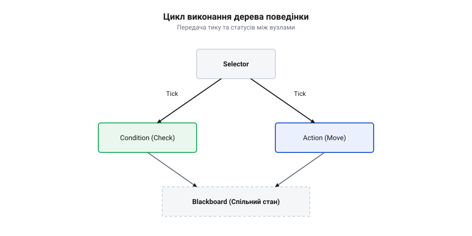

# Дерева поведінки (Behavior Trees): тики, реактивність та композиція автономних агентів

<preknowlist>
- [Потоки настільної ОС проти задач RTOS](root:sf-tasks/potoky-nastilnoi-os-proty-zadach-rtos) — чому автономний агент вимагає жорсткого часового детермінізму замість евристичного квантування
- [Тик планувальника й режим без тику (tickless)](root:sf-tasks/tyk-planuvalnyka-i-rezhym-bez-tyku-tickless) — як апаратний таймер задає періодичність виконання логіки
</preknowlist>

## Проблема масштабованості скінченних автоматів
Складні пристрої, що працюють автономно, вимагають гнучкого реагування на безліч подій. Найпростіший спосіб керувати ними — кінцеві автомати, де система завжди перебуває в одному з відомих станів і переходить в інший за певними правилами. Але щойно автономний агент отримує більше обов'язків, кількість станів зростає, а зв'язків між ними стає в рази більше. Квадратичне зростання кількості переходів перетворює код керування на заплутану мережу, де неможливо передбачити всі можливі сценарії. Логіка того, коли переходити, жорстко зашита у код самого стану, що не дає ізолювати їх і повторно використовувати. Кожна нова вимога до поведінки ламає наявні зв'язки, породжуючи невидимі помилки і роблячи систему некерованою. Це вимагає нової архітектури, де стан і переходи повністю відокремлені.

## Дерева поведінки та сигнал тику
Щоб розділити логіку прийняття рішень і самі дії, використовують дерева поведінки, де всі процеси структуровано у вигляді ієрархії вузлів. Замість того, щоб один стан явно викликав інший, виконання запускається згори донизу через дискретний сигнал тику. На кожному такті апаратного таймера система посилає сигнал головному вузлу, і він каскадом спускається до підпорядкованих. Після виконання кожен вузол повертає своєму батьківському елементу статус: «успіх», «помилка» або «виконується». Цей механізм дозволяє системі постійно оцінювати свій поточний стан, не замикаючись у жорстких циклах очікування. Завдяки тику, агент може будь-якої миті перервати довгу дію, якщо обставини змінилися, залишаючись гнучким і передбачуваним.

## Типи вузлів та їх композиція
Дерево складається з двох основних різновидів блоків: вузлів виконання та вузлів керування. Вузли виконання, або листові вузли, знаходяться на кінцях гілок — вони виконують реальні дії з периферією чи перевіряють умови середовища. Вони не знають про існування одне одного і просто повертають свій поточний статус. Щоб скласти з них алгоритм, застосовують вузли керування — послідовності та селектори. Послідовність виконує своїх нащадків одного за одним, поки не натрапить на помилку. Селектор навпаки — перебирає вузли, поки один із них не завершиться успіхом. Ця комбінаторна логіка дозволяє розробнику складати складну, комплексну поведінку з простих, повністю ізольованих будівельних блоків, без зміни їхнього внутрішнього коду.

## Реактивність та ізольований обмін даними
Безперервне зчитування статусу на кожному такті гарантує механізм реактивного обходу. Передумови для будь-якої дії, такі як безпекова відстань до перешкоди чи заряд батареї, перевіряються безупинно. Якщо умова порушується, дерево миттєво відхиляє поточну гілку виконання і перемикається на відповідні дії порятунку. При цьому вузли дерева не мають прямих посилань один на одного, що робить їх повністю незалежними. Для обміну даними застосовується спільний простір — «класна дошка», де будь-який компонент може записати або прочитати інформацію у потокобезпечний спосіб. Це усуває потребу в глобальних змінних і жорсткому зв'язуванні, дозволяючи агенту адаптуватися до мінливого середовища у реальному часі.

## Детермінованість і пласка структура пам'яті
В системах реального часу недопустимі затримки чи винятки під час динамічного виділення пам'яті. Рекурсія або створення нових об'єктів під час обходу вузлів може спричинити переповнення стека та падіння всієї задачі. Тому дерево поведінки проєктується так, щоб уся його структура була повністю розміщена в лінійному масиві ще на етапі ініціалізації. Всі зв'язки між батьківськими та дочірніми вузлами задаються статичними індексами цього масиву, а не вказівниками, які можуть стати недійсними. Такий підхід гарантує розробнику стабільний час виконання кожного тику, абсолютну детермінованість логіки та безпечну роботу під контролем операційної системи.