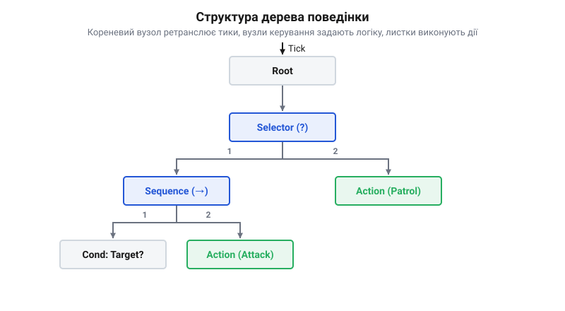

# Еволюція дерев поведінки: від ігрового штучного інтелекту до автономної робототехніки реального часу

## Початкові концепції та фізичні принципи

До появи дерев поведінки системи керування як у відеоіграх, так і в робототехніці спиралися на скінченні автомати. Кожен стан у них жорстко визначав поточну дію системи, а переходи між станами описували реакцію на нові події. Поки логіка була простою, на зразок «патрулювати — побачити ціль — атакувати», такий підхід працював надійно. Проте коли розробники намагалися створити складну автономну поведінку, кількість зв'язків між станами зростала експоненційно. Додавання нової реакції вимагало проведення нових зв'язків від усіх можливих попередніх станів. Це швидко перетворювало логіку керування на заплутану мережу, де кожна нова умова могла непередбачувано зламати існуючі переходи. Архітектура ставала монолітною, і повторно використати окрему частину поведінки в іншому контексті було технічно неможливо без дублювання коду. Щоб краще зрозуміти принципи машини станів та її обмеження при масштабуванні, варто розглянути, як працюють [скінченні автомати в керуванні вбудованими системами](root:sf-devices/finite-state-machine).

У робототехніці паралельно розвивалася реактивна архітектура поглинання, запропонована Родні Бруксом у 1986 році. Вона дозволяла роботам миттєво реагувати на фізичні перешкоди через ієрархію незалежних паралельних процесів. Проте цій архітектурі бракувало здатності до довгострокового планування та виконання послідовних багатоетапних завдань. Фізична природа автономних систем вимагала балансу: агент мусив одночасно в реальному часі реагувати на непередбачувані зміни середовища і при цьому не втрачати контексту поточного складного плану.

Справжній прорив стався у 2004 році під час розробки штучного інтелекту для відеогри Halo 2. Програміст Деміан Ісла зіштовхнувся з обмеженнями скінченних автоматів при спробі створити ілюзію розумної поведінки супротивників. Замість того, щоб описувати поведінку як монолітний набір станів, він використав ієрархічну модульну архітектуру, де загальні наміри розбивалися на ізольовані підзадачі.

Технічно ця архітектура складалася з єдиної точки входу, від якої хід виконання алгоритму розгалужувався вниз через проміжні вузли керування до конкретних елементарних дій на самих краях. Візуально така графова структура нагадувала перевернуте дерево, яке росте з одного кореневого вузла, розгалужується на гілки та закінчується вузлами-листками. Саме тому нова концепція отримала назву @@en|behavior trees@@. 

У цій моделі кожен вузол був повністю ізольованим блоком із власним єдиним завданням і не знав про існування сусідів. Керуючі вузли-гілки відповідали виключно за маршрутизацію: вони опитували своїх нащадків за певним правилом, послідовно один за одним або обираючи перший готовий до виконання. Вузли-листки не приймали рішень про потік виконання, а лише взаємодіяли зі світом — рухали агента, виконували дію або перевіряли умови видимості. Коли система зверталася до кореня, сигнал опитування проходив крізь керуючі вузли донизу, поки не знаходив потрібний листок, після чого листок повертав нагору свій статус виконання. Цей підхід дозволив розробникам складати комплексну поведінку з простих готових модулів, уникаючи жорстких зв'язків між станами. Зрештою ця архітектура виявилася настільки детермінованою і масштабованою, що швидко вийшла за межі ігрової індустрії та стала стандартом програмування автономних систем реального часу.

Читач дізнався про причини відмови від скінченних автоматів, зрозумів деревоподібну топологію керуючих та листкових вузлів, засвоїв принцип ізоляції вузлів та базову маршрутизацію обходу згори донизу. Введено термін: @@en|behavior trees@@.

## Внутрішня будова та алгоритми роботи

Дерево поведінки будується як ієрархічна структура з вузлами, що передають сигнали виконання згори донизу. Процес обходу дерева називається тиком (від @@en|tick@@). Коли планувальник викликає оновлення, тик починається з кореневого вузла і спускається гілками, перевіряючи умови та запускаючи дії. У системі реального часу вузли ніколи не блокують виконання програми. Коли вузол отримує тик, він виконує свою частину роботи і миттєво повертає один із трьох станів: успіх, провал або виконання (якщо дія ще триває і потребує часу, наприклад, поворот сервоприводу). Стан «виконання» є ключовим для автономної робототехніки — він дозволяє системі перервати обробку вузла і повернути керування [планувальнику](root:sf-tasks/tyk-planuvalnyka-i-rezhym-bez-tyku-tickless), щоб не заморозити інші процеси. Архітектура дерева складається з двох основних типів вузлів. Листкові вузли — це конкретні дії або перевірки умов датчиків, які взаємодіють з апаратурою. Керуючі вузли визначають, як саме виконуватимуться їхні нащадки. Наприклад, вузол-послідовність (@@en|sequence@@) запускає дочірні вузли по черзі і зупиняється, якщо хоча б один повертає провал. Це ідеально для завдань типу «під'їхати до об'єкта, захопити його, підняти». Натомість вузол-вибір (@@en|fallback@@ або @@en|selector@@) перевіряє нащадків по черзі, доки один із них не завершиться успіхом. Це дозволяє реалізувати механізми резервування: якщо основний датчик вийшов з ладу, дерево автоматично перемкнеться на запасний варіант дій. Завдяки такій модульній будові, розробники можуть додавати нові патерни поведінки, не змінюючи наявний код. Дерево дозволяє відокремити алгоритми прийняття рішень від низькорівневої обробки переривань та фізичних приводів.

*Показано базову структуру дерева поведінки з коренем, вузлами вибору та послідовності й листками дій, з якої чітко видно ієрархію виконання.*

## Апаратна реалізація та низькорівневий C/C++ код
Коли дерево поведінки переноситься з ігрового рушія на мікроконтролер, з'являються жорсткі вимоги до пам'яті та детермінованості часу виконання. Кожен вузол дерева реалізується як структура або клас на C/C++, де стан зберігається мінімально необхідною кількістю байтів. Замість динамічного виділення пам'яті, яке фрагментує купу й робить час виконання непередбачуваним, вузли дерева розміщуються статично під час компіляції або у заздалегідь виділених пулах. Основний цикл дерева поведінки викликається з окремої задачі RTOS, яка має чітко заданий пріоритет і працює у своєму кванті часу.

Щоб зменшити затримки між викликами дерева, використовують переривання, які повідомляють про завершення роботи периферії. В обробнику переривання викликається функція [виклику RTOS із переривання](root:sf-tasks/vyklyky-rtos-iz-pereryvannia-fromisr), яка встановлює прапорець для розблокування задачі дерева. Це дозволяє уникнути постійного опитування датчиків у циклі. Якщо дерево не має активних задач, планувальник переводить мікроконтролер у [режим без тику](root:sf-tasks/tyk-planuvalnyka-i-rezhym-bez-tyku-tickless) і передає керування [задачі, яка нічого не робить](root:sf-tasks/son-pid-rtos), зберігаючи енергію до наступної події.

## Практичне застосування та відлагодження
Відлагодження дерев поведінки у вбудованих системах вимагає розуміння, у якому стані перебуває кожен вузол. Оскільки в мікроконтролері немає графічного інтерфейсу, розробники використовують логування через UART або JTAG, виводячи поточний стан виконання як текстовий граф. Граничні випадки часто виникають, коли один із листкових вузлів зависає, блокуючи проходження виклику далі по дереву. Це відбувається, якщо дія не має тайм-ауту або чекає на подію, яка ніколи не настане.

Щоб цьому запобігти, кожна апаратна дія у вузлі працює неблокуюче, повертаючи стан виконання доти, доки не отримає результат. Такий підхід гарантує, що дерево встигатиме зробити наступний крок. Інший інцидент — порушення дедлайнів, коли [задача RTOS](root:sf-tasks/potoky-nastilnoi-os-proty-zadach-rtos) не встигає завершити обхід дерева через низький пріоритет. У таких ситуаціях застосовують профілювання: кожен виклик вимірюється таймером мікроконтролера, аби знайти найважчі гілки й оптимізувати їх.