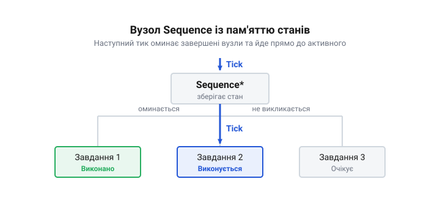

# Формальна математична модель дерев поведінки: граф обходу, функції виконання та часова складність тика

## Початкові концепції та фізичні принципи

Будь-яка автономна система, що працює в реальному часі, постає перед проблемою передбачуваного керування станами. Коли пристрій одночасно опитує датчики, керує двигунами та очікує команд, простий кінцевий автомат швидко перетворюється на некерований клубок переходів. Ця проблема стає критичною, коли завдання виконуються під керуванням операційної системи реального часу, де кожен зайвий такт процесора або пропущений дедлайн призводить до аварії. Тут виникає потреба в математично строгій і фізично детермінованій моделі управління — дереві поведінки (@@en|Behavior Tree@@).

Дерево поведінки — це орієнтований ациклічний граф, у якому кожен вузол відповідає за виконання певної елементарної функції. В основі цієї моделі лежить концепція тика. Тик — це одиничний імпульс обчислення, який поширюється від кореневого вузла до листків і викликає перевірку або зміну стану системи. У фізичному вимірі мікроконтролера тик відповідає послідовності інструкцій, яка обходить вказівники на функції в пам'яті. 

Математично граф визначається множиною вузлів `V` та множиною ребер `E`. Кожен вузол `v ∈ V` під час тика обчислює функцію стану `tick(v, c) → s`, де `c` — поточний контекст системи, а `s` — один із трьох станів: `Успіх` (@@en|Success@@), `Збій` (@@en|Failure@@) або `Виконується` (@@en|Running@@). Цей виклик поширюється від кореня до листків, де вузол-листок виконує елементарну дію, а потім результат згортається у зворотному напрямку: кожен листок повертає свій стан батьківському вузлу, який за власною логікою формує свій результат і передає його вище, поки корінь не отримає підсумок усього дерева. Стан `Виконується` є ключовим для систем реального часу. Він сигналізує планувальнику, що фізична дія ще триває (наприклад, обертання крокового двигуна), і операційна система може віддати процесорний час іншим задачам, як описано в темі [Потоки настільної ОС проти задач RTOS](root:sf-tasks/potoky-nastilnoi-os-proty-zadach-rtos).

Коли ми розглядаємо дерево поведінки в контексті апаратної архітектури, кожен перехід графом має свою вартість. Затримка виконання тика залежить від глибини дерева та кількості вузлів, які необхідно опитати. Якщо вузлів забагато, тик може не вкластися у виділений квант часу планувальника. Тому математична модель мусить враховувати часову складність `O(n)`, де `n` — кількість активних вузлів.

## Внутрішня будова та алгоритми роботи

Щоб дерево поведінки працювало ефективно, його граф обходу реалізується через систему делегування станів. Вузли поділяються на композитні (керувальні), декоратори та листки (дії або умови). 

Композитний вузол `C` визначає маршрут поширення тика до своїх нащадків `v₁`, `v₂` ... `vₙ`. Найпоширенішим є вузол послідовності (@@en|Sequence@@), який задає суворий порядок виконання. Алгоритм його роботи математично можна записати через функцію виконання `f(v)`. Для вузла послідовності результат обчислюється так:

    f(C)
    = Успіх, якщо ∀vᵢ: f(vᵢ) = Успіх                 [усі нащадки завершились успішно]
    = Збій, якщо ∃vᵢ: f(vᵢ) = Збій                   [перший же збій перериває послідовність]
    = Виконується, якщо ∃vᵢ: f(vᵢ) = Виконується     [дія ще триває, чекаємо наступного тика]

Цей базовий підхід вимагає, щоб кожен тик починався з кореня графа і знову проходив усі вузли. У мікроконтролерах із жорстким реальним часом це марнотратно: процесорний час витрачається на переопитування одних і тих самих умов та перезапуск уже завершених дій. Щоб оптимізувати часову складність обходу, вводиться пам'ять станів (@@en|stateful execution@@). Якщо під час попереднього тика нащадок `vᵢ` повернув стан `Виконується`, поточний тик не опитує нащадків від `v₁` до `vᵢ₋₁`. Алгоритм переходить безпосередньо до `vᵢ`. 

Це перетворює складність обходу в найгіршому випадку з `O(N)`, де `N` — загальна кількість вузлів у дереві, на `O(k)`, де `k` — глибина графа до активного вузла. У регістрах мікроконтролера це реалізується збереженням вказівника на поточний активний вузол. Коли планувальник відновлює задачу, тик ініціюється відразу з цього збереженого вказівника. Більш глибокий розбір впливу цього механізму на оптимізацію ресурсів наведено в статті про [вузли з пам'яттю](root:sf-apps/memory-nodes).

*Схема обходу вузлів з використанням пам'яті станів, яка демонструє прямий перехід тика до активного нащадка для уникнення зайвих перевірок.*

Однак пам'ять станів створює пастку в архітектурі. Прямий перехід до активного вузла `vᵢ` означає повний пропуск перевірки попередніх умов `v₁` ... `vᵢ₋₁`. Якщо тривала дія `vᵢ` (наприклад, рух мотора) виконується кілька сотень тиків, а умова `v₁` (наприклад, сигнал аварійної зупинки) за цей час змінюється, дерево про це не дізнається. Це критично при зміні середовища: система продовжуватиме виконувати дію, яка вже стала небезпечною, оскільки тик фізично оминає перевірку попередніх умов. 

Щоб дерево своєчасно реагувало на зміну середовища, перевірку критичних умов виводять з-під впливу пам'яті станів. Якщо апаратна периферія підтримує переривання, немає потреби постійно генерувати тики, марнуючи енергію. Замість холостого циклу, система переводиться в режим [Сон під RTOS: tickless і задача, яка нічого не робить](root:sf-tasks/son-pid-rtos). Дерево «завмирає», зберігаючи вказівник на активний вузол. Воно залишається нерухомим, поки апаратне переривання не подасть сигнал. Цей сигнал через механізм [Виклики RTOS із переривання (FromISR)](root:sf-tasks/vyklyky-rtos-iz-pereryvannia-fromisr) розбудить задачу і змусить систему скинути пам'ять станів, випустивши новий тик від кореня для обробки оновлених критичних даних.

**Теза:** Розкрито математичну модель вузла послідовності та введено концепцію пам'яті станів (stateful execution), що оптимізує часову складність обходу до O(k). Пояснено пастку пропуску перевірки попередніх умов під час прямого переходу до активного вузла та спосіб її вирішення через апаратні переривання й режим сну під RTOS.

## Апаратна реалізація та низькорівневий C/C++ код

Щоб дерево поведінки виконувалося передбачувано і з мінімальними затримками, його вузли в пам'яті розташовують із врахуванням апаратної архітектури мікроконтролера. Обхід орієнтованого графа означає постійні переходи за вказівниками, що на рівні процесора призводить до непередбачуваних промахів кешу та скидання конвеєра. Якщо стани вузлів і функції їх виконання розкидані по купі, кожен тик змушуватиме ядро чекати на вибірку з повільної пам'яті. 

Тому структуру дерева «випрямляють» у суцільний масив, де кожен вузол є елементом із фіксованим зміщенням. Вказівники на дітей замінюють індексами або відносними адресами. Завдяки цьому кеш-лінії процесора завантажують сусідні вузли ще до того, як планувальник перейде до них. Функції виконання обгортають у таблицю віртуальних методів або масив вказівників на функції, щоб викликати їх через непрямий перехід з мінімальною вартістю. 

*Розташування вузлів дерева у суцільному масиві порівняно з купою показує, як кеш-лінія процесора ефективно завантажує сусідні елементи без промахів.*

Окремою проблемою є зберігання стану для вузлів типу «Виконується» (@@en|Running@@). У системах реального часу динамічне виділення пам'яті під час тика неприпустиме через недетермінований час виконання аллокатора. Усю пам'ять для станів (@@en|blackboard@@ або локальний контекст вузла) виділяють статично на етапі ініціалізації. Під час тику вузол лише звертається до свого заздалегідь виділеного блока. Це гарантує, що час обробки функції завжди вкладається у жорсткі часові рамки.

Коли вузол очікує на зовнішню подію, наприклад на дані з датчика, він не може блокувати виконання всього потоку. Якщо він викличе функцію затримки або почне опитувати регістр у циклі, весь тик зупиниться, і дерево не зможе відреагувати на інші події. Замість цього такий вузол просто перевіряє прапорець або читає повідомлення з черги з нульовим таймаутом і одразу повертає стан «Виконується». Справжнє очікування забезпечується механізмами ОС, що детальніше розкрито в темі про [сон під RTOS](root:sf-tasks/son-pid-rtos).

## Практичне застосування та відлагодження

Налагодження дерева поведінки в мікроконтролері зводиться до аналізу часової складності обходу та пошуку вузлів, які ламають детермінованість тика. Найпоширенішою помилкою є приховане блокування: коли один вузол викликає функцію, яка всередині очікує на м'ютекс або захоплює апаратну шину занадто довго. Це призводить до стрибків тривалості тика.

Щоб виявити такі проблеми, профільують виконання всієї функції тику за допомогою апаратних таймерів або пінів. Перед початком обходу графа мікроконтролер встановлює високий рівень на тестовому виводі, а після завершення — низький. Спостерігаючи за цим сигналом на осцилографі, розробник бачить реальну фізичну тривалість кожного тику. Якщо деякі імпульси значно довші за інші, це означає, що певний вузол порушує правило миттєвого повернення. Для практичного налаштування вимірювань варто ознайомитись із посібником про [апаратні таймери для профілювання коду](root:sf-devices/hardware-timers-profiling).

Ще одним важливим інструментом є трасування станів. Оскільки дерево може мати сотні вузлів, покрокове виконання в зневаджувачі (@@en|debugger@@) не дає цілісної картини. Замість цього кожен вузол, який змінює свій стан, записує в кільцевий буфер свій ідентифікатор та новий статус. Цей буфер можна вичитувати окремим низькопріоритетним потоком і передавати на термінал. Такий підхід не створює затримок у самому тику, але дозволяє відновити всю історію переходів і зрозуміти, чому дерево прийняло те чи інше рішення.

Коли система обробляє переривання, важливо пам'ятати, що стан вузлів може змінюватися з контексту переривання. Проте безпосередньо викликати оновлення дерева або змінювати його пам'ять з ISR не можна. Замість цього використовують [виклики RTOS із переривання](root:sf-tasks/vyklyky-rtos-iz-pereryvannia-fromisr), щоб відкласти обробку події до наступного запланованого тику дерева в контексті задачі.