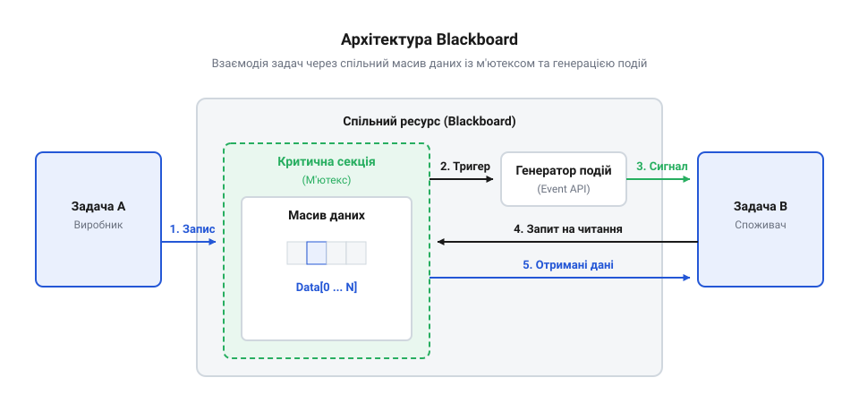

# Проєктування та реалізація потокобезпечного сховища Blackboard із підтримкою подій для RTOS-агента

## Початкові концепції та фізичні принципи

Вбудовані системи реального часу, які керують фізичними пристроями, стикаються з викликом одночасної обробки багатьох потоків даних. Уявіть автономного робота: один його датчик безперервно вимірює відстань до перешкод, другий зчитує команди з радіоканалу, а третій керує двигунами. Коли кілька незалежних задач (наприклад, задача зчитування сенсорів і задача навігації) потребують доступу до тих самих даних, виникає стан гонитви. Якщо одна задача записує нові координати, а інша в цей же момент намагається їх прочитати, вона може отримати пошкоджену або неповну інформацію. Це призводить до непередбачуваної поведінки пристрою.

Щоб вирішити цю проблему, в архітектуру програмного забезпечення вводять централізоване сховище даних, відоме як @@en|Blackboard@@ (класна дошка). Це спільна область пам'яті, де всі вузли системи можуть залишати і брати потрібну інформацію. Проте звичайна глобальна змінна не вирішує проблему одночасного доступу. Тому Blackboard будується як потокобезпечна структура: вона використовує апаратні та програмні механізми захисту пам'яті, гарантуючи, що поки одна задача оновлює запис, жодна інша не зможе його прочитати або змінити.

У контексті операційної системи реального часу (RTOS), захист найчастіше реалізується через м'ютекси (@@en|mutex@@) або критичні секції (@@en|critical section@@). Коли задача звертається до дошки, вона «захоплює» захисний механізм. Будь-яка інша задача, що потребує цих даних, змушена чекати. Але просте блокування створює нову проблему: задачі починають витрачати процесорний час на постійне «опитування» (@@en|polling@@) дошки, перевіряючи, чи не змінилися дані. Оскільки задача безперервно виконується або прокидається лише для того, щоб побачити старі значення, планувальник змушений постійно виділяти їй такти, не даючи мікроконтролеру перейти в енергоощадний режим сну. Це вхолосту спалює ресурси процесора, які могли б використати інші потоки. Тому ефективне сховище обов'язково містить механізм подій (@@en|event support@@). Замість нескінченних перевірок, задача засинає, віддаючи процесор системі. Як тільки дані на дошці оновлюються, сховище генерує подію (сигнал або повідомлення), що миттєво будить зацікавлену задачу для обробки нових значень.

## Внутрішня будова та алгоритми роботи

Архітектура потокобезпечного сховища будується на трьох ізольованих рівнях: фізичному зберіганні даних, синхронізації доступу та апараті сповіщень. Якщо злити ці механізми в моноліт, єдина помилка під час розсилки подій може заблокувати доступ до пам'яті для всіх інших частин прошивки.

*Архітектурна схема Blackboard демонструє взаємодію задач через спільний масив даних, де доступ захищається м'ютексом, а сповіщення про зміни генеруються через події.*

На найнижчому рівні дані лежать у загальній пам'яті як масив записів, де кожен блок прив'язаний до унікального числового ключа. Значення зберігаються як нетипізовані масиви байтів, що супроводжуються вказівниками на їхній розмір і тип. Такий підхід дозволяє одному алгоритму однаково надійно оперувати як одиничним прапорцем статусу, так і складною конфігураційною структурою сенсорів. 

Рівень синхронізації розв'язує проблему одночасного доступу, коли кілька потоків намагаються писати чи читати ті самі дані, створюючи стан гонитви. Щоб гарантувати цілісність, доступ до кожного запису захищається м'ютексом. Коли задача приносить нове значення, вона спершу захоплює цей м'ютекс, виключаючи інші потоки. Далі байти копіюються з локального буфера задачі в пам'ять Blackboard, після чого м'ютекс миттєво звільняється. Жодних математичних перетворень чи обробки під час утримання м'ютекса не відбувається, інакше система втратить детермінованість через довге очікування на ресурс.

Після збереження даних працює рівень маршрутизації, який повідомляє іншим потокам про зміни. Замість витрачання процесорного часу на постійне опитування прапорців, система використовує групи подій (@@en|event groups@@) — спеціальні примітиви [задач RTOS](root:sf-tasks/potoky-nastilnoi-os-proty-zadach-rtos). Кожному ключу на дошці відповідає окремий біт у такій групі. 

Щоб зрозуміти, як відбувається [сон під RTOS](root:sf-tasks/son-pid-rtos) без фонового опитування, треба подивитися на списки планувальника. Коли задача-споживач очікує на оновлення, вона викликає функцію системи для читання події. У цей момент планувальник фізично вилучає задачу зі списку готових до виконання потоків і переносить її у список заблокованих, який прив'язаний до конкретної групи подій. Відтепер планувальник не перевіряє стан цієї задачі й не виділяє їй процесорних тактів — вона просто спить.

Коли задача-видавець записує байти і викликає функцію встановлення події, механізм працює з іншого боку. Ця функція, змінюючи біт у пам'яті, самостійно обходить список потоків, заблокованих на цій події. Вона знаходить сплячу задачу-споживача і перекладає її назад у список готових до виконання. Планувальник нічого не опитує: сама дія встановлення події є тим тригером, який безпосередньо будить потоки. Якщо розбуджена задача має вищий пріоритет за поточну, перемикання контексту відбувається негайно.

Алгоритм читання замикає цей цикл. Прокинувшись від прямого сигналу планувальника, задача-споживач впевнена, що потрібні дані готові. Вона швидко захоплює м'ютекс, забирає копію байтів з Blackboard у власну пам'ять і відпускає замок. Подальша обробка інформації відбувається цілком ізольовано від загального сховища. Цей ланцюжок дій робить час відгуку на подію передбачуваним, що перетворює Blackboard із простого сховища на надійну шину даних для жорсткого реального часу.

Розкрито трирівневу архітектуру потокобезпечного Blackboard (зберігання, синхронізація, маршрутизація). Пояснено внутрішню механіку планувальника RTOS зі списками готовності та блокування, яка дозволяє будити потоки без періодичного опитування. Введено термін «група подій» (event group).

## Апаратна реалізація та низькорівневий C/C++ код

Щоб перетворити архітектурну концепцію сховища на працюючий код, мікроконтролер має гарантувати неподільність операцій. Коли одна задача записує координати датчика в пам'ять, а інша в цей же момент намагається їх прочитати, виникає стан гонитви (@@en|race condition@@). Без захисту читач отримає половину нових даних і половину старих, що призведе до непередбачуваної поведінки системи. 

Для захисту даних використовуються примітиви синхронізації операційної системи реального часу. Найпоширенішим вибором для захисту доступу до спільних ресурсів є м'ютекс (@@en|mutex@@). М'ютекс блокує доступ до ділянки пам'яті для інших задач, поки поточна задача не завершить свою роботу з нею. 

Однак, м'ютекси не можна використовувати в обробниках переривань, оскільки вони можуть заблокувати виконання переривання, що є неприпустимим у системах реального часу. Для коротких операцій, таких як оновлення одного числа або встановлення прапорця, замість м'ютексів застосовують критичні секції (@@en|critical section@@). Вхід у критичну секцію тимчасово забороняє всі переривання, що гарантує атомарність операції на рівні апаратного забезпечення мікроконтролера. Тривалість перебування в критичній секції має бути мінімальною (декілька машинних тактів), інакше система пропустить важливі зовнішні події. 

У коді реалізації сховища кожен запис даних супроводжується сповіщенням зацікавлених задач за допомогою груп подій. 

:::code proj-blackboard-thread-safe-storage/c/freertos/snippet-1.c

:::code proj-blackboard-thread-safe-storage/cpp/freertos/blackboard.cpp

Цей механізм гарантує, що жодна задача не прочитає частково оновлені дані, а планувальник [виклики RTOS із переривання](file:///root:sf-tasks/vyklyky-rtos-iz-pereryvannia-fromisr) розбудить лише ті задачі, які очікують на конкретну подію, без необхідності постійного опитування (@@en|polling@@).

## Практичне застосування та відлагодження

Створення потокобезпечного сховища не закінчується написанням коду. Під час роботи в реальній системі виникають проблеми, пов'язані із взаємодією багатьох задач. Однією з найнебезпечніших є інверсія пріоритетів (@@en|priority inversion@@). Вона трапляється, коли низькопріоритетна задача захопила м'ютекс сховища, а високопріоритетна задача намагається туди записати або звідти прочитати і через це блокується. Якщо в цей час середньопріоритетна задача, яка не залежить від сховища, витіснить низькопріоритетну, то високопріоритетна задача чекатиме непередбачувано довго. Більшість RTOS вирішують це механізмом успадкування пріоритетів: низькопріоритетна задача тимчасово отримує пріоритет високої, щоб швидше звільнити м'ютекс. Важливо перевіряти, чи увімкнена ця функція у конфігурації ОС. Детальніше про механізми розв'язання цієї проблеми читайте в матеріалі про [інверсію пріоритетів та успадкування](root:sf-os/priority-inversion).

Інша класична проблема — взаємне блокування (@@en|deadlock@@). Якщо дві задачі намагаються захопити два м'ютекси в різному порядку, вони можуть заблокувати одна одну назавжди. У контексті Blackboard це означає, що доступ до сховища має бути атомарним для всього об'єкта або групи пов'язаних об'єктів. Ніколи не утримуйте м'ютекс сховища під час виконання тривалих обчислень або виклику інших блокуючих функцій. Взяли м'ютекс, скопіювали дані в локальну змінну, віддали м'ютекс — це золоте правило.

Для діагностики проблем у сховищі під час відлагодження ефективно використовувати інструменти трасування подій (@@en|tracing@@). Вони дозволяють візуально на часовій шкалі побачити, коли і яка задача захопила м'ютекс, скільки часу його утримувала і які події відправила. Якщо ви бачите, що задача занадто довго утримує блокування, це кандидат на оптимізацію. Огляд і методику роботи з такими засобами шукайте в статті про [трасування виконання в RTOS](root:sf-devices/tracing-rtos).

Також корисно перевіряти коди повернення всіх функцій RTOS. Якщо створення групи подій не вдалося через брак пам'яті в купі (@@en|heap@@), або захоплення м'ютекса завершилося тайм-аутом, система має зафіксувати цю помилку (через логування або апаратну зупинку), а не продовжувати роботу з недійсними даними.