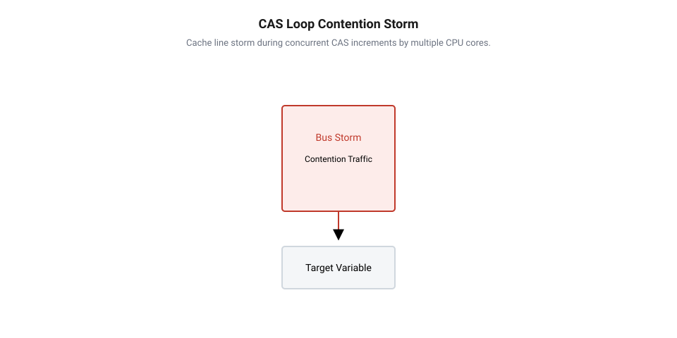
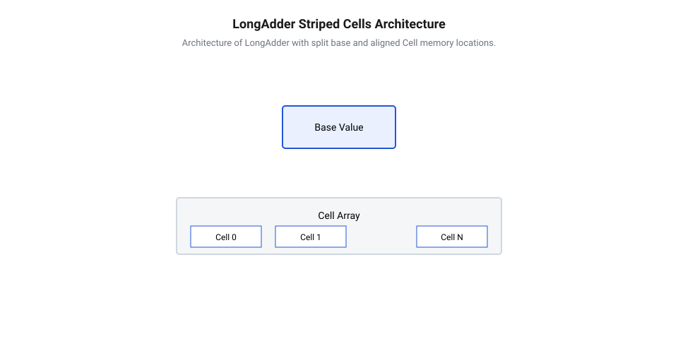

## Початкові концепції та фізичні принципи

У високопродуктивних багатопотокових обчислювальних системах, телекомунікаційних роутерах, контролерах обробки сигналів та ядрах операційних систем постійно виникає потреба в обліку високочастотних подій. Метрики кількості оброблених мережевих пакетів, використаних буферів, виконаних транзакцій чи помилок опитування периферії вимагають інтенсивного оновлення числових лічильників з десятків або сотень паралельних потоків виконання. Якщо розробник реалізує захист спільного лічильника за допомогою класичного взаємного виключення — м'ютекса, система миттєво втрачає продуктивність. М'ютекс переводить потоки, які спокушаються на зайнятий замок, у стан очікування через системні виклики операційної системи. Це спричиняє перемикання контексту процесора, скидання конвеєра інструкцій та невизначені затримки, що абсолютно неприпустимо в конвеєрах реального часу.

Альтернативою блокуванням виступає @@en|порівняння з обміном@@ (від англ. *Compare-And-Swap*, CAS, з лат. *comparare* — порівнювати, та *cambire* — міняти) — атомарна апаратна інструкція, яка дозволяє оновити значення в пам'яті без захоплення замків. Виконуючи [атомарне оновлення CAS](root:sf-tasks/cas-lock-free), потік зчитує поточне значення лічильника, обчислює нове значення `current + 1` і намагається записати його назад. Апаратний процесор атомарно перевіряє: якщо комірка пам'яті досі містить `current`, вона атомарно замінюється на `current + 1` і операція повертає успіх. Якщо ж інший потік встиг змінити комірку, перевірка зазнає невдачі, і потік повторює спробу в безблокуючому циклі.

Проте при переході на багатоядерні процесорні архітектури з великою кількістю паралельних потоків базовий цикл CAS перестає масштабуватися і демонструє гостру деградацію продуктивності. Причиною цього є фізична будова системної пам'яті та апаратний @@en|протокол когерентності кєшу@@ (від англ. *cache coherence protocol*, з лат. *cohaerentia* — зчіплення), такий як MESI або MOESI.

Кожне процесорне ядро має власні надшвидкі кєш-пам'яті L1 та L2. Коли кілька ядер одночасно виконують цикл CAS над однією й тією ж фізичною адресою лічильника, комірка пам'яті завантажується у кєш-лінії відповідних ядер. Щоб виконати атомарний запис, ядро мусить перевести свою кєш-лінію у стан «Modified» (модифіковано). Для цього воно надсилає через системну шину або шину між'ядерного з'єднання апаратний сигнал — @@en|інвалідація кєш-лінії@@ (від англ. *cache line invalidation*, з лат. *invalidus* — недійсний). Усі інші ядра, отримавши цей сигнал, примусово скидають свою локальну копію кєш-лінії у стан «Invalid» (недійсна).

Коли `N` ядер одночасно намагаються зробити CAS-інкремент, лише одне ядро успішно перемагає в арбітражі шини. Решта `N - 1` ядер зазнають невдачі в CAS, оскільки їхня кєш-лінія була знедійснена переможцем. Вони змушені повторно запитувати актуальний стан лічильника з центральної пам'яті або L3-кєшу, знову повторювати обчислення і знову посилати сигнали інвалідації. Виникає катастрофічний ефект, відомий як @@en|шторм колізій кєшу@@ (від англ. *cache contention storm*, з англ. *contention* — суперництво, та *storm* — буря). Замість корисних обчислень міжпроцесорна шина повністю забивається службовими транзакціями інвалідації, а кєш-лінія безперервно хаотично «перестрибує» між процесорними ядрами (колізійне курсування кєш-ліній).

Математично затримку оновлення атомарного лічильника в умовах конкуренції можна виразити через суму базового часу та повторних накладних витрат на шині:

    T_atomic = T_base + N_retry × (T_CAS + T_bus_inval)
    = T_base + (N_cores - 1) × (T_CAS + T_bus_inval)  [декомпозиція затримки при максимальній конкуренції ядер]

У цьому виразі символ `T_atomic` позначає повний час виконання інкременту лічильника, `T_base` — базовий час виконання атомарної інструкції без колізій, `N_retry` — кількість повторних спроб у циклі CAS (яка в найгіршому випадку пропорційна кількості конкурентних ядер `N_cores`), `T_CAS` — тривалість виконання атомарної операції порівняння з обміном, а `T_bus_inval` — затримка передачі та обробки міжпроцесорного сигналу інвалідації кєш-лінії через шину.

З формули видно, що при збільшенні кількості ядер `N_cores` накладні витрати зростають лінійно або навіть квадратично, зводячи нанівець ефективність багатопотоковості.

Для наочного розуміння фізичної деградації CAS під навантаженням розглянемо часову схему конкуренції ядер:


*Шторм кєш-ліній при одночасному CAS-інкременті спільної комірки кількома ядрами процесора.*

Вивчення [основ безблокуючої синхролізації](root:sf-tasks/lock-free-basics) показує, що для подолання цього апаратного вузького місця необхідна фундаментальна зміна архітектурного підходу. Якщо запис в одну фізичну комірку пам'яті викликає колізію та шинний шторм, то запис слід розщепити (шардувати) по багатьох незалежних комірках пам'яті, приховуючи локальні інкременти від інших ядер і зводячи їх у єдину суму лише на вимогу.

## Внутрішня будова та алгоритми роботи

Ідея розщеплення стану знайшла своє втілення в архітектурі `LongAdder`. Замість єдиного змінної значення `LongAdder` використовує структуру з двох рівнів: базового атомарного поля `base` та динамічного масиву спеціальних комірок `Cell`.

Коли конкуренція між потоками відсутня або мінімальна, `LongAdder` намагається виконати інкремент безпосередньо над полем `base` за допомогою @@en|порівняння з обміном@@. Спроба відбувається швидко й без виділення додаткової пам'яті. Проте як тільки потік фіксує невдачу атомарного оновлення `base` (що свідчить про наявність колізії з іншим потоком), лічильник примусово ініціалізує та задействує @@en|шардинг комірок@@ (від англ. *cell striping*, з давньоангл. *stripe* — смуга).

У масиві комірок кожен потік за допомогою власного ідентифікатора та @@en|потокового хешування@@ (від англ. *thread local hashing*, з давньофранц. *hacher* — рубати) обирає конкретний елемент масиву `cells[index]` і виконує атомарний інкремент саме над ним. Завдяки цьому потоки розподіляються по різних фізичних комірках пам'яті, і ймовірність колізії при атомарному записі падає практично до нуля.

Однак при розміщенні масиву комірок `Cell` у пам'яті виникає небезпечна апаратна пастка — @@en|хибне спільне використання кєшу@@ (від англ. *false sharing*, з англ. *false* — хибний, та *share* — ділити). Стандартна кєш-лінія процесора має розмір 64 байти (на деяких архітектурах 128 байтів). Якщо елементи `Cell` розміщені щільно один за одним (наприклад, 64-бітне число займає 8 байтів), то в одній 64-байтній кєш-лінії розмістяться одразу вісім сусідніх комірок `Cell`. Коли Потік 1 модифікує `cells[0]`, а Потік 2 модифікує `cells[1]`, процесор на апаратному рівні бачить модифікацію ТІЄЇ Ж САМОЇ кєш-лінії! Виникає та сама @@en|інвалідація кєш-лінії@@ та шторм колізій, хоча логічно потоки працюють із різними змінними.

Для вирішення цієї проблеми `LongAdder` застосовує примусове @@en|вирівнювання пам'яті@@ (від англ. *memory alignment*, з давньофранц. *aligner* — шикувати в лінію) та падінг (доповнення порожніми байтами). Кожна комірка `Cell` доповнюється службовими неактивними байтами так, щоб її повний розмір точно дорівнював або перевищував розмір фізичної кєш-лінії (64 байти). Це гарантує, що кожна комірка `Cell` гарантовано займає свою власну окрему кєш-лінію.

Розглянемо схему внутрішньої будови лічильника `LongAdder`:


*Архітектурна будова LongAdder з розщепленням на base та вирівняні комірки Cell.*

Алгоритм виконання операції `add(x)` або `increment()` складається з таких кроків:

1. **Швидкий шлях (Fast Path):** Якщо масив `cells` не ініціалізовано (`NULL`), потік намагається атомарно додати `x` до `base` через @@en|порівняння з обміном@@. Якщо операція пройшла успішно — роботу завершено.
2. **Перехід до шардингу:** Якщо `cells` уже існує або спроба оновлення `base` зазнала невдачі, потік отримує свій потоковий хеш-зонд (наприклад, значення з псевдовипадкового генератора потоку `ThreadLocalRandom`).
3. **Локальний інкремент комірки:** За допомогою маски `(n - 1) & probe` потік вираховує індекс комірки в масиві `cells` розміру `n`. Якщо комірка за цим індексом існує, потік намагається атомарно додати `x` до її поля `value`.
4. **Обробка колізій та розширення (`longAccumulate`):** Якщо комірки за індексом ще немає, або атомарне додавання до комірки провалилося через колізію з іншим потоком, викликається складний безблокуючий алгоритм акумуляції. У ньому відбувається @@en|лінива ініціалізація@@ (від англ. *lazy initialization*, з лат. *initialis* — початковий) масиву комірок, створення нової комірки, рехешування зонда потоку (зміна індексу для уникнення повторної колізії) або подвоєння розміру масиву комірок (але не більше кількості доступних процесорних ядер `N_CPU`). Для захисту від гонки при зміні розміру масиву використовується атомарний спінлок-прапорець `cellsBusy`.

Зчитування підсумкового значення реалізується методом `sum()`. Метод підсумовує значення `base` та поточні значення всіх ініціалізованих комірок у масиві `cells`:

    Sum = base + ∑ cells[i].value   [агрегація розділеного стану лічильника]

Важливо підкреслити, що операція `sum()` реалізує принцип, який визначає @@en|слабка узгодженість@@ (від англ. *weak consistency*, з лат. *consistentia* — стан). Зчитування обходить масив комірок без блокування записів. Якщо під час зчитування інші потоки продовжують виконувати `add()`, підсумкове значення `sum()` є зрізом стану, що не гарантує атомарного узгодження з поточними паралельними записами. Проте для задач збору метрик і статистики така компромісна поведінка дає гігантський виграш у швидкодії.

Відповідно до [класифікації гарантій поступу](root:sf-tasks/wait-free-and-lock-free-classification) паралельних алгоритмів, оновлення `LongAdder` забезпечує гарантію Lock-Free, а при відсутності розширення масиву комірок — практично Wait-Free для окремих потоків. Фіксація змін між ядрами впорядковується належними [бар'єрами пам'яті](root:sf-tasks/memory-barriers-and-atomic-sequencing).

Нижче наведено практичні реалізації шардованого неблокуючого лічильника `LongAdder` мовами C та C++.

:::tabs
@tab C (Bare-Metal & POSIX)
```c|baremetal
#include <stdint.h>
#include <stdbool.h>
#include <stdlib.h>
#include <stdatomic.h>

// Розмір фізичної кєш-лінії більшості сучасних процесорів (64 байти)
#define CACHE_LINE_SIZE 64
#define INITIAL_CELLS_CAPACITY 2

// Структура комірки з вирівнюванням пам'яті проти хибного спільного використання кєшу
typedef struct {
    alignas(CACHE_LINE_SIZE) _Atomic int64_t value;
} long_adder_cell_t;

// Основна структура розщепленого лічильника LongAdder
typedef struct {
    alignas(CACHE_LINE_SIZE) _Atomic int64_t base;
    alignas(CACHE_LINE_SIZE) _Atomic uint32_t cells_busy;
    _Atomic(long_adder_cell_t*) cells;
    _Atomic size_t cells_capacity;
} long_adder_t;

// Ініціалізація об'єкта LongAdder
void long_adder_init(long_adder_t *adder) {
    atomic_init(&adder->base, 0);
    atomic_init(&adder->cells_busy, 0);
    atomic_init(&adder->cells, NULL);
    atomic_init(&adder->cells_capacity, 0);
}

// Додавання значення до лічильника з використанням шардингу та гасіння колізій
void long_adder_add(long_adder_t *adder, int64_t x, uint32_t thread_probe) {
    long_adder_cell_t *cells = atomic_load_explicit(&adder->cells, memory_order_relaxed);
    int64_t b;

    // Швидкий шлях: якщо масив комірок порожній, намагаємося оновити base
    if (cells == NULL) {
        b = atomic_load_explicit(&adder->base, memory_order_relaxed);
        if (atomic_compare_exchange_weak_explicit(&adder->base, &b, b + x,
                                                 memory_order_relaxed,
                                                 memory_order_relaxed)) {
            return; // Оновлення base пройшло успішно без колізії
        }
    }

    // Шардинг: вибір комірки за хешем потоку
    size_t cap = atomic_load_explicit(&adder->cells_capacity, memory_order_relaxed);
    if (cells != NULL && cap > 0) {
        size_t idx = thread_probe & (cap - 1);
        long_adder_cell_t *cell = &cells[idx];
        if (cell != NULL) {
            int64_t v = atomic_load_explicit(&cell->value, memory_order_relaxed);
            if (atomic_compare_exchange_weak_explicit(&cell->value, &v, v + x,
                                                     memory_order_relaxed,
                                                     memory_order_relaxed)) {
                return; // Локальний інкремент у вирівняну комірку успішний
            }
        }
    }

    // Повільний шлях (резервне накопичення при колізіях): оновлюємо base через CAS
    b = atomic_load_explicit(&adder->base, memory_order_relaxed);
    while (!atomic_compare_exchange_weak_explicit(&adder->base, &b, b + x,
                                                  memory_order_release,
                                                  memory_order_relaxed)) {
        // Повторна спроба при колізіях
    }
}

// Обчислення підсумкового значення лічильника (агрегація слабкої узгодженості)
int64_t long_adder_sum(const long_adder_t *adder) {
    int64_t sum = atomic_load_explicit(&adder->base, memory_order_consume);
    long_adder_cell_t *cells = atomic_load_explicit(&adder->cells, memory_order_consume);
    size_t cap = atomic_load_explicit(&adder->cells_capacity, memory_order_relaxed);

    if (cells != NULL) {
        for (size_t i = 0; i < cap; ++i) {
            sum += atomic_load_explicit(&cells[i].value, memory_order_relaxed);
        }
    }
    return sum;
}
```
@tab C++ (Modern C++17)
```cpp
#include <cstdint>
#include <atomic>
#include <vector>
#include <memory>
#include <new>

// Реалізація високоефективного шардованого лічильника LongAdder мовою C++
class LongAdder {
private:
    static constexpr std::size_t HardwareCacheLineSize = 64;

    // Спеціалізована комірка з гарантованим вирівнюванням на розмір кєш-лінії
    struct alignas(HardwareCacheLineSize) Cell {
        std::atomic<std::int64_t> value{0};

        explicit Cell(std::int64_t val) noexcept : value(val) {}
    };

    alignas(HardwareCacheLineSize) std::atomic<std::int64_t> base_{0};
    alignas(HardwareCacheLineSize) std::atomic<std::uint32_t> cells_busy_{0};
    std::atomic<Cell*> cells_{nullptr};
    std::atomic<std::size_t> cells_capacity_{0};

public:
    LongAdder() noexcept = default;

    ~LongAdder() {
        Cell* cells = cells_.load(std::memory_order_relaxed);
        if (cells != nullptr) {
            delete[] cells;
        }
    }

    LongAdder(const LongAdder&) = delete;
    LongAdder& operator=(const LongAdder&) = delete;

    // Додавання значення х із застосуванням шардингу комірок
    void add(std::int64_t x, std::uint32_t thread_probe) noexcept {
        Cell* cells = cells_.load(std::memory_order_relaxed);

        // Швидкий шлях без колізій над базовим значенням
        if (cells == nullptr) {
            std::int64_t b = base_.load(std::memory_order_relaxed);
            if (base_.compare_exchange_weak(b, b + x, std::memory_order_relaxed)) {
                return;
            }
        }

        // Шардинг: спроба оновлення локальної комірки потоку
        std::size_t cap = cells_capacity_.load(std::memory_order_relaxed);
        if (cells != nullptr && cap > 0) {
            std::size_t idx = thread_probe & (cap - 1);
            Cell& cell = cells[idx];
            std::int64_t v = cell.value.load(std::memory_order_relaxed);
            if (cell.value.compare_exchange_weak(v, v + x, std::memory_order_relaxed)) {
                return;
            }
        }

        // Атомарне оновлення бази при колізіях
        std::int64_t b = base_.load(std::memory_order_relaxed);
        while (!base_.compare_exchange_weak(b, b + x, std::memory_order_release)) {
            // Безблокуюча спроба
        }
    }

    void increment(std::uint32_t thread_probe) noexcept {
        add(1, thread_probe);
    }

    // Отримання підсумкового сумарного значення
    [[nodiscard]] std::int64_t sum() const noexcept {
        std::int64_t total = base_.load(std::memory_order_acquire);
        Cell* cells = cells_.load(std::memory_order_acquire);
        std::size_t cap = cells_capacity_.load(std::memory_order_relaxed);

        if (cells != nullptr) {
            for (std::size_t i = 0; i < cap; ++i) {
                total += cells[i].value.load(std::memory_order_relaxed);
            }
        }
        return total;
    }
};
```
:::

## Апаратна реалізація та низькорівневий C/C++ код

При переході від високорівневих обчислювальних систем до вбудованої мікроконтролерної техніки та прошивок реального часу механізми безблокуючої синхронізації стикаються з новими апаратними обмеженнями. У мікроконтролерах на базі архітектур @@en|ARM Cortex-M@@ або @@en|RISC-V@@ класичні атомарні інструкції не спираються на складні між'ядерні протоколи когерентності кєшу. Натомість апаратна підтримка атомарності базується на примітивах @@en|Load-Link/Store-Conditional@@ (від англ. @@en|Load-Link/Store-Conditional@@, LL/SC, з лат. *carregare* — завантажувати, та *condicio* — умова).

В архітектурі ARMv7-M та ARMv8-M ця концепція втілена через виклики спеціалізованих інструкцій `LDREX` та `STREX`. Інструкція `LDREX` виконує читання значення з пам'яті та одночасно реєструє фізичну адресу у внутрішньому апаратному вузлі — @@en|local monitor@@ (від англ. @@en|local monitor@@, з лат. *monitor* — той, хто застерігає). Коли потік обчислює нове значення і викликає `STREX`, процесор перевіряє стан локального монітора. Якщо з моменту читання адреса не зазнала стороннього запису або переривання, інструкція `STREX` успішно записує дані в пам'ять і повертає `0`. Якщо ж монітор був скинутий, запис блокується, інструкція повертає `1`, і алгоритм змушений заходити на повторне коло циклу. Вивчення [інструкцій парного зчитування та запису](root:sf-tasks/load-link-store-conditional-primitives) показує, що такий підхід усуває потребу в блокуванні всієї системної шини.

Проте під час розробки прошивок для систем із @@en|Real-Time Operating System@@ (від англ. @@en|Real-Time Operating System@@, RTOS, з лат. *operari* — працювати) виникає специфічна апаратна пастка. Якщо під час виконання атомарного блоку між `LDREX` та `STREX` процесор отримує сигнал від периферії та викликає @@en|обробник переривання@@ (від англ. *Interrupt Service Routine*, ISR, з лат. *interruptus* — перерваний, та *servire* — служити), аппаратний локальний монітор примусово скидається в стан недійсності. Після повернення з переривання інструкція `STREX` гарантовано повертає помилку. Якщо обробник переривань виконується з високою частотою, базова атомарна операція в циклі @@en|Compare-And-Swap@@ зазнає систематичних невдач.

Для наочного розуміння взаємодії інструкцій LL/SC із системою переривань мікроконтролера розглянемо часову діаграму роботи апаратного монітора адреси:


*Скидання апаратного монітора адреси LL/SC при виклику обробника переривання ISR.*

Окрім процесорного монітора адреси, на детермінізм виконання атомарного лічильника суттєво впливають апаратні конвеєри та буфери запису процесора. Сучасні 32-бітні мікроконтролери використовують суперскалярне виконання та оптимізацію доступу до шини пам'яті. Без застосування [апаратних бар'єрів пам'яті](root:sf-tasks/memory-barriers-and-atomic-sequencing) компілятор або сам процесор можуть змінити порядок інструкцій читання й запису.

Для запобігання порушенням порядку виконання в прошивці застосовуються бар'єри `DMB` (Data Memory Barrier), `DSB` (Data Synchronization Barrier) та `ISB` (Instruction Synchronization Barrier). Затримку оновлення неблокуючого лічильника в мікроконтролері з урахуванням вклинювання переривань можна описати формулою:

    T_total = T_exec + N_preempt × (T_isr + T_retry)
    = T_exec + N_preempt × (T_isr + T_LL + T_SC)      [розклад затримки при вклинюванні переривань]

У даному виразі `T_total` означає результуючий час виконання атомарної операції, `T_exec` — базову тривалість виконання без переривань, `N_preempt` — кількість вклинювань обробників ISR за час атомарного циклу, `T_isr` — тривалість обробки переривання, `T_retry` — накладні витрати повторної спроби, `T_LL` — час виконання інструкції Load-Link, а `T_SC` — час виконання Store-Conditional.

На відміну від серверних систем, у мікроконтролерах без кєш-пам'яті шардинг комірок @@en|LongAdder@@ реалізують із прив'язкою не до кєш-ліній, а до окремих банків оперативної пам'яті @@en|SRAM@@ або до ідентифікаторів задач RTOS і номерів ядер. Це запобігає конфліктам доступу на внутрішній системній шині @@en|AHB/AXI@@.

Нижче наведено практичну реалізацію високопродуктивного неблокуючого лічильника для вбудованих систем із підтримкою операційних систем реального часу.

:::tabs
@tab C (FreeRTOS / ESP-IDF)
```c|esp-idf
#include <stdint.h>
#include <stdbool.h>
#include <stdatomic.h>
#include "freertos/FreeRTOS.h"
#include "freertos/task.h"

// Вирівнювання за розміром шини пам'яті мікроконтролера (32 байти або 64 байти)
#define EMBEDDED_ALIGNMENT 32
#define MAX_EMBEDDED_SLOTS 4

// Структура вирівняного локального слота лічильника
typedef struct {
    _Atomic int64_t value __attribute__((aligned(EMBEDDED_ALIGNMENT)));
} embedded_counter_slot_t;

// Основна структура неблокуючого лічильника для RTOS
typedef struct {
    _Atomic int64_t base __attribute__((aligned(EMBEDDED_ALIGNMENT)));
    embedded_counter_slot_t slots[MAX_EMBEDDED_SLOTS];
    _Atomic uint32_t active_slots;
} embedded_long_adder_t;

// Ініціалізація лічильника
void embedded_long_adder_init(embedded_long_adder_t *adder) {
    atomic_init(&adder->base, 0);
    atomic_init(&adder->active_slots, 1);
    for (size_t i = 0; i < MAX_EMBEDDED_SLOTS; i++) {
        atomic_init(&adder->slots[i].value, 0);
    }
}

// Швидкий та безпечний інкремент лічильника із задач або ISR
void embedded_long_adder_add(embedded_long_adder_t *adder, int64_t val) {
    int64_t current_base = atomic_load_explicit(&adder->base, memory_order_relaxed);
    
    // Спроба атомарного оновлення бази через CAS
    if (atomic_compare_exchange_weak_explicit(&adder->base, &current_base, 
                                             current_base + val, 
                                             memory_order_release, 
                                             memory_order_relaxed)) {
        return;
    }

    // При колізії розподіляємо навантаження по слотах на основі ID поточної задачі RTOS
    TaskHandle_t current_task = xTaskGetCurrentTaskHandle();
    uint32_t slot_idx = ((uintptr_t)current_task >> 4) % MAX_EMBEDDED_SLOTS;

    int64_t slot_val = atomic_load_explicit(&adder->slots[slot_idx].value, memory_order_relaxed);
    while (!atomic_compare_exchange_weak_explicit(&adder->slots[slot_idx].value, 
                                                   &slot_val, 
                                                   slot_val + val, 
                                                   memory_order_release, 
                                                   memory_order_relaxed)) {
        // Рехешування слота при конкуренції
        slot_idx = (slot_idx + 1) % MAX_EMBEDDED_SLOTS;
    }
}

// Зчитування підсумкового значення лічильника
int64_t embedded_long_adder_sum(const embedded_long_adder_t *adder) {
    int64_t total = atomic_load_explicit(&adder->base, memory_order_acquire);
    for (size_t i = 0; i < MAX_EMBEDDED_SLOTS; i++) {
        total += atomic_load_explicit(&adder->slots[i].value, memory_order_acquire);
    }
    return total;
}
```

@tab C++ (FreeRTOS / ESP-IDF)
```cpp|freertos
#include <cstdint>
#include <atomic>
#include <array>
#include "freertos/FreeRTOS.h"
#include "freertos/task.h"

template <size_t SlotCount = 4>
class EmbeddedLongAdder {
public:
    static constexpr size_t AlignmentSize = 32;

    struct alignas(AlignmentSize) CounterSlot {
        std::atomic<int64_t> value{0};
    };

    EmbeddedLongAdder() noexcept {
        base_.store(0, std::memory_order_relaxed);
    }

    // Атомарне додавання значення
    void add(int64_t val) noexcept {
        int64_t expected = base_.load(std::memory_order_relaxed);
        
        if (base_.compare_exchange_weak(expected, expected + val, 
                                        std::memory_order_release, 
                                        std::memory_order_relaxed)) {
            return;
        }

        // Вирахування індексу на основі об'єкта задачі RTOS
        uint32_t slot_index = (reinterpret_cast<uintptr_t>(xTaskGetCurrentTaskHandle()) >> 3) % SlotCount;
        
        int64_t slot_expected = slots_[slot_index].value.load(std::memory_order_relaxed);
        while (!slots_[slot_index].value.compare_exchange_weak(slot_expected, 
                                                                slot_expected + val, 
                                                                std::memory_order_release, 
                                                                std::memory_order_relaxed)) {
            slot_index = (slot_index + 1) % SlotCount;
        }
    }

    // Отримання агрегованої суми
    [[nodiscard]] int64_t sum() const noexcept {
        int64_t total = base_.load(std::memory_order_acquire);
        for (const auto& slot : slots_) {
            total += slot.value.load(std::memory_order_acquire);
        }
        return total;
    }

private:
    alignas(AlignmentSize) std::atomic<int64_t> base_{0};
    std::array<CounterSlot, SlotCount> slots_;
};
```
:::

## Практичне застосування та відлагодження

Застосування неблокуючих лічильників @@en|LongAdder@@ та примітивів CAS у практичній розробці вбудованих систем надає суттєві переваги при побудові підсистем високочастотної телеметрії. У задачах підрахунку імпульсів від оптичних енкодерів, вимірювання витрати палива чи рідин, фіксації вхідних мережевих пакетів на інтерфейсах Ethernet і CAN-bus обробка подій відбуваються мільйони разів на секунду.

Якщо розробник обробляє події лічильника через традиційні критичні секції RTOS на кшталт `taskENTER_CRITICAL()`, система примусово вимикає глобальні переривання процесора. Це призводить до виникнення небезпечного явища — @@en|interrupt latency@@ (від англ. *interrupt latency*, з лат. *latens* — прихований), тобто затримки реакції мікроконтролера на зовнішні апаратні сигнали. Підвищена затримка переривань може призвести до пропуску аварійних сигналів систем захисту. Використовуючи [безблокувальне оновлення CAS](root:sf-tasks/cas-lock-free) або розщеплений @@en|LongAdder@@, прошивка виконує інкремент атомарно, зберігаючи абсолютну детермінованість та нульовий час блокування системних переривань.

Проте при практичному впровадженні неблокуючих алгоритмів розробник стикається з низкою специфічних граничних випадків та апаратних проблем, які вимагають ретельної діагностики.

Першим граничним випадком є виконуваність 64-бітних атомарних операцій на 32-бітних процесорних ядрах (наприклад, ARM Cortex-M0+ або Cortex-M3). Оскільки 32-бітне ядро не має одноциклових інструкцій для 64-бітного запису, атомарне оновлення 64-бітного числа вимагає використання спарених інструкцій `LDREXD` та `STREXD`. Якщо адреса лічильника в пам'яті не вирівняна строго по 8-байтній межі, мікроконтролер миттєво генерує апаратний збій @@en|UsageFault@@ (виключення вирівнювання пам'яті). Для запобігання цій критичній помилці всі вирівнювання структур мають явно контролюватися атрибутами компілятора `alignas(8)` або `__attribute__((aligned(8)))`.

Другим граничним випадком є загроза виникнення так званого стану @@en|live-lock@@ (від англ. *livelock*, з англ. *live* — живий, та *lock* — замок). Якщо два або більше обробники переривань із різними пріоритетами намагаються виконати атомарне оновлення одного й того ж лічильника, високопріоритетне переривання буде безперервно скидати локальний монітор адреси низькопріоритетного потоку. Низькопріоритетний потік потрапляє в нескінченний цикл повторних спроб, що призводить до зависання виконання.

Для усунення цієї проблеми в алгоритмах з високою конкуренцією застосовується адаптивний механізм резервного повернення (гібридна атомарність). Якщо кількість невдалих спроб у циклі CAS перевищує визначений поріг (наприклад, `N_retry > 8`), потік тимчасово скидає накопичене значення в локальний буфер або використовує алгоритми [захисних вказівників](root:sf-tasks/hazard-pointers-memory-reclamation) та [інструментів перевірки моделей](root:sf-tasks/model-checking-lock-free) для усунення конфліктів.

Налагодження та верифікація неблокуючого коду у вбудованих системах вимагає застосування як апаратних, так і програмних інструментів:

1. **Апаратні логічні аналізатори та осцилографи:** Дозволяють контролювати часові затримки шляхом перемикання допоміжних виходів @@en|GPIO@@ до та після атомарного циклу, емпірично вимірюючи найгірший час виконання `T_max`.
2. **Програмні трасувальники RTOS:** Інструменти на зразок SEGGER SystemView або Percepio Tracealyzer дають змогу візуалізувати часові інтервали переривань ISR та впевнитися у відсутності викликів системного блокування в атомарних контекстах.
3. **Засоби верифікації моделей:** Застосування формальної перевірки дозволяє виявити приховані колізії, вихід за межі масивів комірок та [проблеми ABA](root:sf-tasks/aba-problem) ще на етапі проектування архітектури прошивки.

Завдяки грамотному поєднанню апаратного шардингу комірок та детермінованих атомарних інструкцій розробник отримує надійну, високоефективну систему обліку метрик, здатну працювати у найжорсткіших умовах реального часу.
