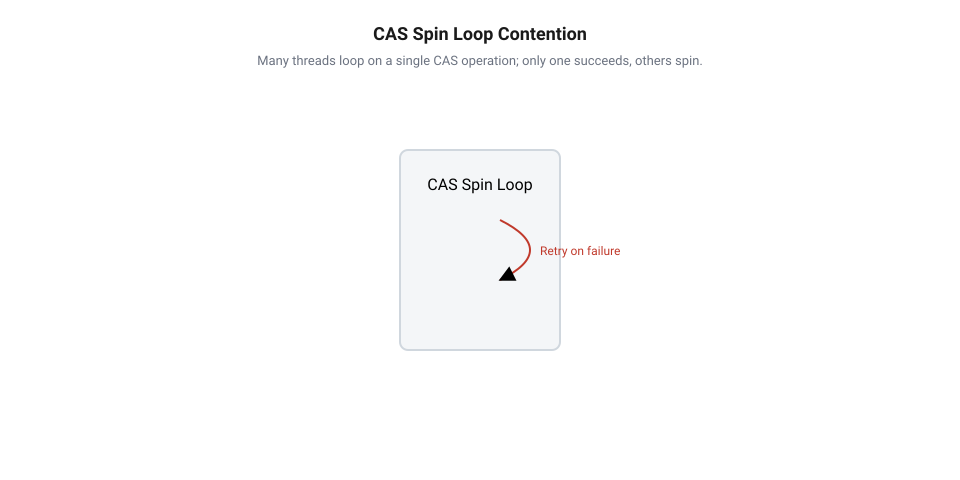
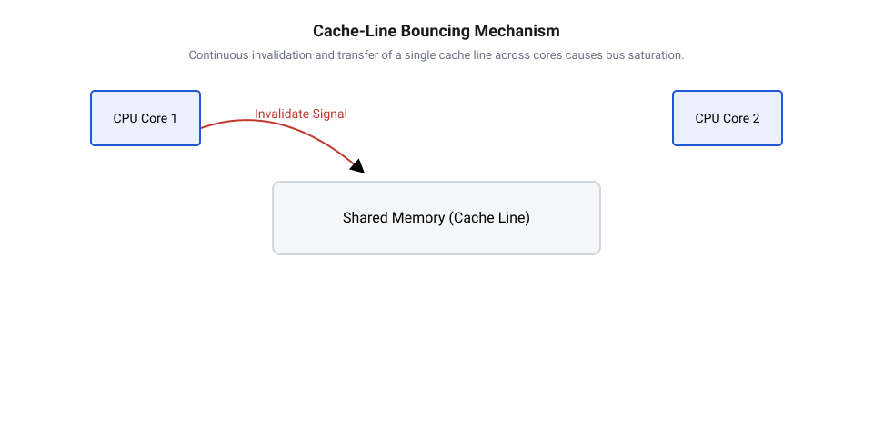
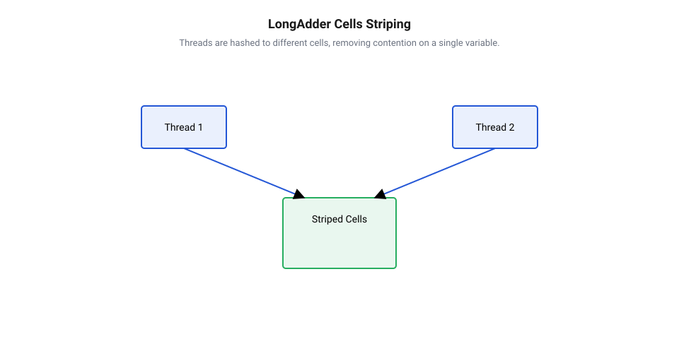
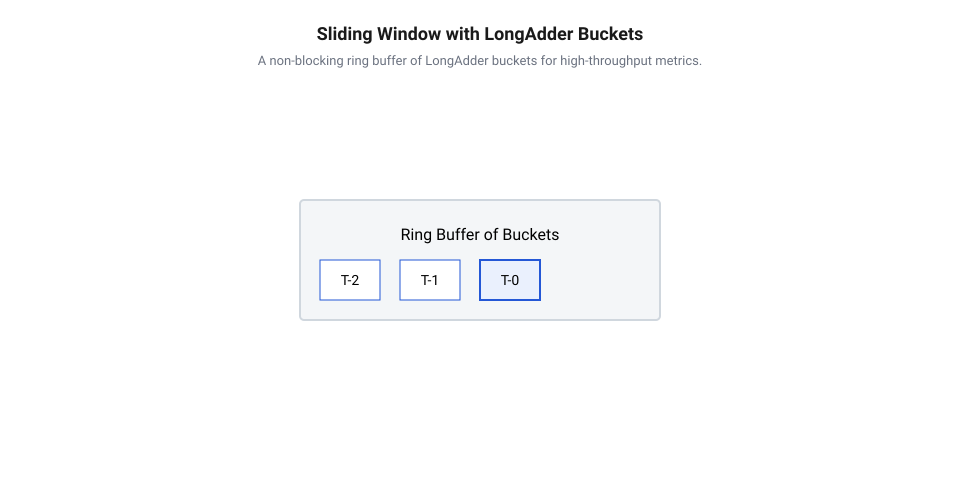

# Неблокуючі лічильники LongAdder і CAS

<preknowlist>
- [Безблокувальне оновлення стану за допомогою інструкції CAS](root:sf-tasks/cas-lock-free) — принцип роботи атомарної інструкції Compare-And-Swap та побудова базового CAS-циклу для оновлення значення.
- [Без замків](root:sf-tasks/lock-free-basics) — базові гарантії неблокуючої синхронізації та відсутність взаємного блокування потоків виконання.
</preknowlist>

## Деградація атомарного лічильника під навантаженням

У високонавантажених сервісах — від веб-серверів та API-шлюзів до систем аналітики в реальному часі — підрахунок подій є однією з найчастіших операцій. Сервер повинен збирати метрики оброблених запитів, підраховувати кількість активних з'єднань або відстежувати обсяги переданих байтів. Перше очевидне рішення — використання класичних блокувань (наприклад, м'ютекси чи секції синхронізації). Проте коли сотні паралельних потоків намагаються оновити єдиний лічильник через замок, продуктивність системи катастрофічно падає. Замість корисної роботи процесор витрачає час на засинання та пробудження потоків, переключення контексту (@@en|context switch@@) та арбітраж черг у ядрі операційної системи.

Прагнучи усунути оверхед блокувань, розробники переходять на [гарантії неблокуючої синхронізації](root:sf-tasks/lock-free-basics), що дозволяє потокам виконувати оновлення стану без призупинення виконання. На рівні мов програмування для цього застосовують атомарні змінні, такі як `AtomicLong` у Java або `std::atomic<int64_t>` у C++. Замість захоплення замка атомарні змінні спираються на [базову інструкцію порівняння](root:sf-tasks/cas-lock-free) та заміни значення — @@en|Compare-And-Swap@@ (від англ. *compare* — порівнювати, *swap* — міняти місцями, далі @@en|CAS@@).

Інструкція @@en|CAS@@ є атомарною апаратною операцією, яка приймає три аргументи: адресу комірки пам'яті, очікуване поточне значення та нове значення, яке необхідно записати. Процесор перевіряє, чи відповідає значення в пам'яті очікуваному. Якщо так — він записує нове значення і повертає `true`. Якщо ж інший потік встиг змінити комірку хоча б на один біт, перевірка провалюється, запис не відбувається, а операція повертає `false`.

Щоб забезпечити надійне оновлення лічильника в багатопотоковому середовищі, оновлення огортають у циклічне очікування @@en|spin-loop@@ (від англ. *spin* — обертатися, *loop* — цикл). Потік у циклі зчитує поточний стан лічильника, обчислює інкрементоване значення та намагається виконати операцію @@en|CAS@@. У багатьох мовах програмування для таких циклів застосовують слабку форму операції — @@en|compare_exchange_weak@@ (від англ. *compare* — порівнювати, *exchange* — обмінювати, *weak* — слабкий). На @@en|RISC@@-архітектурах (від англ. *Reduced Instruction Set Computer* — комп'ютер зі скороченим набором інструкцій), таких як ARM чи RISC-V, атомарне оновлення реалізують не єдиною інструкцією, а парою інструкцій завантаження зі зв'язуванням та умовного збереження — @@en|LL/SC@@ (від англ. *Load-Link/Store-Conditional*, де *load* — завантажувати, *link* — пов'язувати, *store* — зберігати, *conditional* — умовний). Через це слабкий @@en|CAS@@ схильний до випадкових невдач — @@en|spurious failure@@ (від англ. *spurious* — хибний, *failure* — невдача), коли операція повертає `false` навіть без зміни значення комірки іншим потоком (наприклад, через переривання або витіснення кеш-лінії). Для циклу @@en|spin-loop@@ це цілком прийнятно: відсутність додаткового апаратного перевірочного циклу, необхідного для сильної форми @@en|compare_exchange_strong@@ (від англ. *strong* — сильний), робить слабкий варіант значно дешевшим і швидшим. Якщо спроба невдала, потік не блокується, а негайно повторює весь цикл знову. Щоб запобігти марній витраті ресурсів процесора у щільному циклі очікування, у кожній ітерації застосовують паузу процесорного конвеєра @@en|pipeline@@ (від англ. *pipe* — труба, *line* — лінія) — апаратну інструкцію @@en|PAUSE@@ на x86 або @@en|YIELD@@ на ARM. Вона зменшує енергоспоживання ядра, запобігає скиданню конвеєра через помилкове передбачення розгалужень — @@en|branch misprediction@@ (від англ. *branch* — гілка, *misprediction* — хибне передбачення), а також вивільняє ресурси виконання для сусідніх апаратних потоків при гіперпотоковості @@en|hyper-threading@@ (від англ. *hyper* — над, *thread* — потік):

:::tabs
:::code root\eng\sf-tasks\cas-and-longadder-counters/cas-and-longadder-counters-d/java/atomiceventcounter.java c
:::code root\eng\sf-tasks\cas-and-longadder-counters/cas-and-longadder-counters-d/cpp/atomiceventcounter.cpp cpp
:::code root\eng\sf-tasks\cas-and-longadder-counters/cas-and-longadder-counters-d/c/atomic-counter-init.c c
:::

Як показує [історія розвитку неблокуючих](root:sf-tasks/cas-and-longadder-counters/hist-cas-and-striped-counters.md) апаратних примітивів, поява інструкції @@en|CAS@@ у процесорних архітектурах стала величезним кроком уперед порівняно з грубими апаратними блокуваннями шини пам'яті. Проте при масштабуванні кількості процесорних ядер виявився серйозний недолік цієї моделі.

На низькому рівні конкуренції (1–4 потоки) @@en|AtomicLong@@ працює надзвичайно швидко, забезпечуючи мінімальну затримку виконання @@en|latency@@ (від англ. *latent* — прихований). Але щойно кількість паралельних потоків зростає до десятків або сотень, пропускна здатність @@en|throughput@@ (від англ. *through* — наскрізь, *put* — класти) лічильника різко падає.

Причина полягає в принциповому конфлікті спільного ресурсу. Коли `N` потоків одночасно виконують інструкцію @@en|CAS@@ над однією і тією ж коміркою пам'яті, процесор атомарно пропускає лише один потік. Лише один потік здійснює успішний запис і виходить із циклу. Решта `N - 1` потоків зазнають невдачі, виявляють зміну значення і змушені йти на другий виток циклу @@en|spin-loop@@. Оскільки всі вони роблять це одночасно, ймовірність того, що наступну спробу виконає конкретний потік, стає дедалі меншою.

Цю поведінку описує [математична модель конфліктів](root:sf-tasks/cas-and-longadder-counters/math-cas-contention-and-striping.md) в циклах очікування. Нехай `T_total` — загальний час, витрачений системою на успішний інкремент лічильника, `T_cas` — базовий час виконання однієї інструкції @@en|CAS@@, `N` — кількість активних конкурентних потоків, `P_fail(k)` — ймовірність того, що `k`-ша спроба завершиться невдачею, а `T_overhead` — оверхед повторної перевірки пам'яті та арбітражу.

```
T_total = T_cas + T_retry
= T_cas + ∑ (k × P_fail(k) × T_overhead)      [підсумовування затримок невдалих спроб]
= O(N²)                                      [квадратична деградація від кількості потоків]
```

При малих `N` значення `T_retry` є близьким до нуля, і загальний час дорівнює `T_cas`. Але із зростанням `N` ймовірність успіху будь-якого потоку падає за законом `1 / N`, а кількість марних повторів зростає пропорційно `N`. У результаті загальні витрати процесорного часу на одну корисну операцію інкременту зростають за квадратичним законом `O(N²)`.

Замість виконання корисної бізнес-логіки процесорні ядра потрапляють у [явище зациклення потоків](root:sf-os/spin-loop-livelock) у нескінченному @@en|spin-loop@@. Потоки спалюють 100% обчислювальних ресурсів CPU, але сумарна кількість оброблених подій на секунду падає практично до нуля. Для детальнішого ознайомлення з класифікацією неблокуючих алгоритмів та способами розв'язання супутніх апаратних проблем перегляньте керівництво про [гарантії прогресу у безблокових алгоритмах та проблему ABA](root:sf-algorithms/lock-free-progress-guarantees-and-aba-problem).


*Підпис: Схема виникнення конфліктів у циклі CAS при одночасному оновленні спільного атомарного лічильника кількома потоками.*

## Причина конфліктів у кеш-лініях

Падіння продуктивності @@en|spin-loop@@ у циклі @@en|CAS@@ виглядає парадоксально на рівні програмного коду, адже потоки не викликають системних викликів і не переходять у стан очікування (@@en|BLOCKED@@). Щоб збагнути справжні причинно-наслідкові зв'язки цього сповільнення, необхідно розглянути апаратний рівень взаємодії процесорних ядер та пам'яті.

Сучасні багатоядерні процесори побудовані з використанням багаторівневої ієрархії кешів. Кожне процесорне ядро має власні надшвидкі кеші першого (L1) та другого (L2) рівнів, тоді як кеш третього рівня (L3) або оперативна пам'ять є спільними для всіх ядер. Процесор ніколи не зчитує і не записує окремий байт або 64-бітну змінну безпосередньо в оперативну пам'ять — обмін даними відбувається фіксованими блоками даних, які називаються кеш-лініями @@en|cache line@@ (від англ. *cache* — схованок, *line* — рядок). Типовий розмір кеш-лінії становить 64 байти.

Коли змінна лічильника `AtomicLong` розміщується в пам'яті, вона потрапляє в один із таких 64-байтових блоків. Для забезпечення єдиного та узгодженого бачення пам'яті всіма ядрами апаратне забезпечення використовує [протоколи когерентності кешу](root:sf-distributed/cache-coherence-and-line-bouncing). Одним із найпоширеніших є протокол @@en|MESI@@ (абревіатура від *Modified, Exclusive, Shared, Invalid*). За цим протоколом кожна кеш-лінія в L1/L2 кеші конкретного ядра перебуває в одному з чотирьох станів:

1. **Shared (S)** — кеш-лінія присутня в кешах декількох ядер, її вміст є актуальним і придатним лише для зчитування. 2. **Exclusive (E)** — кеш-лінія присутня в кеші тільки одного ядра, дані актуальні і не змінювалися порівняно з L3/RAM. 3. **Modified (M)** — кеш-лінія змінена локальним ядром, містить єдину актуальну копію даних і повинна бути скинута в пам'ять перед звільненням. 4. **Invalid (I)** — дані в кеш-лінії є застарілими через те, що інше ядро виконало запис у цю комірку.

Коли декілька потоків лише зчитують значення атомарного лічильника, її @@en|cache line@@ знаходиться у стані **Shared** у кешах L1/L2 усіх ядер. Зчитування відбувається миттєво з локального кешу без виходу на зовнішню шину.

Проте операція інкременту лічильника є операцією читання-модифікації-запису @@en|Read-Modify-Write@@ (далі @@en|RMW@@). Для успішного виконання інструкції @@en|CAS@@ ядро процесора змушене перевести кеш-лінію зі стану **Shared** у стан **Modified**. 

Щоб отримати ексклюзивне право на запис, ядро надсилає через внутрішню шину міжпроцесорної взаємодії @@en|interconnect@@ (від англ. *inter* — між, *connect* — з'єднувати) системний сигнал інвалідації (@@en|Invalidate@@). Отримавши цей сигнал, усі інші ядра процесора маркують копію цієї кеш-лінії у своїх кешах L1/L2 як **Invalid**.

Тут і виникає катастрофічний мікроархітектурний конфлікт. Припустимо, ядро A виконує @@en|CAS@@ і надсилає сигнал інвалідації. Кеш-лінія в кешах ядер B, C та D негайно стає **Invalid**. Через декілька наносекунд ядро B у своєму циклі @@en|spin-loop@@ намагається виконати наступну спробу @@en|CAS@@. Виявляється, що потрібна кеш-лінія інвалідована — відбувається кеш-промах (@@en|cache miss@@). Конвеєр виконання ядра B вимушено призупиняється.

Ядро B надсилає по шині @@en|interconnect@@ запит на отримання оновленого кеш-рядка з кешу ядра A. Після передачі 64-байтового блоку ядро B вимагає монопольного права на запис і у свою чергу надсилає шинний сигнал інвалідації для всіх інших ядер, включаючи ядро A.

Цей процес неперервного хаотичного кочування кеш-рядка між L1/L2 кешами різних ядер дістав назву перегони кеш-ліній @@en|cache-line bouncing@@ (від англ. *bounce* — відбиватися, підстрибувати).

При високій конкуренції перегони кеш-ліній призводять до виснаження шини пам'яті та створення системного «шторму інвалідацій». Замість виконання корисних команд конвеєри ядер процесора простаюють у чергах на арбітраж міжпроцесорної шини. Більше того, інструкція @@en|CAS@@ на багатьох архітектурах викликає апаратний замок шини @@en|bus lock@@ (наприклад, префікс `LOCK` в х86), який блокує транзакції пам'яті навіть для тих ядер, які виконують абсолютно сторонні задачі.

Ось чому спроба багатьох потоків оновити єдину змінну `AtomicLong` перетворює цю комірку на централізовану точку конфлікту. Щоб відновити лінійне масштабування та гарантувати високу пропускну здатність, необхідно кардинально змінити підхід — усунути єдину точку запису, розподіливши операції інкременту по різних кеш-лініях, що реалізовано в акумуляторах `LongAdder`.


*Підпис: Механізм перегонів кеш-ліній (cache-line bouncing) та навантаження шини пам'яті при виконанні протоколів когерентності.*

## Архітектура шардованого акумулятора LongAdder

Коли сотні паралельних потоків намагаються одночасно виконувати інкремент єдиної комірки `AtomicLong`, продуктивність системи падає через постійні конфлікти в циклі `CAS` та перегони кеш-ліній. Для подолання цього бар'єра масштабованості концепцію оновлення спільного стану необхідно фундаментально змінити: замість примусового зведення всіх потоків до єдиної точки запису в пам'яті використовують децентралізацію обчислень. Цей підхід отримав назву шардування (від англ. *stripe* — смуга, далі @@en|striping@@). Замість однієї змінної створюється динамічний масив локалізованих комірок (від англ. *cell* — комірка, далі @@en|Cell@@), між якими розподіляються операції запису різних процесорних ядер.

Як показує аналіз в [історії розвитку атомарних примітивів](root:sf-tasks/cas-and-longadder-counters/hist-cas-and-striped-counters.md), еволюція неблокуючих алгоритмів привела від одинарних апаратних інструкцій до розподілених структур даних типу `LongAdder`. Базовий принцип такого акумулятора полягає у двовентильному розподілі навантаження. Клас містить дві ключові складові: базове поле `base` та масив комірок `cells`.

Поки конкуренція між потоками відсутня або залишається низькою, акумулятор працює в режимі мінімальних витрат. Кожен потік намагається оновити поле `base` за допомогою швидкої інструкції @@en|CAS@@. Якщо конкуренції немає, запис проходить миттєво, а масив `cells` взагалі не виділяється в оперативній пам'яті. Проте щойно потік зазнає невдачі при спробі оновити `base` — що свідчить про наявність паралельного запису з іншого ядра — акумулятор ледачо (від англ. *lazy* — ледачий, ініціалізація за вимогою, далі @@en|lazy initialization@@) ініціалізує масив `cells` і переводить систему в режим шардування.

Для розподілу потоків по комірках масиву кожному потоку призначається псевдовипадковий ідентифікатор — зонд потоку (від фр. *sonde* — щуп, перевірка, далі @@en|thread probe@@). У Java для цього використовують внутрішнє поле `threadLocalRandomProbe`. Обчислення індексу комірки в масиві відбувається через швидку побітову операцію:

```
index = thread_probe ∧ (cells_length - 1)      [побітове І для масиву степеня двійки]
```

Отримавши індекс, потік виконує операцію @@en|CAS@@ не над глобальною змінною, а виключно над значенням у `cells[index]`. Оскільки розмір масиву `cells` є степенем двійки, побітове І діє як надшвидкий аналог обчислення за модулем.

Якщо у вибраній комірці також виникає конфлікт (два потоки з однаковим хешем одночасно спробували оновити одну й ту саму комірку `Cell`), потік не застрягає в нескінченному циклі. Початковий зонд потоку (у Java — поле `ThreadLocalRandom.probe`) ініціалізується ледачо при першому зверненні до лічильника. За невдалої спроби виконувати операцію @@en|CAS@@ над коміркою потік видозмінює свій @@en|thread probe@@ за допомогою алгоритму рехешування @@en|xorshift@@ (від англ. *exclusive OR* — виключне АБО, *shift* — зсув, далі @@en|xorshift@@), який виконує швидкі побітові зсуви та операції виключного АБО. Це миттєво перенаправляє потік до іншого індексу масиву на наступній ітерації без блокувань та викликів операційної системи. Якщо зіткнення повторюються навіть після зміни зонда, а розмір масиву `cells` є меншим за кількість доступних процесорних ядер, масив динамічно розширюється вдвічі (від англ. *resize* — змінювати розмір, далі @@en|dynamic resizing@@). Для безпечного виділення чи збільшення масиву без важких блокувань використовується атомарний прапорець @@en|cellsBusy@@ (від англ. *busy* — зайнятий, далі @@en|cellsBusy@@), який працює як неблокуючий спін-лок зі значеннями 0 та 1. Потік, який першим успішно змінює прапорець @@en|cellsBusy@@ з 0 на 1 за допомогою операції @@en|CAS@@, отримує ексклюзивне право виділити новий масив подвоєного розміру, скопіювати посилання на наявні комірки `Cell` та скинути прапорець у 0. Потоки, яким не вдалося захопити @@en|cellsBusy@@, не застрягають у блокуванні, а знову виконують рехешування свого @@en|thread probe@@ і намагаються оновити інші доступні комірки. Розширення зупиняється при досягненні кількості фізичних ядер процесора, адже подальше збільшення масиву не дасть мікроархітектурного виграшу.

Згідно з [математичною моделлю шардування](root:sf-tasks/cas-and-longadder-counters/math-cas-contention-and-striping.md), розподіл `N` паралельних потоків по `M` комірках зменшує ймовірність конфлікту на конкретному елементі. При `M ≥ N` кожне процесорне ядро здійснює запис у власний кеш-рядок без інвалідації кешів сусідніх ядер. Це перетворює квадратичну деградацію затримок `O(N²)` на константний час виконання `O(1)` для кожного інкременту.


*Підпис: Схема розподілу потоків по окремих комірках масиву LongAdder за допомогою хешування потоку.*

Нижче наведено приклад реалізації концепції шардованого лічильника, яка демонструє розподіл операцій запису по масиву комірок:

:::tabs
:::code root\eng\sf-tasks\cas-and-longadder-counters/cas-and-longadder-counters-d/java/metricsbuffer.java c
:::code root\eng\sf-tasks\cas-and-longadder-counters/cas-and-longadder-counters-d/cpp/stripedaccumulator.cpp cpp
:::code root\eng\sf-tasks\cas-and-longadder-counters/cas-and-longadder-counters-d/c/striped-accumulator-init.c c
:::

## Захист від хибного розділення кешу

Створення масиву комірок `Cell[]` вирішує логічну проблему розподілу потоків, але на мікроархітектурному рівні виникає прихована пастка. Змінні типу `long` або об'єкти `Cell` розміщуються в оперативній пам'яті послідовно один за одним. Типовий розмір кеш-лінії становить 64 байти, тоді як 64-бітне число займає всього 8 байтів. Це означає, що до одного кеш-рядка потрапляють одразу 8 сусідніх комірок `Cell`.

Коли потік A оновлює `cells[0]` на першому процесорному ядрі, а потік B оновлює `cells[1]` на другому процесорному ядрі, апаратний протокол когерентності працює з усім 64-байтовим блоком. Ядро A надсилає шинний сигнал інвалідації, який маркує весь кеш-рядок у кеші L1/L2 ядра B як недійсний. Незважаючи на те, що потоки модифікують абсолютно різні змінні, ядра продовжують конкурувати за один і той самий кеш-рядок. Цей ефект називається хибним розділенням кеш-ліній (від англ. *false* — хибний, *sharing* — спільне використання, далі @@en|false sharing@@).

Без спеціального захисту шардування втрачає свій зміст: замість прискорення виконання система знову потрапляє у виснажливі перегони кеш-ліній. Для усунення хибного розділення застосовують вирівнювання пам'яті (від англ. *align* — вирівнювати, далі @@en|memory alignment@@) та падінг (від англ. *pad* — підкладка, заповнювати, далі @@en|padding@@). Детальніше про механізми вирівнювання пам'яті та боротьбу з міжядерними конфліктами читайте у статті про [хибне розділення кеш-ліній та падінг у багатопотокових структурах](root:sf-lang/false-sharing-padding).

Сутність падінгу полягає у додаванні «порожніх» неробочих байтів навколо кожної комірки `Cell`, щоб штучно збільшити її розмір до обсягу одного або двох кеш-рядків. У Java для цього використовують спеціальну анотацію `@sun.misc.Contended` (далі @@en|Contended@@). Під час компіляції та розміщення об'єктів у купі JVM додає 128 байтів порожнього простору перед і після полів класу `Cell`. Додатковий запас у 128 байтів (замість 64) гарантує захист не лише від знаходження сусідніх комірок в одному кеш-рядку, а й від упередженої вибірки даних (від англ. *prefetch* — попередньо вибирати, далі @@en|spatial prefetcher@@) апаратними контролерами сучасних процесорів.

В мовах C та C++ ізоляцію комірок досягають за допомогою специфікатора вирівнювання `alignas(64)` або додавання явних масивів-заповнювачів `char padding[56]`.


*Підпис: Порівняльне розташування комірок у кеш-рядках із вирівнюванням пам'яті та без нього.*

Другою фундаментальною особливістю акумуляторів `LongAdder` є механізм підрахунку підсумкового значення через метод `sum()`. На відміну від `AtomicLong`, де поточний стан єдиної змінної є завжди точно відомим, у `LongAdder` підсумкове значення розсіяне по масиву `cells` та полю `base`.

Для отримання загальної суми метод `sum()` послідовно обходить поле `base` та всі існуючі комірки масиву `cells`, додаючи їхні значення. Проте під час цього обходу інші потоки продовжують паралельно виконувати операції `increment()` та `add()`. Метод `sum()` не блокує записи і не робить атомарного знімка (від англ. *snapshot* — знімок, далі @@en|atomic snapshot@@) пам'яті.

Через відсутність блокувань обчислене значення є підсумково узгодженим (від англ. *eventual* — кінцевий, *consistency* — узгодженість, далі @@en|eventual consistency@@). Якщо під час обходу масиву потік A вже додав одиницю в `cells[0]` і перейшов до `cells[1]`, а потік B у цей же момент інкрементував `cells[0]`, метод `sum()` може не врахувати цей новий інкремент у поточному виклику. Точне значення гарантується лише у випадку, коли в момент виклику `sum()` паралельні записи тимчасово припинилися.

Звідси випливає чіткий інженерний критерій вибору між примітивами:

1. `AtomicLong` слід обирати тоді, коли необхідна негайна й абсолютна точність значення при кожному зчитуванні (наприклад, для генерації унікальних ідентифікаторів, лічильників транзакцій або суворого лімітування ресурсів). Як зазначається у [довіднику атомарних примітивів](root:sf-tasks/cas-and-longadder-counters/api-longadder-and-cas-primitives.md), за цю точність доводиться платити деградацією пропускної здатності при високому навантаженні. 2. `LongAdder` є ідеальним вибором, коли частота записів значно перевищує частоту зчитувань, а система орієнтована на максимальний @@en|throughput@@. У [системах моніторингу високої пропускної](root:sf-tasks/cas-and-longadder-counters/proj-high-throughput-metrics-counter.md) здатності підрахунок мільйонів метрик на секунду за допомогою `LongAdder` не створює процесорних заторів.

На відміну від складніших концепцій, таких як [узгодженого читання без блокувань](root:sf-tasks/seqlock) або [механізмах читання без замків](root:sf-tasks/read-copy-update), акумулятор `LongAdder` оптимізує саме операцію запису, жертвуючи атомарністю миттєвого зчитування заради бездоганного паралельного масштабування.

## Компроміс між точністю та швидкістю

У багатопотоковій архітектурі не існує універсального примітива синхронізації, який забезпечує ідеальну продуктивність для будь-якого сценарію. Розробка високонавантажених систем завжди зводиться до пошуку балансу між двома протилежними вимогами: суворою послідовною узгодженістю зчитування та максимальною пропускною здатністю запису. Вибір між атомарною змінною `AtomicLong` (або `std::atomic<int64_t>`) та шардованим акумулятором `LongAdder` є класичним прикладом цього архітектурного компромісу.

Атомарні змінні класу `AtomicLong` орієнтовані на забезпечення суворої точності та негайної узгодженості стану. Будь-який виклик методів зчитування або оновлення повертає єдине абсолютно точне значення на момент виконання операції. Це досягається завдяки тому, що стан лічильника зосереджений в одній комірці пам'яті, над якою виконуються атомарні інструкції @@en|CAS@@.

Така гарантія є критично важливою у алгоритмах, де логіка виконання залежить від точного атомарного переходу стану за схемою «перевірка та дія». Прикладами таких завдань є:
1. **Генерація унікальних ідентифікаторів та послідовних номерів**: кожне зчитування мусить гарантувати отримання унікального значення, яке більше ніколи не буде повернуте іншому потоку. 2. **Суворе лімітування ресурсів**: алгоритми типу Token Bucket або Leaky Bucket, у яких лічильник не повинен опускатися нижче нуля або перевищувати задану квоту. Якщо два потоки одночасно зчитають застаріле значення, система може пропустити більше запитів, ніж дозволено. 3. **Точний облік токенів та транзакцій**: де кожна одиниця має фінансову або логічну цінність і не допускає кінцевої розбіжності.

Проте за сувору точність `AtomicLong` платить високою ціною під навантаженням. Коли сотні потоків одночасно модифікують одну комірку, виникають виснажливі [перегони кеш-ліній](root:sf-distributed/cache-coherence-and-line-bouncing), які перетворюють циклічні спроби @@en|CAS@@ на квадратичну деградацію затримок (від англ. *latency* — затримка, далі @@en|latency@@).

На протилежному боці спектра знаходиться `LongAdder`. Цей акумулятор оптимізований для досягнення максимальної пропускної здатності запису (від англ. *throughput* — пропускна здатність, далі @@en|throughput@@) за умов високої паралельної конкуренції. Завдяки шардуванню операцій по масиву комірок із захистом від хибного розділення кешу кожен потік виконує інкремент у власній локалізованій комірці за константний час `O(1)`.

Ціною такого прискорення є відмова від негайної атомарної узгодженості при зчитуванні. Метод `sum()` не здійснює атомарного знімка (від англ. *atomic snapshot* — атомарний знімок, далі @@en|atomic snapshot@@) пам'яті та не блокує паралельні записи. Він послідовно додає значення базового поля та всіх комірок масиву. Якщо під час обходу масиву потоки продовжують виконувати інкременти, обчислене значення є підсумково узгодженим (від англ. *eventual consistency* — кінцева узгодженість, далі @@en|eventual consistency@@). З цієї причини `LongAdder` принципово неможливо застосовувати для генерації послідовностей чи атомарного зменшення лічильника з перевіркою межі, адже в ньому відсутня єдина атомарна операція над загальною сумою.

Крім того, необхідно враховувати витрати оперативної пам'яті (від англ. *overhead* — накладні витрати, далі @@en|overhead@@). Екземпляр `AtomicLong` займає лише 8 байтів корисного навантаження, тоді як `LongAdder` при виникненні конфліктів динамічно виділяє масив комірок, де кожна комірка доповнюється падінгом у 128 байтів для ізоляції кеш-рядків.

Для практичного вибору між примітивами доцільно керуватися наступними критеріями:

1. **AtomicLong** обирають при високій частоті читань або коли кожне зчитування вимагає строгої точності й атомарного переходу стану. Як підкреслюється в [довіднику методів атомарних](root:sf-tasks/cas-and-longadder-counters/api-longadder-and-cas-primitives.md) примітивів, ціна такої точності — суттєвий оверхед при паралельному записі. 2. **LongAdder** обирають для високонавантажених метрик та лічильників подій, де частота записів у сотні разів перевищує частоту читання суми, а бізнес-логіці достатньо підсумкової узгодженості.

На відміну від складніших алгоритмів, таких як [парадигмою читання без](root:sf-tasks/read-copy-update) блокувань чи [алгоритмами узгодженого читання](root:sf-tasks/seqlock), шардований акумулятор вирішує саме проблему масштабування записів.

Нижче наведено порівняльний приклад використання обидвох примітивів у реалізаціях лімітера квот та агрегатора метрик:

:::tabs
:::code root\eng\sf-tasks\cas-and-longadder-counters/cas-and-longadder-counters-d/java/executiontradeoffdemo.java c
:::code root\eng\sf-tasks\cas-and-longadder-counters/cas-and-longadder-counters-d/cpp/strictratelimiter.cpp cpp
:::code root\eng\sf-tasks\cas-and-longadder-counters/cas-and-longadder-counters-d/c/rate-limiter-init.c c
:::

## Інтеграція неблокуючих лічильників у моніторинг

У промислових високонавантажених сервісах обробка телеметрії та збір метрик відбуваються безперервно паралельно з виконанням основної бізнес-логіки. Якщо веб-сервер обробляє сотні тисяч запитів на секунду, будь-яке затримання у потоці моніторингу миттєво відбивається на загальній затримці системи. Просте накопичення підсумкової кількості подій від моменту запуску програми дає лише загальне уявлення про стан сервісу. Для реального моніторингу, розрахунку завантаженості, контролю рівня сервісу та спрацювання сигналів тривоги необхідні метрики у ковзному вікні (від англ. *sliding window* — ковзне вікно, далі @@en|sliding window@@) — наприклад, підрахунок кількості запитів за останні 60 секунд.

Класична реалізація ковзного вікна на основі черги подій із часовими позначками під м'ютексом створює приховану «пляшкове шийку». Робочі потоки змушені конкурувати за замок при кожному запиті лише для того, щоб зареєструвати метрику. Для досягнення максимальної пропускної здатності метричну систему будують на основі неблокуючих часових кошиків (від англ. *bucket* — кошик, далі @@en|bucket@@) із шардованими лічильниками `LongAdder`. Більше про принципи розбиття інтервалів та побудову кільцевого буфера дивіться у матеріалі про [кошики ковзного вікна на неблокуючих лічильниках](root:sf-algorithms/sliding-window-lock-free-counter).

Архітектура неблокуючого ковзного вікна спирається на три ключові елементи:
1. **Кільцевий буфер часових кошиків**: створюється масив фіксованого розміру `N`, де кожен елемент відповідає окремому часовому інтервалу (від англ. *time slot* — часовий інтервал, далі @@en|time slot@@), наприклад, 1 секунді. Для вікна тривалістю 60 секунд використовується масив із 60 кошиків (від англ. *ring buffer* — кільцевий буфер, далі @@en|ring buffer@@). 2. **Атомарний ідентифікатор епохи кошика**: кожен кошик містить часову позначку в секундах, яка вказує, до якої саме секунди належать поточні дані. 3. **Шардований акумулятор у кожному кошику**: всередині кошика розміщується екземпляр `LongAdder`, який приймає інкременти від паралельних потоків без призупинення виконання.

Алгоритм запису події по черзі виконує наступні кроки без захоплення блокувань:
1. Потік зчитує поточний системний час у секундах `now_sec`. 2. Обчислюється індекс кошика в кільцевому буфері за допомогою операції остачі від ділення: `index = now_sec % window_size`. 3. Потік зчитує часову позначку кошика за цим індексом. 4. Якщо часова позначка кошика є застарілою (меншою за `now_sec`), це означає, що кошик зберігає дані попередньої хвилини. Потік намагається оновити часову позначку на `now_sec` та скинути лічильник `LongAdder` за допомогою методу `reset()`. 5. Після актуалізації кошика потік виконує метод `increment()` над `LongAdder` поточного кошика.

Завдяки тому, що оновлення часової позначки та скидання кошика відбуваються лише раз на секунду (при зміні епохи), а всі інші мільйони інкрементів виконуються безпосередньо над шардованим акумулятором, конкуренція між потоками повністю усувається.

Зчитування підсумкової метрики за ковзне вікно (наприклад, для відправки в систему аналітики) відбувається паралельно, не блокуючи жодного робочого потоку:
1. Потік-зчитувач отримує поточний час `now_sec`. 2. Перебирає всі кошики в кільцевому буфері. 3. Для кожного кошика перевіряється умова актуальності: `now_sec - bucket.timestamp < window_size`. 4. Якщо кошик потрапляє у поточне вікно, його значення `bucket.counter.sum()` додається до загальної суми.


*Підпис: Архітектура неблокуючого ковзного вікна для обчислення метрик пропускної здатності.*

Як показано в [проєкті високонавантаженої системи](root:sf-tasks/cas-and-longadder-counters/proj-high-throughput-metrics-counter.md) моніторингу, такий підхід дозволяє обробляти десятки мільйонів подій на секунду з практично нульовими затримками на збір телеметрії. Завдяки відсутності динамічного виділення пам'яті під час запису подій система не створює навантаження на збирач сміття (@@en|garbage collector@@), забезпечуючи передбачуваний профіль продуктивності.

При виникненні граничних випадків, таких як [проблеми ABA в](root:sf-tasks/aba-problem) неблокувальних структурах або затримки системного годинника, використання ротації епох гарантує, що застарілі кошики будуть коректно очищені до того, як у них почнеться запис нового інтервалу. Завдяки цим властивостям шардовані акумулятори стали стандартом де-факто у сучасних бібліотеках моніторингу та метрик.

Нижче наведено повну реалізацію неблокуючого ковзного вікна лічильника метрик трьома мовами програмування:

:::tabs
:::code root\eng\sf-tasks\cas-and-longadder-counters/cas-and-longadder-counters-d/java/slidingwindowcounter.java c
:::code root\eng\sf-tasks\cas-and-longadder-counters/cas-and-longadder-counters-d/cpp/slidingwindowcounter.cpp cpp
:::code root\eng\sf-tasks\cas-and-longadder-counters/cas-and-longadder-counters-d/c/sliding-window-init.c c
:::