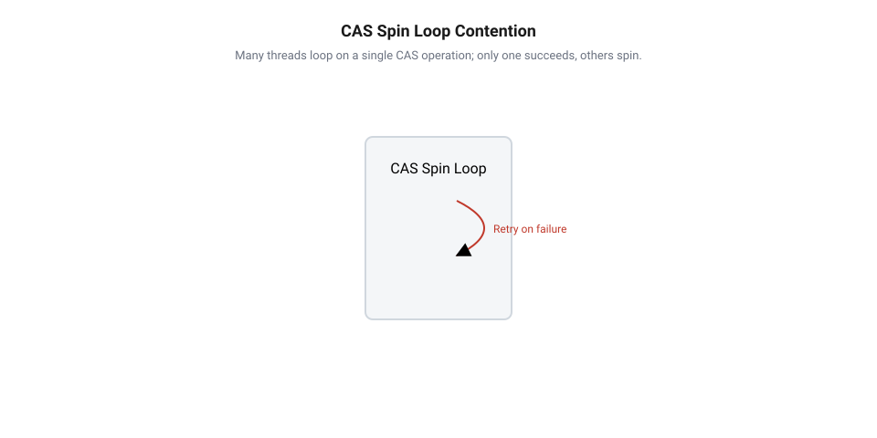
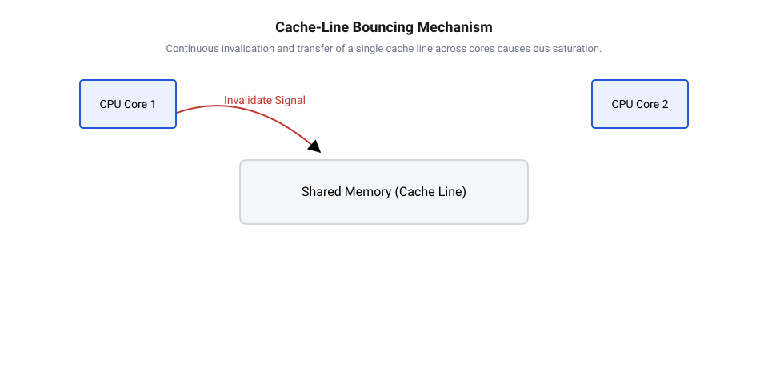
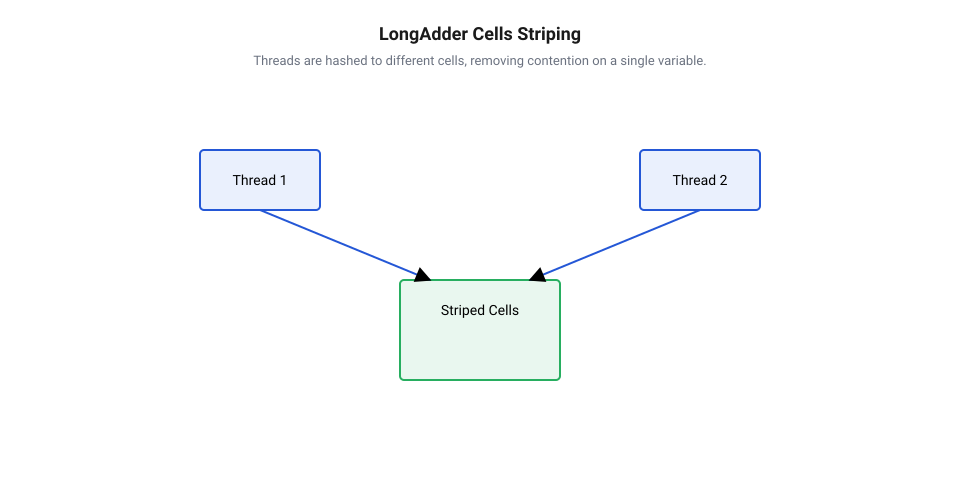

# Неблокуючі лічильники LongAdder і CAS

<preknowlist>
- [Без замків](root:sf-tasks/lock-free-basics) — базові гарантії неблокуючої синхронізації та відсутність взаємного блокування потоків виконання
- [Безблокувальне оновлення стану за допомогою інструкції CAS](root:sf-tasks/cas-lock-free) — принцип роботи атомарної інструкції Compare-And-Swap та організація циклу повторних спроб для оновлення значення
</preknowlist>

## Деградація атомарного лічильника під навантаженням

Замки блокують потоки оверхедом системи. Для швидкого підрахунку подій використовують [гарантії неблокуючої синхронізації](root:sf-tasks/lock-free-basics) через атомарні змінні на базі [інструкції Compare-And-Swap](root:sf-tasks/cas-lock-free) (англ. @@en|Compare-And-Swap@@, від *compare* — порівнювати, *swap* — міняти місцями, далі @@en|CAS@@). Вона оновлює комірку лише за умови збігу значення з очікуваним.

Потік працює в циклі очікування @@en|spin loop@@ (від *spin* — крутитися, *loop* — цикл): зчитує число, додає одиницю й викликає @@en|CAS@@. За випередження іншим потоком операція повертає хибу, змушуючи повторити спробу.

Під навантаженням сотень потоків успіху досягає лише один. Решта марно повторюють цикл: кількість спроб зростає як `O(N²)`. Ядра спалюють 100% потужності на холості повтори, викликаючи колапс пропускної здатності.

*Конкуренція за спільну комірку призводить до масових невдач CAS і марного спалювання ресурсів ядер.*

## Причина конфліктів у кеш-лініях

Деградація зумовлена будовою кешу: процесор обмінюється з пам'яттю 64-байтовими блоками — кеш-лініями (англ. @@en|cache line@@, від *cache* — сховок, *line* — рядок). Змінна лічильника завжди займає частину однієї лінії.

Протокол @@en|MESI@@ (від *Modified, Exclusive, Shared, Invalid*) вимагає монопольного володіння рядком для запису. Перед виконанням @@en|CAS@@ ядро переводить свою @@en|cache line@@ у стан **Modified**, надсилаючи шинний сигнал інвалідації. Це маркує лінію в інших ядрах як **Invalid**.

Одночасні записи породжують шторм інвалідацій. Щойно одне ядро оновлює стан, інші зазнають кеш-промаху й чекають передачі 64 байтів шиною. Це неперервне кочування блоку називають перегонами кеш-ліній (англ. @@en|cache line bouncing@@, від *bounce* — відскакувати). Воно перевантажує шину пам'яті та блокує конвеєри ядер.

*Кочування кеш-лінії між ядрами перевантажує шину інвалідаціями та зупиняє процесорні конвеєри.*

## Архітектура шардованого акумулятора LongAdder

Щоб зняти конфлікт навколо змінної, стан децентралізують через шардування (англ. @@en|sharding@@, від *shard* — уламок). Акумулятор @@en|LongAdder@@ (від *long* — довге ціле, *adder* — суматор) розділяє стан на поле `base` та динамічний масив комірок (англ. @@en|Cell@@, від *cell* — комірка).

Без суперництва потоки оновлюють `base` через @@en|CAS@@. За першого конфлікту виділяється масив комірок. Потік отримує числовий зонд (англ. @@en|thread probe@@, від *probe* — зонд) і вибирає комірку маскуванням: `index = probe ∧ (cells_length - 1)`. Степінь двійки в розмірі масиву розводить потоки по різних комірках @@en|Cell@@ без черг.

При зіткненні на комірці потік рехешує зонд @@en|thread probe@@ побітовими зсувами й обирає іншу. За частих конфліктів масив подвоюється до числа ядер процесора, забезпечуючи константний час `O(1)`.

*Шардування розносить записи по окремих комірках масиву без конкуренції за пам'ять.*

## Захист від хибного розділення кешу

Масив комірок приховує апаратну пастку: 64-бітне число займає 8 байтів, тому в одну 64-байтову @@en|cache line@@ потрапляє відразу вісім сусідніх комірок @@en|Cell@@.

Коли різні ядра змінюють сусідні комірки, протокол @@en|MESI@@ однаково інвалідує всю лінію цілком. Ядра продовжують руйнівний @@en|cache line bouncing@@ навіть без спільних даних. Це явище називають хибним розділенням кешу (англ. @@en|false sharing@@, від *false* — хибний, *share* — спільно ділити).

Для ізоляції комірок використовують байтовий падінг (англ. @@en|padding@@, від *pad* — підкладка): до @@en|Cell@@ додають порожні байти, доводячи розмір до 128 байтів. Це розносить комірки в окремі кеш-лінії та блокує випереджальну вибірку (англ. @@en|prefetcher@@, від *prefetch* — вибирати наперед), яка завантажує лінії парами.

*Байтовий падінг розносить комірки по окремих кеш-лініях, ліквідуючи хибне розділення пам'яті.*

## Компроміс між точністю та швидкістю

Шардування прискорює запис ціною ускладнення читання. Щоб отримати суму, лічильник послідовно додає поле `base` та значення всіх комірок @@en|Cell@@ без блокування паралельних записів і без створення атомарного знімка.

Якщо під час сумування тривають оновлення, результат може не врахувати найновіших змін. Структура @@en|LongAdder@@ гарантує підсумкову узгодженість (англ. @@en|eventual consistency@@, від *eventual* — кінцевий, *consistency* — узгодженість): точна сума відома лише після завершення записів. На відміну від [алгоритмів узгодженого читання](root:sf-tasks/seqlock) чи [механізмів читання без замків](root:sf-tasks/read-copy-update), примітив розмінює строгість читання на швидкість запису.

Правило вибору спирається на вимоги задачі:
- Атомарні змінні обирають для суворої точності: унікальні ідентифікатори, банківські операції чи ліміти запитів. - Акумулятор @@en|LongAdder@@ застосовують для метрик і телеметрії, де темп запису важливіший за миттєву точність.