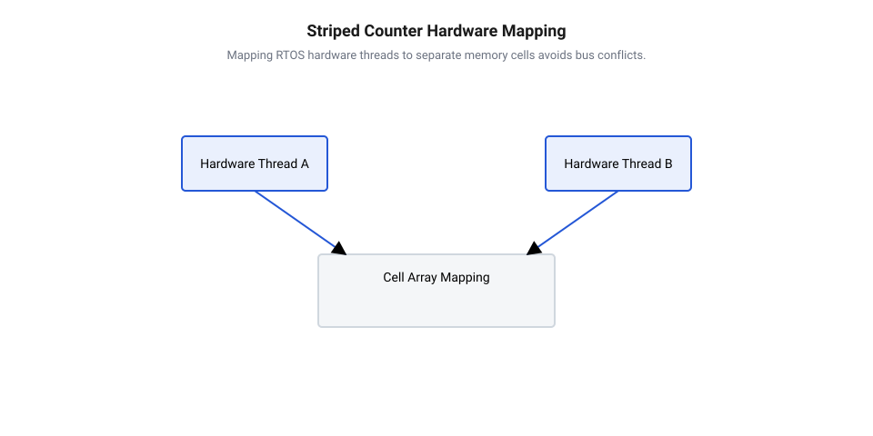

## Початкові концепції та фізичні принципи

У 1970 році інженери компанії IBM представили примітив `COMPARE AND SWAP` для архітектури мейнфреймів System/370 з метою вирішення проблеми взаємного виключення в системному програмуванні без блокування ядра операційної системи. Згодом, у 1989 році, компанія Intel інтегрувала аналогічну інструкцію `CMPXCHG` у процесори 80486, а розробники архітектур RISC запропонували [парні атомарні інструкції](root:sf-tasks/load-link-store-conditional-primitives) LL/SC. З початком ери масових багатоядерних процесорів у 2000-х роках атомарний примітив `@@en|Compare-And-Swap@@` (з англ. *compare* — порівнювати, *swap* — обмінювати) став фундаментальною основою для побудови неблокувальних структур даних.

Класичне мутекс-блокування операційної системи вимагає переключення контексту потоку, переведення його у стан очікування та повторного пробудження через системні виклики ядра, що створює затримки порядку мікросекунд. Концепція безблокового оновлення запропонувала альтернативу в просторі користувача: замість захоплення важких блокувань потік зчитує поточне значення з пам'яті, обчислює нове значення локально і атомарно замінює старе значення на нове тільки тоді, коли вміст комірки не змінився під час обчислення. Якщо інший потік встигає модифікувати комірку раніше, інструкція `@@en|CAS@@` повертає логічну помилку, і потік повторює операцію у безперервному циклі `@@en|spin-lock@@` (з англ. *spin* — обертатися, *lock* — замок).

Для низького рівня паралелізму атомарні лічильники на зразок `@@en|AtomicLong@@` (з англ. *atomic* — неподільний, *long* — довге ціле число) забезпечують відмінну продуктивність та [гарантії поступу паралельних](root:sf-tasks/wait-free-and-lock-free-classification) алгоритмів. Проте коли десятки або сотні паралельних потоків одночасно намагаються виконати [безблокувальне оновлення стану](root:sf-tasks/cas-lock-free) єдиної змінної, виникає критичне фізичне вузьке місце на рівні кеш-ієрархії процесора та міжпроцесорної шини.

Сучасні багатоядерні системи підтримують когерентність кеш-пам'яті за допомогою апаратних протоколів родини MESI (Modified, Exclusive, Shared, Invalid) або MOESI. Кожне процесорне ядро зберігає копію спільної змінної у власному швидкому L1/L2 кеші. Коли один із потоків успішно виконує інструкцію `@@en|CAS@@` або атомарну операцію запису з системним префіксом `LOCK`, його процесорне ядро змушене розіслати широкомовний сигнал інвалідації всім іншим ядрам. Це вимагає негайного скидання та маркування відповідного рядка кешу `@@en|cache line@@` (з англ. *cache* — схованка, *line* — рядок) як недійсного (Invalid) у кешах усіх інших ядер системи.

При високій конкуренції потоки витрачають понад 90% часу не на корисну роботу, а на очікування в циклі `@@en|CAS@@`, поки кеш-контролери безперервно переганяють лінії кешу між ядрами. Цей апаратний ефект виродження отримав назву `@@en|cache ping-pong@@` (з англ. *cache* — схованка, *ping-pong* — настільний теніс). Спільний рядок кешу постійно мігрує від одного ядерного кешу до іншого, викликаючи шторм інвалідацій, перевантаження шини Interconnect та постійні скидання інструкційного конвеєра CPU. Зі зростанням кількості паралельних потоків загальна пропускна здатність лічильника `@@en|AtomicLong@@` стрімко падає, доводячи, що одна атомарна комірка пам'яті фізично не здатна масштабуватися при масованому паралельному записі.

## Внутрішня будова та алгоритми роботи

Щоб подолати фізичний бар'єр інвалідації єдиної комірки пам'яті, відомий дослідник паралельних обчислень Даг Лі (Doug Lea) у межах специфікації JSR-166 створив для Java 8 базовe архітектурне рішення `@@en|Striped64@@` (з англ. *striped* — смугастий, *64* — 64-бітне число). Саме ця структура стала основою для високоефективного неблокувального лічильника `@@en|LongAdder@@` (з англ. *long* — довге ціле число, *adder* — суматор). Ключова ідея полягає в принципі стратифікації та децентралізації запису: замість конкуренції за один адресний простір структура даних шардує модифікації між масивом незалежних елементів.

На відміну від складних безблокових контейнерів, де виникає [проблема ABA у безблокувальних](root:sf-tasks/aba-problem-basics) алгоритмах через повторне використання покажчиків пам'яті, арифметичний лічильник оперує монотонними числовими значеннями. Це дозволяє спростити структуру даних і зосередитися виключно на оптимізації пропускної здатності кешу. Архітектура `@@en|Striped64@@` поєднує одне атомарне базове поле `base` та динамічний масив об'єктів `@@en|Cell@@` (з англ. *cell* — комірка). Життєвий цикл оновлення лічильника ділиться на декілька фаз:
1. За відсутності спроб одночасного запису від інших потоків алгоритм виконує звичайний `@@en|CAS@@` безпосередньо над полем `base`. У цьому режимі продуктивність дорівнює звичайному атомарному лічильнику без додаткових витрат пам'яті.
2. Якщо перша операція над `base` завершується невдачею через колізію, алгоритм ініціалізує локальний хеш-ідентифікатор потоку (зокрема за допомогою прихованого поля псевдовипадкового зондування потоку).
3. За наявності ініціалізованого масиву `@@en|Cell@@` потік обчислює індекс комірки за формулою `(n - 1) & probe`, де `n` — довжина масиву, а `probe` — хеш потоку.
4. Потік намагається атомарно збільшити значення у вибраній комірці `@@en|Cell@@`. Якщо виникає колізія з іншим потоком, хеш `probe` переобчислюється, а масив комірок розширюється вдвічі (до досягнення кількості доступних ядер CPU) під захистом легковажного прапорця розширення `cellsBusy`.

Динамічне розширення масиву запобігає перевитраті пам'яті: масив починається з двох елементів і розростається лише за реальної потреби, не перевищуючи кількість ядер процесора, оскільки більша кількість комірок не додасть фізичного паралелізму.

Щоб уникнути взаємного впливу потоків під час оновлення сусідніх елементів масиву, кожна комірка `@@en|Cell@@` забезпечується апаратним падінгом. Утилітарна анотація `@Contended` додає 64 або 128 порожніх байтів до та після корисного 64-бітного значення поля `value`. Це гарантує, що дві окремі комірки `@@en|Cell@@` ніколи не опиняться в межах одного фізичного `@@en|cache line@@`. Повне усунення явища `@@en|False Sharing@@` (з англ. *false* — хибний, *sharing* — спільне використання) дозволяє процесорним ядрам модифікувати власні комірки паралельно, не викликаючи сигналів інвалідації L1/L2 кешу сусідніх ядер.

Отримання підсумкового значення лічильника відбувається за допомогою методу `sum()`. Алгоритм зчитує значення поля `base` та послідовно підсумовує значення всіх активних комірок масиву `@@en|Cell@@`. Оскільки метод `sum()` не блокує комірки під час обходу, отриманий результат являє собою узгоджений у часі зріз (eventual consistency). З огляду на це `@@en|LongAdder@@` ідеально підходить для високоінтенсивного збору метрик і статистики, де висока швидкість запису має пріоритет, а неатомарність підсумовування компенсується відсутністю глобальних [бар'єрів пам'яті та](root:sf-tasks/memory-barriers-and-atomic-sequencing) міжпроцесорних затримок.

## Апаратна реалізація та низькорівневий C/C++ код

При розробці прошивок для багатоядерних мікроконтролерів або систем реального часу `@@en|RTOS@@` (англ. *Real-Time Operating System* — операційна система реального часу) зі надвисокою частотою апаратних переривань спроба оновити єдину атомарну змінну через класичний цикл `@@en|CAS@@` призводить до катастрофічного падіння детермінізму. Кожне паралельне ядро чи процесорний потік, намагаючись записати нове значення, змушує шину пам'яті інвалідувати кеш-лінії сусідніх ядер. У результаті замість корисного обчислення процесор витрачає процесорні такти на постійні повторні спроби інструкцій, створюючи тривалі затримки обробки сигналів. Для забезпечення стійкої роботи вбудованої системи алгоритм лічильника необхідно проектувати з урахуванням низькорівневої архітектури шин та кеш-пам'яті мікроконтролера.

Щоб усунути апаратні колізії, низькорівневий C++ код реалізує структуру `@@en|LongAdder@@` через фіксований масив комірок `@@en|Cell@@`, розміщених у пам'яті з урахуванням вирівнювання за розміром `@@en|cache line@@`. На апаратному рівні оновлення лічильника виконується шляхом прив'язки поточного потоку `@@en|RTOS@@` або номера ядра процесора до конкретного індексу масиву. Для запобігання затримкам обробки даних використовують [апаратні атомарні інструкції](root:sf-tasks/lock-free-atomic-primitives) безпосередньо на рівні процесорного ядра. В архітектурах ARM Cortex класичний `@@en|CAS@@` замінюється атомарною операцією `@@en|Fetch-and-Add@@` (англ. *fetch* — вибирати + *add* — додавати), яка викликом інструкцій `LDREX` та `STREX` гарантує оновлення локальної комірки. Спеціальний апаратний блок `@@en|Exclusive Monitor@@` (англ. *exclusive* — виключний + *monitor* — спостерігач) стежить за адресою пам'яті: якщо під час виконання операції інше ядро не втручалося в цю лінію, запис завершується за один такт. Багато сучасних мікропроцесорних архітектур підтримують [апаратні парні інструкції LL/SC](root:sf-tasks/load-link-store-conditional-primitives), які контролюють цілісність шини без блокування всього системного інтерфейсу пам'яті.

Ключова оптимізація продуктивності при реалізації на C++ полягає у використанні послабленого впорядкування пам'яті `@@en|relaxed memory order@@` (англ. *relaxed* — послаблений + *memory* — пам'ять + *order* — порядок). Оскільки під час інкременту комірки нам не потрібно синхронізувати інші незалежні змінні між ядрами, атомарний запис виконується з прапорцем `std::memory_order_relaxed`. Це дозволяє компілятору та процесору уникнути вставки важких бар'єрів пам'яті під час кожного інкременту. Лише при зчитуванні загальної суми методом `sum()` застосовується послідовна синхронізація через правильно розставлені [апаратні бар'єри пам'яті](root:sf-tasks/memory-barriers-and-atomic-sequencing) для впорядкування результату.

Перед розбором коду розрахуємо ймовірність колізії `P_c` при випадковому розподілі `N` потоків по `K` смугах пам'яті:

```
P_c = 1 - (1 - 1/K)^(N - 1)
    = 1 - (1 - 1/4)^(4 - 1)    [підстановка значення K = 4 та N = 4]
    = 1 - (3/4)^3              [обчислення степеня]
    = 1 - 27/64                [зведення дробу]
    = 37/64 ≈ 0.578            [підсумкова ймовірність перетину при випадковому хешуванні]
```

Де `P_c` — ймовірність того, що хоча б один із `N - 1` інших потоків потрапить у ту ж комірку, `N` — кількість активних потоків `@@en|RTOS@@`, а `K` — кількість смуг у масиві. З виразу видно, що при прив'язці потоку до фіксованого ядра ймовірність конфлікту прямує до нуля, тоді як при випадковому хешуванні потрібен запас по кількості смуг.


*Структура прив'язки апаратних потоків RTOS до окремих комірок пам'яті для виключення конфліктів шини.*

Нижче наведено практичну реалізацію смугастого лічильника для вбудованих систем на C++20 зі статичним розподілом пам'яті, що унеможливлює використання динамічної кучі під час виконання:

```cpp
#include <atomic>
#include <cstdint>
#include <array>

template <size_t StripesCount = 4>
class EmbeddedLongAdder {
private:
    static_assert((StripesCount & (StripesCount - 1)) == 0, "StripesCount must be a power of 2");

    struct alignas(64) Cell {
        std::atomic<int64_t> value{0};
    };

    std::array<Cell, StripesCount> cells;
    std::atomic<int64_t> base{0};

    inline size_t get_stripe_index() const noexcept {
        // Отримання ідентифікатора апаратного ядра або потоку RTOS
        uint32_t id = get_current_core_id(); 
        return static_cast<size_t>(id & (StripesCount - 1));
    }

public:
    void add(int64_t x) noexcept {
        size_t idx = get_stripe_index();
        // Використання relaxed memory order для максимальної швидкості
        cells[idx].value.fetch_add(x, std::memory_order_relaxed);
    }

    void increment() noexcept {
        add(1);
    }

    int64_t sum() const noexcept {
        int64_t total = base.load(std::memory_order_relaxed);
        for (const auto& cell : cells) {
            total += cell.value.load(std::memory_order_relaxed);
        }
        return total;
    }
};
```

У цій реалізації специфікатор `alignas(64)` гарантує, що кожна комірка `@@en|Cell@@` займає окрему кеш-лінію. Завдяки цьому усувається ефект `@@en|False Sharing@@`, коли зміна значення в одному ядрі призводила б до скидання кешу сусіднього ядра. Спліт-архітектура забезпечує високу масштабованість, оскільки ядра працюють із паралельними ділянками пам'яті абсолютно незалежно.

## Практичне застосування та відлагодження

У прошивках вбудованих систем неблокуючі смугасті лічильники застосовуються в першу чергу для збору високочастотної телеметрії: підрахунку оброблених пакетів мережевого стека, фіксації кількості вибірок аналого-цифрового перетворювача та моніторингу пропущених тактів у високонавантажених обробниках переривань `@@en|ISR@@` (англ. *Interrupt Service Routine* — процедура обслуговування переривань). Звичайні блокуючі механізми на основі м'ютексів операційної системи не придатні для використання всередині переривань, оскільки спроба захоплення блокування у контексті переривання викликає невизначену поведінку або системне заклинювання. У таких умовах, де потрібне [безблокувальне оновлення стану](root:sf-tasks/cas-lock-free) без захоплення м'ютекса, розподілені атомарні комірки є єдиним надійним рішенням.

Проте при використанні неблокуючих лічильників у мікроконтролерах розробники стикаються з трьома критичними граничними випадками:

1. **Заборона динамічної релокації в RTOS:** Стандартна реалізація `@@en|Striped64@@` у високорівневих мовах динамічно розширює масив `@@en|Cell@@` при виявленні колізій. У системному програмуванні для мікроконтролерів виклики виділення динамічної пам'яті (`malloc` або `new`) всередині `@@en|ISR@@` недопустимі через недетермінований час виконання та ризик вичерпання кучі. Тому розмір масиву смуг повинен бути статично зафіксований на етапі компіляції відповідно до кількості апаратних потоків або ядер.

2. **Переповнення розрядності на 32-бітних архітектурах:** Якщо прошивка виконується на 32-бітному ядрі (наприклад, ARM Cortex-M4), 64-бітні атомарні операції `std::atomic<int64_t>` можуть не мати прямої апаратної підтримки. У такому разі компілятор змушений емулювати 64-бітний атомарний ікремент через внутрішні цикли `@@en|CAS@@` або програмні критичні секції, що знівелює перевагу у швидкодії. Для 32-бітних мікроконтролерів слід обирати тип `uint32_t` або переконуватися у наявності апаратних інструкцій `LDRD`/`STRD`.

3. **Скидання та синхронізація стану:** Монотонні лічильники не схильні до пошкодження пам'яті, але при спробі скинути значення в нуль під час активного запису іншими ядрами виникає ризик розсинхронізації. Хоча класична [проблема ABA у безблокувальних](root:sf-tasks/aba-problem-basics) алгоритмах стосується переважно динамічних вказівників, несвоєчасне обнулення комірок без явного бар'єру пам'яті призводить до втрати збережених ікрементів. Для гарантування узгодженості під час обнулення лічильника застосовують двофазний протокол із попередньою інвалідацією запису.

Для діагностики та верифікації неблокуючих алгоритмів використовують спеціалізований інструментарій. Під час системного відлагодження у середовищі емуляції або на реальному залізі запускають інструмент `@@en|ThreadSanitizer@@` (англ. *thread* — нитка + *sanitize* — очищати), який аналізує порядок звернень до пам'яті й фіксує відсутність необхідних міток впорядкування. Одночасно апаратні модулі трасування, такі як `@@en|ITM@@` (англ. *Instrumentation Trace Macrocell* — макрокомірка трасування інструментарію), дозволяють вимірювати затримки виконання атомарних циклів без внесення часових спотворень у робочий потік. У свою чергу, системний `@@en|profiler@@` (англ. *profile* — профіль, стислий опис) показує рівень колізій на шині пам'яті. Подібні інструменти підтверджують, що правильно зконфігуровані смугасті лічильники забезпечують високі [гарантії поступу паралельних](root:sf-tasks/wait-free-and-lock-free-classification) обчислень у прошивці.
