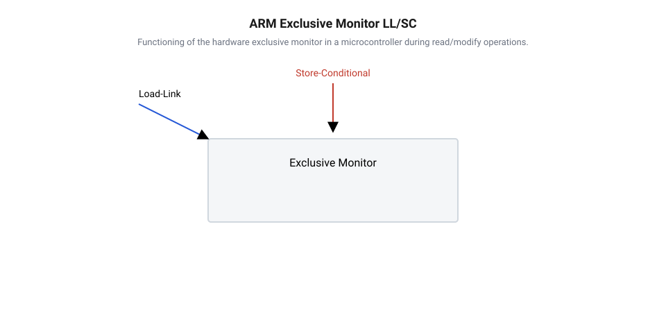
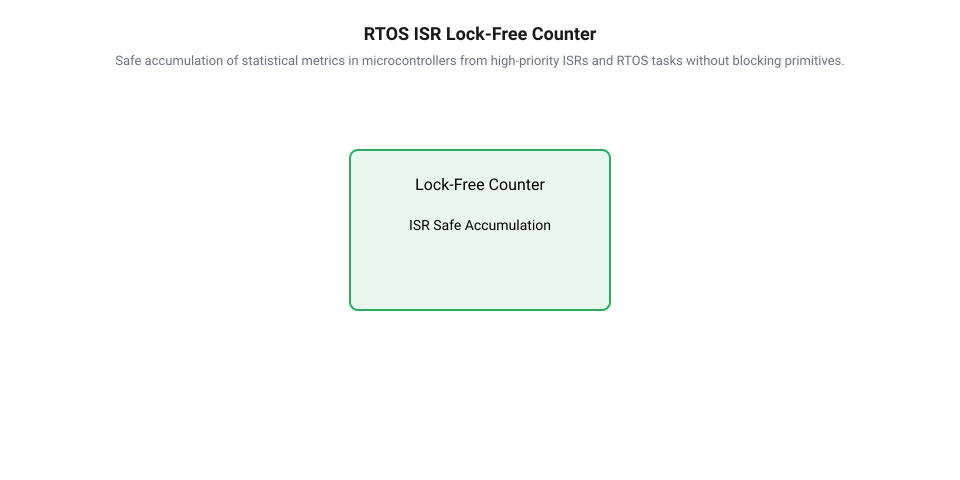

## Початкові концепції та фізичні принципи

Під час розробки високопродуктивних багатопотокових систем першою архітектурною перешкодою стає забезпечення узгодженого оновлення лічильників та системних метрик. Використання класичних примітивів взаємного виключення створює значні затримки через перемикання контексту потоків у колі операційної системи. Для усунення цих витрат застосовують [безблокувальне оновлення стану](root:sf-tasks/cas-lock-free) на основі процесорної інструкції @@en|Compare-And-Swap@@ (з англ. *compare* — порівнювати, *swap* — обмінювати; скорочено @@en|CAS@@). Вона атомарно порівнює вміст комірки пам'яті з очікуваним значенням і модифікує його лише у разі збігу, спираючись на апаратні [атомарні інструкції маніпуляції](root:sf-tasks/lock-free-atomic-primitives) пам'яттю.

На фізичному рівні сучасні процесори підтримують когерентність кеш-пам'яті @@en|cache coherence@@ (з англ. *coherence* — зчепленість, узгодженість) за допомогою протоколів сімейства @@en|MESI@@ (з англ. *Modified, Exclusive, Shared, Invalid*). Коли один з потоків виконує інкремент спільного @@en|atomic counter@@ (з англ. *atomic* — атомарний, *counter* — лічильник), відповідний рядок кешу @@en|cache line@@ (з англ. *cache* — схованок, *line* — рядок) розміром зазвичай 64 байти має перейти у стан @@en|Modified@@ у кеші L1/L2 даного ядра. Для цього ядро надсилає шинний сигнал знецінення, що провокує транзакційний шторм @@en|cache invalidation storm@@ (з англ. *invalidation* — знецінення, *storm* — шторм) для всіх інших ядер, де цей рядок перебував у стані @@en|Shared@@.

При зростанні кількості паралельних потоків виникає високе суперництво @@en|contention@@ (з англ. *contend* — змагатися). Усі потоки одночасно виконують цикл опитування @@en|spin loop@@ (з англ. *spin* — обертатися, *loop* — цикл), що спричиняє постійне переміщення кеш-рядка між ядрами — феномен @@en|cache line ping-ponging@@ (з англ. *ping-ponging* — перекидання туди-сюди). За один такт шини лише один потік успішно виконує @@en|CAS@@, тоді як решта $N - 1$ потоків отримують відмову через знецінення локальної копії пам'яті і змушені повторювати читання з кешу вищого рівня або RAM.

Оцінимо обчислювальну складність оновлення лічильника при одночасному виконанні $N$ потоків. Нехай $t_{cas}$ — час однієї спроби @@en|CAS@@ за відсутності конфліктів, а $t_{bus}$ — затримка арбітражу між'ядерної шини. У найгіршому випадку на кожній ітерації лише один потік завершує модифікацію успішно, а кількість конфліктних повторів для $N$ успішних інкрементів описується сумою:

S(N) = ∑ᵢ₌₁ⁿ i
= N · (N + 1) ÷ 2      [сумування арифметичної прогресії]
= (N² + N) ÷ 2          [розкриття дужок]

З виведеного співвідношення видно, що загальна кількість спроб оновлення зростає як $O(N²)$. Замість константного часу $O(1)$ середня затримка виконання одного інкременту для кожного потоку збільшується лінійно від кількості активних ядер $O(N)$, перетворюючи атомарну змінну на вузьке місце системної шини.

Операції @@en|CAS@@ вимагають застосування суворих правил впорядкування пам'ятних транзакцій, для чого використовують [бар'єри впорядкування операцій](root:sf-tasks/memory-barriers-and-atomic-sequencing). Це забезпечує [гарантії поступливості паралельних](root:sf-tasks/wait-free-and-lock-free-classification) алгоритмів на рівні @@en|lock-free@@ (з англ. *lock* — блокування, *free* — вільний): загальний прогрес системи зберігається, хоча окремі потоки можуть тривалий час перебувати у стані затримки. На відміну від алгоритмів над вказівниками, де проявляється [проблема ABA у неблокувальних](root:sf-tasks/aba-problem) структурах, цілочисельний інкремент менш вразливий до підміни значень, проте втрата продуктивності через шинний шторм робить одиночний @@en|CAS@@ непридатним для високонавантажених лічильників.

## Внутрішня будова та алгоритми роботи

Для розв'язання проблеми шинного шторму та усунення затримок рівня $O(N²)$ застосовують підхід просторового розділення стану — посмугування або @@en|striping@@ (з англ. *stripe* — смуга). Замість модифікації єдиної комірки створюється масив комірок @@en|striped array@@ (з англ. *striped* — посмугований, *array* — масив) розміром $M$, а також одна базова змінна @@en|base value@@. Цей механізм покладено в основу високоефективних лічильників @@en|LongAdder@@ (з англ. *long* — довге ціле число, *adder* — суматор).

Алгоритм оновлення стану у @@en|LongAdder@@ працює за двостадійною схемою. Спочатку потік робить спробу виконати один @@en|CAS@@ над базовою змінною @@en|base value@@. За відсутності конкуренції операція завершується за константний час $O(1)$ без використання додаткової пам'яті. Якщо ж виявлено @@en|contention@@ (спроба модифікації базової змінної зазнала невдачі), потік переходить до використання масиву комірок. За допомогою хешування ідентифікатора потоку @@en|thread-local@@ (з англ. *thread* — потік виконання, *local* — локальний) обчислюється індекс комірки $k = h(T_{id}) \bmod M$.

Якщо під час спроби виконувати @@en|CAS@@ над обраною коміркою виникає колізія з іншим потоком, потік робить повторне хешування або ініціює процедуру розширення масиву комірок у два рази, аж поки розмір $M$ не зрівняється з кількістю доступних процесорних ядер. Розрахуємо ймовірність колізій при розподілі $N$ потоків по $M$ комірках масиву за принципом задачі про дні народження. Імовірність $P_{no\_collision}$ того, що всі $N$ потоків оберуть унікальні комірки, становить:

P_no_collision = ∏ᵢ₌₀ⁿ⁻¹ ((M - i) ÷ M)
= (M ÷ M) · ((M - 1) ÷ M) · ... · ((M - N + 1) ÷ M)     [добуток ймовірностей вибору вільних комірок]
≈ e⁻⁽ⁿ² ÷ 2M⁾                                            [розклад Тейлора для показникової функції при N << M]

Звідси ймовірність виникнення хоча б однієї колізії $P_{collision}$ дорівнює:

P_collision = 1 - P_no_collision
≈ 1 - e⁻⁽ⁿ² ÷ 2M⁾                                       [ймовірність протилежної події]

При динамічному адаптуванні розміру масиву $M \ge N$ ймовірність колізії прямує до нуля, завдяки чому складність операції запису знижується з $O(N)$ до $O(1)$. Однак просторовий розподіл комірок створює ризик хибного розділення пам'яті @@en|false sharing@@ (з англ. *false* — хибний, *sharing* — спільне використання), коли кілька комірок масиву потрапляють у один і той самий 64-байтний кеш-рядок. Зміна однієї комірки знецінюватиме сусідні комірки в кешах інших ядер. Для усунення цього ефекту застосовують штучний відступ або вирівнювання @@en|padding@@ (з англ. *pad* — набивка, заповнення), заповнюючи простір між комірками порожніми байтами до розміру повного кеш-рядка. 

Під час підсумовування значення викликом `sum()` відбувається послідовне читання базової змінної та всіх комірок масиву. Зчитане значення є неузгодженим зрізом у часі, оскільки під час обходу масиву паралельні потоки можуть продовжувати інкремент. Це свідомий компроміс: відмова від атомарного знімка стану дозволяє досягти максимальної швидкості запису. Альтернативним апаратним механізмом для подібних операцій слугують [архітектури Load-Link і Store-Conditional](root:sf-tasks/ll-sc-architecture), але шардинг на рівні структур даних лишається універсальним програмним рішенням.

Нижче наведено порівняльну реалізацію шардованого лічильника @@en|LongAdder@@ мовами C++ та C із застосуванням вирівнювання кеш-рядків.

:::tabs
@tab C++
```cpp
#include <atomic>
#include <vector>
#include <thread>
#include <cstdint>

// Вирівнювання структури за розміром cache line (64 байти) для запобігання false sharing
struct alignas(64) PaddedCell {
    std::atomic<int64_t> value{0};
};

class StripedLongAdder {
private:
    std::atomic<int64_t> base{0};
    std::vector<PaddedCell> cells;
    size_t mask;

public:
    explicit StripedLongAdder(size_t num_cells = 8) : cells(num_cells), mask(num_cells - 1) {}

    void add(int64_t x) {
        int64_t b = base.load(std::memory_order_relaxed);
        // Спроба прискореного оновлення base за відсутності конкуренції
        if (base.compare_exchange_weak(b, b + x, std::memory_order_relaxed)) {
            return;
        }

        // Обчислення локального хешу потоку для вибору комірки
        size_t hash = std::hash<std::thread::id>{}(std::this_thread::get_id());
        size_t idx = hash & mask;

        // Інкремент атомарної комірки
        cells[idx].value.fetch_add(x, std::memory_order_relaxed);
    }

    int64_t sum() const {
        int64_t result = base.load(std::memory_order_relaxed);
        for (const auto& cell : cells) {
            result += cell.value.load(std::memory_order_relaxed);
        }
        return result;
    }
};
```
@tab C
```c
#include <stdatomic.h>
#include <stdint.h>
#include <stdlib.h>

// Вирівнювання комірки на 64 байти для виключення false sharing
typedef struct {
    _Atomic int64_t value;
    uint8_t padding[64 - sizeof(_Atomic int64_t)];
} _Alignas(64) PaddedCellC;

typedef struct {
    _Atomic int64_t base;
    PaddedCellC* cells;
    size_t num_cells;
} StripedLongAdderC;

void long_adder_init(StripedLongAdderC* adder, size_t num_cells) {
    atomic_init(&adder->base, 0);
    adder->num_cells = num_cells;
    adder->cells = (PaddedCellC*)aligned_alloc(64, num_cells * sizeof(PaddedCellC));
    for (size_t i = 0; i < num_cells; ++i) {
        atomic_init(&adder->cells[i].value, 0);
    }
}

void long_adder_add(StripedLongAdderC* adder, int64_t x, uintptr_t thread_id) {
    int64_t expected = atomic_load_explicit(&adder->base, memory_order_relaxed);
    if (atomic_compare_exchange_weak_explicit(&adder->base, &expected, expected + x,
                                              memory_order_relaxed, memory_order_relaxed)) {
        return;
    }

    size_t idx = thread_id % adder->num_cells;
    atomic_fetch_add_explicit(&adder->cells[idx].value, x, memory_order_relaxed);
}

int64_t long_adder_sum(const StripedLongAdderC* adder) {
    int64_t total = atomic_load_explicit(&adder->base, memory_order_relaxed);
    for (size_t i = 0; i < adder->num_cells; ++i) {
        total += atomic_load_explicit(&adder->cells[i].value, memory_order_relaxed);
    }
    return total;
}
```
:::

## Апаратна реалізація та низькорівневий C/C++ код

Під час розробки високоефективної прошивки для мікроконтролерів виконання атомарних модифікацій лічильників спирається на специфіку архітектури конкретного процесорного ядра. На відміну від настільних систем, де атомарність часто забезпечується прямим блокуванням системної шини за допомогою @@en|Compare-And-Swap@@ (з англ. *compare* — порівнювати, *swap* — обмінювати; скорочено @@en|CAS@@), процесори архітектур ARM Cortex-M та RISC-V застосовують [парні інструкції LL/SC](root:sf-tasks/load-link-store-conditional-primitives) — @@en|Load-Link/Store-Conditional@@ (з англ. *load* — завантажувати, *link* — зв'язувати, *store* — зберігати, *conditional* — умовний; скорочено @@en|LL/SC@@). В апаратній системі команд ARM цей механізм реалізовано за допомогою спеціалізованих інструкцій `@@en|LDREX@@` (завантаження з пометкою ексклюзивності) та `@@en|STREX@@` (запис за умови збереження ексклюзивності).

Апаратний контроль атомарності покладено на спеціальний модуль ядра — монітор ексклюзивного доступу @@en|Exclusive Monitor@@ (з англ. *exclusive* — винятковий, *monitor* — спостерігач). У одноядерних мікроконтролерах працює локальний монітор, що відстежує адресу пам'яті, зчитану поточним ядром. У багатоядерних системах додається глобальний монітор на рівні міжконтролерного арбітра шини. Коли потік або обробник переривання виконує `LDREX`, монітор переходить у стан ексклюзивного доступу для відповідної комірки. Якщо в цей момент інше ядро або шинний майстер [здійснює запис за цією адресою](root:sf-tasks/lock-free-atomic-primitives), монітор скидається у відкритий стан. Подальша інструкція `STREX` перевіряє стан монітора: якщо він залишається ексклюзивним, запис у пам'ять виконується і повертається нульовий прапорець успіху; якщо ж стан скинуто, запис відхиляється, а регістр статусу отримує одиницю.


*Принцип функціонування апаратного монітора ексклюзивності у мікроконтролері під час читання та модифікації атомарної комірки.*

Обчислимо сумарні втрати процесорних тактів на одну спробу інкременту лічильника у циклі `LDREX`/`STREX` для ядра ARM Cortex-M4. Позначимо тривалість інструкції ексклюзивного читання як T_ldrex, виконання арифметичного додавання в регістрі як T_add, умовного запису як T_strex, а перевірки прапорця розгалуження як T_cmp. Тривалість однієї ітерації циклу T_cycle обчислюється так:

T_cycle = T_ldrex + T_add + T_strex + T_cmp
= 1 + 1 + 2 + 1                  [затримки інструкцій у тактах Cortex-M4]
= 5                              [сумарна тривалість однієї ітерації]

З наведеного обчислення видно, що за відсутності конфліктів оновлення атомарного лічильника займає всього 5 тактів процесора. Проте якщо під час виконання цього блоку виникає колізія шини або переривання, `STREX` повертає помилку, змушуючи програму повторювати цикл. При K невдалих спробах тривалість виконання зростає до T_total = (K + 1) · T_cycle.

Для гарантування послідовності транзакцій пам'яті у прошивці застосовують [бар'єри пам'яті](root:sf-tasks/memory-barriers-and-atomic-sequencing) — @@en|Memory Barrier@@ (з англ. *memory* — пам'ять, *barrier* — бар'єр). В архітектурі ARM це апаратні інструкції `@@en|DMB@@` (Data Memory Barrier) та `@@en|DSB@@` (Data Synchronization Barrier). Якщо для підрахунку статистичних метрик використовується модель впорядкування @@en|relaxed ordering@@ (з англ. *relaxed* — ослаблений, *ordering* — впорядкування) `std::memory_order_relaxed`, компілятор не генерує додаткових бар'єрів `DMB`, що забезпечує максимальну продуктивність. У разі передачі даних між ядрами використовують модель @@en|acquire-release@@ (з англ. *acquire* — захоплювати, *release* — вивільняти), яка примусово вставляє бар'єри пам'яті для запобігання переупорядкуванню інструкцій шинним конвеєром.

Нижче наведено низькорівневу реалізацію шардованого суматора @@en|LongAdder@@ (з англ. *long* — довге ціле число, *adder* — суматор) для вбудованих систем мовами C++ та C із вирівнюванням комірок пам'яті для запобігання [хибного розділення пам'яті](root:sf-tasks/cas-lock-free).

:::tabs
@tab C++|embedded
```cpp
#include <atomic>
#include <cstdint>
#include <cstddef>

// Вирівнювання структури за розміром кеш-рядка або лінії шини (64 байти)
struct alignas(64) PaddedAtomicCell {
    std::atomic<uint32_t> value{0};
};

// Вбудований шардований суматор з фіксованою кількістю комірок
template <size_t N_SLOTS>
class EmbeddedLongAdder {
private:
    std::atomic<uint32_t> base{0};
    PaddedAtomicCell slots[N_SLOTS];

public:
    EmbeddedLongAdder() = default;

    // Атомарне додавання із застосуванням relaxed ordering
    void add(uint32_t val, uint32_t core_or_thread_id) {
        uint32_t current_base = base.load(std::memory_order_relaxed);
        
        // Спроба прямого оновлення базової змінної за відсутності колізій
        if (base.compare_exchange_weak(current_base, current_base + val,
                                       std::memory_order_relaxed,
                                       std::memory_order_relaxed)) {
            return;
        }

        // При конфлікті оновлюємо окремий шардований осередок
        size_t slot_idx = core_or_thread_id % N_SLOTS;
        slots[slot_idx].value.fetch_add(val, std::memory_order_relaxed);
    }

    // Зчитування сумарного значення
    uint32_t read_sum() const {
        uint32_t total = base.load(std::memory_order_relaxed);
        for (size_t i = 0; i < N_SLOTS; ++i) {
            total += slots[i].value.load(std::memory_order_relaxed);
        }
        return total;
    }
};
```
@tab C|esp-idf
```c
#include <stdatomic.h>
#include <stdint.h>
#include <stddef.h>

// Вирівнювання комірки пам'яті для виключення false sharing
typedef struct {
    _Atomic uint32_t value;
    uint8_t padding[64 - sizeof(_Atomic uint32_t)];
} _Alignas(64) padded_cell_t;

typedef struct {
    _Atomic uint32_t base;
    padded_cell_t slots[4];
} embedded_long_adder_t;

void embedded_long_adder_init(embedded_long_adder_t* adder) {
    atomic_init(&adder->base, 0);
    for (size_t i = 0; i < 4; ++i) {
        atomic_init(&adder->slots[i].value, 0);
    }
}

void embedded_long_adder_add(embedded_long_adder_t* adder, uint32_t val, uint32_t core_id) {
    uint32_t expected = atomic_load_explicit(&adder->base, memory_order_relaxed);
    
    // Спроба оновлення базової змінної через CAS
    if (atomic_compare_exchange_weak_explicit(&adder->base, &expected, expected + val,
                                              memory_order_relaxed, memory_order_relaxed)) {
        return;
    }

    // Модифікація посмугованої комірки за індексом ядра
    size_t idx = core_id % 4;
    atomic_fetch_add_explicit(&adder->slots[idx].value, val, memory_order_relaxed);
}

uint32_t embedded_long_adder_sum(const embedded_long_adder_t* adder) {
    uint32_t total = atomic_load_explicit(&adder->base, memory_order_relaxed);
    for (size_t i = 0; i < 4; ++i) {
        total += atomic_load_explicit(&adder->slots[i].value, memory_order_relaxed);
    }
    return total;
}
```
:::

## Практичне застосування та відлагодження

Розробка систем реального часу @@en|RTOS@@ (з англ. *Real-Time Operating System* — операційна система реального часу) висуває суворі вимоги до детермінованості обробки подій. Усередині підпрограм обслуговування переривань @@en|ISR@@ (з англ. *Interrupt Service Routine* — підпрограма обслуговування переривань) категорично заборонено використовувати класичні блокувальні примітиви синхронізації, такі як м'ютекси або семафори. Виклик функції блокування у перериванні провокує інверсію пріоритетів @@en|Priority Inversion@@ (з англ. *priority* — пріоритет, *inversion* — інверсія), порушує роботу планувальника задач та викликає паніку ядра (HardFault). Застосування [безблокувальних алгоритмів](root:sf-tasks/lock-free-basics) дозволяє здійснювати атомарний підрахунок подій (вхідних мережевих пакетів, зафіксованих імпульсів таймера чи переданих байтів DMA) безпосередньо з ISR без відключення глобальних переривань і без виникнення мертвих блокувань.


*Безпечне накопичення статистичних метрик у мікроконтролері з переривань високого пріоритету та задач RTOS без блокувальних примітивів.*

Практична інтеграція атомарних лічильників та структур `LongAdder` у мікроконтролерну прошивку супроводжується низкою апаратних обмежень та граничних випадків:
1. **Голодування у циклах повтору (STREX Starvation):** Якщо високочастотне переривання постійно вклинюється між виконанні інструкцій `LDREX` та `STREX` у фоновій задачі RTOS, локальний монітор ексклюзивності скидатиме свій стан до завершення запису. Це спричиняє нескінченне обертання задачі у циклі опитування @@en|spin loop@@ (з англ. *spin* — обертатися, *loop* — цикл). На відміну від алгоритмів із [гарантіями поступу Wait-Free](root:sf-tasks/wait-free-and-lock-free-classification), де кожен потік гарантовано завершує операцію за фіксований час, атомарні цикли на базі `CAS` забезпечують гарантію Lock-Free, що може створювати тимчасові затримки виконання задач низького пріоритету.
2. **Компроміс пам'яті та шардингу:** У мікроконтролерах із обмеженим обсягом оперативної пам'яті (SRAM розміром від 32 до 512 Кбайт) розміщення великих шардованих масивів із набивкою байтів @@en|padding@@ (з англ. *pad* — набивка) призводить до перевитрати системних ресурсів. Для вбудованих систем кількість комірок шардингу обирають суворо відповідно до кількості процесорних ядер (наприклад, 2 комірки для двоядерних SoC на кшталт ESP32) або обмежуються вирівнюванням за 32-бітними межами регістрів.
3. **Ризик проблеми ABA у складних структурах:** При виконанні простих інструкцій додавання цілочисельний лічильник захищений від спотворення стану. Проте якщо атомарний суматор інтегровано у кільцевий буфер даних або списки вільних блоків, може проявлятися [проблема ABA](root:sf-tasks/aba-problem), коли значення лічильника чи адреса комірки повертається до початкового стану між читанням та перевіркою `CAS`.

Для відлагодження продуктивності та діагностики конфліктів атомарних операцій у прошивках ARM Cortex-M використовують апаратний модуль відстеження даних та трасування — @@en|DWT@@ (з англ. *Data Watchpoint and Trace* — модуль відстеження даних та трасування). Лічильник тактів `DWT->CYCCNT` дозволяє точно виміряти затримку виконання оновлення атомарної змінної:

```cpp
// Замір часу виконання атомарного інкременту за допомогою DWT CYCCNT
uint32_t start_cycles = DWT->CYCCNT;
adder.add(1, core_id);
uint32_t elapsed_cycles = DWT->CYCCNT - start_cycles;
```

Якщо показник `elapsed_cycles` суттєво перевищує розраховані 5 тактів (наприклад, сягає 20–30 тактів), це свідчить про високу конкуренцію на шині пам'яті або постійний зрив монітора ексклюзивності через переривання. Отримані аналітичні метрики дозволяють розробнику підібрати оптимальний рівень шардингу комірок та відкоригувати пріоритети переривань для забезпечення детермінованої роботи прошивки.
