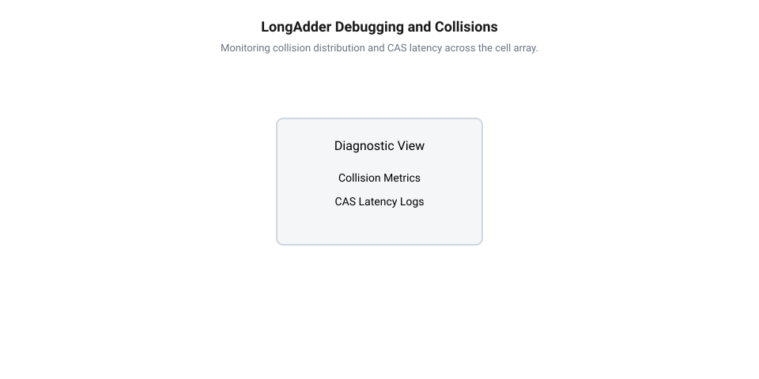

## Початкові концепції та фізичні принципи

Високопродуктивні вбудовані системи та прошивки мікроконтролерів систем реального часу змушені безперервно підраховувати сотні тисяч подій на секунду — від вхідних мережевих пакетів і сигналів периферійних таймерів до квантів часу операційної системи. Коли високочастотні обробники переривань або паралельні задачі @@en|RTOS@@ (англ. *Real-Time Operating System*) намагаються одночасно оновити лічильник метрик, традиційні механізми синхронізації стають головним вузьким місцем усієї прошивки. Використання таких класичних примітивів, як @@en|spinlock@@ (англ. *spin* — обертатися, *lock* — замок) або @@en|mutex@@ (англ. *mutual exclusion* — взаємне виключення), зупиняє виконання паралельних потоків, призводить до інверсії пріоритетів і створює непередбачувані затримки. Під час високочастотних обробок розробники використовують [механізми без застосування блокувань](root:sf-tasks/lock-free-basics), що забезпечують передбачуваний час відгуку та детерміновану поведінку системи.

Проте заміна класичних замків на атомарне додавання за допомогою єдиної апаратної інструкції не вирішує проблему повністю під час високого навантаження. Для забезпечення атомарності на рівні заліза процесори застосовують спеціальні атомарні примітиви. Найпоширенішим із них є @@en|Compare-And-Swap@@ (англ. *compare* — порівнювати, *swap* — обмінювати), або @@en|CAS@@, який зчитує поточне значення з пам'яті, порівнює його з очікуваним і лише в разі збігу записує нове значення. Апаратна підтримка атомарних інструкцій забезпечує [безпечне оновлення спільного стану](root:sf-tasks/cas-lock-free) в оперативній пам'яті. У процесорних архітектурах без прямої підтримки цієї інструкції застосовують [спеціальні парні інструкції](root:sf-tasks/load-link-store-conditional-primitives) читання та умовного запису @@en|Load-Link/Store-Conditional@@ (англ. *load* — завантажувати, *store* — зберігати), або @@en|LL/SC@@.

Коли десятки ядер або обробників переривань одночасно виконують цикл @@en|CAS@@ для однієї і тієї ж комірки пам'яті, виникає явище високої конкуренції — @@en|contention@@ (англ. *contend* — змагатися). У цьому стані лише один потік успішно виконує атомарний модифікуючий запис, тоді як усі інші потоки зазнають невдачі, відкочують свої обчислення та повторюють цикл знову. Постійні повторні спроби марно витрачають такти процесора, знижують пропускну здатність шини та спричиняють падіння продуктивності, яке за масштабами перевищує витрати від звичайного блокування. На рівні шинної матриці мікроконтролера транзакція атомарного читання-модифікації-запису блокує доступ інших майстрів шини до відповідного сегмента пам'яті, що спричиняє додаткові затримки квантів часу для задач @@en|RTOS@@.

Фізична причина цього явища лежить у влаштуванні кеш-пам'яті процесора та протоколах когерентності. Пам'ять мікроконтролера чи багатоядерного процесора організована у вигляді кеш-ліній — @@en|cache line@@ (фр. *cacher* — ховати, англ. *line* — лінія), які зазвичай мають розмір 32, 64 або 128 байтів. Для підтримання узгодженості даних між кешами різних ядер використовуються апаратні протоколи когерентності, такі як @@en|MESI@@ (англ. *Modified, Exclusive, Shared, Invalid*). Коли ядро A виконує атомарний запис у змінну лічильника, протокол @@en|MESI@@ змушений перевести відповідну @@en|cache line@@ у стан Modified в кеші ядра A та надіслати сигнал анулювання (англ. *invalidate*) всім іншим ядрам. Як тільки ядро B намагається виконати власний атомарний крок, ця ж @@en|cache line@@ повинна бути вилучена з кешу ядра A і передана в кеш ядра B.

При інтенсивному паралельному оновленні виникає ефект хаотичного переміщення лінії кешу між ядрами — @@en|cache line ping-ponging@@ (англ. *ping-pong* — настільний теніс). Лінія кешу не встигає зафіксуватися в жодному з ядер, шина пам'яті стає перевантаженою службовими сигналами узгодження, а конвеєр інструкцій процесора простоює в очікуванні завершення транзакцій когерентності.

Додатково ситуацію ускладнює ефект хибного розділення пам'яті — @@en|false sharing@@ (англ. *false* — хибний, *sharing* — спільне використання). Якщо декілька незалежних лічильників або системних прапорців розміщені в пам'яті поруч і потрапляють у межі однієї @@en|cache line@@, оновлення одного лічильника скидає кеш для сусідніх незалежних даних. У результаті ядра блокують одне одного навіть тоді, коли вони модифікують абсолютно різні логічні показники. Таким чином, фізична межа продуктивності атомарного підрахунку метрик зумовлена не швидкістю виконання математичного додавання, а затримками шини пам'яті та апаратною архітектурою когерентності кешів. Для подолання цього бар'єра необхідно відмовитися від ідеї фіксованої єдиної точки запису в пам'яті.

## Внутрішня будова та алгоритми роботи

Для розв'язання проблеми системної конкуренції за єдину комірку пам'яті було розроблено архітектурний підхід шардингу або смугування — @@en|striping@@ (англ. *stripe* — смуга). Його головна ідея полягає в тому, щоб розподілити сумарне значення метрики між масивом окремих комірок, кожна з яких обробляє локальні прирости від конкретного ядра або потоку. Механізм @@en|LongAdder@@ (англ. *long* — довгий, *add* — додавати) реалізує саме цю концепцію, адаптуючи її до жорстких вимог обробки вбудованих систем.

Внутрішня структура @@en|LongAdder@@ складається з двох основних компонентів: базового атомарного поля `base` та динамічного або стабільно виділеного масиву комірок `cells`. Кожен елемент масиву представлений спеціальною структурою @@en|Cell@@ (лат. *cella* — комірка). Для запобігання критичному ефекту @@en|false sharing@@ кожна @@en|Cell@@ вирівнюється в пам'яті за межею розміру @@en|cache line@@ за допомогою спеціальних атрибутів вирівнювання або заповнюється додатковими бадді-байтами (англ. *padding*). Завдяки цьому модифікація однієї комірки @@en|Cell@@ одним ядром ніяк не впливає на стан сусідніх комірок у кеші інших ядер. У вбудованих системах із суворими обмеженнями динамічної пам'яті масив комірок `cells` часто виділяється статично заздалегідь, з огляду на максимально можливу кількість ядер процесора або критичних переривань. Це гарантує детермінований час виконання без ризику відмови через брак пам'яті.

Алгоритм виконання операції збільшення лічильника орієнтований на двостадійне швидке оновлення:

1. **Оптимістична спроба без конкуренції.** Потік спочатку намагається виконати швидку інструкцію @@en|CAS@@ для центрального поля `base`. Якщо конкуренція в системі відсутня або низька, оновлення `base` проходить з першої спроби за мінімальну кількість тактів без залучення додаткової пам'яті.
2. **Перехід до розподіленого масиву.** Якщо атомарний запис у `base` зазнав невдачі через конкуренційну конфліктність з іншим потоком, алгоритм активує розподілений режим. Потік обчислює хеш-код свого ідентифікатора (ідентифікатора потоку @@en|RTOS@@ або номера процесорного ядра з системного регістру) і вибирає відповідну комірку `cells[hash % capacity]`.
3. **Локальне оновлення та динамічне рехешування.** Потік виконує інструкцію @@en|CAS@@ над вибраною коміркою @@en|Cell@@. Якщо ця спроба успішна, операцію завершено. Якщо ж виникає колізія (два потоки з однаковим хешем одночасно змагаються за одну @@en|Cell@@), алгоритм змінює внутрішнє значення хешу даного потоку (англ. *re-hash*) або ініціалізує розширення масиву `cells`, подвоюючи його розмір до досягнення кількості процесорних ядер.

Для забезпечення максимальної швидкості під час інкременту вбудовані алгоритми використовують ослаблене впорядкування пам'яті — @@en|relaxed memory order@@ (англ. *relaxed* — ослаблений). Оскільки окремі збільшення лічильника метрик не пов'язані з передачею володіння іншими даними або вказівниками між потоками, відмова від суворих бар'єрів пам'яті дозволяє процесору перевпорядковувати інструкції та обходити затримки шини. Щоб уникнути розсинхронізації шини, розробники налаштовують [суворе впорядкування операцій пам'яті](root:sf-tasks/memory-barriers-and-atomic-sequencing) між процесорними ядрами лише під час підсумкового читання.

Зчитування підсумкового значення метрики виконується за допомогою функції `sum()`. Вона послідовно підсумовує значення базового поля `base` та всіх активних комірок масиву `cells`. Важливо підкреслити, що функція `sum()` не блокує паралельні записи й не створює глобальної атомарної транзакції над усім масивом. Вона повертає узгоджений зріз стану на момент зчитування. Це забезпечує абсолютний пріоритет для високочастотних записів, переносячи незначні витрати на рідкісні операції читання статистики. При цьому розробник обирає конкретний тип алгоритму виходячи з того, які саме [гарантії завершення операцій](root:sf-tasks/wait-free-and-lock-free-classification) потрібні для даної прошивки.

Для інтеграції описуваних алгоритмів у реальний код вбудованих систем розроблені низькорівнева реалізація мовою C та обгортка драйвера з приємним @@en|API@@ (англ. *Application Programming Interface*) мовою C++.

Низькорівневий драйвер обробки лічильників на C реалізує вирівнювання комірок та CAS-петлю оновлення:

:::code root/eng/sf-tasks/cas-and-longadder-counters/proj-high-throughput-metrics-counter/c/main.c c

У свою чергу, обгортка на C++ надає зручний об'єктно-орієнтований інтерфейс для інтеграції в сучасні системні прошивки:

:::code root/eng/sf-tasks/cas-and-longadder-counters/proj-high-throughput-metrics-counter/cpp/main.cpp cpp

## Апаратна реалізація та низькорівневий C/C++ код

Перехід від теоретичної моделі смугування до працюючої прошивки мікроконтролера вимагає точного узгодження коду з апаратною архітектурою процесора. На низькому рівні ефективність атомарних операцій спирається на [апаратні атомарні примітиви](root:sf-tasks/lock-free-atomic-primitives), реалізовані в системній шині та процесорному ядрі. У мікроконтролерах на базі архітектури ARM Cortex-M3/M4/M7/M33 або RISC-V атомарні інструкції виконуються за допомогою спеціалізованих системних блоків моніторингу ексклюзивного доступу — @@en|exclusive monitor@@ (англ. *exclusive* — виключний, *monitor* — спостерігач). Коли ядро зчитує комірку пам'яті перед підготовкою до зміни значення, апаратний монітор фіксує фізичну адресу. Якщо інше ядро або периферійний модуль @@en|DMA@@ (англ. *Direct Memory Access* — прямий доступ до пам'яті) здійснює запис за цією ж адресою до завершення атомарної транзакції, статус ексклюзивності скидається.

У разі скидання статусу ексклюзивності спроба запису повертає помилку на рівні регістра процесора, що змушує прошивку виконувати новий цикл повторної спроби. У системах без прямої підтримки одинарного порівняння та обміну процесори використовують [інструкції читання та умовного запису](root:sf-tasks/load-link-store-conditional-primitives) LL/SC. Щоб мінімізувати затримки на низькому рівні, алгоритм оновлення лічильника спочатку намагається обійтися без звернення до додаткової пам'яті.

Базовий цикл модифікації описується низькорівневим атомарним виразом. У мові C для цього використовується функція `atomic_compare_exchange_weak_explicit`. Використання саме «слабкої» (англ. *weak*) форми інструкції @@en|CAS@@ є критично важливим для оптимізації циклів у прошивках: вона дозволяє процесору повертати хибний результат при спонтанних апаратних перериваннях, уникаючи додаткових обчислювальних витрат на внутрішню перевірку стану.

Апаратна ефективність розподіленого масиву повністю залежить від строгого вирівнювання структур даних у пам'яті. Для запобігання між'ядерним конфліктам кожен елемент масиву комірок повинен мати розмір, кратний довжині кеш-лінії. У коді мовою C це досягається за допомогою атрибута вирівнювання `__attribute__((aligned(64)))` або специфікатора `alignas(64)`. Порожнє заповнення — @@en|padding@@ (англ. *pad* — подушка, заповнювач) — гарантує, що атомарна змінна займе всю кеш-лінію самостійно, унеможливлюючи її блокування під час оновлення сусідніх лічильників.

Ще одним важливим фактором є налаштування впорядкування операцій пам'яті. При оновленні окремих осередків лічильника немає потреби зупиняти конвеєр процесора важкими шинними бар'єрами. Використання моделі `memory_order_relaxed` дозволяє процесору та компілятору вільно перевпорядковувати інструкції навколо атомарного додавання, оскільки лічильник метрик не захищає вказівники на інші дані. Проте під час фінального зчитування суми для забезпечення узгодженого зрізу стану розробники застосовують [бар'єри впорядкування пам'яті](root:sf-tasks/memory-barriers-and-atomic-sequencing), які синхронізують локальні кеші ядра перед підсумовуванням.

Для ідентифікації поточного виконавця в реальному часі прошивка зчитує номер поточного процесорного ядра з системного регістра (наприклад, `CPU_ID`) або отримує хендл поточної задачі операційної системи реального часу @@en|RTOS@@. Отримане значення хешується для вибору конкретного індексу в масиві комірок.

:::tabs
```c
#include <stdatomic.h>
#include <stdint.h>
#include <stddef.h>

#define CACHE_LINE_BYTES 64
#define NUM_CELLS_MAX 8

// Вирівнювання комірки за межею кеш-лінії для усунення false sharing
typedef struct {
    _Atomic uint64_t value;
    uint8_t padding[CACHE_LINE_BYTES - sizeof(_Atomic uint64_t)];
} __attribute__((aligned(CACHE_LINE_BYTES))) Cell;

typedef struct {
    _Atomic uint64_t base;
    Cell cells[NUM_CELLS_MAX];
    size_t active_cells;
} LongAdder;

void long_adder_init(LongAdder *adder, size_t cell_count) {
    atomic_init(&adder->base, 0);
    adder->active_cells = (cell_count > NUM_CELLS_MAX) ? NUM_CELLS_MAX : cell_count;
    for (size_t i = 0; i < adder->active_cells; i++) {
        atomic_init(&adder->cells[i].value, 0);
    }
}

void long_adder_add(LongAdder *adder, uint64_t val, size_t thread_id) {
    uint64_t b = atomic_load_explicit(&adder->base, memory_order_relaxed);
    if (atomic_compare_exchange_weak_explicit(&adder->base, &b, b + val,
                                              memory_order_relaxed, memory_order_relaxed)) {
        return;
    }

    size_t index = thread_id % adder->active_cells;
    uint64_t c = atomic_load_explicit(&adder->cells[index].value, memory_order_relaxed);
    while (!atomic_compare_exchange_weak_explicit(&adder->cells[index].value, &c, c + val,
                                                  memory_order_relaxed, memory_order_relaxed)) {
        // Повторна спроба при колізії на комірці
    }
}

uint64_t long_adder_sum(const LongAdder *adder) {
    uint64_t sum = atomic_load_explicit(&adder->base, memory_order_relaxed);
    for (size_t i = 0; i < adder->active_cells; i++) {
        sum += atomic_load_explicit(&adder->cells[i].value, memory_order_relaxed);
    }
    return sum;
}
```

```cpp
#include <atomic>
#include <cstdint>
#include <cstddef>
#include <array>

template <size_t MaxCells = 8>
class LongAdderCounter {
private:
    struct alignas(64) Cell {
        std::atomic<uint64_t> value{0};
        uint8_t padding[64 - sizeof(std::atomic<uint64_t>)]{};
    };

    std::atomic<uint64_t> base_{0};
    std::array<Cell, MaxCells> cells_{};
    size_t active_cells_{MaxCells};

public:
    explicit LongAdderCounter(size_t active_cells = MaxCells)
        : active_cells_(active_cells > MaxCells ? MaxCells : active_cells) {}

    void add(uint64_t val, size_t thread_id) noexcept {
        uint64_t b = base_.load(std::memory_order_relaxed);
        if (base_.compare_exchange_weak(b, b + val, std::memory_order_relaxed)) {
            return;
        }

        size_t index = thread_id % active_cells_;
        uint64_t c = cells_[index].value.load(std::memory_order_relaxed);
        while (!cells_[index].value.compare_exchange_weak(c, c + val, std::memory_order_relaxed)) {
            // Оновлення комірки при локальній конкуренції
        }
    }

    void increment(size_t thread_id) noexcept {
        add(1, thread_id);
    }

    [[nodiscard]] uint64_t sum() const noexcept {
        uint64_t total = base_.load(std::memory_order_relaxed);
        for (size_t i = 0; i < active_cells_; ++i) {
            total += cells_[i].value.load(std::memory_order_relaxed);
        }
        return total;
    }
};
```
:::

У наведених реалізаціях драйвера ключовий акцент зроблено на збереженні високої детермінованості часу виконання. Код усуває будь-які виклики операторів динамічного виділення пам'яті під час обробки подій, що робить його придатним для використання в високочастотних обробниках переривань вбудованих систем.

## Практичне застосування та відлагодження

У реальних прошивках мікроконтролерів високоефективний підрахунок метрик необхідний у задачах із жорстким часовим детермінізмом. Типовими прикладами застосування @@en|LongAdder@@ є підрахунок високочастотних вхідних імпульсів з датчиків, облік переданих кадрів мережевих інтерфейсів (Ethernet, CAN, Wi-Fi), а також реєстрація статистичних подій планировщика @@en|RTOS@@ — кількості переключень контексту та викликів системних функцій. Коли обробник переривання @@en|ISR@@ (англ. *Interrupt Service Routine* — служба обробки переривань) змушений оновлювати системну статистику на частотах у сотні кілогерц, будь-яка затримка на шині пам'яті призводить до пропуску вхідних сигналів периферії.

Однак впровадження неблокуючих лічильників пов'язане з кількома апаратними та алгоритмічними граничними випадками, які вимагають ретельного налагодження. Першим граничним випадком є апаратні витрати пам'яті. Оскільки кожна комірка `Cell` вирівнюється за розміром кеш-лінії (наприклад, 64 байти), масив із 8 комірок займає 512 байтів оперативної пам'яті @@en|SRAM@@ (англ. *Static Random-Access Memory* — статична оперативна пам'ять), незважаючи на те, що корисні дані складають лише 64 байти (8 × 8 байтів). У системних мікроконтролерах із обмеженим обсягом пам'яті надмірне виділення комірок призводить до її марнотратного використання. Розробник мусить точно балансувати розмір масиву відповідно до кількості реальних фізичних ядер та критичних обробників переривань.

Другим важливим аспектів є аномалія асинхронного зчитування зрізу даних при виклику функції `sum()`. Оскільки обчислення суми відбувається шляхом послідовного зчитування базового поля та масиву комірок без накладання глобального блокування, під час зчитування паралельні потоки можуть продовжувати інкрементувати інші комірки. Це створює так званий неатомарний зріз states (англ. *non-atomic snapshot*). Таке значення може не відповідати жодному точному моменту часу в минулому, хоча воно залишається монотонно зростаючим. Для систем моніторингу продуктивності та телеметрії така незначна похибка є цілком припустимою, але для фінансових або критичних розрахунків слід використовувати [механізми послідовного читання Seqlock](root:sf-tasks/seqlock) або структури з чіткими гарантіями атомарних зрізів.


*Схема діагностики розподілу колізій між комірками Cell та виявлення затримок CAS-петлі в системі RTOS.*

Третім граничним випадком є ефект тривалих колізій у разах невірно підібраної функції хешування. Якщо декілька високочастотних обробників переривань закешовані на один і той самий індекс комірки, виникає сплеск повторних спроб у циклі @@en|CAS@@, що створює нестабільність затримок виконання — @@en|jitter@@ (англ. *jitter* — тремтіти). Для виявлення таких аномалій використовують апаратні засоби налагодження та профайлери:

1. **Апаратні лічильники циклів та трасування.** Використання модулів DWT (англ. *Data Watchpoint and Trace*) у мікроконтролерах Cortex-M дозволяє точно виміряти кількість тактів процесора, витрачених на один інкременти, та зафіксувати сплески затримок.
2. **Моніторинг коефіцієнта повторних спроб.** У відлагоджувальну збірку прошивки додають розширені лічильники колізій, які фіксують кількість невдалих операцій @@en|CAS@@. Якщо відсоток колізій перевищує задану межу, система ініціалізує динамічне розширення масиву комірок або змінює алгоритм хешування.
3. **Формальна верифікація та тестування.** Для гарантії відсутності стану гонитви даних — @@en|data race@@ (англ. *data* — дані, *race* — гонитва) — застосовують [перевірку моделей неблокувального коду](root:sf-tasks/model-checking-lock-free) та спеціалізовані аналізатори потоків.

Систематична діагностика та правильний вибір розміру масиву дозволяють досягти максимальної пропускної здатності лічильників метрик без порушення детермінізму системи реального часу.
