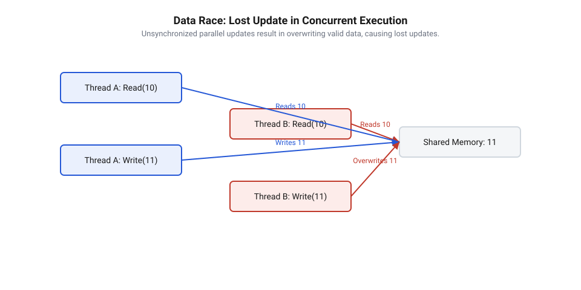
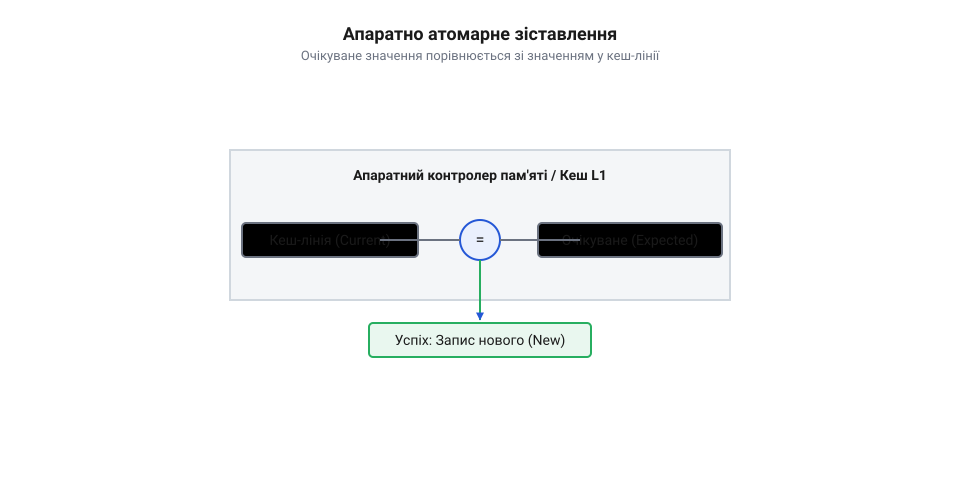
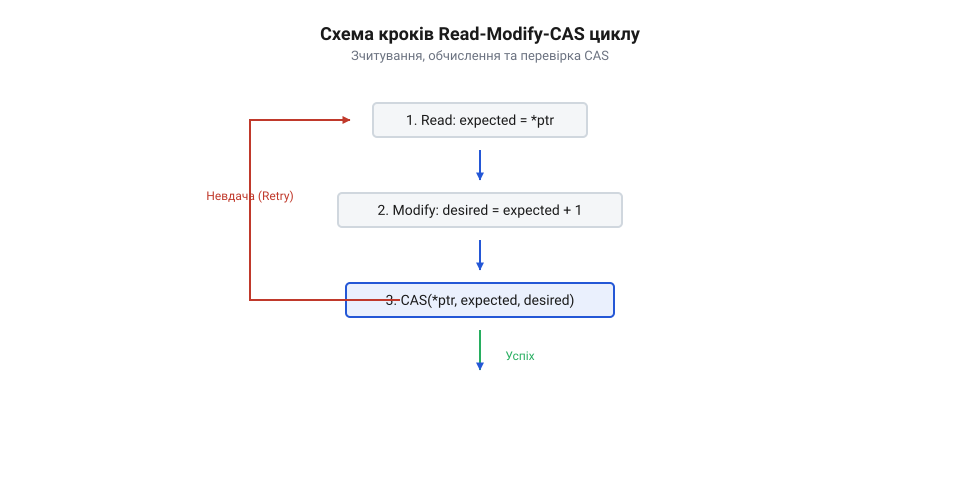
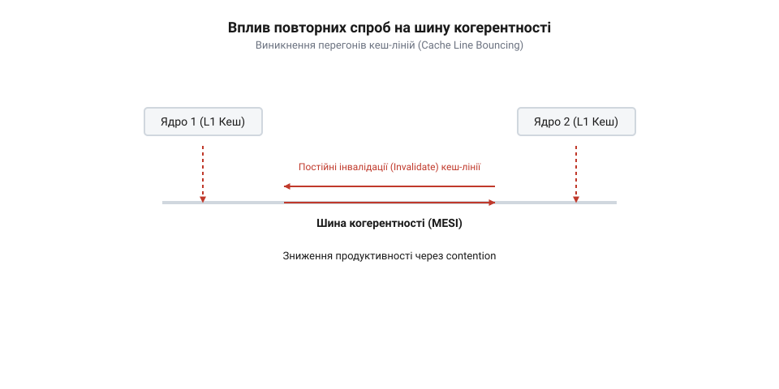
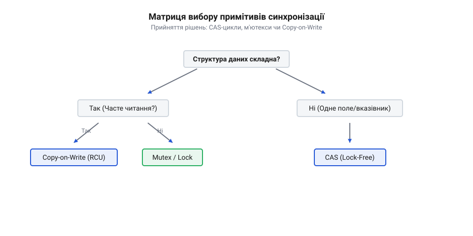

# Безблокувальне оновлення стану за допомогою інструкції CAS

<preknowlist>
- [Без замків](root:sf-tasks/lock-free-basics) — базові поняття гонитви за даними та концепція синхронізації без м'ютексів.
</preknowlist>

## Втрачені оновлення в конкурентному середовищі

Уявіть високонавантажену веб-систему, в якій сотні паралельних робочих потоків підраховують кількість оброблених мережевих запитів або оновлюють спільний баланс користувача. Розробники часто припускають, що звичайна операція інкременту лічильника видається настільки простою, що вона мусить виконуватися миттєво й неперервно. Проте під час практичного запуску системи без спеціальних механізмів синхронізації виявляється дивна аномалія: після виконання мільйона операцій інкременту підсумкове значення лічильника виявляється значно меншим за очікуване — наприклад, 600 000 замість 1 000 000. Частина оновлень безслідно зникає.

Причина цієї деструктивної поведінки криється в тому, що навіть найпростіша командна конструкція мови високого рівня на кшталт `counter++` або `count += 1` не є єдиною атомарною дією для центрального процесора. На апаратному рівні сучасних процесорних архітектур будь-яка модифікація змінної в пам'яті розбивається на три послідовні та роздільні фази, які формують цикл @@en|зчитування–модифікація–запис@@ (англ. *@@en|Read-Modify-Write@@*, від *read* — читати, *modify* — змінювати, *write* — писати):

1. **Фаза зчитування (Read / Load):** Процесор копіює поточне значення змінної зі спільної оперативної пам'яті або спільних рівнів кеш-пам'яті (L2/L3) у локальний регістр конкретного процесорного ядра. 2. **Фаза модифікації (Modify / Compute):** Арифметико-логічний пристрій (АЛП) ядра змінює значення у локальному регістрі — наприклад, додає одиницю до зчитаного числа. 3. **Фаза запису (Write / Store):** Процесор копіює обчислене нове значення з локального регістра назад у спільну комірку пам'яті.

Коли кілька потоків виконуються паралельно на різних процесорних ядрах, їхні триетапні цикли зчитування, модифікації та запису до однієї й тієї ж комірки пам'яті довільно переплітаються у часі. Розглянемо приклад, коли два потоки (Потік А та Потік Б) одночасно намагаються збільшити спільну змінну `counter`, яка початково дорівнює `10`. Потік А зчитує `10` у свій регістр. У той самий мікросекундний проміжок часу, до того як Потік А встиг зберегти результат, Потік Б також зчитує з пам'яті все ще актуальне значення `10` у свій власний регістр. Потім Потік А обчислює `11` і записує `11` у пам'ять. Одразу після цього Потік Б, маючи у своєму регістрі застаріле обчислення `10 + 1 = 11`, також записує `11` у ту саму комірку пам'яті.

У результаті двох послідовних операцій інкременту змінна прийняла значення `11` замість `12`. Зміна, проведена Потоком А, була повністю перезаписана й втрачена. Цей феномен називається @@en|втрачене оновлення@@ (англ. *@@en|lost update@@*, від *lost* — втрачений, *update* — оновлення). Одночасний доступ кількох потоків до неатомарного ресурсу без синхронізації створює @@en|гонитву за даними@@ (англ. *@@en|data race@@*, від *data* — дані, *race* — перегони), що призводить до непередбачуваного стану системи, відомого як @@en|стан перегонів@@ (англ. *@@en|race condition@@*, від *race* — перегони, *condition* — умова).


*Послідовність дій двох потоків, які одночасно читають і перезаписують одну змінну, що призводить до втрати оновлення одного з потоків.*

Наведений нижче код демонструє виникнення втрачених оновлень у конкурентному середовищі при спробі паралельного збільшення лічильника без використання синхронізації.

:::tabs
:::code root/eng/sf-tasks/cas-lock-free/cas-lock-free-d/c/count-unsynchronized.c c
:::code root/eng/sf-tasks/cas-lock-free/cas-lock-free-d/cpp/count-unsynchronized.cpp cpp
:::

Класичне рішення проблеми втрачених оновлень полягає у використанні традиційних примітивів взаємного виключення, таких як @@en|м'ютекс@@ (англ. *@@en|mutex@@*, скорочення від *@@en|mutual exclusion@@* — взаємне виключення). М'ютекс створює критичну секцію: лише один потік у певний момент часу може захопити замок і виконати модифікацію даних, тоді як усі інші потоки блокуються операційною системою.

Проте песимістичне блокування супроводжується значними накладними витратами. Коли потік натрапляє на зайнятий м'ютекс, операційна система змушена перевести його зі стану виконання у стан очікування. Це вимагає здійснення виклику ядра (sys-call) та виконання @@en|перемикання контексту@@ (англ. *@@en|context switch@@*, від *context* — контекст, *switch* — перемикання), під час якого збереження та відновлення регістрів CPU, таблиць сторінок пам'яті й скидання кешів займає тисячі процесорних тактів. У середовищах із @@en|витісняльною багатозадачністю@@ (англ. *@@en|preemptive multitasking@@*, від *preemptive* — витісняльний, *multi-* — багато, *task* — завдання) виникнення затримок через блокування може призводити до інверсії пріоритетів та взаємних блокувань (deadlocks).

Осмислення недоліків м'ютексів формує ключову потребу паралельного програмування: нам потрібен спосіб гарантувати цілісність модифікації даних без призупинення виконання потоків. Потрібен примітив, який дозволить потоку зчитати початковий стан, обчислити нове значення локально й записати його назад у пам'ять лише за умови, що початковий стан не змінювався іншими потоками під час обчислення. Причому ця перевірка й запис повинні відбуватися як єдина @@en|атомарна@@ (грец. *@@grc|ἄтоμος@@* [atomos] — неподільний) апаратна операція. Саме це є фундаментом для створення [неблокувальних підходів](root:sf-tasks/lock-free-basics) синхронізації.

## Механіка та апаратна природа CAS

Для вирішення проблеми втрачених оновлень без залучення блокувань операційної системи процесорні архітектури надають фундаментальний апаратний примітив — інструкцію @@en|Compare-And-Swap@@ (англ. *@@en|Compare-And-Swap@@*, від *compare* — порівнювати, *swap* — міняти), або скорочено CAS. 

Вчена семантика операції CAS полягає у зіставленні поточного вмісту комірки пам'яті з очікуваним значенням, яке потік зчитав раніше, і атомарній заміні цього вмісту на нове значення лише у разі збігу. Логічно операцію CAS можна виразити трьома параметрами: вказівником на комірку пам'яті (`address`), очікуваним значенням (`expected`) та новим бажаним значенням (`desired`). На відміну від звичайної програмної функції, представлена нижче послідовність дій виконується центральним процесором повністю нерозривно:

```
[Початок атомарної інструкції CAS]
якщо *address дорівнює expected:
    *address = desired
    повернути true  [Успіх: значення оновлено]
інакше:
    повернути false [Невдача: значення в пам'яті було змінено іншим потоком]
[Кінець атомарної інструкції CAS]
```

Якщо протягом часу між початковим зчитанням даних та викликом CAS жоден інший потік не модифікував значення за адресою `address`, умова `*address == expected` виконується, інструкція записує `desired` і повертає `true`. Якщо ж інший потік встиг змінити значення в пам'яті, порівняння повертає `false`, запис не здійснюється, а потік-ініціатор отримує сигнал про те, що його обчислення базувалися на застарілих даних.

Апаратна реалізація такої нерозривності на рівні багатоядерних процесорів базується на взаємодії підсистеми когерентності кешів та шинних контролерів. У сучасних процесорах пам'ять організована у @@en|кеш-лінії@@ (англ. *@@en|cache line@@*, від *cache* — тайник, *line* — рядок) розміром зазвичай 64 байти. За забезпечення узгодженості даних між кешами L1/L2 окремих ядер відповідає @@en|когерентність кешів@@ (англ. *@@en|cache coherency@@*, від *coherence* — узгодженість) через @@en|протокол MESI@@ (англ. *@@en|MESI protocol@@*, від акроніма *Modified, Exclusive, Shared, Invalid*).

Коли ядро процесора виконує атомарну інструкцію порівняння та заміни (наприклад, інструкцію `LOCK CMPXCHG` в архітектурі x86/x64), воно надсилає в системну шину @@en|запит на володіння@@ (англ. *@@en|Read For Ownership@@*, від *read* — читати, *for* — для, *ownership* — володіння). За цим запитом кеш-лінія, яка містить цільову адресу, переводиться в ексклюзивний стан (`Exclusive` або `Modified`) у кеші поточного ядра, а копії цієї кеш-лінії в кешах усіх інших ядер примусово маркуються як недійсні (`Invalid`). Спеціальний апаратний [міжкомандний шинний контролер](root:sf-tasks/cas-lock-free/comp-coherency-interconnect.md) або протокол кеш-когерентності блокує будь-які інші спроби читання чи запису цієї кеш-лінії з боку сусідніх ядер на точний час виконання порівняння та перезапису. Це гарантує, що жодне інше ядро не зможе вклинитися між перевіркою `expected` і збереженням `desired`.


*Схема роботи інструкції CAS на апаратному рівні зі зіставленням очікуваного значення та комірки пам'яті для атомарного підміни.*

Історія виникнення атомарних операцій порівняння та заміни починається з перших багатопроцесорних систем IBM System/370, де було впроваджено інструкції `CS` (Compare and Swap) та `CDS` (Compare Double and Swap) для синхронізації системних queues в операційній системі OS/VS2. Згодом інструкцію `CMPXCHG` було додано в процесори 80486 архітектури x86. Теоретичний фундамент під застосування CAS заклав Моріс Герліхі (Maurice Herlihy) у своїй фундаментальній праці 1991 року. Він довів, що традиційні апаратні атомарні операції, такі як `Test-And-Set`, `Fetch-And-Add` або звичайне читання/запис, мають обмежену силу синхронізації (їхнє @@en|число консенсусу@@ (англ. *@@en|consensus number@@*, від *consensus* — згода, *number* — число) дорівнює 1 або 2). Це означає, що за їхньою допомогою неможливо побудувати неблокувальні алгоритми для довільної кількості потоків без загрози блокувань. Натомість операція CAS має нескінченне число консенсусу (`∞`), що робить її універсальним примітивом: за допомогою CAS можна реалізувати будь-яку @@en|безблокувальну@@ (англ. *@@en|lock-free@@*, від *lock* — замок, *free* — вільний) структуру даних. Коректність цих математичних гарантій тісно пов'язана з [ієрархією консенсусу Герліхі](root:sf-tasks/cas-lock-free/math-consensus-number-and-progress-guarantees.md).

Розглянемо практичний приклад виконання інструкції CAS у сучасних мовах програмування C та C++.

:::tabs
:::code root/eng/sf-tasks/cas-lock-free/cas-lock-free-d/c/main.c c
:::code root/eng/sf-tasks/cas-lock-free/cas-lock-free-d/cpp/main.cpp cpp
:::

Варто зауважити, що не всі процесорні архітектури реалізують атомарність саме через інструкцію CAS. Деякі RISC-архітектури (зокрема ARM та MIPS) замість єдиної інструкції CAS використовують пару [інструкцій Load-Link/Store-Conditional](root:sf-tasks/load-link-store-conditional-primitives) (LL/SC). Інструкція Load-Link зчитує значення та встановлює апаратний монітор на кеш-лінію, а Store-Conditional записує нове значення лише у випадку, якщо від моменту LL ця кеш-лінія не зазнавала жодних зовнішніх модифікацій. Попри відмінність апаратної реалізації, семантичний результат для розробника вищих рівнів залишається еквівалентним.

Окрім атомарного підміни значення, виконання CAS на процесорі тісно пов'язане з контролем порядку інструкцій та узгодженням пам'яті. Для запобігання спекулятивному перевпорядкуванню читань і записів процесором та компілятором атомарні виклики доповнюються встановленням відповідних [бар'єрів пам'яті](root:sf-tasks/memory-barriers-and-atomic-sequencing).

Таким чином, інструкція CAS забезпечує надійну апаратну основу для неблокувального оновлення стану: вона дозволяє перевірити відсутність конфлікту запису в єдиній нерозривній процесорній операції, створюючи базис для побудови оптимістичних циклів оновлення даних.

## Оптимістичний цикл Read-Modify-CAS

Традиційне песимістичне блокування виходить із припущення, що конфлікти між потоками відбуваються часто, тому перед будь-якою модифікацією даних потік повинен захопити замок. Проте в багатьох реальних системах паралельні потоки звертаються до спільних даних одночасно лише в незначній частці відсотків часу. У таких умовах постійне захоплення та звільнення м'ютексів створює невиправдані накладні витрати на перемикання контексту та виклики операційної системи.

Альтернативний підхід базується на стратегії, відомій як @@en|оптимістичне оновлення@@ (англ. *@@en|optimistic update@@*, від *optimistic* — оптимістичний, *update* — оновлення). Її суть полягає у тому, що потік припускає відсутність конфліктів: він вільно зчитує поточний стан, локально обчислює нове значення і лише наприкінці намагається записати результат. Для атомарного затвердження змін використовується @@en|цикл Read-Modify-CAS@@ (англ. *@@en|Read-Modify-CAS loop@@*), який замінює песимістичну критичну секцію на оптимістичні повторні спроби для побудови [неблокувальних алгоритмів оновлення](root:sf-tasks/lock-free-basics).

Механіка роботи цього циклу складається з трьох послідовних кроків, що повторюються до досягнення успіху:

1. **Фаза зчитування (Read):** Потік зчитує актуальне значення спільної змінної з пам'яті та зберігає його у локальній змінній, яка виконуватиме роль очікуваного значення (значення `expected`). 2. **Фаза обчислення (Modify):** Потік виконує необхідну бізнес-логіку або арифметичну операцію над локальною копією та формує бажане нове значення (значення `desired`). На цьому етапі інші потоки можуть паралельно змінювати спільну комірку пам'яті, але це не порушує цілісність даних, оскільки локальні обчислення відбуваються у приватному контексті потоку. 3. **Фаза атомарної перевірки та запису (CAS-перевірка):** Потік викликає атомарну інструкцію CAS, передаючи їй адресу спільної змінної, збережене значення `expected` та обчислене значення `desired`. Якщо спільна змінна все ще дорівнює `expected`, інструкція атомарно записує `desired` і повертає успіх — цикл завершується. Якщо ж інший потік встиг модифікувати змінну, значення в пам'яті більше не відповідає `expected`. Інструкція CAS зазнає невдачі, не змінює пам'ять, оновлює `expected` актуальним значенням і потік іде на нове коло @@en|повторної спроби@@ (англ. *@@en|retry@@*, від *re-* — знову, *try* — намагатися).


*Покроковий потік оптимістичного оновлення стану через цикл зчитування, обчислення та атомарної перевірки із розгалуженням на вихід або повторну спробу.*

Програмний інтерфейс для виконання атомарних операцій порівняння та заміни в сучасних мовах програмування реалізує цей алгоритм через спеціалізовані функції та методи системних бібліотек. Зазвичай функція CAS приймає посилання на цільову комірку пам'яті, посилання на змінну з очікуваним значенням, нове бажане значення, а також параметри моделей впорядкування пам'яті окремо для успішного та невдалого випадків виконання. У системному програмуванні розрізняють два класи таких операцій: @@en|сильна операція CAS@@ (англ. *@@en|strong CAS@@*, від *strong* — сильний) та @@en|слабка операція CAS@@ (англ. *@@en|weak CAS@@*, від *weak* — слабкий). Сильний варіант (`compare_exchange_strong`) гарантує повернення `false` лише тоді, коли значення у пам'яті дійсно не збігається з очікуваним. Слабий варіант (`compare_exchange_weak`) дозволяє так званий @@en|випадковий збій@@ (англ. *@@en|spurious failure@@*, від *spurious* — хибний, *failure* — збій) — повернення `false` навіть при збігу значень через апаратні особливості архітектур із парами інструкцій LL/SC (наприклад, при перериванні або витісненні кеш-лінії). Оскільки слабкий CAS генерує коротші та ефективніші машинні інструкції на RISC-процесорах, його використання є найбільш доцільним саме всередині циклів Read-Modify-CAS, де повторна спроба й так передбачена алгоритмом. Гнучкість моделей пам'яті досягається через [встановлення бар'єрів пам'яті](root:sf-tasks/memory-barriers-and-atomic-sequencing) при виклику: вибірка з семантикою Acquire забезпечує видимість попередніх записів інших потоків, а запис із семантикою Release робить локальні зміни видимими для наступних читачів.

Наведений нижче код ілюструє побудову стійкого неблокувального лічильника з використанням циклу Read-Modify-CAS у мовах C та C++.

:::tabs
:::code root/eng/sf-tasks/cas-lock-free/cas-lock-free-d/c/counter-init.c c
:::code root/eng/sf-tasks/cas-lock-free/cas-lock-free-d/cpp/lockfreecounter.cpp cpp
:::

Поведінка циклу Read-Modify-CAS суттєво змінюється залежно від рівня конкуренції між потоками. Коли навантаження низьке, CAS виконується успішно з першої ж спроби, забезпечуючи мінімальну затримку без жодних системних викликів. Однак під високою конкуренцією, коли десятки потоків одночасно намагаються оновити ту саму комірку пам'яті, ефективність починає падати. Тільки один потік перемагає в CAS-перевірці, а всі інші зазнають невдачі й змушені виконувати @@en|повторні спроби@@ (англ. *@@en|retries@@*).

У цей момент виникає серйозний апаратний ефект — @@en|перегони у кеш-лініях@@ (англ. *@@en|cache-line bouncing@@*, від *cache line* — кеш-лінія, *bouncing* — відбивання). Щоразу, коли один із потоків успішно виконує атомарний запис, процесорне ядро надсилає сигнал RFO (Request For Ownership). Сигнали надсилаються через [міжкомандний шинний контролер](root:sf-tasks/cas-lock-free/comp-coherency-interconnect.md) процесора для примусового анулювання відповідної кеш-лінії в кешах L1/L2 усіх інших ядер. У результаті кеш-лінія зі спільною змінною безперервно переміщується між ядрами, викликаючи масові промахи кешу (cache misses) та перевантажуючи шину когерентності.


*Деградація пропускної здатності підвищеною конкуренцією потоків, коли множинні невдалі CAS-інструкції викликають перегони кеш-ліній між ядрами.*

Для пом'якшення цього ефекту під високим навантаженням розробники застосовують стратегію @@en|експоненційної затримки@@ (англ. *@@en|exponential backoff@@*, від *exponential* — експоненційний, *back-off* — відступ): після кожної невдалої спроби потік робить паузу (наприклад, виконує інструкцію `PAUSE` або короткий розвантажувальний цикл), тривалість якої випадково зростає. А для чистових лічильників під надвисокою конкуренцією застосовують [масштабовані лічильники LongAdder](root:sf-tasks/cas-and-longadder-counters), які розділяють стан між кількома комірками пам'яті.

З погляду теорії паралельних обчислень, алгоритми на основі Read-Modify-CAS забезпечують гарантію поступу, яка математично обґрунтована у [дослідженнях консенсусних гарантій](root:sf-tasks/cas-lock-free/math-consensus-number-and-progress-guarantees.md), де доведено нескінченне число консенсусу інструкції CAS. Така поведінка системного поступу класифікується як [гарантія системного поступу](root:sf-tasks/wait-free-and-lock-free-classification) рівня Lock-Free: завжди гарантується, що принаймні один потік у системі здійснює корисний поступ за скінчене число кроків, навіть якщо окремі потоки відчувають тимчасове @@en|голодування потоку@@ (англ. *@@en|thread starvation@@*, від *thread* — потік, *starvation* — голодування). Цей універсальний паттерн лежить в основі складніших неблокувальних алгоритмів, що чудово видно на прикладі того, як влаштована [структура атомарного стеку](root:sf-tasks/cas-lock-free/proj-lock-free-atomic-stack.md), де верхівка контейнера оновлюється саме через оптимістичний CAS-цикл.

## Атомарне оновлення складеного стану

Апаратна інструкція CAS працює виключно з поодинокими комірками пам'яті фіксованого розміру — зазвичай 32, 64 або рідше 128 біт. Проте на практиці програмістам регулярно доводиться атомарно оновлювати складні багатополеві структури даних: конфігураційні профілі систем, таблиці маршрутизації, сесійні стани користувача або складені геометричні координати. Спроба оновити кожне поле об'єкта окремими послідовними CAS-операціями руйнує атомарність змін та створює стани перегонів, під час яких паралельні читачі бачать узгоджену лише частково, внутрішньо суперечливу інформацію.

Для розв'язання цієї проблеми використовують комбінацію паттернів: @@en|незмінна структура даних@@ (англ. *@@en|immutable data structure@@*, від *in-* — не, *mutabilis* — змінний) поєднується з підходом @@en|копіювання під час модифікації@@ (англ. *@@en|Copy-on-Write@@*, скорочено *@@en|CoW@@*). Замість мутації полів безпосередньо в існуючому об'єкті, потік створює нову копію усієї структури в купі, модифікує потрібні значення у локальному контексті, після чого здійснює атомарну @@en|підміну вказівника@@ (англ. *@@en|pointer swap@@*, від *pointer* — вказівник, *swap* — обмін) на новий об'єкт за допомогою єдиної інструкції CAS.

Процес атомарного оновлення складеного об'єкта за цією схемою розбивається на наступні кроки:

1. **Зчитування кореневого вказівника:** Потік зчитує атомарний вказівник `root_ptr`, який посилається на поточну незмінну версію об'єкта в пам'яті, і зберігає його значення у локальній змінній `old_ptr`. 2. **Локальне копіювання та модифікація:** Потік виділяє пам'ять під новий екземпляр об'єкта `new_ptr`, копіює у нього вміст із `old_ptr` та вносить потрібні зміни. Оскільки `new_ptr` ще не опублікований у спільному просторі пам'яті, локальна модифікація абсолютно безпечна й не потребує жодних блокувань. 3. **Атомарна підміна вказівника:** Потік виконує операцію CAS для цільового `root_ptr`, передаючи `old_ptr` як очікуване значення та `new_ptr` як бажане. Якщо `root_ptr` досі дорівнює `old_ptr`, інструкція атомарно перенаправляє вказівник на `new_ptr`. З цього мікросекундного моменту всі нові читачі миттєво отримують доступ до повністю оновленої версії об'єкта. Якщо ж CAS зазнає невдачі через паралельне оновлення іншим потоком, виділений `new_ptr` знищується, а потік повторює процес знову.


*Атомарне оновлення складеного стану шляхом копіювання об'єкта в пам'яті та атомарної підміни root-вказівника через інструкцію CAS.*

Нижче наведено практичну реалізацію атомарного оновлення складеного конфігураційного об'єкта у мовах C та C++.

:::tabs
:::code root/eng/sf-tasks/cas-lock-free/cas-lock-free-d/c/config-create.c c
:::code root/eng/sf-tasks/cas-lock-free/cas-lock-free-d/cpp/appconfig.cpp cpp
:::

Використання CAS для оновлення складеного стану має чітко окреслені межі застосовності та підводні камені. Найкритичніший нюанс стосується управління життєвим циклом вивільненої пам'яті. Коли потік успішно замінює `old_ptr` на `new_ptr`, старий об'єкт більше не доступний за кореневим вказівником. Проте інші потоки-читачі, які зчитали `old_ptr` за мікросекунду до підміни, можуть досі виконувати зчитування полів цього об'єкта. Негайне видалення пам'яті `old_ptr` призведе до фатальних помилок звернення до звільненої пам'яті (use-after-free).

Для безпечного очищення застарілих об'єктів використовують @@en|підрахунок посилань@@ (англ. *@@en|reference counting@@*, від *reference* — посилання, *count* — підрахунок) або спеціалізовані алгоритми. Крім того, при вивільненні й повторному виділенні пам'яті під нові екземпляри виникає ризик повторного використання тих самих адрес. Це призводить до відомої [підводної камені ABA](root:sf-tasks/aba-problem), коли адреса знову виділеного об'єкта збігається зі старою, створюючи хибне враження відсутності змін у CAS. Тому повноцінні неблокувальні контейнери потребують застосування [технік безпечного вивільнення](root:sf-tasks/aba-problem-and-safe-memory-reclamation) пам'яті, таких як Hazard Pointers або Epoch-Based Reclamation.

З погляду швидкодії паттерн Copy-on-Write є ідеальним для сценаріїв із перевагою читання над записом (read-heavy workload) — наприклад, коли конфігурація зчитується мільйони разів на секунду, а оновлюється раз на кілька хвилин. У такому разі читачі дістають абсолютну швидкість без жодних очікувань. Однак для високої частоти запису створення нових копій великих об'єктів створює значне навантаження на аллокатор пам'яті та пропускну здатність шини. У таких випадках розробники обирають альтернативні підходи на кшталт [механізмів відстрочки RCU](root:sf-tasks/read-copy-update) або оптимізованої під читання [моделі блокування Seqlock](root:sf-tasks/seqlock), де читання не модифікує лічильники посилань.

Паттерн атомарного оновлення через копіювання практично реалізовано в [контейнері незмінного стану](root:sf-tasks/cas-lock-free/proj-immutable-state-cow-container.md), де будь-які зміни складних об'єктів публікуються атомарно без призупинення потоків-читачів.

## Поведінка під навантаженням та модальності

Продуктивність неблокувальних алгоритмів на основі інструкцій Compare-And-Swap є надзвичайно високою за умов низької та помірної конкуренції. Проте при переході до режимів із високою щільністю паралельних запитів поведінка апаратного забезпечення зазнає радикальних змін. Коли десятки обчислювальних ядер одночасно намагаються модифікувати єдину комірку пам'яті через оптимістичний цикл, природні фізичні обмеження системної шини та кеш-підсистеми починають визначати загальну пропускну здатність системи.

Головним чинником деградації швидкодії під навантаженням є ефект, відомий як @@en|перегони у кеш-лініях@@. Під час виконання операції CAS процесорне ядро вимагає ексклюзивного володіння кеш-лінією, де розташована атомарна змінна. Коли один потік успішно завершує запис, його ядро надсилає через [міжкомандний шинний контролер](root:sf-tasks/cas-lock-free/comp-coherency-interconnect.md) шинний запит RFO (Request For Ownership). Протокол когерентності кешів змушений миттєво анулювати копії цієї кеш-лінії у кешах L1 та L2 усіх інших ядер. На наступній ітерації циклу всі конкуруючі потоки зазнають промаху кешу і синхронно звертаються до загального кешу L3 або оперативної пам'яті. У результаті кеш-лінія безперервно переміщується між ядрами процесора, перевантажуючи шину когерентності та знижуючи ефективну продуктивність алгоритму до рівня, нижчого за показники класичних м'ютексів.

Для запобігання колапсу шини когерентності в циклі оптимістичного оновлення застосовують @@en|експоненційну затримку@@ (англ. *@@en|exponential backoff@@*, від *exponential* — експоненційний, *back-off* — відступ). Замість негайного виконання наступної спроби CAS після невдачі потік робить паузу, тривалість якої зростає пропорційно кількості невдалих ітерацій:

```c
void backoff_delay(int attempt) {
    int max_spins = 1 << (attempt < 10 ? attempt : 10);
    for (int i = 0; i < max_spins; ++i) {
        #if defined(__x86_64__) || defined(_M_X64)
        __builtin_ia32_pause();
        #elif defined(__aarch64__)
        __asm__ volatile("yield");
        #endif
    }
}
```

Пауза дає змогу вигравшому потоку завершити свою роботу та звільнити шину пам'яті, суттєво зменшуючи кількість некорисних інструкцій CAS та повертаючи системі стабільну пропускну здатність.

Аналіз поведінки CAS-алгоритмів під навантаженням вимагає чіткого розмежування системних та локальних гарантій виконання. Атомарні CAS-цикли забезпечують @@en|безблокувальні гарантії@@ (англ. *@@en|lock-freedom@@*, від *lock* — замок, *freedom* — свобода). Це означає, що система в цілому гарантовано робить @@en|системний поступ@@ (англ. *@@en|system progress@@*, від *system* — система, *progress* — поступ): принаймні один потік у системі завершує свою операцію за скінченне число кроків, навіть якщо інші потоки постійно повертаються на повторне коло.

Утім, @@en|безблокувальні гарантії@@ не захищають окремі потоки від локального зациклення. У найгіршому сценарії під високим навантаженням певний потік може постійно програвати перегони за CAS іншим ядрам, що призводить до явищ @@en|голодування потоків@@ (англ. *@@en|thread starvation@@*, від *thread* — потік, *starvation* — голодування). Більш суворою є @@en|гарантія безочікувальності@@ (англ. *@@en|wait-freedom@@*, від *wait* — очікування, *freedom* — свобода), яка гарантує, що кожен потік виконає свою операцію за обмежену кількість кроків незалежно від дій інших учасників. Фундаментальна теорія, що описує [формальний аналіз поступу](root:sf-tasks/cas-lock-free/math-consensus-number-and-progress-guarantees.md) у паралельних системах, класифікує примітиви за їхньою здатністю вирішувати задачу консенсусу. Інструкція CAS володіє нескінченним числом консенсусу, що дозволяє будувати на її основі довільні безблокові деталізовані структури, такі як [неблокувальний стек Требера](root:sf-tasks/cas-lock-free/proj-lock-free-atomic-stack.md). Детальніше ієрархічний поділ описано у матеріалі про [класифікацію гарантій поступу](root:sf-tasks/wait-free-and-lock-free-classification).

Крім апаратного суперництва за кеш-лінії, коректність і швидкість CAS-циклів напряму залежать від того, як процесор та компілятор перевпорядковують інструкції. Сучасні суперскалярні процесори виконують інструкції поза порядком, а компілятори агресивно оптимізують доступ до пам'яті. Щоб забезпечити правильний порядок видимості змінних між ядрами, розробник має явно вказувати відповідну @@en|модель пам'яті@@ (англ. *@@en|memory model@@*, від *memory* — пам'ять, *model* — модель) та використовувати відповідні @@en|бар'єри пам'яті@@ (англ. *@@en|memory barrier@@*, від *memory* — пам'ять, *barrier* — бар'єр).

Стандарт ANSI C та ISO C++ визначають кілька режимів впорядкування атомарних операцій:

1. **Relaxed (`memory_order_relaxed`):** Гарантує лише атомарність самої операції читання або запису, але не встановлює жодних обмежень на перевпорядкування інших інструкцій довкола неї. 2. **Acquire (`memory_order_acquire`):** Застосовується до операцій читання. Гарантує, що жодне зчитування чи запис, розташовані у коді після Acquire, не будуть перенесені процесором або компілятором перед цією операцією. 3. **Release (`memory_order_release`):** Застосовується до операцій запису. Гарантує, що всі попередні зчитування та записи будуть повністю завершені у пам'яті до моменту виконання запису з семантикою Release. 4. **Sequential Consistency (`memory_order_seq_cst`):** Найсуворіший режим, який встановлює єдиний глобальний порядок усіх атомарних операцій у системі, але вимагає найдорожчих апаратних бар'єрів.

Поєднання операції Release при успішному запису в CAS та операції Acquire при зчитуванні початкового стану утворює так зване відношення synchronizes-with, що гарантує повну передачу контексту між потоками. Глибокі механізми роботи апаратних інструкцій розкрито у матеріалі про [бар'єри пам'яті та впорядкування](root:sf-tasks/memory-barriers-and-atomic-sequencing).

Нижче наведено практичний приклад реалізації публікації даних через неблокувальний CAS-контейнер із семантикою Acquire-Release у мовах C та C++.

:::tabs
:::code root/eng/sf-tasks/cas-lock-free/cas-lock-free-d/c/publisher-init.c c
:::code root/eng/sf-tasks/cas-lock-free/cas-lock-free-d/cpp/payload.cpp cpp
:::


*Схема передачі контексту пам'яті між потоками через бар'єри Acquire та Release.*

## Вибір між CAS та блокуваннями

Побудова високопродуктивних паралельних систем вимагає тверезої оцінки компромісів між безблокувальними алгоритмами та класичними примітивами взаємного виключення. Неблокувальні алгоритми на основі інструкцій CAS не є універсальним вирішенням усіх проблем синхронізації: їхня ефективність визначається трьома основними параметрами — рівнем конкуренції, складністю модифікованих даних та вимогами до затримок.

Ключовим критерієм вибору є рівень, який характеризує @@en|конкуренція потоків@@ (англ. *@@en|thread contention@@*, від *thread* — потік, *contention* — суперництво). При низькому та помірному навантаженні оптимістичний CAS-цикл виконується майже миттєво, за кілька наносекунд, не вимагаючи перемикання контексту та звернень до ядра операційної системи. Натомість класичний @@en|м'ютекс@@ (англ. *@@en|mutex@@*, від *mutual exclusion* — взаємне виключення) у випадку конфлікту переводить потік у стан сну через системні виклики, що тягне за собою накладні витрати у мікросекунди.

Однак при екстремальному навантаженні картина змінюється на протилежну. Коли сотні потоків одночасно штурмують одну комірку пам'яті через CAS, неефективність постійних повторних спроб призводить до марного випалювання процесорного часу та вичерпання смуги пропускання пам'яті. У таких умовах @@en|м'ютекс@@ виявляється більш доцільним: він засипляє чекаючі потоки, звільняючи процесорні ядра та шину когерентності для корисної роботи. Якщо ж завдання вимагає високої продуктивності лічильника під екстремальним навантаженням, найкращі результати демонструють спеціалізовані [неблокуючі лічильники LongAdder](root:sf-tasks/cas-and-longadder-counters), які шардують стан між окремими комірками пам'яті для усунення перегонів кеш-ліній.

Другим чинником є розмір та структура модифікованого стану. Інструкція CAS є атомарною лише для поодиноких слів пам'яті. Якщо потрібно атомарно оновити структуру з десятків полів, пряме застосування CAS стає неможливим без виділення пам'яті. У таких випадках ефективним є підхід Copy-on-Write, де CAS застосовується для підміни root-вказівника на незмінну структуру. Зразком такого підходу є [атомарне оновлення конфігураційного стану](root:sf-tasks/cas-lock-free/proj-immutable-state-cow-container.md). Якщо ж об'єкти великі та часто модифікуються, накладні витрати на постійне копіювання перекриють вигоди від безблокувальності. Для таких сценаріїв доцільніше використовувати традиційні @@en|м'ютекси@@ або альтернативні варіанти, як-от [механізм Seqlock](root:sf-tasks/seqlock) або [парадигма Read-Copy-Update](root:sf-tasks/read-copy-update).

Третій чинник — вимоги до @@en|пропускна здатність@@ (англ. *@@en|throughput@@*, від *through* — наскрізь, *put* — ставити) та @@en|затримка@@ (англ. *@@en|latency@@*, від лат. *latens* — прихований). У системах реального часу витіснення потоку, який утримує @@en|м'ютекс@@, створює загрозу інверсії пріоритетів та непередбачуваних пауз. Безблокувальний алгоритм гарантує, що відсутність блокувань унеможливлює зависання системи через витіснення одного з потоків операційною системою.

Узагальнена матриця прийняття рішень для вибору примітива синхронізації наведена нижче:

| Сценарій використання | Рівень конкуренції | Складність даних | Рекомендований примітив | Ключовий компроміс |
| :--- | :--- | :--- | :--- | :--- |
| Прості лічильники / Прапорці | Низький - Середній | 1-2 слова | CAS / Атомарні інструкції | Мінімальна затримка, нульові системні виклики |
| Високочастотне агрегування | Високий | 1 слово | LongAdder / Шардовані атоміки | Висока пропускна здатність ціною додаткової пам'яті |
| Конфігурації (Read-Heavy) | Будь-який | Складені об'єкти | CAS + Copy-on-Write (CoW) | Швидке читання без замків, витрати на копіювання при записі |
| Багатополеві структури (Write-Heavy) | Середній - Високий | Складені об'єкти | Mutex / RW-Lock | Ефективне використання CPU, можливість блокування потоків |
| Читання з нульовою затримкою | Високий | Складені об'єкти | RCU / Seqlock | Мережеві драйвери та ядро OS, складне управління пам'яттю |

Під час роботи з атомарними вказівниками у неблокувальних структурах розробник також має враховувати класичні апаратні пастки, серед яких ключовою є [проблема ABA](root:sf-tasks/aba-problem). Для її подолання застосовують теговані вказівники та безпечні стратегії управління пам'яттю, такі як Hazard Pointers або Epoch-Based Reclamation, розкриті у матеріалі про [безпечне звільнення пам'яті](root:sf-tasks/aba-problem-and-safe-memory-reclamation). На архітектурах RISC альтернативою є використання [інструкцій Load-Link/Store-Conditional](root:sf-tasks/load-link-store-conditional-primitives). Загальний огляд філософії синхронізації доступний у матеріалі з [концепцією неблокувальних алгоритмів](root:sf-tasks/lock-free-basics).

Наведені нижче приклади реалізують вибір між CAS Copy-on-Write та М'ютексом залежно від профілю навантаження на C та C++.

:::tabs
:::code root/eng/sf-tasks/cas-lock-free/cas-lock-free-d/c/cow-config-update.c c
:::code root/eng/sf-tasks/cas-lock-free/cas-lock-free-d/cpp/serverconfig.cpp cpp
:::


*Дерево прийняття рішень щодо вибору оптимістичного CAS, м'ютекса або шардованого лічильника залежно від навантаження.*