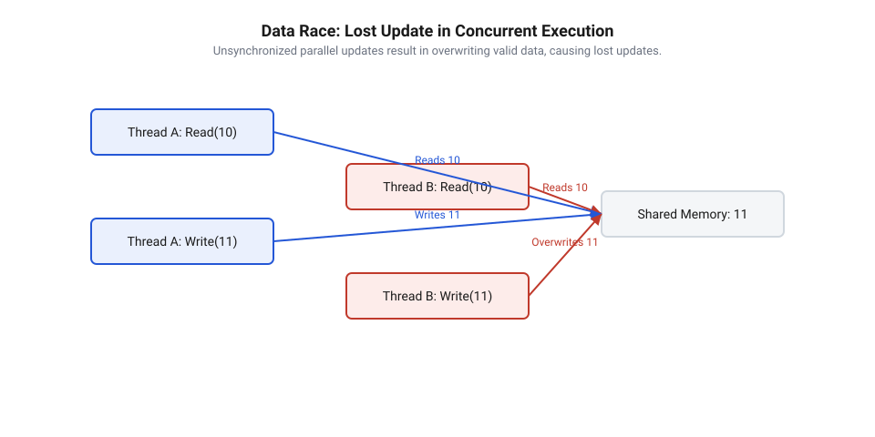
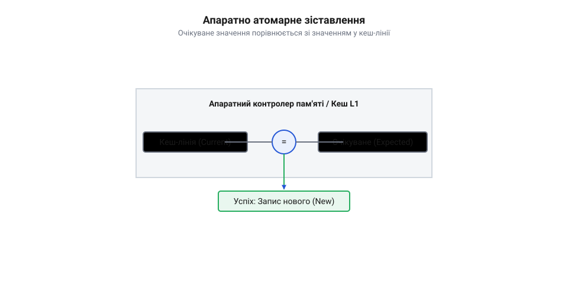
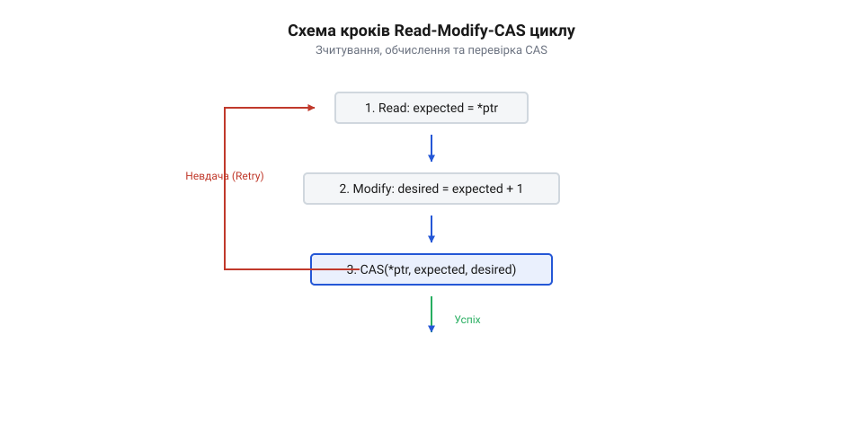
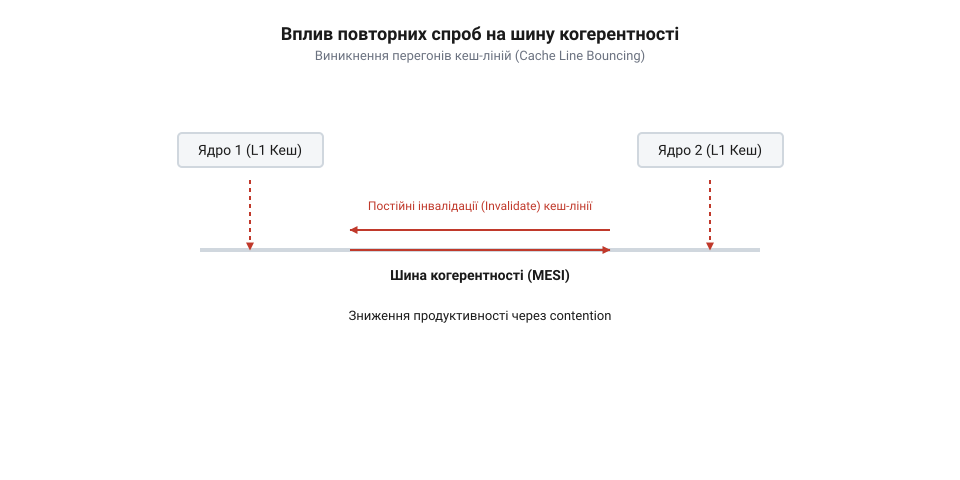
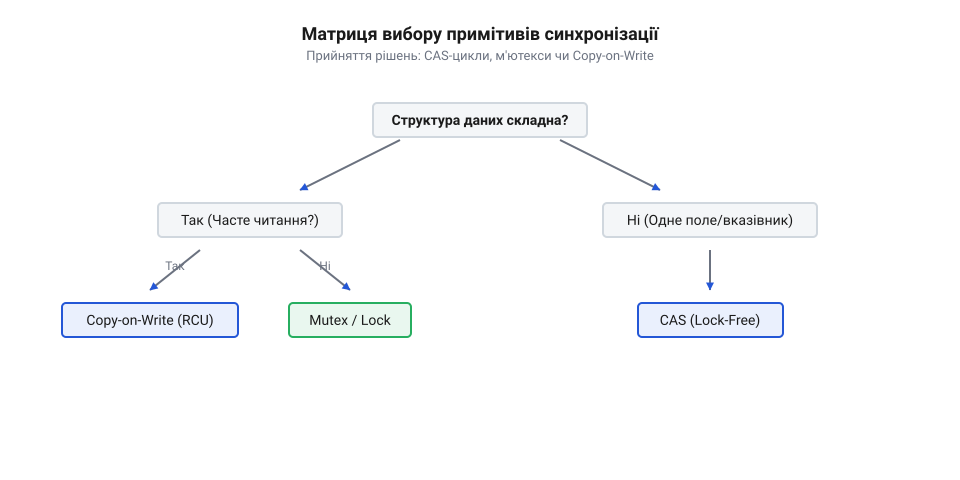

# Безблокувальне оновлення стану за допомогою інструкції CAS

<preknowlist>
- [Без замків](root:sf-tasks/lock-free-basics) — базові поняття гонитви за даними та концепція синхронізації стану без використання м'ютексів
</preknowlist>

## Втрачені оновлення в конкурентному середовищі

Інкремент `counter++` процесор розбиває на три фази: зчитування з пам'яті в регістр, зміну та зворотний запис (англ. @@en|Read-Modify-Write@@). Одночасне виконання переплітає ці фази: потоки обчислюють однаковий результат і затирають правки один одного. Виникає втрачене оновлення (англ. @@en|lost update@@, від англ. *lost* — втрачений, та *update* — оновлення) через [гонитву за даними](root:sf-tasks/lock-free-basics) (англ. @@en|data race@@).

*Неатомарні фази переплітаються, затираючи оновлення.*

Захист м'ютексом (англ. @@en|mutex@@, від англ. *mutual exclusion* — взаємне виключення) дорогий: конкуренція змушує ядро призупиняти потік і перемикати контекст (англ. @@en|context switch@@). Усунути затримки дозволяє апаратний примітив оновлення пам'яті без блокування потоків.

## Механіка та апаратна природа CAS

Інструкція Compare-And-Swap (англ. @@en|CAS@@, від англ. *compare* — порівняти, та *swap* — обміняти) приймає адресу комірки, очікуване й нове значення. Процесор атомарно зіставляє вміст пам'яті з очікуваним: за збігу записує нове й фіксує успіх, а за розбіжності повертає невдачу.

*Атомарне оновлення в кеші без блокування шини.*

Неподільність гарантує протокол когерентності кешів @@en|MESI@@: ядро захоплює кеш-лінію (англ. @@en|cache line@@) у стан `Modified`, оновлюючи її в локальному кеші L1 без блокування шини. Нескінченне число консенсусу (англ. @@en|consensus number@@, від лат. *consensus* — згода) робить @@en|CAS@@ універсальною основою для неблокувальних (англ. @@en|lock-free@@) структур даних.

## Оптимістичний цикл Read-Modify-CAS

Оновлення стану будують як оптимістичний цикл: потік зчитує значення як очікуване, локально обчислює новий стан і викликає @@en|CAS@@. За збігу запис фіксується, а за конфлікту потік повторює спробу зі свіжим значенням.

*Повторення спроб до підтвердження CAS.*

Слабка форма (англ. @@en|compare_exchange_weak@@) на архітектурах ARM чи RISC-V допускає хибні збої через переривання, проте в циклах швидша за сильну.

За високої конкуренції паралельний запис спричиняє перегони в кеш-лініях (англ. @@en|cache-line bouncing@@, від англ. *bounce* — відскакувати): лінія кешу мігрує між ядрами, перевантажуючи шину. Навантаження згладжують експоненційною затримкою (англ. @@en|exponential backoff@@) — прогресивною паузою між невдалими спробами.

*Міграція кеш-лінії між ядрами виснажує шину.*

## Атомарне оновлення складеного стану

Інструкція @@en|CAS@@ оперує одним машинним словом і не оновлює багатополеві структури. Для них застосовують незмінні об'єкти та копіювання при записі (англ. @@en|Copy-on-Write@@, або @@en|COW@@): потік модифікує локальну копію й атомарно підміняє кореневий вказівник (англ. @@en|root pointer@@) через @@en|CAS@@.

*Підміна кореневого вказівника не затримує читачів.*

Передчасне вивільнення пам'яті небезпечне: читачі можуть ще опрацьовувати старий об'єкт, а повторне використання адреси провокує [проблему ABA](root:sf-tasks/aba-problem) (англ. @@en|ABA problem@@, від станів A → B → A). Тому @@en|COW@@ застосовують за рідкісних оновлень разом із [безпечним вивільненням пам'яті](root:sf-tasks/aba-problem-and-safe-memory-reclamation).

## Поведінка під навантаженням та модальності

Цикл @@en|CAS@@ дає гарантію поступу @@en|lock-free@@: принаймні один потік рухається вперед, але окремий може зазнавати голодування (англ. @@en|starvation@@, від англ. *starve* — голодувати). Його виключає гарантія без очікування (англ. @@en|wait-free@@, від англ. *wait* — очікування, та *free* — вільний від), де крок кожного потоку гарантовано завершується.

*Release публікує зміни, а Acquire гарантує їхнє зчитування.*

Через апаратне перевпорядкування інструкцій процесором самої атомарності недостатньо. Узгодженість забезпечує впорядкування пам'яті (англ. @@en|acquire-release ordering@@): запис `Release` публікує зміни, а зчитування `Acquire` створює відношення (англ. @@en|synchronizes-with@@) без витрат на повні бар'єри пам'яті (англ. @@en|memory barrier@@).

## Вибір між CAS та блокуваннями

Вибір інструмента синхронізації залежить від профілю навантаження:
- За низької та помірної конкуренції короткі цикли @@en|CAS@@ перевершують @@en|mutex@@ за швидкістю, не задіюючи ядро ОС. - Під екстремальним паралельним записом на одну змінну цикли @@en|CAS@@ спалюють процесорний час; для суматорів краще обрати [шардовані лічильники LongAdder](root:sf-tasks/cas-and-longadder-counters) (англ. @@en|LongAdder@@), які розносять оновлення по різних кеш-лініях. - Для складеного стану з домінуванням читань оптимальні [підхід RCU](root:sf-tasks/read-copy-update) (англ. @@en|RCU@@, від англ. *read-copy-update* — читання, копіювання, оновлення) або [узгоджене читання Seqlock](root:sf-tasks/seqlock), що усувають конфлікти в кеші читачів. - За тривалих критичних секцій, великого стану чи високої частки записів надійнішим є класичний @@en|mutex@@, який присипляє потоки та береже ресурси процесора.

*Частота оновлень, розмір даних і допустима затримка визначають вибір між CAS, шардуванням, RCU та м'ютексом.*