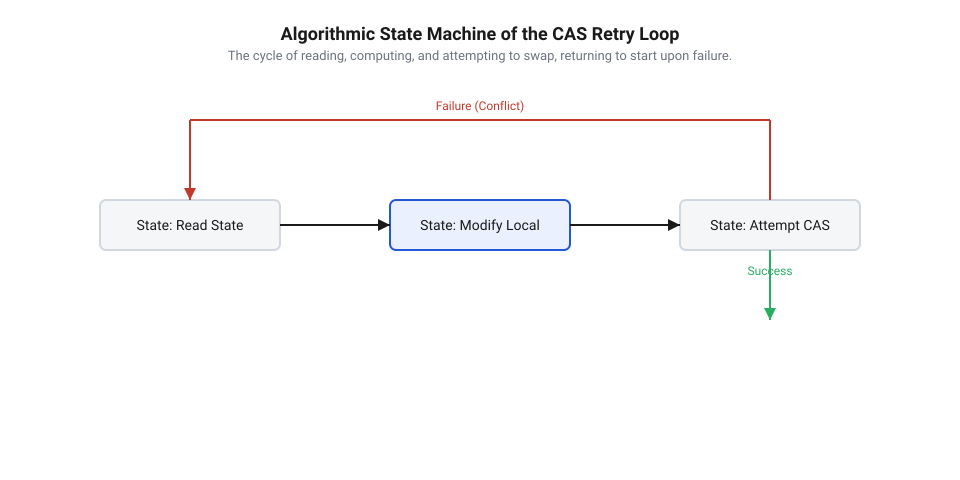
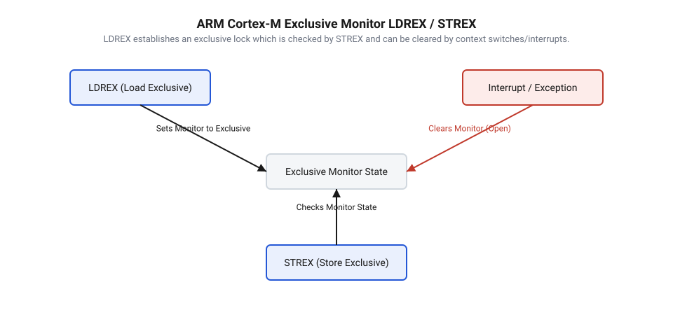

## Початкові концепції та фізичні принципи

Коли декілька обчислювальних ядер або потоків виконання у реальному часі намагаються одночасно змінити одну й ту саму ділянку пам'яті, виникає фундаментальна фізична проблема узгодженості даних. Без спеціального захисту паралельні операції читання та запису накладаються одна на одну у часі, створюючи @@en|стан гонки@@ (від англ. *race condition*) та руйнуючи цілісність даних у пам'яті. Традиційним розв'язком цієї проблеми тривалий час слугував @@en|м'ютекс@@ (від англ. *mutex*, скорочення від *mutual exclusion* — взаємне виключення). Однак у високонавантажених вбудованих системах та операційних системах реального часу (RTOS) блокування за допомогою @@en|м'ютексів@@ створює суттєві та часто неприпустимі накладні витрати. Потік виконання, що зустрів заблокований @@en|м'ютекс@@, змушений переходити у стан очікування, що викликає важку операцію переключання контексту процесора та виклик планувальника задач. Це призводить до непередбачуваних затримок виконання (лат. *latency*), виникнення небезпечних явищ у системі на кшталт @@en|інверсії пріоритетів@@ (від англ. *priority inversion*) або повного зупинення виконання через @@en|дедлок@@ (від англ. *deadlock* — взаємне блокування). Навіть простіші механізми синхронізації на кшталт @@en|spinlock@@ (від англ. *spin lock* — блокування з активним очікуванням) даремно спалюють процесорні цикли в @@en|активному очікуванні@@, забиваючи системну шину постійними запитами. Саме тому розробники змушені шукати підходи, коли алгоритми розробляються [без застосування замків](root:sf-tasks/lock-free-basics), спираючись на атомарні апаратні інструкції процесора.

Щоб зрозуміти, як досягається безблокувальне оновлення стану без зупинки чи блокування сусідніх потоків, необхідно зануритися у фізику функціонування процесорних шин та кеш-пам'яті. Сучасні багатоядерні мікроконтролери та процесори не працюють із оперативною пам'яттю напряму при кожній арифметичній операції — замість цього дані завантажуються у швидкі @@en|рядки кешу@@ (від англ. *cache lines*). Коли одне ядро змінює значення змінної у своєму локальному кеші, інші ядра процесора мають негайно дізнатися про втрату актуальності власних копій цієї ділянки пам'яті. Цю задачу вирішує апаратний механізм @@en|когерентність кешу@@ (від англ. *cache coherency*), який працює через @@en|протокол MESI@@ (від англ. *MESI protocol*, названого за першими літерами станів *Modified*, *Exclusive*, *Shared*, *Invalid*). У старіших архітектурах для виконання атомарної зміноподібної операції процесор виставляв спеціальний фізичний @@en|сигнал LOCK#@@ (від англ. *lock bus signal*), який апаратно блокував усю системну @@en|шину inter-connect@@ (від англ. *interconnect bus*), забороняючи іншим периферійним пристроям, контролерам прямого доступу до пам'яті (DMA) та сусіднім ядрам звертатися до RAM. У сучасних мікропроцесорних архітектурах апаратне забезпечення використовує значно локальніші механізми: кеш-контролер ядра захоплює відповідний @@en|рядок кешу@@ у стан *Exclusive* або *Modified*, забезпечуючи монопольний фізичний доступ до комірки на час виконання лише однієї атомарної інструкції.

Фундаментом для побудови складних неблокувальних алгоритмів та структур даних є @@en|атомарність@@ (від грец. *atomos* — неподільний) базових операцій, які надаються процесором через [атомарні апаратні примітиви](root:sf-tasks/lock-free-atomic-primitives). Найважливішою та найуніверсальнішою серед них є інструкція @@en|Compare-And-Swap@@ (від англ. *compare* — порівнювати, *swap* — обмінювати) або скорочено @@en|CAS@@. Фізично ця інструкція виконується за один неподільний такт процесорного ядра (або нерозривну послідовність шинних транзакцій кеш-контролера) і приймає три основні аргументи: вказівник на цільову комірку пам'яті `p`, очікуване старе значення `expected` та бажане нове значення `desired`. Апаратна логіка виконуючого ядра зчитує поточний вміст за адресою `p` і порівнює його зі значенням `expected`. Якщо значення повністю збігаються біт-у-біт, процесор атомарно записує за адресою `p` нове значення `desired` і повертає прапор успіху `true`. Якщо ж значення у пам'яті відрізняються від `expected` (що свідчить про те, що інше ядро чи переривання вже встигло змінити комірку), запис скасовується на апаратному рівні, а інструкція повертає `false` та записує поточне значення з пам'яті назад у `expected`.

Ключова фізична особливість @@en|CAS@@ полягає у тому, що перевірка та запис відбуваються монолітно на самому фізичному кремнії: жоден інший переривник, потік чи периферійний модуль не може вклинитися між фазою порівняння та фазою запису. Це дає абсолютну гарантію відсутності @@en|гонки даних@@ на найнижчому рівні обчислювальної системи. Крім того, реальне виконання інструкції @@en|CAS@@ у більшості процесорних архітектур супроводжується створенням апаратного @@en|бар'єра пам'яті@@ (від англ. *memory barrier*), який жорстко фіксує порядок видимості збережених даних для всіх інших обчислювальних вузлів. Використовуючи [бар'єри впорядкування пам'яті](root:sf-tasks/memory-barriers-and-atomic-sequencing), програміст отримує гарантію того, що всі попередні операції запису завершаться та стануть видимими в системі раніше за виконання @@en|CAS@@, а наступні операції читання й запису не будуть переупорядковані компілятором чи конвеєром процесора раніше за це атомарне оновлення.

Порівняно з класичним відключенням переривань у мікроконтролерах, яке часто використовується як найпростіший спосіб досягнення атомарності у одноядерних системах, інструкція @@en|CAS@@ володіє колосальною перевагою: вона працює локально над конкретною коміркою пам'яті та залишається полностью коректною у багатоядерних конфігураціях (SMP). Відключення переривань блокує обробку критичних подій від реального світу та збільшує затримку реакції системи (лат. *interrupt latency*), що є неприпустимим для жорсткого реального часу. Натомість @@en|CAS@@ залишає переривання увімкненими, дозволяючи системі миттєво реагувати на зовнішні сигнали, забезпечуючи при цьому сувору математичну узгодженність спільного стану.

## Внутрішня будова та алгоритми роботи

Перехід від класичного блокування до використання інструкцій @@en|CAS@@ вимагає кардинальної зміни алгоритмічного підходу до проектування прошивок: замість песимістичного захисту всієї критичної секції @@en|м'ютексом@@ застосовується концепція @@en|оптимістичне узгодження@@ (від англ. *optimistic concurrency control*). У цьому підході потік виконання припускає, що конкуренція за спільний ресурс є низькою і конфлікти паралельних записів трапляються відносно рідко. Алгоритм не блокує інші потоки перед початком модифікації даних, а виконує всі необхідні обчислення локально у реєстрах процесора. Лінійна послідовність дій алгоритму складається з трьох чітких кроків. На першому кроці потік атомарно зчитує поточний стан спільної змінної з пам'яті у свою локальну змінну `old_val`. На другому кроці виконуються довільно складні обчислення нового стану `new_val = f(old_val)` повністю автономно у локальних реєстрах ядра без утримання будь-яких замків чи блокувань. На третьому кроці потік здійснює спробу атомарно застосувати обчислений результат за допомогою інструкції @@en|CAS@@.

Якщо під час виконання локальних обчислень жоден інший потік чи переривання не модифікували спільну комірку пам'яті, значення за адресою залишається рівним `old_val`. У такому разі інструкція @@en|CAS@@ успішно записує `new_val` у пам'ять і повертає прапор успіху, завершуючи атомарне оновлення стану всього за один крок. Якщо ж інший потік встиг виконати свій @@en|CAS@@ та змінити комірку раніше, поточна спроба зазнає невдачі. Оскільки апаратний запис скасовується, стан системи залишається абсолютно узгодженим і непошкодженим. Потік-невдаха опиняється у спеціальній конструкції повторних спроб, яка називається @@en|робочий цикл CAS-петлі@@ (від англ. *CAS loop*). Замість переходу в сон, блокування чи виклику операційної системи, потік зчитує оновлене актуальне значення з пам'яті, повторно виконує обчислення `new_val` на основі нового `old_val` і знову здійснює виклик @@en|CAS@@. Цей процес ітеративно повторюється доти, доки атомарне оновлення не завершиться успіхом.


*Логіка роботи неблокувального оновлення стану: від початкового читання та локального обчислення до атомарної перевірки CAS із циклічним повтором при конфлікті.*

Поведінка @@en|робочого циклу CAS-петлі@@ суттєво змінюється залежно від рівня навантаження та кількості паралельних виконавців у системі. При низькій конкуренції @@en|CAS@@ виконується з першої ж спроби, забезпечуючи найвищу можливу швидкість оновлення станційного регістра чи лічильника (всього кілька тактів процесора). Проте при значному зростанні кількості паралельних ядер виникає висока @@en|конкуренція за пам'ять@@ (від англ. *contention*). Коли десятки ядер одночасно крутяться у @@en|робочому циклі CAS-петлі@@ і намагаються записати дані в один і той самий @@en|рядок кешу@@, шина міжпроцесорної взаємодії перевантажується службовими транзакціями. Переходи станів у @@en|протоколі MESI@@ викликають шкідливе явище @@en|bouncing рядків кешу@@ (від англ. *cache line bouncing*), коли @@en|рядок кешу@@ безперервно передається від одного ядра до іншого, постійно інвалідуючись та викликаючи затримки шини. Для зменшення негативного впливу цього ефекту у високопродуктивних алгоритмах застосовують @@en|експоненційний backoff@@ (від англ. *exponential backoff*) — у разі невдачі @@en|CAS@@ потік робить коротку паузу (наприклад, через спеціальну процесорну інструкцію `NOP` або `PAUSE`), тривалість якої зростає з кожною наступною невдалою спробою.

Практичним прикладом застосування @@en|робочого циклу CAS-петлі@@ у вбудованих системах є атомарне оновлення складеного 32-бітного регістра стану периферійного модуля. Такий регістр може містити декілька бітових прапорів, біти поточного режиму та лічильник пакетів. Щоб змінити лише лічильник пакетів, не порушуючи інші прапори, потік у @@en|робочому циклі CAS-петлі@@ зчитує 32-бітне слово, виділяє маскою потрібні біти, збільшує лічильник, формує нове 32-бітне значення і виконує @@en|CAS@@. Якщо під час формування нового слова переривання змінило один із прапорів стану у цьому ж регістрі, @@en|CAS@@ зафіксує розбіжність, скасує запис і змусить цикл прочитати нові прапори та переобчислити значення заново. Це забезпечує атомарність модифікації окремих полів без використання глобальних блокувань.

Внутрішня будова неблокувальних алгоритмів на основі @@en|CAS@@ має також свої класичні граничні вразливості. Найвідомішою з них є [проблема ABA в неблокувальних структурах](root:sf-tasks/aba-problem), коли значення комірки пам'яті змінюється з `A` на `B`, а потім знову повертається до `A` між зчитуванням `old_val` та викликом @@en|CAS@@. Потік помилково вважає, що стан не змінювався, хоча внутрішній вміст чи зв'язки структури даних вже було повністю зруйновано іншим потоком. Для розв'язання цієї проблеми використовують дворазово розширений @@en|CAS@@ з версіонуванням (поєднання вказівника та монотонно зростаючого лічильника модифікацій) або спеціалізовані [неблокуючі лічильники](root:sf-tasks/cas-and-longadder-counters). Крім того, у RISC-архітектурах (ARM, RISC-V) @@en|CAS@@ нерідко реалізується через пару інструкцій Load-Link/Store-Conditional, які слугують [альтернативою інструкції CAS](root:sf-tasks/load-link-store-conditional-primitives) і природно відслідковують будь-який запис у кеш-лінію, запобігаючи ефекту ABA на рівні апаратури. Завдяки належно побудованому @@en|робочому циклу CAS-петлі@@ система отримує надійну гарантію поступу: хоча окремий потік може затримуватися через повторні спроби у разі конфліктів, загальний прогрес принаймні одного потоку в системі завжди забезпечений, що повністю відповідає найвищим [гарантіям поступу паралельних алгоритмів](root:sf-tasks/wait-free-and-lock-free-classification).

## Апаратна реалізація та низькорівневий C/C++ код

Атомарне оновлення комірки пам'яті вимагає безпосередньої підтримки з боку процесорної архітектури. Спосіб, у який мікропроцесор забезпечує атомарність атомарної операції @@en|Compare-And-Swap@@ (від англ. @@en|compare@@ — порівнювати, та @@en|swap@@ — обмінювати), принципово відрізняється залежно від системної архітектури. У процесорах сімейства @@en|x86-64@@ операція реалізована через апаратну інструкцію @@en|LOCK CMPXCHG@@. Під час її виконання процесорне ядро виставляє префікс @@en|LOCK@@, який активує когерентне блокування рядка кешу в протоколі @@en|MESI@@ або фіксує системну шину inter-connect. Це гарантує, що жодне інше ядро або пристрій введення-виведення не зможе зчитати чи модифікувати таку комірку впродовж усього циклу «читання-порівняння-запис».

На противагу архітектурі @@en|x86-64@@, у мікроконтролерах і процесорах архітектури @@en|RISC@@ (зокрема @@en|ARM Cortex-M@@ та @@en|RISC-V@@) виділеної інструкції @@en|CAS@@ немає. Замість неї застосовуються [парні атомарні інструкції LL/SC](root:sf-tasks/load-link-store-conditional-primitives) — @@en|Load-Link/Store-Conditional@@ (від англ. @@en|load@@ — завантажувати, @@en|link@@ — зв'язувати, @@en|store@@ — зберігати, та @@en|conditional@@ — умовно). В системі команд @@en|ARM@@ ця пара представлена інструкціями `LDREX` (Load Register Exclusive) та `STREX` (Store Register Exclusive).

Фізичний механізм виконання цієї пари спирається на апаратний @@en|exclusive monitor@@ (від лат. @@en|exclusivus@@ — виключний, та англ. @@en|monitor@@ — відстежувач) всередині ядра процесора або шинного арбітра. Коли ядро виконує інструкцію `LDREX`, воно завантажує значення з пам'яті й одночасно реєструє фізичну адресу в ексклюзивному моніторі, переводячи його у стан відстеження. Якщо наступна інструкція `STREX` намагається записати нове значення за цією ж адресою, монітор перевіряє, чи залишався запис ексклюзивним. Якщо інший процесорний корінь, DMA-контролер або обробник переривання змінив вміст цієї адреси чи спричинив контекстне перемикання, ексклюзивний монітор скидається. У цьому разі інструкція `STREX` скасовує запис у пам'ять і повертає прапорець помилки (значення 1 у регістрі статусу).


*Цикл ексклюзивного доступу LDREX/STREX із скиданням стану монітора при виклику переривання.*

Для керування апаратними бар'єрами та порядком вибірки команд стандарти C11 (`stdatomic.h`) та C++11 (`<atomic>`) надають розробнику специфікатори моделей впорядкування пам'яті @@en|memory order@@ (від англ. @@en|memory@@ — пам'ять, та @@en|order@@ — порядок). Оптимізація низькорівневого коду вимагає точного добору параметрів впорядкування:

1. `std::memory_order_relaxed` — забезпечує атомарність оновлення значення, але не накладає жодних обмежень на переупорядкування сусідніх інструкцій компілятором чи конвеєром процесора.
2. `std::memory_order_acquire` — гарантує, що жодна наступна операція читання чи запису в поточному потоці не буде перенесена вище цієї межі. Застосовується при зчитуванні стану.
3. `std::memory_order_release` — гарантує, що всі попередні операції запису стануть видимими для інших потоків до виконання цієї операції. Застосовується при публікації нових даних.
4. `std::memory_order_seq_cst` — забезпечує суворе глобальне послідовне впорядкування (@@en|sequential consistency@@), генеруючи інструкції апаратних бар'єрів пам'яті `DMB ISH` на ядрах @@en|ARM@@.

Коректне застосування цих параметрів детально регламентують [бар'єри пам'яті та моделі](root:sf-tasks/memory-barriers-and-atomic-sequencing) впорядкування паралельних операцій, що дозволяє уникнути зайвих простоїв процесорного конвеєра.

У програмному інтерфейсі C/C++ операція @@en|CAS@@ представлена двома функціями: `compare_exchange_weak` та `compare_exchange_strong`. Варіант `compare_exchange_weak` може завершитися хибною невдачею — @@en|spurious failure@@ (від лат. @@en|spurius@@ — хибний, та англ. @@en|failure@@ — збій), коли функція повертає `false`, хоча значення в пам'яті відповідає очікуваному. На архітектурах @@en|LL/SC@@ хибна невдача виникає через випадкове скидання ексклюзивного монітора (наприклад, при спрацюванні таймерного переривання між `LDREX` і `STREX`). 

Оскільки в неблокувальних алгоритмах оновлення стану завжди виконується всередині циклу `do-while`, використання `compare_exchange_weak` є найбільш ефективним. Вона транслюється у пряму послідовність `LDREX`/`STREX` без додаткових перевірок. Натомість `compare_exchange_strong` змушена генерувати внутрішній вкладений цикл для придушення хибних невдач, що створює зайві накладні витрати у прошивці мікроконтролера.

Нижче наведено практичну реалізацію атомарного оновлення регістра статусу периферійного пристрою для вбудованих систем мовами C та C++.

:::tabs
```c
#include <stdbool.h>
#include <stdint.h>
#include <stdatomic.h>

typedef struct {
    uint16_t status_flags;
    uint16_t sequence_number;
} device_state_t;

typedef union {
    device_state_t state;
    uint32_t raw;
} atomic_state_t;

static _Atomic uint32_t g_system_state = 0;

// Атомарне оновлення прапорців статусу з автоматичним інкрементом лічильника послідовності
bool update_device_status(uint16_t set_flags, uint16_t clear_flags) {
    uint32_t current_raw = atomic_load_explicit(&g_system_state, memory_order_relaxed);
    atomic_state_t old_val;
    atomic_state_t new_val;

    do {
        old_val.raw = current_raw;
        new_val.raw = current_raw;
        
        // Модифікація локальної копії стану
        new_val.state.status_flags = (old_val.state.status_flags & ~clear_flags) | set_flags;
        new_val.state.sequence_number = old_val.state.sequence_number + 1;

        // Слабкий CAS у циклі очікування: оптимально для ARM/RISC-V LL/SC
    } while (!atomic_compare_exchange_weak_explicit(
        &g_system_state,
        &current_raw,
        new_val.raw,
        memory_order_release,
        memory_order_relaxed));

    return true;
}
```
```cpp
#include <atomic>
#include <cstdint>
#include <cstring>

struct alignas(4) DeviceState {
    uint16_t status_flags;
    uint16_t sequence_number;
};

class LockFreeStateController {
public:
    explicit LockFreeStateController(uint16_t initial_flags = 0) noexcept {
        DeviceState init_state{initial_flags, 0};
        state_raw_.store(to_raw(init_state), std::memory_order_relaxed);
    }

    // Безблокувальне оновлення прапорців статусу
    void update_flags(uint16_t set_mask, uint16_t clear_mask) noexcept {
        uint32_t expected = state_raw_.load(std::memory_order_relaxed);
        uint32_t desired = 0;

        do {
            DeviceState current = from_raw(expected);
            current.status_flags = (current.status_flags & ~clear_mask) | set_mask;
            current.sequence_number++;
            desired = to_raw(current);
        } while (!state_raw_.compare_exchange_weak(
            expected,
            desired,
            std::memory_order_release,
            std::memory_order_relaxed));
    }

    DeviceState get_state() const noexcept {
        uint32_t raw = state_raw_.load(std::memory_order_acquire);
        return from_raw(raw);
    }

private:
    static uint32_t to_raw(DeviceState s) noexcept {
        uint32_t raw = 0;
        std::memcpy(&raw, &s, sizeof(raw));
        return raw;
    }

    static DeviceState from_raw(uint32_t raw) noexcept {
        DeviceState s{};
        std::memcpy(&s, &raw, sizeof(s));
        return s;
    }

    std::atomic<uint32_t> state_raw_{0};
};
```
:::

## Практичне застосування та відлагодження

Розробка системних прошивок для операційних систем реального часу (RTOS) часто вимагає синхронізації даних між задачами та обробниками переривань @@en|Interrupt Service Routine@@ (від лат. @@en|interruptus@@ — перерваний, та англ. @@en|routine@@ — процедура, скорочено @@en|ISR@@). Використання традиційних м'ютексів або семафорів у контексті переривань категорично заборонено: пристрій не має контексту потоку для переходу в стан очікування (sleeping/blocking), тому спроба захопити блокувальний замок всередині переривання призводить до критичного збою прошивки (наприклад, @@en|HardFault@@ в @@en|ARM Cortex-M@@).

Поширене рішення із глобальним вимкненням переривань через інструкцію `__disable_irq()` гарантує атомарність, але збільшує затримку реакції системи на зовнішні події (interrupt latency). Використання петлі @@en|CAS@@ дозволяє реалізувати безпечну взаємодію між перериванням та основними задачами без блокування системної шини та без затримки обробки переривань.

Однак при високій інтенсивності запитів з боку кількох ядер або високочастотних переривань система потрапляє в стан високої конкуренції (contention). Якщо одна з задач постійно програє боротьбу за оновлення адреси пам'яті через переривання ексклюзивного монітора, виникає ефект безкінечного циклу — @@en|livelock@@ (від англ. @@en|live@@ — живий, та @@en|lock@@ — замок). Поток продовжує активно виконувати обчислення, але не робить корисного поступу, що призводить до виснаження ресурсів — @@en|starvation@@ (від англ. @@en|starvation@@ — голодування).

Для нейтралізації цього ефекту в алгоритми оновлення впроваджують механізм експоненційного відступу — @@en|backoff@@ (від англ. @@en|back off@@ — відступати). У мікроконтролерних системах замість тривалого блокування застосовують паузи конвеєра:

```
delay = base_delay × 2ⁿ
[де n — кількість невдалих спроб CAS, а пауза виконується через NOP/WFE]
```

Для вимірювання ймовірності успішного виконання атомарної інструкції при паралельному доступі N потоків використовують формулу розрахунку успішності атомарної спроби:

```
P_success = 1 - P_conflict
= 1 - (1 - (1 - 1/N)^(K-1))      [ймовірність успішного виклику CAS за K спроб]
```

При побудові динамічних безблокувальних структур (стеків або черг) на основі вказівників виникає фундаментальна проблема ABA. Якщо потік зчитав вказівник на вузол A, після чого інший потік вилучив A, звільнив пам'ять і виділив новий вузол за тією ж самою адресою A, первинний CAS успішно виконає заміну, не помітивши, що структура даних повністю змінилася.

Оскільки у вбудованій прошивці використання динамічного виділення пам'яті (`malloc`/`free`) часто заборонено через ризики фрагментації, розробники застосовують статичні пули об'єктів з упакованими версійними вказівниками (верхні 16 біт 32-бітного слова зберігають лічильник модифікацій, а нижні 16 біт — індекс у пулі). У більш складних системах із динамічною пам'яттю реалізують [механізми безпечного вилучення пам'яті](root:sf-tasks/hazard-pointers-memory-reclamation), які запобігають звільненню вузлів, поки на них посилаються інші потоки.

Оцінюючи поведінку безблокувального коду під максимальним навантаженням, розробник мусить систематизувати [гарантії поступу паралельних алгоритмів](root:sf-tasks/wait-free-and-lock-free-classification) (Lock-Free vs Wait-Free), гарантуючи детермінований час відгуку прошивки.

Діагностика граничних випадків у неблокувальних алгоритмах ускладнюється тим, що класичні покрокові налагоджувачі (JTAG/SWD) змінюють часові інтервали виконання й приховують гонки станів. Для забезпечення надійності прошивки застосовують комбінацію трьох підходів:

1. Динамічний аналіз та інструментування коду (запуск алгоритмів під аналізаторами стан-гонок @@en|ThreadSanitizer@@).
2. Формальна верифікація моделей: інструменти на кшталт [перевірка системних моделей](root:sf-tasks/model-checking-lock-free) аналізують усі можливі переплетення виконання потоків і перевіряють інваріанти структури даних.
3. Апаратний трейсинг на рівні мікроконтролера: використання лічильників циклів DWT (Data Watchpoint and Trace) та виводу ITM (Instrumentation Trace Macrocell) в ядрах @@en|ARM Cortex-M@@ дозволяє фіксувати максимальну кількість ітерацій CAS-петлі у реальному часі без зупинки процесора.
