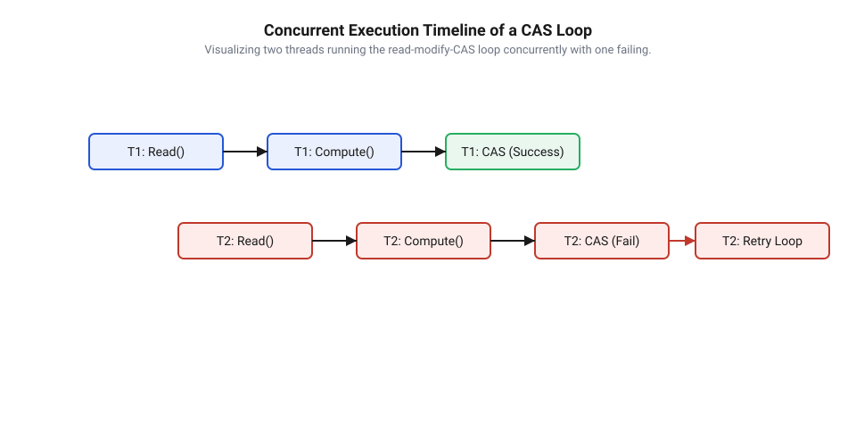
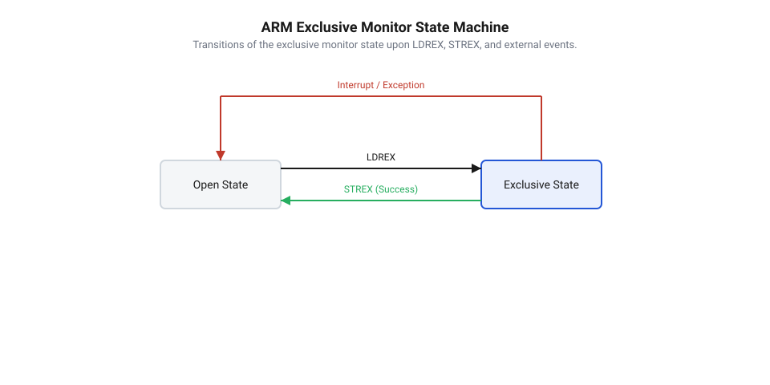
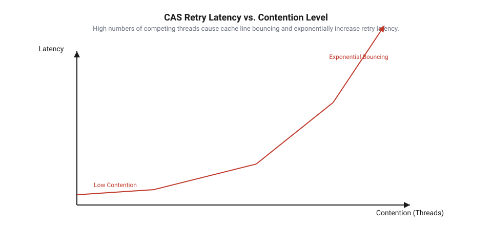

## Початкові концепції та фізичні принципи

У багатопотокових обчислювальних системах виникає фундаментальна проблема: коли декілька процесорних ядер намагаються одночасно прочитати, змінити та записати нове значення в одну й ту саму комірку оперативної пам'яті, звичайна послідовність машинних інструкцій зазнає катастрофічного збою. Цей феномен називається @@en|race condition@@ (від @@en|race@@ — перегони, та @@en|condition@@ — умова). Причиною є те, що стандартна операція модифікації стану складається з трьох окремих етапів на рівні мікроархітектури: зчитування поточного значення з пам'яті у внутрішній регістр процесора, обчислення нового результату в арифметично-логічному пристрої та запис підсумкового значення назад у пам'ять. Якщо під час цих тактів інше ядро процесора встигає змінити вміст цієї ж комірки, перше ядро під час запису незворотно перезапише чужі зміни, спричинивши втрату даних.

Щоб запобігти такій деструктивній поведінці, апаратне забезпечення сучасних мікропроцесорів надає спеціальні атомарні інструкції типу @@en|Read-Modify-Write@@ (від @@en|read@@ — читати, @@en|modify@@ — модифікувати, @@en|write@@ — писати, далі @@en|RMW@@). Головна фізична умова атомарності полягає в тому, що весь триетапний цикл зчитування, обчислення та запису виконується як єдина неделима операція з точки зору всіх інших ядер та периферійних пристроїв шини. Жодне інше ядро не може вклинитися посередині цього циклу або прочитати проміжний стан.

Фізична реалізація неделимості @@en|RMW@@-операцій еволюціонувала разом із архітектурою багатоядерних процесорів. У перших багатопроцесорних системах для гарантування атомарності застосовувався фізичний @@en|bus lock@@ (від @@en|bus@@ — шина, та @@en|lock@@ — замок). Процесор виставляв спеціальний сигнал на системній шині (наприклад, сигнал `LOCK` у мікропроцесорах x86), що фізично блокував доступ усіх інших ядер до оперативної пам'яті на час виконання інструкції. Хоча це гарантувало коректність, виставляння шинного замка створювало величезні затримки виконання та знижувало продуктивність усієї системи.

У сучасних мікроконтролерах та багатоядерних процесорах атомарність забезпечується на рівні кеш-пам'яті за допомогою протоколів кеш-когерентності, таких як MESI або MOESI. Поняття @@en|cache line@@ (від @@en|cache@@ — схованка, та @@en|line@@ — лінія) визначає мінімальний блок пам'яті (зазвичай 64 байти), яким оперує кеш-ієрархія. Протокол @@en|cache coherence@@ (від @@en|cache@@ — схованка, та lat. @@en|cohaerentia@@ — зв'язок) стежить за тим, щоб усі ядра бачили узгоджений стан пам'яті. Коли розробляються [безблокувальні алгоритми та структури](root:sf-tasks/lock-free-basics), ядро, яке виконує атомарне оновлення, захоплює відповідну @@en|cache line@@ у монопольний стан (Modified або Exclusive), надсилаючи іншим ядрам сигнал анулювання (Invalidate). Доки атомарна операція не завершиться, жодне інше ядро не зможе отримати доступ на читання чи запис до цього блоку пам'яті. Це називається кеш-замком (@@en|cache lock@@), і він працює в сотні разів швидше за фізичне блокування всієї шини.

Найважливішим апаратним примітивом для створення неблокуючих систем є інструкція @@en|Compare-And-Swap@@ (від @@en|compare@@ — порівнювати, та @@en|swap@@ — обмінювати, далі @@en|CAS@@). Апаратний механізм @@en|CAS@@ приймає три параметри: адресу комірки пам'яті `addr`, очікуване значення `expected` та нове бажане значення `desired`. Спираючись на [базові атомарні примітиви](root:sf-tasks/lock-free-atomic-primitives), мікропроцесор атомарно виконує наступний алгоритм:

1. Зчитує поточне значення з адреси `addr` у внутрішній тимчасовий регістр `V`.
2. Порівнює `V` з очікуваним значенням `expected`.
3. Якщо `V` дорівнює `expected`, мікропроцесор записує `desired` за адресою `addr` і повертає прапор успіху `true`.
4. Якщо `V` не дорівнює `expected` (що означає, що інший потік встиг змінити стан), запис не відбувається, комірка `addr` залишається недоторканою, а інструкція повертає `false` (або актуальне значення `V`).

В архітектурах x86 ця операція реалізована інструкцією `CMPXCHG` з префіксом `LOCK`, тоді як у деяких RISC-архітектурах використовується [пара інструкцій LL/SC](root:sf-tasks/load-link-store-conditional-primitives), яка забезпечує аналогічну функціональність на рівні зв'язки зчитування та умовного запису.

Використання @@en|CAS@@ дає змогу повністю відмовитися від м'ютексів та критичних секцій операційної системи. Коли потік захоплює м'ютекс, він ризикує бути заблокованим ОС при виникненні конкуренції, що призводить до коштовного перемикання контексту потоків, інверсії пріоритетів та загрози виникнення ситуації @@en|deadlock@@ (від @@en|dead@@ — мертвий, та @@en|lock@@ — замок). На противагу цьому, атомарна інструкція @@en|CAS@@ дає змогу виконувати оновлення стану без зупинки виконання інших потоків.

## Внутрішня будова та алгоритми роботи

Прямий виклик інструкції @@en|CAS@@ виконує атомарну перевірку й заміну лише за один крок. Однак для оновлення довільного стану системи потрібна програмна обгортка, відома як @@en|CAS-loop@@ (від @@en|CAS@@ та @@en|loop@@ — петля). Алгоритм @@en|CAS-loop@@ працює за принципом оптимістичного паралелізму: потік передбачає відсутність конфліктів, готує нове значення на основі прочитаного стану, а в разі виявлення конкурентної зміни — повторює спробу.

Типовий цикл оновлення стану складається з чотирьох послідовних кроків:
1. Зчитування поточного значення змінної стану `old_val = state`.
2. Обчислення нового значення `new_val = f(old_val)` у локальних регістрах потоку.
3. Спроба атомарного запису через виклик `CAS(&state, &old_val, new_val)`.
4. Якщо операція повертає `true`, оновлення успішно завершено. Якщо повертається `false`, потік оновлює `old_val` прочитаним значенням і повертається на крок 2.


*Схема показує часову діаграму двох потоків: потік A завершує CAS з першої спроби, а потік B отримує відмову, перечитає стан і повторює операцію.*

Математичною основою стійкості таких алгоритмів є поняття @@en|consensus number@@ (від lat. @@en|consensus@@ — згода). Число консенсусу визначає максимальну кількість паралельних потоків, які можуть узгодити єдине спільне рішення за допомогою даного примітива за скінченну кількість кроків. У той час як звичайні атомарні операції читання та запису мають число консенсусу 1, інструкція @@en|CAS@@ має число консенсусу `∞` (нескінченність). Це математично доводить, що за допомогою @@en|CAS@@ можна побудувати безблоковий алгоритм узгодження для довільної кількості `N` потоків.

Аналізуючи гарантії виконання, зазначимо, що відповідно до [класифікації гарантій поступу](root:sf-tasks/wait-free-and-lock-free-classification), система на основі @@en|CAS-loop@@ володіє властивістю @@en|lock-free@@ (від @@en|lock@@ — замок, та @@en|free@@ — вільний). Це означає глобальну гарантію поступу всієї системи: хоча окремий потік через постійні конфлікти може крутитися в циклі тривалий час, система в цілому завжди здійснює крок уперед.

Доведемо цей факт математично. Нехай `N` потоків одночасно виконують оновлення через @@en|CAS-loop@@. Зміна стану комірки `state` з значення `old_val` на `new_val` можлива лише тоді, коли інструкція @@en|CAS@@ повертає `true`. Якщо для потоку `T_i` інструкція @@en|CAS@@ повернула `false`, це означає, що поточний вміст `state` більше не дорівнює прочитаному раніше значенню `old_val`. Така зміна могла відбутися виключно внаслідок того, що якийсь інший потік `T_j` (де `j ≠ i`) успішно виконав свій виклик @@en|CAS@@ у проміжку між кроками 1 та 3 потоку `T_i`. Отже, кожна невдала спроба в одному потоці супроводжується щонайменше одним гарантованим успішним оновленням у сусідньому потоці. Загальний прогрес системи є детермінованим.

Оцінимо математичне сподівання кількості спроб виконання циклу при наявності високого рівня конкуренції за пам'ять (поняття @@en|contention@@, від lat. @@en|contentio@@ — змагання). Позначимо через `p` ймовірність того, що потік виконує інструкцію @@en|CAS@@ без конфлікту з іншими ядрами (`0 < p ≤ 1`). Тоді ймовірність `P(k)` того, що потік успішно оновлює стан саме на `k`-ій спробі, описується геометричним розподілом:

P(k) = (1 - p)ᵏ⁻¹ · p

де:
- `k` — кількість спроб виконання атомарної інструкції (`k ∈ ℕ`, `k ≥ 1`);
- `p` — ймовірність успішного завершення операції за одну спробу;
- `P(k)` — ймовірність отримання першого успіху саме на спробі з номером `k`.

Обчислимо математичне сподівання `E[k]` кількості спроб, необхідних потоку для успішного оновлення стану:

E[k]
= ∑ (k · (1 - p)ᵏ⁻¹ · p)    [сумування за k від 1 до ∞]
= p · ∑ (k · (1 - p)ᵏ⁻¹)     [винесення константного множника p]
= p · (1 / p²)              [застосування формули похідної геометричного ряду]
= 1 / p                     [алгебраїчне спрощення]

При зменшенні ймовірності успіху `p` (наприклад, через зростання кількості ядер) математичне сподівання кількості спроб зростає як `1 / p`. При надзвичайно високій конкуренції постійні невдалі спроби призводять до ефекту @@en|cache line bouncing@@ (від @@en|cache line@@ та @@en|bouncing@@ — підстрибування), коли лінія кешу безперервно передається між L1-кешами різних ядер. Щоб гарантувати правильне впорядкування пам'яті під час таких повторів, розробник має застосовувати відповідні [апаратні бар'єри пам'яті](root:sf-tasks/memory-barriers-and-atomic-sequencing).

Складнішим випадком є оновлення динамічних структур даних та вказівників, де виникає [проблема хибного успіху ABA](root:sf-tasks/aba-problem). Вона полягає в тому, що значення комірки пам'яті змінюється з `A` на `B`, а потім знову повертається до `A`. Інструкція @@en|CAS@@ вважатиме, що стан не змінювався, і запише `desired`, хоча внутрішні дані вже були модифіковані. Для вирішення цієї проблеми застосовують @@en|tagged pointer@@ (від @@en|tag@@ — мітка, та @@en|pointer@@ — вказівник) — комбінацію вказівника та лічильника модифікацій, або використовують [безпечні захисні вказівники](root:sf-tasks/hazard-pointers-memory-reclamation) для управління пам'яттю. Зауважимо, що для простих математичних лічильників замки й @@en|CAS-loop@@ часто замінюють на [масштабовані лічильники LongAdder](root:sf-tasks/cas-and-longadder-counters).

Нижче наведено практичну реалізацію неблокуючого менеджера оновлення стану для вбудованих систем мовами C та C++.

:::tabs
```c
#include <stdatomic.h>
#include <stdbool.h>
#include <stdint.h>

// Структурний тип для збереження атомарного стану
typedef struct {
    _Atomic uint32_t state;
} state_manager_t;

// Ініціалізація модуля стану
void state_manager_init(state_manager_t *mgr, uint32_t initial_val) {
    atomic_init(&mgr->state, initial_val);
}

// Безблокувальне оновлення стану за допомогою CAS-петлі
uint32_t state_manager_update(state_manager_t *mgr, uint32_t addend) {
    uint32_t expected = atomic_load_explicit(&mgr->state, memory_order_relaxed);
    uint32_t desired;

    do {
        desired = expected + addend;
        // atomic_compare_exchange_weak оновлює expected актуальним значенням при невдачі
    } while (!atomic_compare_exchange_weak_explicit(
        &mgr->state,
        &expected,
        desired,
        memory_order_release,
        memory_order_relaxed));

    return desired;
}
```
```cpp
#include <atomic>
#include <cstdint>

class StateManager {
private:
    std::atomic<uint32_t> state_;

public:
    explicit StateManager(uint32_t initial_val = 0) noexcept : state_(initial_val) {}

    // Безблокувальне оновлення стану з використанням std::atomic::compare_exchange_weak
    uint32_t update(uint32_t addend) noexcept {
        uint32_t expected = state_.load(std::memory_order_relaxed);
        uint32_t desired = 0;

        do {
            desired = expected + addend;
            // У разі відмови expected автоматично оновлюється поточним значенням state_
        } while (!state_.compare_exchange_weak(
            expected,
            desired,
            std::memory_order_release,
            std::memory_order_relaxed));

        return desired;
    }

    [[nodiscard]] uint32_t get_state() const noexcept {
        return state_.load(std::memory_order_acquire);
    }
};
```
:::

## Апаратна реалізація та низькорівневий C/C++ код

Коли програміст викликає атомарну операцію в коді високого рівня, процесор перекладає її в послідовність апаратних команд, які взаємодіють із шиною пам'яті та кеш-пам'яттю. На відміну від концептуальної моделі, де атомарна зміна відбувається миттєво, апаратна реалізація залежить від архітектури процесора. У архітектурах @@en|CISC@@ (з англ. @@en|Complex Instruction Set Computer@@) інструкція @@en|Compare-And-Swap@@ (з англ. @@en|compare@@ — порівнювати, @@en|and@@ — і, @@en|swap@@ — обмінювати) реалізована однією атомарною командою `LOCK CMPXCHG`. Префікс `LOCK` блокує кеш-рядок у стані @@en|Modified@@ протоколу кеш-когерентності, унеможливлюючи доступ інших ядер до цієї комірки на час виконання запису.

У мікроконтролерах із архітектурою @@en|RISC@@ (наприклад, ARM Cortex-M3/M4/M7/M33 та RISC-V) монолітна команда порівняння та обміну відсутня. Натомість апаратна підтримка атомарності реалізована за допомогою [парами інструкцій LL/SC](root:sf-tasks/load-link-store-conditional-primitives). В архітектурі ARM це пари інструкцій `LDREX` (з англ. @@en|Load-Register Exclusive@@) та `STREX` (з англ. @@en|Store-Register Exclusive@@). Інструкція `LDREX` читає значення з пам'яті та мітить адресу в апаратному пристрої — @@en|exclusive monitor@@ (з англ. @@en|exclusive@@ — виключний, та лат. @@en|monitor@@ — той, хто застерігає). Якщо під час обчислень інше ядро чи периферійний модуль @@en|DMA@@ здійснює запис за цією адресою, монітор скидає стан у @@en|Open@@. Наступна інструкція `STREX` перевіряє стан монітора: якщо він залишається @@en|Exclusive@@, запись відбувається успішно й інструкція повертає 0; якщо ж стан змінився на @@en|Open@@, запись блокується, а інструкція повертає 1.


*Перехід станів ексклюзивного монітора між Open та Exclusive при атомарних операціях.*

Для розробника на C та C++ стандарт надає два варіанти функції обміну: @@en|weak CAS@@ (з англ. @@en|weak@@ — слабкий) та @@en|strong CAS@@ (з англ. @@en|strong@@ — сильний). Різниця між ними криється саме в апаратній реалізації ексклюзивних моніторів. У процесорах з [архітектурою Load-Link/Store-Conditional](root:sf-tasks/ll-sc-architecture) інструкція `STREX` може завершитися невдачею навіть якщо значення за адресою не змінювалося — наприклад, через виклики переривань, перемикання контексту RTOS або шум на внутрішній шині. Таке явище називається @@en|spurious failure@@ (з лат. @@en|spurious@@ — несправжній, та англ. @@en|failure@@ — відмова).

Функція `atomic_compare_exchange_weak` дозволяє спонтанні збої. Якщо атомарне оновлення виконується всередині циклу `while`, використання слабкого CAS є значно ефективнішим на ARM та RISC-V: воно не вимагає від компілятора генерувати внутрішній повторний цикл для захисту від спонтанних збоїв. Сильний варіант `atomic_compare_exchange_strong` гарантує відсутність спонтанних збоїв, проте генерує додаткові інструкції перевірки, що збільшує обсяг коду прошивки.

Управління порядком виконання інструкцій та синхронізацією кешів здійснюється через [моделі впорядкування пам'яті](root:sf-tasks/memory-barriers-and-atomic-sequencing) (@@en|memory order@@ (з англ. @@en|memory@@ — пам'ять, @@en|order@@ — порядок)). При оновленні лічильника або стану в неблокуючому циклі використовують комбінацію @@en|acquire-release@@ (з англ. @@en|acquire@@ — захоплювати, @@en|release@@ — звільняти) семантики:

- `memory_order_relaxed` підходить для читання поточного стану перед обчисленням нового значення, якщо між потоками немає додаткових прапорців синхронізації корисного навантаження.
- `memory_order_release` гарантує, що всі попередні записи в пам'ять стануть видимими іншим потокам до моменту успішного виконання CAS.
- `memory_order_acquire` забезпечує видимість наступних операцій читання після успішного підтвердження зміни стану.

На рівні ассемблера ARM Cortex-M виклик семантики `acquire` або `release` транслюється в бар'єрну інструкцію `DMB` (з англ. @@en|Data Memory Barrier@@). Використання ослабленого впорядкування `memory_order_relaxed` дає змогу компілятору уникнути генерації `DMB`, заощаджуючи від 3 до 7 тактів ядра на кожній ітерації.

Коли кілька ядер або системних задач одночасно намагаються оновити одну й ту саму атомарну змінну, виникає ефект @@en|cache line bouncing@@ (з фр. @@en|cacher@@ — ховати, та англ. @@en|bounce@@ — відбиватися). Кеш-рядок постійно мігрує між кешами ядер у стані перезапису, а більшість ітерацій CAS завершуються невдачею. Для збереження продуктивності застосовують алгоритм із семантикою експоненційного відступу — @@en|exponential backoff@@ (з лат. @@en|exponentia@@ — показник, та англ. @@en|backoff@@ — відступ). При кожній невдалій спробі потік робить паузу, тривалість якої подвоюється з кожною ітерацією:

```
T_delay(k) = min(T_base × 2ᵏ, T_max)      [обчислення інтервалу відступу на ітерації k]
```

Для реалізації паузи у мікроконтролерах замість порожніх циклів застосовують ассемблерні інструкції паузи або короткої затримки `__NOP()`, які не навантажують шину пам'яті.

Нижче наведено практичну реалізацію потокобезпечного атомарного лічильника подій з експоненційним відступом для прошивки мікроконтролера мовами C та C++.

:::tabs
```c|esp-idf
#include <stdbool.h>
#include <stdint.h>
#include <stdatomic.h>
#include "freertos/FreeRTOS.h"
#include "freertos/task.h"

#define MAX_BACKOFF_LOOPS 64

typedef struct {
    _Atomic uint32_t value;
} atomic_counter_t;

void atomic_counter_init(atomic_counter_t *counter, uint32_t initial) {
    atomic_init(&counter->value, initial);
}

uint32_t atomic_counter_add_safe(atomic_counter_t *counter, uint32_t val) {
    uint32_t current = atomic_load_explicit(&counter->value, memory_order_relaxed);
    uint32_t desired;
    uint32_t backoff = 1;

    do {
        desired = current + val;
        // Використовуємо weak CAS для мінімізації накладних витрат на LL/SC
        if (atomic_compare_exchange_weak_explicit(&counter->value,
                                                  &current,
                                                  desired,
                                                  memory_order_release,
                                                  memory_order_relaxed)) {
            return desired;
        }
        
        // Апаратна затримка для зменшення колізій шини
        for (uint32_t i = 0; i < backoff; i++) {
            asm volatile("nop");
        }
        
        if (backoff < MAX_BACKOFF_LOOPS) {
            backoff <<= 1; // Експоненційне збільшення інтервалу
        }
    } while (true);
}
```
```cpp|freertos
#include <atomic>
#include <cstdint>
#include "FreeRTOS.h"
#include "task.h"

class LockFreeCounter {
public:
    explicit LockFreeCounter(uint32_t initial = 0) : value_(initial) {}

    uint32_t add(uint32_t val) noexcept {
        uint32_t current = value_.load(std::memory_order_relaxed);
        uint32_t backoff = 1;

        constexpr uint32_t max_backoff = 64;

        while (!value_.compare_exchange_weak(current,
                                             current + val,
                                             std::memory_order_release,
                                             std::memory_order_relaxed)) {
            // Оптимізація паузи для зменшення колізій у кеш-рядку
            for (uint32_t i = 0; i < backoff; ++i) {
                asm volatile("nop");
            }
            if (backoff < max_backoff) {
                backoff <<= 1;
            }
        }
        return current + val;
    }

    uint32_t get() const noexcept {
        return value_.load(std::memory_order_acquire);
    }

private:
    std::atomic<uint32_t> value_;
};
```
:::

## Практичне застосування та відлагодження

Застосування неблокуючих алгоритмів у реальних системах реального часу (RTOS) вимагає глибокого розуміння граничних випадків та специфічних аномалій виконання. Хоча завдяки використанню [апаратних атомарних інструкцій](root:sf-tasks/lock-free-atomic-primitives) система уникає взаємних блокувань (дедлоків), у безблокувальних структурах можуть виникати інші проблеми детермінізму.

Першою проблемою є @@en|starvation@@ (з давньоангл. @@en|steorfan@@ — помирати від голоду) низькопріоритетних задач RTOS. Якщо високопріоритетна задача постійно виконує атомарні операції над тією ж коміркою пам'яті, низькопріоритетна задача може нескінченно повторювати цикл CAS, втрачаючи кванти процесорного часу. Другою аномалією є @@en|priority inversion@@ (з лат. @@en|prior@@ — перший, та @@en|inversio@@ — перевертання). На відміну від стандартних м'ютексів RTOS із протоколом успадкування пріоритету, безблокувальна CAS-петля не має механізму сигналізувати планировщику операційної системи про те, що задача з нижчим пріоритетом виконує критичну фазу підготовки даних.

Окрему увагу слід приділяти обробникам переривань (ISR). Неблокуючі алгоритми є ідеальним вибором для передачі даних між ISR та основними потоками, оскільки виклик функцій системних блокувань RTOS у контексті переривання заборонений. Проте якщо переривання перериває потік у момент між читанням значення та виконанням `STREX`, цикл CAS змушений буде зробити додаткову ітерацію.


*Залежність середньої затримки та кількості повторів CAS-петлі від рівня конкуренції.*

При роботі зі складними безблоковими структурами даних, така як списки або стеки, класичною пасткою є використання повторно виділеної пам'яті. Для запобігання [проблеми ABA у безблокувальних](root:sf-tasks/aba-problem-basics) алгоритмах розробнику необхідно застосовувати атомарні вказівники з тегами версій або інфраструктуру [захисних вказівників Hazard Pointers](root:sf-tasks/hazard-pointers-memory-reclamation).

Відлагодження неблокуючого коду на мікроконтролерах супроводжується важливою апаратною особливістю. Встановлення класичної точки зупину (@@en|breakpoint@@) всередині CAS-петлі призводить до того, що під час зупинки ядра ексклюзивний монітор ARM Cortex-M автоматично скидається в стан `Open` інструкцією `CLREX`. В результаті після відновлення виконання покрокове налагодження інструкції `STREX` завжди повертатиме помилку 1, роблячи традиційне покрокове налагодження неможливим.

Для відлагодження неблокуючих алгоритмів використовують апаратні модулі трасування без зупинки ядра:

- @@en|watchpoint@@ (з англ. @@en|watch@@ — спостерігати, та @@en|point@@ — точка) модуля @@en|DWT@@ (з англ. @@en|Data Watchpoint and Trace@@) дає змогу фіксувати зміни змінної в реальному часі без переривання виконання програмного потоку.
- Канал @@en|ITM@@ (з англ. @@en|Instrumentation Trace Macrocell@@) дозволяє виводити лічильники невдалих спроб CAS без суттєвого спотворення часових інтервалів прошивки.
- Застосування інструментів статичного аналізу та методів [перевірки моделей неблокувального](root:sf-tasks/model-checking-lock-free) коду дає змогу математично довести відсутність станів гонитви ще до прошивки кристала.

Оцінка ефективності безблокувального оновлення стану базується на вимірюванні коефіцієнта повторних спроб (@@en|retry ratio@@):

```
R_retry = N_failed / (N_success + N_failed)
= 1 - N_success / N_total      [обчислення частки марних спроб CAS]
```

Якщо коефіцієнт `R_retry` перевищує 0.15 (тобто понад 15% викликів CAS вимагають повторних ітерацій), використання неблокувального алгоритму стає менш вигідним, ніж використання класичної критичної секції RTOS.

У таблиці нижче наведено порівняльний аналіз вибору між неблокуючим CAS та класичними примітивами синхронізації RTOS залежно від умов експлуатації прошивки:

| Критерій оцінки | Неблокуючий CAS | М'ютекс / Критична секція RTOS |
| :--- | :--- | :--- |
| Контекст виконання | Дозволено в обробниках переривань (ISR) | Лише на рівні задач/потоків |
| Накладні витрати без колізій | 3–15 тактів ядра (мінімальні) | 50–200 тактів (виклики планировщика) |
| Поведінка при високій конкуренції | Градієнтне зростання `R_retry` та навантаження шини | Детерміноване блокування та перемикання контексту |
| Захист від інверсії пріоритетів | Відсутній (вимагає обережності) | Наявний (протоколи Prio Inheritance) |
| Складність відлагодження | Висока (потрібні апаратні трасувальники DWT/ITM) | Середня (підтримується стандартним RTOS-відлагоджувачем) |

Таким чином, розробник має вибирати CAS-петлю для коротких атомарних модифікацій базових типів та передачі подій із переривань, а традиційні м'ютекси RTOS — для тривалих критичних секцій та умов високого рівня конкуренції задач.
