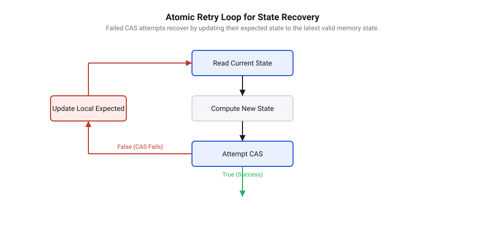

## Початкові концепції та фізичні принципи

У вбудованих системах реального часу кілька апаратних контекстів — фонові потоки операційної системи @@en|RTOS@@ (від англ. *Real-Time Operating System* — операційна система реального часу) та високопріоритетні обробники апаратних переривань ISR — постійно змагаються за доступ до спільних системних ресурсів, структур даних та регістрів периферії. Традиційні методи захисту критичних секцій, такі як вимкнення переривань за допомогою глобальних команд процесора або захоплення м'ютексів операційної системи, створюють серйозні проблеми для детермінізму системи. Вимкнення переривань збільшує @@en|interrupt latency@@ (від лат. *latens* — прихований, затримка відгуку процесора на зовнішню апаратну подію), що неприпустимо у швидкісних системах керування. Використання м'ютексів усередині обробників переривань взагалі заборонено, оскільки переривання не має власного контексту планувальника і не може переходити у стан очікування, а спроба блокування призводить до негайного краху системи або фатального мертвеного блокування.

Фізична причина втрати цілісності даних при паралельному доступі полягає у структурі процесорного конвеєра та апаратних шин. Будь-яка стандартна операція модифікації змінної у пам'яті складається з трьох окремих та незалежних кроків процесора: завантаження значення з оперативної пам'яті або кешу в робочий регістр процесора, обчислення нового значення у арифметично-логічному пристрої та зворотний запис модифікованого значення з регістра у пам'ять. Ця послідовність утворює операцію @@en|read-modify-write@@ (від англ. *read* — зчитувати, *modify* — змінювати, *write* — писати). Якщо в контролері переривань NVIC виникає подія саме між завантаженням та зворотним записом, процесор призупиняє потік і передає керування обробнику переривань. Обробник читає те саме початкове значення, змінює його та записує у пам'ять. Коли потік відновлює виконання, він перезаписує значення у пам'яті своїм застарілим результатом, повністю втрачаючи зміни, внесені перериванням. Такий конфлікт називають @@en|race condition@@ (від англ. *race* — перегони, *condition* — стан; ситуація неузгодженого паралельного доступу).


*Конфлікт модифікації пам'яті під час переривання та його розв'язання за допомогою атомарного порівняння.*

Для забезпечення абсолютної цілісності даних без призупинення апаратних переривань розробники спираються на фізичну @@en|atomicity@@ (від грец. *atomos* — неподільний, властивість операції виконуватися як єдиний апаратний крок, який неможливо перервати). Базовим апаратним механізмом неблокувальної синхронізації є інструкція @@en|Compare-And-Swap@@ (від англ. *compare* — порівнювати, *swap* — обмінювати; атомарна інструкція порівняння з обміном). На фізичному рівні ця інструкція приймає три аргументи: вказівник на комірку пам'яті, очікуване старе значення та бажане нове значення. Процесор виконує порівняння поточного вмісту пам'яті з очікуваним і здійснює запис нового значення лише тоді, коли значення в пам'яті точно збігається з очікуваним. Якщо за час обчислень інший контекст успев модифікувати пам'ять, порівняння дає збій, запис блокується на рівні кристала процесора, а інструкція повертає ознаку невдачі.

В апаратних архітектурах мікроконтролерів атомарність реалізується за допомогою спеціалізованих ексклюзивних моніторів шини та [апаратні атомарні примітиви](root:sf-tasks/lock-free-atomic-primitives). Замість очікування на блокуючих замках алгоритм будується як @@en|lock-free@@ (від англ. *lock* — замок, *free* — вільний; властивість алгоритму гарантувати поступ хоча б одного потоку за скінченну кількість кроків) структура із використанням @@en|retry loop@@ (від англ. *retry* — повторна спроба, *loop* — цикл). Потік зчитує поточний стан, розраховує нове значення у локальних регістрах і намагається застосувати його через CAS. При виявленні апаратного збію цикл не зупиняє систему, а повторно зчитує актуальний стан і виконує обчислення знову, реалізуючи [безпечну обробку без блокувань](root:sf-tasks/lock-free-basics).

Логічну умову виконання апаратного порівняння та обміну можна записати у вигляді послідовного математичного виразу:

success = (RAM[address] == expected) ? (RAM[address] := desired, 1) : 0

Вираз демонструє, що атомарний запис значення `desired` за адресою `address` відбувається виключно при збігу поточного вмісту пам'яті з очікуваним `expected`. Якщо умова не справджується, пам'ять залишається незмінною, а функція повертає 0. Використання належних [бар'єри впорядкування пам'яті](root:sf-tasks/memory-barriers-and-atomic-sequencing) гарантує правильний порядок виконання команд у конвеєрі процесора та дає суворі [гарантії поступу неблокувальних алгоритмів](root:sf-tasks/wait-free-and-lock-free-classification).

## Внутрішня будова та алгоритми роботи

Внутрішня архітектура неблокувального модуля оновлення стану базується на концепції атомарного конвеєра даних, де цілісний стан системи упаковується в єдиний скалярний тип або структуру розміром у слово процесора. Такий підхід дозволяє проводити оновлення всієї керуючої структури — прапорців готовності, лічильників та вказівників — за один атомарний крок. На мікроконтролерних архітектурах ARM Cortex-M3/M4/M7 або RISC-V фізичне виконання CAS покладається на [архітектурі парних інструкцій](root:sf-tasks/ll-sc-architecture) `LDREX`/`STREX`, що формують [альтернативи на основі LL/SC](root:sf-tasks/load-link-store-conditional-primitives).

Програмний конвеєр оновлення стану всередині неблокувального модуля розбивається на чотири чіткі послідовні фази:

1. Зчитування атомарного знімка стану з пам'яті у робочі регістри процесора з використанням відповідного семантичного бар'єра пам'яті.
2. Формування нового стану системи шляхом обчислення нових прапорців, модифікації лічильників або оновлення вказівника на наступний елемент.
3. Застосування вихідного бар'єра впорядкування пам'яті для гарантії того, що всі попередні записи у буфери даних завершені до публікації нового стану.
4. Виконання атомарної інструкції CAS та аналіз результату її виконання.

У сучасних стандартах мов C та C++ атомарний порівняльний обмін представлений двома основними варіантами: `@@en|atomic_compare_exchange_weak@@` та `@@en|atomic_compare_exchange_strong@@`. Слабкий варіант (`weak`) допускає хибне повернення збою — так зване @@en|spurious failure@@ (від англ. *spurious* — хибний, *failure* — збій; спонтанне скидання ексклюзивного монітора шини через зовнішні події або переривання). Однак усередині циклу `@@en|retry loop@@` слабка форма є більш ефективною: на архітектурах LL/SC вона генерує менше коду та не вимагає додаткових внутрішніх циклів перевірки, що істотно знижує затримки у мікроконтролерах.

Коли кілька високочастотних джерел (наприклад, обробник DMA та два потоки RTOS) одночасно намагаються оновити одну й ту саму комірку пам'яті, виникає висока @@en|thread contention@@ (від лат. *contentio* — суперництво, інтенсивний паралельний доступ). У цьому стані багаторазові збої в циклі повторних спроб викликають інтенсивне навантаження на внутрішню шину пам'яті та конфлікти @@en|cache coherency@@ (від англ. *cache* — кеш, *coherency* — узгодженість; постійна інвалідація кеш-рядків між ядрами процесора). Для згладжування пікових навантажень у цикл повторів вбудовують короткі паузи процесора або адаптивну затримку.

Приклад низькорівневої реалізації алгоритму атомарного оновлення стану для C та C++ показує побудову типового циклу CAS:

:::tabs
=== C
:::code root/eng/sf-tasks/cas-lock-free/proj-lock-free-atomic-stack/c/main.c c
=== C++
:::code root/eng/sf-tasks/cas-lock-free/proj-lock-free-atomic-stack/cpp/main.cpp cpp
:::

При роботі з динамічними структурами даних та вказівниками у неблокувальному коді виникає фундаментальна [класичну проблему ABA](root:sf-tasks/aba-problem) (від абревіатури послідовності станів *A-B-A*). Суть проблеми полягає в тому, що потік зчитує значення `A`, після чого його виконання призупиняється. За цей час інший контекст змінює значення комірки на `B`, а потім повертає його назад до `A`. Коли перший потік відновлює роботу, інструкція CAS бачить у пам'яті очікуване значення `A` і успішно виконує обмін. Проте внутрішній стан об'єкта або структура зв'язків уже були повністю змінені, що призводить до руйнування пам'яті. Стандартним вирішенням цієї проблеми є тегування вказівників лічильником версій та створення алгоритмів на базі [стека Трейбера](root:sf-tasks/treiber-stack-and-michael-scott-queue).

Математична модель формування розширеного атомарного стану з 32-бітного вказівника та 32-бітного лічильника версій описується виразом:

state_next = (version_old + 1) SHL 32 OR data_new
= ((state_current SHR 32) + 1) SHL 32 OR data_new      [виділення версії та додавання одиниці]
= state_combined                                       [формування упакованого 64-бітного слова]

Математичне перетворення демонструє, як у верхніх 32 бітах 64-бітного слова накопичується монотонно зростаючий інкремент версії `version_old`, тоді як у нижніх 32 бітах розміщується адреса або корисне значення `data_new`. Навіть якщо адреса `data_new` повертається до початкового значення `A`, лічильник версій гарантовано змінюється, роблячи будь-яку приховану подібність станів неможливою для атомарного порівняння.

## Апаратна реалізація та низькорівневий C/C++ код

Спроба реалізувати стійку до високої конкуренції структуру даних у мікроконтролерних системах без застосування важких механізмів синхронізації впирається у фізичні обмеження шини процесора. Коли декілька обробників переривань та системних потоків операційної системи реального часу намагаються одночасно внести зміни до спільного стека, звичайні операції запису за вказівником спричиняють @@en|race condition@@ (від англ. *race condition* — стан гонитви). Блокування переривань або використання критичних секцій збільшує @@en|interrupt latency@@, що неприпустимо для детермінованих задач. Для вирішення цієї проблеми застосовується @@en|lock-free@@ (від англ. *lock-free* — без блокувань) структура, у якій атомарне оновлення вершини відбувається за допомогою інструкції @@en|Compare-And-Swap@@ (від англ. *compare and swap* — порівняння та обмін).

На апаратному рівні сучасні процесорні архітектури реалізують атомарність за допомогою різних інструкцій. В архітектурах x86 застосовується префікс `LOCK` із командою `CMPXCHG`, тоді як у мікроконтролерах ARM Cortex-M та RISC-V використовується пара ексклюзивних інструкцій load-linked/store-conditional (`LDREX`/`STREX` або `LR`/`SC`). Вивчення того, як працюють [апаратні атомарні інструкції](root:sf-tasks/lock-free-atomic-primitives), розкриває причину, чому атомарне порівняння може завершитися невдачею навіть за відсутності прямого конфлікту між потоками: будь-яка апаратна подія або переривання скидає ексклюзивний монітор процесора.

Для побудови атомарного стека на мові C використовується стандартний заголовок `<stdatomic.h>`. Основна ідея полягає в тому, що операція `push` створює новий вузол, зчитує поточний вказівник на вершину стека `head` без блокувань, зв'язує його з новим вузлом і пробує виконати атомарний обмін. Якщо інший потік встиг змінити `head`, операція повертає `false`, і цикл повторює спробу з актуальним значенням. 

Нижче наведено ідіоматичні реалізації атомарного стека на мовах C та C++.

:::tabs
@tab C
```c
#include <stdatomic.h>
#include <stdlib.h>
#include <stdbool.h>

typedef struct Node {
    int data;
    struct Node* next;
} Node;

typedef struct {
    _Atomic(Node*) head;
} AtomicStack;

void atomic_stack_init(AtomicStack* stack) {
    atomic_store_explicit(&stack->head, NULL, memory_order_relaxed);
}

void atomic_stack_push(AtomicStack* stack, int value) {
    Node* new_node = (Node*)malloc(sizeof(Node));
    if (!new_node) return;
    new_node->data = value;
    
    Node* old_head = atomic_load_explicit(&stack->head, memory_order_relaxed);
    do {
        new_node->next = old_head;
    } while (!atomic_compare_exchange_weak_explicit(
        &stack->head,
        &old_head,
        new_node,
        memory_order_release,
        memory_order_relaxed));
}

bool atomic_stack_pop(AtomicStack* stack, int* result) {
    Node* old_head = atomic_load_explicit(&stack->head, memory_order_acquire);
    do {
        if (old_head == NULL) {
            return false;
        }
    } while (!atomic_compare_exchange_weak_explicit(
        &stack->head,
        &old_head,
        old_head->next,
        memory_order_acquire,
        memory_order_relaxed));

    *result = old_head->data;
    free(old_head);
    return true;
}
```
@tab C++
```cpp
#include <atomic>
#include <optional>

template <typename T>
class AtomicStack {
private:
    struct Node {
        T data;
        Node* next;
        explicit Node(T val) : data(std::move(val)), next(nullptr) {}
    };

    std::atomic<Node*> head_{nullptr};

public:
    AtomicStack() = default;
    
    ~AtomicStack() {
        Node* current = head_.load(std::memory_order_relaxed);
        while (current) {
            Node* next = current->next;
            delete current;
            current = next;
        }
    }

    void push(T value) {
        Node* new_node = new Node(std::move(value));
        Node* old_head = head_.load(std::memory_order_relaxed);
        do {
            new_node->next = old_head;
        } while (!head_.compare_exchange_weak(
            old_head,
            new_node,
            std::memory_order_release,
            std::memory_order_relaxed));
    }

    std::optional<T> pop() {
        Node* old_head = head_.load(std::memory_order_acquire);
        do {
            if (!old_head) {
                return std::nullopt;
            }
        } while (!head_.compare_exchange_weak(
            old_head,
            old_head->next,
            std::memory_order_acquire,
            std::memory_order_relaxed));

        T result = std::move(old_head->data);
        delete old_head;
        return result;
    }
};
```
:::

Ключовим моментом у наведеному коді є вибір моделей впорядкування пам'яті. Використання `memory_order_release` під час виклику `push` гарантує, що всі попередні операції запису у поля вузла `new_node->data` та `new_node->next` повністю завершаться до того, як оновлений вказівник `head` стане видимим для інших ядер процесора. З іншого боку, семантика `memory_order_acquire` під час вилучення елемента через `pop` формує зв'язок впорядкування, гарантуючи прочитання актуальних даних вузла після успішного оновлення вершини. Застосування специфічних бар'єрів розкрито у матеріалі про [впорядкування атомарних операцій](root:sf-tasks/memory-barriers-and-atomic-sequencing).

Використання слабкої форми порівняння `atomic_compare_exchange_weak` є суттєвою оптимізацією для мікроконтролерів. Оскільки слабкий варіант дозволяє спонтанні відмови @@en|spurious failure@@ (від англ. *spurious failure* — спонтанна збійна відмова) через мікроархітектурні особливості шини, він виконується за меншу кількість тактів порівняно зі строгим варіантом, який змушений будувати внутрішній цикл перезапуску інструкцій. Оскільки наш алгоритм вже містить зовнішній цикл `do-while`, використання слабкої інструкції дає максимальну продуктивність.

Аналіз класичної реалізації, якою є [стек Трейбера](root:sf-tasks/treiber-stack-and-michael-scott-queue), демонструє фундаментальну проблему динамічного звільнення пам'яті у паралельному середовищі. Викликаючи `free(old_head)` або `delete old_head` одразу після вилучення зі стека, ми ризикуємо викликом негайного повторного використання цієї ж адреси іншим потоком. Це створює класичну ситуацію, відому як [проблема ABA у структурі](root:sf-tasks/aba-problem-basics), коли значення вказівника повертається до початкового, але внутрішній стан вузла вже змінився, що призводить до руйнування зв'язаного списку.

## Практичне застосування та відлагодження

У реальних вбудованих системах та прошивках реального часу безблокувальні стеки найчастіше застосовуються для керування пулами незмінних буферів пам'яті, обміну повідомленнями між ядрами двоядерних мікроконтролерів (наприклад, ESP32 або STM32H7) та передачі подій із високопріоритетних обробників переривань ISR у завдання RTOS. Використання неблокувальних інструкцій гарантує детермінований час виконання операцій без ризику виникнення інверсії пріоритетів чи дедлоків.

Під час розробки та налагодження таких систем інженери стикаються з трьома основними класами апаратних та програмних системних проблем:

1. **Захист від проблеми ABA та безпечне звільнення пам'яті.**
Якщо пам'ять для вузлів виділяється з динамічної купи або повторно використовується з фіксованого пулу, безпосередній `pop` може зчитати застаріле значення `next`. Для вирішення цієї проблеми застосовують розширені вказівники із версіонуванням — теговані вказівники @@en|tagged pointer@@ (від англ. *tagged pointer* — маркований вказівник), де поруч із вказівником зберігається лічильник модифікацій. Для подвійного атомарного обміну потрібна 64-бітна атомарна інструкція CAS (наприклад, `CMPXCHG8B` або подвійні `LDREXD`/`STREXD`). Альтернативним підходом є застосування спеціальних механізмів відкладеного звільнення, таких як [захисні вказівники hazard pointers](root:sf-tasks/hazard-pointers-memory-reclamation) або [безпечне повторне використання пам'яті](root:sf-tasks/aba-problem-and-safe-memory-reclamation).

2. **Запобігання ефекту хибного сумісного використання кешу.**
У багатоядерних системах розміщення атомарного вказівника `head` в одній кеш-лінії @@en|cache line@@ (від англ. *cache line* — рядок кешу) разом із часто використовуваними змінними викликає явище @@en|false sharing@@ (від англ. *false sharing* — хибне сумісне використання). Щоразу, коли одне ядро виконує інструкцію CAS, кеш-лінія інвалідується для всіх інших ядер, спричиняючи значні затримки шини Interconnect. Для усунення цього ефекту структура атомарного стека повинна вирівнюватися за межою кеш-лінії (зазвичай 64 байти) за допомогою директиви `alignas(64)`. Принципи мінімізації конкуренції за шину детально описані в розділі про [основи безблокувальної розробки](root:sf-tasks/lock-free-basics).

3. **Методологія відлагодження та верифікація під навантаженням.**
Виявлення помилок у безблокувальних алгоритмах шляхом звичайного покрокового відлагодження через JTAG є неефективним, оскільки зупинка ядра змінює часові інтервали конфліктів. Для верифікації використовують комбінацію інструментів:
- **Динамічний аналіз конкуренції:** комбіляція коду з прапорцями інструментування @@en|ThreadSanitizer@@ (від англ. *thread sanitizer* — очищувач потоків) (`-fsanitize=thread`) дозволяє автоматично фіксувати відсутність бар'єрів пам'яті або race condition на стадії ПК-симуляції.
- **Формальна перевірка моделей:** застосування інструментів формального аналізу та [перевірку паралельних моделей](root:sf-tasks/model-checking-lock-free) для дослідження всіх можливих переплешень інструкцій та виявлення прихованих станів race condition.
- **Стрес-тестування під перериваннями:** проведення тривалих тестових прогонів із включеними апаратними таймерами та генеруванням випадкових затримок для перевірки дотримання гарантій поступу системи згідно з [класифікацією неблокувальних алгоритмів](root:sf-tasks/wait-free-and-lock-free-classification).

Завдяки дотриманню вищенаведених правил розробник отримує детермінований компонент прошивки, здатний працювати при екстремальних рівнях конкуренції без втрати стабільності та з мінімальною затримкою обробки даних.
