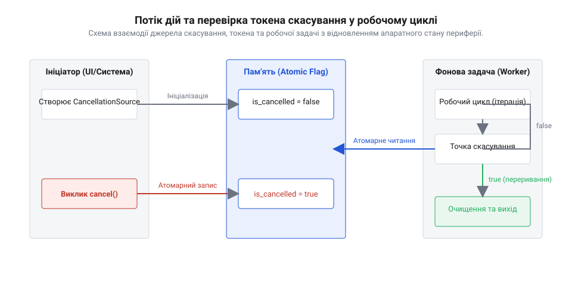
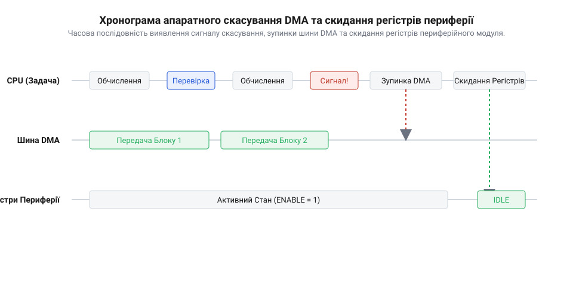

## Початкові концепції та фізичні принципи

Уявімо вбудовану систему під управлінням мікроконтролера, яка виконує тривалу та ресурсоємну задачу — наприклад, калібрування аналогово-цифрових перетворювачів, запис великого блоку даних у зовнішню флеш-пам'ять або послідовну передачу масиву вимірювань через периферійний модуль @@en|прямий доступ до пам'яті@@ (англ. @@en|Direct Memory Access@@, скорочено @@en|DMA@@, від @@en|direct@@ — прямий та @@en|memory access@@ — доступ до пам'яті). У певний момент робочого циклу від зовнішньої системи, обробника переривань чи користувача надходить команда негайно зупинити поточний процес. Найпростішим розв'язком здається силове, @@en|примусове переривання@@ (англ. @@en|preemptive cancellation@@ чи @@en|thread termination@@) виконуваної задачі з боку ядра операційної системи. Однак у фізичній реальності мікроконтролера таке раптове втручання призводить до критичних апаратних збоїв та втрати стабільності всього пристрою.

Головна небезпека примусового знищення потоку полягає у руйнуванні цілісності апаратного та програмного стану. Коли потік зупиняється в довільний момент часу на довільній інструкції, апаратний @@en|регістр керування@@ (англ. @@en|control register@@) периферійного модуля залишається у ввімкненому стані. Наприклад, шина @@en|SPI@@ або @@en|I2C@@ може застрягти посеред передачі кадру, залишаючи лінію вибору мікросхеми у низькому електричному потенціалі. Через це підключені зовнішні сенсори стають недоступними для всіх інших задач мікроконтролера. Аналогічно, у системній оперативній пам'яті задача могла утримувати @@en|м'ютекс@@ (англ. @@en|mutex@@, від @@en|mutual exclusion@@ — взаємне виключення) або виділений буфер. При раптовій ліквідації задачі м'ютекс залишається захопленим назавжди, створюючи нерозв'язне взаємне блокування ядра.

Щоб запобігти апаратним аваріям та забезпечити детерміновану поведінку, у системній розробці застосовують @@en|кооперативне скасування@@ (англ. @@en|cooperative cancellation@@, від латинського @@en|cooperari@@ — співпрацювати та @@en|cancellare@@ — перекреслювати). Суть цього підходу полягає у добровільній взаємодії між викликаючою стороною та виконувачем. Зовнішній потік чи обробник переривання не знищує задачу силоміць, а лише виставляє в пам'яті індикатор запиту на зупинку. Виконувальна задача самостійно та регулярно опитує цей індикатор у заздалегідь визначених безпечних точках відновлення — @@en|контрольна точка@@ (англ. @@en|cancellation checkpoint@@, від @@en|check@@ — перевіряти та @@en|point@@ — точка).

Передача сигналу скасування між потоками або між обробником переривання (англ. @@en|interrupt request@@, скорочено @@en|ISR@@) і головним потоком вимагає суворого дотримання апаратної синхронізації шини пам'яті. Проста модифікація звичайної змінної є неприпустимою: компілятор під час оптимізації може зберегти значення змінної у внутрішньому регістрі ядра процесора, внаслідок чого фоновий цикл ніколи не побачить змін у фізичній RAM. Для надійної сигналізації застосовується @@en|атомарний прапорець@@ (англ. @@en|atomic flag@@, від грецького @@en|atomos@@ — неподільний) та @@en|бар'єр пам'яті@@ (англ. @@en|memory barrier@@), який примусово скидає конвеєр інструкцій і забезпечує миттєву когерентність стану прапорця між усіма ядрами процесора та контекстами переривань.

Часова відстань від моменту виставлення прапорця зовнішньою подією до моменту, коли задача виявить цей сигнал і розпочне безпечне повернення ресурсів, визначається як @@en|затримка скасування@@ (англ. @@en|cancellation latency@@). У системах під керуванням @@en|операційна система реального часу@@ (англ. @@en|Real-Time Operating System@@, скорочено @@en|RTOS@@) ця затримка є одним із головних критеріїв детермінізму.

Визначимо загальний час накладних витрат виконання задачі з урахуванням періодичності перевірок токена. Нехай робочий цикл виконує N ітерацій обчислень, кожна з яких займає час dt_step, а перевірка прапорця здійснюється кожні k ітерацій і вимагає часу t_check на атомарне читання шини:

T_overhead = N × t_check ÷ k      [обчислення часових витрат на перевірку прапорця]
T_total = N × dt_step + T_overhead      [підсумковий час виконання обчислювального циклу]

З отриманого виразу видно, що занадто часто встановлені контрольні точки (мале значення k) збільшують додатковий час T_overhead через постійні звернення до атомарної пам'яті. Натомість велике значення k зменшує накладні витрати, але пропорційно збільшує @@en|затримка скасування@@, роблячи систему менш чутливою до зовнішніх команд зупинки.

У системній архітектурі кооперативний підхід тісно пов'язаний із вибраним механізмом обробки вводу-виводу. Якщо програма реалізує [блокуючий і неблокуючий ввід-вивід](root:sf-tasks/blocking-vs-nonblocking-io), то для блокуючих системних операцій простого опитування прапорця в циклі недостатньо — додатково потрібне розбудження потоку через системні події. У той же час, коли архітектура спирається на [опитування проти події](root:sf-tasks/polling-vs-events), перевірка прапорця скасування природно вбудовується безпосередньо у крок опитування стану периферійного пристрою.

## Внутрішня будова та алгоритми роботи

Для чіткого та ізольованого впровадження механізму зупинки у програмну архітектуру застосовується паттерн @@en|токен скасування@@ (англ. @@en|cancellation token@@, від @@en|token@@ — знак або жетон). Цей паттерн розділяє права на ініціацію зупинки та права на її спостереження. Архітектурне рішення базується на двох об'єктах: джерелі скасування (`CancellationTokenSource`), яке створюється викликаючою стороною для управління станом, та власне токені (`CancellationToken`), який передається у фонову задачу як компактний інспекційний інтерфейс у режимі «лише для читання».

Алгоритм функціонування фонової задачі з підтримкою кооперативної зупинки спирається на чіткий послідовний перехід між апаратними та програмними станами. На старті задача ініціалізує потрібну периферію, після чого входить у цикл обробки даних.


*Схема взаємодії джерела скасування, токена та робочої задачі з відновленням апаратного стану периферії.*

Покроковий алгоритм виконання та виходу задачі має таку структуру:
1. **Фаза ініціалізації:** створення токена, виділення апаратних буферів пам'яті та налаштування периферійних модулів.
2. **Фаза ітерації та опитування:** у кожній @@en|контрольна точка@@ задача виконує атомарну перевірку стану токена. Якщо прапорець скинутий, виконується наступна порція обчислень.
3. **Фаза виявлення запиту:** при отриманні значення `true` задача перериває основний обчислювальний алгоритм і негайно переходить до процедури відкоту.
4. **Фаза відновлення апаратного стану:** вимикаються переривання від периферії, зупиняються канали контролера @@en|DMA@@, а виходи мікроконтролера переводяться у безпечний високоімпедансний стан.
5. **Фаза вивільнення системних ресурсів:** звільняються всі системні семафори, @@en|м'ютекс@@ та оперативна пам'ять, після чого потік повертає код скасування й детерміновано завершує роботу.

У сучасних багатопотокових та мережевих рішеннях @@en|кооперативне скасування@@ виступає зв'язувальною ланкою між різними рівнями асинхронності. Для систем із подійною обробкою, де ключовим елементом є [цикл подій](root:sf-tasks/event-loop), токен скасування дає змогу вилучати неактуальні завдання з черги таймера ще до початку їхнього виконання.

При ускладненні програми та використанні концепцій, де реалізовані [колбеки, проміси та async/await](root:sf-tasks/async-await), токен скасування передається прозоро крізь весь стек викликів. Це дозволяє впровадити комплексі [паттерни плавного завершення систем](root:sf-tasks/graceful-shutdown-patterns), забезпечуючи коректне збереження стану всіх компонентів при вимкненні чи перезавантаженні сервісу. Коли ж у програмі діє [структурована асинхронність та керування скоупом](root:sf-tasks/structured-concurrency-scope), скасування головного батьківського скоупу автоматично та детерміновано поширюється на всі дочірні потоки й асинхронні задачі.

Нижче наведено практичні приклади програмної реалізації паттерна @@en|токен скасування@@: перший приклад розроблено для операційної системи реального часу вбудованих систем мовою C, а другий — для системних додатків мовою C++.

:::tabs
```c|esp-idf
#include <stdio.h>
#include <stdbool.h>
#include <stdatomic.h>
#include "freertos/FreeRTOS.h"
#include "freertos/task.h"

// Структура джерела та токена скасування для вбудованих систем
typedef struct {
    atomic_bool is_cancelled;
} cancellation_token_t;

// Ініціалізація атомарного токена
void cancellation_token_init(cancellation_token_t *token) {
    atomic_init(&token->is_cancelled, false);
}

// Виставляння сигналу скасування джерелом
void cancellation_token_cancel(cancellation_token_t *token) {
    atomic_store_explicit(&token->is_cancelled, true, memory_order_release);
}

// Перевірка стану токена у робочій задачі
bool cancellation_token_is_requested(const cancellation_token_t *token) {
    return atomic_load_explicit(&token->is_cancelled, memory_order_acquire);
}

// Фонова задача RTOS з контролем скасування
void worker_task(void *pvParameters) {
    cancellation_token_t *token = (cancellation_token_t *)pvParameters;
    printf("[RTOS Task] Запуск обробки периферії...\n");

    for (int step = 0; step < 100; step++) {
        // Контрольна точка перевірки прапорця
        if (cancellation_token_is_requested(token)) {
            printf("[RTOS Task] Сигнал скасування виявлено! Зупинка DMA...\n");
            // Детерміноване очищення апаратного стану периферії
            vTaskDelay(pdMS_TO_TICKS(10));
            printf("[RTOS Task] Ресурси очищено, задачу завершено безпечно.\n");
            vTaskDelete(NULL);
            return;
        }

        // Виконання порції обчислень
        vTaskDelay(pdMS_TO_TICKS(20));
    }

    printf("[RTOS Task] Обробку повністю завершено без скасування.\n");
    vTaskDelete(NULL);
}
```
```cpp
#include <iostream>
#include <atomic>
#include <thread>
#include <chrono>
#include <memory>

// Внутрішній стан скасування з атомарним прапорцем
class CancellationTokenState {
public:
    void cancel() noexcept {
        cancelled_.store(true, std::memory_order_release);
    }

    bool is_cancellation_requested() const noexcept {
        return cancelled_.load(std::memory_order_acquire);
    }

private:
    std::atomic<bool> cancelled_{false};
};

// Токен скасування з доступом «лише для читання»
class CancellationToken {
public:
    explicit CancellationToken(std::shared_ptr<CancellationTokenState> state)
        : state_(std::move(state)) {}

    bool is_cancellation_requested() const noexcept {
        return state_ && state_->is_cancellation_requested();
    }

private:
    std::shared_ptr<CancellationTokenState> state_;
};

// Джерело ініціації скасування
class CancellationTokenSource {
public:
    CancellationTokenSource()
        : state_(std::make_shared<CancellationTokenState>()) {}

    CancellationToken get_token() const {
        return CancellationToken(state_);
    }

    void cancel() {
        if (state_) {
            state_->cancel();
        }
    }

private:
    std::shared_ptr<CancellationTokenState> state_;
};

// Фонова обчислювальна задача
void run_worker(CancellationToken token) {
    std::cout << "[C++ Worker] Обчислювальний процес розпочато.\n";

    for (int i = 0; i < 50; ++i) {
        // Контрольна точка скасування
        if (token.is_cancellation_requested()) {
            std::cout << "[C++ Worker] Отримано запит скасування на ітерації " << i << ".\n";
            std::cout << "[C++ Worker] Вивільнення ресурсів та безпечний вихід.\n";
            return;
        }

        std::this_thread::sleep_for(std::chrono::milliseconds(15));
    }

    std::cout << "[C++ Worker] Процес успішно завершено.\n";
}
```
:::

Завдяки використанню шаблону @@en|токен скасування@@ розробник створює детермінований, високоефективний та безпечний код для вбудованих та розподілених систем, запобігаючи витоку ресурсів та апаратним блокуванням.

## Апаратна реалізація та низькорівневий C/C++ код

У фізичній архітектурі мікроконтролера обробка тривалих масивів даних найчастіше делегується спеціалізованому апаратному вузлу — модуль @@en|прямий доступ до пам'яті@@ (англ. @@en|Direct Memory Access@@, скорочено @@en|DMA@@, від @@en|direct@@ — прямий та @@en|memory access@@ — доступ до пам'яті). На відміну від програмних обчислювальних циклів у ядрі процесора, модуль @@en|DMA@@ працює незалежно через системну матрицю шин. Якщо потік обробки отримує @@en|токен скасування@@ (англ. @@en|cancellation token@@), просте переривання програмного циклу не зупиняє апаратне транспортування байтів з периферійного пристрою в оперативну пам'ять (англ. @@en|Random Access Memory@@, скорочено @@en|RAM@@). Якщо ядро процесора перейде до вивільнення буфера пам'яті до того, як контролер @@en|DMA@@ буде фізично деактивовано, апаратний периферійний модуль продовжить записувати дані поверх уже знятої з розподілу пам'яті, що призведе до фатального пошкодження структури купи.

Коректна реалізація низькорівневого скасування вимагає детермінованого скидання апаратного стану периферійних модулів. Секвенція скасування на рівні прошивки охоплює маскування векторів переривань у контролері @@en|векторизований контролер переривань@@ (англ. @@en|Nested Vectored Interrupt Controller@@, скорочено @@en|NVIC@@), негайне скидання біта дозволу роботи в @@en|регістр керування@@ (англ. @@en|control register@@) та очищення прапорцевих регістрів. При цьому важливо дочекатися завершення поточного шинного транзакційного циклу периферії: наприклад, при використанні послідовного інтерфейсу @@en|SPI@@ зупинка без перевірки прапорця зайнятості шини (англ. @@en|busy flag@@) залишить вихід вибору мікросхеми в низькому стані, блокуючи системну шину для всіх подальших запитів.


*Часова послідовність виявлення сигналу скасування, зупинки шини DMA та скидання регістрів периферійного модуля.*

Для взаємодії між обробником апаратного переривання (англ. @@en|Interrupt Service Routine@@, скорочено @@en|ISR@@) та основними потоками виконання ключову роль відіграє консистентність шини пам'яті та порядок інструкцій процесорного ядра. Сучасні процесорні ядра здатні змінювати порядок виконання інструкцій для оптимізації конвеєра, а кєш-пам'ять або буфери запису можуть затримувати оновлення значень у фізичній @@en|RAM@@. Виставлення токена скасування в обробнику переривань без застосування @@en|бар'єр пам'яті@@ (англ. @@en|memory barrier@@) створює загрозу виникнення стан гонитви (англ. @@en|race condition@@). Використання атомарного запису з семантикою звільнення (англ. @@en|release semantics@@) гарантує, що всі попередні записи у буфери записані у фізичну пам'ять до виставляння токена, тоді як атомарне читання в обробнику задачі з семантикою захоплення (англ. @@en|acquire semantics@@) унеможливлює виконання наступних інструкцій до зчитування актуального прапорця.

Математично проаналізуємо оптимальну частоту атомарних перевірок токена скасування під час обробки блоків даних периферією. Нехай загальний обсяг даних становить S байтів, а обробка розбита на транші розміром B байтів. Час передачі одного блоку контролером @@en|DMA@@ задається відношенням розміру блоку B до швидкості шини R_dma. При кожному переході між блоками процесор витрачає час t_chk на виконання атомарного читання прапорця з урахуванням накладних витрат @@en|бар'єр пам'яті@@. Загальний час обробки та відносний коефіцієнт накладних витрат процесора E розраховуються наступним чином:

t_block = B ÷ R_dma      [час апаратного перекачування одного блоку даних]
N_blocks = S ÷ B          [підсумкова кількість контрольних блоків]
T_total = S ÷ R_dma + (S ÷ B) × t_chk      [повний тривалість обробки з перевірками]
E = (t_chk × R_dma) ÷ B      [відносна частка втрат процесорного часу]

З вираженого коефіцієнта E = (t_chk × R_dma) ÷ B випливає фундаментальний компроміс проєктування вбудованих систем: при зменшенні розміру блоку B максимальна @@en|затримка скасування@@ (англ. @@en|cancellation latency@@) зменшується до L_max = B ÷ R_dma, покращуючи реактивність системи. Проте накладні витрати CPU зростають зворотньо пропорційно розміру B. Оптимальний розмір блоку обирається з умови, щоб накладні витрати E не перевищували допустимий бюджет процесорного часу, задовольняючи вимогам часу відгуку реального часу.

При виборі між схемами опитування стану та подійною обробкою [опитування проти події](root:sf-tasks/polling-vs-events) низькорівнева реалізація токена дозволяє комбінувати атомарні прапорці з апаратними перериваннями. Якщо система спирається на [блокуючий і неблокуючий ввід-вивід](root:sf-tasks/blocking-vs-nonblocking-io), процедура відновлення периферії стає частиною детермінованого скасування транзакції.

:::tabs
```c|esp-idf
#include <stdio.h>
#include <stdbool.h>
#include <stdint.h>
#include <stdatomic.h>
#include "freertos/FreeRTOS.h"
#include "freertos/task.h"
#include "driver/gpio.h"

// Низькорівневе джерело та токен скасування
typedef struct {
    atomic_bool is_cancelled;
} hw_cancellation_token_t;

// Апаратний контекст периферійного модуля (DMA та регістри)
typedef struct {
    uint32_t dma_channel;
    uint32_t buffer_address;
    size_t block_size;
    volatile uint32_t *control_reg;
} hw_peripheral_t;

// Ініціалізація атомарного токена скасування
void hw_token_init(hw_cancellation_token_t *token) {
    atomic_init(&token->is_cancelled, false);
}

// Перевірка стану токена з семантикою acquire
inline static bool hw_token_is_requested(const hw_cancellation_token_t *token) {
    return atomic_load_explicit(&token->is_cancelled, memory_order_acquire);
}

// Виклики з ISR або фонового потоку з семантикою release
void hw_token_cancel_from_isr(hw_cancellation_token_t *token) {
    atomic_store_explicit(&token->is_cancelled, true, memory_order_release);
}

// Апаратне скидання периферії та вивільнення шини DMA
static void hw_peripheral_safe_stop(hw_peripheral_t *dev) {
    printf("[HW Clean] Зупинка DMA каналу %lu...\n", (unsigned long)dev->dma_channel);
    // Маскування переривань та деактивація біта у регістрі керування
    if (dev->control_reg) {
        *(dev->control_reg) &= ~(1U << 0); // Скидаємо біт ENABLE
    }
    // Очікування завершення шинного циклу
    vTaskDelay(pdMS_TO_TICKS(2));
    printf("[HW Clean] Периферію переведено у безпечний стан.\n");
}

// Задача обробки апаратного потоку даних
void hw_dma_processing_task(void *pvParameters) {
    hw_cancellation_token_t *token = (hw_cancellation_token_t *)pvParameters;
    uint32_t dummy_reg = 1U; // Імітація апаратного регістра CR1
    hw_peripheral_t dev = {
        .dma_channel = 1,
        .buffer_address = 0x20001000,
        .block_size = 512,
        .control_reg = &dummy_reg
    };

    printf("[Task] Запуск передачі блоків даних через DMA...\n");

    for (int block = 0; block < 20; block++) {
        // Контрольна точка перевірки токена перед запуском чергового блоку DMA
        if (hw_token_is_requested(token)) {
            printf("[Task] Виявлено сигнал скасування на блоці %d!\n", block);
            hw_peripheral_safe_stop(&dev);
            vTaskDelete(NULL);
            return;
        }

        // Імітація виконання передачі блоку DMA
        vTaskDelay(pdMS_TO_TICKS(15));
    }

    printf("[Task] Усі блоки даних передано успішно.\n");
    vTaskDelete(NULL);
}
```
```cpp
#include <iostream>
#include <atomic>
#include <memory>
#include <thread>
#include <chrono>

// Токен скасування з низькорівневою атомарною синхронізацією
class HwCancellationToken {
public:
    explicit HwCancellationToken(std::shared_ptr<std::atomic<bool>> flag)
        : flag_(std::move(flag)) {}

    [[nodiscard]] bool is_cancellation_requested() const noexcept {
        return flag_ && flag_->load(std::memory_order_acquire);
    }

private:
    std::shared_ptr<std::atomic<bool>> flag_;
};

// Джерело ініціації скасування
class HwCancellationTokenSource {
public:
    HwCancellationTokenSource()
        : flag_(std::make_shared<std::atomic<bool>>(false)) {}

    HwCancellationToken get_token() const noexcept {
        return HwCancellationToken(flag_);
    }

    void cancel() noexcept {
        if (flag_) {
            flag_->store(true, std::memory_order_release);
        }
    }

private:
    std::shared_ptr<std::atomic<bool>> flag_;
};

// RAII-обгортка для апаратного периферійного модуля
class HardwareRegisterGuard {
public:
    explicit HardwareRegisterGuard(uint32_t channel)
        : channel_(channel), active_(true) {
        std::cout << "[RAII] Апаратний канал DMA " << channel_ << " ініціалізовано.\n";
    }

    ~HardwareRegisterGuard() {
        if (active_) {
            stop_hardware();
        }
    }

    void stop_hardware() noexcept {
        if (active_) {
            std::cout << "[RAII] Апаратне вимкнення та очищення регістрів каналу " << channel_ << ".\n";
            active_ = false;
        }
    }

    HardwareRegisterGuard(const HardwareRegisterGuard&) = delete;
    HardwareRegisterGuard& operator=(const HardwareRegisterGuard&) = delete;

private:
    uint32_t channel_;
    bool active_;
};

// Задача низькорівневої обробки
void process_hardware_stream(HwCancellationToken token) {
    HardwareRegisterGuard hw_guard(2); // Автоматичний деструктор очистить регістри

    for (int step = 0; step < 30; ++step) {
        if (token.is_cancellation_requested()) {
            std::cout << "[Worker] Контрольна точка: отримано запит зупинки!\n";
            // RAII автоматично викличе stop_hardware() при виході з функції
            return;
        }
        std::this_thread::sleep_for(std::chrono::milliseconds(10));
    }
    std::cout << "[Worker] Обробку стриму повністю завершено.\n";
}
```
:::

## Практичне застосування та відлагодження

У практичній розробці реальних прошивок та системного ПЗ застосування кооперативного скасування зустрічається з підступними граничними випадками. Найбільш розповсюдженою пасткою є скасування задачі, яка знаходиться у блокуючому стані очікування системних ресурсів. Якщо потік перейшов у стан сну через виклики очікування семафора чи системної черги, проста перевірка атомарного токена всередині обчислювального циклу стає недієвою: потік фізично не виконує інструкції CPU і не може дістатися до наступної контрольної точки. Внаслідок цього виникає невизначене блокування системи, коли викликаюча сторона чекає на завершення задачі, а задача чекає на подійний сигнал.

Для розв'язання проблеми блокуючого очікування застосовують гібридний механізм сповіщення. Замість безкінечного блокування системний виклик переводиться на використання обмеженого часового інтервалу (англ. @@en|timeout@@) з подальшою атомарною перевіркою токена у циклі, або ж ініціатор скасування надсилає перериваючий системний сигнал чи записує фантомний елемент у чергу подій. Це дає змогу вивести потік зі стану сну, після чого потік перевіряє стан токена скасування і виконує детермінований алгоритм виходу. Впровадження подібних підходів є важливою складовою для [паттерни плавного завершення систем](root:sf-tasks/graceful-shutdown-patterns), коли програма повинна зберегти свій внутрішній стан перед перезавантаженням пристрою.

Ще однією критичною проблемою в операційних системах реального часу є @@en|інверсія пріоритету@@ (англ. @@en|priority inversion@@) та @@en|лайвлок@@ (англ. @@en|livelock@@). Якщо низькопріоритетна задача утримує апаратний @@en|м'ютекс@@ периферії і отримує команду скасування, процедура її відкоту та вивільнення ресурсів має виконуватися миттєво. Якщо ж у цей момент високопріоритетна задача очікує той самий @@en|м'ютекс@@, а середньопріоритетні задачі витісняють низькопріоритетну задачу з CPU, час скасування стає непідконтрольним. Для усунення цього ефекту процедура скасування зобов'язана тимчасово успадковувати пріоритет найвищого очікуючого потоку (англ. @@en|priority inheritance@@) або виконуватися у захищеному критичному секторі. Коли у прошивці впроваджено [структурована асинхронність та керування](root:sf-tasks/structured-concurrency-scope) скоупом, ієрархічне скасування батьківського скоупу гарантує автоматичну передачу каскадного сигналу всім дочірнім задачам з урахуванням їхніх пріоритетів.

Діагностика та вимірювання фізичної часової затримки скасування у вбудованих системах вимагає застосування спеціалізованого апаратного та програмного інструментарію. Найбільш точним методом апаратного профілювання є використання вільних виходів загального призначення (англ. @@en|General Purpose Input/Output@@, скорочено @@en|GPIO@@) у комбінації з приладами типу @@en|осцилограф@@ чи @@en|логічний аналізатор@@ (англ. @@en|logic analyzer@@). Сигнальний вихід `GPIO_A` встановлюється у високий логічний рівень у момент виклику процедури скасування з ISR або джерела, а вихід `GPIO_B` виставляється у високий рівень під час входу в контрольну точку і скидається у низький стан після повного деактивування периферії та повернення ресурсів. Часова різниця між імпульсом на `GPIO_A` та зрізом на `GPIO_B` показує точну фізичну @@en|затримка скасування@@ в мікросекундах.

Для програмного відлагодження складної поведінки систем реального часу використовують інструменти системного трасування, такі як @@en|SEGGER SystemView@@ або @@en|FreeRTOS Tracealyzer@@. Вони дозволяють візуалізувати перемикання контекстів задач, моменти викликів ISR та затримки реакції на атомарні токени. Крім того, для запобігання застряганню задач у циклічному опитуванні застосовується апаратний @@en|сторожовий таймер@@ (англ. @@en|Watchdog Timer@@, скорочено @@en|WDT@@). Якщо через помилку проєктування потік пропустить контрольну точку або застрягне у власному блокуючому циклі, сторожовий таймер перезавантажить мікроконтролер, запобігаючи неконтрольованій поведінці пристрою у промислових умовах.

:::tabs
```c|esp-idf
#include <stdio.h>
#include <stdbool.h>
#include <stdatomic.h>
#include "freertos/FreeRTOS.h"
#include "freertos/task.h"
#include "freertos/event_groups.h"
#include "driver/gpio.h"

#define LATENCY_PROFILE_GPIO_PIN GPIO_NUM_18
#define CANCELLATION_BIT BIT0

// Контекст скасування з Event Group для розбудження з блокуючого сну
typedef struct {
    atomic_bool is_cancelled;
    EventGroupHandle_t event_group;
} async_cancellation_context_t;

// Ініціалізація контексту
void async_context_init(async_cancellation_context_t *ctx) {
    atomic_init(&ctx->is_cancelled, false);
    ctx->event_group = xEventGroupCreate();
}

// Подача сигналу скасування з виставлянням GPIO для профілювання затримки
void async_context_cancel(async_cancellation_context_t *ctx) {
    // Встановлюємо GPIO пин для вимірювання затримки логічним аналізатором
    gpio_set_level(LATENCY_PROFILE_GPIO_PIN, 1);
    atomic_store_explicit(&ctx->is_cancelled, true, memory_order_release);
    // Розбудження блокованого потоку через системний Event Group
    xEventGroupSetBits(ctx->event_group, CANCELLATION_BIT);
}

// Фонова задача з безпечним розбудженням з блокуючого стану
void async_worker_task(void *pvParameters) {
    async_cancellation_context_t *ctx = (async_cancellation_context_t *)pvParameters;
    printf("[Worker] Задача увійшла в цикл обробки подій...\n");

    while (1) {
        // Замість безкінечного блокування очікуємо з таймаутом 50 мс
        EventBits_t uxBits = xEventGroupWaitBits(
            ctx->event_group,
            CANCELLATION_BIT,
            pdFALSE,
            pdFALSE,
            pdMS_TO_TICKS(50)
        );

        // Перевірка атомарного токена скасування після виходу з очікування
        if (atomic_load_explicit(&ctx->is_cancelled, memory_order_acquire) || (uxBits & CANCELLATION_BIT)) {
            printf("[Worker] Сигнал скасування отримано! Вивільнення ресурсів...\n");
            
            // Скидаємо GPIO пин, фіксуючи кінець затримки скасування
            gpio_set_level(LATENCY_PROFILE_GPIO_PIN, 0);
            
            vEventGroupDelete(ctx->event_group);
            printf("[Worker] Задачу детерміновано завершено.\n");
            vTaskDelete(NULL);
            return;
        }

        // Виконання корисного кроку обробки при відсутності скасування
        printf("[Worker] Крок обробки виконано.\n");
    }
}
```
```cpp
#include <iostream>
#include <atomic>
#include <condition_variable>
#include <mutex>
#include <thread>
#include <chrono>

// Клас профілювання та діагностики затримки скасування
class LatencyProfiler {
public:
    static void signal_start() noexcept {
        start_time_ = std::chrono::high_resolution_clock::now();
        std::cout << "[Profiler] Сигнал скасування подано (GPIO High).\n";
    }

    static void signal_end() noexcept {
        auto end_time = std::chrono::high_resolution_clock::now();
        auto duration = std::chrono::duration_cast<std::chrono::microseconds>(end_time - start_time_).count();
        std::cout << "[Profiler] Зупинку завершено (GPIO Low). Виміряна затримка: " << duration << " мкс.\n";
    }

private:
    static inline std::chrono::high_resolution_clock::time_point start_time_;
};

// Джерело скасування з можливістю переривання блокуючого очікування
class InterruptibleCancellationTokenSource {
public:
    InterruptibleCancellationTokenSource() : cancelled_(false) {}

    void cancel() {
        {
            std::lock_guard<std::mutex> lock(cv_mutex_);
            cancelled_.store(true, std::memory_order_release);
        }
        LatencyProfiler::signal_start();
        cv_.notify_all(); // Розбудження блокованих потоків
    }

    [[nodiscard]] bool is_cancelled() const noexcept {
        return cancelled_.load(std::memory_order_acquire);
    }

    // Блокуюче очікування з підтримкою скасування
    template<typename Rep, typename Period>
    bool wait_for(const std::chrono::duration<Rep, Period>& rel_time) {
        std::unique_lock<std::mutex> lock(cv_mutex_);
        return cv_.wait_for(lock, rel_time, [this]() {
            return cancelled_.load(std::memory_order_acquire);
        });
    }

private:
    std::atomic<bool> cancelled_;
    std::mutex cv_mutex_;
    std::condition_variable cv_;
};

// Робоча задача з діагностикою та обробкою переривань
void profiled_worker(InterruptibleCancellationTokenSource& cts) {
    std::cout << "[Worker Thread] Запуск робочого циклу з контролем затримки.\n";

    for (int i = 0; i < 10; ++i) {
        // Перевірка очікування з таймаутом 100 мс
        if (cts.wait_for(std::chrono::milliseconds(100))) {
            std::cout << "[Worker Thread] Отримано сповіщення про скасування!\n";
            // Очищення ресурсів
            LatencyProfiler::signal_end();
            return;
        }
    }
    std::cout << "[Worker Thread] Робочий цикл успішно завершено.\n";
}
```
:::
