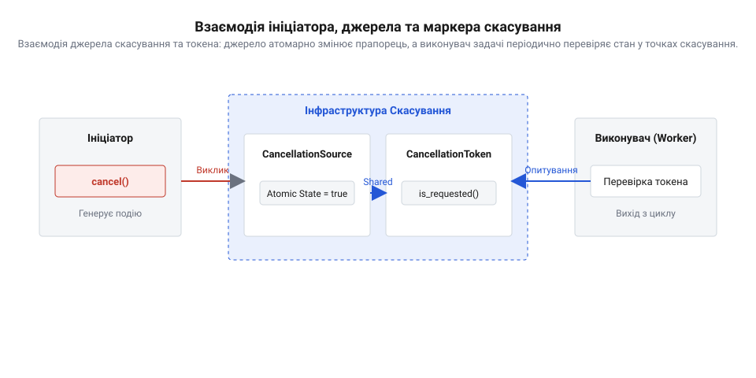
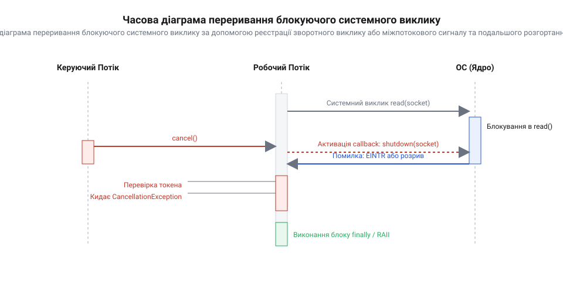
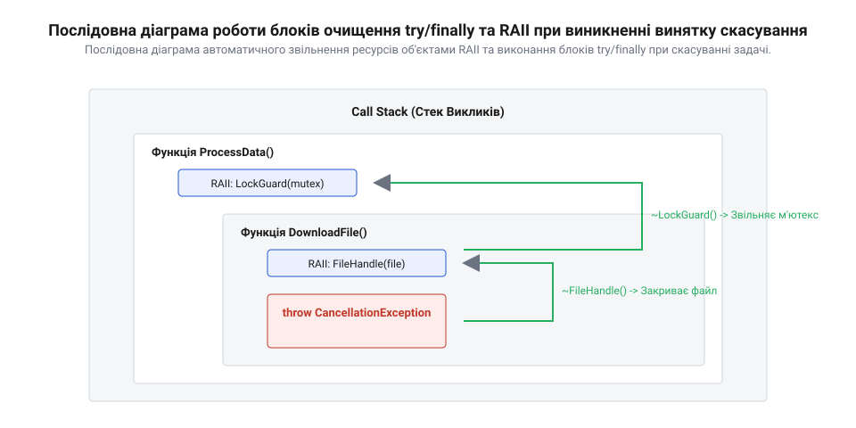
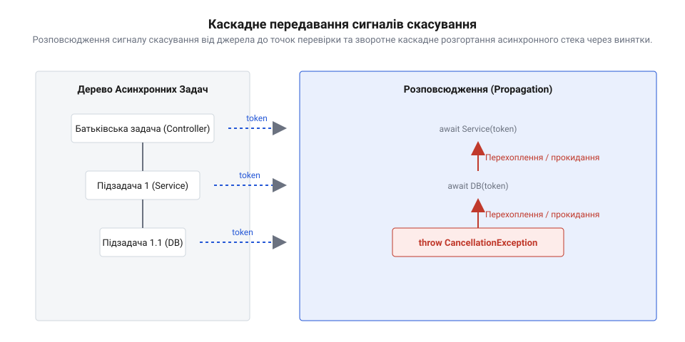

# Кооперативне скасування довгої роботи

<preknowlist>
- [Блокуючий і неблокуючий ввід-вивід](root:sf-tasks/blocking-vs-nonblocking-io) — Специфіку очікування завершення системних викликів та різницю між блокуванням потоку й неблокуючим виконанням.
- [Колбеки → проміси → async/await](root:sf-tasks/async-await) — Базові механізми асинхронного керування потоком виконання та передачі винятків в асинхронних функціях.
- [Опитування проти події: коли перебирати стан, а коли чекати сповіщення](root:sf-tasks/polling-vs-events) — Принципи опитування прапорців стану та подієвих сповіщень для синхронізації асинхронних задач.
</preknowlist>

## Загроза примусового переривання тривалих обчислень

Тривалі фонові процедури — від обробки великих масивів даних до підтримки постійних мережевих з'єднань — неминуче стикаються з потребою в передчасному зупиненні. Користувач може натиснути кнопку скасування в інтерфейсі, тайм-аут асинхронного запиту може вичерпатися, або система ініціює [плавне завершення систем](root:sf-tasks/graceful-shutdown-patterns) для оновлення обчислювального вузла. На перший погляд, найпростішим і найшвидшим шляхом зупинити виконання здається примусове вбивство потоку чи задачі за допомогою системних або рантайм-команд. Проте примусова зупинка створює критичні загрози для стабільності, цілісності даних та безпеки всієї програмної системи.

Головна небезпека примусового переривання полягає в тому, що операційна система або віртуальна машина зупиняє виконання потоку на довільній інструкції процесора. Робочий потік не отримує жодного попередження та не має змоги завершити поточну логічну операцію. На низькому рівні навіть просте оновлення 64-бітового значення на 32-бітовій архітектурі або модифікація покажчика у пам'яті складається з кількох послідовних машинних інструкцій. Якщо переривання відбувається між цими інструкціями, у пам'яті виникає частковий запис — так званий розірваний запис (англ. @@en|torn write@@). У багатопотокових середовищах це призводить до того, що внутрішні інваріанти складних структур даних — зв'язаних списків, хеш-таблиць чи дерев — виявляються назавжди порушеними. Якщо потік знищується посередині перев'язування вказівників у двозв'язному списку, один вказівник вказує на новий вузол, а зворотний — на старий. У пам'яті залишаються напівзмінені об'єкти, осиротілі вказівники та суперечливий стан, що під час наступних звернень інших потоків призводить до непередбачуваної поведінки, пошкодження даних або аварійного завершення всієї програми.

На рівні керування ресурсами примусове переривання повністю розриває ланцюжок очищення пам'яті та системних дескрипторів. Сучасне програмне забезпечення покладається на автоматичне звільнення ресурсів через деструктори об'єктів, блоки гарантованого очищення @@en|try/finally@@ або конструкції @@en|RAII@@ (англ. @@en|RAII@@, від @@en|Resource Acquisition Is Initialization@@ — захоплення ресурсу є ініціалізацією). Нормальне завершення функції чи навіть обробка винятків завжди супроводжуються розгортанням стеку (англ. @@en|stack unwinding@@), під час якого послідовно викликаються деструктори та очисні процедури для кожного фрейму виклику. Примусове знищення потоку повністю обходить розгортання стеку. Фрейми виклику просто викреслюються зі стеку рантаймом чи операційною системою без виконання жодного очисного коду.

Внаслідок обходу розгортання стеку відкриті файли залишаються без закриття системних дескрипторів та без скидання оперативних буферів запису на диск, через що дані в файлах виявляються обрізаними або пошкодженими. Мережеві сокети залишаються в напіввідкритому стані (англ. @@en|half-open TCP connection@@), а виділена динамічна пам'ять незворотно витікає. Перебуваючи в умовах, де активний [блокуючий і неблокуючий ввід-вивід](root:sf-tasks/blocking-vs-nonblocking-io), примусове вилучення виконання залишає зовнішні бази даних та бак-енд сервери в стані нескінченного очікування відповідей. Віддалений сервер продовжує утримувати транзакційні блокування на таблицях бази даних до вичерпання тайм-ауту мережевої сесії, що може тривати десятки хвилин і блокувати роботу інших вузлів кластера.

Окрему й надзвичайно гостру загрозу становлять примітиви синхронізації багатопотокових програм. Для захисту спільних даних потоки використовують м'ютекси (англ. @@en|mutex@@, від @@en|mutual exclusion@@ — взаємне виключення) або спінлоки. Якщо потік успішно захоплює м'ютекс і входить у критичну секцію, а потім примусово знищується операційною системою, цей м'ютекс залишається захопленим назавжди. У системному програмуванні такий стан називається осиротілим блокуванням (англ. @@en|orphaned mutex@@) або отруєним блокуванням. Будь-який інший потік додатка, який згодом спробує захопити той самий м'ютекс, перейде в стан безкінечного очікування в ядрі операційної системи. Це спричиняє каскадне взаємоблокування — @@en|deadlock@@ (англ. @@en|deadlock@@), яке паралізує роботу всієї системи без найменшої можливості автоматичного самовідновлення.

Більше того, у сучасних платформах обчислення виконуються не на окремих потоках ОС, а в пулах потоків (англ. @@en|thread pool@@). Примусове знищення потоку руйнує сам пул потоків, знижуючи продуктивність рантайму та спричиняючи голодування потоків (англ. @@en|thread pool starvation@@).

Практика розробки системного програмного забезпечення протягом десятиліть переконливо довела неможливість безпечного примусового переривання. У перших версіях багатопотокових платформ розробники надавали прямі API для асинхронного знищення потоків. Зокрема, у мові Java існував метод @@en|Thread.stop()@@, у POSIX-стандарті — асинхронний режим @@en|pthread_cancel@@ з прапорцем @@en|PTHREAD_CANCEL_ASYNCHRONOUS@@, а в ОС Windows — системний виклик @@en|TerminateThread@@. Проте реальна експлуатація виявила величезну кількість невідтворюваних помилок, пошкоджень купи (англ. @@en|heap corruption@@) та фатальних зависань. З'ясувалося, що навіть стандартні бібліотечні функції, такі як @@en|malloc@@ або виклик виводу в консоль, внутрішньо використовують глобальні блокування купи. Знищення потоку всередині @@en|malloc@@ отруює глобальний м'ютекс розподільника пам'яті, блокуючи всі наступні виклики виділення пам'яті в усіх потоках процесу. Через ці фундаментальні обмеження автори мов і операційних систем визнали асинхронне вбивство потоків застарілим і небезпечним, сформувавши [еволюції методів зупинки](root:sf-tasks/cooperative-cancellation/hist-cancellation-evolution.md) обчислень від примусового вилучення до кооперативної взаємодії.

Глибокий аналіз руйнівних наслідків асинхронного знищення підводить до єдиного правильного архітектурного висновку: обчислювальна задача може бути зупинена тільки самостійно й добровільно. Зовнішній ініціатор скасування не повинен примусово вбивати виконувача. Замість цього ініціатор надсилає індикативний сигнал про бажаність зупинки. Виконувач обчислень, досягнувши безпечної точки у власному коді, сам перевіряє цей сигнал, припиняє обробку даних, відновлює внутрішні інваріанти, коректно звільняє захоплені ресурси й лише після цього повертає керування.

## Контракт джерела та маркера скасування

Усвідомлення небезпеки примусового переривання вимагає переходу до архітектурної моделі кооперативного скасування. Головний принцип цієї моделі полягає в суворому розділенні відповідальності між двома автономними учасниками: компонентом, що ініціює запит на скасування, та виконувачем довготривалої задачі. У сучасних програмних платформах таке розділення реалізується за допомогою двох чітко розмежованих об'єктів: джерела скасування (англ. @@en|cancellation source@@, від @@en|source@@ — джерело) та маркера скасування (англ. @@en|cancellation token@@, від @@en|cancel@@ — скасовувати та @@en|token@@ — маркер/позначка).

Джерело скасування повністю керує життєвим циклом сигналу зупинки. Воно створюється ініціатором операції — наприклад, компонентом графічного інтерфейсу при натисканні кнопки скасування, обробником мережевого запиту при вичерпанні тайм-ауту або системним службовим потоком при зупинці сервісу. Джерело надає метод генерації сигналу — @@en|cancel()@@ — та володіє внутрішнім прапорцем стану. Натомість виконувачу задачі передається лише маркер скасування — легковажне, потокобезпечне представлення стану скасування, придатне тільки для читання. Маркер позбавлений можливості генерувати сигнал зупинки чи змінювати стан джерела. Він дає змогу робочому потоку лише опитувати стан за допомогою перевірки @@en|is_cancellation_requested()@@. Таке однонапрямлене розділення гарантує інкапсуляцію: робоча задача не може випадково чи навмисно перервати інші паралельні обчислення або зкинути стан скасування у батьківському контексті.

*Взаємодія джерела скасування та токена: джерело атомарно змінює прапорець, а виконувач задачі періодично перевіряє стан у точках скасування.*

Внутрішня механіка маркера скасування базується на потокобезпечному атомарному читанні прапорця з пам'яті. Оскільки джерело скасування та виконувач задачі зазвичай працюють у різних паралельних потоках, зміна стану джерела повинна ставати негайно видимою для маркера без застосування важких операторів синхронізації ядра. Для цього прапорець реалізують як атомарну змінну (англ. @@en|atomic flag@@) з відповідною моделлю пам'яті (наприклад, @@en|relaxed@@ або @@en|acquire-release@@). Виклик @@en|cancel()@@ на джерелі виконує атомарний запис значення true у прапорець із семантикою публікації (англ. @@en|release memory order@@). При цьому маркер виконує читання з семантикою захоплення (англ. @@en|acquire memory order@@), гарантуючи, що всі записи в пам'яті, здійснені ініціатором до скасування, виявляються видимими для робочого потоку після проходження точки перевірки. Повний опис стандартних підходів, методів розширення та параметрів цих об'єктів містить [довідник інтерфейсу маркерів](root:sf-tasks/cooperative-cancellation/api-cancellation-token-interface.md) скасування.

Фундаментальним елементом коду виконувача задачі є точка скасування (англ. @@en|checkpoint@@, від @@en|check@@ — перевіряти та @@en|point@@ — точка). Точкою скасування називається конкретна ділянка коду всередині обчислювального циклу або між етапами обробки, де виконується перевірка стану маркера й де система перебуває в цілісному, узгодженому стані. У точці скасування виконувач опитує маркер. Якщо @@en|is_cancellation_requested()@@ повертає true, задача припиняє подальші обчислення, проводить необхідне очищення й повертає статус скасування або викидає спеціалізований виняток скасування (англ. @@en|cancellation exception@@).

Визначення частоти та щільності розташування точок скасування є ключовою інженерною задачею при проектуванні кооперативних алгоритмів. Занадто часта перевірка токена у внутрішніх мікроскопічних циклах, які виконуються мільйони разів на секунду, створює додаткове навантаження на шину пам'яті через атомарні читання прапорця й може помітно знизити продуктивність обчислень. Натомість занадто рідкісні точки скасування (наприклад, одна перевірка на кілька хвилин обчислень) роблять систему «заторможеною» та нечутливою до команд користувача. Оптимальним правилом є розміщення точок скасування на зовнішніх ітераціях обробки блоків даних, перед виконанням кожної ресурсомісткої підзадачі або через фіксовані інтервали часу.

Окрім опитування токена у циклах, маркер скасування у просунутих платформенних реалізаціях підтримує підписку подієвих зворотних викликів (англ. @@en|callback registration@@). Це необхідно для сценаріїв, коли робочий потік перебуває в стані очікування зовнішньої події чи утримує умовну змінну. Зареєстрований зворотний виклик виконується негайно при виклику @@en|cancel()@@ на джерелі, пробуджуючи потік з очікування та направляючи його до найближчої точки очищення.

Нижче наведено приклад реалізації джерела та токена скасування мовами C та C++, який показує практичну побудову потокобезпечного контракту та перевірку контрольних точок у циклі.

:::tabs
:::code root\eng\sf-tasks\cooperative-cancellation/cooperative-cancellation-d/c/cts-init.c c
:::code root\eng\sf-tasks\cooperative-cancellation/cooperative-cancellation-d/cpp/cancellationtoken.cpp cpp
:::

Вибір між безпосереднім опитуванням токена та ініціалізацією сповіщень залежить від архітектури системи. Для чисто обчислювальних задач регулярне [опитування проти події](root:sf-tasks/polling-vs-events) є максимально ефективним, оскільки атомарне читання в локальному кеші процесора не створює накладних витрат на виклики функцій чи контекстні перемикання. Для побудови складної виробничої системи, що підтримує збереження та відновлення станів, створюється повноцінний [практичний обчислювальний двигун](root:sf-tasks/cooperative-cancellation/proj-cooperative-cancellation-engine.md) з підтримкою точок скасування та атомарних маркерів.

У сучасних асинхронних архітектурах маркер скасування є невід'ємним елементом підписів функцій. Налаштовуючи [управління асинхронним потоком](root:sf-tasks/async-await), розробник передає маркер скасування крізь усю ієрархію викликів. У масштабованих багатопотокових середовищах це інтегрується в паттерн [структурована асинхронність](root:sf-tasks/structured-concurrency-scope), де скасування батьківського контексту автоматично поширює токен скасування на всі дочірні асинхронні задачі.

Для забезпечення детермінованості виконання та мінімізації накладних витрат обробка даних у критичних секціях здійснюється за допомогою цілочисельної арифметики з атомарним оновленням прапорців станів @@en|atomic flags@@, що виключає дрейф фази та блокування переривань.

## Точки скасування у блокуючих операціях

Коли обчислювальна задача виконує тривалий розрахунок у циклі, вона може на кожній ітерації перевіряти атомарний прапорець (@@en|atomic flag@@). Проте реальні високопродуктивні системи рідко складаються лише з обчислень у процесорних регістрах: програма чекає на прибуття мережевого пакета з сокета (@@en|socket@@, від англ. *socket* — роз'єм, гніздо), читає дані з диска або очікує на спрацювання таймера. Якщо потік виконання робить системний виклик на кшталт `read()` або `recv()`, операційна система переводить його у стан очікування. У цьому стані потік повністю втрачає процесорний час і не виконує жодної інструкції користувацького коду. Якщо саме під час перебування у системному виклику від джерела скасування (@@en|cancellation source@@) надходить сигнал зупинки, задача не зможе самостійно перевірити маркер скасування (@@en|cancellation token@@), адже її потік фізично заморожений. Якщо потік виконує [блокуючий ввід-вивід](root:sf-tasks/blocking-vs-nonblocking-io) без підтримки сигналів переривання, програма залишається завислою до прибуття даних або до вичерпання мережевого таймауту.

Щоб вивести потік із блокуючого системного виклику, операційна система мусить отримати зовнішній імпульс, який скасує очікування на рівні ядра. При отриманні переривання (@@en|interrupt@@, від лат. *interruptus* — перерваний) системний виклик достроково завершується з помилкою. У POSIX-сумісних операційних системах для цього застосовуються міжпотокові сигнали. Надсилання сигналу потоку виводить його з системного виклику, після чого виклик повертає значення `-1`, а системна змінна `errno` набуває значення `EINTR`. Потік, який перервав очікування через `EINTR`, негайно переходить до точки скасування (@@en|checkpoint@@) та аналізує стан `@@en|cancellation token@@`. Детальніше про [історичні причини відмови](root:sf-tasks/cooperative-cancellation/hist-cancellation-evolution.md) від примусового завершення потоків на користь міжпотокових сигналів переривання й кооперативної взаємодії розповідається в окремому історичному матеріалі.

Низькорівневим та архітектурно надійним підходом для розблокування системних викликів є використання допоміжних каналів сповіщення. Зокрема, у багатопотокових C-програмах поширений паттерн трюку з власною трубою (@@en|self-pipe trick@@). При створенні задачі ініціалізується безіменний канал даних (pipe), дескриптор читання якого додається до системного селектора `select()` або `poll()` поруч із дескриптором файла (@@en|file descriptor@@) мережевого сокета. Якщо виникає потреба перервати очікування, `@@en|cancellation source@@` з іншого потоку записує один байт у дескриптор запису труби. Це миттєво робить дескриптор читання готовим до введення-виведення, системний виклик `poll()` виходить із блокування, а потік виявляє сигнал скасування без необхідності чекати мережевих даних. У ситуації, коли системний [циклі подій](root:sf-tasks/event-loop) керує тисячами з'єднань, цей принцип лежить в основі розблокування внутрішніх асинхронних черг та реакторів.

У високорівневих асинхронних рантаймах та сучасних стандартах мов програмування блокуючий ввід-вивід обгортається через реєстрацію зворотного виклику (@@en|callback@@, від англ. *call back* — виклик у відповідь). Коли потік починає операцію очікування ресурсу, він підписується на подію скасування через [інтерфейс маркерів скасування](root:sf-tasks/cooperative-cancellation/api-cancellation-token-interface.md). Зворотний виклик містить дію, яка примусово переводить блокуючий ресурс у стан помилки або закриття. Наприклад, для мережевого сокета `@@en|callback@@` викликає системну функцію `shutdown()`, що припиняє передачу даних і розблоковує всі потоки, які чекали на `read()` або `accept()`. Порівняно з підходом, де застосовується [опитування прапорця до](root:sf-tasks/polling-vs-events) настання події, подієва підписка забезпечує нульову затримку реакції на скасування та не витрачає ресурси процесора під час спокою.

*Часова діаграма переривання блокуючого системного виклику за допомогою реєстрації зворотного виклику або міжпотокового сигналу та подальшого розгортання стека.*

:::tabs
:::code root\eng\sf-tasks\cooperative-cancellation/cooperative-cancellation-d/c/pollfd.c c
:::code root\eng\sf-tasks\cooperative-cancellation/cooperative-cancellation-d/cpp/blockingsocketreader.cpp cpp
:::

## Гарантоване звільнення ресурсів та відкат

Миттєвий вихід з обчислювальної задачі після виявлення сигналу скасування розв'язує проблему затримок виконання, але створює загрозу для цілісності системних ресурсів та даних. У момент, коли потік у точці скасування (@@en|checkpoint@@) вирішує перервати обробку і кидає виняток скасування (@@en|cancellation exception@@) або повертає код помилки, у пам'яті можуть залишатися відкриті дескриптори файлів (@@en|file descriptor@@), невіддана оперативна пам'ять, відкриті сокети (@@en|socket@@) та захоплені м'ютекси. Якщо потік залишає область видимості без очищення ресурсів, виникає витік пам'яті або осиротілий м'ютекс (@@en|orphaned mutex@@), що призводить до взаємного блокування (@@en|deadlock@@) інших потоків у пулі. Більш того, якщо задача виконувала багатокрокову модифікацію даних на диску чи у сховищі, неповний запис залишить систему у пошкодженому стані.

Для запобігання витокам ресурсів при достроковому виході використовується механізм розгортання стека (@@en|stack unwinding@@, від англ. *stack unwinding* — розгортання стека). Коли функція переривається винятком або достроковим поверненням, рантайм послідовно знищує всі локальні об'єкти у зворотному порядку їх створення. У мові C++ фундаментальним паттерном для цього є `@@en|RAII@@` (англ. *Resource Acquisition Is Initialization* — отримання ресурсу є ініціалізацією). Завдяки `@@en|RAII@@` обгортки ресурсів (файлові дескриптори, мережеві сокети, захоплені м'ютекси) автоматично викликають свої деструктори при розгортанні стека. Для мов без автоматичних деструкторів або для специфічних локальних дій очищення застосовується охоронець області видимості (@@en|scope guard@@, від англ. *scope guard* — захисник межі). Об'єкт `@@en|scope guard@@` приймає лямбда-функцію з кодом очищення і гарантовано виконує її при виході з поточного блоку коду незалежно від причини завершення.

У середовищах із керованою пам'яттю та збирачем сміття (наприклад, Java, C# чи Python) вихід з асинхронного блоку керується конструкціями `@@en|try/finally@@`. Навіть коли асинхронний каскад переривається і прогортає стек викликів, блок `finally` виконується обов'язково. Завдяки цьому всі закриття сокетів, повернення з'єднань до пулу потоків (@@en|thread pool@@) та видалення тимчасових файлів відбуваються до того, як виняток скасування підніметься вище по стеку. Використання винятків скасування в поєднанні з синтаксисом [async/await в асинхронних](root:sf-tasks/async-await) функціях дозволяє прогортати стек викликів через кілька рівнів абстракції без втрати контролю над ресурсами.

Окрім звільнення системних ресурсів, скасування вимагає узгодження стану даних. Залежно від вимог до відновлення обчислень застосовуються дві стратегії:
1. **Транзакційний відкат (Rollback)**: Якщо задача виконувала атомарну зміну (наприклад, формування підписаного архіву чи оновлення схеми даних), при виявленні скасування всі часткові зміни скасовуються. Тимчасові файли видаляються, а початковий стан системи повністю відновлюється. 2. **Фіксація проміжних точок (Checkpoints & Persistence)**: Для дуже тривалих задач (наприклад, пакетної обробки великих масивів) відкат усіх обчислень є недоцільним. У такому разі задача періодично зберігає свій прогрес у точках скасування (@@en|checkpoint@@). При отриманні сигналу скасування потік фіксує останній коректний стан і завершує роботу. При наступному запуску процес відновлює виконання з останнього збереженого кроку.

Гнучке відновлення стану реалізоване в матеріалі про [генератор обчислень із](root:sf-tasks/cooperative-cancellation/proj-cooperative-cancellation-engine.md) підтримкою збереження точок відновлення. Надійне звільнення ресурсів та відкат є фундаментальною складовою [плавного завершення](root:sf-tasks/graceful-shutdown-patterns) сервісів під навантаженням. Крім того, в рамках [структурованого керування](root:sf-tasks/structured-concurrency-scope) життєвим циклом обчислень скасування батьківської задачі автоматично ініціює каскадне очищення всіх її дочірніх підзадач.

*Послідовна діаграма автоматичного звільнення ресурсів об'єктами RAII та виконання блоків try/finally при скасуванні задачі.*

:::tabs
:::code root\eng\sf-tasks\cooperative-cancellation/cooperative-cancellation-d/c/process-file-transactional.c c
:::code root\eng\sf-tasks\cooperative-cancellation/cooperative-cancellation-d/cpp/scopeguard.cpp cpp
:::

## Розповсюдження статусу та асинхронні винятки

У багатопотокових та асинхронних програмах довготривала робота рідко виконується єдиною монолітною функцією. Зазвичай вона описується ієрархією або ланцюжком викликів, де високорівнева операція ініціює серію підзадач, кожна з яких звертається до мережі, файлової системи чи обчислювальних алгоритмів. Коли користувач скасовує операцію або спливає тайм-аут, сигнал від джерела має миттєво й узгоджено пройти крізь усі рівні вкладеності. Якщо бодай один проміжний шар проігнорує сигнал зупинки або неправильно інтерпретує результат скасованої підзадачі, система втрачає чутливість: виникають висячі операції, які продовжують даремно споживати процесорний час та пам'ять.

Для забезпечення передбачуваного завершення будь-яка асинхронна задача у момент свого фінішу повинна описуватися одним із трьох взаємовиключних станів:

1. **Успіх** (`@@en|Resolved@@` / `@@en|Completed@@`) — обчислення повністю виконано, отримано коректний результат. 2. **Помилка виконання** (`@@en|Faulted@@` / `@@en|Rejected@@`) — виникла несподівана системна або доменна аномалія (наприклад, обрив мережевого з'єднання чи пошкодження даних), що вимагає логування, алертингу або повторної спроби. 3. **Скасування** (`@@en|Canceled@@`) — виконання перервано за нормативним запитом спостерігача до його природного завершення.

Слід чітко розрізняти помилку виконання та скасування. Аварійна помилка свідчить про те, що система не змогла виконати свій контракт через зовнішній чи внутрішній збій. Скасування ж є абсолютно штатною ситуацією: користувач закрив вкладку або відмовився від завантаження файла. Якщо скасування обробляти як звичайний краш системи, логи переповняться хибними тривогами, а механізми автоматичного повтору викликів (retry policies) почнуть даремно перезапускати задачі, які людина свідомо попросила зупинити.

Передача інформації про переривання крізь дерево асинхронних функцій називається розповсюдженням скасування (`@@en|cancellation propagation@@` (від англ. @@en|propagation@@, з латинського _propagare_ — поширювати)). На відміну від звичайного синхронного стека, де винятки розгортають фізичний стек потоку, в асинхронній модель ланцюжок складається із зафіксованих фреймів корутин (`@@en|coroutine frame@@`) або зв'язаних промісів. Передача маркерів зупинки відбувається через параметри функцій або контекст оточення (`@@en|ambient context@@`). У сучасних середовищах із підтримкою синтаксичної конструкції [асинхронного ланцюжка керування](root:sf-tasks/async-await) основними інструментами розповсюдження є спецтипи винятків — `@@en|cancellation exception@@` (`CancellationException`, з латинського _exceptio_ — виключення, застереження).

Коли глибинна задача досягає точки перевірки (`@@en|checkpoint@@`) і виявляє, що прапорець у `@@en|cancellation token@@` активовано, вона перериває поточне виконання і генерує `CancellationException`. Асинхронний рантайм перехоплює цей виняток, переводить об'єкт `@@en|future@@` (англ. @@en|future@@ — майбутній результат) або `@@en|promise@@` (англ. @@en|promise@@ — обіцянка) у стан `Canceled` і прокидає його вгору по стеку до місця виклику `await`.

*Розповсюдження сигналу скасування від джерела до точок перевірки та зворотне каскадне розгортання асинхронного стека через винятки.*

Головною небезпекою при такій схемі є маскування винятків скасування (`@@en|swallowed exception@@`, поглинений виняток). Загальний блок перехоплення `catch (std::exception& e)` або `catch (Throwable t)`, написаний у проміжному коді без належної перевірки типу винятку, здатний перехопити `CancellationException`, сприйняти його як звичайну помилку і повернути дефолтне значення або приглушити його. У результаті розповсюдження переривається: верхні шари системи вважають, що підзадача успішно завершилася з порожнім результатом, і продовжують виконувати наступні етапи алгоритму. Це руйнує цілісність обчислень. Точний опис контрактів та методів об'єктів перевірки містить [довідник програмного інтерфейсу](root:sf-tasks/cooperative-cancellation/api-cancellation-token-interface.md).

Коректний асинхронний код зобов'язаний або пропускати `CancellationException` далі нагору (rethrow), або явно перетворювати його у відповідний стан скасування результату. Коли в системі ініціюється [процес плавного зупинення](root:sf-tasks/graceful-shutdown-patterns), таке каскадне прокидання гарантує миттєве розгортання стека та виконання всіх збережених блоків очищення ресурсів. Про те, як еволюціонували ці підходи від примусового переривання до кооперативності, детально розповідає [огляд історичного розвитку](root:sf-tasks/cooperative-cancellation/hist-cancellation-evolution.md).

Особливої уваги вимагають комбінатори паралельного виконання. Якщо батьківська задача запускає декілька паралельних підзадач і одна з них викидає `CancellationException` або зазнає помилки, [ієрархічне керування життєвим циклом](root:sf-tasks/structured-concurrency-scope) вимагає автоматично надіслати сигнал скасування усім сусіднім гілкам. Батьківський комбінатор не повинен завершуватися доти, доки кожна дочірня задача безпечно не завершить свої розгортання та не звільнить ресурси, запобігаючи появі необробленого відхилення (`@@en|unhandled rejection@@`, з англійського @@en|unhandled rejection@@ — необроблене відхилення). Наочна [практична реалізація двигуна](root:sf-tasks/cooperative-cancellation/proj-cooperative-cancellation-engine.md) ілюструє побудову подібних задач із відновленням стану після переривання.

Коли асинхронний потік не виконує обчислень, а очікує на події від зовнішніх систем, замість того щоб застосовувати [періодичне опитування стану](root:sf-tasks/polling-vs-events), ефективнішим є [неблокуючий ввід-вивід](root:sf-tasks/blocking-vs-nonblocking-io) у поєднанні з подієвим сповіщенням, де [системний цикл подій](root:sf-tasks/event-loop) розриває очікування при надходженні сигналу зупинки.

Нижче наведено приклади розповсюдження статусу скасування крізь асинхронний ланцюжок викликів мовами C++ та C.

:::tabs
:::code root\eng\sf-tasks\cooperative-cancellation/cooperative-cancellation-d/cpp/cancellation-exception.cpp cpp
:::code root\eng\sf-tasks\cooperative-cancellation/cooperative-cancellation-d/c/is-cancellation-requested.c c
:::