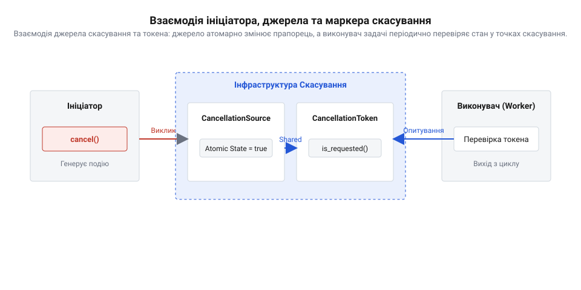
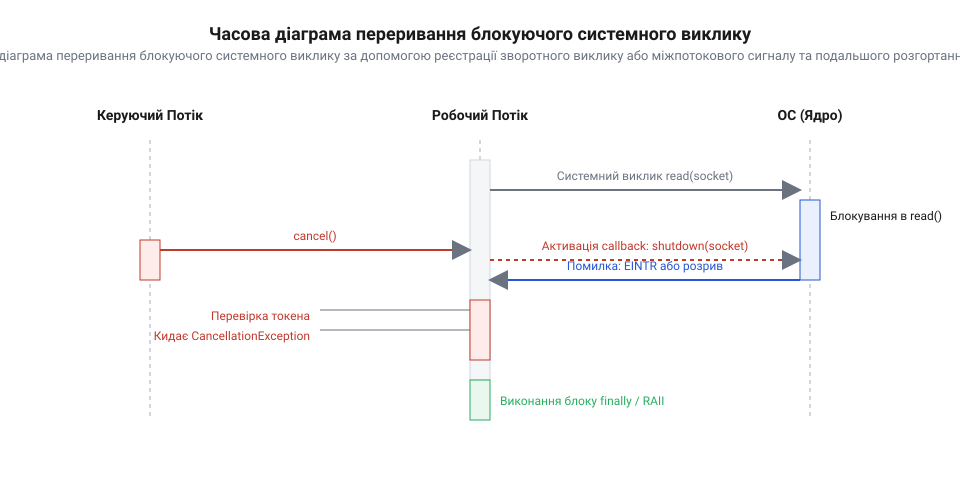
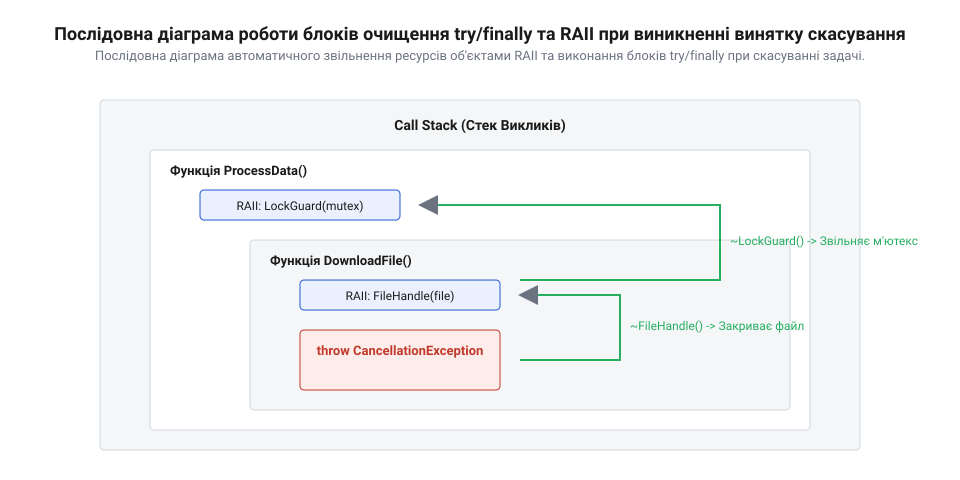
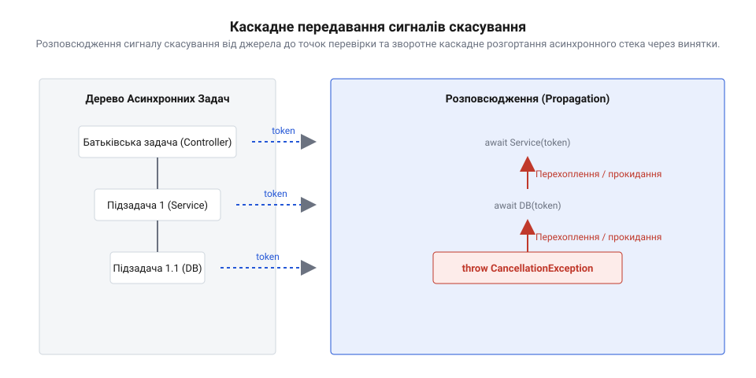

# Кооперативне скасування довгої роботи

<preknowlist>
- [Блокуючий і неблокуючий ввід-вивід](root:sf-tasks/blocking-vs-nonblocking-io) — специфіку очікування завершення системних викликів та різницю між блокуванням потоку й неблокуючим виконанням
- [Колбеки → проміси → async/await](root:sf-tasks/async-await) — базові механізми асинхронного керування потоком виконання та передачі винятків в асинхронних функціях
</preknowlist>

## Чому примусове переривання небезпечне
Коли мікроконтролер виконує довге обчислення або чекає на дані, виникає потреба зупинити цю роботу до її природного завершення. Найпростіший підхід — просто знищити потік через системний виклик операційної системи реального часу (RTOS). Проте раптове переривання виконання створює серйозну загрозу для цілісності системи. Якщо потік зупинити посеред запису в пам'ять або передачі кадру по шині, виникають розірвані записи — частково оновлені структури даних, які залишаються у недійсному стані.

Інша критична проблема — осиротілі м'ютекси. Якщо потік захопив ексклюзивний доступ до спільного ресурсу і був примусово знищений, він ніколи не зніме блокування. Будь-який інший процес, що спробує звернутися до цього ресурсу, назавжди зупиниться, утворюючи взаємоблокування (@@en|deadlock@@). Тому систему будують так, щоб потік не вбивали ззовні. Натомість використовують кооперативне скасування: ініціатор лише просить про зупинку, а сам потік добровільно перериває свою роботу у безпечний момент.

## Джерело та маркер скасування
Щоб потік міг безпечно завершити роботу, архітектура скасування розділяє ролі на дві частини. Ініціатор тримає джерело скасування (@@en|cancellation source@@) — об'єкт, через який він подає сигнал про зупинку. Виконувач довгої задачі отримує маркер скасування (@@en|cancellation token@@) — об'єкт, який дозволяє лише зчитувати стан, але не змінювати його.

*Схема показує, як ініціатор встановлює прапорець через джерело, а робочий потік періодично перевіряє маркер без ризику випадкового скидання стану.*

Під час тривалих обчислювальних циклів потік періодично опитує маркер. Ці перевірки розміщують у безпечних точках — місцях коду, де структури даних узгоджені, а проміжний стан можна безпечно відкинути. Якщо маркер сигналізує про скасування, потік самостійно перериває цикл і починає процедуру виходу. Атомарність прапорця в маркері гарантує, що перевірка стану з іншого потоку не створить гонитви даних.

## Скасування у блокуючих операціях
Опитування маркера працює лише тоді, коли процесор активно виконує інструкції. Якщо потік робить системний виклик очікування мережі або диска, операційна система присипляє його. У цьому замороженому стані потік не може перевірити прапорець, і [блокуючий ввід-вивід](root:sf-tasks/blocking-vs-nonblocking-io) триватиме доти, доки не надійдуть дані або не спрацює тайм-аут.

*Джерело скасування генерує апаратне переривання або подію RTOS, яка змушує систему розбудити потік із помилкою перерваного виклику.*

Щоб вивести потік із такого очікування, ініціатор використовує міжпотокові сигнали або подієві сповіщення самої RTOS. Джерело скасування не просто встановлює прапорець, а й надсилає системну подію в чергу або викликає функцію переривання очікування на дескрипторі. Системний виклик достроково повертає помилку переривання. Розбуджений потік перевіряє маркер скасування, розуміє справжню причину помилки і починає вихід.

## Звільнення ресурсів при скасуванні
Коли потік дізнається про скасування, він мусить прибрати за собою, перш ніж повністю зупинитися. Раптовий вихід із функції залишить відкриті файли, виділену пам'ять та заблоковані м'ютекси. Щоб цього уникнути, використовують механізми автоматичного звільнення ресурсів під час розгортання стека.

*При достроковому виході гарантовано викликаються деструктори локальних об'єктів або блоки очищення, знімаючи блокування та повертаючи пам'ять.*

У мовах на кшталт C++ це вирішується ідіомою RAII (@@en|Resource Acquisition Is Initialization@@), де деструктори об'єктів самостійно звільняють ресурси при виході з області видимості. В інших мовах для цього застосовують блоки `finally` або `defer`. Якщо під час скасування робота зі структурами даних залишилася незавершеною, потік відкочує транзакції до попереднього цілісного стану, зберігаючи загальну стабільність системи.

## Каскадне розповсюдження статусу скасування
Складна робота часто розбивається на ієрархію викликів, де одна задача запускає кілька підзадач. Коли спрацьовує маркер, статус скасування повинен коректно передатися крізь усі рівні вгору. Сигнал зупинки обгортається у спеціальний тип помилки або виняток скасування.

*Кожен рівень ієрархії отримує сповіщення про переривання і передає його вище, відмовляючись від подальшого виконання наступних кроків.*

Головна небезпека тут — поглинання винятків. Якщо проміжний код ловить усі помилки підряд і просто логує їх, [передача стану в асинхронних функціях](root:sf-tasks/async-await) зламається. Батьківська функція вважатиме, що дочірня успішно завершилася, і продовжить обчислення з порожніми або недійсними даними. Щоб уникнути цього, виняток скасування завжди відрізняють від аварійних помилок і гарантовано прокидають нагору, зупиняючи весь каскад обчислень.