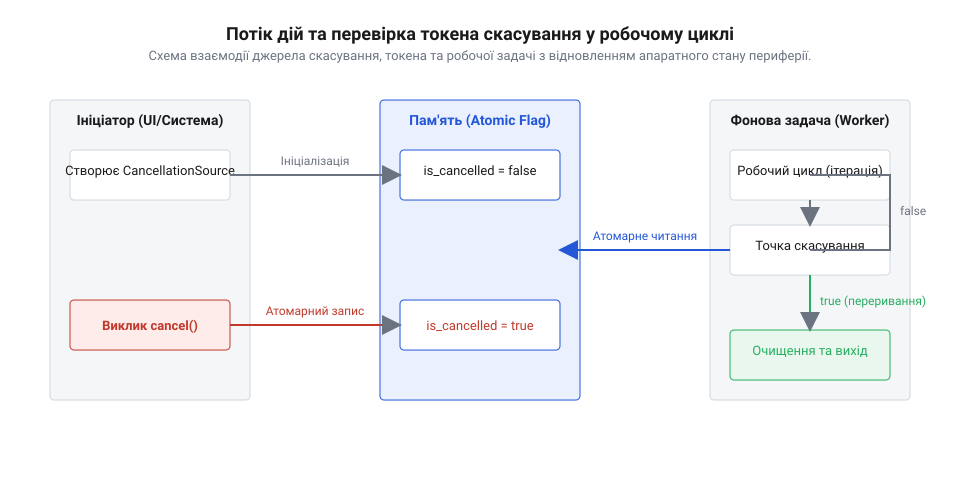

## Початкові концепції та фізичні принципи

Коли довготривала обчислювальна задача втрачає актуальність або вимагає термінового зупинення через зміну зовнішніх умов, обчислювальна система мусить безпечно припинити її виконання. На ранніх етапах розвитку операційних систем у 1960–1970-х роках єдиним доступним механізмом було @@en|примусове скасування@@ (від англ. @@en|forced cancellation@@, де лат. @@la|cancelli@@ — грати, перекреслення) — асинхронне @@en|переривання@@ (від лат. @@la|interruptio@@ — розрив), яке зовні анулювало виконання @@en|потоку@@ (від англ. @@en|thread@@ — нитка). У такій примітивній моделі операційна система або керівна програма просто вилучали контекст процесора й викреслювали задачу зі списку активного планувальника. Проте фізична будова системних ресурсів та структур пам'яті виявила фундаментальну небезпеку цього підходу.

Фізична оперативна пам'ять та апаратні @@en|реєстри@@ (від лат. @@la|regestrum@@ — внесений список) не спроможні миттєво відновити узгоджений стан, якщо процес їх модифікації перервано посередині базового ланцюжка команд. Якщо задачу зупиняли в той момент, коли вона змінювала покажчики в зв'язаному списку, оновлювала заголовок файлового буфера чи записувала дані у внутрішні @@en|реєстри@@ периферійного контролера, цілісність структури незворотно руйнувалася. Багатопотокові середовища 1990-х років, такі як ранні специфікації стандарту POSIX (1995 рік) та перші версії Java 1.0, надавали прямі виклики асинхронної зупинки. Згодом практика розробки довела, що примусове скасування задачі, яка встигла захопити @@en|м'ютекс@@ (від англ. @@en|mutex@@, скорочення від *mutual exclusion* — взаємне виключення), залишає це блокування в загарбаному стані назавжди, що викликає катастрофічне @@en|взаємне блокування@@ системних ресурсів.

Для подолання цієї кризи розробники операційних систем та архітектори програмного забезпечення сформулювали фізичний принцип цілісності стану: жоден зовнішній суб'єкт не має права насильно змінювати потік управління всередині чужого стек-фрейму та руйнувати його інваріанти. У 1998 році розробники мови Java у версії 1.2 офіційно оголосили метод примусової зупинки застарілим і небезпечним для використання, що заклало підвалини для принципово нової парадигми. Альтернативою став підхід під назвою @@en|кооперативне скасування@@ (від англ. @@en|cooperative cancellation@@, де лат. @@la|cooperari@@ — працювати разом), у якому обчислювальна задача сама вирішує, у який момент і яким чином безпечно припинити власну роботу.

В основі кооперативної моделі лежить чіткий розподіл відповідальності між ініціатором та виконавцем. Керівний @@en|потік@@ більше не вбиває задачу насильно, а лише виставляє сигнал про необхідність припинення роботи. Робочий @@en|потік@@ самостійно зчитує цей сигнал у спеціально відведених безпечних проміжках часу. Коли масштабна задача вимагає тривалого виконання, ззвичайний [блокуючий і неблокуючий ввід-вивід](root:sf-tasks/blocking-vs-nonblocking-io) не дає змоги миттєво перервати внутрішній цикл обробки без додаткової перевірки, тому розробники почали вбудовувати регулярне опитування прапорця скасування безпосередньо у внутрішні обчислювальні цикли. Фізично це означало перехід від зовнішнього примусового переривання до добровільного передання управління самим виконавцем.

Головною фізичною передумовою коректного функціонування кооперативного скасування стала гарантія атомарності під час читання та запису прапорця сигналу. Оскільки прапорець виставляється з одного @@en|потоку@@, а перевіряється з іншого, ця дія має бути @@en|атомарна операція@@ (від грец. @@el|atomos@@ — неподільний). Без залучення апаратних бар'єрів пам'яті або атомарних процесорних інструкцій оптимізувальний компілятор чи суперскалярний процесор міг закешувати значення прапорця в локальному регістрі ядра, що призводило до @@en|стан гонитви@@ (від англ. @@en|race condition@@). Фізичні механізми когерентності кешів та атомарні бар'єри пам'яті забезпечили гарантовану миттєву видимість змін прапорця між усіма ядрами процесора, зробивши кооперативне скасування надійним та детермінованим інструментом.

## Внутрішня будова та алгоритми роботи

Програмна архітектура механізму кооперативного скасування будується на тристоронній взаємодії між ініціатором обчислень, передавальним об'єктом та алгоритмом виконання всередині робочої задачі. Ініціатор створює спеціальне джерело сигналу й передає пов'язаний @@en|маркер скасування@@ (від англ. @@en|cancellation token@@, де *token* — розпізнавальний знак) у робочий @@en|потік@@ під час його ініціалізації. Цей маркер виступає захищеним каналом зв'язку: він містить атомарний прапорець стану та список зареєстрованих зворотних викликів для сповіщення асинхронних підсистем.


*Схема передачі сигналу скасування через атомарний прапорець та вихід робочої задачі через точку скасування.*

Алгоритм функціонування робочої задачі спирається на послідовне проходження спеціально розроблених перевірочних рубежів. Такий рубіж має назву @@en|точка скасування@@ (від англ. @@en|cancellation point@@) і являє собою ділянку коду, де внутрішні інваріанти програми повністю збережено, ресурси перебувають у локалізованому стані, а переривання не загрожує цілісності даних. Під час виконання масштабних циклів обробки алгоритм на кожному кроці виконує зчитування стану, який зберігає @@en|маркер скасування@@. Для передачі сигналу між паралельними задачами часто застосовують [опитування проти події](root:sf-tasks/polling-vs-events), де робоча задача або регулярно перевіряє прапорець у циклі, або блокується на системному об'єкті сповіщення до появи сигналу.

Якщо під час чергової перевірки в точці скасування виявлено активний сигнал зупинки, алгоритм негайно припиняє виконання основної бізнес-логіки й переходить до процедури очищення. На цьому етапі задача зобов'язана звільнити всі раніше захоплені @@en|м'ютекс@@, закрити відкриті мережеві сокети й файлові дескриптори, скинути буфери пам'яті та повернути апаратні @@en|реєстри@@ периферії у вихідний стан. Після завершення очищення задача завершує виконання й повертає статус скасування або генерує спеціальний виняток. Такий коректний вихід гарантує детермінованість і запобігає витокам ресурсів у системі.

Впродовж 2000–2010-х років кооперативне скасування еволюціонувало від простих локальних прапорців до повноцінних ієрархічних систем управління життєвим циклом. У 2010 році платформою .NET 4.0 було впроваджено уніфікований механізм `CancellationTokenSource`, а в мові Go у 2014 році базовим стандартом став пакет `context`. У цих архітектурах сигнал скасування поширюється за принципом дерева: скасування батьківського об'єкта автоматично транслюється на всі дочірні задачі. Згодом ця концепція розвинулася в [структуровану асинхронність та ієрархічне](root:sf-tasks/structured-concurrency-scope) керування життєвим циклом задач, де дерево виконання гарантує, що жодна дочірня задача не залишиться безнаглядною після скасування батьківського контексту.

У сучасній розробці високонавантажених та вбудованих систем кооперативна модель є основою надійності. Саме на цій архітектурі будуються сучасні [паттерни плавного завершення систем](root:sf-tasks/graceful-shutdown-patterns) у мікросервісах, серверних додатках та операційних системах реального часу. В складних асинхронних архітектурах, де функціонує [головний цикл подій](root:sf-tasks/event-loop), скасування передається через проміси та асинхронні канали без заблокування системних потоків. Кооперативне скасування перетворилося з локального прийому на універсальний архітектурний принцип побудови безпечних паралельних систем.

## Апаратна реалізація та низькорівневий C/C++ код

Коли обчислювальна задача виконується на обмеженому апаратному рівні вбудованої системи, неефективне переривання обробки загрожує не лише втратою обчислювального стану, а й фізичним збоєм периферійного обладнання. На початку 1980-х років у перших операційних системах реального часу, таких як VRTX (розроблена компанією Hunter & Ready у 1981 році) та ранніх версіях VxWorks (створеної компанією Wind River Systems у 1987 році), домінував механізм примусового вилучення задач. Керівне ядро миттєво знищувало @@en|потік@@ викликом `taskDelete()`, асинхронно анулюючи його стековий фрейм. Проте у мікроконтролерах це спричиняло важкі системні аварії: @@en|DMA-контролер@@ (від англ. @@en|Direct Memory Access@@ — прямий доступ до пам'яті) продовжував записувати дані в уже звільнений @@en|буфер@@ (від англ. @@en|buffer@@ — проміжна захисна ланка), а апаратні @@en|реєстри@@ (від лат. @@la|regestrum@@ — внесений список) периферійних модулів залишалися заблокованими у проміжних напівконфігурованих станах.

Розвиток відкритих ядер RTOS на початку 2000-х років, зокрема поява ядра FreeRTOS у 2003 році за авторством Річарда Баррі (Richard Barry), переніс вектор розробки вбудованих систем на кооперативне скасування. В архітектурі сучасних мікроконтролерів, таких як сімейство ARM Cortex-M з контролером переривань @@en|NVIC@@ (від англ. @@en|Nested Vectored Interrupt Controller@@ — вкладений векторний контролер переривань), сигнал зупинки формується апаратно чи програмно у вигляді @@en|переривання@@ (від лат. @@la|interruptio@@ — розрив). Обробник переривань ISR (від англ. @@en|Interrupt Service Routine@@) не втручається у стек робочої задачі, а лише виставляє бітовий прапорець у спеціальній групі подій RTOS або атомарній змінній оперативної пам'яті.

Щоб мінімізувати затримки реагування та уникнути зайвого навантаження на процесорне ядро, обчислювальний цикл прошивки регулярними інтервалами опитує цей прапорець. На апаратному рівні критично важливо, щоб прапорець скасування зберігався за адресою пам'яті із гарантованою когерентністю кешу та відсутністю оптимізацій з боку компілятора. У мовах C11 та C++11 для цього застосовують @@en|атомарна операція@@ за допомогою стандартних типів `std::atomic<bool>` чи `atomic_bool`. Компілятор транслює перевірку такого прапорця у найкоротшу послідовність машинних інструкцій (наприклад, ексклюзивне зчитування `LDR` та умовний перехід `CBZ` в архітектурі ARM Cortex-M4), виконуючи перевірку у точці скасування всього за 1–2 такти процесора. Для запобігання небезпечному перевпорядкуванню команд оптимізатором C/C++ та суперскалярним конвеєром процесора застосовуються інструкції апаратних бар'єрів пам'яті, такі як `__DMB()` (від англ. @@en|Data Memory Barrier@@).

Нижче наведено практичну реалізацію обчислювального циклу на мові C++ для операційної системи FreeRTOS, де робоча задача обробляє масив даних від апаратного сенсора та кооперативно перевіряє @@en|маркер скасування@@ перед кожною порцією обчислень:

```cpp
#include <atomic>
#include "FreeRTOS.h"
#include "task.h"
#include "semphr.h"

// Структура маркера скасування для вбудованих систем
struct CancellationToken {
    std::atomic<bool> is_cancelled{false};
    
    void request_cancel() noexcept {
        is_cancelled.store(true, std::memory_order_release);
    }
    
    bool is_cancellation_requested() const noexcept {
        return is_cancelled.load(std::memory_order_acquire);
    }
};

// Функція зупинки периферії та очищення буферів
void stop_dma_hardware_transfer() {
    // Скидання прапорців та вимкнення каналу DMA у вихідний стан
    DMA1_Channel1->CCR &= ~DMA_CCR_EN;
    while ((DMA1_Channel1->CCR & DMA_CCR_EN) != 0) {
        // Очікування апаратного зупинення каналу
    }
}

// Робоча задача обробки сигналів
void sensor_processing_task(void* pvParameters) {
    auto* token = static_cast<CancellationToken*>(pvParameters);
    
    while (true) {
        // Точка скасування перед початком нової ітерації
        if (token->is_cancellation_requested()) {
            // Безпечне зупинення апаратних модулів
            stop_dma_hardware_transfer();
            
            // Звільнення ресурсів та завершення задачі RTOS
            vTaskDelete(NULL);
            return;
        }
        
        // Основне обчислювальне навантаження прошивки
        process_next_sensor_block();
    }
}
```

Представлений алгоритм забезпечує високий детермінізм виконання: тривалість затримки між подачею сигналу скасування та реальною зупинкою задачі визначається лише часом виконання одного обчислювального блоку `process_next_sensor_block()`. Використання атомарних операцій із семантикою пам'яті `acquire-release` гарантує миттєву видимість змін між ядрами без залучення важких системних об'єктів блокування.

## Практичне застосування та відлагодження

Практичне впровадження кооперативного скасування у прошивках реального часу вимагає ретельного аналізу граничних випадків та використання спеціалізованих інструментів трасування. В історичній перспективі налагодження асинхронних систем у 1990-х роках обмежувалося осцилографами та переключенням зовнішніх виводів GPIO для вимірювання затримок реакції системи. З появою у 2010-х роках програмних трасувальників реального часу, таких як Percepio Tracealyzer (2010 рік) та SEGGER SystemView (2015 рік), розробники отримали можливість спостерігати точну мікросекундну хронологію подій між виставленням прапорця в ISR та виходом задачі через @@en|точка скасування@@.

Під час розробки реальних вбудованих систем виникають три критичні пастки, здатні порушити детермінованість або призвести до апаратної аварії:

1. **Скасування всередині критичної секції.** Якщо сигнал про припинення роботи надходить у момент, коли @@en|потік@@ виконав закриття переривань через `taskENTER_CRITICAL()` або `__disable_irq()`, спроба миттєво перервати виконання спричинить важке порушення стану ядра. Робоча задача зобов'язана зберегти прапорець скасування, завершити критичну секцію, оновити системний @@en|реєстри@@ і лише після відновлення глобальних переривань виконати вихід через точку скасування.
2. **Незвершені транзакції периферії.** Якщо задача виконує обмін через DMA або послідовний шинний контролер SPI/I2C, просте переривання обчислювального циклу залишає апаратний модуль у стані очікування відповіді. Прошивка повинна коректно викликати примусову зупинку транзакції, очистити вхідні та вихідні буфери FIFO та скинути апаратні прапорці перед передачею управління.
3. **Конфлікт зі сторожовим таймером.** Якщо процедура виходу та очищення ресурсів займає занадто багато часу (наприклад, через тривале очікування вимкнення зовнішньої периферії), системний @@en|сторожовий таймер@@ (від англ. @@en|watchdog timer@@) виходить за межі допустимого інтервалу та ініціює перезавантаження мікроконтролера. Очищення ресурсів має бути гранично коротким, або регулярно підтримувати скидання лічильника таймера.

Для ефективного налагодження апаратних систем розробники застосовують апаратний @@en|відлагоджувач@@ (від англ. @@en|debugger@@) з інтерфейсом JTAG або SWD, аналізуючи вміст системних стеків та статусних реєстрів контролера переривань. Коли в системі застосовується [опитування проти події: коли перебирати](root:sf-tasks/polling-vs-events) стан, а коли чекати сповіщення, скасування задачі ефективно комбінується із режимним енергозбереженням: задача перебуває у заблокованому стані на об'єкті сповіщення RTOS до появи сигналу скасування або завершення таймера, не витрачаючи енергію акумулятора в даремних циклах перевірки.

У складних багатозадачних прошивках кооперативне скасування є ключовим елементом загальної архітектури надійності. Воно гармонійно доповнює [паттерни плавного завершення систем](root:sf-tasks/graceful-shutdown-patterns), дозволяючи пристрою безпечно зберігати свій стан у енергонезалежній Flash-пам'яті перед переходом у режим глибокого сну чи оновленням прошивки по повітрю. А в архітектурах із вищими рівнями абстракції такі механізми перегукуються з тим, як організовано [структуровану асинхронність та ієрархічне](root:sf-tasks/structured-concurrency-scope) керування життєвим циклом задач. Завдяки строгому дотриманню правил кооперативної взаємодії вбудовані системи досягають високого рівня детермінованості, стійкості до відмов та надійності в найскладніших умовах експлуатації.
