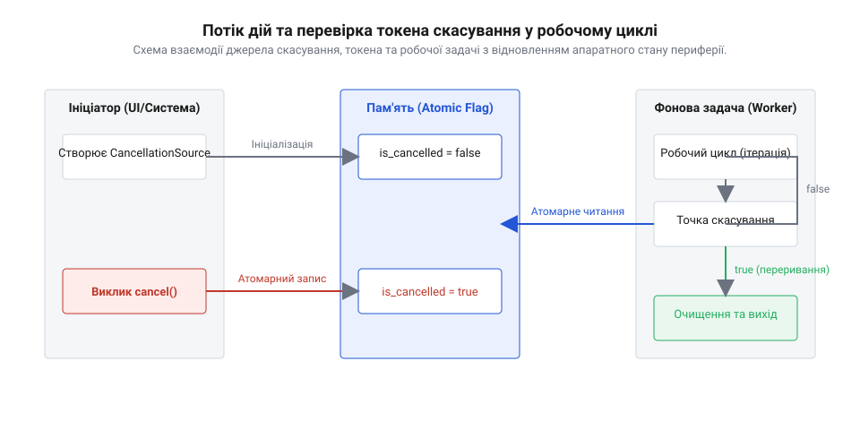

## Початкові концепції та фізичні принципи

Примусова зупинка фонового обчислювального потоку або задачі операційної системи реального часу в мікроконтролері миттєво створює приховану деструктивну нестабільність. Якщо асинхронний операційний процес переривається зовнішнім викликом примусового знищення, виконавець не встигає звільнити виділені в оперативній пам'яті ресурси, розблокувати системні @@en|mutex@@ (мутекси) чи завершити сеанс запису у конфігураційні регістри периферії. У результаті апаратні периферійні блоки — такі як шини I2C, SPI або контролери @@en|DMA@@ (прямого доступу до пам'яті) — залишаються у проміжному стані з висінням системної шини. Для побудови стабільних вбудованих систем розробнику необхідна концепція @@en|cooperative cancellation@@ (кооперативне скасування) (від лат. @@la|cooperatio@@ — спільна праця), за якої задача самостійно перевіряє запит на зупинку у безпечних точках і впорядковано завершує власну роботу.

Фізичні принципи функціонування мікроконтролерів вимагають детермінованого дотримання послідовностей запису в апаратні регістри. Коли обчислювальний модуль виконує довгий алгоритм — наприклад, розрахунок цифрового фільтра, вимірювання сигналів або пакетну транзакцію у зовнішню пам'ять FLASH, — апаратний стан залежить від збереження інваріантів пам'яті. Раптова зупинка виконання на середині циклу запису сторінки флеш-пам'яті залишає фізичний кристал під підвищеною напругою програмування, що призводить до пошкодження комірок пам'яті або апаратного зависання внутрішньої шини AHB. Аналогічно, обрив передачі по шині I2C під час низького рівня на лінії системного годинника SCL назавжди блокує ведену периферію в стані очікування, вимагаючи примусового фізичного скидання мікроконтролера через вивід NRST. Щоб уникнути апаратних збоїв, реалізація [плавного завершення обробки](root:sf-tasks/graceful-shutdown-patterns) переносить відповідальність за вихід з циклу на саму задачу. Замість зовнішнього втручання задача періодично зчитує @@en|cancellation token@@ (токен скасування) (від англ. @@en|token@@ — розпізнавальний знак).

Програмна організація такого сповіщення спирається на використання @@en|atomic flag@@ (атомарного прапорця) (від гр. @@el|atomos@@ — неподільний), який розміщується у спільній оперативній пам'яті. Звичайне зчитування змінної прапорця у циклі обробки може бути оптимізоване компілятором C/C++ через кешування значення в процесорному регістрі, через що задача взагалі не помітить зовнішню зміну стану. Для запобігання такій оптимізації прапорець опитування мусить мати модифікатор `volatile` або реалізовуватися через атомарні типи мови C. На фізичному рівні шини системного процесора зміна прапорця вимагає вказівки @@en|memory barrier@@ (бар'єра пам'яті) (від франк. @@fr|barriera@@ — загородження), який гарантує скрізну видимість нової точки стану для всіх ядер або апаратних модулів без витіснення поточного процесу.

На набагато вищому рівні вбачається різниця між обробкою команд у багатоядерних або багаторазових архітектурах мікроконтролерів. Зміна прапорця скасування в одному ядрі мусить бути синхронізована з кеш-пам'яттю другого ядра через виклики атомарних інструкцій із семантикою `acquire-release`. Це унеможливлює виникнення @@en|race condition@@ (стану гонитви) (від англ. @@en|race@@ — змагання), коли сигнал скасування подано, але робоче ядро продовжує конвеєрне виконання інструкцій через затримки шини пам'яті.

На відміну від примусового асинхронного переривання, при якому контекст виконання скасовується безапеляційно, кооперативний підхід перетворює зупинку на детермінований алгоритмічний перехід. Задача отримує сигнальний статус і виконує внутрішню процедуру очищення: коректно відключає переривання периферії, скидає прапорці готовності шини та повертає використані буфери в системний пул. Перехід від [періодичного опитування стану](root:sf-tasks/polling-vs-events) до системних сигналів скасування дає змогу розробнику зберігати суворий контроль над цілісністю даних та апаратних регістрів мікроконтролера.

## Внутрішня будова та алгоритми роботи

Архітектура модуля кооперативного скасування базується на чіткому поділі ролей між спостерігачем та виконавцем. Керуючий процес створює @@en|cancellation source@@ (джерело скасування) (від лат. @@la|fons@@ — джерело), яке володіє монопольним правом на ініціалізацію сигналу зупинки. Виконавчий фоновий процес отримує лише відповідний @@en|cancellation token@@ для зчитування поточного стану. Усередині тривалого обчислювального алгоритму розробник розміщує @@en|checkpoint@@ (контрольні точки) (від англ. @@en|point@@ — точка), у яких здійснюється швидка перевірка наявності запиту на завершення.

Вибір частоти розміщення контрольних точок визначає системний баланс між продуктивністю та затримкою реагування. Якщо перевірка @@en|atomic flag@@ відбувається на кожній ітерації короткого внутрішнього циклу, накладні витрати на звернення до пам'яті та виконання інструкцій переходу сповільнюють корисні обчислення. Якщо ж перевірка здійснюється занадто рідко — наприклад, лише раз на кілька сотень мілісекунд між великими блоками обробки даних, — виникає висока @@en|cancellation latency@@ (затримка скасування) (від лат. @@la|latens@@ — прихований). Оптимальний алгоритм вимагає розміщення контрольних точок перед кожною потенційно тривалою операцією або на зовнішніх ітераціях пакетної обробки.

Складність виникає тоді, коли тривала задача мусить очікувати зовнішню подію або таймер усередині операційної системи реального часу @@en|RTOS@@. Коли задача засинає через системний виклик затримки або очікування семафора, звичайний @@en|atomic flag@@ не здатний розбудити її до завершення таймауту. У такому разі застосування [неблокуючих операцій вводу-виводу](root:sf-tasks/blocking-vs-nonblocking-io) поєднується із використанням системних подій RTOS або переривань, які переривають очікування та змушують задачу негайно перейти до контрольної точки. Для цього джерело скасування надсилає сигнальний біт у групу подій `EventGroup` або викликає сповіщення `xTaskNotify()`, що миттєво переводить задачу зі стану `BLOCKED` у стан `READY`. Впровадження [структурованої асинхронності](root:sf-tasks/structured-concurrency-scope) дає змогу поширювати сигнал скасування за ієрархією дочірніх задач, забезпечуючи детерміноване очищення каскаду залежних обчислювальних процесів.

Алгоритм обробки скасування будується як скінченний автомат станів: звичайний режим обробки даних, виявлення сигналу в контрольній точці, перехід у режим санітарного очищення та остаточна термінація з поверненням відповідного коду помилки або статусу `CANCELLED`.


*Послідовність перевірки прапорця скасування у циклі обробки даних та переходу до процедури очищення апаратних ресурсів.*

У низькорівневій розробці на мові C для безпечного звільнення ресурсів застосовується паттерн виходу через єдину точку очищення (`goto cleanup`), тоді як у C++ використовується концепція RAII (захват ресурсу є ініціалізацією). Нижче наведено реалізацію алгоритму перевірки токена скасування у робочому циклі обробника даних на мові C:

```c
#include <stdbool.h>
#include <stdatomic.h>
#include <stddef.h>
#include <stdint.h>

// Структура токена скасування з атомарним прапорцем
typedef struct {
    atomic_bool cancel_requested;
} cancellation_token_t;

// Перевірка стану токена в контрольній точці
inline bool cancellation_is_requested(const cancellation_token_t *token) {
    if (token == NULL) {
        return false;
    }
    return atomic_load_explicit(&token->cancel_requested, memory_order_acquire);
}

// Робочий цикл обробки даних із кооперативним скасуванням
int process_data_payload(const cancellation_token_t *token, uint8_t *buffer, size_t len) {
    int result_status = 0;

    for (size_t i = 0; i < len; ++i) {
        // Контрольна точка перевірки сигналу зупинки
        if (cancellation_is_requested(token)) {
            result_status = -1; // Статус скасування (CANCELLED)
            goto cleanup;
        }
        
        // Виконання атомарного кроку обробки даних
        buffer[i] = (uint8_t)(buffer[i] ^ 0xAA);
    }

    return result_status;

cleanup:
    // Виконання санітарного очищення апаратних ресурсів і буферів
    hardware_dma_abort();
    hardware_peripheral_reset();
    return result_status;
}
```

## Апаратна реалізація та низькорівневий C/C++ код

Апаратна реалізація модуля скасування у вбудованій системі вимагає прямої взаємодії з @@en|hardware register@@ (апаратними регістрами) (від англ. @@en|register@@ — список, запис) мікроконтролера та контролерами периферії. Коли пристрою передається сигнал переривання роботи, процес скасування не може обмежуватися лише встановленням значення у змінній оперативної пам'яті. У момент спрацьовування @@en|checkpoint@@ (контрольної точки) низькорівневий @@en|driver@@ (драйвер) (від англ. @@en|driver@@ — керувати) мусить виконати послідовне скидання внутрішніх апаратних буферів @@en|FIFO@@ (від англ. @@en|First In, First Out@@ — першим прийшов, першим пішов) та деактивувати канали @@en|DMA@@ (прямого доступу до пам'яті). Якщо зупинити фонову задачу без очищення регістрів управління периферією, контролер системної шини залишає прапорці транзакцій у заблокованому стані. Це спричиняє @@en|deadlock@@ (глухий кут) (від англ. @@en|deadlock@@ — тупик) при наступній спробі ініціалізації того самого периферійного пристрою, адже апаратний блок очікує завершення попереднього циклу зчитування або запису.

Для забезпечення детермінованого читання стану прапорця скасування у низькорівневому коді мовою C застосовуються атомарні операції із суворим контролем вказівників на пам'ять. Звернення до регістрів прапорців здійснюється через вказівники з модифікатором `volatile`, що забороняє оптимізатору компілятора згортати повторні читання в процесорні регістри генерального призначення та вимагає виконання реальної транзакції на шині. При отриманні запиту на зупинку ядро мікроконтролера виконує виклики апаратних бар'єрів пам'яті `__DMB()` (Data Memory Barrier) та `__ISB()` (Instruction Synchronization Barrier). Апаратний бар'єр пам'яті `__DMB()` гарантує, що всі попередні операції запису у системну шину @@en|AHB@@ завершені до того, як код почне процедуру звільнення периферійних ресурсів. У свою чергу, бар'єр `__ISB()` очищує конвеєр інструкцій процесора, змушуючи його повторно зчитати інструкції з вибірки, що унеможливлює виникнення @@en|race condition@@ (стану гонитви) на апаратному рівні.

Низькорівневий обробник на мові C приймає вказівник на структурований @@en|cancellation token@@ (токен скасування) та реалізує безпечну перевірку стану без блокування системних переривань. Для цього використовується безблокувальне читання прапорця з атомарною семантикою `memory_order_acquire`, яка синхронізує операції читання пам'яті з атомарним записом `memory_order_release` у джерелі скасування. Нищівні апаратні збої попереджаються обов'язковою перевіркою коректності вказівника перед доступом до структури data-payload. Якщо токен вказує на наявність запиту зупинки, система виконує кероване зупинення активних периферійних транзакцій, вимикає тактування відповідного периферійного модуля через регістри `RCC` або `PRCM` та повертає негативний статус переривання.

Нижче наведено низькорівневу реалізацію алгоритму обробки на мові C та обгортку драйвера з @@en|API@@ інтерфейсом на C++:

:::tabs
:::code root/eng/sf-tasks/cooperative-cancellation/proj-cooperative-cancellation-engine/c/main.c c

:::code root/eng/sf-tasks/cooperative-cancellation/proj-cooperative-cancellation-engine/cpp/main.cpp cpp
:::

Обгортка драйвера та API інтерфейс на C++ підвищує надійність прошивки за рахунок застосування концепції @@en|RAII@@ (захват ресурсу є ініціалізацією) та об'єктно-орієнтованої абстракції над апаратними джерелами скасування. Клас @@en|driver wrapper@@ (обгортка драйвера) (від англ. @@en|wrapper@@ — обгортка) втілює строгу семантику володіння: деструктор об'єкта гарантує автоматичний виклик санітарної процедури скидання апаратних регістрів у разі виходу з області видимості через скасування або винятковий стан. C++ API приховує деталі атомарних викликів та маніпуляцій з регістрами за зручним інтерфейсом об'єкта `cancellation_source`. Це дає змогу передавати безпечні посилання на `cancellation_token` у дочірні обчислювальні об'єкти без ризику витоку ресурсів, пошкодження стану шини чи випадкового копіювання прапорців скасування.

## Практичне застосування та відлагодження

Практичне застосування модулів кооперативного скасування у прошивках мікроконтролерів вимагає комплексної діагностики часових затримок та усунення прихованих граничних випадків. Головна складність відлагодження полягає у виявленні дисбалансу між частотою розташування контрольних точок та величиною @@en|cancellation latency@@ (затримки скасування). Якщо прошивка виконує тривалу математичну обробку або працює з зовнішніми сенсорами через [опитування стану периферії](root:sf-tasks/polling-vs-events), пропущена контрольна точка перед блокуючою операцією призводить до того, що система перестає реагувати на зовнішні події зупинки. У результаті спрацьовує системний @@en|watchdog timer@@ (сторожовий таймер) (від англ. @@en|watchdog@@ — сторожовий пес), що спричиняє аварійне перезавантаження всієї мікроконтролерної системи замість плавного завершення задачі. Розробник повинен розраховувати найгірший час виконання ділянок коду між сусідніми контрольними точками, щоб гарантувати вихід із циклу до закінчення інтервалу сторожового таймера.

Для діагностики виконання алгоритмів скасування у реальному часі використовуються комбіновані методи апаратного трасування та фіксації сигналів на фізичних виводах мікроконтролера. Розробник призначає окремий вивід @@en|GPIO@@ (від англ. @@en|General Purpose Input/Output@@ — ввід-вивід загального призначення), який змінює свій логічний рівень у момент встановлення прапорця скасування та повертається в початковий стан після завершення процедури очищення ресурсів. За допомогою логічного аналізатора або осцилографа вимірюється точний інтервал часу між подачею сигналу та остаточним звільненням периферії, а також вимірюється часовий джитер (відхилення затримки). Додатково у критичних вузлах прошивки розміщуються @@en|assertion@@ (асерції) (від лат. @@la|asserere@@ — стверджувати), які перевіряють інваріанти системи у режимі відлагодження: відсутність утриманих мутексів операційної системи реального часу @@en|RTOS@@, коректність розміру вільної оперативної пам'яті в купі та нульовий рівень лічильників активних транзакцій DMA після виходу з робочого циклу.

Під час налагодження особливу увагу приділяють трьом складним граничним випадкам. Перший випадок виникає, коли сигнал скасування надходить у момент перебування задачі у критичній секції із заблокованими перериваннями `__disable_irq()`. У цій ситуації прапорець опитування зберігається в атомарній пам'яті, але реакція обробника відкладається до виходу з критичного блоку, що вимагає мінімізації часу перебування у критичних секціях. Другий випадок пов'язаний з ініціалізацією скасування безпосередньо з @@en|interrupt service routine@@ (обробника переривання) (від англ. @@en|interrupt service routine@@ — процедура обслуговування переривань). Звернення до токена з контексту переривання вимагає використання спеціальних атомарних функцій з суфіксом `FromISR` в операційній системі RTOS для запобігання пошкодженню стека та невизначеній поведінці планувальника. Третій випадок — скасування під час активної фази передачі даних через DMA. Драйвер мусить спочатку примусово зупинити канал DMA через регістр `CR` / `CCR`, зачекати прапорця підтвердження зупинки `TEIF` або `TCIF` від контролера шини і лише після цього обнулити вказівники буферів.

Пряме примусове видалення задач в RTOS за допомогою системних викликів на зразок `vTaskDelete()` є антипатерном, оскільки воно обходить механізми C++ і не викликає деструктори локальних об'єктів. При застосуванні C++ прошивки безапеляційне видалення задачі залишає невивільнені динамічні буфери та заблоковані ресурси, що призводить до фрагментації пам'яті. Кооперативне скасування забезпечує детермінований розгорт стека: задача природно виходить з функції потоку, викликаючи деструктори всіх створених локальних об'єктів RAII.

У складних багатозадачних архітектурах застосування кооперативного скасування інтегрується з концепцією [цикл подій](root:sf-tasks/event-loop). Задача, отримавши токен зупинки, видаляє власні підписки з черги подій, повертає зайняті буфери в системний пул та передає диспетчеру підсумковий статус скасування. Такий підхід дає змогу будувати детерміновані вбудовані системи, у яких навіть при виникненні критичних помилок або команд аварійного відключення кожен апаратний модуль системи зберігає цілісність даних та переходить у безпечний енергоефективний стан.
