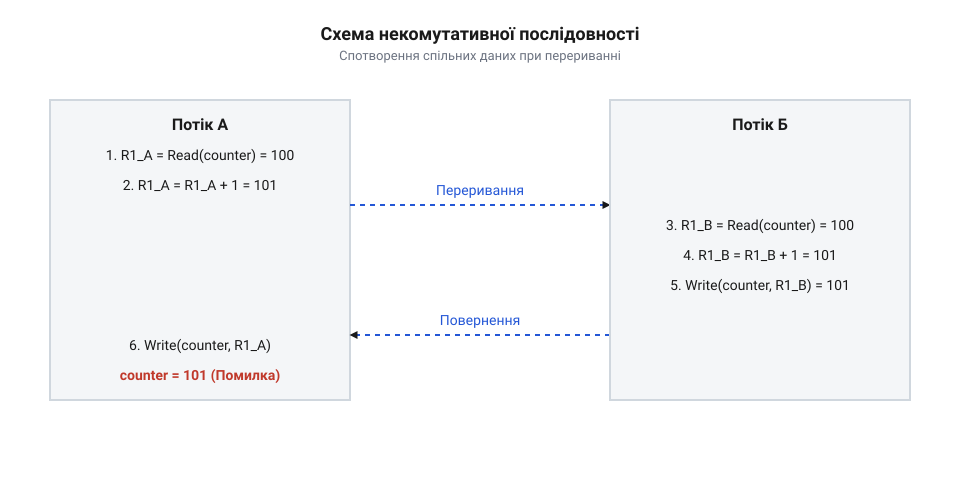

# Критичні секції

<preknowlist>
- [Перегони даних і замки](root:sf-tasks/data-races-locks) — поняття стану перегонів, некомутативності операцій та базової потреби у взаємному виключенні
- [Спін-замок](root:sf-tasks/spinlock) — концепція активного очікування та принцип апаратного тестування зі встановленням
</preknowlist>

## Переривання некомутативних операцій над спільним станом

У програмуванні високого рівня вирази на кшталт `counter++` або `balance += 100` створюють хибне враження єдиного, неподільного кроку. Однак для центрального процесора (від англійського @@en|Central Processing Unit@@, CPU) ця дія розпадається на послідовність машинних інструкцій: зчитати значення зі спільної пам'яті у локальний регістр (від пізньолатинського @@la|registrum@@ — списочний запис), модифікувати його в арифметично-логічному пристрої та записати обчислений результат назад у пам'ять. Цей трикроковий цикл називається операцією зчитування-модифікації-запису (від англійського @@en|read-modify-write@@, RMW). Небезпека виникає тоді, коли дана послідовність є некомутативною (від латинського @@la|commutatio@@ — зміна, перестановка). Некомутативність означає, що кінцевий стан системної пам'яті кардинально залежить від того, в якому саме порядку виконуються часткові кроки двох або більше паралельних виконавців. Якщо один виконавець прочитав проміжне значення до того, як інший завершив свій запис, системний стан неминуче спотворюється.

Причина спотворення полягає у відсутності атомарності (від грецького @@el|atomos@@ — неподільний) машинного циклу на рівні шини пам'яті та регістрів. Навіть на одноядерному процесорі або у мікроконтролерному середовищі виконуваний код може бути перерваний асинхронно у будь-який момент між інструкціями зчитування та запису. Переривання (від англійського @@en|interrupt@@) відбувається з двох основних причин: через надходження сигналу від периферійного пристрою, яке запускає апаратний обробник переривань (від англійського @@en|interrupt handler@@), або через спрацьовування системного таймера, яке змушує планувальник (від англійського @@en|scheduler@@) операційної системи здійснити перемикання контексту (від латинського @@la|contextus@@ — з'єднання, зв'язок; від англійського @@en|context switch@@). У багатоядерних процесорних архітектурах із симетричною багатопроцесорністю (від англійського @@en|Symmetric Multiprocessing@@, SMP) некомутативні операції взагалі виконуються паралельно на фізично різних ядрах, що створює безпосередню конкуренцію за лінії кеш-пам'яті.

Покрокова механіка спотворення спільного стану ілюструється на прикладі двох паралельних виконавців — Потоку А та Потоку Б, які намагаються збільшити значення спільної змінної `counter`, що початково дорівнює `100`:

```
V_initial = 100

[Потік А]: R1_A = Read(counter)     [R1_A = 100]
[Потік А]: R1_A = R1_A + 1          [R1_A = 101, модифікація в регістрі]
-------------------- [Перемикання контексту планувальником] --------------------
[Потік Б]: R1_B = Read(counter)     [R1_B = 100, прочитано застаріле значення]
[Потік Б]: R1_B = R1_B + 1          [R1_B = 101]
[Потік Б]: Write(counter, R1_B)     [counter = 101 у пам'яті]
-------------------- [Повернення контексту Потоку А] --------------------
[Потік А]: Write(counter, R1_A)     [counter = 101 у пам'яті, оновлення Потоку Б втрачено!]
```

Після виконання двох операцій інкременту очікуване значення змінного стану мало б становити `102`. Проте через те, що Потік Б прочитав комірку пам'яті у момент, коли Потік А вже обчислив новий результат у своєму локальному регістрі, але ще не записав його в оперативну пам'ять, відбулася втрата даних. Потік А після повернення контексту перезаписав збережений результат Потоку Б своїм застарілим значенням.

Небезпека некомутативних послідовностей наочно демонструється на часовій діаграмі переривання RMW-циклу.


*Часова діаграма некомутативної операції зчитування, модифікації та запису з перериванням обробником або планувальником.*

У багаторівневих програмах проблема поглиблюється оптимізаціями компілятора та позачерговим виконанням інструкцій процесором. Компілятор C або C++, не маючи інформації про паралельні виконавчі контексти, може кешувати значення змінної у регістрі процесора на тривалий час або винести її зчитування за межі циклу. У результаті інші потоки або обробники переривань бачитимуть не лише проміжні, а й повністю застарілі дані. Ситуація, в якій коректність обчислень залежить від відносного часу або послідовності виконання інструкцій декількома потоками, називається станом гонитви (від англійського @@en|race condition@@). Якщо при цьому щонайменше один виконавець здійснює запис без синхронізації, виникають руйнівні [стан гонитви та псування пам'яті](root:sf-tasks/data-races-locks), які призводять до невизначеної поведінки системи.

Некомутативність незахищених операцій у програмуванні простору користувача демонструє практичний приклад конкурентного інкрементування лічильника з кількох потоків:

:::tabs
@tab C
:::code root\eng\sf-tasks\critical-sections/critical-sections-d/c/unsafe-increment.c c
@tab C++
:::code root\eng\sf-tasks\critical-sections/critical-sections-d/cpp/unsafe-increment.cpp cpp
:::

Використання ключового слова `volatile` у мові C чи звичайного оголошення у C++ не здатне забезпечити атомарність операції `++global_counter`. Без спеціальних апаратних бар'єрів проміжний стан відкритий для інших виконавців, що викликає потребу застосування ізольованих примітивів або [апаратних атомарних інструкцій](root:sf-tasks/lock-free-atomic-primitives).

## Апаратна та програмна природа критичної секції

Усвідомлення неминучості спотворення даних при некомутативних операціях привело системну інженерію до концепції критичної секції (від латинського @@la|criticus@@ — вирішальний, та @@la|sectio@@ — розріз, частина). Критична секція — це ділянка коду, в якій здійснюється доступ до спільного змінюваного ресурсу і яка повинна виконуватися як єдиний неподільний блок щодо інших паралельних виконавців. Системне призначення критичної секції полягає у забезпеченні взаємного виключення (від англійського @@en|mutual exclusion@@, звідси назва примітиву @@en|mutex@@): якщо один виконавець перебуває всередині критичної секції, жоден інший потік, процес чи обробник переривань не має права входити у власну критичну секцію, яка звертається до того самого ресурсу.

Фундаментальні теорії взаємного виключення були вперше сформульовані Едсгером Дейкстрою (від нідерландського @@nl|Edsger Dijkstra@@) у 1960-х роках. За формалізацією Дейкстри, коректна реалізація критичної секції зобов'язана виконувати чотири обов'язкові критерії: по-перше, гарантувати строге взаємне виключення; по-друге, забезпечувати прогрес (жоден процес поза критичною секцією не може блокувати інші вхідні потоки); по-третє, гарантувати обмежене очікування (жоден потік не повинен чекати на вхід нескінченно, що виключає голодування); по-четверте, функціонувати незалежно від відносної швидкості та кількості процесорів. У ранніх обчислювальних системах за відсутності атомарних інструкцій взаємне виключення будувалося виключно програмно (алгоритми Деккера та Петерсона). З появою симетричних багатопроцесорних систем (SMP) стався еволюційний перехід до апаратно забезпечуваних атомарних примітивів — інструкцій перевірки зі встановленням (від англійського @@en|Test-and-Set@@, TAS), порівняння з обміном (від англійського @@en|Compare-and-Swap@@, CAS) та зв'язаного зчитування із умовним записом (від англійського @@en|Load-Link/Store-Conditional@@, LL/SC). У ядрах операційних систем це дозволило перейти від грубих глобальних системних блокувань (від англійського @@en|Giant Lock@@) до дрібногранулярних спинлоків, м'ютексів та високомасштабованих методів безблокового зчитування, таких як механізм [синхронізації через RCU](root:sys-unix/rcu-read-copy-update).

Реалізація гарантій критичної секції залежить від рівня системного стека, в якому виконується код. На найнижчому рівні — у мікроконтролерах (від англійського @@en|bare-metal@@) та обробниках переривань — взаємне виключення досягається шляхом апаратного маскування переривань (від англійського @@en|interrupt masking@@). Процесор вимикає генерацію подій периферії або підвищує поріг пріоритету переривань, зберігаючи значення системних регістрів (наприклад, `PRIMASK` в архітектурі ARM Cortex-M або прапорець `IF` у x86). Це гарантує, що поточна послідовність інструкцій не буде перервана асинхронним обробником. Систематизований огляд цих регістрів і команд наведено у довіднику з [інтерфейсу маскування переривань](root:sf-tasks/critical-sections/api-baremetal-interrupt-masking-interface.md).

У ядрах операційних систем (від англійського @@en|OS Kernel@@) маскування переривань застосовується лише для коротких операцій на локальному ядрі. Для багатоядерних систем цього недостатньо, оскільки інші ядра продовжують виконувати код паралельно. Тому в ядрі використовують вимкнення витіснення (від англійського @@en|preemption disable@@) у поєднанні з апаратними блокуваннями активного очікування, такими як [примітив спін-замка](root:sf-tasks/spinlock). Спін-замок циклічно опитує атомарний прапорець у пам'яті доти, доки критична секція не звільниться.

У просторі користувача (від англійського @@en|User Space@@) апаратне маскування переривань заборонене з міркувань безпеки та стабільності системи. Тут критичні секції реалізуються через примітиви синхронізації ОС — м'ютекси (від англійського @@en|mutex@@) та системні виклики підключення потоків до черг очікування (наприклад, `futex` у Linux). Коли потік намагається увійти у зайняту критичну секцію, операційна система переводить його у стан сну, вивільняючи процесорне ядро для інших задач. Детальний довідник викликів та функцій бібліотек містить [системний інтерфейс критичних секцій](root:sf-tasks/critical-sections/api-rtos-and-posix-critical-section-interface.md).

Зіставляючи всі рівні виконання, системний стек захисту критичних секцій має вигляд чіткої ієрархії.


*Ієрархічний графік системного стека із зіставленням примітивів взаємного виключення на рівнях hardware, OS kernel та user space.*

При проектуванні систем критично важливо розрізняти просторові та часові межі критичної секції. Просторові межі визначають точний діапазон синтаксичних інструкцій коду, захищених блокуванням. Часові межі (тривалість утримання) вимірюються кількістю тактів процесора або мікросекундами від моменту захоплення примітиву до його звільнення. Головне правило оптимізації полягає в мінімізації часу перебування всередині критичної секції. Всередині захищеного блоку суворо заборонено виконувати довготривалі операції вводу-виводу (I/O), виклики мережевих протоколів, виділення динамічної пам'яті або взаємодію з іншими блокуваннями, оскільки це призводить до порушення системного дедлайна, збоїв детермінізму реального часу та небезпечних блокувань навхрест.

У сучасному мовному програмуванні простору користувача гарантія виходу з критичної секції за будь-яких умов (включно із винятками) досягається за допомогою паттерна RAII (від англійського @@en|Resource Acquisition Is Initialization@@ — отримання ресурсу є ініціалізацією). Нижче наведено ідіоматичні приклади захисту критичних секцій у C та C++:

:::tabs
@tab C
:::code root\eng\sf-tasks\critical-sections/critical-sections-d/c/safe-counter-init.c c
@tab C++
:::code root\eng\sf-tasks\critical-sections/critical-sections-d/cpp/safecounter.cpp cpp
:::

Використання RAII-обгорток гарантує парність операцій захоплення та вивільнення замка, запобігаючи виникненню небезпечних витоків блокувань.

## Механізми взаємного виключення на рівнях стека

Захист критичної секції не є універсальним алгоритмом одного вигляду, що застосовується у будь-якому програмному середовищі. Найдешевші й найефективніші механізми взаємного виключення визначаються тим рівнем виконання системного стека, на якому функціонує конкретний код. На найнижчому апаратному рівні — у мікроконтролерах (від англійського @@en|bare-metal@@) та автономних пристроях без операційної системи — основним джерелом конкуренції за спільний стан є асинхронні обробники переривань. Оскільки у таких системах відсутні інші потоки чи ядра процесора, критична секція виникає в місці перетину основного циклу програми та процедури обслуговування переривань (від англійського @@en|Interrupt Service Routine@@, ISR). Гарантія неподільності операцій RMW досягається шляхом апаратного маскування переривань (від англійського @@en|interrupt masking@@). Процесор тимчасово блокує реакцію на зовнішні сигнальні лінії або піднімає поріг пріоритету переривань.

Однак пряме вимкнення переривань ховає в собі системну пастку при вкладених викликах критичних секцій. Якщо внутрішній функціональний блок просто безумовно ввімкне переривання при виході, він порушить ізоляцію зовнішньої критичної секції, яка все ще розраховує на вимкнений стан переривань. Для збереження детермінізму апаратний механізм мусить обов'язково зберігати поточний стан маски чи регістру прапорців процесора перед вимкненням і відновлювати саме збережене значення при виході з секції. Наприклад, в архітектурі ARM Cortex-M для цього використовується регістр `PRIMASK`, у RISC-V — біт `MIE` у регістрі `mstatus`, а в архітектурі x86 — прапорець `IF` регістру `EFLAGS`. Повний довідник процесорних команд та регістрів керування маскуванням розкриває низькорівневий [маскування апаратних переривань](root:sf-tasks/critical-sections/api-baremetal-interrupt-masking-interface.md).

На рівні ядра операційної системи (від англійського @@en|OS Kernel@@) або в середовищах реального часу (від англійського @@en|Real-Time Operating System@@, RTOS) одного маскування переривань вже недостатньо, якщо система працює на багатоядерному процесорі. У одноядерному ядрі взаємне виключення критичних секцій забезпечується тимчасовим вимкненням витіснення (від англійського @@en|preemption disable@@). Планувальник операційної системи втрачає можливість примусово переключити поточний контекст на іншу задачу, поки потік знаходиться всередині критичної секції. Проте в симетричних багатопроцесорних системах (SMP) інші процесорні ядра продовжують паралельно виконувати код. Для захисту між’ядерного спільного стану ядро комбінує вимкнення витіснення на локальному ядрі із залученням [примітив спін-замка](root:sf-tasks/spinlock) (від англійського @@en|spinlock@@). Спін-замок реалізує активне очікування (від англійського @@en|busy waiting@@): потік циклічно виконує атомарну інструкцію перевірки та запису у комірці пам'яті доти, доки замок не вивільниться. Оскільки очікування споживає процесорний час та електроенергію, спін-замки застосовуються виключно для надкоротких критичних секцій, де тривалість блокування менша за накладні витрати перемикання контексту. Якщо ж обробка ресурсу вимагає тривалого часу або зачіпає операції зчитування, системні ядра переходять до використання масштабованих підходів, таких як [механізм RCU-синхронізації](root:sys-unix/rcu-read-copy-update) чи спільних блокувань.

У просторі користувача (від англійського @@en|User Space@@) привілейовані інструкції маскування переривань та вимкнення витіснення є недоступними з міркувань безпеки та захисту пам'яті. Синхронізація потоків користувача покладається на примітиви ОС — м'ютекси (від англійського @@en|mutex@@). М'ютекс поєднує в собі швидку перевірку у просторі користувача через атомарну інструкцію порівняння з обміном (від англійського @@en|Compare-and-Swap@@, CAS) із переведенням потоку в стан сну у ядрі ОС, якщо замок виявився зайнятим. У системі Linux цей двофазний механізм реалізовано через системний виклик `futex` (від англійського @@en|fast userspace mutex@@). Очікуючи вивільнення м'ютекса, потік не витрачає тактів CPU, а віддає ядро процесора іншим задачам. Для автоматизації управління життям м'ютексів у мовах високого рівня вживаються RAII-обгортки (від англійського @@en|Resource Acquisition Is Initialization@@, RAII), які здійснюють захоплення замка при ініціалізації об'єкта та його обов'язкове вивільнення у деструкторі при виході з зони видимості. Систематизований перелік системних викликів та функцій стандарту POSIX наводить [системний інтерфейс критичних секцій](root:sf-tasks/critical-sections/api-rtos-and-posix-critical-section-interface.md), а практичне профілювання цих примітивів містить [тестовий стенд профілювання](root:sf-tasks/critical-sections/proj-cpp-raii-spinlock-mutex-benchmarking.md).

Вибір конкретного примітиву взаємного виключення залежить від трьох ключових факторів: системного рівня виконання коду, контексту (чи дозволено потоку спати) та тривалості критичної секції. Логіка вибору примітиву подана на блок-схемі інженерного рішення.


*Блок-схема прийняття інженерного рішення щодо вибору примітиву взаємного виключення залежно від тривалості секції та контексту виконання.*

Демонстрація реалізації низькорівневого маскування переривань на мікроконтролері ARM Cortex-M та RAII-захисту м'ютекса у просторі користувача відображає різницю підходів на різних рівнях стека:

:::tabs
@tab C|bare-metal
:::code root\eng\sf-tasks\critical-sections/critical-sections-d/c/--get-primask.c c
@tab C++|rtos
:::code root\eng\sf-tasks\critical-sections/critical-sections-d/cpp/safedatabuffer.cpp cpp
:::

Повний приклад реалізації низькорівневих модулів для мікроконтролерів деталізує [модуль захисту ресурсів](root:sf-tasks/critical-sections/proj-baremetal-and-rtos-critical-sections.md).

## Порушення детермінізму та затримки реального часу

Використання примітивів взаємного виключення гарантує атомарність і коректність даних, але платою за це є негативний вплив на часові характеристики та детермінізм (від латинського @@la|determinatus@@ — визначений) всієї системи. Кожного разу, коли потік або обробник утримує блокування, він створює часовий бар'єр для інших задач. У системах реального часу (від англійського @@en|Real-Time Systems@@) найбільшу небезпеку становить латентність переривань (від латинського @@la|latens@@ — прихований; @@en|interrupt latency@@) — це проміжок часу від моменту виникнення апаратного сигналу периферійного пристрою до початку виконання першої інструкції його обробника. Якщо критична секція виконується з маскуванням переривань, апаратний сигнал буде затримано на весь час перебування коду всередині цієї секції. Непередбачувані коливання цього часу створюють часовий джитер (від англійського @@en|time jitter@@) — відхилення фактичного моменту реакції системи від строго розрахованого дедлайна.

Для розрахунку максимального часу відгуку задачі у системах реального часу застосовують математичну модель затримок. Нехай обчислюється найгірший час відгуку `R_i` для задачі з індексом `i` (позначимо `R_i`). Він складається з власного часу виконання задачі `C_i` (позначимо `C_i`), максимальної затримки блокування `B_i` (позначимо `B_i`), спричиненої критичними секціями задач нижчого пріоритету, та суммарної затримки `I_i` (позначимо `I_i`) від витіснення задачами вищого пріоритету та маскування переривань:

```
R_i = C_i + B_i + I_i
```

Значення `B_i` напряму визначається найдовшою критичною секцією у системі, яка утримує спільний замок. Якщо критична секція розтягнута у часі, величина `B_i` зростає, що може призвести до перевищення системного дедлайна `R_i > D_i` та аварійної відмови системи реального часу. Повний математичний апарат розрахунку подано у праці щодо [розрахунку часу відгуку](root:sf-tasks/critical-sections/math-realtime-latency-and-jitter.md).

У багатозадачних середовищах із пріоритетним плануванням виключення переривань або утримання м'ютекса викликає класичну системну патологію — інверсію пріоритетів (від латинського @@la|inversio@@ — перевертання; @@en|priority inversion@@). Поточна ситуація виникає тоді, коли низькопріоритетний потік L захоплює м'ютекс спільного ресурсу. У цей момент з'являється високопріоритетний потік H, якому потрібен той самий ресурс. Потік H блокується на м'ютексі й переходить у стан очікування. Якщо в цей же час активізується потік середнього пріоритету M, який взагалі не використовує даний ресурс, планувальник витісняє низькопріоритетний потік L, оскільки пріоритет M вищий за L. У результаті потік L не може завершити критичну секцію й віддати замок, а високопріоритетний потік H змушений чекати, поки потік M не виконає свою роботу. Потік середнього пріоритету фактично блокує потік найвищого пріоритету. Для подолання цього лиха застосовуються [протоколи успадкування пріоритетів](root:sf-tasks/priority-protocols) (від англійського @@en|Priority Inheritance Protocol@@, PIP) та протокол стелі пріоритетів (від англійського @@en|Priority Ceiling Protocol@@, PCP), за яких пріоритет потоку L тимчасово піднімається до пріоритету потоку H на час утримання замка.

Другою фундаментальною небезпекою утримання кількох блокувань є взаємне блокування або дедлок (від англійського @@en|deadlock@@). Якщо потік A захоплює замок 1 і намагається отримати замок 2, а потік B одночасно захопив замок 2 і очікує на замок 1, обидва виконавці застрягають назавжди. Уникнення дедлоків вимагає строгого дотримання ієрархії захоплення замків або використання викликів спроби захоплення з таймаутом (наприклад, `pthread_mutex_trylock`).

Процеси часового відгуку, зростання латентності та явище інверсії пріоритетів наочно показано на часовій діаграмі.


*Часова діаграма системного відгуку з демонстрацією латентності переривань та явища інверсії пріоритетів під час утримання блокування.*

У багатопроцесорних та багатоядерних системах висока конкуренція (від англійського @@en|lock contention@@) за критичні секції створює фізичний бар'єр масштабованості продуктивності, який описується законом Амдала (від англійського @@en|Amdahl's law@@). Закон математично визначає граничне прискорення програми `S` (позначимо `S`) залежно від кількості процесорних ядер `p` (позначимо `p`) та частки послідовного коду `s` (позначимо `s`), який виконується всередині критичних секцій:

```
S(p) = 1 / (s + (1 - s) / p)
lim_{p -> inf} S(p) = 1 / s      [граничне прискорення при безкінечних ядрах]
```

З формули видно, що якщо у програмі лише 10% коду (`s = 0.1`) виконується всередині послідовних критичних секцій, максимальне прискорення системи ніколи не зможе перевищити 10 разів, навіть якщо залучити тисячу процесорних ядер. Детальний аналіз оцінює праця щодо [оцінки масштабованості коду](root:sf-tasks/critical-sections/math-amdahl-law-and-contention-scaling.md).

На апаратному рівні конкуренція за критичну секцію викликає фізичну деградацію шини пам'яті через явище биття кеш-ліній (від англійського @@en|cache line bouncing@@). Коли багато ядер процесора одночасно намагаються виконати атомарну інструкцію CAS над однаковим спін-замком, кожна спроба запису змушує протокол когерентності кешу (наприклад, MESI) анулювати дану кеш-лінію в кешах усіх інших ядер. У результаті ця лінія кеш-пам'яті безперервно перекачується між ядрами через системну шину, блокуючи пропускну здатність процесорного інтерконнекту.

Схема передачі та анулювання ліній кеш-пам'яті при багатоядерній конкуренції подана на фігурі нижче.


*Модель когерентності кеш-пам'яті багатоядерного процесора при конкуренції за критичну секцію.*

Фізичні накладні витрати когерентності детально висвітлює праця про [явище биття кеш-ліній](root:hw-arch/cache-coherence-and-line-bouncing). Щоб мінімізувати вплив часового джитера, дедлоків та биття кешу, сучасному інженеру слід скорочувати просторові й часові межі критичних секцій, виносити блокувальні операції за їхні межі або переходити до застосування [замків читачів-письменників](root:sf-tasks/readers-writer-lock) та [безблоковими структурами даних](root:sf-tasks/lock-free-atomic-primitives).

## Фізичні обмеження масштабованості та когерентності кешу

Збільшення кількості процесорних ядер у сучасному обчислювальному обладнанні здається найпростішим шляхом підвищення загальної продуктивності програми. Проте паралельне виконання коду натикається на непоборне фізичне обмеження: наявність критичних секцій для захисту спільного стану. Коли один потік утримує взаємне виключення, усі інші потоки, що звертаються до цього ж ресурсу, змушені чекати. Це перетворює паралельну обробку на строго послідовне виконання, зводячи нанівець обчислювальний потенціал додаткових ядер.

Для математичної оцінки теоретичного прискорення паралельних систем залежно від обсягу послідовних обчислень застосовується @@en|Amdahl's law@@ (від імені комп'ютерного архітектора Джина Амдала, @@en|Gene Amdahl@@). Позначимо через `N` кількість доступних процесорних ядер, через `p` — частку алгоритму, яка виконується повністю паралельно (де `0 ≤ p ≤ 1`), а через `1 - p` — частку коду, затиснуту у критичних секціях чи процедурах синхронізації, що виконується строго послідовно.

Тоді підсумковий коефіцієнт прискорення обчислень `S(N)` описується виразом:

```
S(N) = 1 / ((1 - p) + p / N)
```

Якщо кількість процесорних ядер у системі зростає до нескінченності (`N → ∞`), паралельний компонент `p / N` нівелюється та прямує до нуля. У цьому граничному випадку рівняння набуває вигляду:

```
S(N) = 1 / ((1 - p) + p / N)
     = 1 / (1 - p)                [гранична межа при N → ∞]
```

Звідси випливає фундаментальний висновок: максимальне теоретичне прискорення паралельної програми обмежене виключно тривалістю її послідовної частини. Якщо критичні секції займають хоча б `5%` від загального часу виконання програми (`1 - p = 0.05`), підсумкове прискорення системи не зможе перевищити `1 / 0.05 = 20` разів, незалежно від того, чи має процесор 32, 128 чи тисячу ядер. Детальні розрахунки втрат продуктивності від конкуренції за блокування описує [модель закону Амдала](root:sf-tasks/critical-sections/math-amdahl-law-and-contention-scaling.md), яка показує нелінійне падіння пропускної здатності при збільшенні кількості паралельних потоків.

Закон Амдала у класичній формі описує ідеальну математичну модель, припускаючи, що самі операції захоплення та звільнення замків виконуються безкоштовно. У реальних симетричних багатопроцесорних архітектурах (@@en|SMP@@, англ. *Symmetric Multiprocessing* — симетричне багатопроцесування) додається ще один вагомий фізичний фактор — накладні витрати на підтримання когерентності кеш-пам'яті (@@en|Cache Coherence@@, англ. *cache* — сховище, *coherence* — зв'язність).

Кожне процесорне ядро оснащене персональними кешами першого та другого рівнів (L1 та L2). Для того щоб усі ядра бачили єдину узгоджену картину оперативної пам'яті, апаратна частина процесора використовує [апаратний протокол когерентності](root:hw-arch/cache-coherence-and-line-bouncing) (наприклад, @@en|MESI protocol@@, названий за чотирма станами кеш-рядка: @@en|Modified@@ — змінено, @@en|Exclusive@@ — ексклюзивно, @@en|Shared@@ — спільно, @@en|Invalid@@ — недійсно). Пам'ять передається між кешами та процесорними ядрами не окремими байтами, а кеш-рядками (@@en|Cache Line@@) фіксованого розміру, який у більшості сучасних архітектур становить 64 байти.

Коли потік на ядрі 1 захоплює замок або модифікує спільний стан усередині критичної секції, він записує нове значення у свій локальний L1-кеш. Відповідний кеш-рядок переходять у стан `Modified`. Апаратний контролер когерентності негайно генерує сигнал інвалідації та транслює його через міжпроцесорну шину (наприклад, @@en|Ultra Path Interconnect@@ або @@en|Infinity Fabric@@) усім іншим ядрам. Інші ядра, які до цього мали копію цього кеш-рядка у стані `Shared`, примусово переводять свої локальні копії у стан `Invalid`.

Якщо потік на ядрі 2 намагається виконати атомарну інструкцію над цим же замком або прочитати оновлені дані, у його кеші відбувається промах (@@en|Cache Miss@@). Конвеєр інструкцій ядра 2 повністю зупиняється. Контролер пам'яті змушений призупинити виконання коду та організувати фізичну передачу зміненого кеш-рядка з кешу ядра 1 до кешу ядра 2 через міжпроцесорне з'єднання.

Постійне фізичне переміщення кеш-рядка між L1/L2-кешами різних ядер процесора називається @@en|Cache Line Bouncing@@ (англ. *cache* — сховище, *line* — рядок, *bounce* — відбиватися). Кожен такий «відскок» викликає апаратну затримку у 50–200 тактів процесора. За умов високої конкуренції (@@en|Contention@@) за [стан гонитви та замки](root:sf-tasks/data-races-locks) процесорні ядра витрачають переважну більшість часу не на виконання корисної логіки програми, а на очікування інвалідації та передачі кеш-рядків між ядрами. Через це крива реально виміряної продуктивності при додаванні нових ядер після досягнення певної межі стрімко падає вниз.


*Схема передачі кеш-рядка між L1/L2 кешами ядер процесора при зміні стану за протоколом MESI.*

Окремим прихованим джерелом зниження швидкодії є @@en|False Sharing@@ (англ. *false* — хибний, *sharing* — спільне використання). Воно виникає тоді, коли дві повністю незалежні змінні, що використовуються різними потоками і не мають між собою логічного стану перегонів, фізично розташовані поруч на одному й тому самому 64-байтовому кеш-рядку.

Коли ядро 1 модифікує свою змінну A, апаратний контролер інвалідує весь кеш-рядок. Ядро 2, яке працює зі змінною B і навіть не підозрює про існування змінної A, отримує промах кешу та змушене перезавантажувати весь рядок з міжпроцесорної шини. Для боротьби з хибним розшаруванням застосовують примусове вирівнювання структур за межею кеш-рядка (`alignas(64)`) та додавання порожнього проміжного простору (@@en|Padding@@).

:::tabs
:::code root\eng\sf-tasks\critical-sections/critical-sections-d/c/unalignedcounters.c c
:::code root\eng\sf-tasks\critical-sections/critical-sections-d/cpp/badstate.cpp cpp
:::

## Вибір примітивів та оптимізація межі захисту

Розуміння часових та фізичних обмежень блокувань дозволяє перейти від пасивного застосування замків до свідомого проективання ефективних критичних секцій. Головна мета оптимізації полягає у двох інженерних принципах: мінімізації часу утримання блокування та виборі найменш витратного примітива синхронізації для конкретного середовища виконання.

Найпоширенішою помилкою при розробці паралельних систем є необґрунтоване розширення меж критичної секції. Включення у захищений блок операцій виділення пам'яті (`malloc`/`operator new`), системних викликів введення-виведення (читання диска, мережевий socket I/O), форматування рядків, логування або складних математичних розрахунків призводить до того, що замок утримується тисячі тактів процесора замість кількох наносекунд.

Оптимальна побудова критичної секції вимагає суворого виведення всіх підготовчих та завершальних операцій за межі взаємного виключення:

1. **Локальна підготовка**: Всі необхідні обчислення, виділення пам'яті та форматування даних виконуються локально у стеку потоку до захоплення замка. 2. **Атомарний захват і передача**: Потік входить у критичну секцію, виконує лише швидку некомутативну операцію (наприклад, копіювання вказівника або оновлення лічильника) і негайно залишає її. 3. **Постобробка**: Системний виклик I/O, сповіщення інших потоків або логування здійснюються поза межами блокування.


*Порівняння часового профілю виконання широкої та звуженої критичної секції.*

При виборі конкретного примітива взаємного виключення слід керуватися архітектурними характеристиками системи та часовим масштабом критичної секції:

- **Апаратні переривання та мікроконтролери (Bare-Metal)**:
  У коді обробників переривань (@@en|ISR@@, англ. *Interrupt Service Routine*) чи в одноядерних мікроконтролерах без операційної системи класичні замки не працюють. Для захисту спільного стану застосовується [маскування переривань процесора](root:sf-tasks/critical-sections/api-baremetal-interrupt-masking-interface.md) шляхом збереження та відновлення регістру прапорців (наприклад, `PRIMASK` в ARM Cortex-M). Для складніших систем реального часу розробляють уніфікований [модуль захисту ресурсів RTOS](root:sf-tasks/critical-sections/proj-baremetal-and-rtos-critical-sections.md), який коректно ізолює критичний код як у Bare-Metal, так і під керуванням @@en|RTOS@@ (англ. *Real-Time Operating System*).

- **Наносекундні критичні секції у багатоядерних системах**:
  Якщо тривалість критичної секції не перевищує кількох десятків наносекунд (менше за час двох перемикань контексту планувальника, який становить ~1–2 мікросекунди), виклик системного м'ютексу створює надмірні накладні витрати. Тут доцільно використовувати [механізми спін-замків](root:sf-tasks/spinlock) (@@en|Spinlock@@, англ. *spin* — обертатися, *lock* — замок), де потік чекає на дозвіл у короткому циклі активного опитування.

- **Мікросекундні та тривалі блокування у просторі користувача**:
  Якщо критична секція виконує обсяжну роботу або може заблокуватися на очікуванні ресурсу, активне очікування призведе до марного спалювання процесорного часу. Необхідно застосовувати @@en|Mutex@@ (англ. *mutual exclusion* — взаємне виключення). Системні особливості їхньої роботи висвітлює [системний інтерфейс критичних секцій](root:sf-tasks/critical-sections/api-rtos-and-posix-critical-section-interface.md). М'ютекс переводить потік у стан сну при виникненні конкуренції, віддаючи процесорне ядро іншим задачам. У системах реального часу для запобігання інверсії пріоритетів м'ютекс має підтримувати [протоколи успадкування пріоритетів](root:sf-tasks/priority-protocols). Вплив тривалості блокування на дедлайни розраховує [математична модель часового джитера](root:sf-tasks/critical-sections/math-realtime-latency-and-jitter.md).

- **Переважання операцій зчитати над записати**:
  У сценаріях, де зчитування даних відбувається у сотні разів частіше за оновлення, звичайний м'ютекс стає пляшковим горлом. Оптимальним рішенням є [замки з множинним зчитуванням](root:sf-tasks/readers-writer-lock) (@@en|Shared Mutex@@), а у високомасштабованих ядрах ОС — [механізм зчитування та оновлення](root:sys-unix/rcu-read-copy-update) (@@en|RCU@@, англ. *Read-Copy-Update*), який дозволяє потокам-читачам зчитувати дані взагалі без затримок та блокувань.

- **Прості атомарні лічильники та прапорці**:
  Коли весь спільний стан виражається єдиним числом або вказівником, критична секція із м'ютексом є надлишковою. Замість замків слід застосовувати [безблокові атомарні примітиви](root:sf-tasks/lock-free-atomic-primitives) на базі інструкцій `Compare-And-Swap` (@@en|CAS@@).

При написанні коду у мовах високого рівня (зокрема C++) ручний виклик функцій `lock()` та `unlock()` є джерелом критичних помилок. Якщо всередині критичної секції згенерується виняток (@@en|Exception@@) або відбудеться раннє повернення через `return`, виклик `unlock()` буде пропущено, що призведе до вічного заблокування системи (@@en|Deadlock@@, англ. *dead* — мертвий, *lock* — замок).

Для гарантії виняткобезпечності обов'язково застосовують паттерн @@en|RAII@@ (англ. *Resource Acquisition Is Initialization* — отримання ресурсу є ініціалізація). Конструктор RAII-обгортки захоплює замок при створенні об'єкта на стеку, а деструктор гарантовано звільняє його при виході з області видимості. Профілювання та вимірювання швидкодії таких обгортків демонструє [тестовий стенд RAII-примітивів](root:sf-tasks/critical-sections/proj-cpp-raii-spinlock-mutex-benchmarking.md).

:::tabs
:::code root\eng\sf-tasks\critical-sections/critical-sections-d/c/process-bad.c c
:::code root\eng\sf-tasks\critical-sections/critical-sections-d/cpp/safedatabuffer-2.cpp cpp
:::