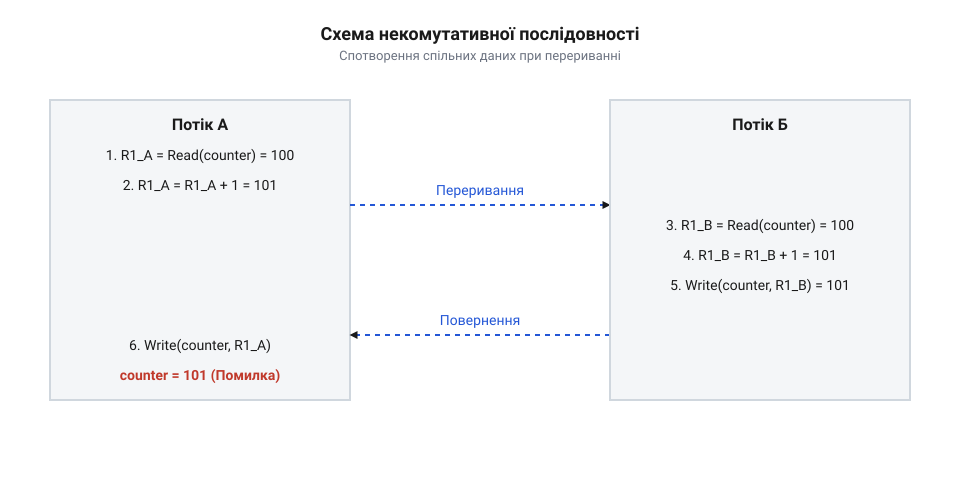

## Переривання некомутативних операцій над станом

Вираз `counter++` здається неподільним, але процесор виконує його в три кроки: зчитати з пам'яті в регістр, змінити в обчислювачі й записати назад. Це операція зчитування-модифікації-запису — @@en|read-modify-write@@ (від англ. *read* — читати, *modify* — змінювати, *write* — писати; RMW). Вона некомутативна (від лат. *commutatio* — зміна): результат у пам'яті залежить від порядку кроків виконавців.

Коли під час обчислення в регістрі першого потоку стається переривання чи вичерпується квант часу, планувальник здійснює перемикання контексту — @@en|context switch@@ (від лат. *contextus* — з'єднання та англ. *switch* — перемикання). Другий потік зчитує з пам'яті ще не змінене число, модифікує його та записує результат. Відновившись, перший потік записує в комірку власний результат, обчислений із застарілих даних. Оновлення другого потоку втрачається.

*Підпис: Асинхронне витіснення потоку між зчитуванням і записом пам'яті руйнує спільний стан.*

Залежність результату від збігу часових інтервалів зветься станом гонитви — @@en|race condition@@ (від давньоангл. *rǣs* — біг та лат. *condicio* — умова). Без ізоляції некомутативні послідовності неминуче спричиняють [руйнівні перегони даних](root:sf-tasks/data-races-locks).

## Взаємне виключення на рівнях стека

Щоб усунути збої, доступ до спільного ресурсу ізолюють у неподільний блок — @@en|critical section@@ (від грец. *kritikos* — вирішальний та лат. *sectio* — частина). Вона базується на взаємному виключенні — @@en|mutual exclusion@@ (від лат. *mutuus* — взаємний та *excludere* — витісняти): доки один виконавець перебуває всередині секції, інші не мають туди доступу.

Захист секції залежить від рівня стека. У мікроконтролерах застосовують апаратне маскування переривань — @@en|interrupt masking@@ (від лат. *interrumpere* — розривати та франц. *masque* — прикриття): процесор тимчасово вимикає прийом сигналів через системні регістри, блокуючи запуск обробників.

У ядрах багатоядерних систем вимикають витіснення задач і застосовують [активне очікування спін-замка](root:sf-tasks/spinlock) — @@en|spinlock@@ (від англ. *spin* — обертатися та *lock* — замок), який циклічно опитує прапорець у пам'яті.

У просторі користувача доступ до маскування заборонений. Секції охороняє м'ютекс — @@en|mutex@@ (скорочення від @@en|mutual exclusion@@). Зайнятий м'ютекс переводить потік у стан сну засобами операційної системи, віддаючи ядро іншим задачам.

*Підпис: Ієрархія взаємного виключення від маскування апаратних сигналів до системних м'ютексів.*

## Вплив блокувань на детермінізм і швидкодію

Блокування має відчутну часову ціну. Маскування переривань чи замок відкладають реакцію на події. Виникає латентність переривань — @@en|interrupt latency@@ (від лат. *latens* — прихований) — затримка від сигналу до старту обробника. Її коливання породжують часовий джитер — @@en|jitter@@ (від англ. *jitter* — тремтіти): розкид затримок реакції щодо дедлайна.

У пріоритетних планувальниках блокування спричиняє [явище інверсії пріоритетів](root:sf-tasks/priority-inversion) — @@en|priority inversion@@ (від лат. *prior* — перший та *inversio* — перевертання). Коли потік низького пріоритету тримає @@en|mutex@@, а його витісняє потік середнього пріоритету, високопріоритетна задача зависає в очікуванні ресурсу: другорядна робота блокує критичну.

*Підпис: Затримка обробки переривань та блокування високопріоритетної задачі через спільний замок.*

На багатоядерних процесорах закон Амдала — @@en|Amdahl's law@@ (від імені комп'ютерного інженера Gene Amdahl) обмежує прискорення: якщо частка коду в критичних секціях дорівнює `s`, прискорення не перевищить `1 / s`. Одночасні спроби захопити замок викликають биття кеш-ліній — @@en|cache line bouncing@@ (від англ. *bounce* — відбиватися): протокол когерентності безупинно ганяє рядок кешу між ядрами, перевантажуючи шину пам'яті.

## Оптимізація меж і вибір примітивів

Щоб блокування не знижувало швидкодію, межі критичної секції звужують. Неприпустимо тримати замок під час виділення пам'яті, обчислень чи вводу-виводу. Код будують у три кроки: підготувати дані у стеку, увійти в секцію для швидкої зміни стану й негайно вийти перед постобробкою.

*Підпис: Звуження часового вікна блокування шляхом винесення обчислень і операцій вводу-виводу.*

Примітив обирають за тривалістю: для наносекундних дій у ядрі беруть @@en|spinlock@@, для тривалих у просторі користувача — @@en|mutex@@. За переваги операцій зчитування монопольний замок замінюють на [замки читачів-письменників](root:sf-tasks/readers-writer-lock).

Для запобігання втраті замка при виході чи помилках застосовують паттерн @@en|RAII@@ (від англ. *Resource Acquisition Is Initialization* — захоплення ресурсу є ініціалізацією). Об'єкт-вартовий захоплює замок у конструкторі та гарантовано відпускає його в деструкторі при виході з області видимості.
