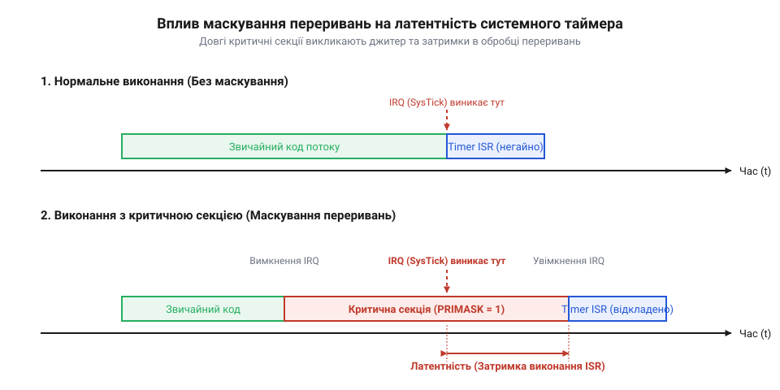

## Початкові концепції та фізичні принципи

Уявіть високошвидкісний контролер промислового двигуна, у якому аналогово-цифровий перетворювач генерує апаратне переривання кожні 50 мікросекунд для коригування струму обмоток. У цей же момент фонова задача оновлює двозв'язний список буфера діагностики. Якщо апаратне переривання спрацює посеред запису в пам'ять, коли вказівники вузлів виявилися частково переписаними, обробник переривання прочитає пошкоджену адресу, що призведе до аварійного перезавантаження процесора. Коли кілька паралельних потоків обчислень або апаратних джерел одночасно намагаються модифікувати спільні структури даних, у системі виникають [перегони даних і замки](root:sf-tasks/data-races-locks), що порушує детермінізм обчислень.

Для захисту спільних ресурсів використовується критична секція (від @@la|criticus@@ — вирішальний та @@la|sectio@@ — розріз, частина). Це спеціально позначена ділянка коду, виконання якої гарантує взаємне виключення (@@en|mutual exclusion@@): жоден інший потік чи апаратний обробник не може отримати доступ до того самого ресурсу, доки поточний виконавець не завершить операції.

На фізичному рівні @@en|мікроконтролер@@ (від @@el|mikros@@ — малий та @@en|controller@@ — управитель) складається з процесорного ядра, системи шин пам'яті, конвеєра інструкцій та контролера переривань. Звичайна операція модифікації змінної у мовах високого рівня виглядатиме як послідовність асемблерних команд: зчитування з пам'яті в регістр ядра, модифікація значення в арифметико-логічному пристрої та зворотний запис у пам'ять. Оскільки ця послідовність потребує кількох тактів процесора, вона не є атомарною. Якщо під час її виконання виникає апаратний сигнал, конвеєр процесора перериває поточну послідовність та зберігає регістровий контекст.

Найпростішим способом забезпечення ексклюзивності на одному процесорному ядрі є апаратне маскування переривань. Виконання спеціальної інструкції ядра маскує проходження сигналів від периферії (від @@el|periphereia@@ — окружність). Контролер переривань продовжує фіксувати зовнішні події та встановлювати відповідні прапори в регістрах, однак ядро процесора ігнорує ці запити до моменту скидання маски.

Тимчасова заборона переривань безпосередньо впливає на часові характеристики вбудованої системи. Час, протягом якого апаратне переривання очікує зняття маски для початку виконання свого обробника, утворює затримку (від @@la|latens@@ — прихований, @@en|latency@@). Оскільки тривалість перебування коду в критичній секції коливається залежно від гілок розгалуження, виникає непередбачуване тремтіння часу реакції — джитер (від @@en|jitter@@ — тремтіння).

Для забезпечення атомарності без глобального вимкнення переривань сучасні процесорні архітектури надають спеціальні апаратні інструкції ексклюзивного доступу до шини пам'яті та бар'єри пам'яті. Бар'єри змушують конвеєр процесора та буфери запису завершити всі поточні операції з шиною до переходу до наступної інструкції, гарантуючи послідовний @@en|детермінізм@@.


*Часова діаграма затримки реакції на апаратне переривання під час виконання критичної секції.*

## Внутрішня будова та алгоритми роботи

Програмна архітектура систем реального часу вимагає суворого математичного розрахунку часових меж, аби гарантувати відсутність пропущених дедлайнів. Опишемо математичну модель, яка пов'язує тривалість критичних секцій із затримками та джитером.

Назвемо використовувані величини словами: `L_{irq}` — затримка реакції на апаратне переривання, `T_{crit}` — тривалість критичної секції із вимкненими перериваннями, `T_{overhead}` — апаратні накладні витрати ядра на збереження контексту та перехід до вектора переривань. Максимальний час виконання критичної секції позначимо як `T_{crit}^{max}`, а мінімальний — як `T_{crit}^{min}`.

Формула розрахунку найгіршої затримки переривання дістається шляхом додавання найгіршого часу блокування переривань та апаратних витрат:

```
L_{irq}^{max} = T_{crit}^{max} + T_{overhead}
```

Вираз показує, що найгірший час реакції системного переривання прямо пропорційний максимальній тривалості критичної секції `T_{crit}^{max}`.

Для обчислення джитеру `J_{irq}`, який визначає величину тремтіння часу реакції, знайдемо різницю між найгіршою та найкращою затримкою:

```
J_{irq} = L_{irq}^{max} - L_{irq}^{min}
= (T_{crit}^{max} + T_{overhead}) - (T_{crit}^{min} + T_{overhead})    [підстановка виразів затримок]
= T_{crit}^{max} - T_{crit}^{min}                                       [скорочення однакових накладних витрат]
```

Отримана формула підтверджує, що @@en|джитер@@ переривань повністю визначається флуктуацією тривалості критичної секції `ΔT_{crit} = T_{crit}^{max} - T_{crit}^{min}`.

У операційних системах реального часу (RTOS) критичні секції захищаються не лише маскуванням переривань, а й примітивами синхронізації, такими як м'ютекс (від @@en|mutex@@, скорочення від @@en|mutual exclusion@@ — взаємне виключення). Якщо високопріоритетна задача очікує звільнення м'ютексу, який утримується низькопріоритетною задачею, виникає інверсія пріоритетів (від @@la|inversio@@ — перевертання, @@en|priority inversion@@). Для запобігання неконтрольованому заблокуванню застосовують [протокол успадкування пріоритетів](root:sf-tasks/priority-inheritance-protocol).

Позначимо `lp(i)` як множину завдань із нижчим пріоритетом за `τ_i`, а `res(i, j)` як множину спільних ресурсів, які використовуються завданням `τ_i` та нижчестоящим завданням `τ_j`. Символом `C_{j,k}` позначимо максимальний час виконання критичної секції завдання `τ_j` під підхопленим ресурсом `k`.

Максимальний час блокування завдання `B_i` обчислюється як найбільша тривалість критичної секції серед усіх нижчестоящих завдань, що ділять спільний ресурс:

```
B_i = max_{j ∈ lp(i), k ∈ res(i,j)} { C_{j,k} }
```

Отримане значення `B_i` використовується в аналізі часу реакції ([аналіз часу виконання](root:sf-tasks/wcet-analysis-embedded)). Позначимо через `C_i` власний час обчислень завдання `τ_i`, через `R_i` — повний час реакції завдання від моменту активації до завершення, через `hp(i)` — множину завдань із вищим пріоритетом за `τ_i`, а через `T_j` — період активації високопріоритетного завдання `τ_j`.

Ітераційне обчислення часу реакції `R_i` здійснюється за допомогою наступного послідовного виведення:

```
R_i⁰ = C_i + B_i
R_i^{k+1} = C_i + B_i + ∑_{j ∈ hp(i)} ⌈ R_i^k / T_j ⌉ × C_j             [врахування витіснення високопріоритетними завданнями]
```

Ітераційний процес продовжується до виконання умови збіжності `R_i^{k+1} = R_i^k`. Якщо підсумкове значення задовольняє нерівність `R_i ≤ D_i` (де `D_i` — граничний термін виконання), система гарантує збереження часового детермінізму.

**Обчислення затримки та джитеру керуючого завдання**

Задано параметри системи:
- Високопріоритетне завдання `τ₁`: `C₁ = 2.0` мс, `T₁ = 10.0` мс, `D₁ = 10.0` мс.
- Низькопріоритетне завдання `τ₂`: `C₂ = 5.0` мс, має критичну секцію із ресурсом `k` тривалістю `C_{2,k} = 1.5` мс.
- Максимальна тривалість критичної секції з вимкненими перериваннями `T_{crit}^{max} = 0.5` мс, а мінімальна `T_{crit}^{min} = 0.1` мс.
- Накладні витрати переривання `T_{overhead} = 0.05` мс.

Обчислимо затримку переривання та джитер:

```
L_{irq}^{max} = 0.5 + 0.05
= 0.55 мс                                                               [додавання витрат переривання]

J_{irq} = 0.5 - 0.1
= 0.40 мс                                                               [обчислення різниці тривалості]
```

Тепер обчислимо час блокування та ітераційний час реакції для завдання `τ₁`:

```
B₁ = C_{2,k}
= 1.5 мс                                                                [визначення часу блокування від τ₂]

R₁⁰ = C₁ + B₁
= 2.0 + 1.5
= 3.5 мс                                                                [початкова ітерація RTA]
```

Оскільки завдання `τ₁` є найвищим за пріоритетом серед задач, сума витіснення дорівнює 0, і час реакції збігається на першій ітерації `R₁ = 3.5` мс. Оскільки `3.5 мс ≤ 10.0 мс`, умова детермінізму виконується.

Для коротких критичних секцій у багатоядерних архітектурах доцільно застосовувати [механізм спін-замка](root:sf-tasks/spinlock), який уникає накладних витрат на перемикання контексту. Якщо апаратний модуль потребує частих зчитувань та рідкісних оновлень, оптимізувати затримки допомагає [шаблон читачів і письменника](root:sf-tasks/readers-writer-lock).

Нижче наведено практичну реалізацію вимірювання тривалості критичної секції та захисту спільних ресурсів мовами C та C++:

:::tabs
== C
```c
#include <stdint.h>
#include "stm32f4xx.h"
#include "FreeRTOS.h"
#include "semphr.h"

static SemaphoreHandle_t xMutex = NULL;

void critical_section_init(void) {
    // Створення м'ютексу з підтримкою успадкування пріоритетів
    xMutex = xSemaphoreCreateMutex();
}

uint32_t execute_critical_section(volatile uint32_t *hardware_register, uint32_t value) {
    uint32_t elapsed_cycles = 0;
    
    if (xMutex != NULL && xSemaphoreTake(xMutex, portMAX_DELAY) == pdTRUE) {
        uint32_t start_cycles = DWT->CYCCNT; // Зчитування лічильника тактів ядра
        
        // Вхід у критичну секцію із маскуванням переривань
        taskENTER_CRITICAL();
        
        *hardware_register += value;
        __DSB(); // Бар'єр синхронізації даних
        
        taskEXIT_CRITICAL(); // Вихід із критичної секції
        
        elapsed_cycles = DWT->CYCCNT - start_cycles;
        xSemaphoreGive(xMutex);
    }
    
    return elapsed_cycles;
}
```
== C++
```cpp
#include <cstdint>
#include "stm32f4xx.h"
#include "FreeRTOS.h"
#include "semphr.h"

class CriticalResourceController {
private:
    SemaphoreHandle_t mutex_;
    volatile uint32_t internal_buffer_{0};

public:
    CriticalResourceController() {
        mutex_ = xSemaphoreCreateMutex();
    }

    ~CriticalResourceController() {
        if (mutex_ != nullptr) {
            vSemaphoreDelete(mutex_);
        }
    }

    uint32_t update_resource(uint32_t value) {
        if (mutex_ == nullptr) return 0;

        if (xSemaphoreTake(mutex_, portMAX_DELAY) == pdTRUE) {
            uint32_t start_cycles = DWT->CYCCNT;

            taskENTER_CRITICAL();
            internal_buffer_ += value;
            TIM2->CNT = internal_buffer_;
            __DSB();
            taskEXIT_CRITICAL();

            uint32_t elapsed = DWT->CYCCNT - start_cycles;
            xSemaphoreGive(mutex_);
            return elapsed;
        }
        return 0;
    }
};
```
:::

## Апаратна реалізація та низькорівневий C/C++ код

Коли кілька потоків виконання або апаратні переривання одночасно звертаються до спільного регістра периферії, звичайне читання чи запис розділяється на окремі процесорні машинні інструкції. Якщо переривання спрацьовує посередині модифікації регістра, виникають [небезпечні перегони даних](root:sf-tasks/data-races-locks) у розділюваній пам'яті, що призводить до збоїв у прошивках вбудованих систем. Для забезпечення неподільності операцій прошивка мусить гарантувати, що ділянка маніпуляції даними виконається як єдиний атомарний крок.

На рівні процесорного ядра @@en|мікроконтролер@@ реалізує апаратне @@en|маскування переривань@@ за допомогою спеціальних системних регістрів. В архітектурах @@en|ARM Cortex-M@@ для цього застосовують @@en|регістр@@ `PRIMASK` або `BASEPRI`. Запис одиниці в `PRIMASK` глобально блокує всі переривання із налаштовуваними пріоритетами, перетворюючи поточний код на непризовний. Проте виключне глобальне блокування збільшує затримку обробки високопріоритетних подій реального часу та викликає небажаний @@en|джитер@@ (від англ. *jitter* — сіпання, нестабільність). Більш гнучкий підхід полягає у використанні регістра `BASEPRI`, який маскує лише переривання з пріоритетом, нижчим за визначений поріг `MAX_SYSCALL_INTERRUPT_PRIORITY`, залишаючи критичні апаратні переривання дієздатними.

Просте вмикання та вимикання маски без урахування попереднього стану створює небезпечну пастку вкладених викликів. Якщо внутрішня функція при виході бездумно дозволить переривання, зовнішня @@en|критична секція@@ (від англ. *critical section* — відповідальна ділянка) втратить захист завчасно. Щоб зберегти @@en|атомарність@@ у вкладених викликах, прошивка повинна зчитувати та зберігати поточне значення регістра маски у локальній змінній перед зміною, а при виході відновлювати саме це збережене значення.

Час, протягом якого переривання заблоковані, безпосередньо збільшує найгірший час реакції системи на зовнішні події. Сумарна затримка реакції `t_latency` обчислюється як сума максимального часу перебування у критичній секції `t_mask` та часу збереження контексту процесора `t_context`:

```
t_latency = t_mask + t_context
          = 24 + 12            [підстановка виміряних тактів ядра]
          = 36                 [найгірша затримка в тактах процесора]
```

Тут `t_mask` визначається кількістю тактів, необхідних для виконання коду всередині маскованої ділянки, а `t_context` дорівнює апаратному часу укладання регістрів на стек при переході в обробник переривання.

Навіть якщо переривання вимкнені, конвеєр процесора та оптимізатор компілятора можуть змінити порядок виконання інструкцій запису. Щоб запобігти передчасному виходу даних із буфера запису процесора за межі маскованого блоку, використовується @@en|барер пам'яті@@ (від англ. *memory barrier* — завада впорядкуванню). Комплексний захист вимагає як компіляторного бар'єра `asm volatile("" ::: "memory")`, який забороняє перестановку інструкцій під час оптимізації C/C++, так і апаратного бар'єра `__DMB()` (Data Memory Barrier), що примусово завершує всі конвеєрні операції збереження в пам'ять до зняття маски.

Нижче наведено практичну низькорівневу реалізацію захищеної критичної секції з підтримкою вкладеності та барерів пам'яті для C та C++.

:::tabs
@tab C
```c|cortex-m
#include <stdint.h>

// Зчитування та вимикання переривань із збереженням попереднього стану
static inline uint32_t critical_section_enter(void) {
    uint32_t primask_state;
    // Зчитуємо поточний стан PRIMASK та вимикаємо переривання
    __asm__ volatile (
        "MRS %0, primask\n\t"
        "CPSID i\n\t"
        : "=r" (primask_state)
        :: "memory"
    );
    return primask_state;
}

// Відновлення попереднього стану переривань
static inline void critical_section_exit(uint32_t saved_state) {
    // Апаратний бар'єр пам'яті для завершення всіх операцій запису
    __asm__ volatile ("dmb" ::: "memory");
    
    // Відновлення значення PRIMASK
    __asm__ volatile (
        "MSR primask, %0\n\t"
        :: "r" (saved_state)
        : "memory"
    );
}

// Приклад використання в C
void update_shared_hardware_counter(volatile uint32_t *counter) {
    uint32_t state = critical_section_enter();
    *counter = *counter + 1; // Атомарне оновлення лічильника
    critical_section_exit(state);
}
```
@tab C++
```cpp|cortex-m
#include <cstdint>

class CriticalSectionGuard {
public:
    // Конструктор зберігає стан та маскує переривання (RAII)
    CriticalSectionGuard() noexcept {
        __asm__ volatile (
            "MRS %0, primask\n\t"
            "CPSID i\n\t"
            : "=r" (m_saved_state)
            :: "memory"
        );
    }

    // Деструктор автоматично відновлює стан при виході зі скоупу
    ~CriticalSectionGuard() noexcept {
        __asm__ volatile ("dmb" ::: "memory");
        __asm__ volatile (
            "MSR primask, %0\n\t"
            :: "r" (m_saved_state)
            : "memory"
        );
    }

    // Заборона копіювання для безпеки
    CriticalSectionGuard(const CriticalSectionGuard&) = delete;
    CriticalSectionGuard& operator=(const CriticalSectionGuard&) = delete;

private:
    std::uint32_t m_saved_state;
};

// Приклад використання в C++
void safe_buffer_append(volatile uint32_t &shared_var, uint32_t value) {
    CriticalSectionGuard guard;
    shared_var += value; // Безпечне атомарне додавання
}
```
:::

## Практичне застосування та відлагодження

Помилки в проективанні критичних секцій у складній системі реального часу часто виявляються не під час звичайного тестування, а на етапі довготривалої експлуатації під високим навантаженням. Найбільш підступними є ситуації, коли тривалість блокування переривань випадково перевищує допустимий часловий ліміт, що призводить до втрати пакетів зв'язку, пропущених обробників апаратних таймерів або незворотного взаємного блокування потоків.

Типовою помилкою розробників є виклик системних блокуючих функцій операційної системи (таких як м'ютекси, очікування семафорів чи затримки `vTaskDelay`) всередині критичної секції із вимкненими перериваннями. Операційна система втрачає можливість переключати контекст та обробляти системний квант часу, що зупиняє @@en|планувальник@@ та викликає зависання ядра. Для тривалих операцій над спільними ресурсами замість блокування переривань доцільно застосовувати [легковагомий спін-замок](root:sf-tasks/spinlock) або апаратну синхронізацію. Якщо в системі переважають операції читання даних, краще підходить [патерн багатьох читачів](root:sf-tasks/readers-writer-lock), який дозволяє паралельний доступ без вимикання системних переривань.

Найбільш точним методом вимірювання часових характеристик та виявлення прихованих затримок є @@en|апаратне трасування@@ з використанням фізичних виводів мікроконтролера та зовнішнього приладу. Для цього перед входом у критичну секцію програмно встановлюється високий логічний рівень на вільному пині GPIO, а одразу після відновлення переривань пин скидається в нуль. Підключений @@en|осцилограф@@ або цифровий логічний аналізатор фіксує ширину імпульсу `t_pulse`, яка точно відповідає реальній тривалості виконання захищеного коду з урахуванням конвеєрних затримок.

Для виявлення випадків аномального затягування критичних секцій під час відлагодження використовується автоматичний вбудований моніторинг тривалості на основі апаратного лічильника тактів `DWT->CYCCNT`. Якщо виміряний час перевищує критичний поріг, система викликає обробник помилок.

:::tabs
@tab C
```c|cortex-m
#include <stdint.h>
#include <stdbool.h>

#define MAX_ALLOWED_CYCLES 500U

// Програмна відлагоджувальна обгортка критичної секції
typedef struct {
    uint32_t saved_state;
    uint32_t start_cycles;
} debug_critical_section_t;

static inline void debug_critical_enter(debug_critical_section_t *cs) {
    cs->start_cycles = DWT->CYCCNT; // Фіксація початкового такту
    cs->saved_state = critical_section_enter();
    GPIOB->BSRR = (1U << 5); // Встановлення GPIO пина в 1 для трасування
}

static inline void debug_critical_exit(debug_critical_section_t *cs) {
    GPIOB->BSRR = (1U << (5 + 16)); // Скидання GPIO пина в 0
    critical_section_exit(cs->saved_state);
    
    uint32_t elapsed = DWT->CYCCNT - cs->start_cycles;
    if (elapsed > MAX_ALLOWED_CYCLES) {
        // Перевищення максимально допустимої тривалості — виклик діагностики
        on_critical_section_timeout_error(elapsed);
    }
}
```
@tab C++
```cpp|cortex-m
#include <cstdint>

class DebugCriticalSectionGuard {
public:
    explicit DebugCriticalSectionGuard(std::uint32_t max_cycles = 500U) noexcept
        : m_max_cycles(max_cycles)
    {
        m_start_cycles = DWT->CYCCNT;
        __asm__ volatile (
            "MRS %0, primask\n\t"
            "CPSID i\n\t"
            : "=r" (m_saved_state)
            :: "memory"
        );
        // Фізичне трасування через GPIO пин
        GPIOB->BSRR = (1U << 5);
    }

    ~DebugCriticalSectionGuard() noexcept {
        GPIOB->BSRR = (1U << (5 + 16));
        __asm__ volatile ("dmb" ::: "memory");
        __asm__ volatile (
            "MSR primask, %0\n\t"
            :: "r" (m_saved_state)
            : "memory"
        );

        std::uint32_t elapsed = DWT->CYCCNT - m_start_cycles;
        if (elapsed > m_max_cycles) {
            on_timeout_error(elapsed);
        }
    }

    DebugCriticalSectionGuard(const DebugCriticalSectionGuard&) = delete;
    DebugCriticalSectionGuard& operator=(const DebugCriticalSectionGuard&) = delete;

private:
    std::uint32_t m_saved_state;
    std::uint32_t m_start_cycles;
    std::uint32_t m_max_cycles;

    static void on_timeout_error(std::uint32_t elapsed_cycles) {
        // Асерт або запис системної помилки в журнал
        (void)elapsed_cycles;
    }
};
```
:::

Окрім апаратних методів, у середовищі операційних систем реального часу використовують інтегровані засоби трасування, такі як інструменти фіксації подій ядра. Вони аналізують статистику максимального часу блокування переривань по кожному потоку виконання. Систематичний моніторинг часу перебування у критичних секціях дозволяє вчасно локалізувати джерела часового джитеру та гарантувати детерміновану роботу вбудованої системи при граничних навантаженнях.
