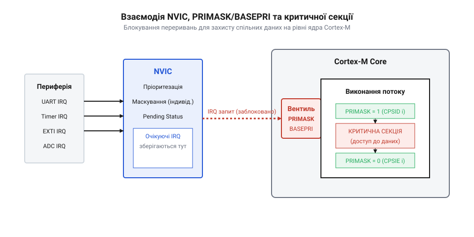

## Початкові концепції та фізичні принципи

При спробі оновити 32-бітний лічильник імпульсів у мікроконтролері значення змінної періодично викривляється та стає невизначеним. На апаратному рівні обробка даних відбується через виконання послідовності базових інструкцій процесорного ядра. Спроба виконати арифметичну операцію модифікації значення змінної в пам'яті вимагає трьох послідовних кроків: зчитування з адреси пам'яті у внутрішній `@@en|регістр@@` (від @@lat|registrum@@ — внесений список), додавання одиниці та зворотного збереження результату. Якщо під час проміжного кроку апаратне `@@en|переривання@@` (від @@en|interrupt@@ — апаратне зупинення основного потоку) зупиняє виконання процесора та передає керування в `@@en|обробник переривання@@` (від @@en|Interrupt Service Routine@@ — функція реагування на подійний сигнал), той самий лічильник модифікується периферійним модулем. Після повернення в основний `@@en|контекст виконання@@` (від @@en|execution context@@ — поточний стан регістрів процесора) старе значення з `@@en|регістра@@` перезаписує зміни, які щойно внесла периферія.

Таке накладання двох незалежних потоків керування на єдину комірку пам'яті утворює `@@en|стан перегонів@@` (від @@en|race condition@@ — залежність результату виконання від відносного часу подій). Проблема виникає через те, що арифметика на процесорному ядрі не є єдиною неподільною операцією. Коли два процеси одночасно змінюють спільну змінну, виникають [непередбачувані перегони даних](root:sf-tasks/data-races-locks), що призводить до незворотного спотворення інформації.

Покрокова послідовність руйнування даних розгортається у такий спосіб:

[Крок 1: зчитування значення з пам'яті]
r0 = memory[counter]       [інструкція LDR зчитує 32-бітний стан]
[Крок 2: апаратне переривання]
memory[counter] = memory[counter] + 5 [обробник ISR змінює пам'ять]
[Крок 3: арифметика основного потоку]
r0 = r0 + 1                [інструкція ADD змінює застарілий стан r0]
[Крок 4: перезапис у пам'ять]
memory[counter] = r0       [інструкція STR спотворює результат ISR]

Щоб запобігти втраті даних, операція модифікації повинна володіти властивістю `@@en|атомарності@@` (від @@lat|atomus@@ — неподільний). Неподільність означає, що з точки зору будь-якого зовнішнього спостерігача або апаратного модуля операція виконується миттєво або не виконується взагалі, без внутрішніх проміжних станів. Ділянка програмного коду, всередині якої здійснюється доступ до спільного ресурсу й вимагається ексклюзивне виконання, називається `@@en|критична секція@@` (від @@en|critical section@@ — ізольована ділянка коду з виключним доступом). Забезпечення ізоляції ґрунтується на принципі `@@en|взаємного виключення@@` (від @@en|mutual exclusion@@ — допуск лише одного потоку в один момент).

У розробці вбудованих систем виділяють дві базові архітектурні парадигми: режим `@@en|baremetal@@` (від @@en|bare metal@@ — виконання прошивки безпосередньо на апаратурі без операційної системи) та керування під управлінням `@@en|RTOS@@` (від @@en|Real-Time Operating System@@ — операційна система реального часу). У режимі `@@en|baremetal@@` єдиним джерелом конкурентності є апаратні `@@en|переривання@@`, які генеруються таймерами, системним тиком або зовнішніми шинами даних. У середовищі `@@en|RTOS@@` до апаратних `@@en|переривань@@` додається `@@en|планувальник задач@@` (від @@en|task scheduler@@ — модуль розподілу процесорного часу), який може примусово призупинити поточну задачу на користь більш пріоритетної. Якщо задача тривалий час очікує на звільнення ресурсу, вона реалізує [очікування у циклі](root:sf-tasks/spinlock) або переходить у стан блокування ядра. В обох випадках збереження цілісності пам'яті вимагає чітко розробленого апаратного або програмного бар'єра.

## Внутрішня будова та алгоритми роботи

Найпростішим і найшвидшим способом створення `@@en|критичної секції@@` у режимі `@@en|baremetal@@` є безпосереднє `@@en|маскування переривань@@` (від @@en|interrupt masking@@ — апаратне блокування сигналів переривань). На мікроконтролерах архітектури `ARM Cortex-M` це реалізується через модифікацію спеціального `@@en|регістра@@` `PRIMASK` за допомогою асемблерних інструкцій `CPSID i` (заборона переривань) та `CPSIE i` (дозвіл переривань). Виконання інструкції `CPSID i` встановлює прапорець, який змушує [контролер переривань NVIC](root:sf-tasks/cortex-m-nvic-interrupts) ігнорувати всі запити `@@en|переривань@@` із налаштовуваним пріоритетом. У результаті процесор гарантовано виконує послідовність інструкцій як єдиний атомарний блок.

Однак наївне вимкнення та ввімкнення `@@en|переривань@@` містить приховану пастку під час виклику вкладених функцій. Якщо підпрограма A вимикає `@@en|переривання@@`, викликає підпрограму B, а підпрограма B у своєму фіналі виконує інструкцію `CPSIE i`, то після повернення в підпрограму A `@@en|переривання@@` виявляються ввімкненими завчасно. Подальший код підпрограми A втрачає захист, і виникає `@@en|вкладена критична секція@@` (від @@en|nested critical section@@ — каскадне входження у захищені блоки коду), яка руйнує цілісність системи. Правильний алгоритм вимагає збереження поточного стану `@@en|регістра@@` `PRIMASK` у локальну змінну перед закриттям `@@en|критичної секції@@` та відновлення збереженого стану під час виходу:

[Крок 1: збереження стану регістра]
state = __get_PRIMASK()    [читання поточного прапорця переривань]
[Крок 2: маскування переривань]
__disable_irq()            [виконання асемблерної інструкції CPSID i]
[Крок 3: атомарне виконання]
counter = counter + 1      [безпечна модифікація спільного ресурсу]
[Крок 4: відновлення початкового стану]
__set_PRIMASK(state)       [записування збереженого значення назад]

У операційних системах реального часу `@@en|RTOS@@` глобальне `@@en|маскування переривань@@` невиправдано збільшує затримку реакції на критичні апаратні події. Тому ядро `@@en|RTOS@@` надає дворазово диференційований механізм. Для коротких операцій над структурами даних використовується [планування задач в RTOS](root:sf-tasks/rtos-task-scheduling), де маскуються лише ті `@@en|переривання@@`, чий пріоритет нижчий за поріг `configMAX_SYSCALL_INTERRUPT_PRIORITY` (через `@@en|регістр@@` `BASEPRI`). Це дозволяє високонадійним апаратним обробникам із нульовою затримкою продовжувати виконання, поки `@@en|планувальник задач@@` заблокований. Альтернативним підходом є зупинка самого `@@en|планувальника задач@@` функцією `vTaskSuspendAll()`, при якій `@@en|переривання@@` продовжують оброблятися, але `@@en|перемикання контексту@@` (від @@en|context switch@@ — процедура заміни активної задачі у процесорі) повністю забороняється.

Для тривалих операцій обробки ресурсів, де вимкнення `@@en|переривань@@` або `@@en|планувальника задач@@` неприпустиме, застосовується `@@en|м'ютекс@@` (від @@en|mutex@@, скорочено від @@en|mutual exclusion@@ — примітив синхронізації) або `@@en|спін-замок@@` (від @@en|spinlock@@ — активне очікування у циклі). Коли вимагається [паралельне читання структури](root:sf-tasks/readers-writer-lock) багатьма потоками, але єдиний запис, `@@en|м'ютекс@@` контролює чергу й запобігає інверсії пріоритетів.

:::code root/eng/sf-tasks/critical-sections/proj-baremetal-and-rtos-critical-sections/c/main.c c

:::code root/eng/sf-tasks/critical-sections/proj-baremetal-and-rtos-critical-sections/cpp/main.cpp cpp

## Апаратна реалізація та низькорівневий C/C++ код

Перехід від теоретичних принципів блокування до створення реальної прошивки вимагає глибокого розуміння апаратних регістрів процесорного ядра та специфіки інструкцій системної шини. У мікроконтролерах на базі архітектури ARM Cortex-M (зокрема серій Cortex-M3, M4, M7 та M33) просте вимкнення `@@en|переривань@@` через регістр `PRIMASK` створює занадто високу `@@en|затримку переривань@@` (від @@lat|latens@@ — прихований, @@en|interrupt latency@@ — час затримки реакції системи на зовнішній подійний сигнал). Якщо `@@en|критична секція@@` обробляє масив даних або виконує складний розрахунок, вимикання всіх апаратних сигналів робить мікроконтролер нездатним вчасно реагувати на критичні події периферії. Щоб оптимізувати час виконання та зберегти детермінізм прошивки, апаратна архітектура надає гнучкіші регістри маскування та спеціалізовані атомарні інструкції.

Для обмеження затримок обробки подій замість тотального маскування використовується системний `@@en|регістр@@` `BASEPRI`. Цей регістр дозволяє [апаратних пріоритетів контролера](root:sf-tasks/cortex-m-nvic-interrupts) відсікати лише ті `@@en|переривання@@`, чий обчислений пріоритет є нижчим за встановлену межу. Завдяки цьому критичні апаратні обробники з високим пріоритетом виконуються миттєво навіть тоді, коли задача прошивки перебуває всередині `@@en|критичної секції@@`. На рівні інструкцій процесора атомарність модифікації даних забезпечується парою операндів `@@en|LDREX@@` (Load-Register Exclusive) та `@@en|STREX@@` (Store-Register Exclusive). Їхнє функціонування спирається на апаратний блок `@@en|exclusive monitor@@` (від @@lat|exclusivus@@ — той, що виключає, та @@lat|monitor@@ — той, що наглядає, спеціалізований стежний вузол у процесорному ядрі й матриці шин). Коли потік зчитує комірку через `@@en|LDREX@@`, монітор фіксує фізичну адресу у стані *Exclusive*. Якщо інше `@@en|переривання@@` або потік здійснює запис у цю ж комірку до моменту виконання `@@en|STREX@@`, стан монітора змінюється на *Open*, а спроба запису повертає помилку, змушуючи алгоритм повторити спробу.

*Принцип змінення станів ексклюзивного монітора з Exclusive в Open при зчитуванні та записі за вказаною адресою.*

Окрім апаратної атомарності інструкцій шини, низькорівнева реалізація вимагає чіткого керування порядком виконання операцій у конвеєрі процесора. Сучасні оптимізуючі компілятори та процесори з глибоким конвеєром (наприклад, Cortex-M7) можуть довільно змінювати порядок читань і записів у пам'яті, якщо між ними немає прямої залежності за даними. Щоб запобігти ситуації, коли модифікація спільної змінної витікає за межі `@@en|критичної секції@@`, застосовують `@@en|бар'єри пам'яті@@` (від @@en|memory barrier@@ — апаратна інструкція синхронізації шини та конвеєра). Інструкція `@@en|DMB@@` (Data Memory Barrier) гарантує завершення всіх попередніх операцій із пам'яттю до початку виконання наступних доступів, а `@@en|DSB@@` (Data Synchronization Barrier) додатково зупиняє конвеєр до вивантаження буферів запису. На рівні мови C/C++ компіляторне переупорядкування відсікається вказівником `@@en|volatile@@` або бар'єром компілятора `__asm__ volatile("" ::: "memory")`.

У мові C практична реалізація `@@en|критичної секції@@` будується на функціях збереження поточного стану регістрів маскування в локальну змінну з подальшим їхнім відновленням при виході. Такий підхід гарантує коректну обробку каскадних вкладених блоків без ризику передчасного розблокування `@@en|переривань@@`. Нижче наведено базову реалізацію низькорівневого алгоритму захисту даних на мові C для мікроконтролера.

:::code root/eng/sf-tasks/critical-sections/proj-baremetal-and-rtos-critical-sections/c/main.c c

У мові C++ процедурний підхід із ручним збереженням і відновленням стану регістрів замінюється об'єктно-орієнтованим патерном `@@en|RAII@@` (від @@en|Resource Acquisition Is Initialization@@ — залучення ресурсу є ініціалізацією). Реалізація драйвера створює локальний об'єкт-охоронець `@@en|lock guard@@`, який у своєму конструкторі маскує `@@en|переривання@@` та зберігає попередній стан `PRIMASK` або `BASEPRI`, а у деструкторі автоматично відновлює його. Це повністю виключає помилки розробника при достроковому виході з функції через оператор `return` або під час обробки винятків. Для гнучкості взаємодії з апаратурою C++ API драйвера надає зручний абстрактний інтерфейс, який мінімізує накладні витрати на виконання.

:::code root/eng/sf-tasks/critical-sections/proj-baremetal-and-rtos-critical-sections/cpp/main.cpp cpp

## Практичне застосування та відлагодження

Практичне впровадження примітивів синхронізації у складних прошивках вимагає врахування граничних випадків та небажаних апаратних ефектів. Найнебезпечнішою системною пасткою у середовищі `@@en|RTOS@@` є `@@en|інверсія пріоритетів@@` (від @@lat|inversio@@ — перевертання, @@en|priority inversion@@ — ситуація, коли низькопріоритетна задача утримує `@@en|м'ютекс@@`, високопріоритетна задача блокується в очікуванні ресурсу, а задачі середнього пріоритету витісняють низькопріоритетну, блокуючи виконання всієї системи). У результаті найважливіша функція системи втрачає детермінізм і зупиняється на невизначений час. Для усунення цього ефекту класичні `@@en|м'ютекси@@` в RTOS підтримують [динамічного підвищення пріоритету](root:sf-tasks/rtos-priority-inheritance) для задачі-утримувача. На відміну від `@@en|м'ютексів@@`, пряме `@@en|маскування переривань@@` або [використання спін-замків](root:sf-tasks/spinlock) не підтримує успадкування пріоритетів, тому їхнє застосування обмежується лише найкоротшими ділянками коду.

Другим критичним фактором є забезпечення `@@en|повторної входжуваності@@` (від @@en|re-entry@@ — повторний вхід, @@en|reentrancy@@ — властивість підпрограми безпечно викликатися повторно з іншого контексту або з `@@en|ISR@@` до завершення попереднього виклику). Якщо функція драйвера периферії використовує статичний буфер і викликається як з основної задачі, так і з обробника `@@en|переривання@@`, відсутність належної `@@en|критичної секції@@` призведе до [тяжких перегонів даних](root:sf-tasks/data-races-locks). Поряд із цим перехресне захоплення кількох ресурсів у різній послідовності створює `@@en|взаємне блокування@@` (від @@en|deadlock@@ — мертвий замок, стан незворотної зупинки двох потоків), а надто висока частота апаратних подій під час виконання атомарного циклу `@@en|LDREX@@`/`@@en|STREX@@` спричиняє `@@en|активне заклинювання@@` (від @@en|livelock@@ — живий замок, ситуацію нескінченного повторення спроб без здійснення корисної роботи).

Відлагодження низькорівневих `@@en|критичних секцій@@` у реальному часі ускладнюється тим, що звичайні зупинки процесора через налагоджувальник руйнують апаратні таймінги й приховують помилки. Для вимірювання точної тривалості блокування переривань застосовують інструментальний модуль трасування `@@en|ITM trace@@` (від @@en|Instrumentation Trace Macrocell@@ — апаратний блок виведення діагностичних даних) та лічильник циклів `CYCCNT` у складі блоку DWT мікроконтролера ARM Cortex-M. Запис значення `CYCCNT` на вході та виході із `@@en|критичної секції@@` дозволяє з точністю до одного такту процесора зафіксувати максимальну затримку без внесення часових викривлень у роботу прошивки.

Якщо під час перебування у `@@en|критичній секції@@` виникає апаратний збій адресації або спроба виконання незарівняного доступу, мікроконтролер переходить у обробник `HardFault_Handler`. Діагностика причини аварії здійснюється шляхом читання регістрів статусу помилок `CFSR` (Configurable Fault Status Register) та адреси збою `BFAR` (BusFault Address Register) за допомогою налагоджувача `@@en|GDB@@`. Для верифікації складного розмежування доступу при [забезпеченні багатьох читачів](root:sf-tasks/readers-writer-lock) перед прошивкою на реальне залізо застосовують `@@en|SIL testing@@` (від @@en|Software-In-the-Loop@@ — тестування програмного забезпечення у емульованому контурі) із залученням інструмента `@@en|ThreadSanitizer@@` для фіксації неочищених стану перегонів.
