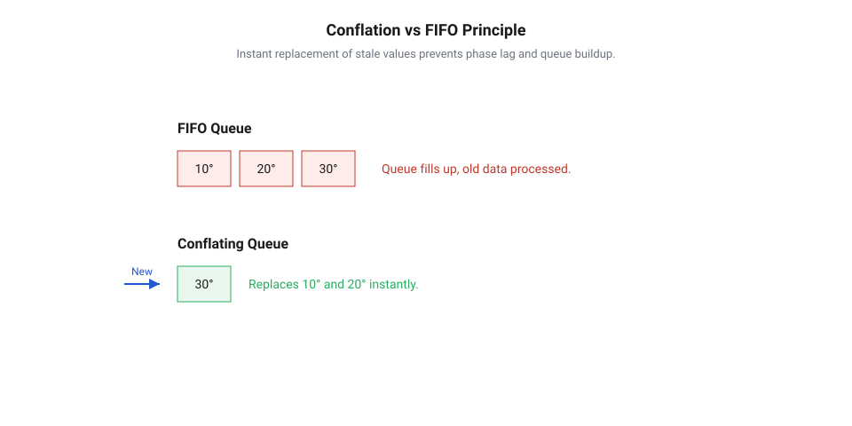
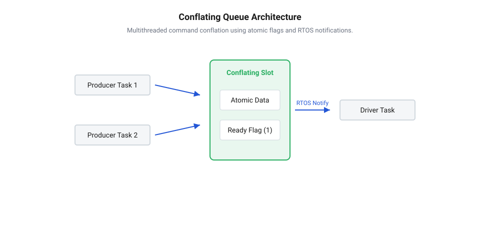

## Початкові концепції та фізичні принципи

У системах реального часу вбудовані мікроконтролери керують фізичними виконавчими механізмами — від крокових двигунів і сервоприводів до промислових клапанів, актуаторів робототехнічних маніпуляторів та польотних регуляторів безпілотних апаратів. Кожен @@en|актуатор@@ (від лат. *actuator* — той, що приводить у рух) належить до фізичного світу й характеризується власною механічною @@en|інерційністю@@ (від лат. *inertia* — бездіяльність, нерухомість). Маса ротора двигуна, момент інерції навантаження, тертя в редукторі та обмеження апаратного драйвера за струмом не дозволяють механічній системі реагувати на зміну управительського сигналу миттєво. Реакція фізичного вузла на нове задане значення зазвичай займає десятки або навіть сотні мілісекунд. Водночас цифровий контур керування — наприклад, високочастотний @@en|PID-регулятор@@ (англ. *PID controller*, від *Proportional-Integral-Derivative*) або обчислювач просторової траєкторії — здатний генерувати нові цільові параметри положення, швидкості чи моменту з частотою 1000 Гц або вище.

Якщо передавати кожне згенероване значення у звичайну чергу першим прийшов — першим пішов, виникає фундаментальне системне суперечливість між обчислювальною та фізичною частинами пристрою. Коли високочастотна задача обчислення траєкторії передає нові координати через [стандартні механізми міжпроцесної взаємодії](root:sf-tasks/task-ipc), елементи починають накопичуватись у пам'яті. Виконавчий драйвер фізично не встигає зчитувати й відправляти в апаратний шинний драйвер CAN, SPI чи модуль @@en|ШІМ@@ (англ. *PWM*, *Pulse-Width Modulation*) кожну проміжну точку з тією частотою, з якою їх генерує математичне ядро. При класичному використанні схеми [взаємодії виробника та споживача](root:sf-tasks/producer-consumer) стандартна FIFO-черга швидко заповнюється до верхньої межі. В результаті виникає згубний ефект накопичення затримки (фазового запізнення): актуатор продовжує послідовно відпрацьовувати застарілі команди, витягнуті з голови черги, які були обчислені кілька десятків мілісекунд тому. Тим часом найактуальніше значення, що відображає поточний реальний стан об'єкта керування, стоїть у самому хвості буфера й чекає своєї черги.

Накопичення застарілих команд у буфері призводить не лише до погіршення динаміки керування та розгойдування замкненого контуру, а й до повної втрати детермінізму вбудованої системи. При переповненні черги нові команди або відкидаються розробником, що викликає втрату критичних даних, або задача-виробник блокується в очікуванні вільного місця, викликаючи небажані затримки в контурі зворотного зв'язку. Проте з фізичної точки зору будь-яке проміжне цільове значення положення, яке актуатор ще не почав відпрацьовувати і яке вже замінене новішим розрахунком, повністю втрачає сенс. Механічний вузол принципово не здатний фізично відтворити всі проміжні мікрокроки, якщо нове завдання вже вимагає перебування в іншій точці простору. Фізичний стан виконавчого пристрою повністю визначається його [динамічними характеристиками керування](root:sf-tasks/actuator-kinematics-control), тому послідовне відпрацювання проміжних застарілих точок є марним витрачанням обчислювальних ресурсів процесора та смуги пропускання апаратних шин.

Для вирішення цього системного конфлікту розробники вбудованого програмного забезпечення застосовують @@en|згортання команд@@ (англ. *command conflation*, від лат. *conflatio* — злиття воєдино). Архітектурна ідея полягає в тому, що для кожного конкретного каналу або ідентифікатора актуатора в буферній структурі зберігається лише один цільовий стан — найновіший. Якщо задача-виробник генерує нову команду для актуатора, який уже має непрочитану команду в черзі, нова команда миттєво заміщує (перезаписує) попереднє значення без зміни розміру черги та без виділення нових елементів пам'яті.

Формалізуємо порівняння затримки доставки команд для класичної FIFO-черги та черги зі згортанням. Позначимо через N_pending кількість неопрацьованих команд у буфері, через T_step — час передачі та апаратної обробки однієї команди драйвером, через T_gen — період генерування нової команди контуром керування.

Розрахуємо загальну затримку T_fifo_latency для класичної FIFO-черги при накопиченні елементів:
```
T_fifo_latency
= N_pending × T_step      [сумування затримок усіх попередніх елементів у черзі]
= (T_gen_period / T_exec_period) × T_step [накопичення черги при перевищенні частоти генерування]
```

Для черги зі згортанням розмір неопрацьованого буфера для кожного актуатора строго обмежений одиницею, тому затримка обчислюється так:
```
T_conflate_latency
= 1 × T_step              [гарантоване обмеження розміру актуального стану одним слотом]
```

З наведеного математичного співвідношення видно, що @@en|черга згортання@@ (англ. *conflating queue*) перетворює затримку доставки команди з лінійно зростаючої функції від кількості накопичених елементів на константну величину O(1). Це забезпечує повний часовий @@en|детермінізм@@ (від лат. *determinare* — визначати, обмежувати), оскільки задача-драйвер завжди зчитує найсвіжіший @@en|буфер@@ (англ. *buffer*) стану без проходження крізь застарілі проміжні кроки.


*Миттєве заміщення застарілого значення у черзі зі згортанням запобігає фазовому запізненню актуатора та ліквідує накопичення черги.*

## Внутрішня будова та алгоритми роботи

Архітектура модуля згортання команд будується навколо статичної таблиці слотів, де кожен @@en|слот@@ (англ. *slot* — зарезервоване місце) закріплений за конкретним каналом актуатора чи його унікальним ідентифікатором. Оскільки кількість виконавчих механізмів у мікроконтролерній системі відома на етапі проективання, масив слотів виділяється у статичній пам'яті BSS або DATA. Це повністю виключає використання динамічної кучі та усуває ризик фрагментації пам'яті під час тривалої роботи прошивки під управлінням @@en|RTOS@@ (англ. *Real-Time Operating System*).

Структура кожного слота містить два основні компоненти: корисне навантаження (структуру даних з цільовими параметрами: кут, швидкість, зусилля, маска прапорів) та прапор стану готовності (атомне число чи бітову маску непрочитаних даних). Коли задача-виробник відправляє команду, вона звертається до слота за індексом актуатора. Якщо в слоті вже лежить непрочитана команда, відбувається її заміщення новими даними. Для передачі масивних потокових даних між задачами іноді використовують [спеціалізовані потокові буфери](root:sf-tasks/message-buffer), проте для дискретних команд керування актуаторами саме слотова структура зі згортанням забезпечує максимальну продуктивність і мінімальний оверхед.

Ключовим завданням при розробці такого модуля є забезпечення багатопотокової безпеки та атомарності операцій. Оскільки запис у слот може здійснюватись із обробників переривань (ISR) або з декількох високопріоритетних задач керування, а зчитування виконує низькопріоритетна задача-драйвер, виникає ризик @@en|гонки даних@@ (англ. *data race*). Якщо драйвер зчитує структуру даних саме в той момент, коли задача керування виконує перезапис, драйвер може зчитати частково оновлені дані — наприклад, нове значення швидкості зі старим значенням цільового кута.

Для уникнення спотворення даних застосовують [внутрішні масиви сповіщень TCB](root:sf-tasks/freertos-tcb-structure-and-notification-array) або критичні секції із захистом від переривань. При використанні традиційних м'ютексів чи семафорів у середовищі реального часу існує небезпека виникнення @@en|інверсії пріоритетів@@ (англ. *priority inversion*, від лат. *inversio* — перевертання). Якщо низькопріоритетний драйвер захопить @@en|м'ютекс@@ (англ. *mutex*, від *mutual exclusion* — взаємне виключення) слота, високопріоритетна задача керування буде заблокована. Тому в мікроконтролерах запис у слот захищають коротким вимкненням переривань або безблокувальними атомарними інструкціями.

Після оновлення даних у слоті задача-виробник повинна сповістити задачу-драйвер про наявність нових команд. Щоб розбудити задачу-драйвер без додаткового накладного витрачання ресурсів, використовують [прямі сповіщення задачі](root:sf-tasks/task-notification) операційної системи. Якщо задача керує декількома незалежними групами актуаторів, для сигналізації про стан готовності окремих каналів також застосовують [бітові групи подій](root:sf-tasks/event-groups), де кожен біт відповідає за свій слот. У разі, якщо оновлення виконується в контексті обробника переривання, відкладену обробку команд може здійснювати [демон системних таймерів](root:sf-tasks/rtos-daemon-task-deferred-interrupts), який безпечно передає виконання у контекст задачі. Для високонавантажених систем, де блокування принципово неприпустимі, задіюється [безблокувальна черга згортання](root:sf-tasks/lock-free-conflating-queue), яка базується на атомарних інструкціях `Compare-And-Swap`.


*Багатопотокова схема згортання команд у слотах із використанням атомарних прапорців та сповіщень RTOS.*

Розглянемо практичну реалізацію черги згортання команд для мікроконтролерів. Нижче наведено ідіоматичний код на C та C++, який реалізує безпечне згортання команд для масиву актуаторів з використанням примітивів RTOS.

:::tabs
```c|freertos
#include <stdint.h>
#include <stdbool.h>
#include "FreeRTOS.h"
#include "task.h"
#include "semphr.h"

#define MAX_ACTUATORS 8

/* Структура команди актуатора */
typedef struct {
    float target_position;
    float target_velocity;
    uint32_t command_flags;
} actuator_cmd_t;

/* Слот черги згортання */
typedef struct {
    actuator_cmd_t command;
    volatile bool is_pending;
} conflating_slot_t;

/* Структура черги згортання */
typedef struct {
    conflating_slot_t slots[MAX_ACTUATORS];
    TaskHandle_t driver_task_handle;
} conflating_queue_t;

static conflating_queue_t g_actuator_queue;

/* Ініціалізація черги */
void conflating_queue_init(TaskHandle_t driver_task) {
    g_actuator_queue.driver_task_handle = driver_task;
    for (int i = 0; i < MAX_ACTUATORS; i++) {
        g_actuator_queue.slots[i].is_pending = false;
    }
}

/* Відправка команди зі згортанням (безпечна для ISR) */
bool conflating_queue_push(uint8_t actuator_id, const actuator_cmd_t *cmd) {
    if (actuator_id >= MAX_ACTUATORS || cmd == NULL) {
        return false;
    }

    UBaseType_t uxSavedInterruptStatus = taskENTER_CRITICAL_FROM_ISR();

    /* Згортання: перезапис даних у слоті незалежно від того, чи була непрочитана команда */
    g_actuator_queue.slots[actuator_id].command = *cmd;
    g_actuator_queue.slots[actuator_id].is_pending = true;

    taskEXIT_CRITICAL_FROM_ISR(uxSavedInterruptStatus);

    /* Сповіщення задачі-драйвера про появу нових даних */
    if (g_actuator_queue.driver_task_handle != NULL) {
        BaseType_t xHigherPriorityTaskWoken = pdFALSE;
        vTaskNotifyGiveFromISR(g_actuator_queue.driver_task_handle, &xHigherPriorityTaskWoken);
        portYIELD_FROM_ISR(xHigherPriorityTaskWoken);
    }

    return true;
}

/* Вибірка актуальної команди драйвером */
bool conflating_queue_pop(uint8_t actuator_id, actuator_cmd_t *out_cmd) {
    if (actuator_id >= MAX_ACTUATORS || out_cmd == NULL) {
        return false;
    }

    bool has_data = false;
    taskENTER_CRITICAL();

    if (g_actuator_queue.slots[actuator_id].is_pending) {
        *out_cmd = g_actuator_queue.slots[actuator_id].command;
        g_actuator_queue.slots[actuator_id].is_pending = false;
        has_data = true;
    }

    taskEXIT_CRITICAL();
    return has_data;
}
```
```cpp|freertos
#include <cstdint>
#include <array>
#include <atomic>
#include "FreeRTOS.h"
#include "task.h"

template <typename CommandType, std::size_t ActuatorCount>
class ConflatingQueue {
public:
    struct Slot {
        CommandType command;
        std::atomic<bool> is_pending{false};
    };

    explicit ConflatingQueue(TaskHandle_t driver_task = nullptr)
        : driver_task_handle_(driver_task) {}

    void set_driver_task(TaskHandle_t driver_task) {
        driver_task_handle_ = driver_task;
    }

    /* Вставка з автоматичним згортанням застарілих даних */
    bool push(std::size_t actuator_id, const CommandType& cmd) {
        if (actuator_id >= ActuatorCount) {
            return false;
        }

        UBaseType_t status = taskENTER_CRITICAL_FROM_ISR();
        slots_[actuator_id].command = cmd;
        slots_[actuator_id].is_pending.store(true, std::memory_order_release);
        taskEXIT_CRITICAL_FROM_ISR(status);

        if (driver_task_handle_ != nullptr) {
            BaseType_t higher_woken = pdFALSE;
            vTaskNotifyGiveFromISR(driver_task_handle_, &higher_woken);
            portYIELD_FROM_ISR(higher_woken);
        }

        return true;
    }

    /* Вибірка найсвіжішої команди драйвером */
    bool pop(std::size_t actuator_id, CommandType& out_cmd) {
        if (actuator_id >= ActuatorCount) {
            return false;
        }

        taskENTER_CRITICAL();
        bool pending = slots_[actuator_id].is_pending.load(std::memory_order_acquire);
        if (pending) {
            out_cmd = slots_[actuator_id].command;
            slots_[actuator_id].is_pending.store(false, std::memory_order_release);
        }
        taskEXIT_CRITICAL();

        return pending;
    }

private:
    std::array<Slot, ActuatorCount> slots_;
    TaskHandle_t driver_task_handle_{nullptr};
};
```
:::

## Апаратна реалізація та низькорівневий C/C++ код

Коли математична модель обробки повідомлень переноситься у фізичний мікроконтролер, розробник стикається з апаратною несинхронністю процесорного ядра та периферійних модулів. Слот черги у @@en|SRAM@@ пам’яті не передає нове значення на вихідні ніжки мікросхеми автоматично. Для фізичного повороту заслінки чи зміни швидкості двигуна найновіша уставка (англ. @@en|setpoint@@) має бути записана у спеціальні апаратні регістри. Помилка на цьому етапі призводить до того, що виконавчий механізм (англ. @@en|actuator@@, від @@la|actus@@ — дія) отримує проміжні, некоректно вирівняні або частково оновлені дані.

Для забезпечення детермінованого зв’язку між чергою згортання (англ. @@en|conflation queue@@, від @@la|con-@@ + @@la|flare@@ — здувати докупи) та фізичною периферією застосовують принципи подвійної буферизації та апаратних тіньових регістрів (англ. @@en|shadow registers@@). Процесорне ядро виконує обчислення та заносить значення у слот черги, після чого сповіщає задачу-драйвер. Задача-драйвер взаємодіє з вихідним периферійним модулем — генератором широтно-імпульсної модуляції (англ. @@en|PWM@@ — @@en|Pulse-Width Modulation@@), цифро-аналоговим перетворювачем або контролером шини @@en|CAN@@. Щоб уникнути випадків, коли зміна уставки відбувається посередині робочого такту периферії і викликає сплеск струму чи апаратний збій, фіксація нового значення в регістрі порівняння таймера прив’язується до переривання оновлення (англ. @@en|ISR@@ — @@en|Interrupt Service Routine@@).

Схема узгодження потоку даних між атомарним слотом черги та апаратним регістром актуатора виглядає наступним чином:


*Принцип атомарного перенесення заданого значення зі слота згортання в апаратні тіньові регістри периферії*

Під час атомарного оновлення слота в обробнику задач важно використовувати бар'єри пам'яті (англ. @@en|memory barrier@@, від @@la|memoria@@ + @@fr|barrière@@). Вони запобігають перевпорядкуванню інструкцій оптимізуючим компілятором або конвеєром процесора. Якщо не зафіксувати порядок запису прапорця готовності та самих даних у слоті, задача драйвера може вичитати застарілі координати актуатора разом із новим прапорцем оновлення.

Для захисту фізичних вузлів від занадто частих перезаписів, які здатні викликати механічне перегрівання або перенасичення каналу зв'язку, у низькорівневий драйвер вбудовують таймер затримки повторного спрацювання (англ. @@en|cooldown timer@@). Якщо від моменту останньої відправки команди не минув заданий часовий інтервал `t_cooldown`, задача не турбує апаратуру, а залишає найновішу уставку чекати у слоті. По закінченню таймера драйвер вичитає актуальний стан слота за один крок, автоматично пригнітивши всі проміжні команди, що надійшли за час очікування.

Для передачі сповіщень між перериваннями периферії та задачами обробки у системах реального часу розробники застосовують [Сповіщення задачі](root:sf-tasks/task-notification), які мінімізують накладні витрати пам'яті порівняно зі стандартними чергами RTOS. Якщо ж обробка вимагає відкладеного виконання поза контекстом переривання, ефективним є залучення системи [Демон таймерів RTOS та відкладена обробка з переривань](root:sf-tasks/rtos-daemon-task-deferred-interrupts).

Нижче наведено практичну реалізацію слота згортання команд актуатора на мовах C та C++ з використанням атомарних операцій та таймера затримки.

:::tabs
```c
#include <stdint.h>
#include <stdbool.h>
#include <stdatomic.h>

// Структура команди актуатора з ідентифікатором та заданим значенням
typedef struct {
    uint16_t actuator_id;
    int32_t setpoint;
    uint32_t timestamp_ms;
} actuator_cmd_t;

// Слот черги згортання з атомарним прапором оновлення
typedef struct {
    actuator_cmd_t command;
    atomic_bool has_new_data;
    uint32_t last_dispatch_ms;
} conflating_slot_t;

// Ініціалізація слота
void conflating_slot_init(conflating_slot_t *slot, uint16_t id) {
    slot->command.actuator_id = id;
    slot->command.setpoint = 0;
    slot->command.timestamp_ms = 0;
    atomic_store_explicit(&slot->has_new_data, false, memory_order_relaxed);
    slot->last_dispatch_ms = 0;
}

// Запис уставку у слот (потокобезпечне атомарне заміщення)
void conflating_slot_push(conflating_slot_t *slot, int32_t new_setpoint, uint32_t now_ms) {
    slot->command.setpoint = new_setpoint;
    slot->command.timestamp_ms = now_ms;
    // Опублікувати дані з бар'єром вивільнення пам'яті
    atomic_store_explicit(&slot->has_new_data, true, memory_order_release);
}

// Забрання найновішої уставки для передачі в периферію
bool conflating_slot_pop_for_dispatch(conflating_slot_t *slot, actuator_cmd_t *out_cmd, 
                                      uint32_t now_ms, uint32_t cooldown_ms) {
    // Перевірка наявності нових даних із бар'єром захоплення
    if (!atomic_load_explicit(&slot->has_new_data, memory_order_acquire)) {
        return false;
    }
    
    // Перевірка дотримання періоду cooldown
    if ((now_ms - slot->last_dispatch_ms) < cooldown_ms) {
        return false;
    }

    // Зчитування найновішого стану
    *out_cmd = slot->command;
    atomic_store_explicit(&slot->has_new_data, false, memory_order_relaxed);
    slot->last_dispatch_ms = now_ms;
    return true;
}
```
```cpp
#include <cstdint>
#include <atomic>
#include <optional>

struct ActuatorCommand {
    std::uint16_t actuator_id{0};
    std::int32_t setpoint{0};
    std::uint32_t timestamp_ms{0};
};

class ConflatingActuatorSlot {
public:
    explicit ConflatingActuatorSlot(std::uint16_t id) : actuator_id_(id) {}

    // Атомарне пригнічення застарілих даних та встановлення нової уставки
    void push(std::int32_t new_setpoint, std::uint32_t now_ms) noexcept {
        cmd_payload_.setpoint = new_setpoint;
        cmd_payload_.timestamp_ms = now_ms;
        cmd_payload_.actuator_id = actuator_id_;
        has_new_data_.store(true, std::memory_order_release);
    }

    // Вичитання уставки з урахуванням апаратного таймера затримки
    std::optional<ActuatorCommand> pop_for_dispatch(std::uint32_t now_ms, 
                                                    std::uint32_t cooldown_ms) noexcept {
        if (!has_new_data_.load(std::memory_order_acquire)) {
            return std::nullopt;
        }

        if ((now_ms - last_dispatch_ms_) < cooldown_ms) {
            return std::nullopt;
        }

        has_new_data_.store(false, std::memory_order_relaxed);
        last_dispatch_ms_ = now_ms;
        return cmd_payload_;
    }

private:
    std::uint16_t actuator_id_;
    ActuatorCommand cmd_payload_{};
    std::atomic<bool> has_new_data_{false};
    std::uint32_t last_dispatch_ms_{0};
};
```
:::

Застосована модель дозволяє гарантувати виконання двох критичних умов вбудованих систем: захист від переповнення буфера (англ. @@en|buffer overflow@@) за умов високої частоти вхідних команд та мінімізацію обсягу оперативної пам'яті. Замість зберігання сотень проміжних позицій у черзі FIFO, система виділяє фіксовану кількість слотів відповідно до числа фізичних актуаторів, досягаючи складності зауваженого доступу `O(1)`.

## Практичне застосування та відлагодження

При впровадженні алгоритмів згортання у серійні вироби розробник має надати інструменти вимірювання детермінізму системи. Головна метрика ефективності роботи черги згортання — це коефіцієнт пригнічення команд (англ. @@en|suppression ratio@@). Він визначає частку застарілих уставок, які були перезаписані в слоті і не витратили ресурс обчислювального ядра та шини даних.

Розрахунок коефіцієнта пригнічення здійснюється за формулою:

```
R_suppress = (N_pushed - N_dispatched) / N_pushed
```

де `N_pushed` — загальна кількість команд, відправлених алгоритмом вищого рівня, а `N_dispatched` — кількість фактично переданих на периферію команд. Якщо значення `R_suppress` прямує до 0, це свідчить про те, що джерело генерує команди повільніше за частоту оновлення апаратури, і черга працює у режимі транзиту. Якщо `R_suppress` наближається до 1, черга ефективно поглинає надлишкові сплески трафіку (англ. @@en|command burst@@).

Аналіз взаємодії задач та стану черг у середовищі операційної системи реального часу (англ. @@en|RTOS@@ — @@en|Real-Time Operating System@@) вимагає контролю внутрішніх структур ядра. У разі використання середовища @@en|FreeRTOS@@ розробнику важливо відстежувати стан задач-виконавців через розбір [Структура TCB та масиви сповіщень у FreeRTOS](root:sf-tasks/freertos-tcb-structure-and-notification-array).

Для апаратного відлагодження та валідації часових затримок використовують логічний аналізатор (англ. @@en|logic analyzer@@). На тестовій платі виділяють відлагоджувальні ніжки (англ. @@en|GPIO@@ — @@en|General-Purpose Input/Output@@), які перемикають свій стан у момент виконання ключових операцій:
1. Високий рівень на Pin A — момент атомарного виклику `push()` у слот.
2. Високий рівень на Pin B — момент спрацювання переривання `ISR` периферії або задачі драйвера.
3. Високий рівень на Pin C — фізична зміна сигналу на ніжці актуатора (наприклад, @@en|PWM@@).

Часовий проміжок між виходами сигналів виглядає наступним чином:

```
Pin A (Push):     ──┐┌───────────────────────────────────
                    ││
Pin B (Dispatch): ──┼┼─────────┐┌────────────────────────
                    ││         ││
Pin C (Hardware): ──┼┼─────────┼┼─────────────┐┌─────────
                    ││         ││             ││
                    ││← Δt_sw →││  ← Δt_hw →  ││
                    ││         ││             ││
```

Часова затримка передачі складається з двох компонентів:
```
t_latency = Δt_sw + Δt_hw
```
де `Δt_sw` — затримка між атомарним оновленням слота та його вичитанням задачею-драйвером (програмна затримка), а `Δt_hw` — затримка апаратного перезавантаження тіньового реєстра периферії (апаратна затримка). Для детермінованих систем сума `t_latency` повинна мати строгу верхню межу.

Окрім апаратних методів, програмна діагностика включає аналіз системних подій через журнал трасування (англ. @@en|trace log@@). Якщо в процесі роботи виникає інверсія пріоритетів (англ. @@en|priority inversion@@, від @@la|prior@@ — старший), коли високопріоритетна задача актуатора очікує на вивільнення ресурсів низькопріоритетною задачею, детермінізм порушується. Для запобігання цьому у чергах згортання уникають використання важких м'ютексів (англ. @@en|mutex@@, від @@en|mutual exclusion@@), надаючи перевагу безблокувальним атомарним операціям (посилання на [Безблокувальна черга зі згортанням елементів](root:sf-tasks/lock-free-conflating-queue)).

Поширені діагностичні помилки розробників вбудованих систем та шляхи їх усунення:

1. **Часткове оновлення структури даних (англ. @@en|torn read@@)**: виникає, коли структура команди складається з кількох полів, а читання відбувається без застосування бар'єра пам'яті чи критичної секції (англ. @@en|critical section@@). Вирішується застосуванням атомарного прапорця публікації з семантикою `memory_order_release` / `memory_order_acquire`.
2. **Невизначена затримка через блокування переривань**: тривале перебування у критичній секції із вимкненими перериваннями призводить до зростання джиттеру (англ. @@en|jitter@@). Обробник має виконувати лише вибірку зі слота за час `O(1)`, переносячи тривалу взаємодію з периферією у контекст фонової задачі.
3. **Гонка у залишках команд при вимиканні**: при зупинці актуатора або переході в аварійний режим у слоті може залишитися уставка. Алгоритм відлагодження повинен включати обов’язкову процедуру скидання (англ. @@en|flush@@) прапорця `has_new_data` при зміні стану системного контролера.

Застосування викладених методик діагностики забезпечує стабільність роботи підводних, авіаційних та промислових актуаторів у режимах підвищеного навантаження.
