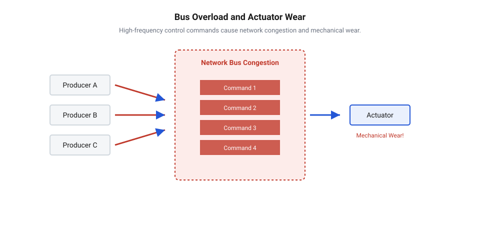
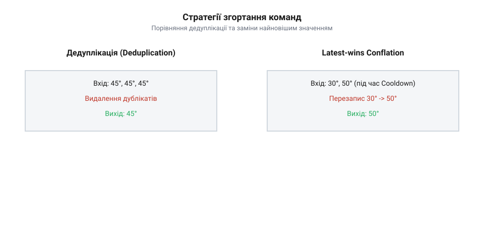
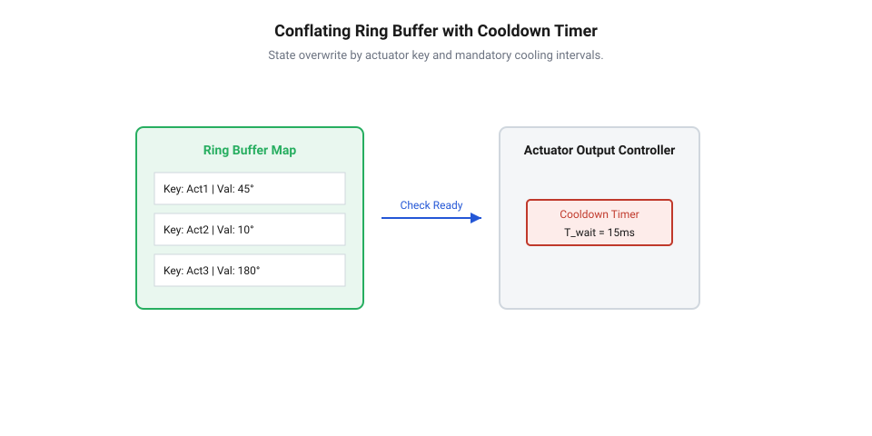

# Згортання команд актуаторів

<preknowlist>
- [Черги й семафори](root:sf-tasks/task-ipc) — Принципи організації черг FIFO та потокобезпечного обміну даними між задачами.
- [Потокові буфери й буфери повідомлень](root:sf-tasks/message-buffer) — Механізми буферизації дискретних повідомлень змінної та фіксованої довжини.
- [Виробник–споживач](root:sf-tasks/producer-consumer) — Патерн взаємодії джерел команд та обробника актуатора через проміжну чергу.
</preknowlist>

## Перевантаження шини та знос актуаторів

Уявіть цифровий регулятор, який опитує датчик положення з частотою 1000 Гц і щоразово обчислює нове керуюче значення для виконавчого клапана. Якщо регулятор безпосередньо надсилає кожен розрахований крок у мережевий канал, виникає парадоксальна ситуація: фізичний привід клапана має власну механічну інерцію і здатний відпрацювати зміну положення лише за десятки або сотні мілісекунд. Мережа ж миттєво переповнюється тисячами дрібних команд, створюючи трафіковий шторм. У результаті пропускна здатність шини вичерпується, інші вузли втрачають можливість передати критичні сповіщення, а сам @@en|actuator@@ (від лат. *actuare* — приводити в дію) починає здійснювати мікроскопічні високочастотні осциляції, що призводять до перегріву й швидкого руйнування механічних передач.

Коли джерело команд генерує запити з частотою, яка перевищує смугу пропускання виконавець-процесу або фізичну швидкодію механізму, виникає невідповідність між інформаційним потоком та фізичною дійсністю. У класичних розподілених системах для передачі керуючих розпоряджень використовують [черги міжзадачного обміну](root:sf-tasks/task-ipc). Якщо черга побудована за принципом FIFO (First-In, First-Out), кожен новий запит стає в кінець буфера. Під час сплеску трафіку черга швидко заповнюється, викликаючи зростання затримок (@@en|latency@@). Актуатор отримує застарілі команди із запізненням, виконуючи рухи, які вже втратили актуальність для поточного стану системи. У бездротових та радіочастотних мережах це додатково спричиняє вичерпання радіоефіру (@@en|airtime contention@@), зростання ймовірності колізій та втрату пакетів.

Еволюція методів пригнічення дублікатів та згортання команд у промислових шинах пройшла тривалий шлях від апаратних фільтрів до інтелектуальних програмних алгоритмів. У перших релейно-контакторних схемах для відсікання високочастотних завад використовували фізичні демпфери та реле часу, що механічно обмежували частоту спрацьовування. Із появою цифрових промислових шин (Fieldbus, CAN, Modbus) керування перейшло на рівень пакетної передачі. Проте зростання обчислювальної потужності контролерів призвело до проблеми, коли @@en|message storm storm@@ (від англ. *storm* — шторм) переповнював буфери приймачів, спричиняючи відмови шини. Це змусило розробників створити алгоритми відсіювання надлишкового трафіку безпосередньо на рівні мережевих протоколів та брокерів (MQTT, ZeroMQ), де ключовими інструментами стали дедуплікація повторів та збереження лише найновішого стану.

Для розв'язання проблеми перевантаження шини та руйнування механізмів у сучасній інженерії застосовують механізм @@en|command conflation@@ (від англ. *conflare* — здувати докупи, зливати). Основна ідея згортання команд полягає у семантичному аналізі потоку керування: якщо проміжні значення устави не впливають на кінцеве положення приводу, їх можна безпечно пригнічувати або замінювати в буфері до моменту відправки. Математичний розрахунок показує, що для оцінки ефективності обробки слід використовувати [модель пригнічення та затримок](root:sf-tasks/dh-actuator-command-conflation/math-command-suppression-rate-and-latency-bounds.md), яка описує коефіцієнт скорочення трафіку та строго обмежує верхню межу часу доставки найновішого стану актуатору.

У багатьох розподілених системах керування у шаблоні [виробник–споживач](root:sf-tasks/producer-consumer) декілька задач-виробників можуть одночасно надсилати нові цільові параметри для одного приводу. Без попереднього фільтраційного бар'єра така архітектура генерує шторм повідомлень.


*Схема виникнення мережевого затору та механічного зносу приводу під дією високочастотного потоку керуючих команд.*

Впровадження інтелектуальних адаптерів у [вузлах керування актуаторами](root:sf-tasks/dh-actuator-command-conflation/comp-actuator-control-node.md) дозволяє перехоплювати потік запитів безпосередньо перед відправкою у фізичний канал, ізолюючи шину та механічну частину від шкідливих осциляцій.

## Семантика команд та стратегії згортання

Не кожен потік повідомлень можна піддавати згортанню. Ключовим кроком під час проектування підсистеми обміну даними є аналіз семантики команд. Команди поділяються на дві фундаментальні категорії:

1. @@en|stateful commands@@ — ідемпотентні розпорядження встановлення стану (наприклад, «встановити кут повороту сервоприводу в 45°», «встановити потужність нагрівача в 60%»). Для таких команд проміжні кроки не мають самостійної цінності для бізнес-логіки; важливим є лише підсумковий стан, до якого має прийти фізична система. 2. @@en|event-driven execution@@ — дискретні імпульсні дії та лічильні події (наприклад, «подати імпульс на кроковий двигун на 1 крок», «додати 10 мл реагенту», «переключити тригер»). Для подій кожна команда є унікальною дискретною операцією. Пригнічення або пропуск хоча б одного запиту призводить до фатальної помилки розрахунку (наприклад, недорахунку кроків або порушення дозування).

Згортання команд є повністю безпечним та ефективним лише для @@en|stateful commands@@.

Для команд встановлення стану застосовують дві основні стратегії пригнічення надлишкових повідомлень:

- @@en|deduplication@@ (від лат. *duplicare* — подвоювати) — фільтрація повторних ідентичних запитів. Якщо джерело послідовно надсилає однакові значення (наприклад, 45°, 45°, 45°), модулю згортання достатньо пропустити перше значення, а наступні дублікати повністю відкинути. Це захищає актуатор від повторної обробки ідентичних команд та знижує навантаження на обчислювальне ядро. - @@en|latest-wins conflation@@ — алгоритм заміни проміжних станів найновішим значенням. Якщо під час перебування команди в буфері очікування надходить нова устава (наприклад, спочатку була устава 30°, а через 2 мс надійшла 50°), проміжне значення 30° перезаписується у буфері значенням 50°. Привід відпрацює одразу підсумкову координату 50°, не витрачаючи час та енергію на проміжну зупинку в точці 30°.


*Порівняння динаміки пригнічення однакових запитів (deduplication) та заміни проміжних устав координати за принципом latest-wins.*

На відміну від стандартних [буферів повідомлень](root:sf-tasks/message-buffer), які зберігають усі вхідні елементи у строгому порядку надходження, черга згортання працює як словник або хеш-таблиця зі збереженням найновішого стану для кожного ідентифікатора актуатора. Під час надходження нової команди система шукає у буфері наявний запис для даного приводу і перезаписує його вміст, не збільшуючи довжину черги.

Окрім перезапису проміжних станів, фізична безпека обладнання вимагає впровадження механізму @@en|cooldown enforcement@@ — примусових інтервалів охолодження та мінімальних пауз між перемиканнями. Навіть якщо нові значення устави відрізняються, привід не повинен отримувати керівні сигнали частіше, ніж дозволяє його тепловий та механічний режим.


*Структура кільцевого буфера згортання з перезаписом станів за ключем актуатора та таймером охолодження.*

Низькорівнева [реалізація буфера C/C++](root:sf-tasks/dh-actuator-command-conflation/proj-actuator-command-conflator-c.md) показує, як організувати атомарні операції перезапису елементів для забезпечення мінімальних затримок виконання.

У багатопотоковому середовищі під час реалізації згортання виникає ризик появи @@en|race condition@@ (від англ. *race condition* — стан гонитви), коли декілька потоків одночасно намагаються оновити або прочитати стан одного актуатора. Для запобігання порушенню послідовності застосовують м'ютекси або будується [безблокувальна черга згортання](root:sf-tasks/lock-free-conflating-queue).

Крім того, критично важливим для спостережуваності шини є збір метрик — @@en|suppressed count telemetry@@. Системний монітор повинен точно знати, скільки повідомлень було пригнічено, щоб оцінювати коефіцієнт економії пропускної здатності.

Налаштування цих параметрів здійснюється через спеціалізований [інтерфейс черги згортання](root:sf-tasks/dh-actuator-command-conflation/api-conflating-queue-interface.md), який дає змогу задавати інтервал `cooldown_ms` та опитувати метрику `drop_count`.

Розглянемо практичний приклад реалізації модуля згортання команд з підтримкою дедуплікації, latest-wins та інтервалу охолодження (cooldown):

:::tabs

@tab C
:::code root\eng\sf-tasks\dh-actuator-command-conflation/dh-actuator-command-conflation-d/c/conflator-init.c c

@tab C++
:::code root\eng\sf-tasks\dh-actuator-command-conflation/dh-actuator-command-conflation-d/cpp/actuatorconflator.cpp cpp

:::

## Алгоритми буферизації та інтервали охолодження

Уявіть цифровий регулятор температури або систему позиціонування робототехнічного маніпулятора, у якій датчик зворотного зв'язку опитується з частотою 500 Гц. Кожен виміряний крок обчислює нову цільову уставу для виконавчого серводвигуна чи нагрівального елемента. Якщо кожен із цих 500 запитів на секунду потрапляє у класичний FIFO-буфер, система накопичує величезну чергу. Фізичний привід здатен змінити своє положення лише за 50 мілісекунд, що відповідає максимальній частоті реагування 20 Гц. Решта 480 запитів на секунду є проміжними уставими, які не лише марно вичерпують обчислювальні ресурси контролера, але й змушують привід здійснювати високочастотні мікроскопічні ривки. Це призводить до прискореного механічного зносу редукторів та перегріву обмоток.

Для відокремлення фізичного приводу від високочастотного потоку регулятора в архітектуру обміну впроваджують @@en|state isolation buffer@@ (від англ. *isolate* — відокремлювати). На відміну від стандартних [буферів дискретних повідомлень](root:sf-tasks/message-buffer), які динамічно виділяють пам'ять під кожен новий елемент і зберігають усю хронологію надходження, буфер ізоляції стану функціонує як фіксована таблиця слотів. Кількість слотів строго дорівнює кількості підключених актуаторів. Кожен слот закріплений за конкретним ідентифікатором приводу `actuator_id` і містить поточну цільову уставу, часову мітку надходження та прапорець наявності даних.

Коли від регулятора надходить нова команда з параметрами `(actuator_id, target_value, timestamp)`, алгоритм витіснення працює за двома послідовними кроками:

1. Перевірка на дублювання: модуль порівнює `target_value` з останньою відправленою на шину уставою або з уставою, що вже лежить у слоті. Якщо значення збігаються, надходження ігнорується, а лічильник пригнічених повідомлень збільшується. 2. Заміна за принципом @@en|latest-wins conflation@@: якщо нове значення відрізняється від збереженого, але попереднє значення зі слота ще не було вичитане споживачем, алгоритм перезаписує вміст слота новим значенням `target_value` та оновлює `timestamp`.

Внаслідок цього витіснення застарілі проміжні устави знищуються безпосередньо в оперативній пам'яті контролера без операцій зсуву масиву чи повторного виділення пам'яті. Об'ємна складність буфера стає константною $O(N)$ від кількості актуаторів $N$, незалежно від частоти надходження запитів. Це гарантує детермінованість використання пам'яті в системах реального часу.

Проте одного лише перезапису проміжних станів недостатньо для повного захисту обладнання. Якщо регулятор генерує суттєво відмінні устави кожні 2 мілісекунди, пряма відправка кожного нового значення все одно зруйнує механічну частину актуатора. Для розв'язання цієї проблеми алгоритм буферизації доповнюється механізмом @@en|cooldown enforcement@@ — примусовим часовим інтервалом охолодження. Інтервал охолодження `T_cooldown` визначає мінімально дозволену паузу між двома послідовними відправками команд у фізичний канал для одного й того самого актуатора.

Для запобігання втраті проміжних цільових позицій при об'єднанні команд (Conflation) у буфері актуатора зберігається прапорець примусової синхронізації та лічильник послідовності. Якщо нова команда надходить до завершення виконання попередньої, оновлюються лише координати кінцевої точки, а поточний рух завершується за згладженою траєкторією без виклику різкого зупину двигуна.

$$t_{now} - t_{last\_sent} \ge T_{cooldown}$$

Якщо $t_{now} - t_{last\_sent} < T_{cooldown}$, команда залишається чекати у слоті. Протягом цього вікна очікування нові устави від регулятора продовжують перезаписувати слот за принципом latest-wins. Таким чином, часове вікно охолодження природним чином накопичує високочастотні зміни та згортає їх у єдину підсумкову команду, яка відправляється на актуатор чітко на межі інтервалу $T_{cooldown}$.

Щоб розрахувати верхню межу затримки доставки та оцінити коефіцієнт скорочення трафіку, застосовується виведення часових інтервалів. Позначимо через $\Delta t_{in}$ період надходження вхідних команд від регулятора, де $\Delta t_{in} < T_{cooldown}$. Коли команда надходить у момент $t_{arr}$, залишкова пауза до закінчення інтервалу охолодження становить $T_{rem} = T_{cooldown} - (t_{arr} - t_{last\_sent})$.

Розрахунок максимальної затримки доставки найновішого стану $L_{max}$ визначається кроками:

        L_max = T_rem
        = T_cooldown - (t_arr - t_last_sent)      [за залишковим часом вікна охолодження]
        ≤ T_cooldown                              [при максимальному залишку вікна]

Отримана верхня межа гарантує, що найновіша устава буде доставлена актуатору не пізніше ніж через $T_{cooldown}$ після відправки попередньої команди. Математичні деталі та граничні випадки цього розподілу містить [опис математичної моделі затримок](root:sf-tasks/dh-actuator-command-conflation/math-command-suppression-rate-and-latency-bounds.md), яка дозволяє обчислити точно коефіцієнт пригнічення для довільних періодичних та спорадичних потоків.

При проектуванні програмного забезпечення підсистеми керування цей алгоритм буферизації оформлюють у вигляді модульного компонента. Докладний [опис інтерфейсу черги згортання](root:sf-tasks/dh-actuator-command-conflation/api-conflating-queue-interface.md) визначає функції ініціалізації параметрів охолодження, атомарного додавання запитів та вичитання готових станів. На верхньому рівні такі буфери інтегруються в [промислові вузли керування актуаторами](root:sf-tasks/dh-actuator-command-conflation/comp-actuator-control-node.md), забезпечуючи прозору фільтрацію трафіку без зміни коду основних алгоритмів регулювання.

Наведемо практичну реалізацію алгоритму буферизації з підтримкою витіснення застарілих команд та часового інтервалу охолодження:

:::tabs

@tab C
:::code root\eng\sf-tasks\dh-actuator-command-conflation/dh-actuator-command-conflation-d/c/conflating-buffer-init.c c

@tab C++
:::code root\eng\sf-tasks\dh-actuator-command-conflation/dh-actuator-command-conflation-d/cpp/conflatingstatebuffer.cpp cpp

:::

## Конкурентність та запобігання стану гонитви

У багатозадачних системах реального часу джерела команд та виконавчі обробники працюють у різних потоках виконання або на різних ядрах багатоядерного процесора. Наприклад, потік PID-регулятора, потік обробки мережевих MQTT-повідомлень та потік аварійного моніторингу можуть одночасно генерувати вказівки для одного й того самого приводного клапана. Якщо два або більше потоків одночасно звертаються до буфера згортання без належної синхронізації, виникає @@en|race condition@@. У кращому випадку це призводить до пошкодження внутрішньої структури даних буфера, а у гіршому — до критичного порушення послідовності станів актуатора.

Особливо небезпечним проявом стану гонитви у чергах згортання є інверсія хронологічного порядку устав або @@en|out-of-order execution@@ (від англ. *out of order* — порушення порядку). Розглянемо ситуацію, коли потік A обчислює команду зупинки аварійного клапана (позиція 0°) у момент часу $t_1 = 100$ мс, але через витіснення за пріоритетом операційної системи його виконання призупиняється. Через 2 мілісекунди потік B обчислює робочу уставу (позиція 45°) у момент $t_2 = 102$ мс і встигає записати її в буфер. Після цього потік A відновлює роботу і завершує свій запис 0°. У результаті в буфері залишається застаріла устава 0°, а новіша устава 45° виявиться витісненою та втраченою. Актуатор виконає застаріле розпорядження, що може призвести до аварійного переповнення резервуара або зупинки технологічного процесу.

Для запобігання розвертанню послідовності станів кожен запит актуатора повинен супроводжуватися монотонно зростаючим порядковим номером (@@en|sequence number@@, від англ. *sequence* — послідовність) або високоточним часовим штампом джерела. Алгоритм згортання доповнюється строгим правилом атомарного оновлення: нова устава $C_{new}$ із порядковим номером $S_{new}$ має право перезаписати наявну в слоті уставу $C_{slot}$ із номером $S_{slot}$ лише за умови:

$$S_{new} > S_{slot}$$

Якщо $S_{new} \le S_{slot}$, вхідна команда вважається застарілою або повторною і миттєво відкидається з підвищенням метрики пригнічених повідомлень. Це гарантує монотонний розвиток стану актуатора незалежно від затримок планувальника задач чи порядку перемикання контексту потоків.

Для забезпечення потокобезпечності під час роботи з класичними міжзадачними чергами розробники часто використовують [примітиви міжзадачного обміну](root:sf-tasks/task-ipc) — м'ютекси або критичні секції операційної системи реального часу. Однак при застосуванні м'ютексів у чергах згортання існує архітектурна пастка. Якщо потік-споживач захоплює м'ютекс буфера на весь час фізичної передачі кадру по повільній шині CAN або RS-485, виникає інверсія пріоритетів (@@en|priority inversion@@) та блокування потоків-виробників.

Щоб уникнути затримок, операції модифікації буфера ізолюють від фізичного введення-виведення. Захоплення м'ютексу здійснюється виключно на час оновлення слота в оперативній пам'яті (кілька наносекунд). Потік-споживач під час вичитання атомарно копіює вміст слота у локальний буфер і негайно звільняє м'ютекс, після чого виконує тривалу передачу по мережі без блокування інших потоків.

У високонавантажених багатоядерних системах, де навіть короткочасне блокування м'ютексом є неприпустимим, застосовується [безблокувальна черга згортання](root:sf-tasks/lock-free-conflating-queue). У такій архітектурі слоти актуаторів реалізуються на основі атомарних операцій типу @@en|compare-and-swap@@ (від англ. *compare and swap* — порівняти та обміняти). Слот містить атомарний вказівник або подвійне слово, яке об'єднує значення устави, номер послідовності та стан слота. Зміна стану виконується за один такт процесора за допомогою атомарних інструкцій без застосування блокуючих викликів операційної системи.

Потокобезпека також стосується збору телеметрії пригнічених повідомлень. При паралельному витісненні команд лічильник пригнічень повинен оновлюватися атомарно (наприклад, за допомогою атомарного додавання `fetch_add`), щоб уникнути втрати статистики під час моніторингу навантаження шини. Розглянута у матеріалах [практична реалізація модуля згортання](root:sf-tasks/dh-actuator-command-conflation/proj-actuator-command-conflator-c.md) демонструє, як інтегрувати захист від гонитви та атомарну телеметрію в коді на C/C++ для вбудованих систем.

Наведемо приклад потокобезпечної черги згортання із захистом від порушення послідовності станів за допомогою порядкових номерів та атомарних оновлень:

:::tabs

@tab C
:::code root\eng\sf-tasks\dh-actuator-command-conflation/dh-actuator-command-conflation-d/c/thread-safe-conflator-init.c c

@tab C++
:::code root\eng\sf-tasks\dh-actuator-command-conflation/dh-actuator-command-conflation-d/cpp/threadsafeactuatorconflator.cpp cpp

:::

## Спостережуваність та телеметрія пригнічених команд

Впровадження алгоритмів згортання та витіснення команд суттєво розвантажує мережевий ефір і запобігає прискореному механічному зносу приводів. Однак без належних інструментів моніторингу цей механізм перетворюється на небезпечну «чорну скриньку». Уявіть ситуацію в промисловій системі керування, де цифровий PID-регулятор через шум датчика або неправильно обрані коефіцієнти впадає в стан високочастотного автоколивання (@@en|hunting@@, від англ. *hunt* — ловити, шукати баланс). Регулятор генерує тисячі команд зміни стану на секунду. Буфер ізоляції стану справно витісняє застарілі устави й відправляє на актуатор лише одну підсумкову команду на межі інтервалу охолодження. Фізично привід працює стабільно, а шина обміну не перевантажена, проте в самому алгоритмі керування розвивається прихована аномалія. Без збору телеметрії відсіювання розробники й оператори системи не матимуть жодного уявлення про те, що 99% згенерованих команд знищуються ще в буфері, марно вичерпуючи процесорний час мікроконтролера та свідчачи про несправність контуру зворотного зв'язку.

Для перетворення згортання з пасивного фільтра на активний інструмент діагностики необхідно впровадити ведення @@en|suppressed count telemetry@@ (від англ. *telemetry* — дистанційне вимірювання). Телеметрія пригнічення базується на роздільному підрахунку подій за допомогою лічильників скидань (@@en|drop counter@@, від англ. *drop* — скидати). Облік ведеться у трьох основних категоріях відсіювання: повторні ідентичні команди (@@en|deduplication@@), витіснені проміжні устави за семантикою найновішого значення (@@en|latest-wins conflation@@) та команди, що надійшли з порушенням послідовності (@@en|out-of-order execution@@). Ключовими первинними показниками ефективності є загальна кількість згенерованих джерелом команд `N_in` та кількість команд `N_out`, фактично відправлених на виконавчий пристрій. Різниця між ними визначає підсумкову кількість пригнічених запитів:

```
N_suppressed = N_in - N_out
```

На основі цих первинних лічильників обчислюють безрозмірний коефіціент пригнічення трафіку `S_r` (від англ. @@en|suppression rate@@, від *suppress* — пригнічувати):

```
S_r = (N_in - N_out) / N_in
    = N_suppressed / N_in      [за визначенням кількості пригнічених запитів]
```

Значення `S_r = 0` означає, що жодна команда не була пригнічена і всі устави досягли актуатора. Значення `S_r`, що наближається до `1.0`, свідчить про стан екстремального шторму повідомлень, коли переважна більшість запитів згортається у буфері. Аналітичні виведення та межі розподілу цього коефіцієнта описує [математична модель пригнічення](root:sf-tasks/dh-actuator-command-conflation/math-command-suppression-rate-and-latency-bounds.md), яка дозволяє розрахувати теоретичну очікувану величину фільтрації для гармонічних та спорадичних вхідних потоків.

Окрім кількості пригнічених повідомлень, критичним апаратом спостережуваності є вимірювання часових характеристик доставки. Згортання за своєю природою вносить додаткову затримку (@@en|latency@@), оскільки найновіший стан може чекати завершення часового вікна охолодження `T_cooldown`. Для оцінки свіжості даних фіксуються два часові інтервали: затримка перебування в буфері `L_buffer = t_dispatch - t_enqueue` (час від потрапляння останнього оновлення в слот до його відправки в канал) та повна затримка свіжості `L_freshness = t_dispatch - t_sample` (час від моменту зняття показання датчика до видачі розпорядження на привід). Моніторинг пікового значення `L_buffer` дозволяє переконатися, що затримка доставки строго обмежена верхньою межею `L_max <= T_cooldown`, і запобігти накопиченню застарілих станів у разі затримок на шині.

Системна реалізація блоку спостережуваності вимагає впровадження легковагих атомарних лічильників безпосередньо у внутрішні структури даних буфера. Розглянутий у супутніх матеріалах [інтерфейс черги згортання](root:sf-tasks/dh-actuator-command-conflation/api-conflating-queue-interface.md) передбачає зберігання метрик у спеціалізованому контексті `drop_count_telemetry` та надання функцій їх атомарного зчитування та скидання. При цьому низькорівнева реалізація в [модулі згортання команд](root:sf-tasks/dh-actuator-command-conflation/proj-actuator-command-conflator-c.md) гарантує, що інкремент лічильників відсіювання здійснюється без блокування основних потоків виконання (@@en|lock-free counters@@), мінімізуючи накладні витрати CPU. Для забезпечення максимальної швидкодії телеметрію інтегрують безпосередньо в [безблокувальну чергу згортання](root:sf-tasks/lock-free-conflating-queue), що виключає затримки на синхронізацію між задачею запису та задачею моніторингу.

Наведемо приклад модуля збору та аналізу телеметрії згортання команд актуаторів, який обчислює коефіцієнти пригнічення та формує зріз метрик для передачі у мережу моніторингу:

:::tabs

@tab C
:::code root\eng\sf-tasks\dh-actuator-command-conflation/dh-actuator-command-conflation-d/c/conflation-telemetry-init.c c

@tab C++
:::code root\eng\sf-tasks\dh-actuator-command-conflation/dh-actuator-command-conflation-d/cpp/conflationtelemetry.cpp cpp

:::

Зібрані телеметричні дані інтегруються в загальний контур спостережуваності розподіленої системи керування. На рівні окремого [вузла керування актуатором](root:sf-tasks/dh-actuator-command-conflation/comp-actuator-control-node.md) метрики пригнічення регулярно упаковуються у кадр телеметрії (@@en|telemetry frame@@) та передаються по каналу зв'язку до центрального контролера або SCADA-системи. Це дає змогу розділити завдання збору метрик від основного [патерну виробник-споживач](root:sf-tasks/producer-consumer), ізолювавши критичний шлях виконання від мережевого моніторингу.

Аналіз часових рядів коефіцієнта `S_r` відкриває широкі можливості для автоматизованої діагностики системи:

1. Виявлення автоколивань та шуму: раптовий стрибок `S_r` з нормальних 0.2–0.4 до >0.9 при незмінній фізичній швидкості виконавчого механізму однозначно вказує на появу високочастотного шуму на аналогово-цифровому перетворювачі або зворушення контуру PID-регулятора. 2. Діагностика зависання або обриву джерела: зниження `S_r` до 0 при одночасному падінні `N_in` сигналізує про зупинку завдання відправки команд або втрату зв'язку з керуючим контролером. 3. Оптимізація та адаптивне налаштування таймерів: якщо телеметрія фіксує, що за відносно низького `S_r` затримка `L_buffer` регулярно наближається до межі `T_cooldown`, це свідчить про надмірне значення інтервалу охолодження. На основі аналізу метрик системний адаптивний контролер може динамічно зменшувати `T_cooldown` для підвищення чутливості приводу під час активних маневрів або збільшувати його для економії енергоспоживання у стаціонарному режимі.

Завдяки організації періодичного опитування метрик через [міжзадачну взаємодію FIFO](root:sf-tasks/task-ipc) та асинхронні [сповіщення окремих задач](root:sf-tasks/task-notification), система зберігає високу детермінованість обробки команд, одночасно надаючи повну прозорість функціонування буферів згортання на всіх рівнях архітектури.