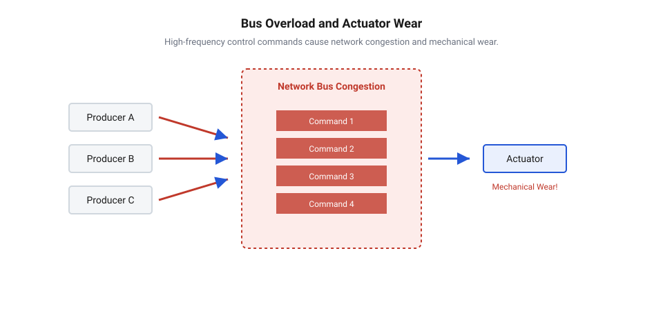
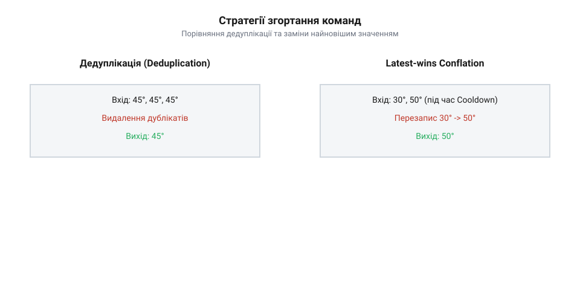
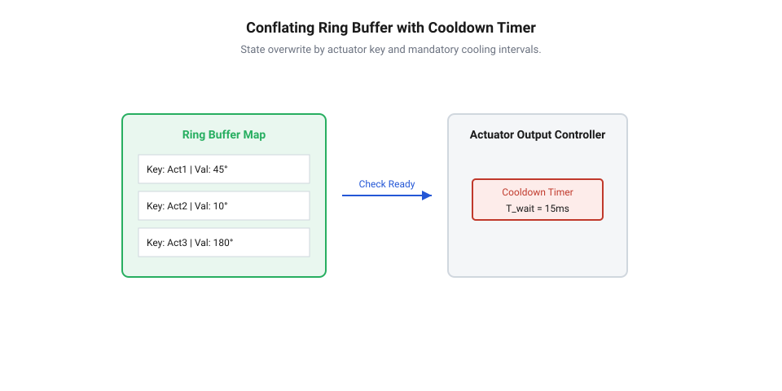

# Згортання команд актуаторів

<preknowlist>
- [Черги й семафори](root:sf-tasks/task-ipc) — принципи організації черг FIFO та потокобезпечного обміну даними між задачами
- [Виробник–споживач](root:sf-tasks/producer-consumer) — патерн взаємодії джерел команд та задач-обробників через проміжну чергу
</preknowlist>

## Перевантаження шини та знос актуаторів

Цифровий регулятор, опитуючи сенсори, розраховує нове цільове положення приводу сотні разів на секунду. Якщо кожну уставу відправляти в канал, виникає розрив між швидкістю обчислень та механікою. Виконавчий пристрій — @@en|actuator@@ (від лат. *actuare* — приводити в дію) — має механічну інерцію і відпрацьовує переміщення за десятки чи сотні мілісекунд.

Звичайні [черги міжзадачного обміну](root:sf-tasks/task-ipc) за принципом FIFO (англ. @@en|FIFO@@, від англ. *First-In, First-Out* — перший увійшов, перший вийшов) за таких умов переповнюються проміжними пакетами. Потік утворює трафіковий шторм на шині, вичерпує пропускну здатність і збільшує затримку доставки (англ. @@en|latency@@, від лат. *latens* — прихований). Актуатор отримує застарілі команди із запізненням, намагаючись відпрацювати рухи, які вже втратили актуальність. Безперервні мікропереміщення викликають паразитарні осциляції: двигун перегрівається від пікових струмів, а механічні передачі зазнають прискореного зносу.

*Черга FIFO затримує доставку через лавину проміжних пакетів, змушуючи привід дріботіти й перегріватися.*

Захист шини зв'язку та механіки вимагає фільтрації керуючого трафіку перед відправкою у фізичний канал. Цю задачу вирішує згортання команд (англ. @@en|command conflation@@, від лат. *conflare* — зливати докупи), що пригнічує надлишкові проміжні значення в буфері.

## Семантика команд та стратегії згортання

Безпека згортання залежить від природи сигналу. Команди встановлення стану (англ. @@en|stateful commands@@) є ідемпотентними уставами кінцевої координати, наприклад, завданням кута заслінки 45° чи потужності нагрівача 60%. Проміжні значення тут не мають цінності: приводу потрібна лише підсумкова точка, тому надлишковий потік безпечно згортається. Натомість дискретні лічильні події (англ. @@en|event-driven execution@@) вимагають виконання кожного імпульсу, як-от крок двигуна чи порція дозатора. Пригнічення бодай однієї такої команди порушує лічбу та веде до збою позиціонування.

Для @@en|stateful commands@@ застосовують дві стратегії фільтрації. Перша — дедуплікація (англ. @@en|deduplication@@, від лат. *duplicare* — подвоювати): модуль автоматично відкидає повторні ідентичні запити. Якщо регулятор циклічно надсилає ту саму координату, фільтр пропускає лише перший пакет, усуваючи повторне навантаження ядра та шини.

Друга стратегія — заміщення найновішим значенням (англ. @@en|latest-wins conflation@@). Якщо в буфері зберігається невичитана устава, нове надходження перезаписує її вміст. Привід не витрачає час на проміжні зупинки, а рухається одразу до найсвіжішої координати.

*Дедуплікація відсіває лише ідентичні повтори, тоді як latest-wins залишає єдину фінальну уставу у вікні згортання.*

## Буфер ізоляції та інтервали охолодження

Щоб заміщувати команди без ризику переповнення пам'яті, замість динамічних черг застосовують буфер ізоляції стану (англ. @@en|state isolation buffer@@, від англ. *isolate* — відокремлювати). Він містить фіксовані слоти під кожен окремий @@en|actuator@@. Це гарантує константне використання оперативної пам'яті за будь-якої частоти надходження запитів.

Алгоритм витіснення шукає слот приводу за його ідентифікатором. Якщо попереднє значення ще не передане у фізичний канал, нова устава просто перезаписує комірку. Довжина черги не зростає, а застарілі дані заміщуються без накладних витрат на динамічне виділення пам'яті.

Коли регулятор генерує часті відмінні значення, одного перезапису замало. Для захисту обладнання призначений інтервал охолодження (англ. @@en|cooldown@@, від англ. *cool down* — охолоджуватися). Параметр `T_cooldown` лімітує мінімальну паузу між фізичними відправками команд для одного актуатора.

Якщо нова команда надходить раніше вичерпання `T_cooldown`, вона очікує в слоті, накопичуючи подальші зміни через @@en|latest-wins conflation@@. У моделі [виробника та споживача](root:sf-tasks/producer-consumer) споживач вичитує слот і надсилає [сповіщення задачі](root:sf-tasks/task-notification) приводу на межі захисного інтервалу. Часове вікно природно згортає високочастотні збурення в єдиний імпульс, захищаючи механіку від передчасного зносу.

*Буфер витісняє застарілі устави у виділеному слоті, а інтервал охолодження затримує відправку до завершення захисної паузи.*