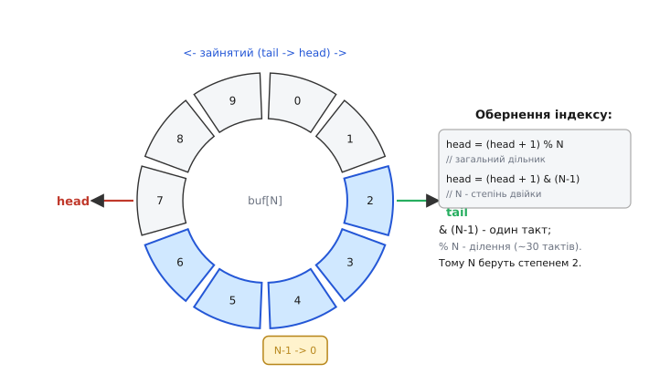
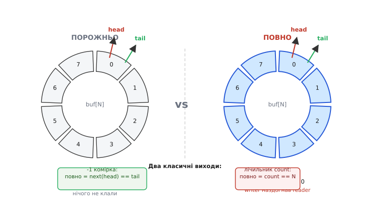

# ⚙️ Кільцевий буфер з нуля: індекси, межі, переповнення

[Контролер DMA](root:hw-arch/dma-controller) ллє дані в пам'ять безперервно, своїм темпом, поки ядро обробляє ривками — і між ними стоїть кільцевий буфер: структура, що звучить тривіально, але ламається рівно в трьох місцях. Збудуймо її покроково й розберімося з кожним.

## Задача

[Контролер DMA](root:hw-arch/dma-controller) наповнює буфер у SRAM безперервно, байт за байтом, не чекаючи ядра. Ядро, своєю чергою, забирає накопичені дані одним заходом — і лише тоді, коли має час. Між апаратним потоком і ривковою обробкою потрібен буфер, що приймає нове, поки старе ще не забрали; не має фіксованого «початку й кінця», бо потік нескінченний; і живе у скінченному шматку SRAM. Масив плюс два індекси звучать як тривіальне рішення — але саме на трьох межах (обернення індексу, «повно проти порожньо», блок через фізичний край масиву) ламається перша реалізація.

Коли тим самим кільцем користуються ISR і ядро водночас, виникають питання атомарності й порядку публікації — їх розбирає тема про [переривання](root:hw-arch/interrupts). Тут зосередимося на самій структурі та її арифметиці.

## Ідея

Кільцевий буфер (ring buffer, circular buffer) — це лінійний масив `buf[N]`, замкнений по модулю: за останнім індексом іде нульовий. Стан буфера описують два індекси: голова (head, writer index) — куди класти наступний байт, і хвіст (tail, reader index) — звідки брати наступний байт.

Серцевина структури — обернення індексу. Два рівнозначних способи:

```
head = (head + 1) % N        // загальний дільник
head = (head + 1) & (N − 1)  // якщо N — степінь двійки (швидка маска)
```

На мікроконтролері ці два вирази нерівнозначні за ціною: `%` — це ціле ділення, яке на Cortex-M без апаратного дільника займає десятки тактів; `&` — один такт, і компілятор знає про це так само добре, як і ми. Саме тому розмір кільця завжди беруть степенем двійки: 64, 128, 256, 512... Та сама маска працює і в SPSC-черзі, яку використовують [переривання](root:hw-arch/interrupts) для обміну з ядром — роль у неї там та сама, з тієї самої першопричини.



*Кільцевий буфер: масив із N комірок, замкнений у коло. head показує куди писати, tail — звідки читати; зайняте — діапазон tail→head. За індексом N−1 одразу йде 0 — це обернення (модуль N), що й робить буфер кільцем.*

Два індекси повністю описують поточний стан кільця — але є ситуація, де один і той самий стан відповідає двом різним умовам, і саме тут перша пастка.

## Пастка повно-проти-порожньо

> 🔧 **Навіщо це** — якщо не знати про цю неоднозначність, буфер або «затирає» свіжі дані поверх незчитаних, або зупиняє запис раніше ніж треба. Обидва сценарії тихі й підступні.

`head == tail` — це і «порожньо» (нічого не клали з моменту останнього читання), і «повно» (writer обійшов увесь масив і наздогнав reader). Сам по собі індекс не розрізняє ці два стани: конфігурація ідентична, зміст протилежний.



*Фундаментальна неоднозначність: head==tail означає і «порожньо», і «повно» — однакові індекси, протилежний зміст. Два класичні виходи: пожертвувати однією коміркою (стан читається з індексів) або тримати лічильник count зайнятих (доступна вся місткість).*

Неоднозначність знімають одним із двох способів — обидва робочі, вибір свідомий:

1. **Жертвуємо одну комірку.** «Повно» визначається як `next(head) == tail`, де `next(i) = (i + 1) & (N − 1)`. Максимальна місткість стає N − 1 (одна комірка завжди вільна як роздільник), але стан буфера читається з самих індексів без жодних додаткових змінних. Класичний вибір для чистого SPSC-кільця без лічильника.

2. **Тримаємо лічильник `count`.** Push збільшує `count`, pop зменшує; «повно» = `count == N`, «порожньо» = `count == 0`. Вся місткість N у грі, але з'являється спільна змінна — для ISR↔ядра вона вимагає [атомарності](root:hw-arch/interrupts). Типовий вибір для DMA-кільця, де «скільки накопичилось» — окреме корисне питання.

Другий варіант зручніший, коли ядро хоче знати ступінь заповнення, а не лише факт «є / нема» — саме він потрібен для DMA-варіанта кільця.

## Робочий код

**Базовий модуль: кільце байтів із лічильником**

:::tabs
:::code proj-ring-buffer/c/robochyi-kod.c
:::code proj-ring-buffer/cpp/robochyi-kod.cpp
:::code proj-ring-buffer/py/robochyi-kod.py
:::code proj-ring-buffer/go/robochyi-kod.go
:::code proj-ring-buffer/js/robochyi-kod.js
:::

`volatile` на індексах і лічильнику позначає, що їх змінює інша сторона (докладно — у темах про [`volatile`](root:sf-lang/volatile) та [переривання](root:hw-arch/interrupts)); компілятор зобов'язаний перечитувати їх щоразу з пам'яті.

**Читання блоку через край масиву**

Ядро забирає не по одному байту, а великим шматком — бо саме так улаштоване передавання до наступного обробника. І тут виникає фізична пастка: блок може починатися поблизу кінця масиву й продовжуватися з його початку. Один логічний блок — два фізично несуміжних відрізки.

:::tabs
:::code proj-ring-buffer/c/robochyi-kod-2.c
:::code proj-ring-buffer/cpp/robochyi-kod-2.cpp
:::code proj-ring-buffer/py/robochyi-kod-2.py
:::code proj-ring-buffer/go/robochyi-kod-2.go
:::code proj-ring-buffer/js/robochyi-kod-2.js
:::

Якщо блок не перетинає край — `n - first == 0`, другий `memcpy` копіює нуль байтів, і це цілком коректно. Але якщо забути про другий відрізок, результат — обрізаний блок або вихід за межі масиву. Саме ця «розірваність» відрізняє кільцевий буфер від лінійного: суцільне читання чи запис завжди потребує двох відрізків у запасі.

## DMA-твіст: коли «голову» рухає апаратура

У класичному кільці голову (head) просуває код — після кожного `rb_push`. У DMA-варіанті письменник — не код, а сам [контролер DMA](root:hw-arch/dma-controller): він автономно переносить байти з периферії прямо в `buf`, не звертаючись до ядра.

Тоді `head` не збільшує ядро — його читають із регістра лічильника передач [каналу DMA](root:hw-arch/dma-channels): скільки байтів контролер уже переніс або скільки лишилося в дескрипторі. «Скільки доступно для читання» = `(апаратний_head − tail) & RB_MASK` — похідна величина без жодного явного лічильника від DMA. Хвіст (tail) своєю чергою рухає ядро, забираючи блок через `rb_pop_block`.

Звідси й перевага: варіант із похідним head зручніший за варіант із явним `count`, який довелося б тримати синхронним з апаратурою. Саме так організовано потік даних від [АЦП через DMA](root:embedded/dma-adc) і [I2S/SPI-мікрофона](root:embedded/dma-spi-i2s); деталі периферії — у тих темах, тут — лише механіка індексів.

## Складність і пастки на МК

- **Степінь двійки.** N — степінь двійки → `& (N−1)` замість `% N`: один такт проти десятків. Якщо N — не степінь двійки, маска не працює — тоді чесний `%` або ручна перевірка `if (i == N) i = 0;`.

- **Повно проти порожньо — обирати свідомо.** «−1 комірка» (стан читається з самих індексів) або `count` (уся місткість, плюс спільна змінна). Мовчки сплутати ці стани — означає губити або перезаписувати дані без жодного попередження.

- **Політика переповнення.** Повно — відкинути новий байт (код вище) / затерти найстаріший (посунути ще й tail) / виставити прапорець помилки. Тихо губити байти підступно; для DMA-потоку переповнення означає «ядро не встигло за апаратурою» — це треба ловити явно.

- **Блок через край — два відрізки.** Будь-яке суцільне читання або запис, що перетинає фізичний край масиву, — це два `memcpy`. Забути другий — обрізаний блок або вихід за масив.

- **Вирівнювання й розмір під DMA.** Реальний DMA часто вимагає, щоб буфер починався на певній межі й мав розмір, кратний рядку кешу (деталі цілісності буфера — у темі про [гонки DMA й кеш](root:sf-tasks/dma-cache-races)); тут достатньо знати, що геометрію буфера диктує не лише зручність коду.

- **Атомарність індексів і два контексти.** Якщо head і tail зачіпають різні контексти — ISR, друге ядро ESP32, або сам DMA через регістр — потрібні атомарність слова і бар'єри, які розбирає тема про [переривання](root:hw-arch/interrupts); `count` як спільний лічильник тим паче потребує обережності.

Кільцевий буфер — це масив плюс модульна арифметика, і вся складність не в «писати по колу», а рівно в трьох місцях: обернення індексу, неоднозначність `head == tail` і блок, що розривається краєм масиву. Коли головою керує сам DMA, а ядро лише зчитує апаратний лічильник передач, кільце стає природним стиком між безперервним апаратним потоком і ривковою обробкою — без жодного зайвого копіювання проміжних даних.
