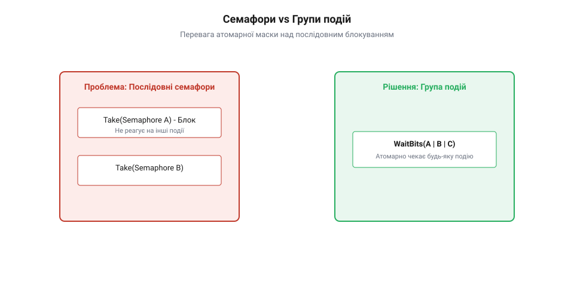
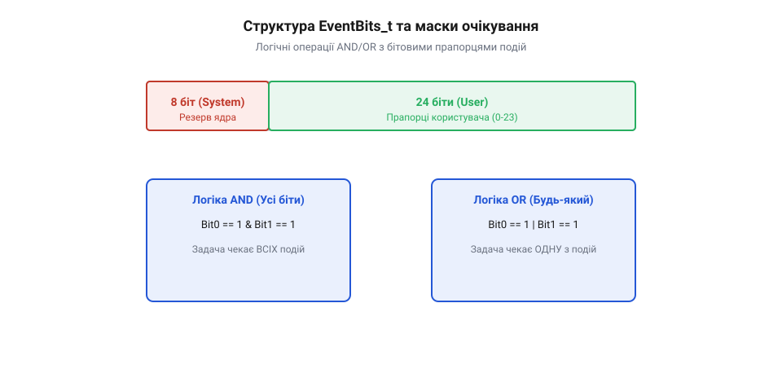
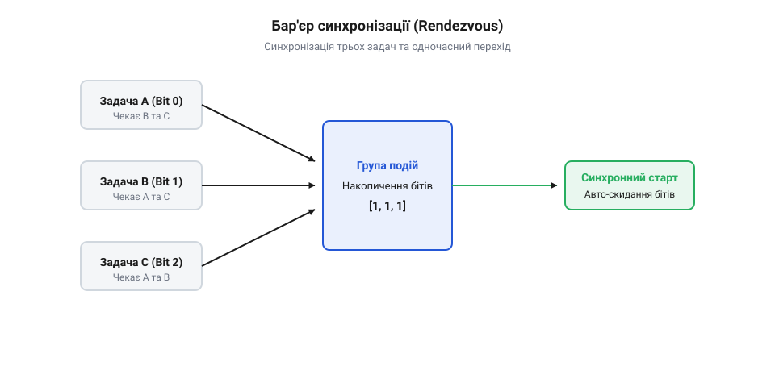
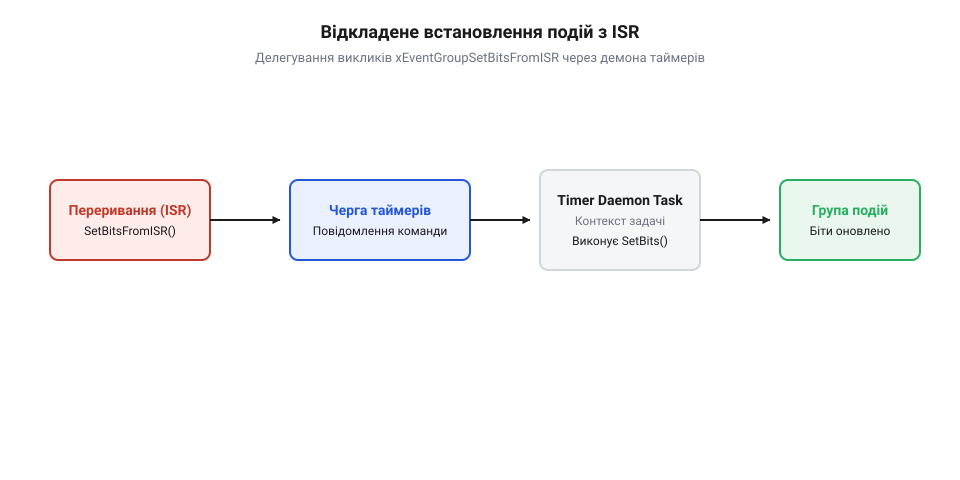

# Групи подій (event groups)

<preknowlist>
- [Черги й семафори](root:sf-tasks/task-ipc) — базові концепції блокування задач та передачі сигналів в RTOS
- [Сповіщення задачі](root:sf-tasks/task-notification) — прямі сповіщення TCB та їх порівняння з групами подій
</preknowlist>

## Синхронізація багатьох подій без черг

У розробці систем реального часу (англ. @@en|Real-Time Operating System@@, @@en|RTOS@@) складні пристрої часто вимагають суворої координації між автономними задачами. Уявіть безпілотний літальний апарат або промисловий робототехнічний контролер: перед тим як увімкнути силові приводи, головний потік управління мусить пересвідчитись, що контролер живлення підтвердив стабільність напруги, плата датчиків завершила самодіагностику, а радіомодуль встановив зв'язок із базовою станцією. Інший типовий сценарій виникає під час виникнення критичної помилки або натискання кнопки аварійної зупинки: система має негайно розблокувати та сповістити п'ять різних задач — від звукового сигналізатора та драйвера двигунів до модуля запису аварійного дампу в енергонезалежну пам'ять.

Коли розробник намагається побудувати подібні схеми взаємодії, використовуючи [традиційні черги та семафори](root:sf-tasks/task-ipc), він швидко зіштовхується з фундаментальними архітектурними обмеженнями класичних примітивів міжпроцесної взаємодії (англ. @@en|Inter-Process Communication@@, @@en|IPC@@). Бінарний семафор (грец. @@en|semaphore@@, від σῆμα — знак, прапор та φορός — носій) спроможний сигналізувати лише про одну-єдину подію: він перебуває або в стані «взято», або «вільно». Лічильний семафор (англ. @@en|counting semaphore@@) дозволяє підраховувати кількість подій одного типу, але так само не здатен передавати складну структуру сигналів.

Головна проблема класичних примітивів полягає в їхній односпрямованості та споживанні сигналу за принципом «один до одного». Черга (англ. @@en|queue@@) або семафор розблоковують лише першу задачу, яка перебуває у списку очікування. Щойно ця задача отримує елемент або бере семафор, примітив повертається у заблокований стан. Щоб сповістити $N$ очікуючих задач про одну й ту саму подію (наприклад, про готовність системного живлення), задача-виробник змушена в циклі $N$ разів викликати функцію віддачі семафора. Це породжує непередбачувані затримки (англ. @@en|latency@@), оскільки кожна віддача семафора може викликати негайне перемикання контексту на задачу з вищим пріоритетом, відкладаючи сповіщення решти задач.

Не менш складною є задача очікування комбінації подій (логічне І, англ. @@en|logical AND@@). Якщо задачі потрібно дочекатися завершення трьох незалежних операцій, при використанні семафорів розробник змушений виконувати три послідовні блокуючі виклики. Якщо друга подія відбудеться раніше за першу, задача все одно залишатиметься заблокованою на першому виклику, не маючи змоги дізнатися про готовність інших компонентів. Послідовне очікування руйнує детермінізм (лат. @@en|determinare@@ — визначати, обмежувати) системи реального часу, створює ризик виникнення взаємних блокувань (англ. @@en|deadlock@@) та суттєво ускладнює обробку таймаутів.

Порівнюючи цей підхід із [прямими сповіщеннями задач](root:sf-tasks/task-notification), можна відзначити, що сповіщення пропонують високу швидкість за рахунок зберігання бітових прапорців безпосередньо у блоці управління задачею (англ. @@en|Task Control Block@@, @@en|TCB@@). Однак сповіщення задач строго привязані до конкретного потоку-одержувача. Треті задачі не можуть підписатися на сповіщення стороннього потоку, а одна подія не може бути атомарно надіслана кільком одержувачам одночасно.

Історичний шлях розвитку механізмів координування задач у операційних системах реального часу розпочинався з найпростіших апаратних та системних прапорців подій (англ. @@en|event flags@@). У перших примітивних ядер RTOS прапорці являли собою звичайні бітові регістри в пам'яті, де кожен біт сигналізував про виконання певної перериванням чи потоком операції. Проте такі ранні реалізації мали суттєвий недолік: вони не забезпечували атомарності перевірки та очищення бітів і не мали вбудованих черг блокування задач. Розробникам доводилось вручну організовувати цикл опитування (англ. @@en|polling@@, від англ. @@en|poll@@ — опитувати) або закривати доступ критичними секціями, що зводило нанівець детермінізм системи. Еволюційний стрибок відбувся з появою повноцінних груп подій (англ. @@en|Event Groups@@, від лат. @@en|eventus@@ — подія, випадок та герм. @@en|gruppe@@ — група). Сучасні групи подій об'єднали бітове поле прапорців із системним списком очікуючих задач (англ. @@en|blocked task list@@), надали можливість атомарного маскування за логікою І/АБО (англ. @@en|logical AND/OR@@) та забезпечили широкомовне сповіщення (англ. @@en|broadcast@@, від broad — широкий та cast — кидати) довільної кількості потоків без додаткових накладних витрат оперативної пам'яті.

Таке архітектурне рішення дає змогу кодувати до 24 незалежних системних подій усередині однієї компактної змінної, атомарно перевіряти довільні комбінації прапорців та розблоковувати будь-яку кількість задач за один процесорний такт. Для передачі складених структур даних або послідовностей повідомлень RTOS використовує [спеціалізовані потокові буфери](root:sf-tasks/message-buffer), проте для задач синхронізації стану групи подій є найефективнішим інструментом.


*Порівняння послідовного опитування декількох семафорів та атомарного розблокування задач за маскою бітів у групі подій.*

## Бітова структура та логіка очікування

Внутрішньо група подій у системі @@en|FreeRTOS@@ являє собою спеціалізовану структуру даних, головним елементом якої є змінна типу `EventBits_t`. Типорозмір цієї змінної визначається конфігураційним макросом `configUSE_16_BIT_TICKS` у файлі `FreeRTOSConfig.h`. На сучасних 32-бітних мікроконтролерних архітектурах (зокрема ARM Cortex-M, ESP32 або RISC-V) `EventBits_t` є 32-бітним беззнаковим цілим числом (`uint32_t`).

Однак розробник не може використовувати всі 32 біти для власних потреб. У системі @@en|FreeRTOS@@ старші 8 бітів (із 24 по 31 біт включно) зарезервовані ядром для службового управління та збереження контрольних прапорців блокування. Отже, для сигналізації прикладних подій користувачеві доступні exact 24 біти (біти з 0 по 23). Кожен із цих бітів (англ. @@en|Event Bits@@) виступає в ролі бінарного прапорця: значення `1` означає, що подія відбулася, а `0` — що подія очікується або була скинута. На 16-бітних архітектурах під користувацькі події виділяється 8 молодших бітів, а старші 8 бітів залишаються за ядром.

Гнучкість груп подій проявляється в двох фундаментальних режимах очікування сигналів:
1. **Логічне АБО (англ. @@en|logical OR@@)**: Задача переходить у стан блокування і чекає, поки *хоча б один* із бітів, вказаних у масці очікування, стане рівним `1`. Цей режим застосовується для обробки альтернативних подій — наприклад, коли потік обробки має розблокуватися або при надходженні даних із UART, або при спрацюванні таймера безпеки, або при виявленні сигналу аварії. 2. **Логічне І (англ. @@en|logical AND@@)**: Задача залишається заблокованою доти, доки *всі* біти, задані в масці очікування, одночасно не встановляться в `1`. Це класичний паттерн синхронізації підсистем: обчислювальний потік очікує, поки Сенсор 1, Сенсор 2 та Модуль Навігації одночасно завершать збір даних перед запуском алгоритму фільтрацій.

Окрім вибору логічної умови, функція очікування приймає прапорець автоматичного очищення бітів після виходу (англ. @@en|clear on exit@@). Якщо цей параметр встановлено в `pdTRUE`, ядро @@en|FreeRTOS@@ атомарно (англ. @@en|atomic operation@@, від грец. @@en|atomos@@ — неподільний) скине очікувані біти в `0` безпосередньо перед поверненням управління задачі. Це запобігає повторному хибному спрацюванню при наступних ітераціях циклу. Якщо ж параметр встановлено в `pdFALSE`, біти залишаються у встановленому стані. Саме збереження бітів у групі дозволяє реалізувати широкомовне сповіщення (англ. @@en|broadcast@@): один виклик встановлення біта розблокує одразу всі $N$ задач, які чекали на цей прапорець, і кожна з них зможе успішно зчитати стан групи.

Математична модель перевірки умов у групах подій спирається на апарат булевої алгебри та побітові операції над вектором стану $E$ (поточні біти `EventBits_t`) та маскою очікування $M$ (`uxBitsToWaitFor`). Для режиму логічного АБО вираз оцінки умови розблокування задачі $T$ описується як:

```
Condition_OR = (E ∧ M) ≠ 0
```

Для режиму логічного І умова вимагає повної відповідності масці очікування:

```
Condition_AND = (E ∧ M) = M
```

При виклику `xEventGroupWaitBitsFromISR()` або оновленні прапорців з обробника переривань виклики розблокування задач відкладаються до завершення ISR через чергу команд таймера (англ. @@en|timer daemon task queue@@), що виключає невизначеність тривалості виконання переривання та захищає контекст ядра RTOS.

```
E_new = E_old ∧ (¬M)
```

Де оператор $\wedge$ позначає побітове І, $\vee$ — побітове АБО, а $\neg$ — побітове заперечення (NOT). Завдяки такій математичній структурі операції маскування виконуються за один процесорний такт через базові інструкції ALU (`AND`, `ORR`, `BIC`), що гарантує високу обчислювальну ефективність і системний детермінізм.

Окремим високоуровневим паттерном координування є рандеву-синхронізація (фр. @@en|rendezvous@@ — зустріч у призначеному місці) або бар'єр синхронізації (англ. @@en|synchronization barrier@@, від фр. @@en|barrière@@ — перегорожа). У багатьох паралельних алгоритмах декілька задач працюють фазами: жодна з задач не має права розпочати виконання Фази 2, доки абсолютно всі задачі групи не завершать Фазу 1. Спроба реалізувати бар'єр через послідовні виклики перевірки бітів вразлива до гонитви даних (англ. @@en|race condition@@).

Для безпечної реалізації бар'єра @@en|FreeRTOS@@ надає атомарну функцію `xEventGroupSync()`. При її виклику задача одночасно виконує дві дії в межах єдиної критичної секції: вона встановлює власний біт завершення фази та занурюється в сон до моменту, поки всі інші учасники бар'єра не встановлять свої біти. Щойно останній учасник викликає `xEventGroupSync()`, ядро розблоковує всі задачі одночасно та скидає біти бар'єра. Детальний перелік викликів наведено у виданні [довідник API груп подій](root:sf-tasks/event-groups/api-freertos-event-groups-api.md), а практичний приклад побудови контролера датчиків демонструє [проєкт рандеву-синхронізації](root:sf-tasks/event-groups/proj-rtos-event-group-rendezvous.md).


*Розподіл бітів у масиві EventBits_t і схема застосування масок логічного І та АБО.*

Нижче наведено практичний приклад створення групи подій, встановлення бітів та очікування їх комбінації за логікою І (Logical AND) мовами C та C++.

:::tabs
@tab C (FreeRTOS Native)
:::code root\eng\sf-tasks\event-groups/event-groups-d/c/freertos/vinittask.c c
@tab C++ (Idiomatic Wrapper)
:::code root\eng\sf-tasks\event-groups/event-groups-d/cpp/freertos/eventgroupwrapper.cpp cpp
:::

Для забезпечення детермінованості виконання та мінімізації накладних витрат обробка даних у критичних секціях здійснюється за допомогою цілочисельної арифметики з атомарним оновленням прапорців станів @@en|atomic flags@@, що виключає дрейф фази та блокування переривань.

## Широкомовне сповіщення та атомарне рандеву

Коли в складному пристрої запускається системна периферія, відразу кілька незалежних задач — модуль відображення інтерфейсу, служба збереження телеметрії та мережевий стек — вимушені одночасно чекати на завершення єдиного процесу: ініціалізації шини живлення та калібрування сенсорів. Якщо побудувати таку схему на класичних бінарних семафорах чи чергах, виникає фундаментальна перешкода: будь-який семафор є строго односпоживачем. Спроба розблокувати три задачі через один семафор призводить до того, що перший за пріоритетом потік забирає токен, а решта задач залишаються заблокованими. Аби сповістити всіх підписників, довелося б викликати функцію віддачі токена в циклі кілька разів поспіль, що руйнує детермінізм, створює затримки перемикання контексту та наражає систему на стани гонитви.

Механізм груп подій вирішує цю проблему через широкомовне сповіщення (@@en|broadcast@@, від англійського *broad* — широкий, *cast* — кидати, спрямовувати). Коли задача або обробник події встановлює певний біт у групі за допомогою виклику `xEventGroupSetBits()`, операційна система не просто змінює значення бітової маски `EventBits_t`. У межах тієї ж атомарної критичної секції планувальник RTOS проходить по всьому списку заблокованих задач `xTasksWaitingForBits`. Кожна задача, чия логічна умова (перевірка `OR` або повна комбінація `AND`) виявилася задоволеною після додавання нових бітів, атомарно переводиться зі стану блокування (@@en|Blocked@@) у стан готовності до виконання (@@en|Ready@@).

Ключовою деталлю керування широкомовним розблокуванням є прапорець `xClearOnExit`. Якщо під час виклику функції `xEventGroupWaitBits()` встановити `xClearOnExit` у значення `pdFALSE`, встановлені біти залишаються в групі подій після розблокування першої сенсорної задачі. Це дозволяє абсолютно всім іншим очікуючим потокам прочитати той самий сигнал і успішно вийти з блокування. Натомість якщо встановити `xClearOnExit` у `pdTRUE` для кількох очікуючих задач, лише перша розблокована задача атомарно скине біт при виході, позбавивши решту задач можливості побачити подію. Тому для широкомовних сигналів прапорець очищення залишають вимкненим, а скидання біта довіряють окремій керуючій задачі або виконують скидання після завершення циклу обробки.

Окрім широкомовного розблокування, групи подій надають потужний механізм фазового узгодження задач — атомарне рандеву (@@en|rendezvous@@, від французького *rendez-vous* — збирайтесь у визначеному місці), також відоме як бар'єрна синхронізація (@@en|barrier synchronization@@). Уявімо паралельні обчислення, де три незалежні задачі обробляють свої частини масиву даних. Жодна з задач не має права розпочати фазу злиття результатів (Фаза 2), поки абсолютно всі три задачі не завершать фазу первинного обчислення (Фаза 1). 

Якщо задача намагатиметься спочатку встановити свій біт готовності, а потім окремим викликом чекати на біти інших задач, між цими двома операціями виникає часовий проміжок, у якому стан системи може бути порушений іншими потоками. Для усунення цієї пастки FreeRTOS надає атомарну (@@en|atomic@@, від грецького *atomos* — неділимий) функцію `xEventGroupSync()`. Вона поєднує встановлення власного біта готовності та очікування на повний шарнірний набір бітів усіх учасників в один неделимий системний виклик.

Функція `xEventGroupSync()` приймає три ключові бітові маски: `uxBitsToSet` (біти, які поточна задача виставляє як знак прибуття до бар'єра), `uxBitsToWaitFor` (маска всіх бітів, які мають зібратися для подолання бар'єра) та таймаут `xTicksToWait`. Усередині ядра RTOS виконання цієї функції підпорядковується чіткій масці дій:

```
[Крок 1: Вхід Задачі 1 (маска прибуття 0x01)]
uxCurrentBits = 0x00 | 0x01 = 0x01
(0x01 & 0x07) ≠ 0x07                     [Умова бар'єра не виконана, Задача 1 блокується]

[Крок 2: Вхід Задачі 2 (маска прибуття 0x02)]
uxCurrentBits = 0x01 | 0x02 = 0x03
(0x03 & 0x07) ≠ 0x07                     [Умова бар'єра не виконана, Задача 2 блокується]

[Крок 3: Вхід Задачі 3 (маска прибуття 0x04)]
uxCurrentBits = 0x03 | 0x04 = 0x07
(0x07 & 0x07) = 0x07                     [Умова бар'єра виконана!]
uxCurrentBits = 0x07 & ~0x07 = 0x00      [Атомарне автоочищення прапорців бар'єра]
```

При виконанні умови бар'єра ядро RTOS атомарно скидає всі біти, вказані в `uxBitsToWaitFor`, і одночасно розблоковує всі задачі, що чекали біля бар'єра. Це гарантує, що бар'єр автоматично повертається у вихідний стан для наступного обчислювального циклу.


*Схема атомарного фазового розблокування трьох задач через бар'єр рандеву xEventGroupSync.*

Практична реалізація цього патерну для [координування трьох паралельних сенсорних задач](root:sf-tasks/event-groups/proj-rtos-event-group-rendezvous.md) демонструє, як паралельні потоки гармонійно переходять між ітераціями обробки без застосування складних умовних змінних чи додаткових лічильників.

:::tabs
:::code root\eng\sf-tasks\event-groups/event-groups-d/c/esp-idf/vworkertaska.c c
:::code root\eng\sf-tasks\event-groups/event-groups-d/cpp/esp-idf/rendezvousbarrier.cpp cpp
:::

---

## Особливості викликів із переривань

Під час розробки прошивок реального часу виникає спокуса виставляти прапорці подій безпосередньо з обробників периферійних переривань (@@en|Interrupt Service Routine@@, скорочено @@en|ISR@@). Однак прямий виклик звичайної функції `xEventGroupSetBits()` всередині ISR є неприпустимим. Причина полягає в обчислювальні складності операції. Коли в групі подій виставляється біт, ядро RTOS змушене виконати обхід списку заблокованих задач `xTasksWaitingForBits`, обчислити складні логічні вирази `AND`/`OR` для кожного потоку та ухвалити рішення про зміну стану задач на `Ready`.

Час виконання цієї процедури прямо пропорційний кількості очікуючих задач `N`, тобто має складність `O(N)`. Якщо дозволити виконання `O(N)` обчислень всередині ISR, час затримки переривання (@@en|interrupt latency@@) стане детерміновано непередбачуваним. Це загрожує пропуском наступних апаратних переривань від високошвидкісних інтерфейсів (наприклад, SPI чи CAN) та викликає тремтіння часу відгуку (@@en|jitter@@).

Для забезпечення константного часу виконання `O(1)` в обробниках переривань FreeRTOS застосовує механізм відкладеної обробки (@@en|deferred interrupt processing@@). Усі потенційно тривалі операції виносяться з контексту переривання в контекст системної задачі — демона таймерів (@@en|Timer Daemon Task@@, від грецького *daimon* — фоновий системний процес). Для цього в ISR використовується спеціалізована функція `xEventGroupSetBitsFromISR()`.

Замість безпосереднього аналізу списку задач, `xEventGroupSetBitsFromISR()` формує короткий елемент команди та відправляє його в системну чергу команд таймера `xTimerQueue`. Ця операція зведення елемента в чергу виконується за строго детермінований час `O(1)`. Структура команди містить вказівник на групу подій, бітову маску для встановлення та вказівник на системну зворотну функцію `vEventGroupSetBitsCallback()`. 

Алгоритм взаємодії обробника переривання та демона таймерів розгортається наступним чином:

```
[Обробник ISR]
  │
  ├── 1. Виклик xEventGroupSetBitsFromISR(xGroup, uxBits, &xHigherPriorityTaskWoken)
  ├── 2. Пуш елемента команди в xTimerQueue [Час виконання O(1)]
  ├── 3. Перевірка прапорця xHigherPriorityTaskWoken
  └── 4. Запит зміщення контексту через portYIELD_FROM_ISR()
  │
[Контекст Задач]
  │
  ├── 5. Планувальник перемикає виконання на Timer Daemon Task (prvTimerTask)
  ├── 6. Демон читає команду з xTimerQueue
  └── 7. Демон викликає xEventGroupSetBits() [Виконання O(N) у контексті задачі]
```


*Послідовність передачі команди з ISR у чергу демона таймерів для асинхронного встановлення бітів.*

Для коректного функціонування цієї схеми у файлі конфігурації `FreeRTOSConfig.h` повинні бути активовані відповідні макроси. Режим [відкладеного оброблення переривань](root:sf-tasks/rtos-daemon-task-deferred-interrupts) вимагає налаштування параметрів системного демона:

- `configUSE_TIMERS 1` — вмикає службу системних таймерів та створює задачу `prvTimerTask`. - `configTIMER_TASK_PRIORITY` — визначає пріоритет демона таймерів. Якщо цей пріоритет вищий за пріоритет поточної перерваної задачі, виклик `portYIELD_FROM_ISR()` спричинить миттєве перемикання контексту на демон відразу після виходу з ISR. - `configTIMER_QUEUE_LENGTH` — задає глибину командної черги. Якщо переривання виникають занадто часто і черга переповнюється, функція `xEventGroupSetBitsFromISR()` поверне значення `pdFAIL`, а подія буде втрачена.

Більше подробиць про правила використання сигнатур функцій для переривань наведено у [довіднику системних викликів](root:sf-tasks/event-groups/api-freertos-event-groups-api.md).

:::tabs
:::code root\eng\sf-tasks\event-groups/event-groups-d/c/esp-idf/gpio-isr-handler.c c
:::code root\eng\sf-tasks\event-groups/event-groups-d/cpp/esp-idf/interrupteventnotifier.cpp cpp
:::

---

## Практичне проєктування та оптимізація пам'яті

Вибір правильного примітива синхронізації є фундаментом надійної архітектури RTOS. Групи подій незамінні в ситуаціях, коли потрібно відстежувати комбінації умов (логіка `AND`/`OR`), проводити широкомовне сповіщення багатьох задач або синхронізувати фази виконання через бар'єр рандеву. Однак для інших задач існують більш ефективні інструменти. Наприклад, якщо необхідно передавати числові дані або структури між потоками, слід використовувати [передачі складних даних](root:sf-tasks/task-ipc) за допомогою черг. Якщо вимагається передача неструктурованих байтових потоків, краще звернутися до [потокових буферів повідомлень](root:sf-tasks/message-buffer). У сценаріях простої бінарної сигналізації між одним джерелом і однією задачею [прямі сповіщення задач](root:sf-tasks/task-notification) випереджають групи подій за швидкістю та не потребують виділення додаткової пам'яті.

При організації передачі даних у класичному патерні [виробник та споживач](root:sf-tasks/producer-consumer) групи подій використовують як сигнальний канал готовності буферів, тоді як для оптимізації частих команд актуаторів краще застосовувати [згортання команд актуаторів](root:sf-tasks/dh-actuator-command-conflation).

Для систем із підвищеними вимогами до надійності та оптимізації оперативної пам'яті (RAM) ключовим рішенням є відмова від динамічного виділення купи. Функція `xEventGroupCreate()` виділяє пам'ять під структуру `EventGroup_t` з динамічної купи RTOS (`pvPortMalloc`). У довгопрацюючих пристроях це створює ризик фрагментації купи (@@en|heap fragmentation@@). 

Альтернативою є статичне виділення пам'яті за допомогою виклику `xEventGroupCreateStatic()`. Загальний розмір структури `StaticEventGroup_t` становить від 28 до 36 байтів (залежно від архітектури процесора). Програміст виділяє цей буфер у статичній пам'яті (BSS або глобальна область), усуваючи невизначеність відмов виділення пам'яті під час виконання:

```c
// Статичне виділення пам'яті під групу подій
static StaticEventGroup_t xCreatedEventGroupMemory;
static EventGroupHandle_t xEventGroupHandle;

void vAppInit(void) {
    xEventGroupHandle = xEventGroupCreateStatic(&xCreatedEventGroupMemory);
}
```

При проєктуванні бітових масок у 32-бітових мікроконтролерах слід враховувати розрядність типу `EventBits_t`. Хоча змінна має ширину 32 біти, користувачеві доступні лише 24 молодші біти (біти від `0` до `23`). Старші 8 бітів (від `24` до `31`) зарезервовані ядром FreeRTOS для збереження керуючих прапорців (таких як `xCLEAR_ON_EXIT_BIT` та `xWAIT_FOR_ALL_BITS`). У 16-бітових системах при конфігурації `configUSE_16_BIT_TICKS 1` користувачеві доступно лише 8 бітів.

При практичній експлуатації груп подій важливо уникати трьох поширених архітектурних пасток:

1. **Втрата подій (@@en|event loss@@):** Групи подій є прапорцями стану, а не лічильниками. Якщо переривання або задача виставляє біт тричі поспіль до того, як очікуюча задача встигне запуститися і прочитати групу, очікуюча задача зафіксує лише один факт встановлення біта. Якщо системі потрібен підрахунок кількості подій, необхідно використовувати звичайний або рахунковий семафор. 2. **Фантомне скидання (@@en|phantom clear@@):** У разі використання широкомовного сповіщення кількох задач встановлення прапорця `xClearOnExit = pdTRUE` у виклику `xEventGroupWaitBits()` призведе до того, що перша розблокована задача скине біт. У результаті інші задачі-підписники ніколи не дізнаються про настання події. 3. **Інверсія пріоритетів (@@en|priority inversion@@) у бар'єрах:** Під час використання `xEventGroupSync()` низькопріоритетна задача може повільно виконувати свою фазу обчислень. Якщо високопріоритетні задачі вже досягли бар'єра і заблокувалися, вони будуть змушені чекати низькопріоритетний потік, що створює тимчасову інверсію пріоритетів.

Нижче наведено завершений архітектурний вузол моніторингу готовності підсистем пристрою, виконаний із використанням статичного виділення пам'яті.

:::tabs
:::code root\eng\sf-tasks\event-groups/event-groups-d/c/esp-idf/vsystemmonitortask.c c
:::code root\eng\sf-tasks\event-groups/event-groups-d/cpp/esp-idf/systemhealthmonitor.cpp cpp
:::