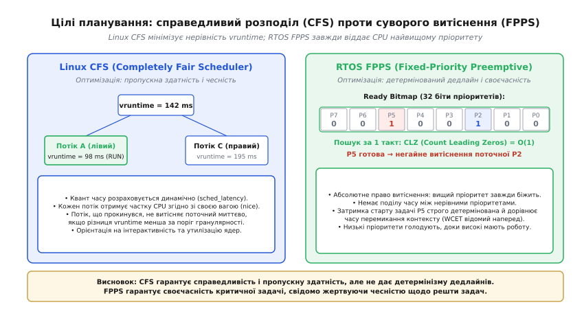
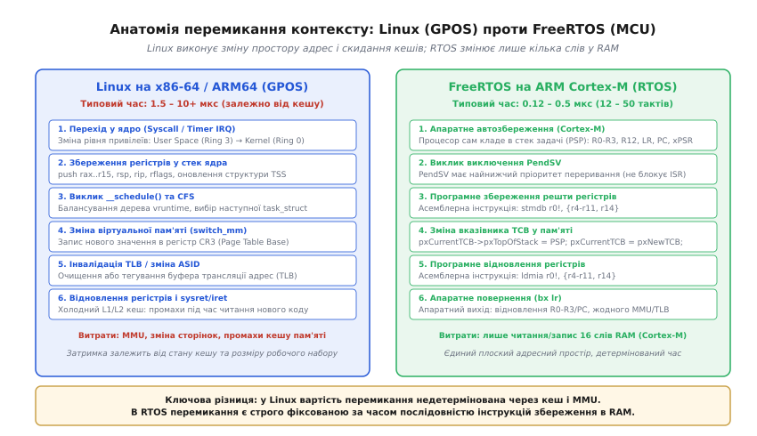
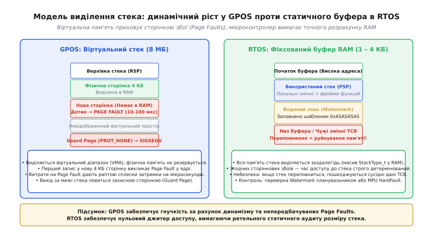
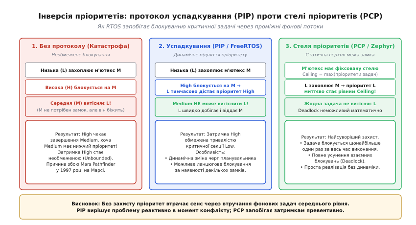
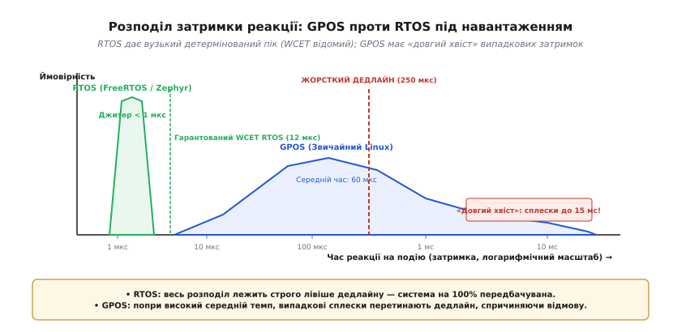

# Потоки настільної ОС проти задач RTOS

<preknowlist>
- [Детермінованість](root:sf-tasks/realtime-determinism) — передбачуваність часу реакції проти середньої швидкості обчислень.
- [Процеси й потоки](root:sf-os/process-vs-thread) — спільний адресний простір, контекст виконання та системні структури.
- [Планувальник](root:sf-os/scheduler) — алгоритми вибору чергової задачі на виконання та квантування часу.
- [Сторінки, таблиці сторінок і MMU](root:sf-os/paging-and-mmu) — трансляція віртуальних адрес, таблиці сторінок і кеш TLB.
- [Інверсія пріоритетів](root:sf-os/priority-inversion) — блокування високого пріоритету низьким через спільний ресурс.
</preknowlist>

Якщо на чотириядерному процесорі з тактовою частотою 3 ГГц запустити цикл стабілізації безколекторного двигуна, що вимагає оновлення параметрів кожні 100 мікросекунд із відхиленням не більше однієї мікросекунди, стандартна настільна операційна система Linux регулярно зриватиме керування. Попри гігабайти оперативної пам'яті та гігагерци обчислювальної потужності, фоновий запис на накопичувач, обробка мережевого пакета чи динамічна зміна частоти процесора здатні затримати потік керування на 5–15 мілісекунд. Водночас мікроконтролер вартістю два долари із тактовою частотою 100 МГц під керуванням операційної системи реального часу (англ. *Real-Time Operating System*, *RTOS*) виконує це перемикання за 0.3 мікросекунди за будь-яких умов.

Причина цієї розбіжності криється не в продуктивності апаратного забезпечення, а в протилежних фундаментальних цілях проєктування. Потоки настільних операційних систем загального призначення (англ. *General-Purpose Operating System*, *GPOS*) створені для максимальної сумарної пропускної здатності та справедливого розподілу ресурсів між десятками некерованих програм. Задачі RTOS підпорядковані єдиній вимозі — абсолютному часовому детермінізму, де своєчасність реакції переважає загальний обсяг виконаних обчислень.

---

### Цілі планування: справедливий розподіл проти суворого витіснення

Планувальник операційної системи загального призначення розв'язує задачу оптимізації пропускної здатності (англ. *throughput*) та інтерактивності (англ. *interactivity*). У Linux типовим алгоритмом для звичайних потоків є повністю справедливий планувальник (англ. *Completely Fair Scheduler*, *CFS*, а в новіших ядрах — *EEVDF*, *Earliest Eligible Virtual Deadline First*). Його математична основа — ідея ідеального багатозадачного процесора, де кожен готовий до виконання потік отримує частку процесорного часу, пропорційну його динамічній вазі (значенню *nice* від -20 до +19).

Для обліку спожитих ресурсів CFS веде змінну віртуального часу виконання кожної сутності — `vruntime` (англ. *virtual runtime*):

```
vruntime += (реальний_час_виконання · NICE_0_LOAD) ÷ вага_потоку
```

Усі готові потоки організовані в червоно-чорне дерево (англ. *red-black tree*), упорядковане за зростанням `vruntime`. Планувальник завжди обирає крайній лівий вузол — потік, який отримав найменше процесорного часу порівняно з іншими. 


*Linux CFS оптимізує справедливий поділ vruntime між усіма потоками, тоді як RTOS FPPS за O(1) віддає 100 % CPU найвищому готовому пріоритету.*

Такий підхід чудово підходить для настільних комп'ютерів і серверів: фоновий рендеринг відео не «підвішує» курсор миші та віконний інтерфейс, а потік вебсервера отримує свою частку обчислень. Проте для задач реального часу справедливість є головною завадою:
1. **Динамічний квант часу.** Величина часу, який потік може виконуватися безперервно (`sched_latency`), постійно перераховується залежно від кількості активних процесів у системі.
2. **Відсутність миттєвого витіснення.** Навіть якщо високопріоритетний потік прокидається після очікування події, CFS не перемикає процесор на нього миттєво, якщо поточний потік ще не вичерпав свій мінімальний поріг гранулярності виконання (`sysctl_sched_min_granularity`).
3. **Евристики балансування.** Ядро періодично переміщує потоки між ядрами процесора для вирівнювання навантаження, що призводить до втрати даних у локальних кешах L1/L2 і спричиняє раптові затримки.

Планувальник RTOS (наприклад, у FreeRTOS чи Zephyr) діє за протилежним принципом — фіксованого пріоритетного витіснення (англ. *Fixed-Priority Preemptive Scheduling*, *FPPS*). Тут немає поняття «справедливості»: кожній задачі під час створення призначається статичний числовий пріоритет.

Алгоритм вибору задачі в RTOS зведений до бітових операцій над регістром маски готовності.

:::tabs
```c
// Пошук найвищого пріоритету за один такт процесора через розширення GCC/Clang
uint32_t top_priority = 31 - __builtin_clz(uxTopReadyPriority);
```
```cpp
#include <bit>
#include <cstdint>

// Ідіоматичний пошук у C++20 без компіляторозалежних макросів
auto top_priority = 31 - std::countl_zero(uxTopReadyPriority);
```
:::

Інструкція `CLZ` (англ. *Count Leading Zeros*, підрахунок провідних нулів) виконується процесором апаратно за один такт. Складність пошуку чергової задачі становить строго `O(1)` і не залежить від кількості задач у системі.

Якщо задача з пріоритетом 5 стає готовою до виконання (наприклад, після сигналу від таймера чи переривання), вона **негайно** й безумовно витісняє задачу з пріоритетом 4 або нижче. Задача нижчого пріоритету не отримує жодної мілісекунди «справедливого залишку» — її виконання зупиняється на поточному такті. Якщо високопріоритетні задачі безперервно виконують роботу, низькопріоритетні задачі не виконаються ніколи (англ. *starvation*, голодування). В RTOS це вважається не дефектом, а усвідомленим архітектурним правилом: якщо системі потрібно керувати рулями літака, оновлення журналу на SD-картці має стояти на паузі доти, доки критична робота не завершиться.

---

### Вартість перемикання контексту: простір ядра проти мікроконтролера

Перемикання контексту (англ. *context switch*) — це процес збереження стану поточного потоку виконання та відновлення стану іншого. Хоча математично зміст операції однаковий, системна вартість у GPOS та RTOS різниться на два порядки.


*Перемикання в Linux охоплює зміну рівнів захисту Ring 3/0, скидання TLB у регістрі CR3 та промахи кешу. В RTOS Cortex-M процесор апаратно зберігає 8 регістрів, а переривання PendSV оновлює покажчик TCB.*

#### Анатомія перемикання в настільній ОС (Linux на x86-64 / ARM64)

У настільній ОС потоки функціонують у просторі користувача (англ. *User Space*, кільце захисту Ring 3 або ARM EL0), а планувальник — у просторі ядра (англ. *Kernel Space*, Ring 0 або ARM EL1). Послідовність перемикання вимагає проходження повного бар'єра захисту:

1. **Зміна рівня привілеїв.** Виклик системного виклику (`syscall`) або апаратне переривання таймера викликає апаратний перехід у режим ядра зі зміною сегментів стека.
2. **Збереження регістрів користувача.** Ядро зберігає регістри загального призначення (`rax`–`r15`, покажчик стека `rsp`, лічильник команд `rip`, прапорці `rflags`) у структуру кадру стека ядра (структура `pt_regs`).
3. **Робота планувальника.** Викликається функція ядра `__schedule()`, яка блокує черги запуску, балансує дерево CFS та обирає наступну структуру `task_struct`.
4. **Зміна адресного простору (MMU).** Якщо відбувається перемикання між потоками різних процесів, виконується функція `switch_mm()`. Вона записує нову фізичну адресу кореневої таблиці сторінок у керівний регістр процесора `CR3` (на x86-64) або `TTBR0_EL1` (на ARM64).
5. **Інвалідація TLB.** Запис у `CR3` призводить до скидання або ревалідації буфера асоціативної трансляції (англ. *Translation Lookaside Buffer*, *TLB*). Навіть із підтримкою ідентифікаторів адресних просторів (англ. *Process-Context Identifiers*, *PCID* / *ASID*), наступні звернення до пам'яті в новому потоці змушені виконувати повільні проходження таблиць сторінок (англ. *Page Table Walk*) по 4–5 рівнях ієрархії.
6. **Забруднення кешу процесора.** Новий потік має власний робочий набір даних (англ. *working set*). Звернення до його пам'яті витісняють лінії з надшвидких кешів L1d та L1i (англ. *cache pollution*), що сповільнює виконання коду протягом перших тисяч тактів після перемикання.
7. **Відновлення та вихід.** Відновлення регістрів нового потоку та виконання інструкції `sysret` або `iret` для повернення в простір користувача.

Сумарна пряма затримка перемикання контексту в Linux становить **1.5–5 мікросекунд**, а непряма (разом із промахами TLB і кешів L1/L2) сягає **10–30 мікросекунд**.

#### Анатомія перемикання в RTOS (FreeRTOS на ARM Cortex-M)

У мікроконтролері відсутній блок керування пам'яттю (англ. *Memory Management Unit*, *MMU*). Усі задачі та саме ядро RTOS розміщені в єдиному плоскому фізичному адресному просторі оперативної пам'яті (RAM). 

Перемикання виконується через спеціалізоване апаратне виключення `PendSV` (англ. *Pended Service Call*), яке налаштоване на найнижчий пріоритет серед переривань:

1. **Апаратне автозбереження (Hardware Stacking).** У момент входу у виключення `PendSV` апаратний конвеєр процесора ARM Cortex-M автоматично зберігає у стек поточної задачі (який адресується покажчиком `PSP`, *Process Stack Pointer*) базові регістри:
   ```
   Стек PSP: [xPSR] [PC] [LR] [R12] [R3] [R2] [R1] [R0]
   ```
2. **Програмне збереження решти регістрів.** В обробнику `PendSV_Handler` виконується асемблерне збереження додаткових регістрів ядра:
   ```armasm
   mrs r0, psp
   stmdb r0!, {r4-r11, r14}
   ```
3. **Оновлення покажчика TCB.** Поточне значення `PSP` записується в перше поле структури описувача задачі (англ. *Task Control Block*, *TCB*):
   ```armasm
   str r0, [r2]   @ pxCurrentTCB->pxTopOfStack = r0
   ```
4. **Вибір наступного TCB.** Планувальник завантажує адресу нового описувача задачі:
   ```armasm
   ldr r1, [r3]   @ pxCurrentTCB = pxNewTCB
   ```
5. **Програмне відновлення.** Завантаження регістрів нової задачі:
   ```armasm
   ldmia r0!, {r4-r11, r14}
   msr psp, r0
   ```
6. **Апаратне повернення.** Інструкція `bx lr` зі спеціальним значенням `EXC_RETURN` (наприклад, `0xFFFFFFFD`) наказує апаратурі автоматично відновити `R0`–`R3`, `R12`, `LR`, `PC`, `xPSR` зі стека нової задачі та продовжити її виконання.

Увесь процес перемикання контексту в RTOS займає **12–50 тактів процесора**. За частоти ядра 100 МГц це становить **0.12–0.5 мікросекунди**. Цей час строго детермінований: він не залежить від стану кешу, обсягу зайнятої пам'яті чи кількості відкритих дескрипторів.

---

### Виділення пам'яті під стек: віртуальний ріст проти фіксованого буфера

Стек зберігає локальні змінні функцій, адреси повернення, збережені регістри та аргументи викликів. Підхід до виділення пам'яті під стек докорінно відрізняє поведінку системи за навантаження.


*GPOS надає великий віртуальний діапазон, але перший дотик до нової сторінки 4 КБ викликає Page Fault. В RTOS стек задачі — це фіксований статичний масив без затримок виділення.*

#### Стек у настільній ОС (динамічний посторінковий ріст)

У настільній ОС кожному новоствореному потоку виділяється великий віртуальний діапазон пам'яті (за замовчуванням у Linux — 8 МБ для головного потоку процесу і 2–8 МБ для потоків `pthread`, виділених через `mmap` із прапорцем `MAP_ANONYMOUS`).

Однак фізична пам'ять (RAM) під цей стек одразу не надається:
1. Віртуальні адреси стека позначаються в ядрі як невідображені (англ. *unmapped*).
2. Коли стек функції розростається і покажчик стека вперше торкається наступної 4-кілобайтної сторінки, процесор формує апаратне виключення — сторінковий збій (англ. *Page Fault*, виключення вектор №14 на x86).
3. Процесор зупиняє виконання потоку і перемикається в обробник ядра `do_page_fault()`.
4. Ядро знаходить вільний фізичний кадр пам'яті (англ. *page frame*), обнуляє його (щоб потік не прочитав чужі залишки пам'яті), записує запис у таблицю сторінок процесу та повертає керування потоку.

Цей механізм економить фізичну пам'ять, але вбиває передбачуваність: випадковий виклик функції з великим локальним масивом викликає затримку обробки сторінкового збою тривалістю **10–100 мікросекунд** безпосередньо посеред обчислень.

На дні віртуального стека настільна ОС розміщує спеціальну захисну сторінку (англ. *Guard Page*) з атрибутом `PROT_NONE`. Будь-яка спроба вийти за межі виділеного розміру стека викликає миттєвий сигнал `SIGSEGV` (англ. *Segmentation Fault*), що захищає сусідні структури даних процесу від псування.

#### Стек у мікроконтролері (статичний фіксований буфер)

В RTOS пам'ять під стек задачі виділяється або як статичний масив у пам'яті під час компіляції, або через статичний блок пулу під час ініціалізації.

:::tabs
:::code potoky-nastilnoi-os-proty-zadach-rtos-d/c/stek-u-mikrokontroleri.c
:::code potoky-nastilnoi-os-proty-zadach-rtos-d/cpp/stek-u-mikrokontroleri.cpp
:::

Переваги та небезпеки такого підходу:
* **Нульовий джитер.** Усі байти фізичної пам'яті доступні миттєво. Жодних сторінкових збоїв не існує на рівні архітектури процесора.
* **Обмеженість ресурсів.** Якщо на мікроконтролері загальний обсяг RAM становить 64 КБ, створення 20 задач зі стеками по 4 КБ вичерпає всю пам'ять пристрою ще до старту програми. Розмір стека для кожної задачі розраховується з точністю до десятків байтів.
* **Небезпека переповнення стека (Stack Overflow).** Якщо функція перевищить виділений буфер, покажчик стека `PSP` почне перезаписувати сусідні змінні в оперативній пам'яті, змінні описувача задачі `TCB` або чужі стеки.

Для боротьби з переповненням стека в RTOS застосовують два механізми:
1. **Водяні знаки (Stack Watermarking).** Під час створення задачі її буфер стека заповнюється байтовим шаблоном (у FreeRTOS — числом `0xA5`). Під час роботи планувальник або утиліта моніторингу перевіряє глибину «змивання» шаблону знизу стека (`uxTaskGetStackHighWaterMark()`). Якщо шаблон знизу порушено, викликається хук аварії `vApplicationStackOverflowHook()`.
2. **Апаратний захист через MPU.** Якщо мікроконтролер має блок захисту пам'яті (англ. *Memory Protection Unit*, *MPU*), RTOS налаштовує нижні 32 байти буфера стека як заборонені для запису. Спроба запису викликає виключення `MemManage_Handler` (апаратний аналог *Segmentation Fault*).

---

### Обробка інверсії пріоритетів

Інверсія пріоритетів (англ. *Priority Inversion*) — одна з найнебезпечніших пасток багатозадачності реального часу. Це ситуація, за якої високопріоритетна задача не може виконатися через те, що ресурс утримується низькопріоритетною задачею, а ту, своєю чергою, витіснила фонова задача середнього пріоритету.


*Без протоколу середня задача блокує високу на невизначений час. PIP тимчасово піднімає пріоритет низької задачі до високої; PCP заздалегідь піднімає пріоритет до стелі замка.*

Сценарій класичної катастрофи:
1. Низькопріоритетна задача `Task_Low` (пріоритет 1) захоплює м'ютекс для доступу до шини SPI.
2. Високопріоритетна задача `Task_High` (пріоритет 10) прокидається від таймера і намагається захопити той самий м'ютекс SPI. Оскільки м'ютекс зайнятий, `Task_High` переходить у стан очікування (блокується).
3. У цей момент готова до виконання середньостатистична задача `Task_Med` (пріоритет 5), якій шина SPI взагалі не потрібна (вона, наприклад, розраховує анімацію дисплея).
4. Планувальник бачить, що серед задач у черзі готовності найвищий пріоритет має `Task_Med` (пріоритет 5 проти пріоритету 1 у `Task_Low`). Планувальник віддає процесор `Task_Med`.
5. **Катастрофа:** `Task_Low` не може завершити роботу з SPI, бо її витіснила `Task_Med`. `Task_High` не може запуститися, бо чекає на звільнення SPI. Критична задача з найвищим пріоритетом фактично чекає на завершення другорядної фонової задачі! Затримка стає необмеженою (англ. *unbounded priority inversion*).

Саме ця системна помилка ледь не призвела до повної втрати марсохода *Mars Pathfinder* у липні 1997 року: задача обробки наукової інформації низького пріоритету захопила м'ютекс інформаційної шини, задача середнього пріоритету витіснила її, а високопріоритетна задача керування шиною застрягла, викликавши спрацювання сторожового таймера (англ. *watchdog timer*) та циклічне перезавантаження станції.

Для запобігання інверсії пріоритетів у сучасних системах реалізують два протоколи.

#### 1. Протокол успадкування пріоритету (Priority Inheritance Protocol, PIP)

Протокол діє реактивно в момент виникнення конфлікту:
* Коли високопріоритетна задача `Task_High` намагається захопити м'ютекс, утримуваний задачею `Task_Low`, ядро RTOS **тимчасово підвищує пріоритет** `Task_Low` до рівня `Task_High`.
* Тепер задача `Task_Low` має пріоритет 10, тому фонова задача `Task_Med` (пріоритет 5) не може її витіснити.
* `Task_Low` швидко завершує критичну секцію, відпускає м'ютекс і її пріоритет автоматично повертається до початкового рівня 1.
* М'ютекс миттєво переходить до `Task_High`, яка починає виконання.

Затримка задачі `Task_High` тепер строго обмежена тривалістю критичної секції задачі `Task_Low`. Цей протокол підтримується у FreeRTOS (для сутностей `Mutex`, але не для бінарних семафорів) та в POSIX-потоках Linux (`PTHREAD_PRIO_INHERIT`).

#### 2. Протокол стелі пріоритетів (Priority Ceiling Protocol, PCP / IPCP)

У протоколі негайної стелі пріоритетів (англ. *Immediate Priority Ceiling Protocol*, *IPCP*, стандартизованому в POSIX як `PTHREAD_PRIO_PROTECT` і доступному в Zephyr та OSEK/AUTOSAR):
* Кожному м'ютексу статично призначається «стеля» пріоритету, яка дорівнює максимальному пріоритету серед усіх задач, що мають право захоплювати цей замок.
* Щойно будь-яка задача захоплює цей м'ютекс, її пріоритет **негайно** піднімається до стелі замка, навіть якщо ніхто інший на замок ще не претендує.
* Завдяки цьому жодна задача, що може претендувати на цей ресурс пізніше, не зможе навіть спробувати витіснити поточного власника.

Властивості протоколу стелі пріоритетів:
1. **Захист від взаємних блокувань (Deadlock Free).** Математично доведено, що за протоколу IPCP взаємне блокування кількох задач через замки стає неможливим.
2. **Обмежене блокування.** Будь-яка високопріоритетна задача за час свого життєвого циклу може бути заблокована щонайбільше один раз на тривалість найдовшої критичної секції.

---

### Джитер і затримки: чому настільні ОС тремтять

Головний ворог систем реального часу — **джитер** (англ. *jitter*, тремтіння або варіативність затримки). Це різниця між мінімальним і максимальним часом відгуку на одну й ту саму подію.


*RTOS утримує всі реакції в межах вузького гарантованого піка WCET. GPOS має довгий статистичний хвіст затримок, що виходить за межі жорсткого дедлайну.*

Джерела джитеру в настільних ОС (Linux, Windows, macOS):
1. **Переривання та відкладені виклики (Top/Bottom Halves).** Обробники переривань мережевих карт, USB-контролерів і графічних процесорів виконуються з абсолютним апаратним пріоритетом. Софтверні переривання (Linux `softirq`, `ksoftirqd`, `tasklets`) можуть затримати виконання потоку простору користувача на сотні мікросекунд.
2. **Спінлоки ядра (Non-preemptible Spinlocks).** У стандартному ядрі Linux секції коду ядра, захищені класичними спінлоками, вимикають витіснення планувальника (`preempt_disable()`). Потік реального часу чекає, доки ядро завершить маніпуляцію зі своїми внутрішніми структурами.
3. **Енергозбереження процесора (C-States / Frequency Scaling).** Сучасні процесори паркують неактивні ядра в глибокі енергозберігаючі стани (C6/C7) та знижують частоту (P-стани через `intel_pstate` або `cpufreq`). Вихід процесора зі стану глибокого сну назад на робочу частоту вимагає від **20 до 200 мікросекунд**.
4. **Когерентність кешів і шинні транзакції.** У багатоядерних системах фоновий прямий доступ до пам'яті (англ. *Direct Memory Access*, *DMA*) від PCIe-накопичувача блокує шину пам'яті, створюючи затримки доступу до RAM для обчислювальних ядер.

#### Патч PREEMPT_RT для Linux

Для зменшення джитеру в Linux розроблено патч реального часу `PREEMPT_RT` (повністю інтегрований в основну гілку ядра Linux 6.12):
* Практично всі внутрішні спінлоки ядра замінюються на сплячі блокування (`rt_mutex`) з підтримкою успадкування пріоритетів.
* Усі апаратні обробники переривань автоматично перетворюються на окремі потоки ядра (`ksoftirqd`), якими можна керувати за пріоритетами.
* `PREEMPT_RT` знижує найгірший час відгуку Linux з 10–50 мілісекунд до **20–50 мікросекунд**.

Проте навіть із `PREEMPT_RT` Linux не стає повноцінною заміною мікроконтролерної RTOS: обробка сторінкових збоїв віртуальної пам'яті, складні драйвери пристроїв та гігантський обсяг коду ядра (понад 30 мільйонів рядків) залишають можливість рідкісних, але неприпустимих для жорсткого реального часу сплесків затримки.

---

### Приклади коду: періодична задача реального часу

Розгляньмо, як одна й та сама інженерна задача — виконання строго періодичного циклу опитування датчика та керування приводом із періодом 1 мс — реалізується засобами RTOS (FreeRTOS) та засобами настільного Linux із розширенням POSIX Real-Time.

#### Реалізація під FreeRTOS

У FreeRTOS функція `vTaskDelayUntil()` забезпечує точний період без накопичення похибки (англ. *drift*).

:::tabs
:::code potoky-nastilnoi-os-proty-zadach-rtos-d/c/realizatsiia-pid-freertos.c
:::code potoky-nastilnoi-os-proty-zadach-rtos-d/cpp/realizatsiia-pid-freertos.cpp
:::

#### Реалізація під Linux (POSIX Real-Time Thread)

Для досягнення мінімального джитеру в Linux необхідно:
1. Заблокувати всю пам'ять процесу в RAM через `mlockall()`, щоб унеможливити Page Faults під час роботи.
2. Перемкнути планувальник потоку на політику реального часу `SCHED_FIFO` з максимальним пріоритетом (99).
3. Налаштувати атрибут м'ютекса на протокол `PTHREAD_PRIO_INHERIT`.
4. Використовувати системний виклик `clock_nanosleep()` з прапорцем `TIMER_ABSTIME` за монотонним таймером `CLOCK_MONOTONIC`.

:::tabs
:::code potoky-nastilnoi-os-proty-zadach-rtos-d/c/realizatsiia-pid-linux.c
:::code potoky-nastilnoi-os-proty-zadach-rtos-d/cpp/realizatsiia-pid-linux.cpp
:::

---

### Порівняльний аналіз архітектур

Узагальнимо ключові інженерні параметри, що відрізняють потоки настільних операційних систем від задач операційних систем реального часу.

| Характеристика | Потік настільної ОС (Linux / Windows) | Задача RTOS (FreeRTOS / Zephyr) |
| :--- | :--- | :--- |
| **Головна мета** | Максимальна пропускна здатність, інтерактивність і чесність | Строгий детермінізм, мінімальний і обмежений найгірший час реакції (WCET) |
| **Алгоритм планування** | Динамічний справедливий поділ (CFS/EEVDF, динамічний `vruntime`) | Фіксоване пріоритетне витіснення (FPPS, бітова маска `O(1)`) |
| **Витіснення** | З урахуванням кванту часу, евристик та порогів гранулярності | Миттєве та безумовне в разі появи вищого пріоритету |
| **Час перемикання** | 1.5 – 10+ мікросекунд (залежить від TLB, сторінок та кешів) | 0.1 – 0.5 мікросекунди (12–50 тактів процесора, фіксований час) |
| **Адресний простір** | Віртуальна пам'ять (MMU), захист процесів, трансляція адрес | Єдиний плоский фізичний адресний простір (RAM), пряма адресація |
| **Стек виконання** | Динамічний віртуальний стек (8 МБ), приховані Page Faults (10–100 мкс) | Статично виділений фіксований буфер RAM (0.5–4 КБ), 0 мкс затримки |
| **Джитер відгуку** | Великий (від десятків мікросекунд до десятків мілісекунд) | Мінімальний (частки мікросекунди, обмежений зверху) |
| **Інверсія пріоритетів** | Опціональна в POSIX (`PTHREAD_PRIO_INHERIT`), не підтримується за замовчуванням | Вбудоване успадкування пріоритетів (PIP) або стеля пріоритетів (PCP) |
| **Вимоги до пам'яті** | Мегабайти на потік, гігабайти RAM для всієї системи | Кілобайти на задачу, сотні кілобайт RAM на всю прошивку |

> 🔧 **Навіщо це.** У сучасних складних виробах (дронах, промислових роботах, медичних апаратах) стандартом стала **гібридна архітектура**. Наприклад, гетерогенний процесор (як-от STM32MP1, NXP i.MX8 або TI Sitara) містить потужні ядра Cortex-A та мікроконтролерні ядра Cortex-M на одному кристалі. Ядра Cortex-A працюють під керуванням Linux, де реалізовано графічний інтерфейс, стек камер, нейромережі та мережевий зв'язок по Wi-Fi/4G. Ядра Cortex-M працюють під керуванням FreeRTOS або Zephyr і напряму керують інверторами двигунів, збирають покази гіроскопів на частоті 8 кГц та забезпечують аварійне вимкнення. Потоки Linux обмінюються даними із задачами RTOS через апаратну спільну пам'ять (OpenAMP / RPMsg). Такий поділ дозволяє поєднати обчислювальну потужність настільної ОС із абсолютною надійністю та детермінізмом реального часу.
