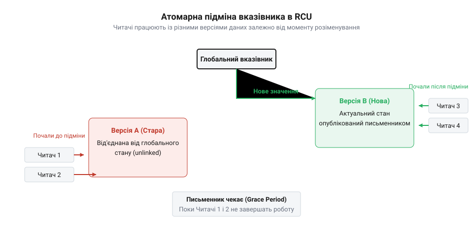
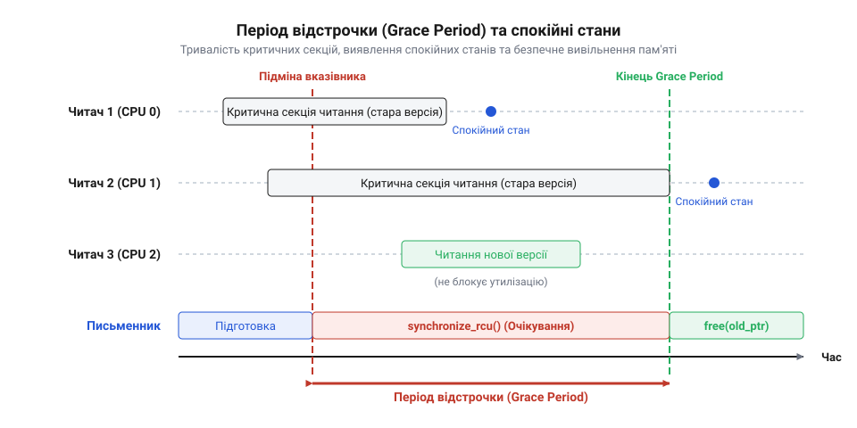
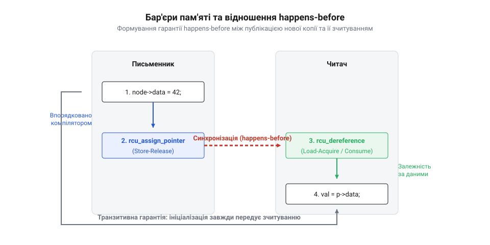
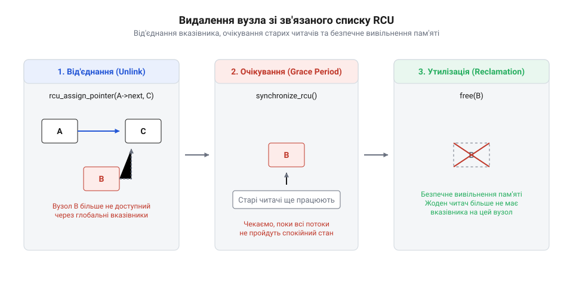

# RCU: читання без замків і період відстрочки

<preknowlist>
- [Без замків](root:sf-tasks/lock-free-basics) — Концепцію відсутності блокувань потоків та базові принципи атомарного доступу до спільної пам'яті.
- [Безблокувальне оновлення стану за допомогою інструкції CAS](root:sf-tasks/cas-lock-free) — Принцип атомарної підміни вказівника та узгодженого оновлення посилання на нову версію структури.
- [Seqlock: узгоджене читання без блокування читача](root:sf-tasks/seqlock) — Концепцію оптимізації неблокуючих читань для навантажень із перевагою операцій читання.
</preknowlist>

## Затримки читання у часто оновлюваних даних

У високонавантажених системних сервісах — таких як кеші записів ДНС (англ. @@en|DNS cache@@), таблиці маршрутизації мережевих пакетів або системні реєстри конфігурацій — переважна більшість операцій є читанням даних. Оновлення записів відбуваються відносно рідко: тисячі читань на секунду можуть припадати лише на один прихід нового запису. У таких умовах природним рішенням здається застосування читацько-письменницьких замків (англ. @@en|read-write lock@@, від @@en|read@@ — читати, @@en|write@@ — писати, @@en|lock@@ — замок, у системному програмуванні — @@en|rwlock@@). Конструктивна ідея @@en|rwlock@@ полягає у розмежуванні прав: багато потоків можуть паралельно захоплювати замок на читання, і лише один поток оновлення отримує ексклюзивний замок на запис. Проте при масштабуванні програми на десятки й сотні процесорних ядер ця концепція стикається з важкою апаратною перешкодою.

Коли потік намагається увійти у критичну секцію читання через замок @@en|rwlock@@, він не просто перевіряє стан пам'яті. Щоб зафіксувати свою присутність і заборонити письменнику модифікувати дані, потік зобов'язаний атомарно збільшити лічильник активних читачів у структурі замка. На апаратному рівні це виконується за допомогою атомарних інструкцій інкременту чи порівняння з обміном (англ. @@en|Compare-And-Swap@@, CAS). Атомарне оновлення навіть одного значення у спільній пам'яті вимагає від процесорного ядра отримання монопольного права на кеш-лінію (англ. @@en|cache line@@), де розташована ця змінна.

Під час виконання атомарного запису протокол узгодженості кешів MESI (англ. @@en|MESI protocol@@, від назв станів @@en|Modified@@ — модифікований, @@en|Exclusive@@ — ексклюзивний, @@en|Shared@@ — спільний, @@en|Invalid@@ — недійсний) змушує ядро згенерувати сигнал інвалідації кеш-лінії (англ. @@en|cache line invalidation@@). Щоб модифікувати лічильник, контролер кешу (англ. @@en|cache controller@@) ініціатора надсилає через міжпроцесорну шину (англ. @@en|interconnect bus@@) запит ексклюзивного володіння (англ. @@en|Request For Ownership@@, RFO, від англ. @@en|request@@ — запит, @@en|ownership@@ — володіння). Контролери кешу інших процесорних ядер відстежують шину за допомогою механізму стеження (англ. @@en|bus snooping@@, від англ. @@en|snoop@@ — підглядавати). Отримавши запит RFO, вони переводять копію цієї лічильникової кеш-лінії у своїх кешах @@en|L1 cache@@ та @@en|L2 cache@@ зі стану @@en|Shared@@ у стан @@en|Invalid@@. Лише після підтвердження інвалідації від усіх ядер ядро-ініціатор переводить кеш-лінію у стан @@en|Modified@@ і виконує запис у локальний кеш. Коли інше ядро намагається прочитати лічильник чи зробити власний інкремент, воно виявляє стан @@en|Invalid@@ у своєму кеші @@en|L1 cache@@, викликає промах кешу (англ. @@en|cache miss@@) і зупиняє виконувальні інструкції. Це ядро змушене запитувати передачу оновленої кеш-лінії з кешу @@en|L1 cache@@ попереднього ядра через міжпроцесорну шину, що витрачає десятки процесорних тактів на кожну спробу читання.

Це викликає катастрофічний ефект пінг-понгу кеш-ліній (англ. @@en|cache line bouncing@@). Кеш-лінія з лічильником активних читачів безперервно кочує між кешами L1/L2/L3 різних процесорних ядер. Замість виконання корисної роботи та швидкого читання з локального кешу L1 із затримкою у 1 наносекунду, читачі систематично блокуються на міжядерній синхронізації, що вимагає від 50 до 200 наносекунд на кожен вхід у критичну секцію. Ситуація стає парадоксальною: хоча логічно оновлення даних не відбувається і всі потоки лише читають інформацію, на фізичному рівні пам'яті кожен читач здійснює модифікацію спільного стану, перетворюючи паралельне читання на послідовну чергу біля шини пам'яті.

Фундаментальні принципи атомарного доступу описує матеріалу про [основи безблокового програмування](root:sf-tasks/lock-free-basics), а накладні витрати атомарних операцій детально розібрано у статті про [неблокуючі лічильники та CAS](root:sf-tasks/cas-and-longadder-counters). Інші примітиви безблокового програмування (англ. @@en|lock-free@@), такі як підрахунок посилань за допомогою атомарних змінних, стикаються з точно такою ж проблемою: будь-який інкремент атомарного лічильника викликає переміщення кеш-лінії. Навіть підхід із використанням послідовних замків, деталізований у розділі про [узгоджене читання за допомогою Seqlock](root:sf-tasks/seqlock), хоч і позбавляє читача від обов'язку писати у структуру замка, все одно змушує читачів виконувати процесорні бар'єри пам'яті для перевірки лічильника версій та повторювати читання у разі конфлікту з оновленням.

Аналіз цієї проблеми формулює чітку вимогу до ідеального механізму оновлення часто читаних даних: читач має бути повністю пасивним. Ідеальна операція читання не повинна виконувати жодних записів у спільну пам'яті, не повинна модифікувати жодних лічильників, не повинна захоплювати замки й чекати на інші потоки. Отримання доступу до даних має зводитися до звичайного розіменування вказівника у пам'яті з мінімальними накладними витратами.

Пошук алгоритмічного вирішення цієї проблеми привів системних розробників до створення нового підходу. Історичний шлях виникнення цього патерну висвітлено у довіднику про [еволюцію RCU в ядрі Linux](root:sf-tasks/read-copy-update/hist-rcu-evolution-in-linux-kernel.md).

Порівняння накладних витрат між класичним захопленням читацького замка та ідеальним пасивним розіменуванням можна проілюструвати наступним кодом:

:::tabs
@tab C
:::code root\eng\sf-tasks\read-copy-update/read-copy-update-d/c/read-rwlock.c c
@tab C++
:::code root\eng\sf-tasks\read-copy-update/read-copy-update-d/cpp/configdata.cpp cpp
:::

## Атомарна підміна вказівника та роздвоєння версій

Вимога пасивного читача встановлює жорстке обмеження: оскільки читачі ніяк не сповіщають систему про початок чи завершення роботи з даними й не утримують блокувань, письменник не має права змінювати поля існуючої структури даних прямо на місці (англ. @@en|in-place update@@). Якщо потік оновлення почне перезаписувати поля об'єкта під час того, як читач розіменовує вказівник на цей об'єкт, виникне стан гонитви за даними (англ. @@en|data race@@), що призведе до зчитування неузгодженого або частково пошкодженого стану.

Щоб обійти це обмеження, застосовується патерн Read-Copy-Update (від англ. @@en|read@@ — читати, @@en|copy@@ — копіювати, @@en|update@@ — оновлювати, скорочено @@en|RCU@@). Головна ідея @@en|RCU@@ полягає в тому, що процес оновлення розділяється на дві окремі фази: фазу внесення змін та фазу утилізації застарілих ресурсів. Коли потік-письменник прагне оновити структуру даних, він виконує наступні кроки:
1. Створює точну копію існуючої структури даних у новій ділянці динамічної пам'яті. 2. Модифікує поля у новій копії. Оскільки жоден інший потік ще не має посилання на цю копію, модифікація відбувається абсолютно безпечно та без використання замків. 3. Виконує атомарну підміну глобального вказівника (англ. @@en|atomic pointer swap@@), перенаправляючи його зі старої версії структури на нову модифіковану копію.

Атомарна підміна здійснюється за допомогою збереження з семантикою вивільнення (англ. @@en|release semantics@@), що забезпечує впорядкування інструкцій: усі записи у поля нової структури гарантовано стають видимими іншим ядрам до того, як вони побачать оновлений вказівник. Базові принципи такого безблокового оновлення описує стаття про [безблокувальне оновлення за допомогою CAS](root:sf-tasks/cas-lock-free), а деталі впорядкування інструкцій розглянуто у матеріалі про [процесорні бар'єри пам'яті та acquire-release](root:sf-tasks/memory-barriers).

Що саме відбувається у момент атомарної підміни вказівника у багатопотоковому середовищі? У цей момент виникає фундаментальне явище роздвоєння версій (англ. @@en|versioning@@, від лат. *versio* — зміна / версіонування), яке спричиняє покрокову розсинхронізацію (англ. @@en|desynchronization@@, від грец. *syn* — разом і *chronos* — час) читачів у часі та адресному просторі:
- Потоки-читачі, які прочитали глобальний вказівник мить до підміни, утримують локальне посилання на початкову Версію A. Вони продовжують безперешкодно й узгоджено читати дані з Версії A, повністю ізольовано від будь-яких змін у системі. - Потоки-читачі, які звертаються до глобального вказівника мить після підміни, отримують посилання на нову Версію B і відразу працюють з оновленими даними. - Протягом перехідного інтервалу в пам'яті фізично співіснують дві паралельні дійсності: старі й нові читачі виконують свої критичні секції одночасно, але звертаються до різних ділянок динамічної пам'яті. Оскільки операції відбуваються за незалежними адресами, між читачами не виникає стану гонитви за даними (англ. @@en|data race@@) чи апаратних затримок кешу. - Розсинхронізація розгортається покроково: кожен потік продовжує виконання зі власною швидкістю, поки кількість спостерігачів Версії A поступово меншає до нуля, адже нові читачі більше не можуть отримати посилання на стару версію, а старі читачі послідовно завершують роботу.

Обидві версії структури співіснують у динамічній пам'яті одночасно. Жоден з читачів не зазнає затримок, заборгованостей чи блокувань: вони отримують атомарний та узгоджений "знімок" даних у момент розіменування вказівника.


*Схема атомарної підміни вказівника в RCU: старі читачі продовжують безпечно читати Версію A, тоді як нові читачі одразу отримують доступ до оновленої Версії B.*

Роздвоєння версій ідеально вирішує завдання миттєвої публікації оновлень без блокування читачів. Однак воно породжує головну проблему та загадку всієї архітектури @@en|RCU@@: управління пам'яттю (англ. @@en|memory management@@). Після того, як вказівник оновлено на Версію B, Версія A стає від'єднаною від глобального стану (англ. @@en|unlinked@@). Чи має право письменник одразу звільнити пам'ять Версії A (наприклад, викликавши `free()` у C або `delete` у C++)?

Відповідь категорично негативна. Якщо письменник негайно вивільнить пам'ять Версії A, старі читачі, які застрягли у критичній секції й утримують локальне посилання на Версію A, спробують прочитати вже вивільнені байти. Це призведе до серйозної помилки звернення до вже звільненої пам'яті (англ. @@en|use-after-free@@), руйнування купи чи аварійного завершення програми.

Отже, утворюється так званий період відстрочки (англ. @@en|grace period@@, від @@en|grace@@ — відстрочка, @@en|period@@ — період). Письменник мусить відкласти утилізацію старої пам'яті до того моменту, поки всі читачі, які почали роботу зі старою версією до підміни вказівника, повністю не завершать свої критичні секції.

Практичне застосування таких підходів у структурах даних проілюстровано у проєкті про [користувацький RCU для зв'язаного списку](root:sf-tasks/read-copy-update/proj-userspace-rcu-lockfree-list.md). Порівняльний аналіз із суміжними стратегіями висвітлено у матеріалі про [епохальне управління пам'яттю EBR](root:sf-tasks/epoch-based-reclamation-concurrency) та розділі про [безпечне вивільнення через Hazard Pointers](root:sf-tasks/hazard-pointers-memory-reclamation).

Приклад реалізації підходу Read-Copy-Update з публікацією вказівника:

:::tabs
@tab C
:::code root\eng\sf-tasks\read-copy-update/read-copy-update-d/c/rcu-update-node.c c
@tab C++
:::code root\eng\sf-tasks\read-copy-update/read-copy-update-d/cpp/node.cpp cpp
:::

## Фізика періоду відстрочки та спокійні стани

Коли потік-письменник завершує підготовку нової версії об'єкта та здійснює атомарну підміну вказівника, у системі виникає критична часова роздвоєність. Усі нові потоки-читачі, які звертаються до глобального посилання після атомарної підміни, миттєво отримують адресу нової структури. Однак потоки, які розпочали читання за мить до підміни, утримують адреси застарілої копії. Оскільки пасивний читач @@en|RCU@@ не захоплює замків, не змінює атомарних лічильників і не залишає у спільній пам'яті жодних слідів своєї присутності, письменник позбавлений прямого способу перевірити, чи читає хтось старий блок пам'яті прямо зараз. Негайний виклик функцій утилізації пам'яті на кшталт `free()` або `delete` призведе до фатальної помилки розіменування звільненого вказівника (англ. @@en|use-after-free@@, від @@en|use@@ — використовувати, @@en|after@@ — після, @@en|free@@ — вивільнити).

Щоб запобігти передчасному знищенню даних, письменник зобов'язаний витримати часовий інтервал, який називається періодом відстрочки (англ. @@en|grace period@@, від @@en|grace@@ — відстрочка, @@en|period@@ — період). Визначення цього інтервалу спирається на фізичну умову: період відстрочки починається в момент атомарної підміни вказівника і завершується тоді, коли кожен потік, який перебував у критичній секції читання на момент підміни, повністю вийде з неї. Після завершення періоду відстрочки застаріла копія стає фізично недосяжною для жодного з потоків у системі, і її пам'яті можна безпечно вивільнити.


*Тривалість критичних секцій читачів, виявлення спокійних станів через контекстні перемикання та завершення періоду відстрочки.*

Для автоматичного визначення моменту завершення всіх критичних секцій системні розробники ввели поняття спокійного стану (англ. @@en|quiescent state@@, від лат. *quiescens* — спокійний, англ. @@en|state@@ — стан). Спокійний стан — це точка виконання потоку, в якій цей потік гарантовано не утримує посилань на жодну RCU-захищену структуру даних. У класичному ядрі операційної системи або некористувацьких середовищах критична секція читача обмежується викликами `rcu_read_lock()` та `rcu_read_unlock()`, які забороняють витіснення потоку. У такому середовищі будь-яке контекстне перемикання (англ. @@en|context switch@@, від @@en|context@@ — контекст, @@en|switch@@ — перемикання), перехід процесорного ядра в режим простою (англ. @@en|idle@@) або повернення у простір користувача є беззаперечним доказом того, що потік пройшов спокійний стан.

Механіка відстеження спокійних станів реалізується двома основними підходами до утилізації застарілих ресурсів (англ. @@en|deferred reclamation@@, від лат. *deferre* — відкладати, *reclamare* — повертати):
1. Синхронне очікування (англ. @@en|synchronous wait@@, від грец. *synchronos* — одночасний): Потік-письменник викликає функцію `synchronize_rcu()`. Цей виклик переводить письменника у стан блокування доти, доки кожне процесорне ядро в системі не пройде принаймні один спокійний стан. Деталі виконання цієї операції описані в [системному API ядра](root:sf-tasks/read-copy-update/api-linux-kernel-rcu.md). 2. Асинхронна утилізація через зворотний виклик (англ. @@en|callback@@, від @@en|call@@ — викликати, @@en|back@@ — назад): Замість блокування власних обчислень, письменник викликає `call_rcu()`, реєструючи адресу застарілого блоку та підключену функцію очищення. Система реєструє цю задачу у внутрішніх чергах і самостійно виконує деалокацію у фоновому системному потоці після завершення @@en|grace period@@.

На відміну від альтернативних механізмів безблокової утилізації пам'яті — таких як [звільнення через вказівники небезпеки](root:sf-tasks/hazard-pointers-memory-reclamation) або [епохальне управління пам'яттю](root:sf-tasks/epoch-based-reclamation-concurrency), де читачі змушені виконувати записи у локальні структури або атомарно оновлювати лічильники епох, @@en|RCU@@ усуває будь-які накладні витрати на етапі читання. Описи подібних підходів висвітлено у [безблоковій розробці списків](root:sf-tasks/read-copy-update/proj-userspace-rcu-lockfree-list.md), де показово продемонстровано переваги пасивного читача.

Глибокі особливості взаємодії RCU із системним планувальником задач розглядаються у [витісненні та плануванні потоків](root:sys-unix/kernel-preemption), де описується механіка роботи примусового перемикання контексту. Додатково, для розробки прикладних програм у користувацькому просторі застосовуються деталі, викладені в [інтерфейсі бібліотеки Userspace RCU](root:sf-tasks/read-copy-update/api-userspace-rcu-liburcu.md). Строге формальне підтвердження безпеки та відсутності гонитви за даними подано у [математичній моделі періоду відстрочки](root:sf-tasks/read-copy-update/math-rcu-grace-period-and-memory-ordering.md).

Наведений нижче приклад демонструє практичну реалізацію синхронного очікування періоду відстрочки та асинхронного очищення застарілої пам'яті:

:::tabs
@tab C
:::code root\eng\sf-tasks\read-copy-update/read-copy-update-d/c/read-rcu-data.c c
@tab C++
:::code root\eng\sf-tasks\read-copy-update/read-copy-update-d/cpp/datapayload.cpp cpp
:::

## Впорядкування пам'яті та бар'єри в RCU

Фундаментальна гарантія @@en|RCU@@ вимагає, щоб читач ніколи не бачив частково ініціалізованого об'єкта та не зчитував застарілих даних після вивільнення пам'яті. На сучасних багатоядерних процесорних архітектурах — таких як ARM, RISC-V чи x86 — це завдання ускладнюється наявністю позапорядкового виконання інструкцій (англ. @@en|out-of-order execution@@, від @@en|out of order@@ — поза порядком, @@en|execution@@ — виконання) та апаратних буферів збереження (англ. @@en|store buffer@@, від @@en|store@@ — зберегти, @@en|buffer@@ — буфер). Без явного впорядкування операцій запису й читання процесор або оптимізуючий компілятор можуть переставити місцями інструкції ініціалізації полів нової структури та інструкцію публікації її вказівника.

Розглянемо небезпеку такого перевпорядкування. Під час оновлення даних потік-письменник спочатку записує значення у поля нової структури пам'яті, а потім присвоює адресу цієї структури глобальному атомарному вказівнику. Якщо процесор виконає запис адреси у глобальну змінну раніше, ніж скине буфер збереження із полями об'єкта, паралельний потік-читач зчитає оновлений вказівник, але отримає сміття замість ініціалізованих даних. Для запобігання цьому у @@en|RCU@@ застосовується бар'єр збереження з вивільненням (англ. @@en|store-release@@, від @@en|store@@ — зберегти, @@en|release@@ — вивільнити). У ядрі Linux цей примітив реалізовано макросом `rcu_assign_pointer()`.


*Формування відношення happens-before між публікацією нової копії та її зчитуванням читачами за допомогою процесорних бар'єрів пам'яті.*

На стороні читача існує симетрична загроза. Коли потік-читач виконує інструкцію зчитування вказівника, процесор із надзвичайно слабкою моделлю пам'яті (наприклад, DEC Alpha) або компілятор із агресивними оптимізаціями може спекулятивно завантажити вміст полів об'єкта ще до того, як буде завершено розіменування самого вказівника. Щоб гарантувати залежність за даними, читач зобов'язаний використовувати бар'єр завантаження зі споживанням (англ. @@en|load-consume@@, від @@en|load@@ — завантажити, @@en|consume@@ — споживати) або бар'єр завантаження з отриманням (англ. @@en|load-acquire@@, від @@en|load@@ — завантажити, @@en|acquire@@ — отримати). У ядрі Linux для цього призначений макрос `rcu_dereference()`.

Поєднання примітива публікації `rcu_assign_pointer()` та примітива розіменування `rcu_dereference()` формує в системі міжпотокове відношення "відбулося-раніше" (англ. @@en|happens-before@@, від @@en|happens@@ — відбувається, @@en|before@@ — раніше):
1. Усі записи в поля нової копії відбуваються раніше за виконання `rcu_assign_pointer()`. 2. Виконання `rcu_assign_pointer()` на письменнику відбувається раніше за успішне виконання `rcu_dereference()` на читачу. 3. Виконання `rcu_dereference()` на читачу відбувається раніше за будь-яке зчитання полів отриманого об'єкта.

Завдяки цьому ланцюжку гарантується, що пасивний читач завжди бачить повністю сформований об'єкт у коректному стані. На більшості поширених процесорних архітектур (зокрема x86) макрос `rcu_dereference()` не генерує жодних додаткових апаратних інструкцій бар'єрів, перетворюючись на звичайну директиву компілятору не переставляти інструкції. Це забезпечує абсолютну нульову затримку читання.

Детальний аналіз низькорівневих процесорних інструкцій та порівняння моделей пам'яті наведено у матеріалі про [бар'єри та acquire-release](root:sf-tasks/memory-barriers). Практичні підходи до застосування цих примітивів у високопродуктивних мережевих сервісах можна прослідкувати у [таблицях мережевої маршрутизації](root:sf-tasks/read-copy-update/proj-rcu-concurrent-routing-table.md).

Нижче наведено практичну реалізацію впорядкування пам'яті для публікації та розіменування RCU-вказівників:

:::tabs
@tab C
:::code root\eng\sf-tasks\read-copy-update/read-copy-update-d/c/publish-status.c c
@tab C++
:::code root\eng\sf-tasks\read-copy-update/read-copy-update-d/cpp/configsnapshot.cpp cpp
:::

## Аналіз навантажень та компроміси RCU

Синхронізація потоків у багатоядерних системах завжди базується на компромісах між затримками читачів, пропускною здатністю записів та витратами пам'яті. Механізм @@en|Read-Copy-Update@@ (від англ. read — читати, copy — копіювати, update — оновлювати), або @@en|RCU@@, усуває центральну проблему класичних примітивів блокування — конкуренцію за загальний стан у кеш-пам'яті. У традиційних схемах на основі @@en|rwlock@@ кожен читач виконує атомарний запис у спільний лічильник. Це викликає межатомне явище @@en|cache line bouncing@@, коли лінія кешу з прапорцем блокування безперервно переміщується між кешами різних ядер процесора, спричиняючи значні затримки апаратних шин.

Альтернативні підходи без блокувань спираються на різні математичні та структурні виправдання. Наприклад, класичні [концепції відсутності блокувань](root:sf-tasks/lock-free-basics) використовують атомарні інструкції на зразок @@en|CAS@@ (від англ. compare-and-swap — порівняти і обміняти). Проте застосування @@en|CAS@@ для модифікації складних зв'язаних структур вимагає повторних циклів у разі конфліктів і не розв'язує проблему утилізації пам'яті. З іншого боку, [структуру послідовних замків](root:sf-tasks/seqlock), відому як @@en|seqlock@@ (від англ. sequence lock — замок послідовності), спроєктовано для швидкого читання без атомарних записів у читацьких секціях, але будь-яка паралельна операція запису змушує читача повторно перечитати всі дані з самого початку.

Специфіка @@en|RCU@@ полягає у наданні читачам статусу @@en|passive reader@@: читач виконує лише звичайне читання вказівника без жодної атомарної інструкції чи запису в шину пам'яті. Вартість операції читання в @@en|RCU@@ дорівнює вартості одного звичайного розіменування вказівника в процесорному регістрі. Проте ця нульова накладна вартість для читачів компенсується асиметричними витратами на боці письменника.

Письменник при застосуванні @@en|RCU@@ мусить виконати чотири послідовні кроки:
1. Створити локальну копію структури даних у пам'яті. 2. Внести зміни в ізольовану копію. 3. Атомарно підмінити вказівник на нову версію структури. 4. Очікувати проходження @@en|grace period@@ (від англ. grace — пільга, прощення та period — період), поки всі читачі, що бачили стару версію, не покинуть @@en|read-side critical section@@.

У робочих навантаженнях типу @@en|read-mostly@@ (де частка читань становить 90–99% і більше) сукупна продуктивність системи з @@en|RCU@@ багаторазово перевищує продуктивність схеми з @@en|mutex@@ (від англ. mutual exclusion — взаємне виключення) або @@en|rwlock@@. Якщо ж частота оновлень зростає, накладні витрати на копіювання об'єктів та очікування періоду відстрочки стають домінуючими.

Порівняльне оцінювання затримок синхронізації у робочих навантаженнях визначається співвідношенням часу виконання читань та записів:

```
T_mutex = N_read · (t_lock + t_unlock + t_bouncing) + N_write · (t_lock + t_update + t_unlock)
T_rcu   = N_read · t_deref + N_write · (t_alloc + t_copy + t_swap + t_grace_period)
```

При t_deref ≈ 0 затримка читання в @@en|RCU@@ практично не залежить від кількості паралельних потоків N_read. Натомість для письменника величина t_grace_period залежить від найтривалішої критичної секції читача та швидкості фіксації @@en|quiescent state@@ (від англ. quiescent — спокійний, неактивний). 

Коли навантаження стає @@en|write-heavy@@, у пам'яті накопичуються застарілі копії об'єктів, які ще не можна вивільнити через незавершені читання. Це створює накладні витрати пам'яті (накопичення старого стану в залишках операційної пам'яті). Для ущільнення лічильників та оновлення статистики в таких умовах доцільніше використовувати аналізи на основі [масштабованих атомарних лічильників](root:sf-tasks/cas-and-longadder-counters) або локальних попотокових накопичувачів, ніж створювати копію всієї структури при кожному оновленні.

Якщо в системі необхідна атомарна зміна одиночного значення без збереження старих версій, звичайна [операція атомарної підміни стану](root:sf-tasks/cas-lock-free) буде ефективнішою за @@en|RCU@@. Проте для складних графів об'єктів, де читачі мають бачити несуперечливий зріз кількох полів одночасно, @@en|RCU@@ залишається єдиним механізмом із гарантією нульового запізнення читача.

Теоретичне підґрунтя та [історія системного програмування](root:sf-tasks/read-copy-update/hist-rcu-evolution-in-linux-kernel.md) у розробці операційних систем показують, що @@en|RCU@@ еволюціонував від простих механізмів заборони витіснення потоків до складної класифікації з підтримкою витіснюваних критичних секцій. На системному рівні [витіснення та планувальник](root:sys-unix/kernel-preemption) безпосередньо впливають на швидкість настання спокійного стану, оскільки перемикання контексту фіксує завершення критичної секції читача у невитісняємих конфігураціях. Строге [математичне доведення безпеки](root:sf-tasks/read-copy-update/math-rcu-grace-period-and-memory-ordering.md) підтверджує, що відношення @@en|happens-before@@ між атомарною публікацією вказівника та завершенням періоду відстрочки повністю виключає гонку даних для прочитаних версій об'єкта.

## Проєктування RCU-структур та відкладена утилізації

Побудова RCU-безпечних динамічних структур даних, таких як @@en|linked list@@ або @@en|hash table@@, спирається на принципи атомарної публікації вузлів та механізм @@en|deferred reclamation@@ (від англ. defer — відкладати, reclaim — повертати, утилізувати). Головне правило RCU-структур: читач повинен завжди бачити валідний, цілісний граф вказівників, навіть у момент, коли письменник здійснює модифікацію або видалення елемента.

Під час додавання нового вузла в @@en|linked list@@ письменник спочатку виділяє пам'ять і повністю ініціалізує вміст нового елемента. Після цього вказівник `next` нового вузла спрямовується на наступний елемент списку. Тільки після завершення ініціалізації вказівник на новий вузол атомарно записується в попередній вузол списку із застосуванням макросу @@en|rcu_assign_pointer@@, який встановлює бар'єр пам'яті @@en|store-release@@. Це гарантує, що жоден процесорний керн не побачить публікацію вказівника раніше за ініціалізацію полів самого вузла.

Видалення вузла з RCU-структури відбувається у два виразні етапи:
1. **Від'єднання (Unlinking):** Письменник атомарно перенаправляє вказівник попереднього вузла в обхід вузла, що видаляється. З цього моменту нові читачі більше не зможуть знайти від'єднаний вузол під час обходу списку. Проте існуючі читачі, які увійшли в критичну секцію до від'єднання, все ще можуть утримувати посилання на цей елемент і безпечно зчитувати його дані. 2. **Утилізація (Reclamation):** Вивільнення пам'яті від'єднаного вузла відкладається до завершення періоду відстрочки.

Послідовність дій під час вилучення елемента та його утилізації ілюструється наведеною схемою.


*Покрокова послідовність вилучення елемента з RCU-списку, яка демонструє миттєве від'єднання вузла для нових читачів, безпечне проходження періоду відстрочки та підсумкове вивільнення пам'яті.*

Для реалізації відкладеної утилізації пам'яті застосовують дві фундаментальні стратегії: блокуючу функцію @@en|synchronize_rcu@@ та асинхронний виклик @@en|call_rcu@@.

Функція @@en|synchronize_rcu@@ блокує виконання поточного письменника доти, доки всі процесорні ядра не пройдуть принаймні один спокійний стан. Це синхронний підхід: письменник платить власним часом очікування, але код залишається лінійним і простим для розуміння.

Асинхронний механізм @@en|call_rcu@@ приймає вказівник на структуру @@en|rcu_head@@, вбудовану у цільовий об'єкт, та функцію зворотного виклику (callback). Письменник від'єднує вузол, реєструє callback через @@en|call_rcu@@ і негайно продовжує виконання, не чекаючи завершення періоду відстрочки. Підсистема RCU самостійно викличе зареєстровану функцію утилізації після настання спокійного стану на всіх ядрах.

У порівнянні з іншими підходами до безпечного вивільнення пам'яті, такими як [епохальне звільнення пам'яті](root:sf-tasks/epoch-based-reclamation-concurrency) чи метод [вказівників небезпечного доступу](root:sf-tasks/hazard-pointers-memory-reclamation) (відомий як @@en|hazard pointers@@), RCU виділяється відсутністю будь-яких записів у локальну чи спільну пам'ять з боку читачів. Крім того, RCU повністю захищає алгоритми від відомої [проблеми маскування повторів](root:sf-tasks/aba-problem) (проблеми ABA), оскільки адреса від'єднаного вузла ніколи не перевикористовується повторно до завершення всіх активних читань.

Щоб правильно впорядкувати процесорні інструкції під час читання та публікації, використовують строгі [процесорні бар'єри пам'яті](root:sf-tasks/memory-barriers), які в RCU інкапсульовано всередині примітивів @@en|rcu_assign_pointer@@ та @@en|rcu_dereference@@.

Нижче наведено практичну реалізацію RCU-списку з відкладеною утилізацією пам'яті мовами C та C++.

:::tabs
:::code root\eng\sf-tasks\read-copy-update/read-copy-update-d/c/rcu-head.c c
:::code root\eng\sf-tasks\read-copy-update/read-copy-update-d/cpp/rculist.cpp cpp
:::

Практичні аспекти розробки таких систем детально висвітлює розроблений [практичний проєкт списку](root:sf-tasks/read-copy-update/proj-userspace-rcu-lockfree-list.md), який демонструє побудову примітивів RCU в просторі користувача. У високонавантажених сервісах [мережева таблиця маршрутизації](root:sf-tasks/read-copy-update/proj-rcu-concurrent-routing-table.md) показує застосування хеш-таблиць із RCU для обробки мільйонів пакетів на секунду без затримок читання.

Для глибокої інтеграції з ядром Linux розробники застосовують низькорівневий [системний макросний інтерфейс](root:sf-tasks/read-copy-update/api-linux-kernel-rcu.md), який надає оптимізовані макроси для роботи зі списками. Якщо розробка ведеться для прикладних багатопотокових систем у просторі користувача, зрілий [комплекс функцій користувача](root:sf-tasks/read-copy-update/api-userspace-rcu-liburcu.md) із бібліотеки @@en|liburcu@@ гарантує готові високопродуктивні RCU-структури даних.