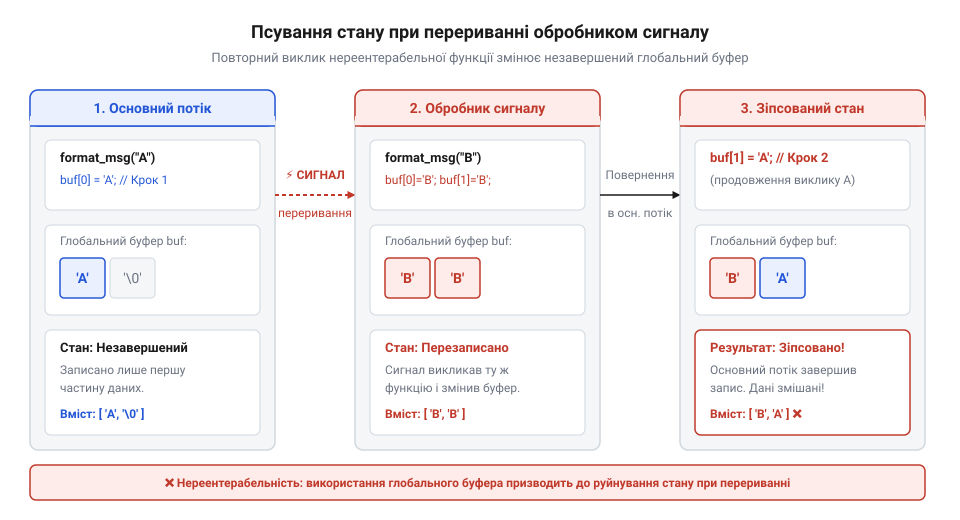
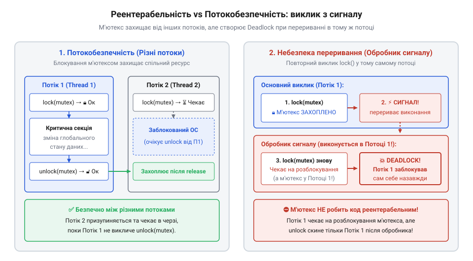
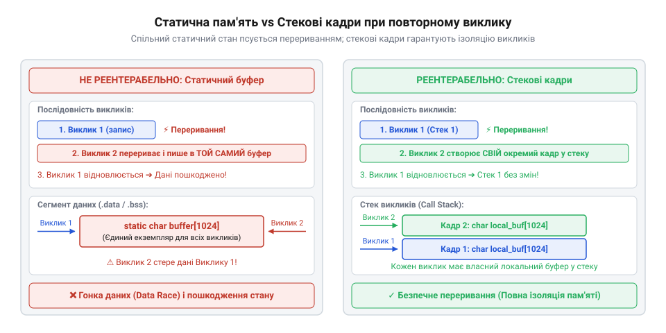

# Реентерабельність: перервати й покликати знову

<preknowlist>
- [Потокова безпека](root:sf-tasks/thread-safety) — Розуміння базових механізмів багатопотоковості, стану гонитви (race conditions) та принципів роботи м'ютексів.
</preknowlist>

## Переривання функції на пів шляху

Уявімо звичайну серверну чи системну програму, яка обробляє потік вхідних мережевих запитів і веде журнал оперативних подій. Для форматування текстових повідомлень розробник створює допоміжну функцію `format_log`, яка накопичує текстові фрагменти у статичному буфері пам'яті. У монотонному однопотоковому середовищі без зовнішніх збурень така функція працює передбачувано й стабільно: спочатку вона обнуляє вказівник запису, потім посимвольно копіює дані, додає часову мітку і повертає готовий для друку рядок. Проте апаратна реальність сучасних обчислювальних систем влаштована значно складніше. Під час виконання будь-якої інструкції програма може бути раптово перервана операційною системою. Причиною переривання може стати надходження асинхронного сигналу POSIX — наприклад, `SIGINT` від користувача у терміналі, `SIGALRM` від таймера ядра чи `SIGUSR1` від міжпроцесної взаємодії.

Коли процесор отримує сигнал переривання, він миттєво зупиняє виконання поточного потоку команд прямо між двома послідовними інструкціями мови машинного коду. Для безпечного переходу ядро операційної системи здійснює перемикання контексту: воно виділяє пам'ять на вершині поточного стека викликів і покроково зберігає туди @@en|фрейм сигналу@@ (англ. frame — рамка), записуючи поточний вказівник команд, регістри загального призначення, прапори процесора та маску блокування сигналів. Після збереження апаратного стану ядро модифікує вказівник інструкцій на адресу першої команди підключеного @@en|асинхронного обробника сигналів@@ (грец. ἀ- — без, σύγχроνος — одночасний) та передає йому управління. Цей обробник виконується у контексті того самого потоку і на тому самому стекі викликів безпосередньо поверх збереженого сигнального фрейму. Проте автоматичне збереження контексту ядра стосується лише регістрів процесора і зовсім не охоплює сегмент оперативної пам'яті: ядро не копіює і не ізолює глобальні або статичні змінні. У результаті будь-який статичний буфер, перерваний на пів шляху запису, залишається в оперативній пам'яті у напівзміненому, неконсистентному стані, і повторний вхід з обробника сигналу прочитає або перезапише цей зіпсований стан, що порушує базові вимоги [асинхронної сигнальної безпеки](root:sys-unix/async-signal-safety) системного коду.

Якщо асинхронний обробник сигналів намагається виконати власну діагностику й викликає ту саму функцію `format_log`, виникає ситуація повторного входу, яка руйнує цілісність даних. Причина полягає у тому, що основний потік був перерваний у мить, коли функція встигла виконати лише частину своєї роботи. Її внутрішній статичний буфер перебував у неконсистентному стані: перша половина повідомлення вже записана, але лічильник довжини вказує на проміжне значення. Коли обробник сигналу повторно викликає `format_log`, функція виконує свій стандартний алгоритм — вона скидає глобальний лічильник позиції у нуль і починає записувати нові символи поверх нерозбірливих даних основного виклику.

Після закінчення виконання обробника сигналу ядро відновлює збережений стан регістрів і повертає процесор до виконання перерваної інструкції основного потоку. Проте внутрішній стан функції вже незворотно зіпсовано. Основний потік продовжує виконання циклу копіювання, щиро вважаючи, що вказівник буфера перебуває у стані до переривання. У результаті програма формує пошкоджений рядок із двох змішаних повідомлень, зазнає витоку пам'яті або зазнає катастрофічного краху через вихід за межі буфера.

Механіку такого непомітного пошкодження пам'яті під час раптового повторного виклику ілюструє така схема:


*Схема переривання виконання функції обробником сигналу, де повторний виклик тієї ж функції модифікує незавершений глобальний буфер основного потоку.*

Наведене схематичне зображення показує фундаментальну вразливість будь-якого обчислювального алгоритму, чий стан зберігається у спільній пам'яті між викликами. Доки первинний виклик не досяг точки завершення, зміна глобальних чи статичних змінних перебуває у тимчасово незавершеному стані. Будь-яка спроба прочитати або модифікувати ці змінні під час асинхронного переривання призводить до збою. Історично ця проблема виникла разом із появою перших багатозадачних операційних систем реального часу, про що детально описують [витоки концепції реентерабельності](root:sf-tasks/reentrancy/hist-reentrancy-origins.md) в архітектурі Unix та апаратних систем переривань.

Проілюструємо нереентерабельну функцію форматування логів на мовах C та C++:

:::tabs
@tab C
:::code root\eng\sf-tasks\reentrancy/reentrancy-d/c/unsafe-log-append.c c
@tab C++
:::code root\eng\sf-tasks\reentrancy/reentrancy-d/cpp/append-message.cpp cpp
:::

У наведеному коді змінні `g_log_buffer` та `g_write_pos` створюють приховану точку відмови. Якщо сигнал надходить під час роботи циклу `for`, обробник сигналу викликає `unsafe_log_append` або `append_message`, скидає `g_write_pos` до нуля та перезаписує елементи `g_log_buffer`. Після повернення з обробника основний потік продовжує запис за новим, зіпсованим значенням `g_write_pos`. Такий поведінковий дефект надзвичайно важко виявити за допомогою традиційного модульного тестування, оскільки помилка проявляється лише при збігу обставин, коли сигнал влучає у вузьке часове вікно виконання функції. Щоб усунути такі вразливості, розробник повинен чітко засвоїти концепцію реентерабельності та навчитися будувати алгоритми, що залишаються стійкими до будь-яких непередбачуваних повторних входів.

## Реентерабельність проти звичайної потокової безпеки

Для подолання проблем, пов'язаних із пошкодженням стану під час переривань, розробники часто намагаються застосувати звичні інструменти багатопотокової синхронізації. Проте тут вони потрапляють у пастку через нерозуміння різниці між потокобезпечністю та @@en|реентерабельністю@@ (англ. re-enter — повторно входити).

Функція називається @@en|реентерабельною@@ (або повторно вхідною), якщо її виконання може бути безпечно призупинене в будь-якій точці, повторно викликане до завершення попереднього виклику з того самого або з іншого потоку, після чого перший виклик успішно відновить роботу з місця зупинки без найменшого пошкодження даних. Натомість звичайна [потокова безпека коду](root:sf-tasks/thread-safety) є окремим поняттям: вона лише гарантує, що функція може одночасно виконуватися у кількох паралельних потоках без виникнення @@en|стану гонитви@@ (англ. race condition — стан змагання). При цьому важливо розрізняти передбачуваний @@en|рекурсивний повторний вхід@@ (лат. recursio — повернення), коли функція свідомо викликає сама себе в межах послідовного стека після приведення даних до узгодженого стану, та @@en|асинхронне сигнальне переривання@@ (грец. ἀ- — без, σύγχρονος — одночасний), яке стається раптово на довільній машинній інструкції. Через цю відмінність розробники іноді помилково намагаються застосувати @@en|рекурсивні м'ютекси@@ (англ. reentrant lock — повторно вхідний замок), які дозволяють тому самому потоку багаторазово захоплювати один замок без самоблокування. Проте такі замки розраховані виключно на послідовну рекурсію: вони не рятують від [взаємних блокувань м'ютексів](root:sf-tasks/deadlocks-and-reentrant-locks) при обробці сигналів. Якщо сигнал перериває потік під час виконання самого механізму захоплення замка чи оновлення його внутрішнього стану, повторна спроба захопити той самий замок з обробника викликає дедлок на внутрішніх структурах примітива або призводить до виконання коду поверх напівзмінених даних, що повністю порушує вимоги, які висуває [асинхронна сигнальна безпека](root:sys-unix/async-signal-safety).

Головна відмінність полягає в механізмі виконання. Класична потокобезпечність найчастіше досягається шляхом взаємного виключення доступу до спільних ресурсів за допомогою @@en|м'ютекса@@ (англ. mutual exclusion — взаємне виключення) або спінлоків. Коли один потік заходить у критичну секцію, він блокує м'ютекс. Інші паралельні потоки, які намагаються зайти в цю ж секцію, призупиняються операційною системою і чекають, доки перший потік закінчить обробку даних і звільнить замок.

Проте спроба використати м'ютекс для захисту функції в контексті асинхронних сигналів призводить до неминучого краху. Розглянемо крок за кроком, що відбувається при виклику заблокованої функції з обробника сигналів:

1. Основний потік програми викликає потокобезпечну функцію, успішно захоплює м'ютекс і заходить у критичну секцію. 2. Під час перебування всередині критичної секції виникає асинхронний сигнал переривання (наприклад, `SIGALRM`). 3. Ядро процесора призупиняє основний потік і передає управління обробнику сигналу. Обробник виконується у контексті **того самого потоку**, який зараз утримує м'ютекс. 4. Обробник сигналу намагається викликати ту саму потокобезпечну функцію. 5. Функція виконує команду захоплення м'ютекса. Оскільки м'ютекс вже заблокований, потік переходить у стан очікування (блокування). 6. Виникає нерозв'язна суперечність: обробник сигналу чекає, поки м'ютекс буде звільнений основним потоком, а основний потік не може продовжити виконання й звільнити м'ютекс, тому що він чекає на завершення обробника сигналу.

У результаті програма миттєво входить у стан незворотного взаємного блокування на єдиному потоці. Порівняння роботи м'ютекса у звичайному багатопотоковому середовищі та у контексті обробника сигналів наочно показано на діаграмі:


*Порівняльна діаграма роботи м'ютекса у міжпотоковому середовищі та в обробнику сигналів.*

Ця діаграма чітко показує фундаментальну прірву між поняттями: м'ютекси вирішують проблему паралельного виконання на різних потоках, але створюють [взаємне блокування потоків](root:sf-tasks/deadlocks-and-reentrant-locks) при спробі захистити асинхронний повторний вхід на тому самому потоці. Саме тому звичайна потокобезпечність не гарантує реентерабельності. Дотримання реентерабельності у системному коді утворює базовий фундамент, на якому будується [асинхронна сигнальна безпека](root:sys-unix/async-signal-safety) функцій стандарту C та POSIX.

Щоб зробити функцію справді реентерабельною, розробник має дотримуватися трьох суворих правил побудови коду:

1. **Повна відсутність статичного та глобального змінюваного стану.** Функція не повинна читати або зберігати дані в глобальних змінних, статичних буферах чи внутрішньому стані модуля. 2. **Передача всього стану через аргументи на стекі.** Будь-які буфери пам'яті, лічильники та контекст обчислень мають виноситися на стек викликача та передаватися у функцію через параметри (вказівники або посилання). 3. **Виклики виключно реентерабельних функцій.** Реентерабельна функція не має права викликати системні чи бібліотечні функції, які спираються на прихований статичний стан (як-от `malloc`, `free`, `strtok`, `gmtime` чи `rand`). Замість них слід використовувати безпечні POSIX-аналоги з суфіксом `_r` (наприклад, `strtok_r`, `gmtime_r`), які систематизовані у спеціальному [довіднику реентерабельних функцій](root:sf-tasks/reentrancy/api-posix-reentrant-functions.md).

З точки зору теоретичної інформатики реентерабельна функція є близькою до математичного поняття @@en|чиста функція@@ (англ. pure function — чиста функція). Її результат залежить виключно від переданих вхідних значень, а саме виконання не викликає жодного прихованого @@en|побічного ефекту@@ (англ. side effect — побічний ефект). Детальніше фундаментальний зв'язок між відсутністю мутабельного стану та безпекою переривань аналізують [математичні властивості функцій](root:sf-tasks/reentrancy/math-pure-functions-and-immutability.md) без побічних ефектів. Якщо ж у багатопотоковому середовищі виникає потреба зберегти стан між викликами без передачі контексту вручну, розробники можуть ізолювати дані, задіюючи [потоково-локальне сховище](root:sf-tasks/thread-local-storage) пам'яті.

Стандартним архітектурним патерном перетворення нереентерабельної функції на безпечний аналог є винесення стану виклику у структуру контексту, яка локально виділяється на стекі кожної викликаючої функції:


*Схема трансформації нереентерабельної функції зі статичним буфером у реентерабельну з явним передаванням структури контексту через стек.*

Продемонструємо рефакторинг наведеного раніше коду форматування логів із переходом на реентерабельну архітектуру з використанням контексту на стекі:

:::tabs
@tab C
:::code root\eng\sf-tasks\reentrancy/reentrancy-d/c/log-context-init.c c
@tab C++
:::code root\eng\sf-tasks\reentrancy/reentrancy-d/cpp/logcontext.cpp cpp
:::

Завдяки передачі контексту через стек кожен виклик функції `reentrant_log_append` оперує своєю власною незалежною ділянкою пам'яті. Навіть якщо асинхронне переривання стається в момент виконання цієї функції у підпрограмі основного потоку, обробник сигналу створює новий локальний фрейм `signal_ctx` на вершині стека й працює з ним. Жодні дані первинного виклику не зачіпаються й не переписуються. На практиці ця техніка лежить в основі рефакторингу системних утиліт, що детально описує [рефакторинг нереентерабельного парсера](root:sf-tasks/reentrancy/proj-reentrant-string-parser.md) даних, а також дозволяє створювати складні структури даних, такі як [сигнально-безпечний кільцевий буфер](root:sf-tasks/reentrancy/proj-signal-safe-ring-buffer.md) для безблокового обміну повідомленнями у системному програмуванні.

## Усунення глобального та статичного стану

Уявіть функцію форматування системного журналу, яка приймає рівень події та текстове повідомлення. Щоб не витрачати час на постійне виділення пам'яті в операційній системі, розробник створює всередині функції статичний масив символів. При кожному виклику функція перезаписує цей масив і повертає вказівник на нього. На перший погляд, таке рішення здається ефективним та зручним. Проте якщо під час формування чергової стрічки виконання програми буде раптово перервано асинхронним сигналом, і @@en|обробник сигналів@@ вирішить записати власне повідомлення про помилку через цю ж функцію, статичний буфер буде миттєво спотворено. Коли обробник завершить роботу та поверне управління у точку переривання, первинний виклик продовжить запис у вже зіпсований масив.

Головним джерелом подібних катастрофічних збоїв є наявність змінного стану, який зберігається між викликами функції. У системному програмуванні будь-яка @@en|глобальна змінна@@ (англ. *global variable* — змінна з глобальною областю видимості) або @@en|статична змінна@@ (англ. *static variable* — змінна зі статичною тривалістю зберігання) розміщується у специфічній ділянці пам'яті процесів — у @@en|сегменті даних@@ (англ. *data segment*). Цей сегмент існує в єдиному примірнику на весь процес. Коли функція використовує внутрішній статичний буфер для збереження тимчасових результатів або проміжних вказівників, вона створює @@en|неявний стан@@ (англ. *implicit state* — прихований стан всередині функції), який належить усім викликам цієї функції одночасно.

Як показують [історичні витоки концепції](root:sf-tasks/reentrancy/hist-reentrancy-origins.md), у перших однопотокових операційних системах використання статичних буферів вважалося нормальним компромісом для економії обмеженої оперативної пам'яті. Однак поява реальної багатозадачності та асинхронних переривань викрила критичну вразливість такої архітектури: функція втрачає здатність коректно обробляти власне повторне входження до завершення попереднього сеансу.

Формально концепція стійкості до переривань спирається на [математичні властивості чистих функцій](root:sf-tasks/reentrancy/math-pure-functions-and-immutability.md) та відсутність побічних ефектів. У теоретичній інформатиці @@en|чиста функція@@ (англ. *pure function*) визначається як відображення, результат якого повністю залежить лише від переданих вхідних аргументів. Вона не здійснює жодного @@en|побічного ефекту@@ (англ. *side effect* — зміна зовнішнього або статичного стану) і не зчитує зовнішній змінний стан.

```
[Формальне визначення нереентерабельного та реентерабельного відображення]
y_non_reentrant = f(x, S_global)    [залежність від зовнішнього сегмента даних]
y_reentrant     = g(x, S_local)     [залежність виключно від локального контексту]
```

З наведеного співвідношення видно, що коли обчислення `y_reentrant` спирається лише на вхідне значення `x` та локальний стан `S_local`, функцію `g` можна викликати довільну кількість разів паралельно або переривати на будь-якій інструкції без ризику спотворення результату.

Щоб перетворити нереентерабельний код на безпечний, необхідно повністю відмовитися від збереження стану в сегменті даних і перейти до використання стека. Порівняльний аналіз трьох основних специфікаторів тривалості зберігання — `static`, `automatic` та `thread_local` — наочно показує різницю між міжпотоковою ізоляцією та реентерабельністю. Змінні з модифікатором `static` розміщуються у єдиному сегменті даних процесу, створюючи прихований стан, спільний для всіх викликів і потоків. Змінні, оголошені всередині функції без модифікатора `static`, є @@en|автоматичними змінними@@ (англ. *automatic variable* — змінна, життєвий цикл якої прив'язаний до виходу з області видимості). Під час кожного виклику функції створюється власна ізольована область пам'яті — @@en|стековий кадр@@ (англ. *stack frame*) безпосередньо на стекі поточного виконання. Якщо функція переривається сигналом чи викликом з іншого потоку, новий виклик створює власний стековий кадр вище за списком адрес, залишаючи дані попереднього кадру недоторканими. Своєю чергою, специфікатор `thread_local` створює окремий екземпляр даних для кожного потоку у [потоково-локальному сховищі пам'яті](root:sf-tasks/thread-local-storage). Це усуває конкуренцію між потоками та забезпечує [потокову безпеку](root:sf-tasks/thread-safety) під час паралельного виконання. Однак `thread_local` не гарантує реентерабельності: асинхронний обробник сигналу виконується у контексті того самого потоку і звертається до єдиного потоково-локального примірника змінної. Якщо переривання сталося під час оновлення такого стану, обробник сигналу прочитає або спотворить напівзмінені дані, що порушує базові вимоги [асинхронної сигнальної безпеки](root:sys-unix/async-signal-safety).


*Конфлікт при повторному вході у статичний буфер проти ізоляції даних у незалежних стекових кадрах*

Розглянемо практичний приклад нереентерабельної функції форматирування та її подальшу трансформацію. Перший варіант використовує статичний буфер і викликає стан гонитви при повторному вході, тоді як другий варіант отримує буфер від викликача через параметри.

:::tabs
:::code root\eng\sf-tasks\reentrancy/reentrancy-d/c/format-log-unsafe.c c
:::code root\eng\sf-tasks\reentrancy/reentrancy-d/cpp/format-log-reentrant-cpp.cpp cpp
:::

Усунення статичних масивів та неявного стану є першим непорушним правилом розробки стійкого коду. Коли виникає потреба гарантувати, що [асинхронна сигнальна безпека](root:sys-unix/async-signal-safety) виконується без жодних винятків, функція повинна оперувати виключно локальними змінними та пам'яттю, наданою викликачем. Однак варто зазначити, що навіть якщо [потоково-локальне сховище](root:sf-tasks/thread-local-storage) гарантує ізоляцію даних між різними потоками виконання, воно не робить код реентерабельним у межах одного й того ж потоку під час асинхронного переривання сигналом.

## Шаблон контексту та рефакторинг функцій

Коли алгоритм вимагає збереження стану між послідовними кроками — як у випадку парсингу текстових потоків, лексичного аналізу або генерації псевдовипадкових чисел — проста відмова від статичних змінних висуває нові виклики. Постає запитання: як передавати стан між викликами функції, не порушуючи її реентерабельності?

Відповіддю на цю проблему є @@en|контекстний шаблон@@ (англ. *context pattern* — шаблон явного управління станом через структуру). Його суть полягає у винесенні всього стану, необхідного для виконання обчислень, у зовнішню @@en|структуру контексту@@ (англ. *context structure*). Замість того щоб функція сама зберігала проміжні індекси чи вказівники у статичних змінних, екземпляр цієї структури створюється викликачем (наприклад, у його стековому кадрі) і передається у функцію за допомогою вказівника при кожному виклику.

Яскравим прикладом такої архітектурної трансформації у системному програмуванні є еволюція функцій розбору рядків POSIX. Класична системна функція `strtok()` зберігає вказівник на поточну позицію в рядку у прихованій статичній змінній. Через це її неможливо використовувати у вкладених циклах, у різних потоках або всередині сигнальних обробників. Щоб розв'язати цю проблему, стандарт POSIX запровадив реентерабельний аналог `strtok_r()`, де літера `r` означає @@en|reentrant@@. У цій функції статичний стан замінено зовнішнім вказівником `saveptr`, який зберігається на стекі викликача. Докладно ці зв'язки розглядає [довідник системних викликів](root:sf-tasks/reentrancy/api-posix-reentrant-functions.md) C-бібліотеки.


*Схема ізольованої передачі контексту виклику через стек при перериванні виконання обробником сигналів*

Процес рефакторингу будь-якого нереентерабельного API на стійку контекстну модель складається з чотирьох послідовних кроків:

1. **Ідентифікація прихованого стану**: Виявлення всіх статичних змінних, глобальних прапорців або статичних буферів, які функція модифікує під час виконання. 2. **Проектування структури контексту**: Об'єднання виявлених елементів стану в єдину структуру даних `@@en|контекст виклику@@`. 3. **Ініціалізація та очищення**: Створення явних функцій для початкового налаштування контексту та звільнення ресурсів (якщо вони використовувалися). 4. **Зміна підпису API**: Модифікація функції таким чином, щоб першим аргументом вона приймала вказівник на створений контекст.

Розглянемо практичний приклад. Дослідимо нереентерабельний парсер рядків CSV, який використовує статичний стан для збереження поточної позиції розбору, та перепишемо його із застосуванням шаблону контексту. Саме таку трансформацію детально розкриває практичний проєкт [рефакторинг нереентерабельного парсера](root:sf-tasks/reentrancy/proj-reentrant-string-parser.md), орієнтований на побудову надійних обробників даних.

:::tabs
:::code root\eng\sf-tasks\reentrancy/reentrancy-d/c/parse-csv-token-unsafe.c c
:::code root\eng\sf-tasks\reentrancy/reentrancy-d/cpp/reentrantcsvparser.cpp cpp
:::

Під час застосування контекстного шаблону важливо уникати підводних каменів, які можуть непомітно позбавити функцію реентерабельності.

Першою небезпекою є @@en|динамічна пам'ять@@ (англ. *dynamic memory* — пам'ять, що виділяється з купи). Якщо всередині реентерабельної функції здійснюється виклик `malloc()`, `free()` або `realloc()`, ці операції звертаються до системної @@en|купи@@ (англ. *heap*). Системна купа захищена внутрішніми м'ютексами для забезпечення потокобезпечності. Якщо асинхронний сигнал перерве виконання `malloc()` у момент, коли менеджер пам'яті заблокував внутрішній замок, і обробник сигналу знову спробує виділити пам'ять, виникне вимушене самоблокування. Тому справді реентерабельний код не повинен виділяти пам'ять з купи під час виконання — усі буфери мають розміщуватися заздалегідь або надаватися на стекі.

Другою поширеною помилкою є спроба захистити контекст всередині обробника сигналів за допомогою м'ютексів. Використання примітивів блокування всередині переривань гарантовано спричиняє [взаємні блокування та дедлоки](root:sf-tasks/deadlocks-and-reentrant-locks), адже перерваний потік не зможе звільнити м'ютекс до завершення обробника. Якщо між основним потоком та сигнальним контекстом необхідно організувати обмін даними, слід використовувати lock-free структури, як-от [сигнально-безпечний кільцевий буфер](root:sf-tasks/reentrancy/proj-signal-safe-ring-buffer.md).

Зрештою, слід завжди пам'ятати, що загальна [потокова безпека](root:sf-tasks/thread-safety) не еквівалентна реентерабельності. Виділення стану через шаблон контексту дозволяє досягти обох цілей одночасно: функція стає повністю безпечною як для використання у багатопотоковому середовищі без додаткових блокувань, так і для виконання в умовах непередбачуваних асинхронних переривань.

## Атомні операції та сигнальна безпека

Уявіть обчислювальний процес, який виконує складну обробку даних або знаходиться в середині алгоритму сортування великого масиву. У довільний, абсолютно не передбачуваний момент часу апаратний таймер, мережевий адаптер або операційна система надсилає процесу @@en|асинхронний сигнал@@ (англ. *asynchronous signal* — асинхронне сповіщення у POSIX). Ядро операційної системи миттєво призупиняє виконання поточного потоку на межі між двома сусідніми інструкціями процесора та примусово змінює вказівник команд, передаючи управління у спеціально зареєстровану функцію — @@en|обробник сигналів@@ (англ. *signal handler* — функція обробки асинхронного сигналу). Якщо в момент цього переривання програма здійснювала зміну базових структур даних або перебувала всередині системного виклику, повторне звернення до тих самих ресурсів із сигнального контексту може викликати катастрофічне пошкодження пам'яті. Саме тут виникає потреба в гарантіях атомарності та специфічній безпеці системного середовища.

Головна небезпека асинхронного переривання полягає у розриві неатомарних операцій запису. Розглянемо випадок, коли потік виконання оновлює 64-бітну цілочисельну змінну на 32-бітній архітектурі процесора. Для виконання цієї операції процесор мусить послідовно виконати дві незалежні інструкції: спочатку записати молодші 32 біти в один регістр або комірку пам'яті, а потім старші 32 біти в другу. Якщо асинхронний сигнал надійде точно між цими двома машинними інструкціями, обробник сигналу при спробі прочитати цю змінну побачить напівдекодований стан — нові молодші біти та застарілі старші біти. Такий ефект називається @@en|розривний запис@@ (англ. *torn write* — некоректне часткове оновлення даних).

Для забезпечення гарантованої цілісності даних стандарт мови C надає спеціальний цілочисельний тип `sig_atomic_t`. Змінна типу `sig_atomic_t` гарантує, що зчитування та запис її значення виконуються як єдина @@en|атомна операція@@ (від грец. *atomos* — неподільний; англ. *atomic operation*) навіть за наявності асинхронних сигнальних переривань. Операційна система та архітектура процесора підбирають розмір `sig_atomic_t` таким чином, щоб оновлення цієї змінної відбувалося за один незаперечний шинний такт.

Проте сама лише атомарність на апаратному рівні не захищає код від оптимізацій компілятора. Під час агресивної компресії коду компілятор прагне зменшити кількість звернень до оперативної пам'яті. Він може зберегти значення змінної у регістрі процесора й виконувати всі подальші читання з регістра, не оновлюючи значення в основній пам'яті. Оскільки обробник сигналів виконується у своєму власному контексті виклику, він не матиме доступу до регістрів основного потоку і зчитає застаріле значення з пам'яті. Для усунення цієї проблеми застосовується модифікатор `volatile` (англ. *volatile* — мінливий). Він забороняє компіляторові кешувати змінну в регістрах і змушує звертатися до оперативної пам'яті при кожному її використанні. Таким чином, канонічним прапорцем для координації роботи з обробником сигналів є оголошення `volatile sig_atomic_t`.

```
[Покрокова перевірка стану сигнального прапорця]
flag_val = read_direct(volatile_sig_atomic_var)    [зчитування з оперативної пам'яті за один шинний такт]
is_set   = (flag_val != 0)                          [атомарна оцінка стану без регістрового кешу]
```

З наведеного ланцюжка видно, що коли обчислення `is_set` спирається на безпосередній виклик пам'яті через `volatile sig_atomic_t`, потік миттєво реагує на події переривання без спотворення регістрового стану.

Втім, тип `sig_atomic_t` має суттєві обмеження. Він гарантує відсутність компіляторних оптимізацій і кешування у регістрах виключно для одиночних операцій зчитування або запису значення, але не забезпечує атомарності складних комбінованих операцій типу «зчитати-модифікувати-записати» (англ. *read-modify-write*). Наприклад, вираз `counter++` насправді розгортається у три окремі кроки: читання поточного значення з пам'яті в регістр, збільшення значення на одиницю та запис результату назад у пам'ять. Якщо асинхронний сигнал перерве потік між першим і третім кроком, модифікація лічильника буде спотворена.

У сучасному системному програмуванні на C та C++ для складніших сценаріїв застосовуються атомарні типи `std::atomic` або C11 `_Atomic`. Тим не менш, тут виникає важлива архітектурна пастка. Атомна змінна є безпечною всередині обробника сигналів лише тоді, коли вона реалізована без використання внутрішніх м'ютексів на апаратному рівні (англ. *lock-free*). Перевірити цю властивість можна за допомогою методу `is_lock_free()`. Якщо атомарність підтримується програмними примітивами блокування, її використання в сигнальному контексті спричинить [взаємні блокування та дедлоки](root:sf-tasks/deadlocks-and-reentrant-locks), адже перерваний потік не зможе звільнити внутрішній замок до завершення обробника.


*Розривний запис при неатомарному перериванні проти атомарного оновлення прапорця*

Другим вирішальним фактором безпеки є вибір системних функцій, які дозволено використовувати всередині обробника сигналів. Більшість стандартних функцій C-бібліотеки, включно з `printf()`, `malloc()`, `free()`, `sprintf()` та `exit()`, вважаються повністю нереентерабельними. Вони спираються на прихований статичний стан або блокують спільні ресурси купою. Виклик `printf()` з обробника сигналів під час виконання іншого виклику `printf()` в основному потоці спричинить пошкодження внутрішніх текстових буферів або вічне зациклення на внутрішньому блокуванні.

Стандарт POSIX чітко визначає перелік функцій, що забезпечують властивість [асинхронна сигнальна безпека у системному програмуванні](root:sys-unix/async-signal-safety). До них належать первинні @@en|системні виклики@@ (англ. *system call* — безпосередній запит послуг ядра операційної системи), такі як `write()`, `read()`, `_exit()`, `sigaction()` та `clock_gettime()`. Вони не виділяють пам'ять з купи, не використовують спільні статичні буфери й гарантують коректну обробку переривань. Докладний перелік таких функцій зібрано в [довіднику системних викликів](root:sf-tasks/reentrancy/api-posix-reentrant-functions.md).

Якщо між обробником сигналів та основним потоком необхідно організувати обмін складнішими структурами даних або масивами байтів, не можна використовувати звичайні черги з м'ютексами. Замість цього розробники застосовують безблоковий [сигнально-безпечний кільцевий буфер](root:sf-tasks/reentrancy/proj-signal-safe-ring-buffer.md), в якому один потік лише записує, а інший лише зчитає дані за допомогою атомарних індексів, що запобігає виникненню станів гонитви.

Розглянемо практичний приклад, у якому порівнюється некоректна реалізація обробника сигналів із застосуванням небезпечних функцій та правильний підхід, заснований на атомарних прапорцях і системних викликах POSIX.

:::tabs
:::code root\eng\sf-tasks\reentrancy/reentrancy-d/c/sigaction.c c
:::code root\eng\sf-tasks\reentrancy/reentrancy-d/cpp/signalhandlermanager.cpp cpp
:::

Отже, розробка стійкого до сигналів коду вимагає дотримання трьох фундаментальних правил. По-перше, обробник сигналів повинен виконувати найменший можливий обсяг дій — переважно встановлювати прапорець типу `volatile sig_atomic_t` або lock-free `std::atomic`. По-друге, всередині обробника категорично заборонено використовувати нереентерабельні функції бібліотеки C та виділення пам'яті з купи; можна використовувати лише безпечні системні виклики POSIX. По-третє, повна [загальна потокова безпека](root:sf-tasks/thread-safety) не гарантує сигнальної безпеки, тому всю основну обробку даних слід виносити з обробника в головний потік програми.