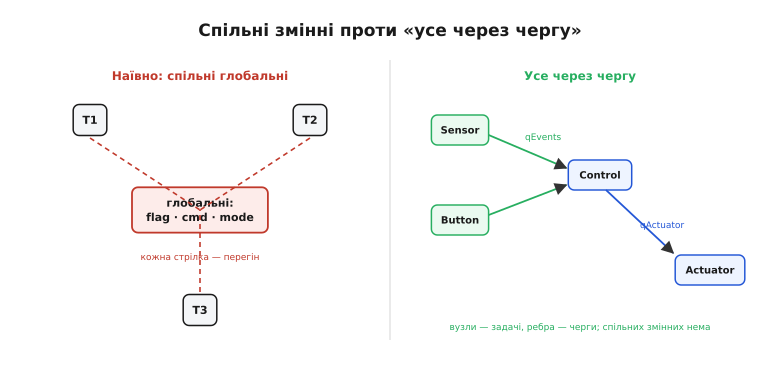
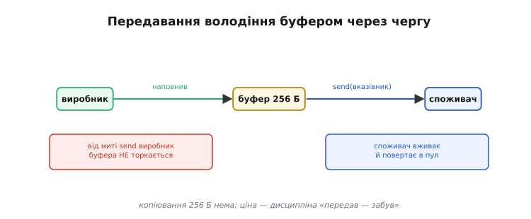

# ⚙️ Усе через чергу: producer–consumer без спільних змінних

Це вставка про **стиль мислення** в багатозадачності. Маючи в руках [чергу й уміння передати нею дані між двома задачами](root:sf-tasks/task-ipc), пораду «чим менше спільного між задачами, тим безпечніше» можна довести до краю — прибрати спільний стан зовсім. Черга тоді стає єдиним місцем, де задачі зустрічаються, а кожна з них лишається простою послідовною програмою.

## Задача

Типова перша реакція на багатозадачність — завести кілька глобальних змінних, які задачі читають і пишуть «за домовленістю»: `volatile bool hasData` — прапорець «є нові дані»; `struct Cmd command` — структура-команда від кнопки до виконавця; `int mode` — поточний режим роботи пристрою. Здається зручно: усі бачать одне й те саме. Та кожна така змінна — мовчазне джерело [перегонів](root:sf-devices/freertos): дві задачі можуть одночасно читати й писати її, і без м'ютекса результат невизначений. Тому до кожної змінної з'являється свій м'ютекс, до кожного м'ютекса — правила блокування, і архітектура обростає невидимими залежностями.

Проблема навіть не лише в перегонах як таких. Спільний стан **розмазує логіку** по всій системі: щоб зрозуміти, хто й коли змінює `mode`, треба тримати в голові всі задачі одночасно. Це повернення до того самого «спагеті», від якого тікали, [покинувши super-loop](root:embedded/super-loop-limits); тільки тепер спагеті не в `loop()`, а в мережі неявних залежностей між задачами. Задачу більше не можна читати як [окрему просту програму](root:sf-os/tasks) — доводиться враховувати всіх, хто звертався до тієї самої змінної.

Питання вставки: чи можна збудувати багатозадачну систему, в якій задачі координуються **без жодної спільної змінної** — так, щоб кожну й далі читати як окрему просту послідовну програму?

## Ідея

Принцип називається «не діли пам'ять — передавай повідомлення» (share-nothing / message passing). Замість того щоб дві задачі **дивилися** на ту саму змінну, одна **кладе копію** в чергу, інша **бере** її звідти. У будь-який момент часу буфер даних **належить** рівно одній задачі: або виробникові, поки він його заповнює, або споживачеві — після того як черга передала. Разом із повідомленням «переїжджає» й **право доступу**. Звідси — немає спільного → немає перегонів → не потрібен м'ютекс на ці дані. М'ютекс лишається лише там, де без нього справді не обійтися: для неподільного заліза — шини SPI або I²C, де кілька задач розділяють одну фізичну периферію.

Але що саме передавати повідомленнями? Через чергу йдуть не лише вимірювання давача. **Будь-яка координація між задачами** може стати повідомленням: подія «кнопку натиснули», команда «увімкни реле», сигнал «змінився режим». Якщо закодувати це як єдиний тип із полем-тегом — `enum MsgType { MSG_SAMPLE, MSG_BUTTON, MSG_SETMODE }` у структурі `Msg` — то одна вхідна черга задачі стає її єдиним «поштовим ящиком». Сама задача перетворюється на цикл: «дістав повідомлення → обробив → повтори». Це і є **акторна модель** (actor model) у мініатюрі — кожна задача-актор знає лише власний стан і отримує ззовні тільки повідомлення.

*Ліворуч — наївна архітектура: задачі дивляться на спільні глобальні змінні (прапорець, структура-команда, режим), кожна стрілка-доступ — потенційний перегін і привід для м'ютекса. Праворуч — «усе через чергу»: задачі-вузли з'єднані ЛИШЕ чергами-ребрами; дані, події й команди передаються повідомленнями, спільних змінних немає зовсім.*

Якщо намалювати таку систему як граф, вузли — це задачі, ребра — черги. Стрілки завжди напрямлені: `taskSensor → qEvents → taskControl → qActuator → taskActuator`. Два виробники можуть надсилати в одну чергу — це «fan-in»: і `taskSensor`, і `taskButton` кидають повідомлення в `qEvents`, а `taskControl` розбирає звідти все підряд. Ключове: **жодної лінії «спільна змінна»** на цьому графі нема зовсім.

Ще одна властивість черги — розв'язка в часі (decoupling): виробник і споживач можуть мати різний ритм. [Розмір буфера й режими блокування](root:sf-tasks/task-ipc) — окрема тема; тут важливе інше: коли черга порожня, споживач просто [спить і не займає процесор](root:sf-os/tasks); коли черга повна, виробник або чекає, або явно відкидає надлишкове — залежно від обраної стратегії (повернемося до цього в «Складності»).

> 🔧 **Навіщо це.** Перш ніж завести спільну глобальну змінну між задачами, спитай: а чи не передати це повідомленням? Дев'яносто відсотків спільного стану зникає від такого питання, а разом із ним — перегони, м'ютекси на дані й найзагадковіші баги багатозадачності. Спільним лишай тільки те, що фізично не можна передати: неподільне залізо (шина) та константи лише для читання.

Де «усе через чергу» **не** є відповіддю? По-перше, неподільне залізо — там м'ютекс залишається. По-друге, сигнал «щось сталося» без жодних даних — там дешевший [task notification або семафор](root:sf-tasks/task-ipc). По-третє, константи часу компіляції або дані лише для читання — їх ділити безпечно й без черги.

## Робочий код

### Як НЕ треба — «наївна» архітектура

*Показуємо, від чого тікаємо: глобальні змінні між задачами й приховані перегони.*

:::tabs
:::code proj-queue-pattern/cpp/iak-ne-treba-naivna.cpp
:::code proj-queue-pattern/go/iak-ne-treba-naivna.go
:::code proj-queue-pattern/py/iak-ne-treba-naivna.py
:::

### Головне — усе через чергу

*`taskSensor` і `taskButton` — два виробники в одну `qEvents`; `taskControl` — споживач + виробник; `taskActuator` — кінцевий виконавець. Стан режиму — локальна змінна всередині `taskControl`, не глобальна.*

:::tabs
:::code proj-queue-pattern/cpp/holovne-use-cherez-cherhu.cpp
:::code proj-queue-pattern/go/holovne-use-cherez-cherhu.go
:::code proj-queue-pattern/py/holovne-use-cherez-cherhu.py
:::

### Передавання великих буферів вказівником

*Коли копіювання дороге — у чергу кладуть вказівник. Виробник після `send` назавжди «забуває» буфер — власником тепер стає споживач.*

:::code proj-queue-pattern/cpp/peredavannia-velykykh.cpp

*Передавання володіння великим буфером через чергу вказівником: виробник наповнив буфер і поклав у чергу лише вказівник; від миті `send` він буфера НЕ торкається — володіння «переїхало» до споживача, який його вживає й повертає в пул. Так уникаємо дорогого копіювання, але платимо дисципліною «передав — забув».*

## Складність і пастки на МК

- **Переповнення черги — тиха втрата або зависання.** Глибину черги [розраховуйте під найгірший сплеск вхідних подій](root:sf-tasks/task-ipc). Явно обирайте стратегію на повну чергу: `portMAX_DELAY` — виробник засне й підвисне, якщо споживач не встигає; `0` — нове повідомлення буде відкинуто; пул із власною чергою — буде витіснено найстаріше. Жодна з цих стратегій не «правильна» сама по собі, але стратегія замовчування рівно одна: виробник чекає вічно.

- **Черга копіює і витрачає RAM.** `xQueueCreate(n, sizeof(Msg))` виділяє `n × sizeof(Msg)` байтів [із купи](root:sf-lang/task-stacks). Великі структури у `Msg` роздмухують цю область. Якщо елемент більший за кілька десятків байтів — передавайте **вказівником** (блок C), а не значенням, і обов'язково використовуйте пул замість `malloc`, щоб уникнути фрагментації купи.

- **Власник вказівника — «передав і забув».** Після `xQueueSend(q, &ptr, …)` виробник **не має права** читати або писати той буфер. Якщо він це зробить — повертається перегін, підступніший за прямий: помилки у вигляді «зіпсованих даних» будуть украй нерегулярними. Подвійний `free` (і виробник, і споживач звільняють буфер) — негайний крах. Дисципліна одна: відправив — присвоїв `NULL` — забув.

- **З ISR — тільки `xQueueSendFromISR`.** Стандартний `xQueueSend` в [обробнику переривань](root:hw-arch/isr) може підвісити планувальник — лише варіанти `…FromISR` безпечні в контексті ISR; після них за потреби переключіть контекст через `portYIELD_FROM_ISR`.

- **Не плутайте засоби.** «Усе через чергу» стосується **даних і команд**. Сигнал «подія сталася» без жодних даних — семафор або task notification, вони дешевші за чергу. Неподільне залізо (шина) — м'ютекс. Замінювати одне одним без причини — і дорожче, і незрозуміліше.

- **Дедлок через зустрічні черги.** Якщо задача A блокувально надсилає в повну чергу задачі B, а B водночас блокувально надсилає в повну чергу A — вони взаємно застигають. Тримайте потік даних переважно **односпрямованим**; для відповіді на запит заводьте **окрему** чергу або task notification, а не зворотний блокувальний `send`.

## Підсумок

«Усе через чергу» — це доведення поради «менше спільного» до нуля спільного: дані, події й команди передаються повідомленнями, право доступу до буфера переходить разом із ними, а кожна задача лишається простою послідовною програмою з одним «поштовим ящиком». Ціна — [пам'ять під черги й стеки задач](root:sf-lang/task-stacks) і сувора дисципліна власника вказівника; виграш — зникають перегони, м'ютекси на дані й найзагадковіші баги багатозадачності.
