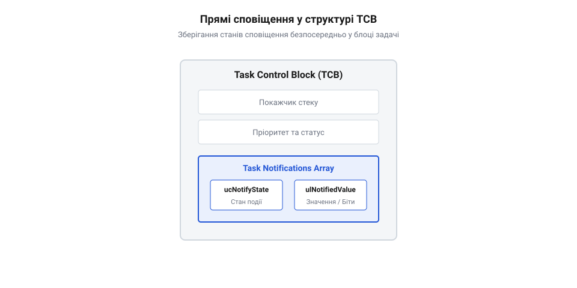
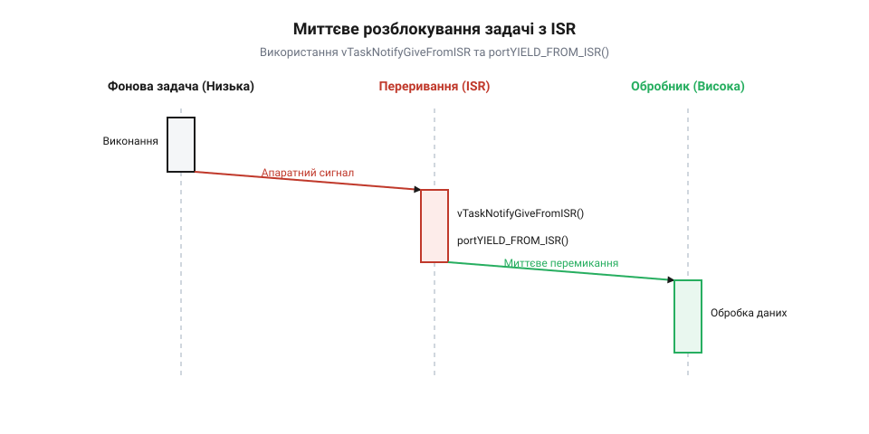

# Сповіщення задачі

<preknowlist>
- [Черги й семафори](root:sf-tasks/task-ipc) — Традиційна міжзадачна синхронізація через семафори.
- [Потокові буфери й буфери повідомлень](root:sf-tasks/message-buffer) — Передавання даних у потокових буферах зі сповіщеннями.
</preknowlist>

## Накладні витрати класичних семафорів

Коли одна задача в операційній системі реального часу (англ. @@en|Real-Time Operating System@@, @@en|RTOS@@) мусить дочекатися завершення події в іншій задачі або в обробнику переривань, найпершою думкою розробника зазвичай є використання бінарного семафора (від грецького *σῆμα* — знак та *φόρος* — той, що носить). Проте для передачі одного-єдиного факту «подія сталася» створення повноцінного міжпроцесного об'єкта є надмірним марнотратством ресурсів. У класичному підході навіть найпростіший бінарний семафор або лічильний семафор будується як обгортка над чергою задач, що тягне за собою суттєві накладні витрати як оперативної пам'яті, так і процесорного часу.

У системі @@en|FreeRTOS@@ бінарний семафор створюється за допомогою виклику `xSemaphoreCreateBinary()`, який внутрішньо викликає функцію `xQueueGenericCreate()`. Для забезпечення роботи такого семафора системі потрібно виділити в оперативній пам'яті (англ. @@en|Random Access Memory@@, @@en|RAM@@) цілісний дескриптор черги @@en|QueueHandle_t@@ (структуру `Queue_t`). Ця структура містить не лише лічильник доступних ресурсів, а й два повноцінні зв'язані списки задач: список задач, що очікують на надсилання @@en|xTasksWaitingToSend@@, та список задач, що очікують на отримання @@en|xTasksWaitingToReceive@@. Крім того, структура зберігає розмір елемента, довжину черги, покажчики на верхівку та край буфера, блоки замків та прапорці стану. Для звичайного сигналізування 1 бітом інформації виділення близько 76–80 байтів оперативної пам'яті (залежно від архітектури мікроконтролера та вирівнювання полів) створює відчутне [традиційна міжзадачна синхронізація](root:sf-tasks/task-ipc) навантаження на систему. Якщо в складній прошивці використовується кілька десятків таких семафорів для синхронізації з периферією, втрати @@en|RAM footprint@@ стають критичними для мікроконтролерів із обмеженим обсягом пам'яті.

Додатковим ускладненням є динамічне виділення пам'яті. При виклику `xSemaphoreCreateBinary()` пам'ять під дескриптор виділяється з системної кучі (англ. @@en|heap@@) через функцію `pvPortMalloc()`. Це створює ризик фрагментації пам'яті під час тривалої роботи пристрою та робить поведінку системи менш передбачуваною, адже невдале виділення пам'яті може призвести до повернення покажчика `NULL` та аварійного зупинення прошивки. Навіть при використанні статичного створення `xSemaphoreCreateBinaryStatic()`, розробник змушений вручну виділяти глобальні або статичні змінні типу `StaticQueue_t`, що захаращує вихідний код і збільшує розмір сегмента даних прошивки.

Окрім пам'яті, класичні семафори вимагають значних процесорних циклів при виконанні операцій `xSemaphoreGive()` та `xSemaphoreTake()`. Кожен такий виклик змушений здійснювати пошук у списку очікування черги, входити у критичну секцію, вимикати переривання чи блокувати планувальник (від англійського @@en|schedule@@ — розклад, планар), оновлювати дескриптори списків та виконувати перевірки стану об'єкта. При відправці сигналу з обробника переривань (англ. @@en|Interrupt Service Routine@@, @@en|ISR@@) операційна система мусить додатково перевіряти, чи не заблокована сама черга іншим контекстом. У результаті затримка пробудження задачі від моменту виникнення переривання до виклику планувальника складає десятки мікросекунд, що погіршує детермінованість системи. Коли ж задача лише чекає сигналів від одного конкретного джерела, використання проміжного об'єкта міжпроцесного зв'язку (англ. @@en|Inter-Process Communication@@, @@en|IPC@@) виявляється абсолютно зайвим ланцюгом.

Еволюція легковагової синхронізації: поява Direct Task Notifications у FreeRTOS відбулася у версії V8.2.0, коли розробники ядра вирішили позбутися проміжних об'єктів для найпоширеніших сценаріїв сигналювання. Замість виділення окремого дескриптора черги прапорці та значення сповіщення були інтегровані безпосередньо в структуру Task Control Block (TCB) кожної задачі. Це дозволило передавати сигнали напряму від джерела до конкретного потоку з нульовими накладними витратами на створення системних об'єктів. Згодом, у версії FreeRTOS V10.4.0, цей механізм еволюціонував далі: поодинокі поля сповіщень були замінені на масиви сповіщень, що дало змогу одній задачі мати кілька незалежних каналів сигналювання без створення додаткових семафорів чи [групи подій](root:sf-tasks/event-groups).

Щоб наочно оцінити вигоду від відмови від класичних семафорів на користь прямого сигналювання, розроблено [порівняльна математична модель продуктивності](root:sf-tasks/task-notification/math-task-notification-latency-and-memory-savings.md) та пам'яті, яка обчислює різницю у використаній @@en|RAM@@ та кількості тактів процесора. Обчислення показують, що при використанні бінарного семафора накладні витрати на об'єкт складають обсяг структури `StaticQueue_t`, тоді як сповіщення задачі (англ. @@en|Direct Task Notification@@) використовує лише поля, вже присутні в TCB.

Розрахунок економії оперативної пам'яті та зменшення затримки перемикання контексту:

```
RAM_semaphore = sizeof(StaticQueue_t)
              = 76 [байт для 32-бітної архітектури ARM Cortex-M]

RAM_notification = sizeof(uint32_t) + sizeof(uint8_t)
                 = 5 [байт у структурі TCB]

Delta_RAM = RAM_semaphore - RAM_notification
          = 76 - 5
          = 71 [байт економії RAM на кожен семафор]
```

Отже, заміна класичного бінарного семафора на прямолінійний спосіб сигналювання вивільняє 71 байт оперативної пам'яті на кожному каналі синхронізації та скорочує час виконання операції відправки сигналу майже втричі за рахунок виключення маніпуляцій зі списками черги.

## Внутрішня будова полів сповіщення TCB

Аби зрозуміти, чому прямі сповіщення задач працюють з мінімальними затримками, необхідно розглянути структуру блоку управління задачею (англ. @@en|Task Control Block@@, @@en|TCB@@). TCB являє собою внутрішню структуру даних @@en|FreeRTOS@@, яка описує поточний стан задачі, її стек, пріоритет та елементи списків планувальника. Замість створення зовнішніх системних об'єктів для синхронізації, ядро операційної системи виділяє спеціальні поля безпосередньо всередині самої структури `tskTCB`.

Основними компонентами механізму сповіщень у структурі TCB є 32-бітне значення сповіщення `ulNotifiedValue` та 8-бітний прапорець стану сповіщення `ucNotifyState`. У сучасних версіях @@en|FreeRTOS@@ (починаючи з V10.4.0) ці поля представлені у вигляді масивів, розмір яких визначається конфігураційною макровизначеною константою `configTASK_NOTIFICATION_ARRAY_ENTRIES`. За замовчуванням цей параметр дорівнює `1`, що зберігає повну зворотну сумісність із попередніми версіями ядра.

Поле `ulNotifiedValue` виконує роль 32-бітної комірки пам'яті, яка може використовуватися як бінарний прапорець, лічильник подій або маска бітів. Поле `ucNotifyState` відстежує поточний стан каналу сповіщення задачі і може набувати одного з трьох основних значень:

1. `taskNOT_WAITING_NOTIFICATION` (`0`) — задача працює або заблокована з іншої причини, сповіщення не очікується;
2. `taskWAITING_NOTIFICATION` (`1`) — задача перейшла в стан блокування за допомогою виклику `xTaskNotifyWait()` або `ulTaskNotifyTake()` і очікує на надходження сигналу;
3. `taskNOTIFICATION_RECEIVED` (`2`) — сповіщення надійшло до того, як задача почала його очікувати, або під час її роботи.

Розміщення цих полів безпосередньо в структурі TCB схематично зображено нижче:


_*Розміщення полів стану ucNotifyState та масиву значень ulNotifiedValue у структурі Task Control Block задачі.*_

У коді ядра @@en|FreeRTOS@@ (файл `tasks.c`) розміщення цих полів у структурі `tskTCB` захищено умовною компіляцією через конфігураційну маску `configUSE_TASK_NOTIFICATIONS`:

:::code root\eng\sf-tasks\task-notification/task-notification-d/c/tsktaskcontrolblock.c c

Коли інша задача або обробник переривання вирішує сповістити потік, вона викликає функцію сигналювання, передаючи їй дескриптор цільової задачі @@en|TaskHandle_t@@. Дескриптор задачі в @@en|FreeRTOS@@ є прямим покажчиком на її структуру TCB (`tskTCB*`). Завдяки цьому операція сповіщення не вимагає пошуку в глобальних таблицях або реєстрах.

Відправник отримує прямий доступ до пам'яті TCB отримувача і виконує такі атомарні кроки:
1. Записує або модифікує значення в масиві `ulNotifiedValue[uxIndex]` відповідно до вибраного режиму (перезапис, встановлення бітів, збільшення лічильника). 2. Перевіряє стан `ucNotifyState[uxIndex]`. Якщо цільова задача перебувала в стані очікування (`taskWAITING_NOTIFICATION`), ядро змінює стан на `taskNOTIFICATION_RECEIVED`. 3. Якщо задача була заблокована очікуванням цього сповіщення, ядро вилучає елемент `xStateListItem` цільової задачі зі списку заблокованих задач (`pxDelayedTaskList`) і розміщує його у відповідному списку готових до виконання задач (`pxReadyTasksLists[uxPriority]`). 4. Якщо пріоритет розблокованої задачі перевищує пріоритет поточної виконуваної задачі, планувальник ініціює миттєве перемикання контексту (англ. @@en|context switch@@).

Коли детально досліджується [структура TCB та масиви](root:sf-tasks/freertos-tcb-structure-and-notification-array), стає зрозуміло, що відсутність проміжних об'єктів повністю усуває потребу у взаємному блокуванні дескрипторів IPC.

Для управління цим механізмом у файлі `FreeRTOSConfig.h` використовуються дві ключові конфігураційні маски:
- `configUSE_TASK_NOTIFICATIONS`: встановлення в `1` вмикає підтримку сповіщень у всіх TCB. Якщо встановити `0`, поля виключаються з TCB під час компіляції, заощаджуючи по 5 байтів RAM на кожну задачу (для масиву розміром 1). - `configTASK_NOTIFICATION_ARRAY_ENTRIES`: задає кількість незалежних індексів сповіщень у масиві для кожної задачі (за замовчуванням `1`). Збільшення цього параметра дозволяє розділити сповіщення від різних джерел (наприклад, окремі індекси для DMA, таймера та опитаної периферії) без створення окремих об'єктів синхронізації.

## Режими роботи та значення eAction

Традиційні механізми міжзадачної взаємодії в операційних системах реального часу вимагають вибору конкретного об'єкта під кожну задачу синхронізації: бінарний семафор сповіщає про подію, лічильний семафор підраховує ресурси, група подій агрегує побітові прапорці, а черга передає структуровані повідомлення. Кожен такий об'єкт потребує власної структури даних у пам'яті та окремого виклику системного плановика. Розробники @@en|FreeRTOS@@ розв'язали цю проблему, інтегрувавши в структуру @@en|TCB@@ задачі єдине 32-бітне числове поле `ulNotifiedValue`. Виникає логічне питання: як одна 32-бітна змінна може повноцінно замінити чотири фундаментальні класи об'єктів @@en|IPC@@, не викликаючи конфліктів інтерпретації даних?

Відповідь полягає в гнучкому управлінні семантикою оновлення цього поля за допомогою перерахованого типу `@@en|eNotifyAction@@`. Коли задача-відправник викликає базову функцію `xTaskNotify`, вона передає параметр `eAction`, який чітко вказує атомарній логіці ядра, що саме зробити з поточним значенням `ulNotifiedValue` у контексті отримувача. Це перетворює @@en|Task Notification@@ на універсальний механізм сповіщення, адаптивний до вимог конкретного алгоритму.

Операційна система підтримує п'ять основних режимів оновлення значення сповіщення:

1. `@@en|eNoAction@@` — режим чистого сигналу. Значення `ulNotifiedValue` залишається незмінним, проте стан сповіщення задачі `ucNotifyState` примусово переводиться у `@@en|taskNOTIFICATION_RECEIVED@@`. Цей режим є найпростішою формою сповіщення, коли факт події важливий сам по собі, а додаткові дані передавати не потрібно. Він є прямим і легковаговим замінником бінарного семафора, коли [класичні черги та семафори](root:sf-tasks/task-ipc) створюють занадто великі накладні витрати оперативної пам'яті.

2. `@@en|eSetBits@@` — побітове об'єднання за допомогою логічного «АБО» (`ulNotifiedValue |= ulValue`). У цьому режимі передане значення `ulValue` виступає маскою бітів. Це дозволяє використовувати єдине 32-бітне поле як компактний аналог групи прапорців подій (від англійського *event flag mask* — маска прапорців подій). Різні задачі або переривання можуть незалежно встановлювати окремі біти у значенні сповіщення (наприклад, біт 0 — готовність даних @@en|UART@@, біт 1 — завершення передачі @@en|SPI@@, біт 2 — таймаут таймера). Задача-отримач при пробудженні зчитує комбінацію встановлених бітів і дізнається, які саме події відбулися за час її сну, замінюючи цим традиційні [групи подій для синхронізації](root:sf-tasks/event-groups) кількох джерел.

3. `@@en|eIncrement@@` — атомарний інкремент значення (`ulNotifiedValue++`). Аргумент `ulValue` у цьому режимі ігнорується плановиком. Кожен новий виклик збільшує внутрішній лічильник задачі на одиницю, реалізуючи поведінку лічильного семафора. Це ідеально підходить для обліку кількісних ресурсів або подій, що накопичуються (наприклад, кількість отриманих пакетів із мережевого інтерфейсу).

4. `@@en|eSetValueWithOverwrite@@` — безумовне перезапис значення (`ulNotifiedValue = ulValue`). Передане значення записається в TCB незалежно від того, чи мала задача попереднє неупереджене сповіщення. Цей режим перетворює сповіщення на поштову скриньку (від англійського *mailbox* — скринька для кореспонденції) ємністю в один елемент із режимом оновлення найновішими даними. Він незамінний у системах моніторингу та покажчиках стану, а також коли виникає потреба в [згортанні застарілих команд](root:sf-tasks/dh-actuator-command-conflation) для актуаторів, де обробка останнього вимірювання датчика є пріоритетнішою за застарілу історію.

5. `@@en|eSetValueWithoutOverwrite@@` — захищене запис значення. Оновлення `ulNotifiedValue = ulValue` відбувається лише в тому випадку, якщо цільова задача вже обробила попереднє сповіщення (стан `ucNotifyState` не дорівнює `@@en|taskNOTIFICATION_RECEIVED@@`). Якщо попередній сигнал ще чекає на обробку, нове значення відкидається, а функція `xTaskNotify` повертає помилку `pdFAIL`. Це реалізує поштову скриньку із захистом від втрати та переповнення даних.

Програмний інтерфейс @@en|Direct Task Notifications@@ у @@en|FreeRTOS@@ надає розробнику цілісний набір функцій та макросів для фонового контексту та середовища переривань. Базова функція `xTaskNotify(TaskHandle_t xTaskToNotify, uint32_t ulValue, eNotifyAction eAction)` приймає хендл цільової задачі, 32-бітний аргумент значення та режим оновлення @@en|eAction@@, повертаючи `pdPASS` при успіху або `pdFAIL`, якщо при режимі `eSetValueWithoutOverwrite` попереднє сповіщення не було зчитане. Для спрощеної синхронізації макрос `xTaskNotifyGive(xTaskToNotify)` викликає `xTaskNotify` у режимі `eIncrement`. На стороні приймача функція `xTaskNotifyWait(uint32_t ulBitsToClearOnEntry, uint32_t ulBitsToClearOnExit, uint32_t *pulNotificationValue, TickType_t xTicksToWait)` дозволяє маскувати й очищати біти значення при вході та виході з очікування, повертаючи `pdTRUE` при отриманні сповіщення протягом таймауту `xTicksToWait` або `pdFALSE` після його закінчення. Для семафорних сценаріїв застосовують оптимізовану `ulTaskNotifyTake(BaseType_t xClearCountOnExit, TickType_t xTicksToWait)`, яка повертає значення лічильника до очищення та при `xClearCountOnExit == pdTRUE` скидає його в нуль (бінарний семафор), а при `pdFALSE` — зменшує на одиницю (лічильний семафор).

Гнучкість прийому сповіщень функцією `xTaskNotifyWait` базується на двох масках очищення бітів: `ulBitsToClearOnEntry` та `ulBitsToClearOnExit`. Перед тим як перевірити стан сповіщення або заснути у чеканні, ядро виконує операцію побітового «І-НЕ» між `ulNotifiedValue` та `ulBitsToClearOnEntry`. Це дозволяє скинути застарілі прапорці перед початком нового циклу очікування. Коли сповіщення надходить (або вже наявне), значення `ulNotifiedValue` копіюється за вказаним розробником покажчиком `pulNotificationValue`. Після цього ядро застосовує маску `ulBitsToClearOnExit`, скидаючи лише ті біти, які задача вже прочитала та збирається обробити, залишаючи інші прапорці активними для наступних викликів.

Для семафорних алгоритмів функція `ulTaskNotifyTake` пропонує ще більш стислий та швидкий шлях виконання. Якщо параметр `xClearCountOnExit` дорівнює `pdTRUE`, функція діє як бінарний семафор: вона повертає значення лічильника (яке буде більшим за 0 при наявності сповіщення) і миттєво обнуляє `ulNotifiedValue`. Якщо ж `xClearCountOnExit` дорівнює `pdFALSE`, функція зменшує `ulNotifiedValue` на 1, емулюючи поведінку лічильного семафора. Оскільки `ulTaskNotifyTake` працює напряму з числовим значенням у TCB без обробки бітових масок, як демонструє [модель обчислення затримок](root:sf-tasks/task-notification/math-task-notification-latency-and-memory-savings.md) та накладних витрат, цей виклик виконується за мінімальну кількість тактів процесора.

Розглянемо практичний приклад використання режимів `eSetBits` та `ulTaskNotifyTake` для реалізації багатозадачного обробника подій та лічильника ресурсів.

:::tabs
:::code root\eng\sf-tasks\task-notification/task-notification-d/c/vworkertask.c c
:::code root\eng\sf-tasks\task-notification/task-notification-d/cpp/eventdispatcher.cpp cpp
:::

Вибір відповідного режиму `eAction` вимагає розуміння архітектурних обмежень. Прямі сповіщення задачі орієнтовані на зв'язок «один-до-одного» або «багато-до-одного», оскільки поле сповіщення належить конкретній цільовій задачі. Якщо алгоритм вимагає розблокування багатьох задач одночасно за однією подією (шаблон розсилки сигналів), розробник повинен використовувати системні [групи подій для синхронізації](root:sf-tasks/event-groups). Якщо ж задача обробляє послідовний потік повідомлень без втрати проміжних значень, краще застосовувати черги або [взаємодії виробника та споживача](root:sf-tasks/producer-consumer), оскільки режим `eSetValueWithOverwrite` навмисно жертвує попередніми даними заради актуальності.

## Розблокування задач із переривань ISR

Асинхронні апаратні переривання (від англійського *Interrupt Service Routine*, @@en|ISR@@) у мікроконтролерах виникають незалежно від стану системного планувальника. Головна вимога до будь-якого обробника переривань — мінімальний час виконання. Тривале тримання процесора у контексті переривання блокує інші апаратні лінії, збільшує затримку реакції системи та порушує детермінованість часу реального виконання. Для вирішення цієї проблеми застосовують паттерн відтермінованої обробки переривань (від латинського *deferre* — відкладати та *rumpere* — ламати/переривати, @@en|Deferred Interrupt Processing@@). У цьому підході @@en|ISR@@ виконує лише первинне критичне обслуговування периферії (наприклад, скидання апаратного прапорця), після чого негайно розблоковує фонову задачу-обробник високого пріоритету, яка і здійснює всю важку обробку даних.

Традиційне розблокування задач із переривання за допомогою бінарних або лічильних семафорів вимагає виклику системних функцій з суфіксом `FromISR`. Проте робота з семафором у перериванні тягне за собою захоплення системних списків черг та блокування переривань для захисту цілісності системної кучі. Використання @@en|Direct Task Notifications@@ дозволяє обробнику переривань модифікувати поля безпосередньо в TCB цільової задачі за допомогою оптимізованих макросів `vTaskNotifyGiveFromISR` або `xTaskNotifyFromISR`.

Ключовою особливістю всіх ISR-функцій у @@en|FreeRTOS@@ є використання параметру-покажчика `pxHigherPriorityTaskWoken`. Чому середовище переривань не може просто викликати перемикання контексту безпосередньо у місці виклику сповіщення? Відповідь криється у будові процесорних стеків та мінімізації повторних перемикань. Переривання працюють у власному апаратному контексті (наприклад, на стеку обробника у архітектурі @@en|ARM@@ @@en|Cortex-M@@). Безпосереднє виклики планувальника посеред виконання ISR викликали б хаотичне перемикання контексту до завершення критичної апаратної процедури.

Замість цього розробник передає у функцію сповіщення покажчик на локальну змінну `pxHigherPriorityTaskWoken`, яка перед викликом ініціалізується значенням `pdFALSE`:

1. Якщо надсилання сповіщення розблоковує задачу, пріоритет якої вищий за пріоритет поточно перерваної задачі, ядро @@en|FreeRTOS@@ атомарно змінює значення `*pxHigherPriorityTaskWoken` на `pdTRUE`. 2. Якщо ж розблокована задача має нижчий або рівний пріоритет, значення залишається `pdFALSE`. 3. Обробник переривання продовжує виконання і доходить до своєї останньої інструкції. 4. В самому кінці ISR розробник викликає макрос `portYIELD_FROM_ISR(xHigherPriorityTaskWoken)`.

Якщо змінна дорівнює `pdTRUE`, макрос ініціює запит на відкладене перемикання контексту (наприклад, через виклик переривання @@en|PendSV@@ у мікроконтролерах @@en|Cortex-M@@). Як тільки поточний ISR завершується і процесор здійснює вихід із вектора переривання, апаратний планувальник миттєво передає управління розблокованій задачі-обробнику, минаючи повернення до менш пріоритетного фонового коду.


*Часова діаграма надходження переривання від периферії, виконання vTaskNotifyGiveFromISR та миттєвого перемикання контексту на задачу-обробник.*

Процес синхронізації між апаратним перериванням та фоновою задачею має чітку часову послідовність. На часовій діаграмі вище показано, як надходження зовнішнього сигналу периферії перериває виконання низькопріоритетного потоку. Обробник переривання виконує виклик `vTaskNotifyGiveFromISR`, атомарно переводячи стан у [структура блоку TCB](root:sf-tasks/freertos-tcb-structure-and-notification-array) цільової задачі зі стану очікування в стан готовності до виконання. Завдяки прапорцю `pxHigherPriorityTaskWoken` макрос `portYIELD_FROM_ISR` гарантує, що при виході з переривання управління одразу переходить до розблокованого високопріоритетного обробника.

Розглянемо практичний C та C++ приклад створення реактивного драйвера передачі даних за допомогою контролера @@en|DMA@@ та сповіщення з переривання.

:::tabs
:::code root\eng\sf-tasks\task-notification/task-notification-d/c/vdmaprocessingtask.c c
:::code root\eng\sf-tasks\task-notification/task-notification-d/cpp/dmadriver.cpp cpp
:::

У практичному [реалізованому прикладі розблокування](root:sf-tasks/task-notification/proj-freertos-task-notification-dma-isr-unblock.md) з обробника переривань DMA детально розібрано архітектуру драйвера з двома буферами. Якщо ж із переривання потрібно передавати безперервний потік байтів без втрати проміжних блоків даних, розробники поєднують сповіщення з [потоковими буферами обміну](root:sf-tasks/message-buffer), де сповіщення задач виступає підповерхневим рушієм розблокування.

Найпоширенішою помилкою при розробці реактивних драйверів є пропуск виклику `portYIELD_FROM_ISR(xHigherPriorityTaskWoken)` наприкінці переривання. Якщо розробник забуде цей виклик, задача-обробник все одно буде розблокована і переведена у стан готовності (`taskREADY`), проте вона не отримає управління негайно! Вона залишиться в черзі готовності доти, доки не станеться наступний системний квант часу (тиковий переривання таймера @@en|FreeRTOS@@) або поточна менш пріоритетна задача добровільно не віддасть квант процесора. Це призводить до виникнення випадкових та важкодіагностованих затримок (від одиниць до десятків мілісекунд), що повністю знецінює використання операційної системи реального часу.

абзац цілком — поглиблений або новий