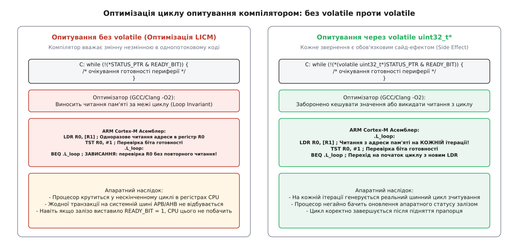
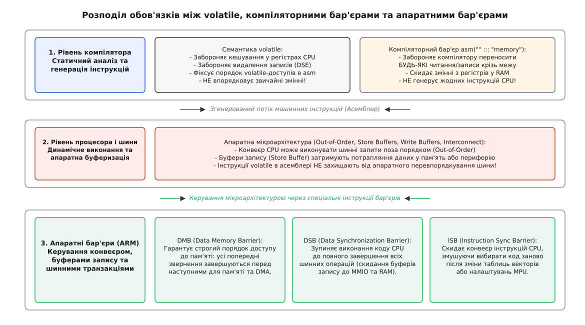
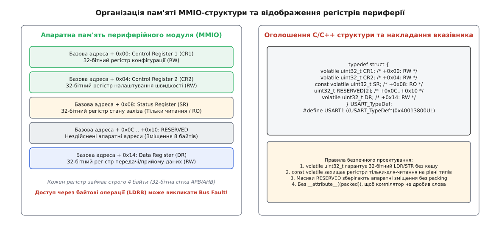

# volatile і компілятор в embedded C

<preknowlist>
- [Атомарність і гонки](root:sf-tasks/atomicity-races) — гонки даних та атомарні неподільні операції.
- [Бар'єри пам'яті: впорядкування операцій](root:sf-tasks/memory-barriers) — апаратні бар'єри CPU та перевпорядкування доступу до пам'яті.
- [Атомарні операції](root:sf-tasks/atomic-ops) — примітиви синхронізації та спільні змінні у паралельних системах.
- [Відображення пам'яті введення-виведення (MMIO)](root:hw-arch/memory-mapped-io) — взаємодія з апаратними регістрами периферії через адресний простір.
</preknowlist>

Розробка низькорівневого програмного забезпечення для вбудованих мікроконтролерів (embedded systems) постійно спирається на пряму взаємодію з апаратними блоками: таймерами, інтерфейсами UART, SPI, I2C та контролерами прямого доступу до пам'яті (DMA). Ця взаємодія здійснюється через регістри введення-виведення з відображенням на пам'ять (Memory-Mapped I/O, MMIO), адреси яких розташовані безпосередньо у загальному адресному просторі процесора. Розробник пише типовий цикл опитування готовності передавача `while (!(UART->SR & TXE_BIT)) {}`, після чого відправляє байт записом у регістр даних `UART->DR = byte`. На етапі налагодження з вимкненими оптимізаціями компілятора (`-O0`) прошивка працює бездоганно: біт перевіряється, залізо відповідає, дані передаються.

Однак варто перемкнути прапорці збірки на стандартні рівні релізної оптимізації (`-O2` або `-O3` у GCC чи Clang), як поведінка пристрою повністю руйнується: процесор нескінченно зависає у циклі перевірки статусу, або ініціалізація периферійного модуля взагалі не виконується. Причина полягає в тому, що компілятор C/C++ оптимізує програму для абстрактної однопотокової машини, де комірки пам'яті можуть змінюватися виключно явними інструкціями самої програми. Не знаючи, що за адресою `0x40013800` стоять кремнієві тригери периферійного контролера, оптимізатор виносить читання статусу за межі циклу, завантажує значення у внутрішній регістр процесора один раз і генерує нескінченний перехід на самого себе. Крім того, послідовні записи конфігурації у той самий регістр компілятор розцінює як «мертвий код» і викидає їх.

Кваліфікатор типу `volatile` (лат. *volatilis* — летючий, мінливий) у мовах C та C++ є базовим інструментом, що вказує оптимізатору: звернення за даною адресою мають зовнішні побічні ефекти (side effects), які компілятор не має права видаляти, об'єднувати або кешувати у регістрах CPU. Водночас у системному програмуванні `volatile` часто хибно наділяють властивостями, якими воно не володіє: атомарністю операцій та апаратним впорядкуванням транзакцій на системних шинах. Без чіткого розуміння меж відповідальності між семантикою мови, компіляторними бар'єрами та апаратними інструкціями мікроархітектури неможливо побудувати надійні драйвери та багатопотокові вбудовані системи.

## Абстрактна машина C/C++ та оптимізації компілятора

Стандарти мов C і C++ формулюють правила перетворення вихідного коду в машинний асемблер на основі формальної концепції «абстрактної машини» (Abstract Machine). Головний принцип роботи оптимізатора закріплений у так званому «правилі ніби так» (англ. *as-if rule*): компілятор має право здійснювати будь-які трансформації вихідного коду, змінювати порядок інструкцій, об'єднувати цикли або повністю видаляти змінні та фрагменти логіки, якщо кінцева **спостережувана поведінка** (observable behavior) програми залишається абсолютно ідентичною тій, яку описав програміст.

Для звичайної пам'яті (RAM) та однопотокового коду це правило забезпечує колосальний приріст продуктивності. Проте абстрактна машина стандартів C/C++ не має вбудованих уявлень про:
1. Апаратні транзистори периферійних модулів, які самостійно оновлюють значення бітів у регістрах пам'яті (наприклад, прапорець прийому байта `RXNE` в UART).
2. Асинхронні обробники переривань (Interrupt Service Routines, ISR), які переривають основний потік виконання і змінюють стан спільних прапорців.
3. Модулі прямого доступу до пам'яті (DMA), що заповнюють буфери в оперативній пам'яті паралельно з роботою обчислювального ядра.

Коли компілятор аналізує функцію опитування статусу периферії без спеціальних кваліфікаторів, він бачить, що між ітераціями циклу жодна інструкція програми не змінює значення пам'яті за вказаною адресою. Відповідно до *as-if rule*, компілятор застосовує низку агресивних оптимізацій:

### 1. Винесення інваріантів циклу (Loop-Invariant Code Motion, LICM) та розподіл регістрів

Зчитування значення з пам'яті через системну шину займає кілька тактів або навіть десятки тактів у випадку повільних шин периферії (APB/AHB). Натомість доступ до регістрів загального призначення процесора (R0–R12 в архітектурі ARM) виконується за один такт або взагалі без затримок у конвеєрі. 

Оптимізатор аналізує цикл `while (!(*STATUS_PTR & READY_BIT))` і робить висновок: оскільки тіло циклу порожнє, значення `*STATUS_PTR` не може змінитися. Отже, немає сенсу повторно виконувати дорогу інструкцію читання з пам'яті на кожній ітерації. Компілятор виконує інструкцію завантаження `LDR` один раз перед входом у цикл, переносить отриманий стан у внутрішній регістр CPU і будує умовний перехід, що багаторазово аналізує значення цього єдиного регістра. Якщо на момент першого читання біт готовності був скинутий, процесор потрапляє у нескінченну пастку: він крутиться в регістрі, а фізична шина опитування заліза залишається мертвою.


*_Порівняння генерації коду для циклу опитування регістра стану: без кваліфікатора volatile компілятор кешує значення в регістрі CPU і зависає; з volatile — генерує обов'язкову шинну інструкцію LDR на кожній ітерації._*

### 2. Видалення «мертвого» запису (Dead Store Elimination, DSE)

Під час ініціалізації периферійних контролерів нерідко потрібно виконати послідовність дій над одним і тим самим регістром. Наприклад, щоб сформувати апаратний імпульс скидання (Hardware Reset) або перемкнути стан виводу GPIO без використання спеціальних атомарних регістрів, пишуть:

:::tabs
```c
// Формування імпульсу на лінії скидання через звичайний вказівник
uint32_t *gpio_out = (uint32_t*)0x40020014UL;

*gpio_out |= (1U << 5);   // Встановити логічну 1
// коротка затримка або наступна дія
*gpio_out &= ~(1U << 5);  // Скинути в логічний 0
```
```cpp
#include <cstdint>

// Формування імпульсу на лінії скидання через звичайний вказівник
auto *gpio_out = reinterpret_cast<std::uint32_t*>(0x40020014UL);

*gpio_out |= (1U << 5);   // Встановити логічну 1
// коротка затримка або наступна дія
*gpio_out &= ~(1U << 5);  // Скинути в логічний 0
```
:::

З погляду абстрактної машини C, перший запис значення з бітом 1 негайно перезаписується другим записом зі значенням 0 без жодного проміжного читання цієї комірки. Оптимізатор класифікує перший запис як марний (Dead Store) і повністю видаляє його зі згенерованого бінарного коду. У результаті на виводі мікроконтролера імпульс фізично не з'являється взагалі.

### 3. Об'єднання записів (Store Merging) та усунення спільних підвиразів (CSE)

Якщо програма послідовно записує кілька байтів за суміжними адресами, компілятор на 32-бітній або 64-бітній платформі може об'єднати два 16-бітних або чотири 8-бітних записи в одну 32-бітну інструкцію запису слова. Якщо ці адреси належать звичайному масиву в оперативній пам'яті, це істотно прискорює роботу. Але якщо адреси належать конфігураційним 8-бітним регістрам периферійного чіпа, де порядок і розрядність шинних циклів суворо регламентовані апаратною логікою, об'єднання записів або зміна їхньої ширини призводить до апаратного збою інтерфейсу або генерації апаратної помилки шини (Bus Fault).

Аналогічно, якщо у функції двічі зчитується регістр лічильника апаратного таймера `uint32_t t1 = *TIMER_CNT; ... uint32_t t2 = *TIMER_CNT;`, оптимізатор за замовчуванням вважатиме, що `t1` і `t2` рівні між собою, замінить друге читання копіюванням значення `t1` і унеможливить вимірювання інтервалів часу.

## Що насправді гарантує volatile

Для подолання описаних конфліктів між статичною моделлю компілятора та фізичною реальністю апаратури стандарти C (починаючи з ANSI C C89/C90 та ISO/IEC 9899:1999) і C++ визначають поняття **спостережуваної поведінки** програми (Observable Behavior). Згідно зі стандартами, спостережуваною поведінкою є:
1. Доступи (читання та записи) до об'єктів, кваліфікованих як `volatile`.
2. Операції введення-виведення через функції стандартної бібліотеки.
3. Стан завершення програми.

Оголошення змінної або звернення через вказівник із кваліфікатором `volatile` накладає на компілятор чотири непорушні правила:

### 1. Обов'язкове фізичне читання (Hardware Read)
Кожен вираз у вихідному коді, який передбачає читання значення `volatile`-об'єкта, зобов'язаний транслюватися в реальну машинну інструкцію читання з пам'яті (`LDR`, `MOV`, `lw`). Компілятору категорично заборонено видаляти повторні читання, замінювати їх константами або переносити значення у постійний регістровий кеш крізь точки послідовного виконання (Sequence Points).

### 2. Обов'язковий фізичний запис (Hardware Write)
Кожен вираз, який записує значення у `volatile`-об'єкт, зобов'язаний генерувати явну машинну інструкцію запису в пам'ять (`STR`, `MOV`, `sw`). Оптимізації Dead Store Elimination та об'єднання записів для таких об'єктів повністю заблоковані. Скільки разів у коді виконано запис у `volatile`-змінну — рівно стільки апаратних транзакцій з'явиться на шині.

### 3. Збереження порядку виконання між volatile-операціями
Компілятор не має права міняти місцями порядок виконання двох або більше звернень до `volatile`-об'єктів. Якщо у вихідному коді написано:

:::tabs
```c
volatile uint32_t *reg_ctrl = (volatile uint32_t*)0x40010000UL;
volatile uint32_t *reg_data = (volatile uint32_t*)0x40010004UL;

*reg_data = 0xAA;
*reg_ctrl = 0x01;
```
```cpp
#include <cstdint>

auto *reg_ctrl = reinterpret_cast<volatile std::uint32_t*>(0x40010000UL);
auto *reg_data = reinterpret_cast<volatile std::uint32_t*>(0x40010004UL);

*reg_data = 0xAA;
*reg_ctrl = 0x01;
```
:::

Компілятор гарантовано згенерує інструкцію запису в `reg_data` раніше, ніж інструкцію запису в `reg_ctrl` у вихідному потоці асемблера. Це критично для периферії, де спочатку завантажують дані у буферний регістр, а потім виставляють біт старту передачі у регістрі керування.

### 4. Збереження ширини доступу (Access Width)
Якщо об'єкт оголошено як `volatile uint32_t`, компілятор згенерує інструкцію доступу до 32-бітного слова (`LDR`/`STR` в ARM, `lw`/`sw` в RISC-V). Він не розіб'є її на чотири окремі 8-бітні інструкції читання байтів (`LDRB`), і не об'єднає дві сусідні 32-бітні змінні в одну 64-бітну команду `LDRD`. Це життєво важливо для шинної топології периферійних модулів: багато контролерів підтримують доступ тільки цілими 32-бітними словами, а спроба байтового доступу призводить до апаратного виключення ядра.

## Чого volatile НЕ гарантує

Найнебезпечніша помилка розробників низькорівневого коду — сприймати `volatile` як магічний засіб вирішення проблем багатопотоковості, синхронізації та потокової безпеки. Семантика `volatile` обмежує **виключно оптимізатор компілятора** на етапі створення асемблерного коду. `volatile` не керує процесорною мікроархітектурою і не змінює роботу фізичних шин кристала.

Розглянемо три фундаментальні обмеження, де `volatile` не надає жодних гарантій:

### 1. Відсутність атомарності (No Atomicity)

Кваліфікатор `volatile` нічого не гарантує щодо неподільності операцій:

- **Розривне читання на вузьких шинах:** Якщо на 8-бітному мікроконтролері (наприклад, AVR ATmega) або 16-бітному ядрі оголосити `volatile uint32_t counter;`, операція запису `counter = 0x12345678` транслюється у чотири послідовні машинних інструкції `STS` (Store Direct to Data Space). Якщо після запису другого байта спрацює асинхронне переривання, обробник ISR прочитає напівзмінене спотворене число. Це явище детально розібрано у статті [Розривне читання (torn read)](root:sf-tasks/torn-reads).
- **Операції читання-модифікації-запису (Read-Modify-Write, RMW):** Навіть на повноцінному 32-бітному ядрі вираз `volatile_var++` або `REG |= BIT` не є атомарним. Компілятор чесно розгортає його у три окремі процесорні інструкції:
  1. `LDR R0, [addr]` (читання з пам'яті в регістр).
  2. `ORR R0, R0, #BIT` (модифікація біта в арифметико-логічному пристрої ALU).
  3. `STR R0, [addr]` (запис оновленого значення назад у пам'ять).

Якщо між першим і третім кроками виникне переривання або інше ядро процесора звернеться до цієї ж комірки, одне з оновлень буде безповоротно втрачено (гонка втраченого оновлення / Lost Update).

### 2. Відсутність апаратного впорядкування пам'яті (No Hardware Memory Ordering)

Сучасні суперскалярні процесори з позапорядковим виконанням (Out-of-Order Execution), а також конвеєрні мікроконтролери з буферами відкладеного запису (Store Buffers, Write Buffers) мають право змінювати реальний порядок проходження транзакцій на фізичній системній шині.

Навіть якщо компілятор згенерував інструкції запису суворо у порядку `STR data` -> `STR flag`, апаратний блок Store Buffer процесорного ядра може затримати перший запис у черзі, тоді як другий запис пройде на шину негайно. Інше ядро мікроконтролера або модуль DMA побачить встановлений прапорець `flag == 1`, але зчитає з пам'яті старі неініціалізовані дані `data`. Кваліфікатор `volatile` ніяк не впливає на Store Buffers, лінії кеш-пам'яті чи арбітри системних шин.


*_Розподіл зон відповідальності: volatile працює лише на рівні компілятора для позначених змінних; компіляторний бар'єр охоплює всю пам'ять у коді; апаратні бар'єри CPU керують виконанням інструкцій на шині та в конвеєрі._*

### 3. Перевпорядкування звичайних змінних довкола volatile

Стандарти мов C та C++ забороняють компілятору міняти місцями порядок двох `volatile`-доступів між собою. Проте вони **дозволяють компілятору переставляти звичайні (не-volatile) операції читання та запису відносно volatile-операцій**, якщо між ними немає прямої залежності за даними!

Розглянемо небезпечний антипатерн передачі буфера через прапорець:

:::tabs
```c
uint8_t tx_buffer[64];              // Звичайний буфер (не volatile)
volatile uint32_t is_ready = 0;     // Прапорець готовності

void send_packet(void) {
    tx_buffer[0] = 0xAA;            // 1. Запис корисних даних
    tx_buffer[1] = 0xBB;
    is_ready = 1;                   // 2. Сигнал обробнику переривання
}
```
:::code volatile-register-d/cpp/3-perevporiadkuvannia.cpp
:::

Оскільки масив `tx_buffer` не позначений як `volatile`, компілятор під час оптимізації `-O3` має повне право перенести інструкцію `is_ready = 1` **вище** заповнення масиву `tx_buffer`, якщо вважатиме це вигідним для планування конвеєра інструкцій. Обробник переривання побачить `is_ready == 1` ще до того, як процесор реально запише байти `0xAA` та `0xBB` у пам'ять.

## Компіляторні та апаратні бар'єри пам'яті

Щоб гарантувати надійність виконання низькорівневих операцій та узгодити стан пам'яті між ядрами, периферією та перериваннями, застосовують дворівневу систему бар'єрів: компіляторні бар'єри та апаратні інструкції синхронізації процесора.

### Компіляторний бар'єр (Compiler Barrier / Signal Fence)

Компіляторний бар'єр наказує оптимізатору: жодна операція читання або запису будь-якої змінної у пам'ять (як `volatile`, так і звичайної) не має права бути перенесена крізь цю точку у вихідному асемблері.

У компіляторах GCC та Clang такий бар'єр створюється за допомогою порожньої асемблерної вставки з вимогою перезавантаження пам'яті:

:::tabs
:::code volatile-register-d/c/kompiliatornyi-barier.c
:::code volatile-register-d/cpp/kompiliatornyi-barier.cpp
:::

Компіляторний бар'єр змушує компілятор скинути всі оптимізовані в регістрах CPU змінні назад у фізичну пам'ять. При цьому сам компіляторний бар'єр **не генерує жодної інструкції в машинному коді** процесора і має нульову апаратну вартість. Проте він діє виключно під час компіляції: якщо процесор має позапорядковий конвеєр або буфери запису, компіляторний бар'єр не захищає від апаратного перевпорядкування.

### Апаратні бар'єри пам'яті архітектури ARM (DMB, DSB, ISB)

Для керування фізичною поведінкою мікроархітектури ядра процесори мають спеціальні апаратні інструкції-бар'єри (Memory Barriers). В архітектурі ARM Cortex-M/Cortex-R/Cortex-A визначено три фундаментальні інструкції:

#### 1. DMB (Data Memory Barrier / Бар'єр пам'яті даних)
Інструкція `DMB` гарантує, що всі явні операції доступу до пам'яті (як читання, так і записи), які передують бар'єру у програмному порядку, будуть завершені та видимі системі пам'яті (іншим ядрам, контролерам DMA) раніше, ніж розпочнеться виконання будь-яких операцій доступу до пам'яті, розташованих після інструкції `DMB`.

`DMB` застосовується під час обміну даними між обчислювальними ядрами у багатоядерних SoC (наприклад, RP2040 або ESP32) та перед передачею буфера контролеру DMA:

:::tabs
```c
#include <cmsis_compiler.h> // Надає __DMB(), __DSB(), __ISB()

void prepare_and_trigger_dma(void) {
    fill_dma_tx_buffer(); // Заповнення пам'яті
    
    __DMB();              // Гарантія: дані фізично готові для шини DMA
    
    DMA1_Channel1->CCR |= DMA_CCR_EN; // Запуск апаратного каналу DMA
}
```
:::code volatile-register-d/cpp/1-dmb-data-memory-barrier.cpp
:::

#### 2. DSB (Data Synchronization Barrier / Бар'єр синхронізації даних)
Інструкція `DSB` є значно строгішим бар'єром, ніж `DMB`. Вона повністю призупиняє виконання будь-яких наступних інструкцій процесора в конвеєрі доти, доки всі попередні звернення до пам'яті (включно зі скиданням усіх внутрішніх буферів відкладеного запису Write Buffers та завершенням транзакцій на шинах AHB/APB) не будуть підтверджені апаратурою.

`DSB` є обов'язковим у трьох типових випадках:
- **Перед виходом з обробника переривання (ISR):** Якщо прапорець переривання периферійного пристрою скидається записом у регістр `UART->SR = 0`, запис може затриматися у Write Buffer процесора. Якщо процесор негайно виконає інструкцію повернення з переривання `BX LR`, контролер переривань (NVIC) знову виявить активний прапорець і викличе той самий обробник повторно. Виклик `__DSB()` перед виходом гарантує скидання прапорця на шині до виходу з ISR.
- **Перед переходом у режим глибокого сну (`WFI` / `WFE`):** Щоб процесор не заснув у момент, коли транзакція конфігурації ще не дійшла до заліза.
- **Під час зміни конфігурації контролера пам'яті або MPU:** Перед перемиканням прав доступу до сторінок пам'яті.

#### 3. ISB (Instruction Synchronization Barrier / Бар'єр синхронізації інструкцій)
Інструкція `ISB` скидає конвеєр вибірки інструкцій (Instruction Prefetch Pipeline) процесора, змушуючи ядро вибирати всі наступні інструкції заново з пам'яті або кешу інструкцій.

`ISB` необхідний після:
- Зміни адреси таблиці векторів переривань у регістрі `SCB->VTOR`.
- Зміни налаштувань захисту пам'яті у блоці MPU (Memory Protection Unit).
- Завантаження коду в оперативну пам'ять (динамічні завантажувачі, запуск коду з RAM після перепрошивки Flash).

Детальний мікроархітектурний аналіз моделей пам'яті процесорів розгорнуто у статті [Бар'єри пам'яті: впорядкування операцій](root:sf-tasks/memory-barriers).

## Правильне оголошення регістрів периферії через структури в C та C++

У системному програмуванні для мікроконтролерів стандартним де-факто є опис апаратних периферійних блоків через C-структури, поля яких безпосередньо накладаються на карту адрес пам'яті (стандарт CMSIS для ARM Cortex). 


*_Відображення структури MMIO на фізичний адресний простір: кожен регістр займає фіксоване зміщення у 32-бітній сітці, нереалізовані комірки закриваються масивами RESERVED, а кваліфікатори volatile гарантують коректність шинних операцій._*

### Патерни безпечного проектування в чистому C

Розглянемо еталонне оголошення структури периферійного модуля (на прикладі універсального таймера/UART):

:::tabs
:::code volatile-register-d/c/paterny-bezpechnoho.c
:::code volatile-register-d/cpp/paterny-bezpechnoho.cpp
:::

Ключові архітектурні правила створення MMIO-структур:
1. **Використання `const volatile uint32_t` для регістрів тільки-для-читання (RO):** Кваліфікатор `const` забороняє програмісту випадково написати `USART1->SR = 0x12` на рівні перевірки типів компілятора, а `volatile` змушує компілятор щоразу зчитувати актуальний стан заліза з фізичної шини.
2. **Явні масиви `RESERVED` для вирівнювання зміщень:** Якщо в адресному просторі периферії між регістрами є прогалини, їх обов'язково заповнюють некваліфікованими масивами `uint32_t RESERVED[N]`. Це гарантує точний збіг зміщень полів структури з фізичними апаратними регістрами.
3. **Заборона `__attribute__((packed))` на MMIO-структурах:** Атрибут упаковки структури змушує компілятор вважати, що дані можуть бути невирівняними за 4-байтовою межею слів. У результаті GCC генерує код побайтового читання (`LDRB`), який ламає роботу 32-бітної шини периферійного контролера.

### Атомарні регістри керування виводами (BSRR vs ODR)

Типовою задачею є зміна стану окремого біта конфігурації без спотворення сусідніх бітів того самого регістра. Якщо змінювати стан через операцію читання-модифікації-запису `GPIO->ODR |= (1U << 5)`, виникає гонка з перериваннями, які можуть паралельно змінити інші виводи цього порту.

Для запобігання гонкам розробники кремнію (наприклад, у мікроконтролерах STM32) додають спеціальні **атомарні регістри встановлення та скидання бітів (Bit Set/Reset Register, BSRR)**:

:::tabs
:::code volatile-register-d/c/atomarni-rehistry.c
:::code volatile-register-d/cpp/atomarni-rehistry.cpp
:::

Запис у регістр `BSRR` виконується однією машинною інструкцією `STR`, а логіка всередині самого апаратного модуля GPIO здійснює зміну тригера відповідного піна. Це повністю виключає необхідність зупиняти переривання або використовувати м'ютекси.

### Ідіоматичні C++ MMIO-обгортки нульової вартості (Zero-Cost Abstractions)

У сучасному C++ замість сирих макросів та вказівників будують типобезпечні шаблони регістрів, які перевіряють права доступу на етапі компіляції та не витрачають жодного зайвого байта пам'яті:

:::code volatile-register-d/cpp/idiomatychni-c-mmio.cpp

Цей підхід забезпечує повну строгість компіляторних перевірок типів, запобігає передачі помилкових вказівників і завдяки повній оптимізації (`inline`) генерує точнісінько такий самий компактний асемблерний код з інструкціями `LDR`/`STR`, як і низькорівневий код на C.

## Зведена матриця та правила вибору інструментів синхронізації

Щоб уникнути типових помилок при проектуванні драйверів та низькорівневих модулів, розподіл інструментів синхронізації та видимості даних зведено у підсумкову матрицю:

| Механізм | Зона впливу | Що гарантує | Чого НЕ гарантує | Типове застосування |
| :--- | :--- | :--- | :--- | :--- |
| **`volatile`** | Оптимізатор компілятора | Обов'язкове читання/запис кожної інструкції; збереження порядку між volatile-доступами | Атомарності операцій; апаратного впорядкування на шині; впорядкування не-volatile змінних | Регістри периферії (MMIO); спільні скалярні прапорці з ISR |
| **Компіляторний бар'єр** (`atomic_signal_fence`) | Оптимізатор компілятора | Заборона переміщення будь-яких операцій пам'яті крізь межу бар'єра в асемблері | Апаратного впорядкування в конвеєрі CPU (0 машинних інструкцій) | Синхронізація з перериваннями на одному ядрі перед зміною прапорців |
| **Апаратний бар'єр `DMB`** | Шини даних і пам'ять CPU | Завершення всіх попередніх транзакцій пам'яті перед наступними | Зупинки виконання конвеєра інструкцій | Передача буферів контролерам DMA; синхронізація між ядрами |
| **Апаратний бар'єр `DSB`** | Конвеєр та системні шини | Повне вичерпання Write Buffers та шинних операцій перед наступною інструкцією | Скидання кешу інструкцій | Скидання прапорців перед виходом з ISR; підготовка до сну `WFI` |
| **Апаратний бар'єр `ISB`** | Конвеєр вибірки інструкцій | Скидання конвеєра команд та вибірка наступних інструкцій заново | Впорядкування шин даних | Зміна таблиці векторів переривань (`VTOR`); налаштування MPU |
| **`std::atomic` / Атоміки** | Компілятор + апаратура CPU | Атомарність RMW-операцій; послідовна узгодженість (Acquire/Release) | Автоматичної підтримки специфіки MMIO (бітових полів без RMW) | Багатопотокові лічильники, блокування, lock-free структури |

### Інженерні правила розробника

1. **Кожен MMIO-регістр периферії зобов'язаний бути `volatile`:** Без цього цикл опитування або запис налаштувань обов'язково зламається під оптимізаціями `-O2` або `-O3`.
2. **`volatile` не забезпечує потокобезпечність (Thread Safety):** Якщо дані модифікуються з кількох потоків або обробників, потрібні атомарні операції, критичні секції з відключенням переривань або апаратні регістри на зразок `BSRR`.
3. **Перед передачею пам'яті модулю DMA завжди викликайте `DMB` або компіляторний бар'єр:** Щоб залізо не почало передавати напівзаповнений буфер.
4. **Перед виходом з обробника переривання, де скидався прапорець заліза, додавайте `DSB`:** Це запобігає фантомним повторним спрацьовуванням переривання через буферизацію запису.
5. **Не використовуйте `volatile` для звичайних змінних у багатопотоковому коді простору користувача:** Для обміну між потоками в ОС використовуйте виключно стандартні примітиви `std::atomic`, м'ютекси та умовні змінні.
