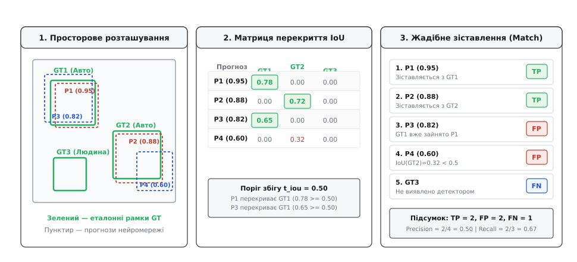
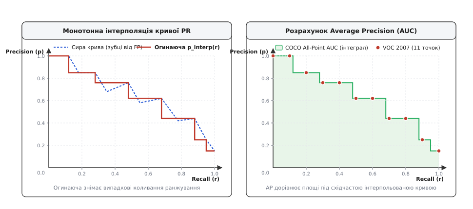

# Метрики детектора

<preknowlist>
- [Виявлення об'єктів](root:sf-visual/object-detection) — представлення детекцій через прямокутні межі (bounding boxes) та оцінки впевненості.
- [Нейродетектори](root:sf-visual/nn-detectors) — одностадійні й двостадійні згорткові архітектури, класифікаційні логіти та регресія координат.
- [Non-Maximum Suppression](root:sf-visual/nms-algorithm) — пригнічення перекривних гіпотез детектора на основі порогу просторового накладання.
- [Зображення як дані](root:sf-visual/image-as-data) — координатна сітка пікселів кадру, просторова роздільність і формати зберігання.
</preknowlist>

Коли оптико-електронний модуль розвідувального безпілотника обробляє відеопотік високої роздільності 3840×2160 пікселів для автоматичного супроводу малорозмірних транспортних засобів (30×30 пікселів) та піхоти (15×40 пікселів), спроба оцінити якість роботи детектора за класичною метрикою точності класифікації (Accuracy) призводить до повної дезорієнтації інженерної оцінки. Якщо розбити вхідний кадр на щільну сітку з пів мільйона потенційних кандидатних вікон і класифікувати кожне як «об'єкт» або «тло», нейромережа, яка не виявила жодної реальної цілі й згенерувала сотні хибних спрацьовувань на копицях сіна чи тінях від дерев, покаже формальну точність класифікації понад 99.98%. Цей парадокс виникає через те, що 99.99% площі зображення становить статичне тло, і абсолютне домінування негативного класу маскує катастрофічні провали у визначенні просторових координат та пропуск реальних об'єктів.

У задачах комп'ютерного зору виявлення об'єктів є багатозадачною проблемою (англ. *multi-task learning*): алгоритм повинен одночасно розв'язати задачу семантичної класифікації (визначити клас об'єкта) та задачу геометричної регресії (точно локалізувати межі тіла у двовимірному чи тривимірному просторі). Для замкненої оцінки системи детекції необхідний математичний апарат, що інтегрує якість просторового охоплення, стійкість ранжування за оцінками впевненості та баланс між повнотою виявлення цілей і частотою хибних тривог.

Повний програмний комплекс для автономної оцінки цих метрик на бортових процесорах реалізовано у вставці [Оцінювач метрик детекції для бортових систем](root:sf-visual/detection-metrics/proj-detection-metrics-evaluator.md).

## Просторова локалізація проти дискретної класифікації

У класичній задачі класифікації зображень простір можливих відповідей фіксований і дискретний: кожному вхідному кадру відповідає один або кілька векторів ймовірностей належності до `C` фіксованих класів. Якість моделі вимірюється співвідношенням правильно розпізнаних зразків до загальної кількості спроб. Якщо модель правильно вгадала мітку класу для 95 зображень зі 100, її точність становить рівно 95%.

У задачі детекції вихідний потік моделі складається з довільної кількості гіпотез `K`, де кожна гіпотеза `P_i` описується вектором з шести параметрів:

```
P_i = (x_min, y_min, x_max, y_max, s_i, c_i)
```

де `(x_min, y_min, x_max, y_max)` — неперервні просторові координати прямокутної обмежувальної рамки (англ. *bounding box*), `s_i ∈ [0, 1]` — оцінка впевненості моделі (англ. *confidence score*), а `c_i ∈ {1, ..., C}` — ідентифікатор семантичного класу.

Множина еталонної розмітки (англ. *Ground Truth*, скорочено `GT`) для того самого кадру містить `M` фізичних об'єктів:

```
GT_j = (x_min*, y_min*, x_max*, y_max*, c_j*)
```

Кількість прогнозованих рамок `K` майже ніколи не збігається з кількістю еталонних об'єктів `M`. Детектор може згенерувати п'ять перекривних рамок навколо одного автомобіля, повністю проігнорувати інший автомобіль у затінку й видати рамку з високою впевненістю на ділянці порожнього асфальту.

Через це виникають фундаментальні розбіжності з класифікаційними метриками:

### 1. Відсутність визначеного істинного негативу (True Negative)

У класифікації помилки розподіляються за матрицею невідповідностей (англ. *confusion matrix*), яка містить чотири квадранти: `TP` (істинно позитивні), `FP` (хибно позитивні), `FN` (хибно негативні) та `TN` (істинно негативні).

У задачі детекції об'єктів поняття `TN` втрачає фізичний зміст. Що саме вважати одним істинним негативом? Чи це ділянка розміром 32×32 пікселі у порожньому кутку кадру? Чи це будь-яке з мільйонів можливих прямокутних вікон довільного масштабу та співвідношення сторін, де об'єкта немає? Оскільки кількість порожніх ділянок неперервна й прямує до нескінченності, показник `TN → ∞`. 

Як наслідок, будь-яка метрика, у формулі якої фігурує `TN`:

```
Accuracy = (TP + TN) / (TP + TN + FP + FN)
Specificity = TN / (TN + FP)
FPR = FP / (FP + TN)
```

девальвується: знаменник стає нескінченно великим, значення `Accuracy` завжди наближається до 1.0, а рівень хибних спрацьовувань `FPR` штучно падає до 0.0 незалежно від реальної кількості галюцинацій детектора. Саме тому криві ROC-AUC (англ. *Receiver Operating Characteristic*), які спираються на `FPR`, у задачах детекції є непридатними та вводять в оману.

### 2. Подвійна природа помилки детектора

Помилка передбачення в детекції не є атомарною. Вона розпадається на три ортогональні складові:
- **Помилка класифікації:** об'єкт локалізовано бездоганно, але танк розпізнано як вантажівку.
- **Помилка локалізації:** клас визначено правильно, але координати рамки зміщені на 20 пікселів або охоплюють лише половину корпусу цілі.
- **Помилка фонового виявлення (галюцинація):** об'єкт знайдено там, де розташована однорідна текстура лісу чи води.

Метрика якості зобов'язана одночасно штрафувати всі три типи дефектів, не змішуючи їх між собою.

### 3. Штраф за дублювання та надлишкові спрацьовування

Якщо біля реального об'єкта алгоритм формує кілька перекривних гіпотез (наприклад, через неповне пригнічення немаксимумів NMS), система не має права вважати кожну рамку успішною. Реальна виконавча система (наприклад, привід турелі чи автопілот) здатна супроводжувати лише одну просторову ціль. Решта гіпотез повинні бути покарані як хибні тривоги `FP`, оскільки вони засмічують обчислювальний тракт і провокують повторні хибні спрацьовування.

## Генерація пропозицій та вихідний тракт детектора

Щоб зрозуміти, звідки береться масив гіпотез для розрахунку метрик, необхідно розглянути структуру вихідного тракту сучасних згорткових нейромереж та трансформерів детекції.

В одностадійних архітектурах (YOLO, SSD, RetinaNet) зображення пропускається крізь піраміду ознак (Feature Pyramid Network, FPN). На кожному масштабному рівні піраміди (від `P3` з кроком дискретизації 8 пікселів до `P7` з кроком 128 пікселів) формується регулярна просторова сітка комірок. Кожна комірка сітки відповідає за генерацію `A` апріорних якірних рамок (англ. *anchors*) або безпосередньо регресує чотири відстані до меж об'єкта (в архітектурах без якорів, таких як FCOS чи CenterNet).

Сумарна кількість вихідних гіпотез до фільтрації для кадру високої роздільності `W × H` визначається сумою розмірностей усіх рівнів піраміди:

```
N_total = A · ( (W/8 · H/8) + (W/16 · H/16) + (W/32 · H/32) + (W/64 · H/64) + (W/128 · H/128) )
```

Для кадру формату 4K (3840×2160) за наявності 3 якорів на рівень загальна кількість кандидатних рамок сягає понад 500 000. 

Вихідний потік детектора проходить три послідовні етапи фільтрації:

1. **Відсікання за порогом впевненості (Score Thresholding):** усі рамки, для яких максимальна ймовірність класу `max_c (s_i,c) < t_conf` (типово `t_conf ∈ [0.001, 0.05]` під час валідації та `t_conf ∈ [0.25, 0.50]` під час реального польоту), негайно відкидаються. Для розрахунку повної кривої PR під час валідації використовують дуже низький поріг `t_conf = 0.001`, щоб отримати повний спектр значень повноти до `Recall = 1.0`.
2. **Пригнічення немаксимумів (Non-Maximum Suppression, NMS):** серед просторово перекривних гіпотез одного класу обирається рамка з максимальною впевненістю, а всі сусідні рамки, які мають з нею `IoU ≥ t_nms` (типово `t_nms = 0.50`), пригнічуються.
3. **Обмеження максимальної кількості гіпотез (Top-K Selection):** залишається не більше `maxDets` рамок з найвищими оцінками впевненості (стандартно до 100 або 300 на кадр).

Якість роботи саме цього відфільтрованого масиву гіпотез і є предметом вимірювання фінальних метрик.

## Геометрія просторового перекриття: Intersection over Union (IoU)

Для кількісної оцінки геометричної відповідності між прогнозованою рамкою `B_p` та еталонною рамкою `B_gt` використовується коефіцієнт Жаккара (англ. *Jaccard Index*, введений швейцарським ботаніком Полем Жаккаром у 1901 році), який у комп'ютерному зорі отримав назву перетину над об'єднанням (англ. *Intersection over Union*, скорочено `IoU`).

Нехай прямокутні області на площині зображення задані множинами пікселів `B_p ⊂ ℝ²` та `B_gt ⊂ ℝ²`. Тоді `IoU` визначається як відношення площі їхньої спільної частини до площі їхнього геометричного об'єднання:

```
IoU(B_p, B_gt) = Area(B_p ∩ B_gt) / Area(B_p ∪ B_gt)
```

Оскільки площа об'єднання двох довільних фігур виражається через суму їхніх площ без площі перетину, формула розрахунку набуває вигляду:

```
IoU(B_p, B_gt) = Area(B_p ∩ B_gt) / (Area(B_p) + Area(B_gt) − Area(B_p ∩ B_gt))
```

Розгорнутий математичний вивід для прямокутників, ребра яких паралельні осям координат кадру (англ. *Axis-Aligned Bounding Box*, AABB):

```
x_left   = max(x1_p, x1_gt)                                                                    [ліва межа спільного прямокутника]
y_top    = max(y1_p, y1_gt)                                                                    [верхня межа спільного прямокутника]
x_right  = min(x2_p, x2_gt)                                                                    [права межа спільного прямокутника]
y_bottom = min(y2_p, y2_gt)                                                                    [нижня межа спільного прямокутника]
w_inter  = max(0.0, x_right − x_left)                                                          [ширина перетину, невід'ємна]
h_inter  = max(0.0, y_bottom − y_top)                                                          [висота перетину, невід'ємна]
Area_inter
= w_inter · h_inter                                                                            [площа спільної області]
Area_p
= max(0.0, x2_p − x1_p) · max(0.0, y2_p − y1_p)                                                [площа прогнозу]
Area_gt
= max(0.0, x2_gt − x1_gt) · max(0.0, y2_gt − y1_gt)                                            [площа еталону]
Area_union
= Area_p + Area_gt − Area_inter                                                                [формула включень-виключень]
IoU
= Area_inter / Area_union                                                                      [підсумковий коефіцієнт Жаккара]
```

Значення `IoU` строго обмежене діапазоном `[0, 1]`:
- `IoU = 0`, коли рамки не мають жодного спільного пікселя (`Area_inter = 0`);
- `IoU = 1`, коли координати кутів прогнозованої та еталонної рамок повністю ідентичні;
- `0 < IoU < 1`, коли присутнє часткове просторове перекриття.

```
+---------------------------+
| B_p                       |
|         +-----------------+---------+
|         | B_p ∩ B_gt      |         |
|         | (Перетин)       |         |
+---------+-----------------+         |
          |                      B_gt |
          +---------------------------+
  Об'єднання (B_p ∪ B_gt) = сумарна площа обох фігур
```

### Формати представлення координат і крайові ефекти

У практичній реалізації оцінювача детектора критично важливо зафіксувати єдину угоду щодо координат рамок:

1. **Формат кутів (Corner / XYXY):** `(x1, y1, x2, y2)`, де `(x1, y1)` — верхній лівий кут, `(x2, y2)` — нижній правий кут. Цей формат є найбільш природним для швидкого обчислення перетинів, оскільки вимагає лише операцій взяття мінімуму та максимуму без операцій додавання чи множення.
2. **Формат центру та розміру (Centroid / CXCYWH):** `(cx, cy, w, h)`, де `(cx, cy)` — геометричний центр, `w` — ширина, `h` — висота. Цей формат використовується всередині нейромереж для регресії відносних зміщень відносно комірок сітки.
3. **Формат лівого верхнього кута та розміру (XYWH / COCO format):** `(x_min, y_min, w, h)`. Стандартний формат анотацій JSON у датасеті MS COCO.

Для переходу між форматами застосовуються прямі перетворення:

```
x1 = cx − w / 2,   y1 = cy − h / 2,   x2 = cx + w / 2,   y2 = cy + h / 2   [CXCYWH -> XYXY]
cx = (x1 + x2) / 2, cy = (y1 + y2) / 2, w = x2 − x1,       h = y2 − y1       [XYXY -> CXCYWH]
x1 = x_min,        y1 = y_min,        x2 = x_min + w,    y2 = y_min + h    [XYWH -> XYXY]
```

Для дискретних цілочисельних піксельних координат історично існувала розбіжність між стандартом PASCAL VOC та сучасним стандартом MS COCO. У PASCAL VOC пікселі розглядалися як неподільні дискретні комірки з індексацією від 1, тому ширина обчислювалася як `w = x2 − x1 + 1`. 

У сучасному стандарті COCO координати вважаються неперервними дійсними числами у вимірному просторі кадру, тому ширина та площа обчислюються без одиничного зміщення: `w = x2 − x1`, `h = y2 − y1`. Якщо `x2 ≤ x1` або `y2 ≤ y1`, площа вважається нульовою, що усуває генерацію від'ємних площ при некоректних передбаченнях нейромережі.

> 🔧 **Навіщо це.** У бортових оптико-електронних станціях БПЛА обчислення координат часто виконується з субпіксельною точністю через масштабування та корекцію дисторсії оптики. Використання неперервної моделі площ без одиничного дискретного зсуву запобігає накопиченню систематичної похибки оцінки на дрібних об'єктах розміром до 10 пікселів.

### Властивості та обмеження класичного IoU

Класичний `IoU` має важливу властивість: він є **масштабно-інваріантним** (англ. *scale-invariant*). Якщо пропорційно збільшити координати кадру та рамок у 10 разів, площа перетину й площа об'єднання збільшаться рівно в 100 разів, а їхнє відношення залишиться абсолютно незмінним. Це дозволяє порівнювати геометричну точність детекції великих і малих об'єктів за єдиною шкалою від 0 до 1.

Проте класичний `IoU` має суттєвий недолік: коли рамки не перетинаються взагалі (`Area_inter = 0`), значення `IoU` тотожно дорівнює нулю незалежно від того, розташовані рамки на відстані 1 пікселя чи 1000 пікселів одна від одної.

Для подолання цього обмеження під час навчання нейромереж розроблено розширені метрики (GIoU, DIoU, CIoU), які враховують площу мінімального охопного прямокутника або евклідову відстань між центрами:

- **Generalized IoU (GIoU):** штрафує за площу порожнього простору всередині мінімальної охопної рамки `C`:
  ```
  GIoU = IoU − (Area(C) − Area_union) / Area(C)
  ```
- **Distance IoU (DIoU):** штрафує за нормалізовану відстань між центрами рамок:
  ```
  DIoU = IoU − d²(center_p, center_gt) / c_diag²
  ```
  де `d` — евклідова відстань між центрами, а `c_diag` — довжина діагоналі мінімального охопного прямокутника.
- **Complete IoU (CIoU):** додатково враховує відповідність співвідношення сторін (англ. *aspect ratio*):
  ```
  CIoU = DIoU − α · v
  v = (4 / π²) · (arctan(w_gt / h_gt) − arctan(w_p / h_p))²
  α = v / ((1 − IoU) + v)
  ```

Незважаючи на переваги `GIoU`, `DIoU` та `CIoU` як функцій втрат при навчанні (англ. *loss functions*), у протоколах валідації та оцінки моделей детекції міжнародні стандарти (VOC, COCO, OpenImages) використовують виключно класичний `IoU`, оскільки він забезпечує строгу й інтуїтивну інтерпретацію частки геометричного накладання тіл.

### Орієнтовані прямокутники (Rotated Bounding Boxes, OBB)

В аерофотозніманні з дронів та супутниковому моніторингу (датасети DOTA, HRSC2016) об'єкти (літаки, кораблі, вагони) розташовані під довільними кутами до горизонту. Звичайні горизонтальні рамки (AABB) для видовженого судна, орієнтованого під кутом 45 градусів, охоплюють величезну площу фонової води, перекриваючись із сусідніми суднами.

У таких задачах застосовують орієнтовані обмежувальні рамки (англ. *Oriented Bounding Boxes*, OBB), які описуються п'ятьма параметрами `(cx, cy, w, h, θ)`, де `θ` — кут нахилу головної осі. Розрахунок `IoU` для OBB вимагає знаходження площі перетину двох опуклих багатокутників за допомогою алгоритму відсікання багатокутників Сазерленда-Ходжмана (англ. *Sutherland-Hodgman algorithm*).

Вершини результуючого багатокутника перетину `(v_1, v_2, ..., v_n)` впорядковуються за годинниковою стрілкою, а його площа обчислюється за формулою шнурування Ґауса (формулою площі трапецій):

```
Area_polygon = 0.5 · | ∑_{i=1}^n (x_i · y_{i+1} − x_{i+1} · y_i) |
```

де `(x_{n+1}, y_{n+1}) = (x_1, y_1)`.

## Зіставлення прогнозів з еталоном (Ground Truth Matching)

Для визначення того, які прогнози є вдалими, а які помилковими, застосовується алгоритм зіставлення прогнозів із розміткою на основі фіксованого порогу перекриття `t_iou` (англ. *IoU threshold*).

### Критерії категоризації: TP, FP, FN

Кожне передбачення детектора та кожен еталонний об'єкт класифікуються за трьома взаємовиключними категоріями:

- **True Positive (TP, істинно позитивний результат):** прогнозована рамка з високою впевненістю успішно зіставлена з еталонним об'єктом того самого класу за умови, що їхній `IoU ≥ t_iou`.
- **False Positive (FP, хибно позитивний результат, хибна тривога):** 
  - рамка згенерована на ділянці фону, де немає жодного еталонного об'єкта (`IoU < t_iou`);
  - рамка правильно вказує на координати об'єкта, але призначає йому помилковий семантичний клас;
  - рамка є надлишковим дублікатом, тобто перекриває еталонний об'єкт, який вже був раніше зіставлений з іншою рамкою, що мала вищу оцінку впевненості.
- **False Negative (FN, хибно негативний результат, пропуск цілі):** еталонний об'єкт з розмітки, для якого детектор не згенерував жодної прогнозованої рамки з `IoU ≥ t_iou` відповідного класу.


*Процедура зіставлення детекцій: розрахунок просторового перекриття, формування матриці IoU та покрокове жадібне призначення True Positive, False Positive та False Negative.*

### Алгоритм жадібного зіставлення (Greedy Matching)

У міжнародних стандартах тестування процедура зіставлення виконується незалежно для кожного семантичного класу `c` за жадібним принципом (англ. *Greedy Matching*):

1. Усі прогнози детектора класу `c` по всьому тестовому набору даних збираються в єдиний глобальний список і впорядковуються за спаданням оцінки впевненості:
   ```
   s_1 ≥ s_2 ≥ s_3 ≥ ... ≥ s_K
   ```
2. Для кожного еталонного об'єкта `GT_j` на кожному кадрі ініціалізується бінарний прапорець зайнятості `matched = false`.
3. Алгоритм послідовно ітерується по відсортованому списку прогнозів `P_i` від найвищої впевненості до найнижчої:
   - Серед усіх еталонних об'єктів `GT_j` того самого кадру знаходиться той, який забезпечує максимальне просторове перекриття `IoU` з поточною рамкою `P_i`:
     ```
     j* = argmax_j IoU(P_i, GT_j)
     max_iou = IoU(P_i, GT_j*)
     ```
   - Якщо `max_iou ≥ t_iou`:
     - Якщо знайдений еталон `GT_j*` ще не був зайнятий (`matched == false`), прогноз `P_i` маркується як **TP**, а прапорець переводиться в стан `matched = true`.
     - Якщо знайдений еталон `GT_j*` вже був зайнятий ранішим (більш впевненим) прогнозом, поточний прогноз `P_i` маркується як **FP** (штраф за дублювання).
   - Якщо `max_iou < t_iou`, прогноз `P_i` маркується як **FP** (помилка локалізації або хибна тривога на фоні).
4. Після повної обробки всіх прогнозів кількість пропущених об'єктів **FN** дорівнює кількості еталонних рамок у датасеті, для яких прапорець залишився у стані `matched == false`.

```
Для кожного кадру зображення:
  M = кількість еталонів GT
  K = кількість прогнозів P
  Впорядкувати P за спаданням впевненості s

  Для i = 1 до K:
    max_iou = 0.0, best_gt = -1
    Для j = 1 до M:
      якщо клас(P[i]) == клас(GT[j]):
        iou = розрахувати_iou(P[i], GT[j])
        якщо iou > max_iou:
          max_iou = iou
          best_gt = j

    якщо max_iou ≥ t_iou:
      якщо не зайнято[best_gt]:
        позначити P[i] як TP
        зайнято[best_gt] = true
      інакше:
        позначити P[i] як FP (дублікат)
    інакше:
      позначити P[i] як FP (помилка локалізації або фон)
```

### Крайові режими розмітки: iscrowd та difficult

У реальних інженерних наборах даних розмітка часто містить специфічні об'єкти, які потребують особливої логіки під час жадібного зіставлення:

1. **Прапорець `iscrowd = 1` (стандарт MS COCO):**
   Використовується для груп об'єктів, де окремі екземпляри неможливо розділити вручну (наприклад, щільний натовп людей або купа дрібних яблук у ящику). Для таких зон замість звичайного `IoU` застосовується коефіцієнт перекриття над областю прогнозу:
   ```
   IoU_crowd(P_i, GT_crowd) = Area(P_i ∩ GT_crowd) / Area(P_i)
   ```
   Якщо прогноз потрапляє всередину області натовпу (`IoU_crowd ≥ t_iou`), він маркується як `TP`. Якщо прогноз не потрапив у натовп, він не створює `FP`, а якщо натовп не виявлений, він не додає `FN`. Також натовп дозволяє багаторазове зіставлення без штрафу за дублювання.
2. **Прапорець `difficult = 1` (стандарт PASCAL VOC):**
   Позначає сильно затінені, розмиті або частково обрізані об'єкти. Якщо детекція знаходить такий об'єкт, вона зараховується або ігнорується, але якщо модель його пропускає, він повністю вилучається зі знаменника повноти `Recall`, запобігаючи спотворенню фінального балу алгоритму на сумнівних зразках.

### Чому жадібне зіставлення, а не глобальне оптимальне паросполучення?

З погляду дискретної математики зіставлення рамок є задачею пошуку максимального вагового паросполучення у двочастковому графі (англ. *Bipartite Matching*), яку можна точно розв'язати алгоритмом Куна-Манкреса (угорським алгоритмом) за час `O(V³)`.

Проте в оцінці детекторів впевненість `s_i` відображає готовність системи прийняти рішення на певному робочому порозі. Якщо високоімовірний прогноз покриває об'єкт, система повинна насамперед віддати перевагу йому. Глобальний алгоритм міг би штучно перепризначити низькоімовірний прогноз на перший об'єкт, щоб звільнити другий об'єкт для високоімовірного прогнозу й максимізувати сумарний `IoU`, що спотворило б реальну поведінку детектора під час відсікання за порогом впевненості.

### Повний покроковий числовий трасування жадібного алгоритму

Розглянемо практичний приклад зіставлення на одному кадрі. Нехай на зображенні присутні три еталонні об'єкти:
- `GT1` (клас "авто", площа 5625 px²)
- `GT2` (клас "авто", площа 6400 px²)
- `GT3` (клас "піхота", площа 3025 px²)

Детектор згенерував чотири прогнози для класу "авто", які вже впорядковані за спаданням впевненості:
1. `P1`: впевненість `s = 0.95`, клас "авто"
2. `P2`: впевненість `s = 0.88`, клас "авто"
3. `P3`: впевненість `s = 0.82`, клас "авто"
4. `P4`: впевненість `s = 0.60`, клас "авто"

Матриця попарного просторового перекриття `IoU` має вигляд:

| Прогноз | GT1 (авто) | GT2 (авто) | GT3 (піхота) |
| :--- | :---: | :---: | :---: |
| `P1 (0.95)` | **0.78** | 0.00 | 0.00 |
| `P2 (0.88)` | 0.00 | **0.72** | 0.00 |
| `P3 (0.82)` | **0.65** | 0.00 | 0.00 |
| `P4 (0.60)` | 0.00 | **0.32** | 0.00 |

Встановимо поріг зіставлення `t_iou = 0.50`. Покрокове виконання жадібного алгоритму:

1. **Крок 1 (P1):** Максимальний `IoU` спостерігається з `GT1` (`IoU = 0.78 ≥ 0.50`). Оскільки `GT1` вільний, призначається `P1 → TP`, а `GT1` переводиться у стан `matched = true`.
2. **Крок 2 (P2):** Максимальний `IoU` спостерігається з `GT2` (`IoU = 0.72 ≥ 0.50`). Оскільки `GT2` вільний, призначається `P2 → TP`, а `GT2` переводиться у стан `matched = true`.
3. **Крок 3 (P3):** Максимальний `IoU` спостерігається з `GT1` (`IoU = 0.65 ≥ 0.50`). Проте `GT1` вже був зайнятий прогнозом `P1` на першому кроці. Тому призначається `P3 → FP` (штраф за дублювання цілі).
4. **Крок 4 (P4):** Максимальний `IoU` спостерігається з `GT2` (`IoU = 0.32 < 0.50`). Перекриття недостатнє. Призначається `P4 → FP` (помилка локалізації).
5. **Фінальна перевірка еталонів:** Еталон `GT3` залишився у стані `matched = false`. Він формує `1 FN` (пропуск піхоти).

Підсумок для класу "авто": `TP = 2`, `FP = 2`, `FN = 0` (для авто) та `FN = 1` (для піхоти).

## Анатомія помилок детектора за стандартом TIDE

Узагальнена метрика `mAP` дає єдине число, але не пояснює інженеру, чому саме модель працює незадовільно: чи проблема у грубих межах рамок, чи у плутанині між схожими класами, чи в хибних тривогах на фоні.

Для діагностики архітектури нейромереж використовується фреймворк TIDE (англ. *Toolbox for Identifying Detection Errors*), який класифікує кожну помилку детектора на шість взаємовиключних категорій:

1. **Помилка класифікації (Classification Error, Cls):** детекція має `IoU ≥ 0.50` з еталонним об'єктом, але вказує неправильний семантичний клас. Лікується збільшенням роздільної здатності класифікаційного шару, балансуванням ваг функцій втрат або донавчанням на складних класах.
2. **Помилка локалізації (Localization Error, Loc):** семантичний клас визначено правильно, але перекриття перебуває в діапазоні `0.10 ≤ IoU < 0.50`. Лікується застосуванням регресійних функцій втрат `CIoU`/`GIoU`, додаванням додаткових рівнів піраміди FPN або підвищенням роздільної здатності вхідного кадру.
3. **Комбінована помилка (Both Cls + Loc Error):** детекція має `0.10 ≤ IoU < 0.50` з об'єктом неправильного класу.
4. **Помилка дублювання (Duplicate Error, Dup):** детекція має правильний клас та `IoU ≥ 0.50` з еталоном, але цей еталон вже був зіставлений з іншою детекцією, яка має вищу оцінку впевненості. Лікується калібруванням порогу пригнічення немаксимумів `t_nms` або переходом на Soft-NMS чи Matrix NMS.
5. **Фонова помилка / Галюцинація (Background Error, Bkg):** детекція має `IoU < 0.10` з усіма наявними на кадрі еталонними об'єктами (спрацьовування на чистій текстурі тла). Лікується застосуванням функції втрат Focal Loss, Hard Negative Mining або додаванням порожніх фонових зображень у навчальну вибірку.
6. **Пропущений об'єкт (Missed Ground Truth Error, Miss):** еталонний об'єкт, який не має жодної детекції з `IoU ≥ 0.10`.

TIDE розраховує внесок кожного типу помилок у втрату загального `mAP` шляхом ізольованого виправлення кожного дефекту (наприклад, перенесення всіх рамок з помилками локалізації точно на координати еталону) та вимірювання дельти приросту `ΔmAP`.

## Вплив алгоритмів пригнічення немаксимумів на форму кривої PR

Алгоритм пригнічення немаксимумів (NMS), який виконується перед етапом оцінки метрик, має прямий і вирішальний вплив на форму підсумкової кривої PR:

### Класичний жорсткий NMS (Hard-NMS)
У класичному NMS, якщо рамка `B_i` перекривається з поточною лідируючою рамкою `M` з `IoU ≥ t_nms`, її впевненість миттєво обнуляється (`s_i = 0`), і рамка повністю видаляється з вибірки. У сценах зі значним скупченням об'єктів (наприклад, два пішоходи, що йдуть пліч-о-пліч і мають взаємний `IoU = 0.55`), Hard-NMS неминуче пригнічує один з реальних об'єктів. Це створює жорстку стелю для повноти: максимальний `Recall` не може перевищити певного значення навіть при порозі впевненості `t_conf → 0`.

### М'який NMS (Soft-NMS)
Soft-NMS (запропонований Бодлою та співавторами в 2017 році) замість повного видалення перекривної рамки плавно знижує її оцінку впевненості пропорційно величині перекриття:

- **Лінійне загасання:**
  ```
  s_i = s_i · (1 − IoU(M, B_i)),   якщо IoU(M, B_i) ≥ t_nms
  ```
- **Ґаусове експоненційне загасання:**
  ```
  s_i = s_i · exp( − (IoU(M, B_i))² / σ )
  ```
  де `σ` — параметр дисперсії (типово `σ = 0.5`).

Вплив Soft-NMS на метрики: рамка другого реального об'єкта не зникає з вибірки, а лише зміщується нижче за списком ранжування. На високих порогах впевненості вона не заважає лідеру, зберігаючи високий `Precision`, а на нижчих порогах успішно зіставляється з другим еталоном, підіймаючи максимальний `Recall` до 1.0. Застосування Soft-NMS зазвичай додає `+1.5–2.5% mAP` на датасетах зі щільними скупченнями цілей без жодних змін у вагах самої нейромережі.

Також суттєвий вплив має кластеризація співвідношення сторін якорів: якщо навчальний датасет містить видовжені цілі (антени, колони, щогли), класичні пропорції якорів (1:1, 1:2, 2:1) призводять до систематичного недобору просторового перекриття, що проявляється як висока помилка локалізації `Loc` за шкалою TIDE.

## Крива «Точність — Повнота» (Precision-Recall Curve)

Коли кожному прогнозу `P_i` у відсортованому за впевненістю масиві присвоєно мітку `TP` або `FP`, система може обчислити показники точності та повноти при зміні робочого порогу відсікання.

### Визначення Precision та Recall у детекції

Точність (англ. *Precision*, від лат. *praecisio* — зріз, точність) визначає частку справжніх цілей серед усіх висунутих системою гіпотез:

```
Precision = TP / (TP + FP)
```

Повнота (англ. *Recall*, від англ. *recall* — відкликання, вилучення) показує, яку частку фізично наявних у сцені об'єктів вдалося успішно виявити системі:

```
Recall = TP / (TP + FN) = TP / M_total
```

де `M_total` — сумарна кількість еталонних об'єктів даного класу в усьому тестовому датасеті.

### Накопичувальний розрахунок кривої

Оскільки всі прогнози попередньо відсортовані за спаданням впевненості, прохід по списку від 1 до `K` еквівалентний плавному зниженню порогу впевненості від 1.0 до 0.0.

На кожному кроці `k ∈ {1, ..., K}` обчислюються накопичені суми:

```
TP_cum(k) = ∑_{i=1}^k [P_i є TP]
FP_cum(k) = ∑_{i=1}^k [P_i є FP]
```

Відповідні значення точності та повноти на кроці `k` становлять:

```
p(k) = TP_cum(k) / (TP_cum(k) + FP_cum(k))
r(k) = TP_cum(k) / M_total
```

При високому порозі відсікання (початок списку) беруться лише детекції з найвищою впевненістю. Зазвичай точність `p(k)` на цьому етапі висока (близька до 1.0), проте повнота `r(k)` низька, оскільки більшість об'єктів ще не врахована.

У міру просування вниз списком накопичуються нові `TP`, і повнота `r(k)` монотонно зростає від 0 до свого максимального значення `Recall_max ≤ 1.0`. Одночасно починають з'являтися помилкові спрацьовування `FP`, що призводить до загального падіння точності `p(k)`.

```
Precision
  1.0 |---.__
      |      \     /\      <- Зубці немонотонності (локальні падіння від FP)
  0.8 |        \--/  \.__
      |                  \.__
  0.6 |                      \
      |                       \.__
  0.4 |                           \
      |                            \
  0.0 +---------------------------------
     0.0   0.2   0.4   0.6   0.8   1.0  Recall
```

Крива `p(r)` не є строго монотонною. Щоразу, коли черговий прогноз виявляється `FP`, знаменник формули точності збільшується на одиницю, а чисельник лишається незмінним — точність різко падає при незмінному значенні повноти, утворюючи пилкоподібні зубці (англ. *wiggles*).

### Вибір робочої точки: F1-Score та F-beta міра

Під час експлуатації детектора на борту БПЛА необхідно зафіксувати одне конкретне значення порогу впевненості `t_conf`.

Для знаходження оптимального балансу між точністю та повнотою розраховують криву гармонійного середнього (F1-score):

```
F1(t_conf) = 2 · (Precision(t_conf) · Recall(t_conf)) / (Precision(t_conf) + Recall(t_conf))
```

Оптимальний поріг впевненості обирається в точці максимуму:

```
t_optimal = argmax_{t} F1(t)
```

У прикладних задачах пріоритети можуть зміщуватися. Якщо пропуск цілі є неприпустимим (пошуково-рятувальні операції, виявлення засідок), застосовують зважену метрику `F_β` з коефіцієнтом `β = 2` (де повнота вдвічі важливіша за точність):

```
F_β = (1 + β²) · (Precision · Recall) / (β² · Precision + Recall)
```

Якщо ж система керує автономною стрільбою або скиданням вантажу, де хибна тривога призводить до невиправданих втрат, обирають `β = 0.5`, надаючи перевагу високій точності.

## Калібрування впевненості: Expected Calibration Error (ECE)

Оцінка впевненості нейромережі `s_i` повинна відображати реальну ймовірність того, що гіпотеза є істинною ціллю. Якщо модель згенерувала 100 детекцій з оцінкою впевненості 0.80, рівно 80 з них мають виявитися істинними спрацьовуваннями (`TP`), а 20 — помилками (`FP`).

Сучасні глибокі нейромережі часто страждають на надмірну самовпевненість (англ. *overconfidence*): через мінімізацію перехресної ентропії (Cross-Entropy Loss) логіти стають надто великими за модулем, і модель видає оцінку `s = 0.95` для прогнозів, які насправді справджуються лише у 60% випадків.

Для кількісного вимірювання відхилення впевненості застосовують метрику очікуваної похибки калібрування (англ. *Expected Calibration Error*, ECE):

1. Усі передбачення розбиваються на `B` інтервалів (кошиків, англ. *bins*) за значенням впевненості:
   ```
   I_b = ( (b − 1)/B, b/B ],   b ∈ {1, ..., B}
   ```
   (типово `B = 10` або `B = 20`).
2. Для кожного кошика `I_b` обчислюються дві величини:
   - **Фактична точність (Accuracy):**
     ```
     acc(I_b) = (1 / |I_b|) · ∑_{i ∈ I_b} [P_i є TP]
     ```
   - **Середня впевненість (Confidence):**
     ```
     conf(I_b) = (1 / |I_b|) · ∑_{i ∈ I_b} s_i
     ```
3. Метрика `ECE` визначається як зважена сума абсолютних різниць між впевненістю та точністю в усіх кошиках:
   ```
   ECE = ∑_{b=1}^B ( |I_b| / N_total ) · | acc(I_b) − conf(I_b) |
   ```

Для виправлення поганого калібрування застосовують метод температурного масштабування (англ. *Temperature Scaling*): логіти класифікаційного шару `z_i` перед взяттям функції Softmax діляться на скалярну температуру `T > 0`:

```
s_i(T) = exp(z_i / T) / ( ∑_j exp(z_j / T) )
```

Оптимізація скаляра `T` на валідаційній вибірці не змінює рангів передбачень і не впливає на значення `mAP`, проте знижує `ECE` у 3–5 разів, забезпечуючи надійну роботу фільтрів відсікання в бортовому контурі керування.

Коректне калібрування є критичним для фільтра Калмана в контурі автосупроводу: оцінка коваріації шуму вимірювань `R_k` безпосередньо масштабується обернено до впевненості `s_i`. Якщо детекція некалібровано переоцінена, фільтр відкидає фізичну кінематику руху цілі й слідує за випадковим викидом регресії координат.

## Векторизація та асимптотична оптимізація обчислення метрик

При проведенні повномасштабного тестування на серверних кластерах (наприклад, оцінка 100 000 кадрів високої роздільності, що містять понад 2 000 000 передбачень) наївний алгоритм розрахунку метрик створює суттєві затримки в конвеєрі неперервної інтеграції (CI/CD).

### 1. Оптимізація структури даних у пам'яті (SoA проти AoS)

У класичній об'єктно-орієнтованій парадигмі координати зберігаються як масив структур (англ. *Array of Structures*, AoS): `struct BBox { float x1, y1, x2, y2; } boxes[N]`. При розрахунку перетину процесор завантажує координати окремими інструкціями, що призводить до простою векторних блоків.

Перехід на структуру масивів (англ. *Structure of Arrays*, SoA):
```
struct BBoxSoA {
    float *x1;
    float *y1;
    float *x2;
    float *y2;
};
```
дозволяє завантажувати координати 8 рамок одночасно у 256-бітні регістри `AVX2` (`_mm256_loadu_ps`) або 4 рамки в 128-бітні регістри `ARM NEON` (`vld1q_f32`).

Обчислення `IoU` для 8 пар рамок виконується паралельно за фіксовану послідовність векторних інструкцій:
```
__m256 ix1 = _mm256_max_ps(a_x1, b_x1);
__m256 iy1 = _mm256_max_ps(a_y1, b_y1);
__m256 ix2 = _mm256_min_ps(a_x2, b_x2);
__m256 iy2 = _mm256_min_ps(a_y2, b_y2);
__m256 iw  = _mm256_max_ps(_mm256_setzero_ps(), _mm256_sub_ps(ix2, ix1));
__m256 ih  = _mm256_max_ps(_mm256_setzero_ps(), _mm256_sub_ps(iy2, iy1));
__m256 inter = _mm256_mul_ps(iw, ih);
__m256 union_area = _mm256_sub_ps(_mm256_add_ps(area_a, area_b), inter);
__m256 iou = _mm256_div_ps(inter, union_area);
```
Це прискорює етап побудови матриці перекриття в 6–8 разів.

### 2. Порозрядне сортування (Radix Sort) для дійсних чисел

Сортування масиву з мільйона передбачень стандартним `std::sort` (Introsort) має часову складність `O(K · log K)`.

Оскільки впевненості є 32-бітними числами з плаваючою комою стандарту IEEE-754, їх можна перетворити на еквівалентні беззнакові цілі числа з збереженням порядку (англ. *monotonic bit-cast transformation*):
```
uint32_t f32_to_sortable_u32(float f) {
    uint32_t u;
    memcpy(&u, &f, sizeof(u));
    uint32_t mask = (u & 0x80000000u) ? 0xFFFFFFFFu : 0x80000000u;
    return u ^ mask;
}
```
Застосування 8-бітного порозрядного сортування (LSD Radix Sort) дозволяє відсортувати весь масив за 4 лінійні проходи з асимптотичною складністю `O(4 · K) = O(K)`, зводячи час ранжування багатомільйонного датасету до кількох мілісекунд.

## Стійкість до шумів сенсора та аугментацій (Corruption mAP)

В умовах бойових дій оптичний канал зазнає значних спотворень: вібраційне розмиття від гвинтів дрона, шум сенсора в сутінках, атмосферні опади або компресійні артефакти радіоканалу передачі відео.

Для вимірювання стійкості застосовують бенчмарк спотворень (COCO-C), що оцінює деградацію `mAP` за 15 типами шумів на 5 рівнях інтенсивності. Відносна стійкість розраховується як відношення:

```
mAP_rel = mAP_corrupted / mAP_clean
```

Модель із вищим `mAP_rel` зберігає здатність виявлення цілей навіть при падінні якості вхідного відеопотоку на борту БПЛА. Крім того, при збільшенні висоти польоту бортовий алгоритм застосовує динамічну адаптацію порогу впевненості `t_conf(h) = t_base · (1 − α · h / h_max)`, що компенсує падіння відгуку нейромережі на надмалих об'єктах без неконтрольованого лавиноподібного зростання хибних спрацьовувань.

## Монотонна інтерполяція та розрахунок середньої точності (AP)

Наявність локальних зубців на сирій кривій `p(r)` створює проблему: випадкова зміна порядку двох сусідніх передбачень із близькими впевненостями може змінити локальну форму кривої й вплинути на підсумковий бал алгоритму.

Для усунення цього шуму застосовується техніка монотонної інтерполяції (англ. *monotonic interpolation*): інтерпольована точність `p_interp(r)` на рівні повноти `r` визначається як максимальна точність, досягнута за будь-якого значення повноти `r' ≥ r`:

```
p_interp(r) = max_{r' ≥ r} p(r')
```

Інтуїтивний зміст цієї операції: якщо система довела, що здатна забезпечити точність 0.85 при повноті 0.70, то за нижчої вимоги до повноти (наприклад, `r = 0.50`) її оцінка точності не повинна опускатися нижче 0.85 через випадкові локальні хибні тривоги. 

Графічно монотонна інтерполяція перетворює пилкоподібну лінію на спадну східчасту огинаючу, що проходить по вершинах зубців справа наліво.


*Інтерполяція кривої Precision-Recall: сира пилкоподібна крива згладжується монотонною огинаючою p_interp(r), площа під якою формує метрику Average Precision.*

### Еволюція стандартів розрахунку AP

Історично склалося два підходи до розрахунку площі під інтерпольованою кривою (англ. *Average Precision*, скорочено `AP`):

#### 1. 11-точкова інтерполяція (PASCAL VOC 2007–2011)

Діапазон повноти дискретизується на 11 рівновіддалених точок:

```
R_11 = {0.0, 0.1, 0.2, 0.3, 0.4, 0.5, 0.6, 0.7, 0.8, 0.9, 1.0}
```

Середня точність обчислюється як середнє арифметичне інтерпольованих точностей у цих 11 вузлах:

```
AP_11 = (1 / 11) · ∑_{r ∈ R_11} p_interp(r)
```

Недолік 11-точкового методу полягає у грубій дискретизації. На малих вибірках або для рідкісних класів, де загальна кількість об'єктів невелика (наприклад, 3 об'єкти), повнота може набувати лише значень `0.0`, `0.33`, `0.67` та `1.0`. Проміжні точки копіюють максимальні значення, що призводить до систематичного завищення `AP` і нездатності зафіксувати тонкі покращення в архітектурі моделі.

#### 2. Неперервна інтеграція по всіх точках (PASCAL VOC 2012+, MS COCO)

У сучасному стандарті відмовилися від фіксованої сітки. `AP` розраховується як точна площа під інтерпольованою східчастою кривою у всьому діапазоні зміни повноти від 0 до 1:

```
AP = ∫_0^1 p_interp(r) dr
```

Оскільки `p_interp(r)` є кусково-постійною функцією, інтеграл точно зводиться до суми площ прямокутників між сусідніми точками зміни повноти:

```
AP = ∑_{i=1}^{n−1} (r_{i+1} − r_i) · p_interp(r_{i+1})
```

де `r_1, r_2, ..., r_n` — унікальні значення повноти, на яких відбувається зміна накопиченої кількості `TP`, доповнені граничними умовами `r_0 = 0` та `r_{n+1} = 1.0`.

### Числовий приклад розрахунку AP

Розглянемо практичний числовий приклад. Нехай у тестовому наборі міститься всього `M = 5` еталонних цілей. Детектор згенерував 7 передбачень, які після впорядкування за спаданням впевненості дали таку послідовність результатів зіставлення:

| Ранг `k` | Впевненість `s` | Результат | Накопичений `TP` | Накопичений `FP` | `Recall` (`TP/5`) | `Precision` (`TP/(TP+FP)`) | `p_interp` |
| :---: | :---: | :---: | :---: | :---: | :---: | :---: | :---: |
| 1 | 0.95 | TP | 1 | 0 | 0.20 | 1/1 = 1.000 | 1.000 |
| 2 | 0.88 | TP | 2 | 0 | 0.40 | 2/2 = 1.000 | 1.000 |
| 3 | 0.75 | FP | 2 | 1 | 0.40 | 2/3 ≈ 0.667 | 0.750 |
| 4 | 0.60 | TP | 3 | 1 | 0.60 | 3/4 = 0.750 | 0.750 |
| 5 | 0.45 | FP | 3 | 2 | 0.60 | 3/5 = 0.600 | 0.667 |
| 6 | 0.30 | TP | 4 | 2 | 0.80 | 4/6 ≈ 0.667 | 0.667 |
| 7 | 0.15 | FP | 4 | 3 | 0.80 | 4/7 ≈ 0.571 | 0.571 |

Розрахунок інтерпольованої точності виконується справа наліво:
- для рангів 6 і 7: `max(0.667, 0.571) = 0.667`
- для рангів 4 і 5: `max(0.750, 0.600, 0.667) = 0.750`
- для рангу 3: `max(0.667, 0.750) = 0.750`
- для рангів 1 і 2: `max(1.000, 1.000) = 1.000`

Обчислення площі неперервної інтеграції:
```
AP
= (0.20 − 0.00) · 1.000 + (0.40 − 0.20) · 1.000 + (0.60 − 0.40) · 0.750 + (0.80 − 0.60) · 0.667 + (1.00 − 0.80) · 0.000   [сума добутків інтервалів повноти на інтерпольовану точність]
= 0.20 · 1.000 + 0.20 · 1.000 + 0.20 · 0.750 + 0.20 · 0.667 + 0.20 · 0.000                                               [обчислення довжин інтервалів повноти]
= 0.200 + 0.200 + 0.150 + 0.133 + 0.000                                                                                   [проміжні площі прямокутних сегментів]
= 0.683                                                                                                                   [інтегральна середня точність AP (68.3%)]
```

Зверніть увагу: оскільки 5-й еталонний об'єкт не був виявлений жодною детекцією, максимальна досягнута повнота склала `0.80`. В інтервалі повноти від `0.80` до `1.00` інтерпольована точність дорівнює нулю, що коректно штрафує підсумковий `AP` за пропуск цілі.

## Стандарт MS COCO: mAP@0.5, mAP@0.75 та mAP@0.50:0.95

У змаганнях PASCAL VOC якість детекції оцінювалася при фіксованому порозі перекриття `t_iou = 0.50` (позначається як `AP_50` або `AP@0.50`). Поріг 0.50 є відносно м'яким: він дозволяє обмежувальній рамці бути помітно ширшою чи зміщеною відносно об'єкта, зараховуючи її як істинне виявлення.

У 2014 році консорціум Microsoft COCO (англ. *Common Objects in Context*) запропонував суворіший протокол оцінки, який став світовим індустріальним стандартом:

1. Розрахунок `AP` виконується для 10 дискретних порогів `IoU` в діапазоні від 0.50 до 0.95 з кроком 0.05:
   ```
   T_iou = {0.50, 0.55, 0.60, 0.65, 0.70, 0.75, 0.80, 0.85, 0.90, 0.95}
   ```
2. Для кожного порогу `t ∈ T_iou` будується своя крива `PR` і розраховується значення `AP(t)`.
3. Підсумкова середня точність для даного класу обчислюється як середнє арифметичне за всіма 10 порогами:
   ```
   AP@[0.50:0.95] = (1 / 10) · ∑_{t ∈ T_iou} AP(t)
   ```
4. Для узагальненої оцінки багатокласового детектора показники `AP` усереднюються за всіма `C` семантичними класами, утворюючи усереднену середню точність (англ. *mean Average Precision*, скорочено `mAP`):
   ```
   mAP@[0.50:0.95] = (1 / C) · ∑_{c=1}^C AP_c@[0.50:0.95]
   ```

| Позначення метрики | Поріг IoU | Призначення та інженерна інтерпретація |
| :--- | :--- | :--- |
| `mAP@[0.50:0.95]` (або просто `mAP`) | `0.50:0.05:0.95` | Головна зведена метрика якості; комплексно оцінює як якість розпізнавання класів, так і субпіксельну точність локалізації. |
| `mAP@0.50` (`AP_50`) | `0.50` | Оцінює здатність грубого виявлення об'єктів без жорстких вимог до ідеальності контуру (стандарт PASCAL VOC). |
| `mAP@0.75` (`AP_75`) | `0.75` | Жорстка метрика просторової точності; вимагає щільного прилягання рамки до фізичних меж об'єкта. |

У наукових публікаціях та звітах про продуктивність нейромереж позначення `mAP` без уточнення індексів за замовчуванням означає саме інтегральну метрику `mAP@[0.50:0.95]`.

### Обмеження кількості детекцій: maxDets та метрика Average Recall (AR)

Стандарт COCO вводить обмеження на максимальну кількість детекцій, які враховуються на одному зображенні (параметр `maxDets`). За замовчуванням оцінюються три режими:
- `maxDets = 1`: оцінка роботи детектора в режимі пошуку єдиного найбільш домінантного об'єкта.
- `maxDets = 10`: оцінка для розріджених сцен.
- `maxDets = 100`: стандартний режим оцінки багатооб'єктних сцен.

Якщо нейромережа видає 500 передбачень на кадр, оцінювач COCO бере лише перші 100 з найвищою оцінкою впевненості, а решту відкидає. Це унеможливлює маніпуляцію метриками, коли модель генерує мільйони випадкових рамок з мізерною впевненістю заради штучного підняття повноти `Recall`.

Паралельно з `AP` стандарт COCO оцінює усереднену повноту (англ. *Average Recall*, `AR`), яка розраховується як подвійна площа під кривою залежності повноти від порогу `IoU` у діапазоні `[0.50, 1.00]`:

```
AR = 2 · ∫_{0.5}^{1.0} Recall(t) dt
```

Показники `AR@1`, `AR@10` та `AR@100` показують, яку максимальну повноту здатна забезпечити модель при фіксованому бюджеті пропускної здатності каналу передачі даних.

## Метрики детекції у суміжних доменах

У різних галузях інженерії вимоги до детектора мають свою специфіку, що породило спеціалізовані стандарти оцінки:

### 1. Автономне водіння: nuScenes Detection Score (NDS)
У датасеті nuScenes для безпілотних автомобілів класичний `mAP` у тривимірному просторі доповнюється п'ятьма типами істинних інженерних помилок (True Positive Errors, TP Errors):
- **ATE (Average Translation Error):** евклідова похибка центру мас об'єкта у 2D площині (в метрах).
- **ASE (Average Scale Error):** похибка об'єму рамки `1 − IoU` після вирівнювання центрів та кутів.
- **AOE (Average Orientation Error):** найменша кутова різниця між орієнтацією автомобіля та еталоном (у радіанах).
- **AVE (Average Velocity Error):** абсолютна похибка оцінки вектора швидкості цілі (в м/с).
- **AAE (Average Attribute Error):** похибка класифікації динамічного стану (наприклад, чи автомобіль припаркований, чи рухається).

Інтегральний показник NDS формується як зважена комбінація:

```
NDS = (1 / 10) · [ 5 · mAP + ∑_{k=1}^5 max(0.0, 1.0 − TP_Error_k) ]
```

Це дозволяє оцінити придатність детектора для безпечного планування траєкторії руху автомобіля.

### 2. Густий натовп: CrowdHuman та Mean Miss Rate
У системах відеоспостереження за щільним натовпом людей оцінюються одразу три взаємопов'язані рамки для кожного пішохода: `Full Body` (повне тіло), `Visible Body` (видима незатінена частина) та `Head` (голова). Замість `mAP` головною метрикою виступає логарифмічна частка пропусків `mMR` (Mean Miss Rate). Оскільки голови людей рідко перекриваються повністю, метрика детекції голів забезпечує надійний підрахунок кількості людей у натовпі навіть за майже повного перекриття тулубів.

## Мультиспектральні та тепловізійні метрики (RGB + LWIR)

На бойових та пошукових БПЛА оптико-електронні системи майже завжди містять спарені оптичні канали: денну кольорову матрицю видимого спектра (RGB) та неохолоджуваний тепловізійний болометр довгохвильового інфрачервоного діапазону (LWIR, 8–14 мкм).

Оцінка якості детектора злиття каналів (англ. *Sensor Fusion*) має суттєву специфіку:

1. **Паралакс та розсинхронізація полів зору:**
   Через фізичну відстань між оптичними осями камер (стереобаза `d_base`) виникає кутовий паралакс. Об'єкт, розташований на відстані 50 метрів, має відносний зсув у 10–15 пікселів між каналами. Метрика оцінки повинна розділяти помилку нейромережі та апаратну похибку калібрування оптичного блоку (Cross-Spectral Alignment Error).
2. **Явище нульового теплового контрасту (Thermal Crossover):**
   Під час сходу та заходу сонця настає момент, коли температура поверхонь ґрунту, рослинності та нерухомих металевих корпусів техніки вирівнюється (`ΔT ≈ 0`). У цей період тепловізійний канал повністю втрачає контраст цілей, і якість детекції опирається виключно на оптичний RGB-сенсор. Метрики оцінки мультимодальних систем обов'язково диференціюють за часом доби, фіксуючи провал `mAP_LWIR` у моменти температурної інверсії.

## Розподіл за масштабами об'єктів і специфіка БПЛА

У реальних сценаріях експлуатації ефективність детектора суттєво залежить від геометричних розмірів об'єкта в пікселях кадру. Велика вантажівка на передньому плані містить тисячі пікселів текстури, тоді як розвідувальний дрон супротивника на відстані 2 км може займати пляму розміром лише 8×8 пікселів.

Стандарт COCO розділяє всі об'єкти на три масштабні категорії за площею їхньої еталонної рамки `Area = w · h`:

```
Малі об'єкти (AP_small):    Area < 32² = 1024 px²
Середні об'єкти (AP_medium): 1024 px² ≤ Area < 96² = 9216 px²
Великі об'єкти (AP_large):   Area ≥ 96² = 9216 px²
```

Під час розрахунку `AP_small` у формуванні списку еталонів беруть участь виключно об'єкти з площею до 1024 пікселів², а прогнози детектора, які зіставляються з об'єктами інших масштабів, ігноруються в знаменнику повноти.

### Особливості метрик для безпілотної авіації та робототехніки

Для систем видового спостереження з БПЛА (датасети VisDrone, UAVDT, AI-TOD) стандартні метрики COCO виявляють специфічні особливості:

### 1. Критична чутливість до похибки в 1 піксель на дрібних цілях

Розглянемо математичну залежність зміни `IoU` від просторового зсуву рамки на `Δ` пікселів для квадратного об'єкта розміром `S × S` пікселів.

Якщо прогнозована рамка зсунута відносно еталону на `Δ` пікселів по осі X (при збігу висоти), площа перетину становить `(S − Δ) · S`, а площа об'єднання дорівнює `2 · S² − (S − Δ) · S`. Тоді функція спадання `IoU` набуває вигляду:

```
IoU(S, Δ) = (S − Δ) / (S + Δ)
```

При діагональному зміщенні на `Δ` пікселів по обох осях:

```
Area_inter = (S − Δ)²
Area_union = 2 · S² − (S − Δ)²
IoU_diag(S, Δ) = (S − Δ)² / (2 · S² − (S − Δ)²)
```

Порівняємо вплив зсуву всього на `Δ = 2` пікселі для великого та малого об'єктів:

- **Великий об'єкт (`S = 64` пікселі, площа 4096 px²):**
  ```
  Area_inter = (64 − 2)² = 62² = 3844
  Area_union = 2 · 4096 − 3844 = 4348
  IoU = 3844 / 4348 ≈ 0.884
  ```
  Прогноз впевнено проходить навіть жорсткий поріг `IoU ≥ 0.75` (`AP_75`) і зараховується як `TP`.

- **Малий об'єкт (`S = 8` пікселів, площа 64 px²):**
  ```
  Area_inter = (8 − 2)² = 6² = 36
  Area_union = 2 · 64 − 36 = 92
  IoU = 36 / 92 ≈ 0.391
  ```
  Незважаючи на те, що нейромережа практично бездоганно вказала на центр об'єкта, значення `IoU < 0.50`, і передбачення зараховується як `FP`, а реальний об'єкт переходить у категорію `FN`. У результаті на суворих порогах `AP@0.75` метрика для малих цілей обвалюється до нуля, не відображаючи реальної практичної користі детектора.

Для вирішення цієї проблеми в аерофотозніманні застосовують метрику нормалізованої відстані Вассерштейна (англ. *Normalized Wasserstein Distance*, NWD), яка моделює рамки як двовимірні Ґаусові розподіли й вимірює відстань між їхніми густинами ймовірностей:

```
N_p = N(μ_p, Σ_p),   N_gt = N(μ_gt, Σ_gt)
μ = (cx, cy),        Σ = diag(w²/12, h²/12)
W₂²(N_p, N_gt) = ||μ_p − μ_gt||₂² + Tr(Σ_p + Σ_gt − 2 · (Σ_p^{1/2} · Σ_gt · Σ_p^{1/2})^{1/2})
NWD(B_p, B_gt) = exp(− √(W₂²(B_p, B_gt)) / C_norm)
```

Метрика `NWD` зберігає плавну неперервність оцінки від 1.0 до 0.0 навіть за нульового піксельного перетину, що робить її стійкою до субпіксельного тремору камер БПЛА.

### 2. Щільні скупчення та взаємне перекриття цілей

Коли колона бронетехніки рухається дорогою або група піхоти перебуває у траншеї, прогнозовані рамки сильно перекриваються між собою. Якщо поріг NMS у постпроцесингу детектора виставлений неправильно, суміжні цілі пригнічуються, різко знижуючи `Recall`. Навпаки, за слабкого пригнічення генеруються сотні дублікатів, які штрафуються метрикою як `FP` і обвалюють `Precision`.

### 3. Спеціалізовані метрики безпеки: FPPI та LAMR

У системах автоматичного пілотування та виявлення повітряних перешкод замість усередненого `AP` застосовують криву залежності частки пропусків цілей (англ. *Miss Rate*, `MR = 1 − Recall`) від середньої кількості хибних спрацьовувань на один кадр (англ. *False Positives Per Image*, `FPPI`):

```
FPPI = FP_total / N_frames
Miss_Rate = FN_total / (TP_total + FN_total) = 1 − Recall
```

Логарифмічно-усереднена частка пропусків (англ. *Log-Average Miss Rate*, `LAMR`) інтегрує значення `Miss Rate` на 9 дискретних рівнях `FPPI`, рівномірно розподілених у логарифмічному масштабі від `10⁻²` до `10⁰` (тобто від 1 хибної тривоги на 100 кадрів до 1 хибної тривоги на кожен кадр):

```
FPPI_points = {10^{-2.0}, 10^{-1.75}, 10^{-1.5}, 10^{-1.25}, 10^{-1.0}, 10^{-0.75}, 10^{-0.5}, 10^{-0.25}, 10^{0.0}}
LAMR = exp( (1 / 9) · ∑_{f ∈ FPPI_points} ln(MR(f)) )
```

Чим нижче значення `LAMR`, тим надійніше система функціонує в жорсткому режимі обмеження хибних тривог, що критично для систем автономного ухилення від зіткнень.

## Метрики у відеопотоці та зв'язок із трекінгом

В автономних системах БПЛА детекція рідко працює як ізольований однокадровий процес: вихід детектора подається на вхід алгоритму супроводу множини об'єктів (Multi-Object Tracking, MOT, зокрема SORT або DeepSORT).

При оцінці детектора у відеопотоці виникає необхідність вимірювання часової узгодженості (англ. *temporal consistency*). Якщо детектор виявляє автомобіль на непарних кадрах з впевненістю 0.90, а на парних кадрах повністю втрачає його (`Recall` падає до 0), покадровий `mAP` може залишатися прийнятним (на рівні 50%), проте трекер постійно втрачатиме ціль і генеруватиме нові траєкторії (перемикання ідентифікаторів, ID Switches).

Для вимірювання якості детекцій у відеопотоці застосовують просторово-часовий `IoU` (англ. *Spatio-Temporal Tube IoU*):

```
Tube_IoU = ( ∑_{t=1}^T Area(B_p(t) ∩ B_gt(t)) ) / ( ∑_{t=1}^T Area(B_p(t) ∪ B_gt(t)) )
```

де `T` — довжина часового вікна супроводу цілі.

Якість детекцій безпосередньо транслюється у фінальні метрики трекера:
- **MOTA (Multiple Object Tracking Accuracy):** інтегрує помилки пропуску `FN`, хибні тривоги `FP` та перемикання ідентифікаторів `IDSW`:
  ```
  MOTA = 1 − (FN_total + FP_total + IDSW_total) / GT_total
  ```
- **IDF1 (Identification F1-Score):** вимірює гармонійне середнє між точністю та повнотою збереження правильного ідентифікатора об'єкта вздовж усього треку:
  ```
  IDF1 = 2 · IDTP / (2 · IDTP + IDFP + IDFN)
  ```

Низький `mAP_small` детектора на борту БПЛА безпосередньо призводить до лавиноподібного зростання `IDSW` у фільтрі Калмана, що робить автоматичне супроводження цілей оптико-електронним модулем неможливим без повторного ручного захоплення оператором.

## Онлайн-моніторинг детектора під час автономного польоту

Під час реального виконання бойового завдання дрон не має доступу до еталонної розмітки `Ground Truth`. Для виявлення відмов сенсорів, зміни погодних умов або навмисного радіоелектронного придушення (РЕБ) на борту розраховують непрямі метрики стабільності:

1. **Частота детекцій на секунду (Prediction Rate Anomaly, PRA):**
   Різке падіння кількості знайдених цілей до нуля свідчить про забруднення або обмерзання оптики; раптовий стрибок до сотень хибних рамок вказує на сонячний відблиск або стробоскопічну заваду.
2. **Просторова ентропія передбачень (Spatial Centroid Entropy):**
   Кадр ділиться на матрицю 8×8 зон. Обчислюється інформаційна ентропія Шеннона розподілу центрів рамок:
   ```
   H = − ∑_{k=1}^{64} p_k · ln(p_k)
   ```
   При нормальній роботі цілі розподіляються по сцені (`H` висока). При апаратному збої NPU або заклинюванні гіростабілізатора всі рамки колапсують в одну гарячу точку (`H → 0`).
3. **Середня ентропія класифікаційного розподілу:**
   Вимірює міру невпевненості моделі: якщо середнє значення ентропії логітів різко зростає, зображення вийшло за межі навчального розподілу (Out-Of-Distribution, OOD), наприклад через появу густого диму чи пилової бурі.

## Компроміс якості та затримки: Парето-фронт детектора

При проектуванні вбудованих систем детекції інженер ніколи не оптимізує `mAP` у вакуумі. Висока точність масивної нейромережі (наприклад, `mAP = 54%`) нічого не варта, якщо обробка одного кадру на бортовому обчислювачі триває 350 мілісекунд (менше 3 FPS), оскільки за цей час дрон, що летить зі швидкістю 30 м/с, зміщується у просторі на 10.5 метрів, зриваючи контур автонаведення.

Оптимальна конфігурація обирається на Парето-фронті (англ. *Pareto Frontier*), який відображає взаємну залежність між чотирма критичними параметрами:
1. **Інтегральна точність:** `mAP@[0.50:0.95]` на валідаційному наборі цільового театру дій.
2. **Час затримки інференсу (Latency):** час повної обробки кадру в мілісекундах (включаючи препроцесинг, запуск на NPU та алгоритм NMS).
3. **Енергоспоживання (Power Consumption):** споживання бортового модуля в ватах (критично для літій-полімерного акумулятора БПЛА).
4. **Обсяг оперативної пам'яті (RAM / SRAM Footprint):** розмір ваг моделі та проміжних буферів активацій під час виконання.

Вибір між сімействами моделей (наприклад, Nano, Small, Medium, Large) завжди є інженерним компромісом: перехід від версії Small до Medium дає приріст `+4.5% mAP`, але подвоює затримку й скорочує польотний час на 15 хвилин через вищий нагрів прискорювача.

## Методологія валідації: Просторова крос-валідація та дрейф даних

Оцінка якості детектора на випадковому розбитті датасету (англ. *Random Train/Test Split*) є однією з найпоширеніших методологічних помилок у машинному зорі. 

Якщо тренувальні та тестові кадри нарізані з одного неперервного відеозапису польоту дрона з частотою 30 FPS, сусідні кадри `t` та `t+1` містять ідентичний фон, те саме освітлення та об'єкти, зміщені лише на частку пікселя. Модель просто запам'ятовує фонові текстури (явище витоку даних, англ. *data leakage*), показуючи тестовий `mAP = 94%`. Проте під час першого ж реального вильоту в іншу географічну зону якість детекції обвалюється до `mAP = 28%`.

### Просторова та часова крос-валідація (Spatial & Temporal K-Fold)

Для отримання достовірної інженерної оцінки датасет розбивається за строгими правилами ізоляції:
1. **Просторове розбиття (Geographic Cross-Validation):** кожен фолд містить записи з абсолютно різних географічних полігонів (наприклад, полігон «Степ», полігон «Хвойний ліс», полігон «Міська забудова»).
2. **Сезонне та погодне розбиття (Domain Shift Validation):** модель тестується на погодних умовах, які не були представлені під час навчання (туман, сутінки, пряме сонячне засвітлення об'єктива).
3. **Бутстреп-довірчі інтервали (Bootstrap Confidence Intervals):** тестовий датасет ресемплюється з поверненням 1000 разів для обчислення 95% довірчого інтервалу `[mAP_2.5%, mAP_97.5%]`. Це дозволяє статистично довести, що приріст нової версії детектора є реальним інженерним досягненням, а не випадковою флуктуацією вибірки.

## Вплив квантування (Int8) та апаратних обмежень NPU

При перенесенні детектора на бортовий нейромережевий прискорювач (NPU або DSP з фіксованою комою Int8) виникають апаратні спотворення метрик:

1. **Квантування оцінок впевненості (Confidence Ties):**
   У форматі Float32 впевненості є практично унікальними дійсними числами. При квантуванні вихідного шару класифікації у 8-бітні цілі числа (Uint8) доступно лише 256 дискретних рівнів квантування. Сотні передбачень отримують абсолютно однакові значення впевненості.
   Якщо сортувальник не є стабільним (англ. *stable sort*), випадковий порядок розташування передбачень з однаковою впевненістю призводить до розкиду підсумкового `mAP` до `±1.2%` при повторних запусках на тому самому наборі даних.
2. **Дрейф координат обмежувальних рамок:**
   Квантування регресійного шару призводить до округлення координат до найближчого кроку квантування. На малих цілях розміром 10×10 пікселів помилка округлення в 0.5 пікселя знижує `IoU` на 5–10%, що призводить до падіння показника `AP@0.75` при збереженні незмінного `AP@0.50`.

## Бортовий валідатор якості детекції: Реалізація

Для інтеграції валідації безпосередньо в бортове програмне забезпечення дрона або стенди автоматизованого тестування прошивок наведемо оптимізовану реалізацію базового ядра розрахунку `IoU`, жадібного зіставлення детекцій та обчислення `AP` за стандартом COCO.

:::tabs
:::code detection-metrics-d/c/main.c
:::code detection-metrics-d/cpp/main.cpp
:::

## Практичний інженерний регламент оцінки

Комплексна оцінка детектора в інженерній практиці об'єднує всі розглянуті ланки у строгу послідовність операцій:

1. **Генерація передбачень:** нейромережа видає тензори сирих рамок та логітів, які фільтруються за базовим порогом впевненості та проходять алгоритм Non-Maximum Suppression для пригнічення очевидних просторових колізій.
2. **Паралельне зіставлення:** для кожного тестового зображення та кожного семантичного класу обчислюється матриця взаємного перекриття `IoU` між детекціями та еталонами, після чого жадібний селектор маркує кожне передбачення як `TP` або `FP`.
3. **Побудова монотонної кривої:** детекції з усього датасету агрегуються в єдиний глобальний стек, впорядкований за впевненістю, формуючи криву `Precision-Recall`, на яку накладається огинаюча `p_interp(r)`.
4. **Інтеграція за сіткою COCO:** розраховується 10 значень `AP` для порогів перекриття від 0.50 до 0.95 з кроком 0.05, а також окремо фільтруються метрики за масштабними підмножинами `AP_small`, `AP_medium`, `AP_large`.
5. **Формування звіту:** підсумковий вектор `(mAP, AP_50, AP_75, AP_s, AP_m, AP_l)` фіксує не лише абстрактну «точність», а й точну інженерну характеристику: граничну дальність роботи системи, стійкість до хибних тривог у складних погодних умовах та надійність захоплення малорозмірних цілей бортовим оптичним каналом.
