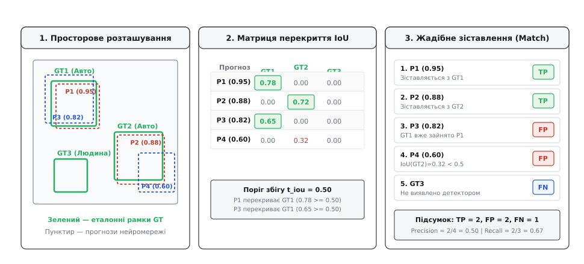
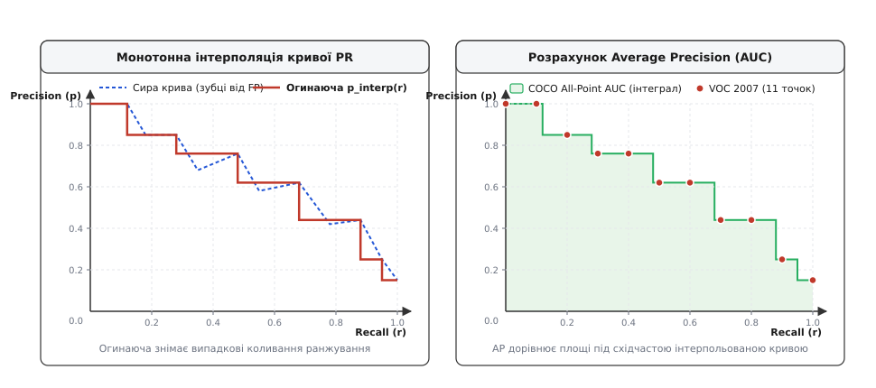

# Метрики детектора

## Чому класифікаційної точності недостатньо

Коли алгоритм комп'ютерного зору обробляє кадр із камери дрона або автономного робота, перед ним постає подвійне завдання: не просто визначити, які об'єкти присутні в сцені, а й точно окреслити межі кожного з них прямокутною рамкою (*bounding box*). Спроба оцінити якість такої системи звичайною класифікаційною точністю (*Accuracy*) одразу заводить інженерну оцінку в глухий кут. Якщо розбити зображення на тисячі дрібних ділянок і класифікувати кожну як «об'єкт» або «тло», модель, яка пропустить усі реальні цілі, формально отримає точність понад 99%. Тло займає переважну більшість площі кадру, і нескінченна кількість порожніх ділянок маскує критичні пропуски об'єктів та хибні спрацьовування.

У класичній класифікації простір відповідей фіксований: кожному зразку зіставляється одна мітка класу. У детекції вихід моделі — це довільна кількість прямокутників із неперервними координатами та оцінками впевненості (*confidence score*). Кількість передбачених рамок рідко збігається з кількістю реальних об'єктів на зображенні: детектор може знайти один автомобіль тричі, повністю пропустити пішохода в затінку та видати зайву рамку на текстурі паркану. Оскільки кількість порожніх місць на зображенні не обмежена, поняття «істинного негативу» (*True Negative*) втрачає фізичний зміст. Для оцінки детектора потрібні метрики, які спираються виключно на правильність знайдених рамок та повноту охоплення цілей.

## Геометрія перекриття: показник IoU

Щоб з'ясувати, чи влучила передбачена рамка в реальний об'єкт, необхідно виміряти геометричну близькість між прямокутником детектора та еталонною розміткою (*Ground Truth*). Для цього обчислюють коефіцієнт перетину над об'єднанням — *Intersection over Union* (IoU).

Формула IoU порівнює дві площі: площу спільної частини двох прямокутників та площу фігури, яку вони утворюють разом:

```
IoU = Area(Перетин) / Area(Об'єднання)
```

Значення IoU завжди лежить у діапазоні від 0.0 до 1.0. Якщо передбачена рамка взагалі не торкається еталона, площа їхнього перетину дорівнює нулю, і IoU становить 0.0. Якщо координати прямокутників збігаються піксель у піксель, перетин ідентичний об'єднанню, а показник дорівнює 1.0. Зсув рамки навіть на кілька пікселів або неточний розмір негайно знижують це число.

## Від геометричного збігу до категорій помилок

Неперервне значення IoU перетворюють на бінарне рішення за допомогою фіксованого порогу — найчастіше `IoU ≥ 0.50` (або `0.75` для вимогливих систем). Якщо перекриття рамки детектора з еталоном перевищує цей поріг, а клас розпізнано правильно, передбачення вважають успішним попаданням — *True Positive* (TP).

Однак у детекції діє суворе правило зіставлення: один фізичний об'єкт розмітки може бути зарахований як TP лише один раз. Якщо детектор згенерував навколо одного автомобіля три перекривні рамки з високим IoU, статус TP отримує лише та рамка, яка має найвищу оцінку впевненості. Решта дві рамки позначаються як *False Positive* (FP). Такий штраф за дублювання критично важливий для систем керування: виконавчий механізм не може реагувати на кілька однакових гіпотез одночасно.


*Зіставлення передбачень детектора з еталоном за порогом перекриття IoU.*

У результаті зіставлення всі передбачення та еталонні об'єкти розподіляються за трьома категоріями:
- **True Positive (TP):** рамка детектора правильно вказала клас, має `IoU ≥ 0.5` з еталоном і є найкращою гіпотезою для цього об'єкта.
- **False Positive (FP):** рамка вказала хибний клас, має `IoU < 0.5`, вказує на порожнє тло або є надлишковим дублікатом уже знайденого об'єкта.
- **False Negative (FN):** реальний об'єкт розмітки, для якого детектор не згенерував жодної відповідної рамки з достатнім рівнем перекриття.

## Точність, повнота та крива Precision-Recall

Отримані лічильники TP, FP та FN дозволяють розрахувати дві фундаментальні характеристики детектора:

```
Precision = TP / (TP + FP)
Recall = TP / (TP + FN)
```

Точність (*Precision*) показує частку справжніх цілей серед усіх рамок, виданих алгоритмом. Якщо точність низька, система генерує багато хибних тривог. Повнота (*Recall*) показує, яку частку від усіх реально присутніх об'єктів вдалося виявити. Якщо повнота низька, система «сліпа» і пропускає цілі.

Обидва показники залежать від порогу впевненості (*confidence threshold*), за яким ми відфільтровуємо передбачення. Якщо встановити високий поріг (наприклад, залишати лише рамки із впевненістю понад 0.9), у вихід потраплять лише найнадійніші гіпотези: точність зросте майже до 1.0, але повнота впаде, бо слабкіші об'єкти відсіються. Якщо знизити поріг до 0.1, модель знайде більше цілей і підніме повноту, проте вихід засмітиться випадковими шумами, і точність різко знизиться.

Цей компроміс візуалізують кривою Precision-Recall (PR-кривою). Для її побудови всі передбачені рамки впорядковують за спаданням оцінки впевненості. Рухаючись списком згори донизу, ми поступово додаємо кожну наступну гіпотезу, перераховуємо поточні значення Precision та Recall і наносимо відповідні точки на графік.

## Середня точність AP та узагальнена метрика mAP

Окремий графік PR-кривої незручно використовувати для швидкого порівняння двох різних моделей. Щоб звести якість роботи детектора до одного числа, обчислюють площу під кривою Precision-Recall — показник середньої точності (*Average Precision*, скорочено AP).

Реальна PR-крива часто має пилкоподібну форму через коливання точності при додаванні нових хибних спрацьовувань. Перед інтегруванням її згладжують монотонною інтерполяцією: для кожного значення повноти точність замінюють на максимальну точність, досягнуту праворуч від цієї точки.


*Монотонна інтерполяція кривої Precision-Recall для розрахунку середньої точності AP.*

Площа під отриманою огинаючою і є значенням AP для окремого класу об'єктів. Якщо в задачі декілька класів (наприклад, автомобілі, пішоходи та дорожні знаки), показники AP розраховують для кожного класу окремо, після чого усереднюють. Отримане число називають усередненою середньою точністю (*mean Average Precision*, скорочено mAP):

```
mAP = (1 / C) * Σ AP_c
```

де `C` — кількість семантичних класів. Показник mAP у діапазоні від 0.0 до 1.0 є головним числовим критерієм балансу між просторовою точністю та здатністю розпізнавання: він рівномірно враховує як пропуски цілей, так і частоту хибних спрацьовувань алгоритму.

## Подальше заглиблення

Сучасні інженерні стандарти (зокрема бенчмарк MS COCO) розширюють розрахунок mAP, усереднюючи його не лише за класами, а й за десятьма різними порогами перекриття від `IoU = 0.50` до `IoU = 0.95`. Крім того, для специфічних умов — таких як виявлення мініатюрних цілей на знімках із БПЛА, де стандартний показник IoU втрачає чутливість, — застосовують адаптивні метрики на основі гаусових розподілів (Normalized Wasserstein Distance).

Детальний аналіз протоколів COCO, розбір крайових випадків усереднення, алгоритми неперервної метрики NWD та оптимізовану C/C++ реалізацію оцінювача наведено у [детальній версії статті](root:sf-visual/detection-metrics/detection-metrics-d.md). Повний програмний комплекс розрахунку метрик для вбудованих платформ міститься у вставці [Оцінювач метрик детекції для бортових систем](root:sf-visual/detection-metrics/proj-detection-metrics-evaluator.md).
