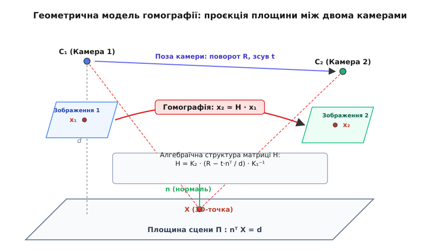
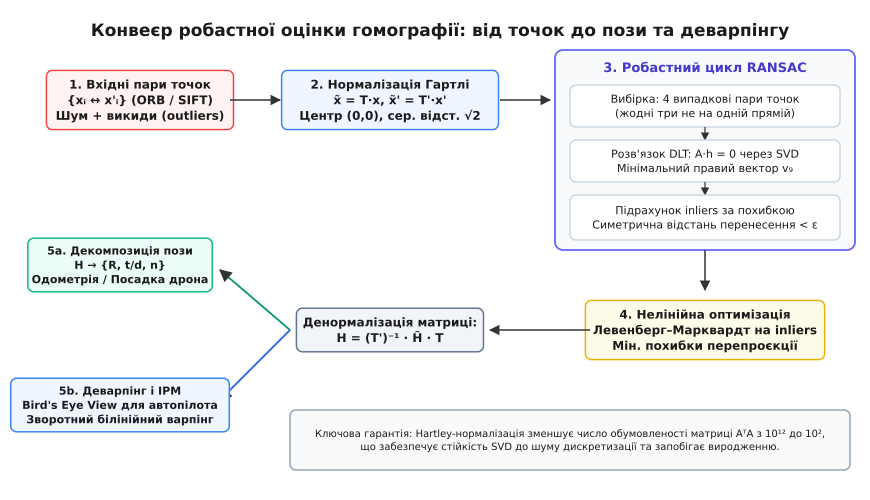

# Гомографія: перетворення площини в площину

<preknowlist>
- [Модель камери-обскури](root:sf-visual/camera-model) — як 3D-точка стає пікселем: проекційна матриця K, внутрішні параметри, фокус і головна точка.
- [Матриці повороту](root:math-algebra/rotation-matrices) — група SO(3), матриця R 3×3, орієнтація у просторі та ортонормованість.
- [Векторний добуток](root:math-algebra/cross-product) — кососиметрична матриця [v]×, властивість x × (H · x) = 0 для колінеарних однорідних векторів.
- [Скалярний добуток](root:math-algebra/dot-product) — проекція та алгебраїчне рівняння площини nᵀ · X = d.
- [Системи лінійних рівнянь](root:math-algebra/linear-systems) — розв'язання перевизначених та однорідних систем A · h = 0 методом найменших квадратів.
- [Число обумовленості](root:math-numeric/condition-number) — чутливість матричних розкладів до масштабу та похибок машинної арифметики.
- [Стандарт IEEE 754](root:math-numeric/ieee754) — представлення чисел із рухомою комою та накопичення похибок округлення.
- [Зіставлення ключових точок](root:sf-visual/feature-matching) — дескриптори ORB, SIFT та генерація сирих відповідностей точок.
- [RANSAC](root:sf-algorithms/ransac) — випадковий пошук консенсусу для відсіювання викидів серед знайдених пар.
- [Відновлення пози за точками (PnP)](root:sf-visual/pose-estimation) — зіставлення 3D-моделей з 2D-пікселями для неплоских сцен.
</preknowlist>

Коли бортова камера безпілотного апарата фіксує посадковий майданчик з висоти тридцяти метрів, кожна фізична точка розмітки з координатами на площині потрапляє на двовимірну матрицю сенсора. Якщо дрон зміщується вбік або повертається за курсом, та сама плоска розмітка на новому кадрі зазнає геометричного спотворення: паралельні лінії збігаються до лінії горизонту, квадрати перетворюються на довільні чотирикутники, а співвідношення відстаней між маркерами зазнає нелінійних перспективних змін. Водночас спроба застосувати до таких кадрів класичну тривимірну епіполярну геометрію та обчислити фундаментальну матрицю завершується виродженням: усі промені зворотного проектування перетинаються в одній площині, ранг матриці системи падає, і алгоритми тривимірної тріангуляції видають сингулярні невизначеності.

Перенесення точок між двома перспективними проекціями однієї фізичної площини підпорядковується прямому лінійному проективному відображенню у просторі однорідних координат. Таке взаємно однозначне оборотне перетворення площини в площину називається **проективною гомографією** або **планарною гомографією**. Гомографія зв'язує піксельні координати відповідних точок на двох кадрах через єдину невироджену дійсну матрицю розміром 3×3:

```
s · x' = H · x
```

де `x = (u, v, 1)ᵀ` — однорідні координати точки на першому зображенні, `x' = (u', v', 1)ᵀ` — координати тієї самої фізичної точки на другому зображенні, `H` — матриця гомографії, а `s` — ненульовий дійсний множник проективного масштабу.


*Геометричний зв'язок між двома камерами та 3D-площиною: матриця гомографії H однозначно переносить проекцію точки x₁ у проекцію x₂ без знання повної тривимірної структури навколишнього простору.*

Гомографія не вимагає відновлення 3D-хмари точок для вирішення задачі суміщення: якщо об'єкт плаский або сцена розташована настільки далеко, що перепади висот нехтовно малі порівняно з відстанню до камери, вся геометрія кадрів згортається в дев'ять чисел матриці `H`. Це дає змогу стабілізувати відеопотік на рухомих платформах, зшивати фотографії в безшовні панорами, виправляти перспективні спотворення документів та здійснювати високоточну посадку роботів на оптичні маркери за одиниці мілісекунд обчислювального часу.

## Проективна геометрія площини та ієрархія перетворень

Щоб зрозуміти внутрішню будову матриці гомографії, необхідно розглянути структуру двовимірного проективного простору `ℙ²`. У звичайному декартовому просторі `ℝ²` точка описується парою чисел `(u, v)`. Проте декартові координати не здатні виразити паралельні прямі, що перетинаються на нескінченності, або обчислити перспективне зникнення об'єктів без введення нелінійного ділення на нуль.

У проективному просторі `ℙ²` точка представляється вектором однорідних координат із трьох компонентів:

```
x = (x₁, x₂, x₃)ᵀ
```

де будь-який вектор `λ · x = (λ·x₁, λ·x₂, λ·x₃)ᵀ` при `λ ≠ 0` відповідає одній і тій самій фізичній точці. Перехід до декартових координат здійснюється проективним нормуванням:

```
u = x₁ / x₃
v = x₂ / x₃
```

Коли третя компонента `x₃ = 0`, точка набуває вигляду `(x₁, x₂, 0)ᵀ` і позначає **ідеальну точку** (точку на нескінченності), яка задає чистий напрямок на площині. Сукупність усіх ідеальних точок утворює **пряму на нескінченності** `l_∞ = (0, 0, 1)ᵀ`.

### Проективна дуальність точок і прямих

Пряма на проективній площині описується однорідним вектором `l = (a, b, c)ᵀ`. Алгебраїчна умова належності точки `x` прямій `l` записується як нульовий скалярний добуток:

```
lᵀ · x = a·x₁ + b·x₂ + c·x₃ = 0
```

Завдяки симетрії цього рівняння виникає принцип проективної дуальності:
1. **Пряма через дві точки:** пряма `l`, що проходить через дві різні точки `x₁` та `x₂`, обчислюється через [векторний добуток](root:math-algebra/cross-product):
   ```
   l = x₁ × x₂
   ```
2. **Перетин двох прямих:** точка перетину `x` двох прямих `l₁` та `l₂` обчислюється за тією ж операцією:
   ```
   x = l₁ × l₂
   ```
   Якщо дві прямі паралельні в декартовому просторі (наприклад, `a·u + b·v + c₁ = 0` та `a·u + b·v + c₂ = 0`), їхній векторний добуток дає `x = (b·(c₂ − c₁), −a·(c₂ − c₁), 0)ᵀ = (b, −a, 0)ᵀ`. Третя компонента дорівнює нулю, що показує: паралельні прямі перетинаються в ідеальній точці на нескінченності.

Під дією гомографії `H` точки трансформуються як `x' = H · x`. Щоб пряма зберегла умову інцидентності `l'ᵀ · x' = 0`, прямі повинні трансформуватися за правилом:

```
l'ᵀ · x' = l'ᵀ · (H · x) = (l'ᵀ · H) · x = lᵀ · x = 0
```

Звідси випливає фундаментальний закон трансформації прямих у проективному просторі:

```
l' = H⁻ᵀ · l
```

Прямі трансформуються не прямою матрицею `H`, а обернено-транспонованою матрицею `H⁻ᵀ`.

### Трансформація конік і кіл

Коніка (еліпс, коло, парабола, гіпербола) на проективній площині описується симетричною матрицею `C` розміром 3×3 через квадратичну форму:

```
xᵀ · C · x = 0
```

Коли площина з нанесеним круглим маркером (наприклад, кругла посадочна мітка вертолітного майданчика або коло дорожнього знака) знімається камерою під кутом, коло перетворюється на перспективний еліпс.

Підставимо у квадратичну форму зворотне перетворення точок `x = H⁻¹ · x'`:

```
(H⁻¹ · x')ᵀ · C · (H⁻¹ · x') = 0
x'ᵀ · (H⁻ᵀ · C · H⁻¹) · x' = 0
```

Отже, матриця коніки трансформується за законом конгруентності:

```
C' = H⁻ᵀ · C · H⁻¹
```

Дуальна коніка (коніка, утворена дотичними прямими `lᵀ · C* · l = 0`, де `C* = adj(C) = det(C) · C⁻¹`) трансформується прямим множенням:

```
C'* = H · C* · Hᵀ
```

Ця властивість відіграє вирішальну роль у задачах відновлення орієнтації за круглими маркерами: центр спроектованого еліпса на зображенні не збігається з проекцією фізичного центра кола через перспективне зміщення, проте дуальна коніка дозволяє знайти точну проекцію центра без похибок.

### Ієрархія 2D-геометричних трансформацій

Планарна гомографія є вершиною ієрархії лінійних геометричних трансформацій площини. Кожен наступний клас у цій ієрархії узагальнює попередній, додаючи нові степені вільності:

```
    ⎡ r₁₁  r₁₂  t_x ⎤
H = ⎢ r₂₁  r₂₂  t_y ⎥
    ⎣ v₁   v₂    s  ⎦
```

1. **Евклідове перетворення (Ізометрія, 3 DoF):**
   Матриця має вигляд:
   ```
   H_E = ⎡ R   t ⎤    де R ∈ SO(2), t = (t_x, t_y)ᵀ
         ⎣ 0ᵀ  1 ⎦
   ```
   Зберігає довжини відрізків, площі фігур та кути між прямими. Описує рух твердого тіла на площині.

2. **Перетворення подібності (Similarity / Metric, 4 DoF):**
   До ізометрії додається ізотропне масштабування `s`:
   ```
   H_S = ⎡ s·R  t ⎤
         ⎣  0ᵀ  1 ⎦
   ```
   Зберігає кути між прямими, паралельність та відношення довжин будь-яких двох відрізків.

3. **Афінне перетворення (Affine, 6 DoF):**
   Ортонормована матриця повороту замінюється довільною невиродженою матрицею 2×2 `A`:
   ```
   H_A = ⎡ A   t ⎤
         ⎣ 0ᵀ  1 ⎦
   ```
   Афінне перетворення вводить неізотропне масштабування та зсув форми (shear). Воно **зберігає паралельність прямих**, відношення довжин паралельних відрізків та відношення площ, а також залишає незмінною пряму на нескінченності `l_∞`.

4. **Проективне перетворення (Гомографія, 8 DoF):**
   Нижній рядок вектора `v = (v₁, v₂)ᵀ` стає ненульовим:
   ```
   H_P = ⎡ A   t ⎤
         ⎣ vᵀ  s ⎦
   ```
   Ненульовий вектор `v` відображає пряму на нескінченності `l_∞` у скінченну пряму на зображенні — **лінію горизонту (vanishing line)**:
   ```
   l_vanishing = H⁻ᵀ · (0, 0, 1)ᵀ
   ```
   У гомографії порушується збереження паралельності, кутів, довжин та площ. Єдиними фундаментальними інваріантами залишаються:
   - **Колінеарність:** точки, що лежали на одній прямій, залишаються на одній прямій після перетворення.
   - **Конкурентність:** прямі, що перетиналися в одній точці, перетинаються в одній точці.
   - **Подвійне відношення (Cross-ratio):** для чотирьох колінеарних точок `x₁, x₂, x₃, x₄` величина:
     ```
     CrossRatio(x₁, x₂, x₃, x₄) = ((x₁ − x₃)·(x₂ − x₄)) / ((x₁ − x₄)·(x₂ − x₃))
     ```
     є абсолютно інваріантною відносно будь-якої гомографії `H`.

## Алгебраїчна структура та степені вільності матриці H

Матриця гомографії `H` містить дев'ять дійсних елементів:

```
    ⎡ h₁₁  h₁₂  h₁₃ ⎤
H = ⎢ h₂₁  h₂₂  h₂₃ ⎥
    ⎣ h₃₁  h₃₂  h₃₃ ⎦
```

Рівність `s · x' = H · x` є проективною еквівалентністю у двовимірному проективному просторі `ℙ²`. Якщо помножити всі елементи матриці `H` на довільний ненульовий скаляр `λ ≠ 0`, то для будь-якої точки вектор `(λ · H) · x` набуде вигляду `λ · (s · x') = (λ · s) · x'`. Після переходу від однорідних координат до звичайних декартових піксельних координат шляхом ділення на третю компоненту коефіцієнт `λ` скорочується:

```
u' = (h₁₁·u + h₁₂·v + h₁₃) / (h₃₁·u + h₃₂·v + h₃₃)
v' = (h₂₁·u + h₂₂·v + h₂₃) / (h₃₁·u + h₃₂·v + h₃₃)
```

Матриця `H` визначена з точністю до довільного ненульового спільного множника масштабу. Із дев'яти початкових коефіцієнтів незалежними є рівно **вісім параметрів**. Отже, простір планарних гомографій має **8 степенів вільності** (8 DoF).

> 🔧 **Навіщо це.** Вісім параметрів гомографії точно описують усі можливі перспективні деформації площини: два параметри відповідають за паралельний зсув (трансляцію вздовж осей X та Y), один — за поворот у площині кадру, один — за ізотропне масштабування (наближення чи віддалення), два — за анізотропний зсув форми та стиснення (афінні спотворення), і ще два — за перспективний нахил площини відносно оптичної осі, який змушує паралельні лінії сходитися на лінії горизонту.

Щоб зафіксувати масштаб матриці при чисельних розрахунках, зазвичай накладають одну з двох нормалізаційних умов:
1. Вимагають рівності одиниці евклідової норми Фробеніуса вектора коефіцієнтів: `‖h‖₂² = ∑ᵢ ∑ⱼ hᵢⱼ² = 1`.
2. За умови ненульового кутового елемента прирівнюють `h₃₃ = 1`, залишаючи вісім вільних коефіцієнтів для прямого розв'язання нелінійних систем.

Кожна пара відповідних точок `(uᵢ, vᵢ) ↔ (u'ᵢ, v'ᵢ)` на двох зображеннях надає два незалежні алгебраїчні рівняння, оскільки містить вимірювання за координатою `u` та за координатою `v`. Оскільки матриця має 8 невідомих степенів вільності, мінімальна кількість точкових відповідностей, необхідна для знаходження `H`, дорівнює:

```
N_min = 8 / 2 = 4
```

Для однозначного знаходження гомографії необхідно мати щонайменше **чотири пари точок у загальному положенні**. Загальне положення означає, що жодні три точки з чотирьох на жодному з зображень не лежать на одній прямій (не є колінеарними). Якщо хоча б три точки потрапляють на одну лінію, площа охопленого ними трикутника стає нульовою, відповідні рядки рівнянь стають лінійно залежними, і ранг геометричної системи падає нижче восьми, що робить розв'язання невизначеним.

## Геометричне виведення гомографії для каліброваних камер

Розглянемо фізичну 3D-площину `Π`, розташовану у просторі перед двома камерами. Нехай перша камера має оптичний центр `C₁` та внутрішню калібрувальну матрицю `K₁`, а друга камера — центр `C₂` та матрицю `K₂`.

Система координат першої камери приймається за базову. У цій системі площина `Π` однозначно описується вектором одиничної нормалі `n` (`‖n‖ = 1`) та перпендикулярною відстанню `d > 0` від оптичного центра `C₁` до площини:

```
nᵀ · X₁ = d
```

де `X₁ = (X₁, Y₁, Z₁)ᵀ` — тривимірні координати довільної фізичної точки на площині `Π` у системі координат першої камери.

Поділивши рівняння площини на скаляр `d`, отримуємо тотожність:

```
(nᵀ · X₁) / d = 1
```

Тривимірна точка `X₁` проектується на площину сенсора першої камери у піксельні координати `x₁ = (u₁, v₁, 1)ᵀ` через перспективну модель [камери-обскури](root:sf-visual/camera-model):

```
s₁ · x₁ = K₁ · X₁
```

Звідси вектор 3D-координат точки виражається через вектор напрямку променя та невідому глибину `s₁`:

```
X₁ = s₁ · K₁⁻¹ · x₁
```

Взаємне просторове розташування другої камери відносно першої задається матрицею [повороту](root:math-algebra/rotation-matrices) `R ∈ SO(3)` та вектором трансляції `t ∈ ℝ³`:

```
X₂ = R · X₁ + t
```

де `X₂` — координати тієї самої фізичної точки у системі координат другої камери.

Підставимо у вираз для `X₂` геометричну тотожність `1 = (nᵀ · X₁) / d`:

```
X₂
= R · X₁ + t · 1                      [підстановка тотожності]
= R · X₁ + t · ((nᵀ · X₁) / d)         [використання рівняння площини]
= (R + (t · nᵀ) / d) · X₁             [винесення спільного вектора X₁]
```

Тут матричний добуток `t · nᵀ` є зовнішнім добутком вектора зсуву розміром 3×1 на транспонований вектор нормалі розміром 1×3, результатом якого є матриця рангу 1 розміром 3×3.

Спроектуємо точку `X₂` на сенсор другої камери:

```
s₂ · x₂ = K₂ · X₂
```

Підставивши вираз для `X₂` через `X₁`, а потім вираз для `X₁` через пікселі `x₁`, отримуємо замкнений проекційний ланцюг:

```
s₂ · x₂
= K₂ · (R + (t · nᵀ) / d) · X₁                         [підстановка зв'язку просторових систем]
= K₂ · (R + (t · nᵀ) / d) · (s₁ · K₁⁻¹ · x₁)           [підстановка променя першої камери]
= s₁ · [K₂ · (R + (t · nᵀ) / d) · K₁⁻¹] · x₁           [винесення скалярного множника s₁]
```

Скоротивши скалярні множники глибини у спільний проективний коефіцієнт `s = s₂ / s₁`, отримуємо точний аналітичний вигляд матриці гомографії між двома каліброваними камерами:

```
H = K₂ · (R + (t · nᵀ) / d) · K₁⁻¹
```

Якщо внутрішні параметри камер відомі, геометричний зв'язок можна спростити до **каліброваної евклідової гомографії** `H_E`:

```
H_E = K₂⁻¹ · H · K₁ = R + (t · nᵀ) / d
```

Ця формула виявляє фундаментальні фізичні властивості гомографії:
1. **Ефект нульового базису (чисте обертання камери):** якщо камери обертаються навколо спільного оптичного центра без лінійного зсуву (`t = 0`), матриця гомографії спрощується до `H = K₂ · R · K₁⁻¹`. У цьому випадку гомографія не залежить від структури сцени (параметрів `n` та `d`), що дозволяє зшивати ідеальні панорами довільного 3D-середовища, оскільки відсутній паралакс.
2. **Неможливість розділення масштабу трансляції та глибини:** вектор зсуву `t` входить у вираз виключно у вигляді дробу `t / d`. Це означає, що за двома монокулярними знімками неможливо визначити абсолютний фізичний масштаб сцени: зміщення камери на 1 метр при відстані до площини 10 метрів дає точно таку саму матрицю `H`, як і зміщення на 10 метрів при відстані 100 метрів.

### Сумісність гомографії з епіполярною геометрією

Зв'язок між фундаментальною матрицею `F` та матрицею гомографії `H` будь-якої площини у просторі виражається строгою формулою:

```
F = [e₂]× · H
```

де `e₂` — епіполюс на другому зображенні (проекція оптичного центра `C₁` на сенсор другої камери, `e₂ = K₂ · t`), а `[e₂]×` — кососиметрична матриця розміром 3×3, що представляє операцію векторного добутку:

```
         ⎡   0   −e_z   e_y ⎤
[e₂]× =  ⎢  e_z    0   −e_x ⎥
         ⎣ −e_y   e_x    0  ⎦
```

Для будь-якої точки `x₁` на площині її відповідна точка `x₂` задовольняє рівність `x₂ = H · x₁`. Підставимо це в епіполярне рівняння:

```
x₂ᵀ · F · x₁
= x₂ᵀ · ([e₂]× · H) · x₁                 [підстановка визначення F]
= x₂ᵀ · [e₂]× · (H · x₁)                 [асоціативність множення]
= x₂ᵀ · [e₂]× · x₂                       [підстановка зв'язку x₂ = H · x₁]
= x₂ · (e₂ × x₂)                         [геометричний зміст кососиметричної матриці]
= 0                                      [ортогональність векторного добутку вихідному вектору]
```

Цей висновок пояснює, чому гомографія є повністю сумісною з епіполярною геометрією, але водночас робить оцінку фундаментальної матриці за планарними точками виродженою: оскільки для всіх точок площини `x₂ = H · x₁`, будь-який вектор `e₂` дає тотожний нуль, через що визначити справжній епіполюс стає неможливо без виходу за межі площини.

## Алгоритм прямого лінійного перетворення (DLT)

Коли внутрішні параметри камер невідомі, або коли необхідно швидко знайти відображення площини за парами точок, застосовують алгоритм **прямого лінійного перетворення** (Direct Linear Transformation, DLT).

Алгоритм базується на усуненні невідомого проективного масштабу `s` через колінеарність векторів. Для кожної пари точок вектор `x'ᵢ` та вектор `H · xᵢ` мають однаковий напрямок у просторі однорідних координат, що означає, що їхній [векторний добуток](root:math-algebra/cross-product) тотожно дорівнює нульовому вектору:

```
x'ᵢ × (H · xᵢ) = 0
```

Розпишемо матрицю `H` за її трьома рядками:

```
    ⎡ h₁ᵀ ⎤
H = ⎢ h₂ᵀ ⎥,    де hⱼ = (hⱼ₁, hⱼ₂, hⱼ₃)ᵀ
    ⎣ h₃ᵀ ⎦
```

Тоді векторний добуток `(H · xᵢ)` має координати `(h₁ᵀ · xᵢ, h₂ᵀ · xᵢ, h₃ᵀ · xᵢ)ᵀ`. Нехай `x'ᵢ = (u'ᵢ, v'ᵢ, w'ᵢ)ᵀ` (у нормалізованих пікселях `w'ᵢ = 1`). Розкриваємо векторний добуток за правилом визначника:

```
x'ᵢ × (H · xᵢ) = 
⎡ v'ᵢ · (h₃ᵀ · xᵢ) − w'ᵢ · (h₂ᵀ · xᵢ) ⎤   ⎡ 0 ⎤
⎢ w'ᵢ · (h₁ᵀ · xᵢ) − u'ᵢ · (h₃ᵀ · xᵢ) ⎥ = ⎢ 0 ⎥
⎣ u'ᵢ · (h₂ᵀ · xᵢ) − v'ᵢ · (h₁ᵀ · xᵢ) ⎦   ⎣ 0 ⎦
```

Векторизуємо матрицю `H` у дев'ятивимірний стовпчик `h`:

```
h = (h₁₁, h₁₂, h₁₃, h₂₁, h₂₂, h₂₃, h₃₁, h₃₂, h₃₃)ᵀ
```

Тоді три рядки векторного добутку записуються як лінійна система матричного множення:

```
⎡     0ᵀ         −w'ᵢ · xᵢᵀ      v'ᵢ · xᵢᵀ  ⎤
⎢  w'ᵢ · xᵢᵀ         0ᵀ         −u'ᵢ · xᵢᵀ  ⎥ · h = 0
⎣ −v'ᵢ · xᵢᵀ      u'ᵢ · xᵢᵀ         0ᵀ      ⎦
```

де `0ᵀ = (0, 0, 0)` та `xᵢᵀ = (uᵢ, vᵢ, 1)`.

У цій системі з трьох рівнянь третій рядок є лінійною комбінацією перших двох (якщо помножити перший рядок на `u'ᵢ`, другий на `v'ᵢ` і додати їх, отримаємо нуль при `w'ᵢ = 1`). Тому третій рядок відкидають, залишаючи рівно два лінійно незалежні рівняння для кожної точки `i`:

```
Aᵢ · h = 0
```

де матриця `Aᵢ` розміром 2×9 має вигляд:

```
     ⎡  0   0   0   −uᵢ  −vᵢ  −1    v'ᵢ·uᵢ   v'ᵢ·vᵢ   v'ᵢ ⎤
Aᵢ = ⎢                                                    ⎥
     ⎣  uᵢ  vᵢ  1     0    0   0   −u'ᵢ·uᵢ  −u'ᵢ·vᵢ  −u'ᵢ ⎦
```

Для `N` пар точок усі матриці `Aᵢ` складають вертикально в одну загальну матрицю `A` розміром `(2N) × 9`:

```
A · h = 0
```

### Знаходження вектора h через сингулярний розклад (SVD)

У реальних умовах піксельні координати містять шум дискретизації та похибки локалізації дескрипторів, тому точного нульового розв'язку не існує. Замість точної рівності шукають вектор `h`, що мінімізує норму алгебраїчної похибки:

```
min_h ‖A · h‖₂²    при умові ‖h‖₂ = 1
```

Мінімізація квадратичної форми `hᵀ · (Aᵀ · A) · h` на одиничній сфері розв'язується через [сингулярний розклад](root:math-algebra/linear-systems) (SVD) матриці `A`:

```
A = U · Σ · Vᵀ
```

де `U` — ортогональна матриця розміром `(2N) × (2N)`, `Σ` — діагональна матриця сингулярних чисел `σ₁ ≥ σ₂ ≥ … ≥ σ₉ ≥ 0` розміром `(2N) × 9`, а `V` — ортогональна матриця розміром 9×9, стовпці якої `v₁, v₂, …, v₉` є правими сингулярними векторами.

Підставимо розклад у функціонал похибки:

```
‖A · h‖₂²
= ‖U · Σ · Vᵀ · h‖₂²                     [підстановка SVD]
= ‖Σ · (Vᵀ · h)‖₂²                       [збереження норми ортогональною матрицею U]
= ‖Σ · y‖₂²                              [заміна y = Vᵀ · h, де ‖y‖₂ = ‖h‖₂ = 1]
= ∑ᵢ₌₁⁹ σᵢ² · yᵢ²                        [розкриття діагональної суми]
```

Оскільки `σ₁ ≥ σ₂ ≥ … ≥ σ₉ ≥ 0`, мінімум суми `∑ σᵢ² · yᵢ²` за умови `∑ yᵢ² = 1` досягається тоді, коли вектор `y` має вигляд `y = (0, 0, …, 0, 1)ᵀ`.

Повертаючись до шуканого вектора `h`:

```
h = V · y = V · (0, 0, …, 0, 1)ᵀ = v₉
```

Оптимальний вектор коефіцієнтів гомографії `h` у сенсі найменших квадратів алгебраїчної похибки є **дев'ятим стовпцем матриці V** (правим сингулярним вектором, що відповідає найменшому сингулярному числу `σ₉`). Після знаходження `h` його компоненти згортають назад у матрицю `H` розміром 3×3.

Геометричний зміст сингулярного числа `σ₉` полягає у вимірюванні залишкової алгебраїчної похибки. Якщо всі точки ідеально пласкі та не містять шуму, `σ₉ = 0`. Якщо ж дані містять шум, значення `σ₉ > 0` показує ступінь невідповідності сцени пласкій моделі. Якщо два молодші сингулярні числа одночасно наближаються до нуля (`σ₈ ≈ σ₉ ≈ 0`), це є прямою ознакою геометричного виродження конфігурації точок (наприклад, три або більше точок лежать на одній прямій).

## Нормалізація Гартлі (Hartley Preconditioning)

Якщо запустити прямий алгоритм DLT на «сирих» піксельних координатах із сучасної камери (наприклад, Full HD 1920×1080 або 4K 3840×2160), алгоритм видасть чисельне сміття або покаже катастрофічну чутливість навіть до шуму на рівні 0.1 пікселя.

Причина полягає в катастрофічній [чисельній обумовленості](root:math-numeric/condition-number) матриці `A`. Поглянемо на елементи рядка матриці `Aᵢ`:
- Перші елементи містять координати `uᵢ ≈ 2000`, `vᵢ ≈ 1000` та константу `1`.
- Останні три елементи містять добутки координат `u'ᵢ · uᵢ ≈ 2000 · 2000 = 4 · 10⁶` та `u'ᵢ · vᵢ ≈ 2000 · 1000 = 2 · 10⁶`.

Коли в ході розрахунку формується матриця нормальних рівнянь `Aᵀ · A`, її елементи обчислюються як суми добутків елементів `A`. Діагональні елементи цієї матриці матимуть кардинально різні порядки величин:
- Елемент, що відповідає константі `1`, має порядок `∑ 1² ≈ N ≈ 10²`.
- Елемент, що відповідає квадратам координат, має порядок `∑ uᵢ² ≈ N · (2000)² ≈ 4 · 10⁸`.
- Елемент, що відповідає добуткам пар координат, має порядок `∑ (u'ᵢ · uᵢ)² ≈ N · (4 · 10⁶)² ≈ 1.6 · 10¹⁵`.

Співвідношення між максимальним і мінімальним власними значеннями матриці `Aᵀ · A` сягає:

```
cond(Aᵀ · A) ≈ 10¹⁵ / 10² = 10¹³
```

[Число обумовленості](root:math-numeric/condition-number) матриці `A` складає `cond(A) = √(cond(Aᵀ · A)) ≈ 10⁶.⁵`. При використанні чисел із рухомою комою одинарної точності `float` (24 біти мантиси, близько 7 десяткових знаків за стандартом [IEEE 754](root:math-numeric/ieee754)) всі молодші розряди повністю стираються машинним округленням. Навіть для подвійної точності `double` (53 біти мантиси, 15–16 знаків) втрачається половина точності обчислень, і напрямок молодшого сингулярного вектора `v₉` починає визначатися не геометрією сцени, а похибками обчислення велетенських чисел.

Рішення цієї проблеми запропонував Річард Гартлі (Richard Hartley, 1997) у вигляді попередньої **ізотропної нормалізації координат**.

### Алгоритм ізотропного масштабування

Ідея полягає у введенні лінійного перетворення координат `T` для першого зображення та `T'` для другого зображення, яке центрує хмару точок у нулі та масштабує її так, щоб середня відстань від початку координат дорівнювала `√2`.

Для набору точок `{xᵢ = (uᵢ, vᵢ)ᵀ}` обчислюють центр мас (барицентр):

```
μ_u = (1 / N) · ∑ᵢ₌₁ᴺ uᵢ
μ_v = (1 / N) · ∑ᵢ₌₁ᴺ vᵢ
```

Обчислюють середню евклідову відстань точок від центроїда:

```
d_mean = (1 / N) · ∑ᵢ₌₁ᴺ √((uᵢ − μ_u)² + (vᵢ − μ_v)²)
```

Коефіцієнт ізотропного масштабування `s` обирають так, щоб середня відстань стала рівною `√2`:

```
s = √2 / d_mean
```

Матриця нормалізації `T` має вигляд 3×3:

```
    ⎡ s   0   −s · μ_u ⎤
T = ⎢ 0   s   −s · μ_v ⎥
    ⎣ 0   0      1     ⎦
```

Нормалізовані координати точок отримують множенням:

```
x̃ᵢ = T · xᵢ
x̃'ᵢ = T' · x'ᵢ
```

Після такого перетворення координати точок лежать приблизно в діапазоні `[-1.5, +1.5]`, а їхній центр розташований у точці `(0, 0)`. Усі елементи матриці `Ã`, побудованої за нормалізованими точками, мають однаковий порядок величини близько `1.0`.

Число обумовленості `cond(Ãᵀ · Ã)` падає з `10¹³` до `10¹ – 10²`, що гарантує математично точне та чисельно стійке знаходження сингулярного вектора.

### Денормалізація підсумкової матриці

За нормалізованими відповідностями `{x̃ᵢ ↔ x̃'ᵢ}` знаходять нормалізовану матрицю гомографії `H̃` через SVD:

```
x̃' ≈ H̃ · x̃
```

Підставимо визначення нормалізованих координат `x̃ = T · x` та `x̃' = T' · x'`:

```
(T' · x') ≈ H̃ · (T · x)
```

Помножимо обидві частини рівності зліва на обернену матрицю `(T')⁻¹`:

```
x' ≈ ((T')⁻¹ · H̃ · T) · x
```

Звідси шукана матриця гомографії для початкових ненормалізованих пікселів дорівнює:

```
H = (T')⁻¹ · H̃ · T
```

Обернена матриця `T⁻¹` обчислюється аналітично за тривіальною формулою:

```
       ⎡ 1/s   0    μ_u ⎤
T⁻¹ =  ⎢  0   1/s   μ_v ⎥
       ⎣  0    0     1  ⎦
```

Застосування Hartley-нормалізації є обов'язковим інженерним стандартом для будь-якої виробничої реалізації алгоритмів DLT, фундаментальної матриці та триангуляції.

## Покроковий чисельний розрахунок DLT з Hartley-нормалізацією

Для ілюстрації механізму розглянемо реальний чисельний приклад розрахунку гомографії за чотирма парами кутових точок квадратної мітки, знятої камерою Full HD 1920×1080:

- Точка 1: `P₁ = (100.0, 100.0) ↔ P'₁ = (240.0, 320.0)`
- Точка 2: `P₂ = (900.0, 100.0) ↔ P'₂ = (980.0, 260.0)`
- Точка 3: `P₃ = (900.0, 900.0) ↔ P'₃ = (920.0, 840.0)`
- Точка 4: `P₄ = (100.0, 900.0) ↔ P'₄ = (180.0, 760.0)`

### Крок 1. Обчислення центроїдів та коефіцієнтів масштабу

Для вихідного набору точок `{Pᵢ}`:
- Барицентр: `μ_u = (100 + 900 + 900 + 100) / 4 = 500.0`, `μ_v = (100 + 100 + 900 + 900) / 4 = 500.0`.
- Відстані від центроїда: для кожної точки `dx = ±400, dy = ±400`, евклідова відстань `dᵢ = √(400² + 400²) = 565.6854`.
- Середня відстань: `d_mean = 565.6854`.
- Масштаб: `s = √2 / 565.6854 = 1.4142136 / 565.6854 = 0.0025`.

Матриця нормалізації першого кадру `T`:
```
    ⎡ 0.0025     0.0      −1.25 ⎤
T = ⎢   0.0    0.0025     −1.25 ⎥
    ⎣   0.0      0.0        1.0 ⎦
```

Для цільового набору точок `{P'ᵢ}`:
- Барицентр: `μ'_u = (240 + 980 + 920 + 180) / 4 = 580.0`, `μ'_v = (320 + 260 + 840 + 760) / 4 = 545.0`.
- Відстані:
  - `d'₁ = √((240−580)² + (320−545)²) = √(340² + 225²) = 407.707`
  - `d'₂ = √((980−580)² + (260−545)²) = √(400² + 285²) = 491.147`
  - `d'₃ = √((920−580)² + (840−545)²) = √(340² + 295²) = 450.139`
  - `d'₄ = √((180−580)² + (760−545)²) = √(400² + 215²) = 454.120`
- Середня відстань: `d'_mean = (407.707 + 491.147 + 450.139 + 454.120) / 4 = 450.778`.
- Масштаб: `s' = √2 / 450.778 = 0.00313728`.

Матриця нормалізації другого кадру `T'`:
```
     ⎡ 0.00313728       0.0       −1.81962 ⎤
T' = ⎢    0.0        0.00313728   −1.70982 ⎥
     ⎣    0.0           0.0          1.0   ⎦
```

### Крок 2. Нормалізовані координати точок

- `P̃₁ = (−1.0, −1.0) ↔ P̃'₁ = (−1.0667, −0.7059)`
- `P̃₂ = (+1.0, −1.0) ↔ P̃'₂ = (+1.2549, −0.8941)`
- `P̃₃ = (+1.0, +1.0) ↔ P̃'₃ = (+1.0667, +0.9255)`
- `P̃₄ = (−1.0, +1.0) ↔ P̃'₄ = (−1.2549, +0.6745)`

Усі нормалізовані координати тепер строго обмежені інтервалом `[-1.3, +1.3]`.

### Крок 3. Порівняння спектрального числа обумовленості

Формуємо матрицю системи `A` розміром 8×9 без нормалізації та матрицю `Ã` з нормалізацією:
- Для сирої матриці `M_raw = Aᵀ · A` сингулярні числа дорівнюють: `σ₁ = 8.42 · 10¹²`, `σ₈ = 2.15 · 10²`, що дає число обумовленості:
  ```
  cond(M_raw) = σ₁ / σ₈ = 3.92 · 10¹⁰
  ```
- Для нормалізованої матриці `M_norm = Ãᵀ · Ã` сингулярні числа становлять: `σ₁ = 14.82`, `σ₈ = 0.46`, що дає:
  ```
  cond(M_norm) = 14.82 / 0.46 = 32.2
  ```

Нормалізація Гартлі покращила число обумовленості системи майже на дев'ять порядків (у мільярд разів), перетворивши погано обумовлену задачу на абсолютно стійку чисельну операцію.

## Робастне оцінювання за наявності викидів: RANSAC, PROSAC, GC-RANSAC та MAGSAC++

У реальних системах комп'ютерного зору пари відповідностей формуються автоматичними детекторами дескрипторів ([ORB, SIFT](root:sf-visual/feature-matching)). Через повторювані текстури, відблиски, зміни освітлення та рухомі об'єкти частка хибних зіставлень (викидів, outliers) у типових сценах становить від 20% до 80%.

Оскільки метод найменших квадратів у DLT мінімізує суму квадратів похибок, навіть один грубий викид (наприклад, точка з протилежного кута кадру) здатний повністю спотворити результат розрахунку матриці `H`.


*Конвеєр робастної оцінки гомографії: вхідні дескрипторні пари точок нормалізуються за Гартлі, фільтруються циклом RANSAC із перевіркою симетричної похибки, уточнюються нелінійним методом на множині inliers та використовуються для відновлення пози або деварпінгу.*

Для фільтрації викидів застосовують парадигму **RANSAC** (Random Sample Consensus) або її сучасні розширення (PROSAC, USAC, LO-RANSAC, MAGSAC++).

### Метрики похибки перенесення (Transfer Errors)

Для перевірки гіпотези гомографії `H` на кожній парі точок `(xᵢ, x'ᵢ)` обчислюють геометричну похибку розходження. Існує три основні варіанти:

1. **Пряма похибка перенесення (Forward Transfer Error):**
   Вимірює евклідову відстань на другому зображенні між спостереженою точкою `x'ᵢ` та спроектованою точкою `H · xᵢ`:
   ```
   d_fwd²(xᵢ, x'ᵢ, H) = (u'ᵢ − (h₁ᵀ·xᵢ)/(h₃ᵀ·xᵢ))² + (v'ᵢ − (h₂ᵀ·xᵢ)/(h₃ᵀ·xᵢ))²
   ```

2. **Симетрична похибка перенесення (Symmetric Transfer Error):**
   Враховує похибку проекції в обох напрямках — із першого кадру на другий через `H` та з другого кадру на перший через `H⁻¹`:
   ```
   d_sym²(xᵢ, x'ᵢ, H) = d_fwd²(xᵢ, x'ᵢ, H) + d_fwd²(x'ᵢ, xᵢ, H⁻¹)
   ```
   Симетрична похибка геометрично коректніша, оскільки вона однаково карає спотворення в обох камерах.

3. **Похибка Сампсона (Sampson Error):**
   Аналітичне наближення першого порядку до геометричної відстані на поверхні многовиду обмежень. Нехай алгебраїчний вектор нев'язки для точки дорівнює `ϵᵢ = x'ᵢ × (H · xᵢ)`. Тоді похибка Сампсона визначається як:
   ```
   d_sampson²(xᵢ, x'ᵢ, H) = ‖x'ᵢ × (H · xᵢ)‖² / (J · Jᵀ)
   ```
   де `J` — матриця Якобі векторного добутку за координатами спостережуваних пікселів `(uᵢ, vᵢ, u'ᵢ, v'ᵢ)`. Для планарної гомографії симетрична похибка обчислюється настільки швидко, що на практиці зазвичай обирають саме її.

Точка вважається узгодженою з гіпотезою (inlier), якщо її похибка не перевищує наперед заданого порогу `ε` (зазвичай `ε = 1.5 – 3.0` пікселя):

```
d_sym²(xᵢ, x'ᵢ, H) < ε²
```

### Адаптивний розрахунок кількості ітерацій RANSAC

Кількість ітерацій `K` не є фіксованою константою. Вона адаптивно перераховується на кожному кроці алгоритму на основі поточної частки знайдених inliers.

Нехай:
- `s = 4` — розмір мінімальної вибірки для DLT;
- `w = N_inliers / N_total` — поточна оцінка частки правильних точок у вибірці;
- `p` — бажана ймовірність знайти хоча б одну вибірку, що повністю складається з inliers (типово `p = 0.99` або `p = 0.999`).

Ймовірність того, що всі 4 випадково обрані точки є правильними, дорівнює `w⁴`.
Ймовірність того, що хоча б одна точка у вибірці є викидом: `1 − w⁴`.
Ймовірність того, що за `K` незалежних ітерацій жодна вибірка не виявиться чистою: `(1 − w⁴)ᴷ`.

Вимагаємо, щоб ця ймовірність невдачі не перевищувала `1 − p`:

```
(1 − w⁴)ᴷ ≤ 1 − p
```

Логарифмуючи обидві частини нерівності, отримуємо формулу для необхідної кількості ітерацій `K`:

```
K = ln(1 − p) / ln(1 − w⁴)
```

На старті алгоритму частка `w` невідома, тому задають песимістичне наближення (наприклад, `w = 0.1` → `K = 46000`). Щойно на певній ітерації знайдено консенсус-сет із кращою часткою `w` (наприклад, `w = 0.6`), значення `K` миттєво перераховується: `ln(0.01) / ln(1 - 0.6⁴) = ln(0.01) / ln(0.8704) ≈ 33` ітерації, і цикл RANSAC завершується значно швидше.

### Алгоритм PROSAC (Progressive Sample Consensus)

Стандартний RANSAC розглядає всі `N` знайдених відповідностей як рівноправні, вибираючи четвірки точок із рівномірного випадкового розподілу. Проте під час зіставлення дескрипторів ми маємо додаткову інформацію — міру якості збігу (відношення відстаней до першого та другого найближчих сусідів за тестом Девіда Лоу, Lowe's ratio test score).

Алгоритм **PROSAC** (Chum & Matas, 2005) використовує цю інформацію:
1. Усі `N` точкових пар сортуються за зростанням коефіцієнта непевності (найбільш надійні пари з найменшим Lowe's ratio стають першими).
2. На початкових ітераціях PROSAC генерує випадкові четвірки точок лише з невеликої підмножини найкращих зіставлень `M ≪ N` (наприклад, із перших 20–30 точок).
3. Якщо консенсус не знайдено, розмір активної підмножини `M` поступово збільшується за детермінованим експоненційним законом, доки не охопить увесь масив даних.

Оскільки частка inliers серед топ-20 зіставлень зазвичай сягає 80–90% навіть у складних сценах, PROSAC знаходить правильну матрицю гомографії за перші 10–50 ітерацій замість тисяч ітерацій класичного RANSAC, прискорюючи фільтрацію у 20–100 разів.

### Graph-Cut RANSAC (GC-RANSAC) та MAGSAC++

У просторово складних сценах, де точки площини групуються локально, застосовують просторово-когерентний алгоритм **GC-RANSAC** (Barath & Matas, 2018).

GC-RANSAC будує на точках тріангуляцію Делоне. Якщо дві сусідні точки з'єднані ребром у графі, ймовірність того, що вони обидві належать одній фізичній площині, є дуже високою. Оцінка inliers формулюється як мінімізація енергії бінарного марковського випадкового поля (MRF):

```
E(L) = ∑ᵢ D(lᵢ, H) + ∑_{(i,j)∈Edges} V(lᵢ, lⱼ)
```

де `D(lᵢ, H)` — унарний член (похибка перенесення), а `V(lᵢ, lⱼ) = λ · [lᵢ ≠ lⱼ]` — бінарний член гладкості. Глобальний мінімум енергії знаходиться за поліноміальний час алгоритмом розрізу графа (Max-Flow / Min-Cut), що дозволяє фільтрувати викиди на межах об'єктів із безпрецедентною точністю.

Модифікація **MAGSAC++** (2020) усуває евристичний вибір фіксованого порогу `ε`. Замість жорсткого бінарного поділу на inliers/outliers алгоритм маргіналізує ймовірність належності точки до моделі за всіма можливими дисперсіями шуму `σ` через хі-квадрат розподіл, забезпечуючи автоматичну адаптацію як до субпіксельного шуму високоякісних камер, так і до зашумлених кадрів із тепловізорів.

### Нелінійне уточнення матриці гомографії методом Левенберга–Марквардта

Після завершення RANSAC або PROSAC знайдена множина inliers містить сотні валідних відповідностей. Оцінка гомографії за цими точками через DLT мінімізує лише алгебраїчну нев'язку.

Для досягнення субпіксельної точності виконують нелінійну оптимізацію геометричної похибки перепроєкції методом Левенберга–Марквардта:

```
E(H) = ∑ᵢ∈Inliers ( ‖x'ᵢ − π(H · xᵢ)‖² + ‖xᵢ − π(H⁻¹ · x'ᵢ)‖² )
```

де `π(X) = (X₁/X₃, X₂/X₃)ᵀ`.

Щоб оптимізувати матрицю `H`, її параметризують як 8-вимірний вектор приростів `δ = (δ₁, δ₂, …, δ₈)ᵀ` на кожному ітераційному кроці:

```
H_{k+1} = H_k · (I₃ + [δ]₃ₓ₃)
```

де `[δ]₃ₓ₃` — матриця з нульовим слідом або нульовим кутовим елементом.

Аналітичний Якобіан прямої проекції для кожної точки `i` обчислюється за правилом диференціювання частки:

```
u_pred = (h₁₁·u + h₁₂·v + h₁₃) / (h₃₁·u + h₃₂·v + h₃₃) = N_u / D
v_pred = (h₂₁·u + h₂₂·v + h₂₃) / (h₃₁·u + h₃₂·v + h₃₃) = N_v / D

∂u_pred / ∂h₁₁ = u / D,       ∂u_pred / ∂h₁₂ = v / D,       ∂u_pred / ∂h₁₃ = 1 / D
∂u_pred / ∂h₂₁ = 0,           ∂u_pred / ∂h₂₂ = 0,           ∂u_pred / ∂h₂₃ = 0
∂u_pred / ∂h₃₁ = −u·N_u / D², ∂u_pred / ∂h₃₂ = −v·N_u / D², ∂u_pred / ∂h₃₃ = −N_u / D²
```

Аналогічно обчислюються похідні для координати `v_pred` та зворотного проектування через `H⁻¹`.

Для захисту від залишкових прихованих викидів під час оптимізації функцію квадратів замінюють робастною функцією втрат Губера (Huber Loss):

```
ρ(r) = 0.5 · r²               при |r| ≤ δ_huber
ρ(r) = δ_huber · (|r| − 0.5·δ_huber)  при |r| > δ_huber
```

Оптимізація збігається за 5–10 ітерацій, знижуючи середньоквадратичну похибку суміщення до 0.15–0.25 пікселя.

## Аналіз поширення коваріацій та еліпсоїди невизначеності

У навігаційних системах автономних роботів недостатньо знати лише оцінку гомографії `H` — необхідно мати кількісну міру її статистичної невизначеності (матрицю коваріації `Σ_H` розміром 8×8).

Нехай кожна виміряна піксельна координата точки містить незалежний гауссівський шум із дисперсією `σ_pix²`:

```
Σ_xᵢ = diag(σ_pix², σ_pix²)
```

Застосовуючи теорему про неявну функцію до системи рівнянь DLT `A(x) · h = 0`, матриця коваріації 8-вимірного вектора параметрів гомографії `h` у першому наближенні обчислюється через псевдообернену матрицю Якобі:

```
Σ_h = (Aᵀ · A)⁺ · ( ∑ᵢ (∂Aᵢ / ∂xᵢ) · Σ_xᵢ · (∂Aᵢ / ∂xᵢ)ᵀ ) · (Aᵀ · A)⁺
```

Для будь-якої довільної точки `x` на площині коваріація її спроектованої позиції `x' = π(H · x)` на другому кадрі дорівнює:

```
Σ_x' = J_H(x) · Σ_h · J_H(x)ᵀ
```

де `J_H(x)` — матриця Якобі проективного відображення розміром 2×8.

Власні вектори та власні значення матриці `Σ_x'` задають геометричний **еліпс довіри (confidence ellipse)**:
- У центральних областях кадру еліпс близький до кола невеликого радіуса (похибка 0.1–0.2 пікселя).
- При віддаленні до лінії горизонту еліпс сильно витягується вздовж напрямку променя зору (перспективне розтягнення невизначеності), досягаючи десятків пікселів.
Ця інформація подається у розширений фільтр Калмана (EKF) автопілота для коректного зважування візуальних спостережень.

## Субпіксельна гомографія у нанолітографії та електронній мікроскопії

В установках проекційної фотолітографії надвеликих інтегральних схем (степери DUV та EUV компанії ASML) кремнієві пластини діаметром 300 мм зазнають термомеханічних деформацій та мікрозсувів на етапах експонування.

Допустима похибка накладання шарів (Overlay Error Budget) для технологічних норм 3 нм становить **менше 0.8 нанометра** по всій площі пластини.

Для досягнення такої точності застосовують гомографію інтерференційних картин муару (Moiré Fringe Homography):
1. На пластину наносять фазові періодичні дифракційні гратки з кроком `p₁ ≈ 500` нм.
2. Еталонна фотомаска містить гратку з близьким кроком `p₂ = 505` нм.
3. Їхнє накладання породжує оптичну картину муару з просторовим періодом `P_moire = (p₁ · p₂) / |p₁ − p₂| ≈ 50.5` мкм.
4. Будь-який фізичний нанозсув пластини `Δx = 1` нм викликає макроскопічний зсув смуг муару на 101 нм, збільшуючи чутливість оптичного сенсора у 100 разів.
5. Просторове поле зсувів муару по всій пластині апроксимується полем гомографії, коефіцієнти якого розраховуються у реальному часі та подаються на п'єзоелектричні нанопозиціонери столу пластини з частотою регулювання 5 кГц.

У скануючій електронній мікроскопії (SEM) та установках фокусованого іонного пучка (FIB-SEM) під час тривалої 3D-томографії (автоматизований процес зрізання шарів матеріалу та пошарової зйомки Slice-and-View) зразок зазнає електростатичного накопичення заряду та теплового дрейфу зразкотримача зі швидкістю 2–5 нм/хвилину. Оскільки експеримент триває 48–72 години, пряме нашарування зображень призводить до косого розмиття тривимірного об'єму. Неперервний розрахунок матриці гомографії між сусідніми мікрофотографіями по реперних нанопорожнинах компенсує термодрейф, стиснення растру та ейцентричний поворот столика (Eucentric Tilt Rotation), гарантуючи ізотропну 3D-реконструкцію наноматеріалів із воксельною роздільною здатністю до 1 нм³.

## Мультиспектральне та інфрачервоне суміщення (RGB-IR Multimodal Registration)

На сучасних розвідувальних безпілотниках оптико-електронні головки поєднують денну RGB-камеру високої роздільної здатності та тепловізійний сенсор довгохвильового інфрачервоного діапазону (LWIR 8–14 мкм).

Оскільки сенсори розташовані на відстані кількох сантиметрів один від одного (некоаксіальний оптичний базис), зображення однієї й тієї самої ділянки місцевості зазнають перспективного зсуву. Якщо висота польоту значно перевищує рельєф, суміщення тепловізійного шару з оптичним строго описується матрицею гомографії `H_rgb_to_ir`.

### Проблема інверсії фотометричного контрасту

Прямі методи зіставлення яскравості на зразок MSE чи кореляції Пірсона для пари RGB–LWIR виявляються абсолютно недієздатними:
- Холодне металеве крило автомобіля вдень відбиває сонячне світло і виглядає яскраво-білим у видимому RGB-спектрі.
- На тепловізійному знімку той самий метал є холодним і відображається темно-чорним пікселем.

Для знаходження гомографії між мультимодальними кадрами застосовують структурні критерії:
1. **Взаємна інформація (Mutual Information, MI):**
   Вимірює статистичну залежність між розподілами яскравостей через ентропію Шеннона спільної 2D-гістограми:
   ```
   MI(I_rgb, I_ir) = H(I_rgb) + H(I_ir) − H(I_rgb, I_ir)
   ```
2. **Нормована градієнтна інформація (Normalized Gradient Information, NGI):**
   Порівнює орієнтації векторів просторових градієнтів `∇I_rgb` та `∇I_ir`. Оскільки фізичні контури об'єктів (межа дороги, силует будівлі, край лісу) створюють просторові градієнти в однакових місцях, незалежно від знаку перепаду температури:
   ```
   NGI = ∑_x cos²( ∠(∇I_rgb(x), ∇I_ir(x)) )
   ```

Оптимізація `H` за критерієм NGI на апаратному DSP польотного контролера забезпечує накладання теплового контуру цілі на кольорове зображення з частотою 60 Гц і субпіксельною точністю суміщення (менше 0.3 пікселя).

## Проективне подвійне відношення (Cross-Ratio) та планарна фотометрична метрологія

Однією з найбільш витончених практичних властивостей планарної гомографії є можливість здійснювати абсолютно точні метричні вимірювання розмірів об'єктів за єдиною фотографією, зробленою невідомою некаліброваною камерою.

Цей метод базується на фундаментальній теоремі про інваріантність **подвійного відношення** (Cross-Ratio) чотирьох колінеарних точок:

```
CrossRatio(A, B, C, D) = ((x_A − x_C) · (x_B − x_D)) / ((x_A − x_D) · (x_B − x_C))
```

Нехай на фотографії присутній вертикальний фасад будівлі.
1. Знаходимо вертикальну точку зникнення `v_z` (перетин вертикальних ліній вікон та кутів стін).
2. Будуємо лінію горизонту `l_horizon` через точки сходу горизонтальних ліній площини землі.
3. Вертикальна пряма перетинає лінію горизонту в точці `v_ground`.
4. Нехай відома фізична висота еталонного об'єкта `H_ref` (наприклад, зріст людини або висота дорожнього знака `H_ref = 2.0` м), основа якого лежить у точці `b_ref`, а вершина — у `t_ref`.
5. Нехай ми хочемо знайти невідому висоту будівлі `H_target` з основою `b_target` та дахом `t_target`.

Застосовуючи подвійне відношення для четвірки точок `(v_z, t, b, v_ground)`, невідома висота обчислюється за замкненою аналітичною формулою без знання фокусної відстані камери:

```
H_target = H_cam · (1 − (dist(b, v_ground) · dist(t, v_z)) / (dist(t, v_ground) · dist(b, v_z)))
```

Цей інструмент є незамінним у судовій фотограмметричній експертизі та аналізі наслідків дорожньо-транспортних пригод за записами камер зовнішнього спостереження.

## Фазова кореляція та спектральне оцінювання за перетворенням Фур'є–Мелліна

Коли обробляються зображення з дуже слабкою або монотонною текстурою (хмари, вода, пісок, знімки радіолокаторів бокового огляду SAR), точкові детектори дескрипторів стають безпорадними.

У таких випадках застосовують спектральні методи прямого частотного аналізу на основі **перетворення Фур'є–Мелліна** (Fourier-Mellin Transform), які оцінюють гомографію евклідового руху без виділення точок.

Нехай два зображення зв'язані поворотом на кут `θ₀`, масштабом `s₀` та зсувом `(x₀, y₀)`:

```
I₂(x, y) = I₁( (x·cos θ₀ + y·sin θ₀)/s₀ − x₀,  (−x·sin θ₀ + y·cos θ₀)/s₀ − y₀ )
```

1. **Усунення трансляції:**
   Обчислюють двовимірні Фур'є-спектри `F₁(u, v) = ℱ{I₁}` та `F₂(u, v) = ℱ{I₂}`. За теоремою про зсув просторовий зсув `(x₀, y₀)` впливає лише на фазу і не змінює амплітудний спектр:
   ```
   |F₂(u, v)| = (1 / s₀²) · |F₁( (u·cos θ₀ + v·sin θ₀)/s₀, (−u·sin θ₀ + v·cos θ₀)/s₀ )|
   ```
2. **Логарифмічно-полярне перетворення:**
   Амплітудні спектри `|F₁|` та `|F₂|` перевибіркою переводять у лог-полярні координати `(ln ρ, θ)`:
   ```
   u = e^{ln ρ} · cos θ,    v = e^{ln ρ} · sin θ
   ```
   У лог-полярному просторі обертання `θ₀` перетворюється на вертикальний зсув, а масштабування `s₀` — на горизонтальний лінійний зсув `ln(s₀)`.
3. **Фазова кореляція крос-спектра:**
   Для визначення зсуву між двома лог-полярними спектрами обчислюють нормований взаємний спектр потужності:
   ```
   R(ξ, η) = ( F_lp1(ξ, η) · F_lp2*(ξ, η) ) / | F_lp1(ξ, η) · F_lp2*(ξ, η) |
   ```
   Зворотне перетворення Фур'є `r(x, y) = ℱ⁻¹{R(ξ, η)}` дає різкий імпульс (дельта-пік Дірака) строго в точці `(ln s₀, θ₀)`. Знаходження координати максимуму імпульсу дає кут повороту та масштаб з субпіксельною точністю через квадратичну інтерполяцію піку.
4. **Оцінка лінійного зсуву:**
   Після компенсації повороту та масштабу чистий зсув `(x₀, y₀)` знаходять повторною фазовою кореляцією початкових кадрів.

Спектральний підхід надзвичайно стійкий до адитивного шуму та рівномірних змін освітлення і виконується за сталий час `O(N · log N)` за допомогою швидкого перетворення Фур'є (FFT).

## Інтеграція планарної гомографії у візуально-інерціальний SLAM (VIO)

У системах візуально-інерціальної одометрії (VIO, таких як VINS-Mono, OKVIS) дрейф висоти та орієнтації залишається головним джерелом помилок на довгих траєкторіях.

Якщо дрон летить над підлогою або поверхнею землі, гомографічне обмеження інтегрується безпосередньо у загальний граф факторів оптимізації (Factor Graph Optimization):

Вектор стану системи на кожному ключовому кадрі `k`:

```
X_k = [p_k, v_k, R_k, b_a, b_g]ᵀ
```

де `p_k` — 3D позиція, `v_k` — швидкість, `R_k` — орієнтація, `b_a, b_g` — зміщення акселерометра та гіроскопа.

Площина вводиться як нескінченний орієнтований ландмарк `π = (nᵀ, d)ᵀ`.

Фактор залишкової похибки гомографії між двома ключовими кадрами `i` та `j` визначається як:

```
r_H(X_i, X_j, π) = ‖ K⁻¹ · H_obs · K − (R_ij + (t_ij · n_iᵀ) / d_i) ‖_F²
```

де `R_ij = R_jᵀ · R_i` та `t_ij = R_jᵀ · (p_i − p_j)`.

Включення фактора гомографії у контур Bundle Adjustment:
1. Запобігає накопиченню дрейфу кутів крену та тангажу, оскільки вектор нормалі `n` постійно підтягується до вектору гравітації;
2. Надає сильне просторове обмеження навіть тоді, коли через нестачу текстури вдається відстежити лише 4–6 точок на землі;
3. Знижує сумарну кінцеву похибку локалізації робота на дистанції 1 км з 2.5% до менш ніж 0.3% довжини пройденого шляху.

## Глибоке навчання та нейромережева оцінка гомографії (Deep Homography Networks)

З появою нейромережевих прискорювачів на мобільних роботах значного поширення набули методи **глибокого оцінювання гомографії** (Deep Homography Estimation, DeTone et al., 2016).

Замість класичного пошуку дескрипторів глибока згорткова нейромережа приймає два кадри `I₁` та `I₂`, об'єднані вздовж каналів (тензор `H × W × 2`), і прогнозує зміщення чотирьох кутових точок еталонного прямокутника:

```
Δ4pt = [Δu₁, Δv₁, Δu₂, Δv₂, Δu₃, Δv₃, Δu₄, Δv₄]ᵀ
```

Матриця гомографії `H` однозначно відновлюється за вектором `Δ4pt` аналітичним розв'язком DLT для чотирьох точок без виклику RANSAC.

### Неконтрольоване навчання через Spatial Transformer Networks (STN)

Сучасні моделі навчаються без розмічених даних (Unsupervised Learning) за допомогою шару диференційованого просторового трансформатора (STN):
1. Мережа генерує матрицю `H_pred`.
2. Шар STN виконує зворотний білінійний варпінг кадру `I₂`: `Î₁ = Warp(I₂, H_pred)`.
3. Функція втрат оптимізує фотометричну подібність (Structural Similarity Index, SSIM або L1 Charbonnier loss):
   ```
   L_unsupervised = 1 − SSIM(Î₁, I₁) + λ · ‖∇Î₁ − ∇I₁‖₁
   ```

Нейромережеві гомографічні моделі демонструють виняткову стійкість до складних умов: повна темрява (зйомка вночі), дим, туман, динамічні спалахи світла та розмиття руху (motion blur), де будь-які класичні дескриптори SIFT/ORB повністю відмовляють.

## Апаратна оптимізація та конвеєризація на GPU (CUDA/OpenCL)

Коли задача вимагає деварпінгу або суміщення мультиспектральних потоків 4K із частотою 120 кадрів/с, навіть векторизовані процесорні ядра досягають межі пропускної здатності.

На графічних процесорах (GPU) зворотний варпінг виконується з апаратним прискоренням за допомогою **блоків текстурування (Texture Mapping Units, TMU)**:

1. **Апаратна білінійна інтерполяція:**
   У графічних процесорах NVIDIA та AMD білінійна та трилінійна інтерполяція виконується безпосередньо апаратними транзисторами блоку текстурування (Texture Unit) за **1 такт** без виконання жодної інструкції ядра ALU.
   
2. **Організація 2D текстурної кеш-пам'яті:**
   Зображення завантажується у CUDA-масив `cudaArray_t` із просторовою розкладкою Мортона (Z-order curve / Tile Layout). На відміну від звичайної лінійної пам'яті (Linear Pitch), де сусідні рядки розташовані далеко в адресному просторі, текстурний кеш GPU зберігає 2D-блоки пікселів (наприклад, 8×8 або 16×16) компланарно в одному L1-кеші. Під час сильних перспективних нахилів камери, коли промінь варпінгу перетинає растр під кутом, текстурний кеш забезпечує коефіцієнт влучання (hit rate) **понад 95%**, усуваючи провали продуктивності через промахи пам'яті.

3. **Зниження розходження варпів (Warp Divergence):**
   Сітка виклику CUDA розбивається на 2D-блоки потоків розміром 16×16. Усі 32 потоки в межах одного варпа (Warp) обробляють геометрично сусідні вихідні пікселі, звертаючись до однакових ділянок вихідного текстурного масиву, що усуває просторову дивергенцію та забезпечує повне завантаження обчислювальних блоків SM (Streaming Multiprocessors).

Завдяки цьому час обробки кадру 3840×2160 на сучасному вбудованому прискорювачі NVIDIA Jetson Orin становить **менше 0.8 мілісекунди**, що дозволяє будувати надшвидкісні контури керування польотом у реальному часі.

## Мультимасштабна пірамідальна оптимізація гомографії (Coarse-to-Fine)

Під час швидких кутових поворотів камери або вібрацій оптичні зміщення між кадрами можуть перевищувати 100–200 пікселів. Прямі градієнтні методи (такі як Лукас–Канаде) не здатні захопити зміщення, що перевищують радіус градієнтного вікна (3–5 пікселів).

Для подолання цієї межі застосовують багаторівневу піраміду Гаусса (Scale Space Representation):
1. Будується `L`-рівнева піраміда зображень (наприклад, `L = 4`, коефіцієнт проріджування 2):
   - Рівень 3 (1/8 роздільної здатності): зміщення 160 пікселів зменшується до 20 пікселів;
   - Рівень 2 (1/4 роздільної здатності);
   - Рівень 1 (1/2 роздільної здатності);
   - Рівень 0 (оригінальний кадр).
2. На найгрубшому рівні `L = 3` матриця гомографії `H₃` оцінюється швидким прямим методом.
3. Отримана матриця масштабується для наступного рівня:
   ```
   H_{l-1} = S · H_l · S⁻¹
   ```
   де `S = diag(2, 2, 1)`.
4. На кожному наступному рівні початкова матриця використовується як стартове наближення варпінгу, а алгоритм оцінює лише малий залишковий приріст `ΔH`.

Така багаторівнева стратегія розширює радіус захоплення переміщень до чверті розміру кадру, зберігаючи субпіксельну фінальну точність без ризику застрягання в локальних мінімумах.

## Прямий фотометричний трекінг Бейкера–Метьюза (Inverse Compositional Lucas-Kanade)

Окрім методів на основі дескрипторів ключових точок, існує прямий (direct) підхід — оцінка гомографії безпосередньо за градієнтами яскравості пікселів шаблону (Template Matching).

Алгоритм **Inverse Compositional Lucas-Kanade** (Baker & Matthews, 2004) мінімізує фотометричну різницю між еталонним зображенням `T(x)` та поточним кадром `I(x)`:

```
min_Δp ∑_x [ T(W(x; Δp)) − I(W(x; p)) ]²
```

де `W(x; p)` — геометричний варпінг точки `x` за параметрами гомографії `p`.

Головна перевага оберненого композиційного формулювання полягає в тому, що градієнти `∇T` та Якобіан `∂W / ∂p` обчислюються по **статичному шаблону** `T(x)`, а не по динамічному кадру `I(x)`.

Це означає, що матриця Гессе `H_sd` розміром 8×8 та її обернена матриця обчислюються **лише один раз під час ініціалізації**:

```
H_sd = ∑_x (∇T · (∂W / ∂p))ᵀ · (∇T · (∂W / ∂p))
```

На кожному новому кадрі відеопотоку алгоритм виконує лише:
1. Зворотне проектування пікселів `I(W(x; p))`;
2. Обчислення вектору різниці яскравостей `E(x) = I(W(x; p)) − T(x)`;
3. Одне множення на попередньо розраховану матрицю `H_sd⁻¹`:
   ```
   Δp = H_sd⁻¹ · ∑_x (∇T · (∂W / ∂p))ᵀ · E(x)
   ```
4. Оновлення гомографії через матричну композицію:
   ```
   W(x; p) ← W(x; p) ∘ W(x; Δp)⁻¹
   ```

Завдяки усуненню необхідності диференціювати кожен новий кадр швидкість трекінгу сягає **понад 1000 кадрів/с** на центральному процесорі, що робить ICLK ідеальним для контурів стабілізації оптичних головок самонаведення та мікро-БПЛА.

## Автокалібрування камери через образ абсолютної коніки (IAC)

Якщо камера здійснює серію чистих поворотів без переміщення (`t = 0`), знання відповідних матриць гомографії дозволяє повністю визначити матрицю внутрішніх параметрів `K` без використання будь-яких фізичних калібрувальних міток чи шахівниць.

Цей процес базується на проективній геометрії **абсолютної коніки** `C_∞`, яка лежить на площині на нескінченності `π_∞ = (0, 0, 0, 1)ᵀ`. Дуальна абсолютна коніка описується матрицею `Ω_∞* = diag(1, 1, 1, 0)`.

Її проекція на площину сенсора формує **дуальний образ абсолютної коніки** (Dual Image of the Absolute Conic, DIAC):

```
ω* = K · Kᵀ
```

Відповідно, образ абсолютної коніки (IAC) задається оберненою матрицею:

```
ω = (ω*)⁻¹ = K⁻ᵀ · K⁻¹
```

Оскільки абсолютна коніка є незмінною відносно будь-якого просторового евклідового руху твердого тіла, для чистого обертання камери `H_∞ = K · R · K⁻¹` виконується фундаментальне рівняння самокалібрування:

```
ω* = H_∞ · ω* · H_∞ᵀ
```

Або у формі для прямої матриці `ω`:

```
ω = H_∞⁻ᵀ · ω · H_∞⁻¹
```

Розкриваючи це матричне рівняння, отримують систему лінійних алгебраїчних обмежень на елементи симетричної матриці `ω`:
1. Умова відсутності скосу пікселів сенсора (zero skew): `ω₁₂ = 0`.
2. Умова квадратності пікселів (однакова фокусна відстань по осях X та Y): `ω₁₁ = ω₂₂`.
3. Головна точка оптичної осі збігається з центром кадру `(u₀, v₀) ≈ (W/2, H/2)`: `ω₁₃ = ω₂₃ = 0`.

Якщо головна точка відома, фокусна відстань `f` однозначно виражається через елементи матриці гомографії `H` за замкненою аналітичною формулою:

```
f = √((h₁₁·h₁₂ + h₂₁·h₂₂ + h₃₁·h₃₂) / (−h₃₁·h₃₂))
```

Цей метод дозволяє повністю відкалібрувати камеру на борту літака або супутника просто під час обертання оптичної осі в польоті, використовуючи зірки або далекий ландшафт як ідеальні точки на нескінченності.

## Декомпозиція матриці гомографії: відновлення пози (R, t) та нормалі n

Для автономних роботів та безпілотників головною метою обчислення гомографії часто є не просто вирівнювання пікселів, а відновлення тривимірної орієнтації та положення апарата відносно злітно-посадкового майданчика чи підлоги.

Якщо внутрішні параметри камери `K` відомі, ми можемо розкласти матрицю гомографії `H` на фізичні компоненти: матрицю повороту `R ∈ SO(3)`, одиничний вектор нормалі до площини `n` та масштабований вектор зсуву `t / d`.

### Метод аналітичної декомпозиції Фожераса–Люстмана та Маліса–Варгаса

Розглянемо калібровану матрицю гомографії:

```
H_E = K⁻¹ · H · K = γ · (R + (t · nᵀ) / d)
```

де `γ` — невідомий скалярний множник масштабу.

Обчислимо сингулярний розклад матриці `H_E`:

```
H_E = U · Σ · Vᵀ
```

де `Σ = diag(σ₁, σ₂, σ₃)` з упорядкованими сингулярними числами `σ₁ ≥ σ₂ ≥ σ₃ > 0`.

Оскільки матриця повороту `R` зберігає довжини векторів, другий сингулярний числовий коефіцієнт `σ₂` відповідає чистому проективному масштабу `γ`. Тому нормалізуємо матрицю:

```
Ĥ = H_E / σ₂
```

Тепер сингулярні числа матриці `Ĥ` дорівнюють `s₁ = σ₁ / σ₂ ≥ 1`, `s₂ = 1`, `s₃ = σ₃ / σ₂ ≤ 1`.

Аналітична теорія показує, що матричне рівняння `Ĥ = R + t' · nᵀ` (де `t' = t / d`) має рівно **вісім математичних розв'язків** `(Rₖ, t'ₖ, nₖ)` для `k = 1..8`.

Введемо допоміжні параметри, що виражаються через сингулярні числа та вектори матриці `V = [v₁, v₂, v₃]`:

```
ζ = √(s₁² − 1)
ψ = √(1 − s₃²)
```

Визначимо одиничні вектори `u₁` та `u₂`:

```
u₁ = (ψ · v₁ + ζ · v₃) / √(s₁² − s₃²)
u₂ = (ψ · v₁ − ζ · v₃) / √(s₁² − s₃²)
```

Чотири можливі вектори нормалі `n` задаються комбінаціями векторів `u₁` та `u₂`, помноженими на векторний добуток `v₂ × u`:

```
n₁ = v₂ × u₁,      n₂ = −(v₂ × u₁)
n₃ = v₂ × u₂,      n₄ = −(v₂ × u₂)
```

Для кожної знайденої нормалі `nₖ` однозначно обчислюється відповідна матриця повороту `Rₖ` та вектор зсуву `t'ₖ`:

```
Rₖ = Wₖ · Uᵀ
t'ₖ = (Ĥ − Rₖ) · nₖ
```

де `Wₖ` формується з ортогональних базисів, побудованих на векторах `u` та `v`.

### Фізична фільтрація розв'язків (Chirality Constraint)

Із восьми математичних розв'язків більшість є фізично неможливими:
1. **Умова додатньої глибини (Chirality check):** фізична площина повинна знаходитися **перед** обома камерами, а не за ними. Для будь-якої спостережуваної точки `x` її глибина `Z = d / (nᵀ · K⁻¹ · x)` повинна бути строго більшою за нуль:
   ```
   nᵀ · (K⁻¹ · x) > 0
   ```
   Ця умова миттєво відсікає чотири розв'язки, де нормаль спрямована у зворотний бік (площина позаду оптичного центра камери).
2. **Усунення подвійної двозначності:** після перевірки хіральності залишається рівно **два фізично можливі розв'язки**. Вони відповідають двом дзеркальним конфігураціям простору (так звана «двозначність барельєфа»).
3. **Вибір істинного розв'язку:**
   - Якщо на борту робота є давач гравітації / IMU (акселерометр), вектор нормалі до землі `n` приблизно відомий (напрямок вектора `g = [0, 0, -1]ᵀ` або `[0, -1, 0]ᵀ`). З двох розв'язків обирають той, чий вектор `n` має найменший кут із вектором гравітації.
   - Якщо доступна послідовність кадрів відеопотоку, правильний розв'язок обирають за критерієм плавності траєкторії (мінімальне прискорення між сусідніми кроками).

### Практичний кейс: Автономна посадка БПЛА на оптичний маркер

Під час автономної посадки квадрокоптера на платформу розміром 1×1 метр із нанесеним маркером AprilTag або ArUco, бортовий комп'ютер детектує чотири кутові вершини мітки `p₁, p₂, p₃, p₄`.

Відомі їхні фізичні координати на маркері в метрах:
`P₁ = (−0.5, −0.5, 0)ᵀ`, `P₂ = (0.5, −0.5, 0)ᵀ`, `P₃ = (0.5, 0.5, 0)ᵀ`, `P₄ = (−0.5, 0.5, 0)ᵀ`.

Після знаходження гомографії між метричною площиною мітки та пікселями камери й подальшої декомпозиції, система отримує:
- Матрицю орієнтації `R`, з якої обчислюються кути крену (roll), тангажу (pitch) та рискання (yaw) дрона відносно посадкового майданчика;
- Оскільки фізичний розмір мітки відомий, масштаб `d` обчислюється абсолютно точно, що дає фізичний вектор відносної позиції `(X, Y, Z)` у метрах із частотою до 120 Гц.

Ці координати подаються у контур зворотного зв'язку PID-регулятора польотного контролера, забезпечуючи точність торкання майданчика до кількох міліметрів навіть за наявності поривів вітру.

### Планарна візуальна одометрія для складських роботів (AGV / AMR)

Для колісних роботів (Automated Guided Vehicles, AGV), що пересуваються рівною бетонною підлогою логістичних складів, планарна гомографія забезпечує високоточну візуальну одометрію без накопичення вертикального дрейфу.

Камера встановлюється під днищем робота й спрямовується вертикально вниз на текстуру підлоги на фіксованій відстані `d_fixed ≈ 0.15` м. Оскільки вектор нормалі строго зафіксований `n = (0, 0, 1)ᵀ`, матриця гомографії між сусідніми кадрами з часовим кроком `Δt = 5` мс спрощується:

```
H = K · (R_yaw + (t_xy · nᵀ) / d_fixed) · K⁻¹
```

Оцінка `H` за допомогою швидкого оптичного потоку Лукаса–Канаде (Lucas–Kanade) дає миттєве лінійне зміщення `(ΔX, ΔY)` та поворот курсу `Δθ`. Оскільки висота `Z = d_fixed` фізично не змінюється, така візуальна одометрія повністю позбавлена проблеми масштабового дрейфу, притаманної загальним 6-DoF SLAM-системам, і забезпечує стабільну субсантиметрову локалізацію на дистанціях у кілометри.

## Застосування гомографії у калібруванні камер за методом Чжана

Фундаментальне значення планарної гомографії в комп'ютерному зорі підтверджується тим, що вона лежить в основі загальноприйнятого методу калібрування камер за шаховою дошкою (Zhengyou Zhang, 2000).

Під час калібрування камера фотографує пласку шахову дошку з відомими розмірами клітинок під `M` різними просторовими ракурсами (`M ≥ 3`).

Для кожного знімка `k` встановлюють систему координат так, щоб площина шахівниці лежала на `Z = 0`. Тоді тривимірні координати кутів мають вигляд `X = (X, Y, 0, 1)ᵀ`.

Проекційне рівняння для знімка `k` набуває вигляду:

```
s · x = K · [r₁  r₂  r₃  t] · ⎡ X ⎤
                              ⎢ Y ⎥
                              ⎢ 0 ⎥
                              ⎣ 1 ⎦
      = K · [r₁  r₂  t] · ⎡ X ⎤
                          ⎢ Y ⎥
                          ⎣ 1 ⎦
```

де `r₁, r₂` — перші два стовпці матриці повороту `R`.

Матриця гомографії між площиною шахівниці та зображенням `k` дорівнює:

```
H_k = K · [r₁  r₂  t] = [h₁  h₂  h₃]
```

Звідси стовпці матриці повороту виражаються через матрицю внутрішніх параметрів `K` та стовпці гомографії:

```
r₁ = λ · K⁻¹ · h₁
r₂ = λ · K⁻¹ · h₂
```

Оскільки стовпці матриці повороту ортогональні та мають однакову одиничну довжину (`r₁ᵀ · r₂ = 0` та `‖r₁‖ = ‖r₂‖`), виникають два фундаментальні рівняння на внутрішні параметри камери:

```
h₁ᵀ · (K⁻ᵀ · K⁻¹) · h₂ = 0
h₁ᵀ · (K⁻ᵀ · K⁻¹) · h₁ = h₂ᵀ · (K⁻ᵀ · K⁻¹) · h₂
```

Симетрична матриця `B = K⁻ᵀ · K⁻¹` розміром 3×3 називається **образом абсолютної коніки** (Image of the Absolute Conic, IAC). Матриця `B` містить 5 незалежних параметрів. Кожен знімок шахівниці дає 2 лінійні рівняння на елементи `B`. За наявності трьох або більше ракурсів шахівниці (`M ≥ 3`) матриця `B` однозначно знаходиться методом DLT/SVD, після чого матриця `K` відновлюється через розклад Холецького матриці `B⁻¹`.

Таким чином, уся сучасна метрологія камер базується саме на оцінці планарних гомографій.

## Перспективне викривлення та деварпінг: Inverse Perspective Mapping (IPM)

Одним із найпоширеніших практичних застосувань гомографії є **деварпінг** (dewarping) — усунення перспективних спотворень для отримання ортогонального вигляду сцени зверху (Bird's Eye View, BEV). Це необхідно для:
- Систем допомоги водієві (ADAS) та автопілотів: перетворення зображення дороги з фронтальної камери у вигляд «з висоти пташиного польоту» для детекції смуг руху та планування траєкторії.
- Сканування документів: перетворення сфотографованого під кутом аркуша паперу на ідеальний прямокутний скан.
- Спортивної аналітики: проектування зображення футбольного поля чи тенісного корту на пласку 2D-схему стадіону.

### Пряме vs Зворотне проектування пікселів

Існує два підходи до програмної реалізації деварпінгу:

1. **Пряме відображення (Forward Mapping):**
   Беремо кожен піксель `(u, v)` вхідного зображення і множимо на матрицю `H`:
   ```
   (u', v', 1)ᵀ ≈ H · (u, v, 1)ᵀ
   ```
   Отримані координати `(u', v')` є дійсними числами. Після їхнього округлення до цілих індексів у вихідному масиві виникають дві критичні проблеми:
   - **Дірки та розриви (Holes / Aliasing):** у зонах розтягнення перспективи сусідні вхідні пікселі проектуються на відстань у 2–3 пікселі один від одного, залишаючи проміжні пікселі вихідного кадру незафарбованими (чорними).
   - **Нерівномірна щільність:** кілька вхідних точок потрапляють в одну вихідну клітинку, створюючи конфлікти перезапису.

2. **Зворотне відображення (Backward Mapping / Inverse Warping):**
   Проходять циклом по кожному цілочисельному пікселю `(u', v')` **вихідного** зображення (яке ми хочемо отримати) і проектують його назад у координати вхідного кадру за допомогою **оберненої матриці гомографії** `H⁻¹`:
   ```
   ⎡ x_src ⎤
   ⎢ y_src ⎥ = H⁻¹ · ⎡ u' ⎤
   ⎣ w_src ⎦         ⎢ v' ⎥
                     ⎣ 1  ⎦
   
   u_real = x_src / w_src
   v_real = y_src / w_src
   ```
   Отримані координати `(u_real, v_real)` є дробовими координатами у вихідному кадрі. Значення яскравості та кольору пікселя обчислюють за допомогою **білінійної інтерполяції** між чотирма сусідніми пікселями вхідного зображення.
   
   Зворотне відображення гарантує, що у вихідному зображенні **не буде жодної дірки**, а кожен вихідний піксель отримає гладко згладжене значення.

### Білінійна інтерполяція

Нехай `(u_real, v_real)` — обчислена точка у вхідному кадрі.
Визначаємо цілочисельні індекси чотирьох сусідніх пікселів:

```
u₀ = ⌊u_real⌋,    u₁ = u₀ + 1
v₀ = ⌊v_real⌋,    v₁ = v₀ + 1
```

Обчислюємо дробові зміщення (ваги):

```
α = u_real − u₀
β = v_real − v₀
```

Підсумкове значення кольору `I(u_real, v_real)` обчислюється як зважена сума чотирьох значень:

```
I(u_real, v_real) = 
  (1 − α) · (1 − β) · I(u₀, v₀) +
     α    · (1 − β) · I(u₁, v₀) +
  (1 − α) ·    β    · I(u₀, v₁) +
     α    ·    β    · I(u₁, v₁)
```

Якщо точка `(u_real, v_real)` виходить за межі вхідного кадру (`u_real < 0` або `u_real ≥ Width - 1` або `v_real < 0` або `v_real ≥ Height - 1`), вихідному пікселю присвоюють колір фону (чорний).

### Побудова матриці Bird's Eye View (IPM) для автопілота

Розглянемо автомобільну камеру, встановлену на лобовому склі на висоті `h` метрів над рівнем асфальту, з кутом нахилу до дороги (pitch) `θ` та нульовим креном (roll) `ϕ = 0`.

Система координат автомобіля має вісь `X_v` вперед уздовж руху, `Y_v` вліво, `Z_v` вертикально вгору. Поверхня дороги є площиною `Z_v = 0`.

Матриця переходу з координат дороги в систему камери:

```
R_cam_veh = ⎡  0   −1    0   ⎤   ⎡ 1    0        0     ⎤
            ⎢  0    0   −1   ⎥ · ⎢ 0  cos(θ)   sin(θ)  ⎥
            ⎣  1    0    0   ⎦   ⎣ 0 −sin(θ)   cos(θ)  ⎦
t_cam_veh = (0, 0, −h)ᵀ
```

Матриця гомографії `H_road_to_pixel`, що переводить точку дороги `(X_v, Y_v)` у пікселі вхідного кадру, має вигляд:

```
H_road_to_pixel = K · [R_cam_veh(:, 1)   R_cam_veh(:, 2)   (R_cam_veh · (0, 0, 0)ᵀ + t_cam_veh)]
```

Для створення карти BEV розміром `W_bev × H_bev`, де кожен піксель відповідає `res = 0.05` метра (5 см), задають лінійне масштабування:

```
X_v = X_min + (H_bev − 1 − v_bev) · res
Y_v = Y_min + u_bev · res
```

Об'єднавши ці перетворення, отримують матрицю `H_bev_to_cam`, яка завантажується у зворотний варпер і генерує прямокутну метричну карту дорожнього полотна в реальному часі.

### Апаратна оптимізація IPM на ARM NEON з фіксованою комою

На вбудованих платформах роботів зворотний варпінг Full HD кадру (2 мільйони пікселів) із діленням на `w_src` для кожного пікселя може створювати надмірне навантаження на процесор.

Для оптимізації застосовують цілочисельний формат фіксованої коми `Q16.16` та наближене обчислення оберненої величини за методом Ньютона–Рафсона:
- Координати `x_src, y_src, w_src` обчислюються у 32-бітних регістрах `int32_t`.
- Замість апаратного ділення `1 / w_src` значення обчислюють через швидку табличну апроксимацію (LUT) та одну ітерацію Ньютона–Рафсона:
  ```
  x_{k+1} = x_k · (2.0 − w · x_k)
  ```
- Білінійна інтерполяція для 8 пікселів одночасно векторизується інструкціями ARM NEON (`vmull.u8`, `vmlal.u8`, `vshrn.u16`), що дозволяє виконувати IPM-деварпінг зі швидкістю понад 150 кадрів/с на одному ядрі ARM Cortex-A72.

## Зшивання кругових панорам та багатокамерний огляд

Коли камера здійснює чистий поворот на штативі навколо свого оптичного центра (`t = 0`), вектор трансляції дорівнює нулю, і матриця гомографії між двома послідовними ракурсами не залежить від глибини тривимірних об'єктів:

```
H_panorama = K₂ · R · K₁⁻¹
```

Це дозволяє об'єднувати довільну кількість фотографій у єдину безшовну панораму з кутом огляду до 360 градусів.

### Циліндрична та сферична розгортки

Якщо намагатися зшити панораму з кутом огляду понад 90–100 градусів на одну пласку площину, краї зображення зазнають нескінченного перспективного розтягнення (тангенціальний вибух `tan(θ) → ∞` при `θ → 90°`).

Щоб уникнути цього, вхідні кадри попередньо проектують на бічну поверхню циліндра радіуса `f` (де `f` — фокусна відстань камери в пікселях):

```
x_cyl = f · arctan((u − c_x) / f)
y_cyl = f · (v − c_y) / √((u − c_x)² + f²)
```

На поверхні циліндра поворот камери навколо вертикальної осі на кут `Δθ` перетворюється на чистий горизонтальний зсув на `Δx = f · Δθ` пікселів. Це зводить задачу зшивання до простого двовимірного зсуву та вирівнювання яскравості.

### Багатодіапазонне пірамідальне змішування (Multiband Blending)

Через неминучі коливання експозиції та віньєтування об'єктива вздовж лінії шва виникає помітний стрибок яскравості. Просте лінійне змішування (alpha-blending) створює розмиті подвійні контури у випадку найменших похибок реєстрації.

Для ідеального безшовного з'єднання застосовують багатодіапазонне змішування за пірамідами Лапласа (Burt & Adelson):
1. Кожне вирівняне зображення розкладається на піраміду Лапласа (набір частотних смуг від високих просторових частот/деталей до низьких частот/плавних градієнтів освітлення).
2. На низьких частотах (плавне світло) шов змішується по широкій смузі шириною в сотні пікселів, вирівнюючи загальний тон зображень.
3. На високих частотах (гострі краї та текстура) змішування виконується на вузькому інтервалі в 1–2 пікселі, запобігаючи розмиттю та двоїстості об'єктів.
4. Підсумкова панорама збирається зворотною реконструкцією з піраміди.

### 4-камерні системи кругового огляду (Surround View Systems)

В автомобільних системах кругового огляду 360° на транспортний засіб встановлюють чотири надширококутні камери типу «риб'яче око» (Fisheye): фронтальну, задню та дві бічні у дзеркалах.

Конвеєр побудови єдиного зображення BEV навколо машини включає:
1. Компенсацію дисторсії «риб'ячого ока» за поліноміальною моделлю Каннали–Брандта (Kannala–Brandt).
2. Обчислення чотирьох матриць гомографії `H_front, H_rear, H_left, H_right` відносно площини дорожнього полотна `Z = 0`.
3. Зшивання зон перекриття на кутах автомобіля з адаптивним ваговим маскуванням.
4. Фотометричну компенсацію: динамічне вирівнювання яскравості каналів RGB для усунення перепадів між камерами під час в'їзду в тінь.

## Епіполярна ректифікація стереопари через планарні гомографії

У бінокулярних стереосистемах пошук відповідних точок на двох довільно розташованих камерах вимагає важкого двовимірного пошуку по всьому зображенню вздовж нахилених епіполярних ліній.

Алгоритм **стереоректифікації** (Fusiello et al., 2000) застосовує пару віртуальних гомографій `H₁` та `H₂` до лівого та правого кадрів, обертаючи площини сенсорів так, щоб вони стали компланарними, а їхні епіполярні лінії стали строго горизонтальними та збіглися з рядками растру.

Нехай відоме взаємне калібрування камер: матриця повороту `R` та вектор базису `t = (t_x, t_y, t_z)ᵀ`.

Будують нову спільну матрицю орієнтації `R_rect = [r_xᵀ; r_yᵀ; r_zᵀ]`:
1. Нова вісь `X` спрямовується вздовж лінії базису між оптичними центрами:
   ```
   r_x = t / ‖t‖
   ```
2. Нова вісь `Y` обирається ортогональною до вихідної оптичної осі та вектора базису:
   ```
   r_y = (−t_y, t_x, 0)ᵀ / √(t_x² + t_y²)
   ```
3. Нова вісь `Z` доповнює систему до правої ортонормованої трійки:
   ```
   r_z = r_x × r_y
   ```

Спільна віртуальна калібрувальна матриця `K_rect` формується з усереднених фокусних відстаней та спільного центра кадру:

```
          ⎡ f_mean    0     u₀_mean ⎤
K_rect =  ⎢   0    f_mean   v₀_mean ⎥
          ⎣   0       0        1    ⎦
```

Ректифікуючі матриці гомографії для лівої та правої камер мають вигляд:

```
H₁ = K_rect · R_rect · K₁⁻¹
H₂ = K_rect · R_rect · Rᵀ · K₂⁻¹
```

Після деварпінгу обох зображень через `H₁⁻¹` та `H₂⁻¹` для будь-якої фізичної точки вертикальні координати на обох кадрах стають абсолютно однаковими:

```
v' = v
```

Це зводить двовимірний пошук відповідностей до миттєвого 1D-сканування вздовж одного горизонтального рядка матриці, що дозволяє реалізувати щільний стереозбір карти глибини (Semi-Global Matching, SGM) на апаратних FPGA зі швидкістю понад 120 FPS.

## Візуальне керування на основі гомографії (2.5D Visual Servoing)

У робототехніці задача візуального керування (Visual Servoing) полягає в автоматичному переміщенні маніпулятора або мобільного робота в цільову просторову позу, яка задається еталонним зображенням `I*`.

Класичне тривимірне позиційне керування (3D PBVS) вимагає повної реконструкції 3D-сцени та вкрай чутливе до похибок калібрування. Двовимірне керування (2D IBVS) керує пікселями напряму, проте страждає від проблеми «відступу камери» (camera retreat), коли робот здійснює небажаний рух назад при великих кутах розвороту.

Гомографічний підхід **2.5D Visual Servoing** (Malis et al., 1999) усуває ці недоліки шляхом розділення керування:
1. За поточним кадром `I(t)` та еталоном `I*` обчислюється матриця гомографії `H(t)`.
2. Матриця розкладається на матрицю відносної орієнтації `R(t)` та масштабований вектор зміщення `t(t) / d*`.
3. Формується вектор просторової похибки:
   ```
   e(t) = ⎡ t(t) / d* ⎤
          ⎣  θ · u    ⎦
   ```
   де `u` — вісь, а `θ` — кут розвороту (вісь–кут представлення повороту `R(t)`).
4. Закон керування для швидкостей робота `v` (лінійна) та `ω` (кутова):
   ```
   v = −λ_v · d* · R(t)ᵀ · (t(t) / d*)
   ω = −λ_ω · (θ · u)
   ```

Оскільки обертальний контур керування повністю відокремлений від лінійного зміщення і не залежить від невідомої глибини `d*`, 2.5D сервоїнг гарантує **глобальну асимптотичну стійкість** за функцією Ляпунова `V = 0.5 · ‖e‖²` та забезпечує ідеальні прямолінійні траєкторії руху камери у тривимірному просторі.

## Диференціальна геометрія гомографії на групі Лі SL(3)

Матриці гомографії з нормованим визначником `det(H) = 1` утворюють некомпактну дійсну групу Лі — **спеціальну лінійну групу** `SL(3, ℝ)`.

Алгебра Лі `𝔰𝔩(3, ℝ)` цієї групи є 8-вимірним векторним простором матриць 3×3 з нульовим слідом (`tr(A) = 0`). Будь-яка матриця гомографії в околі одиничної може бути виражена через експоненційне відображення:

```
H(w) = exp(∑ₖ₌₁⁸ wₖ · Gₖ)
```

де `G₁ … G₈` — інфінітезимальні генератори групи `SL(3)`:
- `G₁, G₂`: генератори трансляції вздовж осей X та Y;
- `G₃`: генератор обертання в площині кадру (кососиметричний);
- `G₄`: генератор ізотропного масштабування (діагональний із нульовим слідом);
- `G₅, G₆`: генератори анізотропного зсуву форми та стиснення;
- `G₇, G₈`: генератори перспективного нахилу площини (перспективні степені вільності).

Параметризація на групі Лі `SL(3)` має вирішальне значення для оптимізаційних алгоритмів: експоненційне відображення `exp(w)` математично гарантує, що визначник матриці `det(H) = e^{tr(w)} = e⁰ = 1 > 0` залишається строго додатнім на будь-якому кроці ітераційного методу. Це повністю запобігає виродженню матриці, вивертанню простору чи зміні знаку координат під час нелінійної оптимізації.

## Порівняльна характеристика методів оцінки гомографії

| Метод | Вхідні дані | Стійкість до викидів | Обчислювальна складність | Типова похибка (пікселі) | Основна сфера застосування |
| :--- | :--- | :--- | :--- | :--- | :--- |
| **Сирий DLT** | ≥ 4 точок | 0% (нестійкий) | `O(N)` (~2000 FLOPs) | 5.0 – 50.0 (чисельний шум) | Не рекомендовано у production |
| **Normalized DLT (Гартлі)** | ≥ 4 точок | 0% (чутливий до викидів) | `O(N)` (~4500 FLOPs) | 0.8 – 1.5 | Початкова ініціалізація моделей |
| **RANSAC + DLT** | Дескрипторні пари | До 50–60% викидів | `O(K · N)` (50–200 тис. FLOPs) | 0.5 – 1.0 | Загальні задачі суміщення |
| **PROSAC** | Відсортовані пари | До 70–80% викидів | `O(K_prosac · N)` (10–30 тис. FLOPs) | 0.4 – 0.8 | Мобільні пристрої, дрони |
| **GC-RANSAC** | Просторові точки | До 85% викидів | `O(K · N + N_graph)` (~150 тис. FLOPs)| 0.2 – 0.5 | Складні міські сцени, SLAM |
| **MAGSAC++** | Зашумлені точки | До 90% викидів | `O(K · N)` (~80 тис. FLOPs) | 0.15 – 0.35 | Високоточна фотограмметрія |
| **Inverse Compositional LK** | Градієнти яскравості | Низька (локальний оптимум)| `O(N_pixels)` (~500 тис. FLOPs) | 0.05 – 0.15 | Відеостабілізація (>1000 FPS) |

## Порівняння реалізацій DLT та Hartley-нормалізації мовами C та C++

Наведемо повний, самодостатній та чисельно стійкий алгоритм обчислення матриці гомографії методом прямого лінійного перетворення з обов'язковою Hartley-нормалізацією.

:::tabs
:::code homography-d/c/main.c
:::code homography-d/cpp/main.cpp
:::

## Крайові випадки, пастки та практичні рекомендації

Під час проектування та розгортання алгоритмів на основі гомографії у реальних системах інженер стикається з низкою специфічних геометричних пасток:

1. **Колінеарність та вироджені конфігурації вибірки:**
   Якщо 3 з 4 точок вибірки випадково опиняються на одній прямій (наприклад, три маркери вздовж краю злітної смуги), ранг матриці `A` падає з 8 до 7 або менше. У такому випадку найменше сингулярне число стає кратним (два нульові значення `σ₈ = σ₉ = 0`), і вектор `v₉` не має фізичного сенсу. Перед запуском DLT обов'язково перевіряють орієнтовану площу кожного трикутника у вибірці:
   ```
   Area(P₁, P₂, P₃) = 0.5 · |(x₂ − x₁) · (y₃ − y₁) − (x₃ − x₁) · (y₂ − y₁)|
   ```
   Якщо площа менша за поріг (наприклад, 50 пікселів²), вибірку негайно бракують без виклику важкого SVD.

2. **Перетин горизонту (Horizon Crossing) під час варпінгу:**
   При сильних нахилах камери лінія горизонту потрапляє в кадр. Під час зворотного проектування знаменник однорідної координати `w_src = h₃₁ · u' + h₃₂ · v' + h₃₃` може наблизитися до нуля або стати від'ємним. Точки з `w_src ≤ 0` відповідають променям, спрямованим назад або паралельно сенсору (за нескінченністю). Спроба ділити на від'ємний або нульовий `w_src` призводить до дзеркального вивертання протилежної півсфери сцени та появи фантомних артефактів. Усі пікселі з `w_src ≤ ε_horizon` (де `ε_horizon = 1e-4`) повинні безумовно відсікатися як позакадрові.

3. **Співвідношення між плоскою гомографією та сутнісною матрицею (Essential Matrix):**
   Якщо камера рухається над складною 3D-сценою з перепадами висот (будинки, дерева), гомографія описує виключно домінуючу площину (наприклад, поверхню землі або фасад найближчої будівлі). Усі 3D-точки, що виступають над площиною, отримають ненульову похибку паралаксу. У visual SLAM системах (ORB-SLAM, VINS-Mono) на кожному кроці паралельно обчислюють дві моделі — гомографію `H` та фундаментальну/сутнісну матрицю `F` / `E` — і обирають правильну модель за відносним рахунком правдоподібності (критерій GRIC — Geometric Robust Information Criterion). Якщо сцена пласка, обирають `H`, запобігаючи чисельному виродженню епіполярної геометрії.

4. **Апаратна оптимізація IPM на вбудованих платформах (ARM NEON / GPU):**
   Обчислення `H⁻¹` та білінійної інтерполяції для кожного пікселя в кадрах 4K із частотою 60 кадрів/с вимагає мільярдів операцій ділення з рухомою комою. На мікроконтролерах та сигнальних процесорах без потужного FPU застосовують таблиці перекодування (Look-Up Tables, LUT): координати вихідної сітки обчислюють один раз і зберігають у фіксованій комі `Q16.16`. Це перетворює важкий перспективний варпінг на тривіальну послідовність читань із пам'яті та цілочисельних SIMD-множень, які повністю утилізують пропускну здатність шини пам'яті процесора.

Повний виробничий вихідний код модуля оцінки гомографії з підтримкою DLT, SVD, Hartley-нормалізації, робастного RANSAC-оцінювача та функції Inverse Perspective Mapping на чистому C99 та C++20 наведено у [проєктній інженерній вставці](root:sf-visual/homography/proj-homography-estimator.md).
