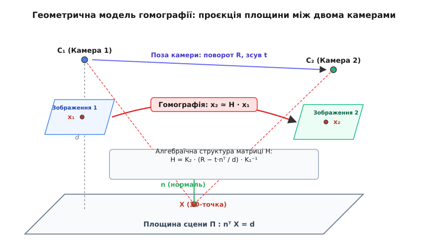

# Гомографія: перетворення площини в площину

Коли бортова камера дрона знімає посадковий майданчик під нахилом, квадратна розмітка перетворюється на нерівнобічну трапецію, паралельні смуги збігаються до лінії горизонту, а відносні відстані між мітками спотворюються. Якщо спробувати обробити такі кадри загальними методами тривимірної реконструкції та побудувати фундаментальну матрицю, алгоритми зазнають виродження: усі фізичні точки лежать у єдиній площині, промені камер не утворюють об'ємних трикутників, і спроба тріангуляції завершується діленням на нуль або чисельним зривом. Для пласких об'єктів потрібен інший математичний міст, який переносить пікселі безпосередньо між двома площинами без побудови повної тривимірної хмари точок.

Такий зв'язок описує **гомографія** (або **планарна гомографія**, від грец. *homos* — однаковий, та *graphein* — креслити, зображати) — взаємно однозначне проективне відображення точок однієї площини на іншу. Гомографія згортає все перспективне спотворення у квадратну матрицю розміром 3×3:

```
s · x' = H · x
```

де `x = (u, v, 1)ᵀ` — координати точки на першому зображенні в однорідному записі, `x' = (u', v', 1)ᵀ` — координати тієї самої фізичної точки на другому зображенні, `H` — матриця гомографії, а `s` — ненульовий числовий множник проективного масштабу.


*Геометричний зв'язок між двома камерами та 3D-площиною: матриця гомографії H однозначно переносить проекцію точки x₁ у проекцію x₂ без знання повної тривимірної структури навколишнього простору.*

Гомографія справедлива у двох фундаментальних випадках комп'ютерного зору:
1. *Зйомка спільної площини:* камера рухається у довільному напрямку, але всі спостережувані об'єкти лежать на одній фізичній поверхні (земля, підлога, стіна будівлі, аркуш паперу, дорожній знак).
2. *Чисте обертання камери:* оптичний центр камери залишається нерухомим, а сенсор лише повертається довкола своєї осі (панорамна зйомка далекого краєвиду). У цьому режимі навіть об'ємний світ поводиться як проекція на спільну нескінченно віддалену сферу або площину.

### Вісім ступенів вільності: чому потрібно чотири точки

Матриця `H` містить дев'ять дійсних чисел:

```
    ┌             ┐
    │ h₁₁ h₁₂ h₁₃ │
H = │ h₂₁ h₂₂ h₂₃ │
    │ h₃₁ h₃₂ h₃₃ │
    └             ┘
```

Проте ці дев'ять чисел не є повністю незалежними. Оскільки координати точок задані в однорідному вигляді, множення всієї матриці `H` на будь-який ненульовий коефіцієнт `λ` не змінює кінцевих декартових пікселів: дріб `(λ·x₁) / (λ·x₃)` дає те саме значення `u'`. Масштаб матриці є вільним, тому матриця гомографії має рівно вісім ступенів вільності. Щоб зафіксувати матрицю однозначно, достатньо задати умову нормування — наприклад, покласти `h₃₃ = 1` або зажадати одиничної норми Фробеніуса `||H|| = 1`.

Кожна пара відповідних точок між двома кадрами `(u, v) ↔ (u', v')` дає два незалежні лінійні рівняння: одне для горизонтальної осі `u'`, друге — для вертикальної осі `v'`. Записавши зв'язок через координати:

```
u' = (h₁₁·u + h₁₂·v + h₁₃) / (h₃₁·u + h₃₂·v + h₃₃)
v' = (h₂₁·u + h₂₂·v + h₂₃) / (h₃₁·u + h₃₂·v + h₃₃)
```

та помноживши обидві частини на спільний знаменник, отримують систему двох лінійних обмежень на дев'ять невідомих елементів матриці.

Звідси випливає фундаментальне правило розрахунку:
- Одна пара точок дає 2 рівняння.
- Дві пари дають 4 рівняння.
- Три пари дають 6 рівнянь (цього замало для визначення 8 параметрів).
- **Чотири пари точок** дають рівно 8 незалежних рівнянь, яких вистачає для єдиного точного знаходження матриці `H`.

Єдина геометрична вимога до цих чотирьох точок — вони мусять перебувати в загальному положенні: жодні три точки не повинні лежати на одній прямій лінії. Якщо три маркери вишикуються в ряд, система рівнянь втратить ранг, і матриця стане виродженою.

### Погляд згори: Inverse Perspective Mapping та посадка дрона

Одне з найпоширеніших практичних застосувань гомографії — зворотне перспективне перетворення (англ. *Inverse Perspective Mapping*, IPM), або генерація вигляду «з висоти пташиного польоту» (англ. *Bird's Eye View*, BEV).

Коли автомобільний автопілот або робот-доставник аналізує дорожнє полотно через фронтальну камеру, розмітка та перешкоди на дорозі звужуються вдалині. Щоб побудувати метричну 2D-карту вільного простору навколо шасі, застосовують штучну гомографію: пікселі перспективного зображення перепроєктують на віртуальну площину, розташовану паралельно до асфальту під кутом 90 градусів. У результаті паралельні смуги руху знову стають паралельними лініями однакової товщини, а відстань у пікселях на результуючій карті прямо відповідає сантиметрам на реальній дорозі.

Аналогічний принцип працює під час автономної посадки безпілотника на оптичний маркер:
1. Бортовий алгоритм виявляє чотири кути квадратного посадкового майданчика на поточному відеокадрі.
2. Знаючи еталонні фізичні розміри квадрата у метрах (наприклад, кути з координатами `(0,0)`, `(1,0)`, `(1,1)`, `(0,1)`), система миттєво обчислює матрицю гомографії між еталоном і кадром сенсора.
3. Маючи відому матрицю внутрішніх параметрів камери `K` (фокусну відстань і оптичний центр), матрицю гомографії аналітично розкладають на геометричні складові: матрицю просторового повороту `R`, вектор напрямку зміщення `t` та вектор нормалі до площини `n`.

Завдяки цьому бортовий контролер дрона дізнається точний кут свого крену, тангажу та відносну висоту над платформою без використання GPS чи важких лазерних сканерів.

### Робота в реальних умовах: шум, викиди та оптимізація

На реальних зображеннях кути маркерів чи особливі точки знаходять із похибкою дискретизації сенсора, а частина знайдених відповідностей виявляється хибною через відблиски або повторювані текстури. Якщо обчислити матрицю `H` за чотирма випадковими точками з шумом, результат виявиться нестабільним: піксельні координати порядку `10³` призводять до поганої обумовленості матриць і катастрофічного накопичення похибок обчислень.

Інженерний конвеєр розв'язує цю задачу у три кроки:
1. *Нормалізація Гартлі:* перед побудовою рівнянь усі координати точок масштабують і центрують так, щоб їхній центр мас лежав у початку координат `(0, 0)`, а середня відстань до точок дорівнювала `√2`. Це знижує число обумовленості системи на десять порядків і захищає обчислення від машинних похибок.
2. *Фільтрація через **RANSAC**:* серед сотень знайдених точкових пар алгоритм випадковим чином вибирає четвірки, будує кандидатні матриці гомографії та перевіряє, скільки інших точок підтверджують отримане перетворення. Усі хибні зіставлення (викиди) автоматично відсіюються.
3. *Остаточне уточнення:* на базі відібраних узгоджених точок матрицю уточнюють методом найменших квадратів через сингулярний розклад (SVD) або нелінійну мінімізацію геометричної похибки перепроєкції.

Повне алгебраїчне виведення нормалізації Гартлі, строгий розклад матриці гомографії на рух камери та площину, а також розбір неоднозначності розв'язків і критерію хіральності викладено у [детальній статті](root:sf-visual/homography/homography-d.md). Повну реалізацію оцінювача гомографії, алгоритму DLT та зворотного варпінгу на C і C++ наведено у [проєктній інженерній вставці](root:sf-visual/homography/proj-homography-estimator.md).
