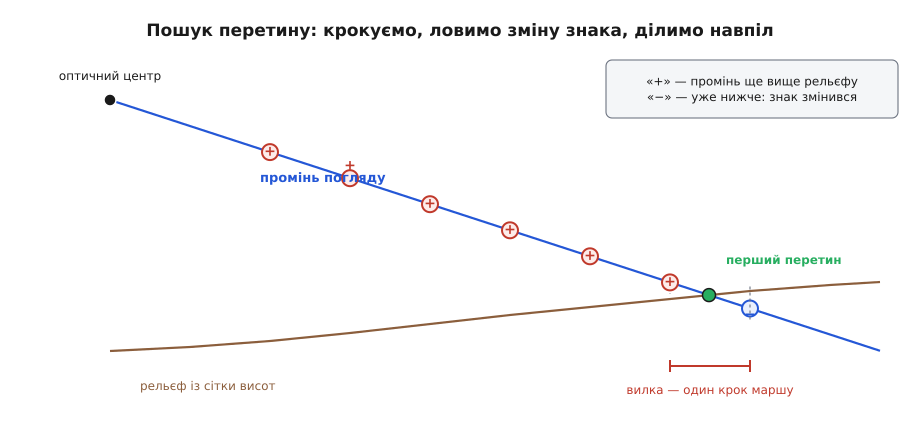

# ⚙️ Розв'язувач «піксель → широта й довгота» на C

Нижче — повний код, який приймає номер пікселя й телеметрію польоту, а віддає координати точки на землі. Він недовгий, але кожен його крок відповідає окремому давачу зі своєю системою відліку, своєю одиницею й своїм способом збрехати — тож більша частина роботи тут не в арифметиці, а в тому, щоб на стику двох сусідніх кроків нічого не переплуталося.

## Що подають на вхід

Вхід — не «зображення», а знімок разом з усім, що борт знав про себе в мить затвора.

:::code proj-pixel-to-ground/c/shcho-podaiut-na-vkhid.c

У цій структурі зійшлися чотири незалежні джерела: оператор із пікселем, AHRS із кутами корпуса, енкодери підвісу й приймач GNSS. Кожне приходить своїм каналом і зі своєю затримкою, тому перше, що робить справжня система, — зводить їх до **однієї мітки часу** й інтерполює телеметрію на момент затвора, а не бере «останнє, що прийшло». Решта — геометрія.

Одиниці зафіксовано жорстко: усередині структури немає жодного градуса й жодної висоти над рівнем моря. І те, і те живе лише на межі — там, де числа читає людина або чужий формат.

## Промінь: із пікселя в напрямок

Об'єктив зміщує точку тим сильніше, чим далі вона від центра кадру, тож першим ділом піксель треба повернути туди, де він був би в ідеальної камери. Формула **Брауна–Конраді** (доцентрову частину вивів Александер Конраді 1919 року, звів обидві до знайомого сьогодні вигляду Дуейн Браун 1966-го) рахує в зворотний бік — зі справжньої точки спотворену. Оберненої формули в елементарних функціях немає, зате є проста нерухома точка: підставляємо здогад, дивимось, у що він спотворився, поправляємо.

:::code proj-pixel-to-ground/c/promin-iz-pikselia-v.c

Цикл збігається тому, що дисторсія — мала добавка: кожен прохід зменшує нев'язку приблизно в стільки разів, у скільки сама поправка менша за координату, тож для звичайного об'єктива вистачає трьох-чотирьох проходів, а вісім лишають запас на край кадру. Для «риб'ячого ока», де поправка порівнянна з координатою, ця нерухома точка вже не стягується — там беруть іншу модель проєкції, а не інші коефіцієнти.

Далі — три повороти. Кути Ейлера в аеронавігаційному порядку дають матрицю **R** = Rz(курс)·Ry(тангаж)·Rx(крен):

:::code proj-pixel-to-ground/c/promin-iz-pikselia-v-2.c

Перестановка `{ d[2], d[0], d[1] }` — уся «камера проти корпуса»: оптична вісь стає «вперед», права сторона кадру — «праворуч», низ кадру — «вниз». Вивірку прикладаємо **раніше** за неї, ще в осях камери, бо це залишковий кут між оптичною віссю й механічними осями кріплення. Якщо калібрувальний політ дав вивірку відносно інерціального блока, її місце інше — після кутів підвісу, з боку корпуса. Переплутані боки не видно на прямовисному кадрі й видно на похилому: помилка з'являється тільки на ненульових кутах підвісу й росте разом із ними.

## Перевірка на горизонт

Складова `d_n[2]` — це «скільки в погляді низу». Її знак вирішує, чи задача взагалі має розв'язок: при нулі промінь паралельний землі, при від'ємному дивиться вгору. Порогом тут не варто ставити абстрактне мале число — чесніше зафіксувати **дальність, за якою відповідь усе одно нікому не потрібна**, і відкидати все, що за неї виходить.

```c
#define RANGE_MAX 5000.0        /* далі геоприв'язка за телеметрією не варта довіри */

typedef enum { GEO_OK, GEO_HORIZON, GEO_NO_HIT } Status;
```

Ця стеля сама переводиться в кут. З висоти 120 м дальність 5 км означає, що «низу» в погляді має бути щонайменше 120/5000 = 0.024, тобто промінь нахилений до землі хоч на 1.4°. Усе, що пологіше, розв'язку не отримує — і це правильно: там один градус шуму орієнтації коштує більше, ніж уся відповідь.

Ключове — що відмова повертається **окремим станом**, а не координатою. Спокуса віддати «хоч щось» тут особливо сильна, бо число ж порахувалося; але оператор не побачить, що воно взялося з променя, який пройшов над горизонтом, і повірить йому так само, як усім іншим.

## Перетин: площина і рельєф

Для горизонтальної площини на висоті `h_g` над еліпсоїдом усе замикається одним діленням. Промінь виходить із оптичного центра, а той зміщений від антени на важіль, повернутий у місцеві осі:

:::code proj-pixel-to-ground/c/peretyn-ploshchyna-i.c

Рельєф замкненої формули не має: висота під променем змінюється разом із самим променем. Модель поверхні тут — сітка вузлів із відомим кроком, а висота між вузлами добудовується [білінійною інтерполяцією](root:math-numeric/bilinear-interpolation) чотирьох сусідів:

:::code proj-pixel-to-ground/c/peretyn-ploshchyna-i-2.c

Далі — те, заради чого все це писалося. Ідемо вздовж променя сталим кроком і чекаємо, поки різниця висот змінить знак; той крок, на якому вона змінилася, і є вилка, всередині якої лежить **перший** перетин. Уточнюємо його половинним діленням — методом, якому досить лише різних знаків на кінцях і не потрібно ні похідної, ні гладкості, а рельєф гладким і не буває.

:::code proj-pixel-to-ground/c/peretyn-ploshchyna-i-3.c


*Марш дає вилку, половинне ділення — точність: перше коштує лінійно, друге майже нічого.*

> 🔧 **Навіщо це.** Крок маршу — не параметр швидкодії, а параметр **правильності**. Пагорб, вужчий за крок, промінь просто перестрибне: обидві проби лишаться додатними, і розв'язувач знайде другий перетин замість першого — точку за гребенем, куди камера не бачить. Тому крок беруть не більший за пів клітинки сітки: дрібніших горбів у самій сітці однаково немає.

## Назад у градуси

Зсуви на північ і схід — це метри в дотичній площині. Щоб зробити з них градуси, потрібні два радіуси кривини еліпсоїда на цій широті: уздовж меридіана й упоперек нього.

:::code proj-pixel-to-ground/c/nazad-u-hradusy.c

Обидва радіуси беруться на широті **зйомки**, а не цілі: у межах кількох кілометрів вони змінюються в сьомому знаку, і різниця губиться далеко за шумом орієнтації. Висоту `h` сюди подають уже цільову — ту, на якій промінь зустрів поверхню.

## Збірка й запуск

:::code proj-pixel-to-ground/c/zbirka-i-zapusk.c

```
площина: 50.450647 30.520796  висота 160.0 м, похила дальність 150.9 м
рельєф:  50.450618 30.520760  висота 165.5 м, похила дальність 144.0 м
```

Перший рядок — ті самі числа, що дає розрахунок на папері. Другий відрізняється на **4.2 м**: схил підняв поверхню назустріч променю, той зустрів її раніше, і жодного способу дізнатися про це з самого знімка немає.

Дорогою видно ціну кроків, які легко пропустити. Записаний піксель (2938.65, 2063.66) після виправлення дисторсії став рівно (3000.00, 2100.00) — зсув на 71 піксель; подати сирий піксель просто в K⁻¹ означало б промазати повз ціль на **3.67 м**. А якщо поставити `lever = { 0.05, 0.0, 0.18 }` — камера на 5 см уперед і 18 см нижче антени, — відповідь зрушиться на 10 см. Поряд із метровою похибкою звичайного [GNSS](root:hw-sensing/gnss) це ніщо, але саме заради таких сантиметрів і ставлять RTK: коли решта похибок падає до одиниць сантиметрів, важіль стає одним із найбільших доданків.

## Складність

Марш робить L/Δs проб, кожна — чотири звертання до сітки й десяток множень, тобто стала. [Половинне ділення](root:math-numeric/bisection) додає log₂(Δs/ε) проб. Разом:

```
O(L/Δs + log₂(Δs/ε))

L = 5000 м, Δs = 10 м, ε = 0.01 м
марш            до 500 проб  (у прикладі знак змінився на 15-й)
ділення навпіл      10 проб
```

Друга частина фактично безкоштовна: за десять кроків вилка з десяти метрів стискається до сантиметра. Уся ціна — у першій, і платять її дальністю пошуку, а не потрібною точністю. Дрібнити крок заради точності безглуздо; дрібнити його треба лише тоді, коли рельєф має горби, вужчі за крок.

Арифметики тут на кілька сотень множень — мікросекунди. Реальний час з'їдає інше: сітка висот лежить у файлах-плитках, і промінь на п'ять кілометрів перетинає їх кілька. Тому в бойовій системі `grid_height` читає не масив, а кеш плиток, і саме промах цього кешу, а не 500 проб маршу, вирішує, встигне розв'язувач за кадром чи ні. Пристрій самої сітки — [цифрова модель рельєфу](root:sf-visual/terrain-elevation-model).

## Пастки

- **Дві різні висоти.** `h0` мусить бути над **еліпсоїдом**, як його й видає приймач; сітка рельєфу майже завжди роздається над **рівнем моря**. В Україні розбіжність близько 25 м — постійний зсув висоти, що обертається на систематичну помилку координати ([звідки береться це розходження](root:math-geometry/geoid-and-amsl)). Або приводьте сітку до еліпсоїда, або віднімайте хвилю геоїда — але не змішуйте.
- **Знак осі «вниз».** У NED додатне z спрямоване до землі, тож висота — це `h0 − p[2]`, з мінусом. Переплутаний знак не дає жодної помилки компіляції: код спокійно шукає перетин угорі й повертає «розв'язку немає» на цілком нормальному кадрі.
- **Градуси й радіани.** Тригонометрія C рахує в радіанах, телеметрія приходить у градусах, оператор бачить градуси. Тримайте градуси лише на межі системи. Заразом про друк: один шостий знак широти — це 11 см, тож «%.6f» — це не косметика, а межа роздільності виводу.
- **Мітки часу.** Знімок, поза корпуса й кути підвісу міряються різними пристроями. Підвіс, що повертається зі швидкістю 30°/с, за 50 мс розсинхронізації дає 1.5° помилки — на пологому промені це десятки метрів. Мітки мають бути [від одного годинника](root:sf-distributed/timestamps), а телеметрія — інтерпольована на момент затвора.
- **Дисторсія й вивірка — сталі, тому найпідступніші.** Вони не шумлять і не усереднюються: помилка в них однаково зсуває **всі** кадри польоту в один бік, і на карті це виглядає як бездоганно точна зйомка, зміщена на кілька метрів. Обидві дістають один раз — [калібруванням камери](root:sf-visual/camera-calibration) й калібрувальним польотом над відомими точками.
- **Сітка скінченна.** `grid_height` повертає нуль за межами покриття, і `hit_terrain` чесно віддає `GEO_NO_HIT`. Спокуса «підставити останній вузол» тут дорого коштує: користувач отримає координату замість відмови й не дізнається, що вона взята зі стелі.
