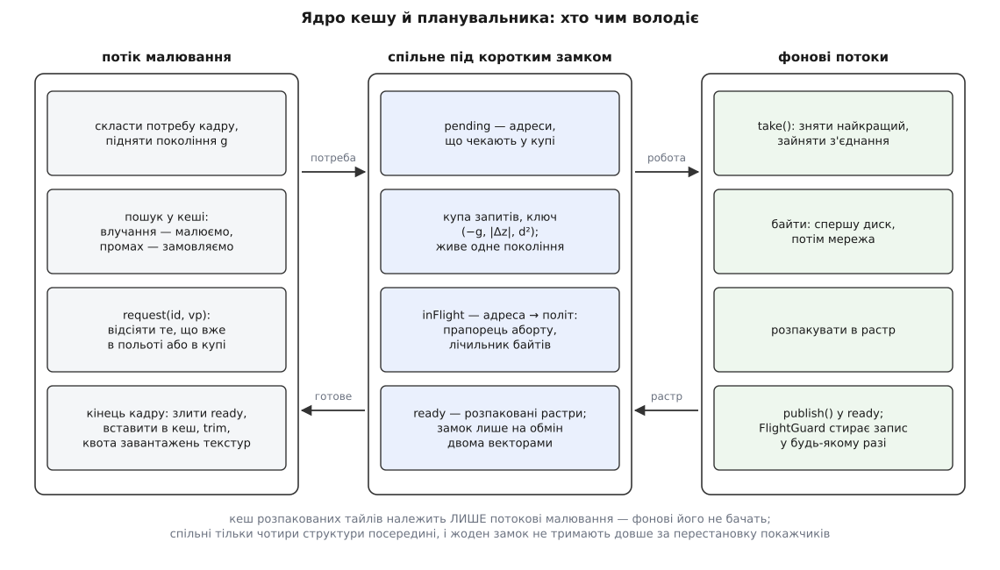
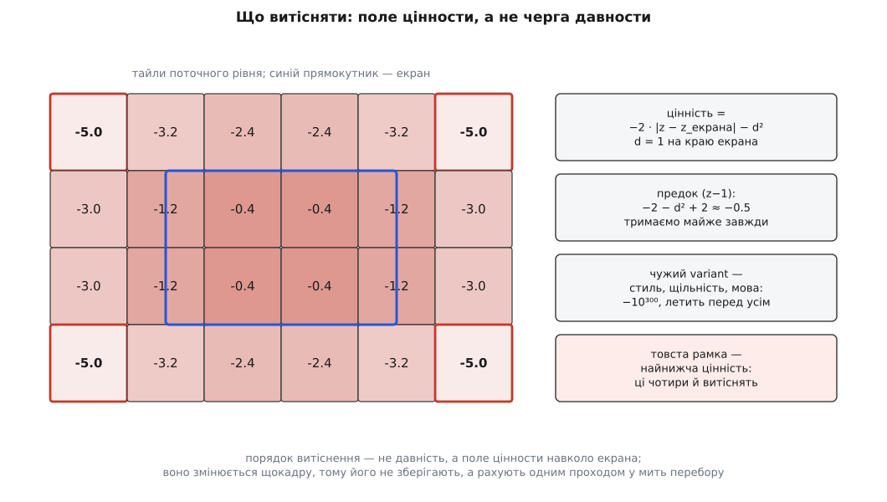

# ⚙️ Ядро тайлового кешу й планувальника: адреса, цінність, купа, політ

Тут зібрано на C++ те, що в справжніх картах зазвичай розповзається по десятку файлів: адреса тайла з арифметикою предка, кеш із межею в байтах і витісненням за близькістю до екрана, купа запитів із поколінням, таблиця польоту й квота завантажень на кадр. Разом це — п'ятсот рядків, які й вирішують, чи карта їде за пальцем, чи «доганяє» його з наростанням; і майже всі відомі помилки тайлових конвеєрів живуть не всередині цих п'яти шматків, а на стиках між ними.

## Задача

Кожного кадру потік малювання знає, які адреси йому потрібні: сто-півтораста трійок z/x/y плюс кільце запасу навколо екрана. Частина вже лежить розпакована в пам'яті. Решту треба десь узяти, і на це є 16.6 мілісекунди, з яких на всю нашу бухгалтерію можна витратити хіба десяту частину.

Від ядра вимагають шести речей одночасно:

- **знайти в пам'яті за наносекунди** й не платити за пошук навіть на промаху;
- **тримати межу в байтах**, а не в штуках, і викидати те, що зараз найдалі від ока;
- **упорядкувати замовлення** так, щоб центр екрана й свій рівень ішли першими;
- **не замовляти двічі** те, що вже летить;
- **дешево скасовувати** те, що застаріло, — і не скасовувати того, за що вже заплачено;
- **не з'їсти кадр** завантаженням текстур і не застигнути на замку, який тримає фоновий потік.

## Три рішення, на яких усе тримається

**Адресна арифметика — це зсуви.** Сітки рівнів вкладені: тайл рівня z рівно накриває чотири тайли рівня z+1. Тому предок, номер квадранта й пакування адреси в одне 64-бітне число — це кілька зсувів без жодного пошуку й без жодної алокації.

**Пріоритет і цінність — функції поточного вікна, тому їх не можна зберігати.** Щойно карта зрушила, змінилася цінність **усіх** записів одразу. Купа, впорядкована за старим вікном, стає не «трохи неточною», а просто неправильною. Звідси два висновки, які й визначають форму коду: купа запитів живе рівно одне покоління й перескладається щокадру, а порядок витіснення не підтримують — його рахують одним проходом у ту мить, коли справді треба когось викинути.

**Кеш належить одному потокові.** Розпакований кеш чіпає лише потік малювання. Фонові потоки не бачать його взагалі й спілкуються з ним через одну чергу, замок на якій тримають рівно стільки, скільки триває обмін двома векторами. Так зникає цілий клас гонитв — не тому, що їх акуратно синхронізували, а тому, що спільного стану просто немає.



*Спільного стану рівно чотири структури, і жодна з них не тримає піксельних даних — тільки адреси, ключі й покажчики.*

## Адреса: усе, що можна зробити зсувом

Адреса — не трійка, а четвірка. П'ятий байт її ключа несе `variant`: джерело (супутник чи схема), стиль, щільність пікселів, мова підписів. Забути його — це не «дрібна неточність», а кеш, який на екрані подвійної щільности назавжди віддає картинку звичайної.

:::code proj-tile-cache/cpp/adresa-use-shcho-mozhna.hpp

Три деталі варті пояснення.

`key()` укладає поля так, що число зростає разом із (z, x, y) — дамп кеша виходить упорядкований сам собою, без окремого компаратора. Порівняння адрес звелося до порівняння двох `uint64_t`, тому `operator==` не має жодної гілки.

Хеш **перемішує біти явно**. Ключі сусідніх тайлів різняться тільки молодшими бітами `y` — це найщільніший і найрегулярніший вхід, який може дістати [хеш-таблиця](root:sf-algorithms/hash-table). Стандарт нічого не обіцяє про якість `std::hash` для цілих типів: реалізація має право повернути саме число. Три множення й три зсуви коштують дешевше за один довгий ланцюг колізій, тож питання закривають на місці, а не сподіваються на бібліотеку.

`quadrant()` виглядає дрібницею, але саме він перетворює «немає тайла» на «намалюй чверть предка»: молодший біт `x` каже ліворуч чи праворуч, молодший біт `y` — вгорі чи внизу.

## Цінність тайла: чому її не можна зберігати

Порядок витіснення задає одна функція. На вхід їй ідуть адреса й **поточне** вікно; на виході — число, де більше означає цінніше.

:::code proj-tile-cache/cpp/tsinnist-taila-chomu-ii-ne.hpp

Дві сталі — `2.0` за рівень і `+2.0` предкам — не з естетики. Вони калібрують один порядок, який видно в числах:

```
тайл у центрі екрана, свій рівень          −0.4
той самий тайл біля краю екрана            −1.0     (d² = 1 за означенням)
предок цього тайла, рівень z−1     −2·1 − 0.5 + 2 = −0.5
дитина, що лишилася після віддалення  −2·1 − 0.4  = −2.4
сусід за екраном, d² ≈ 5                   −5.0
чужий variant                            −10³⁰⁰
```

Предок дешевший за свій тайл, але дорожчий за все, що за межами екрана, — а це рівно те, чого від нього хочуть: предків у піраміді на третину більше за нижній рівень, коштують вони мало, а рятують від дір завжди. Дитина бонусу не отримує навмисно: після віддалення її вчетверо більше на ту саму площу, і корисна вона рівно один короткий момент.



*Цінність — це поле навколо екрана, а не позначка часу на записі. Тому воно й не зберігається: один рух карти зміщує все поле цілком.*

> 🔧 **Навіщо це.** Класичне «викидай те, до чого найдовше не зверталися» тут працює погано з конкретної причини: оператор веде карту вправо, тайли за лівим краєм стають найстарішими й вилітають першими — а через секунду він веде назад, і всі вони потрібні знову. Витрачено канал, час і батарею на те, що щойно було в руках. Позначка часу описує **минуле** звертання, а поле цінности — **наступне**, і на карті друге передбачуване, бо рука рухається неперервно.

## Кеш, обмежений байтами

:::code proj-tile-cache/cpp/kesh-obmezhenyi-baitamy.cpp

Записи лежать у щільному векторі, а хеш-таблиця тримає лише індекси. Це дає локальність під час `trim`: прохід по цінності читає суміжну пам'ять, а не гуляє по вузлах таблиці. Платня за щільність — видалення через перестановку останнього елемента на місце вилученого, і саме через неї `find` не сміє віддавати `const Raster*`: до наступного кадру цей запис може виявитися зовсім іншим тайлом.

`shared_ptr<const Raster>` тут не церемонія, а те, що робить витіснення безпечним. Потік малювання взяв покажчик, за мить `trim` викинув запис із кеша — пікселі живі, бо на них є посилання, і помруть аж тоді, коли кадр домалюється. Слово `const` закриває другий бік: опублікований растр більше ніхто не переписує.

`trim` не підтримує впорядкованости — він її будує щоразу наново, бо цінність цілком залежить від вікна. Це виглядає марнотратно рівно доти, доки не помітити другу половину рішення: витісняють **не до стелі, а до 85 %**. Один прохід звільняє місце під півтори сотні наступних вставок, тобто на кілька секунд роботи; без цієї гістерези кеш опинявся б на самій межі й сортувався щокадру.

Три робочі вектори — поля класу, а не локальні змінні: після першого шторму вони вже потрібного розміру й більше не звертаються до алокатора.

## Купа запитів, що живе одне покоління

Ключ пріоритету — трійка, яку порівнюють лексикографічно.

:::code proj-tile-cache/cpp/kupa-zapytiv-shcho-zhyve.cpp

Відстань бережуть **у квадраті**: корінь не змінює порядку, а коштує на кожному порівнянні всередині [купи](root:sf-algorithms/priority-queue-adt).

Тепер головне рішення планувальника. Коли карта зрушила, все, що чекає в купі, описує вже не той екран. Замість того щоб переоцінювати тисячі записів, купу **викидають цілком** — і той самий кадр за мікросекунду складе потребу наново й покладе актуальні запити з правильними ключами.

:::code proj-tile-cache/cpp/kupa-zapytiv-shcho-zhyve-2.cpp

Купа живе один кадр — і це не втрата, а точний розрахунок. За шістнадцять мілісекунд фонові потоки встигають зняти з неї кілька найкращих запитів; рівно ті, що були найкращими **на момент цього кадру**. Наступний кадр складе купу з нуля з новими ключами. Скасування «всього, що не почалося» виходить безкоштовним: воно звелося до одного присвоєння порожньої купи.

`pending_` — це просто множина адрес, які зараз лежать у купі. Вона потрібна, щоб та сама адреса не потрапила туди двічі: під час нерухомої карти покоління не змінюється, і без цієї перевірки кожен кадр докладав би ту саму сотню запитів. `inFlight_` тримає адреси, які вже полетіли. Разом ці дві таблиці й дають [об'єднання однакових запитів](root:sf-distributed/request-coalescing): друга й третя згадка адреси — байдуже, чи вона потрібна сама по собі, чи як предок-заповнювач для сусіда — не породжують ані байта трафіку.

`Flight` живе за `shared_ptr` навмисно. Фоновий потік тримає свою копію й читає `abort` без замка, а планувальник під замком може будь-коли стерти запис із таблиці — об'єкт від цього не помре. Обидва поля атомарні, бо їх пише один потік, а читає інший, і жодного порядку між ними не потрібно: `relaxed` тут не мікрооптимізація, а точний опис вимоги.

Політика скасування записана в `reclaimSlot` буквально. Обірвати запит, який уже прийняв байти, — заплатити двічі: встановлення з'єднання коштує кілька обертів по мережі, і повторне замовлення заплатить за них знову. Тому скасовують лише те, що стоїть на нулі, лише коли з'єднань більше немає, і лише по одному за раз.

## Кадр: злити, вставити, підрізати, вивантажити

Готові растри переходять із фонових потоків у потік малювання через одну чергу, замок якої тримають рівно на обмін двома векторами — той самий прийом, що й у [подвійній буферизації](root:sf-tasks/double-buffering).

:::code proj-tile-cache/cpp/kadr-zlyty-vstavyty.cpp

Фоновий потік у циклі виглядає так:

:::code proj-tile-cache/cpp/kadr-zlyty-vstavyty-2.cpp

`source.fetch` дивиться на `flight.abort` у своєму зворотному виклику й нарощує `flight.bytesReceived`, щойно поїхали перші байти; `decode` і `uploadTexture` — межі прикладу, вони належать бібліотеці зображень і графічному API. Адреси для потреби кадру дає арифметика [тайлової сітки](root:math-geometry/web-mercator-tiles).

А ось увесь кадр:

:::code proj-tile-cache/cpp/kadr-zlyty-vstavyty-3.cpp

Порядок кроків тут не довільний. Спершу вставляють доспіле — щоб потреба кадру одразу знайшла його в кеші й не замовила вдруге. Потім складають потребу — і лише після цього підрізають, бо `trim` має бачити вже нове вікно. Завантаження текстур іде останнім, коли решта [бюджету кадру](root:sf-visual/frame-budget) вже відома.

Квота подвійна навмисно. Лічильник штук захищає від очевидного випадку — тридцяти готових тайлів одночасно. Строк за годинником захищає від неочевидного: перше завантаження після зміни формату текстури може коштувати не сто мікросекунд, а кілька мілісекунд, і жодна константа «скільки штук» цього не передбачить. Перевірка `need_.count` — не оптимізація, а коректність: тайл, що приїхав уже непотрібним, лежить у кеші й чекає, а відеопам'ять на нього не витрачають.

## Складність і числа

```
TileId::parent, ancestor, quadrant, key    O(1)              зсуви, без пам'яті
cache.find                                 O(1) очікувано    хеш-таблиця
cache.insert                               O(1) амортизовано push_back + один запис
cache.erase                                O(1) очікувано    перестановка + правка індексу
cache.trim                                 O(n log n)        один прохід на шторм
scheduler.request                          O(log m)          вставка в купу
scheduler.take                             O(log m)          зняття вершини
scheduler.newGeneration                    O(m)              звільнити вектор купи
```

n — записів у кеші, m — запитів у купі. Обидва числа малі й обмежені зверху конструкцією, і це видно з арифметики:

```
тайл 256×256 RGBA        256 · 256 · 4          = 262 144 Б = 256 КіБ
запис у кеші             262 144 + 128          = 262 272 Б
кеш на 256 МіБ           268 435 456 / 262 272  ≈ 1023 записи      → n
потреба кадру 3200×1800  ≈ 108 видимих + кільце запасу ≈ 150 адрес → m
```

Тисяча записів — це `std::sort` приблизно на 10⁴ порівнянь, тобто десятки мікросекунд. Один такий прохід звільняє 15 % бюджету:

```
268 435 456 · 0.15 ≈ 40.3 МБ ≈ 153 тайли
```

Сто п'ятдесят вставок — це кілька секунд активного возіння карти. Отже `trim` бачить кадр разів у сто рідше, ніж сам кадр, і його вартість розчиняється. Якби записи були однакового розміру, `std::sort` можна замінити на `std::nth_element` із наперед порахованою кількістю жертв — стандарт обіцяє йому лінійність у середньому; при тисячі записів різниця не варта ускладнення, при сотні тисяч — варта.

Купа на півтори сотні елементів дає log₂150 ≈ 7.2 порівняння на операцію. `newGeneration` під час руху викидає її щокадру — це один `free` на вектор, мікросекунди.

## Де це ламається

**Лічильник штук замість байтів.** Тайл 256×256 RGBA — 256 КіБ, той самий тайл 512×512 — рівно мегабайт. Межа «дві тисячі тайлів» означає будь-що між 375 МіБ і 2 ГіБ залежно від того, який сервер відповів. Тому в `Entry` лежить `bytes`, а не одиниця. Той самий рядок ховає другу пастку, тоншу: `footprint()` бере `capacity()`, а не `size()` — вектор, який ріс подвоєнням, легко тримає вдвічі більше, ніж використовує, і ця різниця в кеші на гігабайт коштує сотні мегабайтів «нізвідки».

**Лічильник, що поїхав.** Найпідступніша помилка в `insert` — забути `bytes_ -= old.bytes` на перезаписі наявного ключа. Кеш працює, тайли віддаються, нічого не падає; просто `bytes_` повзе вгору швидше за реальність, `trim` починає викидати робочий набір, і карта йде в холостий цикл перезавантажень. Симптом читається як «кеш не працює», а причина — одне віднімання. Тому інваріант варто перевіряти: у зневаджувальній збірці — сума `entries_[i].bytes` проти `bytes_` раз на секунду.

**Скасування вже початих запитів.** Спокуса «на зміну вікна скасувати геть усе» під час руху вбивча: покоління змінюється щокадру, кожен запит скасовується за кілька мілісекунд після старту, і жоден не доживає до кінця. Карта, яку «оптимізували» скасуванням, не наповнюється взагалі, доки палець не зупиниться. Правило рятує однією умовою: у купі — скасовуємо все й безкоштовно; у польоті — тільки те, що на нулі байтів, і тільки коли потрібне з'єднання.

**Витік у таблиці польоту.** Якщо фоновий потік вийде раніше — 404, таймаут, виняток — і не зітре запис із `inFlight_`, адреса залишиться «в польоті» назавжди. `request` мовчки її пропускатиме, тайл не замовлять більше ніколи, і на карті буде одна діра, яка не заростає ніколи й тільки в одному місці. Знайти таке за симптомом майже неможливо. Ліки не в тому, щоб не забути `retire()` на кожному виході, а в тому, щоб виходів не рахувати: `FlightGuard` стирає запис у деструкторі — [ресурс прив'язаний до часу життя](root:sf-lang/raii), і жодна нова гілка в коді не може цього зламати.

**Гонитва між розпакуванням і малюванням.** Три різні поломки з однієї причини — спільний стан там, де його могло не бути.

Перша: покласти кеш під спільний замок, щоб фонові потоки вставляли туди самі. Формально коректно, практично — потік малювання час від часу застигає рівно на той час, поки хтось усередині робить `trim` із сортуванням. Тому в цьому коді фонові потоки кеша **не бачать**; єдина спільна річ — вектор у `ReadyQueue`, і замок на ньому тримають на час перестановки покажчиків.

Друга: віддати з кеша `const Raster*`. Покажчик переживе `trim` цього ж кадру, і малювання піде по звільненій пам'яті. Ще веселіше без витіснення: `entries_.push_back` перевиділяє вектор, і всі раніше видані покажчики стають сміттям тихо, без жодного видимого приводу. `shared_ptr<const Raster>` знімає обидва випадки.

Третя: перевикористати буфер розпакування. Пул буферів здається розумною економією — доки той самий буфер не віддадуть під новий тайл, поки попередній ще малюють. Растр після `publish` — незмінний, і `const` у `RasterPtr` це не позначка наміру, а заборона на рівні типу.

**Ключ без варіанта.** І найтихіша з усіх: `variant`, забутий у `key()`. Кеш працює бездоганно на машині розробника й показує підписи чужою мовою або розмиту картинку на екрані подвійної щільности — і лише в тих користувачів, у кого налаштування відрізняються від типових. Десять бітів у ключі коштують нуль; їхня відсутність коштує тижня пошуків.
