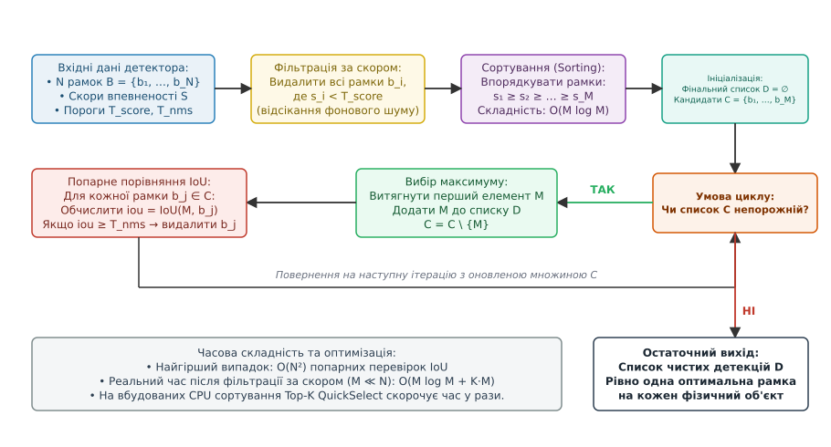

# Non-Maximum Suppression (NMS)

<preknowlist>
- [Нейродетектори](root:sf-visual/nn-detectors) — виявлення об'єктів нейромережею, просторове розбиття сітки (grid cells), якірні рамки (anchors) та оцінка ймовірності класу.
- [Виявлення об'єктів](root:sf-visual/object-detection) — класичні та нейромережеві підходи до локалізації цілей, координатні простори та метрика перекриття прямокутників.
- [Швидке впорядкування (Quicksort)](root:sf-algorithms/quicksort) — сортування масивів за час O(N log N) методом «розділяй і володарюй».
- [Порядкові статистики та Quickselect](root:sf-algorithms/quickselect) — пошук k найбільших елементів у масиві за лінійний середній час O(N).
- [Основи трекінгу в комп'ютерному зорі](root:sf-visual/tracking) — супровід габаритних рамок цілей у часі та чутливість трекера до дублікатів детекцій.
</preknowlist>

Коли сучасний нейромережевий детектор на кшталт YOLOv8 або SSD опрацьовує звичайний вхідний кадр роздільною здатністю 640×640 пікселів, його вихідний тензор містить не два чи три акуратні прямокутники навколо видимих людей чи автомобілів, а рівно 8400 або 8732 сирі габаритні рамки (англ. *bounding boxes*). На кожного реального пішохода, що потрапив у поле зору об'єктива, припадає від 30 до 90 згенерованих гіпотез: центральні клітинки просторової сітки, сусідні зміщені позиції та різні масштабні рівні піраміди ознак одночасно сигналізують про наявність об'єкта. Усі ці рамки мають дещо відмінні координати кутів та різні показники впевненості (наприклад, 0.94, 0.88, 0.76, 0.52), але описують ту саму фізичну ціль.

Якщо передати такий неочищений масив безпосередньо в контур керування автономного безпілотника, систему екстреного гальмування автомобіля чи алгоритм міжкадрового трекінгу SORT, система зазнає миттєвого збою. Замість однієї перешкоди автопілот побачить щільний клубок із пів сотні взаємно перекритих об'єктів. Планувальник траєкторії почне будувати абсурдні маневри ухилення, трекер згенерує десятки хибних треків-привидів із постійними стрибками ідентифікаторів, а час обчислення матриці асоціацій зросте у сотні разів. Щоб перетворити надлишковий хаос числових прогнозів на чистий список одиничних детекцій, застосовують алгоритм **Non-Maximum Suppression** (NMS, від лат. *suppressio* — придушення, стримування, тобто придушення немаксимумів).

Завдання NMS полягає в тому, щоб у кожному локальному скупченні просторово узгоджених рамок знайти єдиного найдостовірнішого представника — локальний максимум упевненості — та безповоротно придушити всі його просторові копії й похибки квантування сітки. У цій статті детально розібрано математичні засади метрики просторового перекриття рамок, класичну жадібну процедуру придушення, її сучасні модифікації (Soft-NMS, DIoU-NMS, Matrix NMS, Adaptive NMS) та інженерні методи оптимізації для вбудованих процесорів реального часу.

## Причини надлишковості рамок у нейромережевих детекторах

Щоб зрозуміти, чому алгоритм NMS є обов'язковою завершальною ланкою конвеєра комп'ютерного зору, необхідно простежити механіку формування просторових гіпотез усередині нейронної мережі. Жоден сучасний алгоритм глибокого навчання не здатен за один прямий прохід згенерувати точну змінну кількість рамок безпосередньо у вигляді зв'язного списку об'єктів. Архітектура тензорних обчислень вимагає фіксованої структури вихідних матриць, прив'язаної до геометричної сітки дискретизації зображення.

### Багатомасштабна піраміда ознак (FPN) та щільна сітка вибірки

Розглянемо типовий одностадійний детектор (англ. *single-stage detector*), побудований на базі піраміди ознак (Feature Pyramid Network, FPN). На вхід подається зображення розміром `640 × 640` пікселів. Згорткова основа (англ. *backbone*) послідовно зменшує просторову роздільну здатність карт ознак із кроками дискретизації (англ. *stride*) 8, 16 та 32 пікселі:
- **Рівень P3 (дрібні об'єкти):** сітка `80 × 80` клітинок = 6400 просторових позицій;
- **Рівень P4 (середні об'єкти):** сітка `40 × 40` клітинок = 1600 просторових позицій;
- **Рівень P5 (великі об'єкти):** сітка `20 × 20` клітинок = 400 просторових позицій.

Загальна кількість точок передбачення становить `6400 + 1600 + 400 = 8400`. У без'якірних детекторах (англ. *anchor-free*, таких як YOLOv8 чи FCOS) кожна з цих 8400 точок генерує вектор виходу `[t_x, t_y, t_w, t_h, c₁, c₂, …, c_C]`, де перші чотири числа кодують відхилення координат рамки відносно центру клітинки, а наступні значення — ймовірності належності до кожного з `C` класів. В якірних детекторах (англ. *anchor-based*, таких як YOLOv4 чи RetinaNet), де в кожній точці оцінюється від трьох до дев'яти шаблонних рамок різного співвідношення сторін, кількість кандидатів сягає `8400 × 3 = 25200` або `8400 × 9 = 75600`.

Коли в полі зору з'являється об'єкт (наприклад, пішохід розміром `120 × 260` пікселів), рецептивне поле згорткових фільтрів накриває його не однією ізольованою точкою, а цілим кластером суміжних нейронів. Клітинка сітки, розташована в геометричному центрі людини, активується з високим рівнем упевненості (наприклад, 0.94). Сусідні клітинки, зміщені на 8 чи 16 пікселів праворуч, ліворуч, вище чи нижче, бачать майже ту саму візуальну інформацію і також успішно регресують координати до меж тіла пішохода, формуючи рівні впевненості 0.89, 0.81, 0.73. Одночасно на сусідньому рівні піраміди ознак P4 (де клітинки мають більший просторовий крок) ще дві-три точки також генерують рамки для цього самого об'єкта зі скорами 0.68 та 0.55.

### Крос-масштабна активація та регресія меж (Distribution Focal Loss)

У сучасних без'якірних архітектурах регресія координат кутів виконується не через пряме передбачення чисел `(x, y, w, h)`, а через механізм розподілених втрат фокусування (Distribution Focal Loss, DFL). Мережа моделює ймовірнісний розподіл положення кожної з чотирьох меж рамки (верхньої, нижньої, лівої, правої) відносно центру клітинки у вигляді дискретного вектора з 16 значень.

Завдяки цьому модель здатна виражати невпевненість щодо нечітких меж (наприклад, розмитий рухом край автомобіля чи прозора тканина одягу). Проте такий розподіл призводить до того, що кілька суміжних клітинок сітки навчаються регресувати майже однакові інтегральні математичні сподівання меж прямокутника. Якщо об'єкт має проміжний габаритний розмір (наприклад, 75 пікселів на стику масштабів P3 та P4), обидва рівні піраміди одночасно сприймають його як цільовий, посилюючи крос-масштабне дублювання (англ. *cross-scale redundancy*).

Аналогічна надлишковість виникає і в двостадійних архітектурах (англ. *two-stage detectors*, таких як Faster R-CNN чи Cascade R-CNN). Перша стадія — мережа генерування регіонів (Region Proposal Network, RPN) — накладає на зображення щільну сітку якорів і відбирає близько 2000 регіонів-кандидатів (англ. *region proposals*). Більшість із них сильно перекриваються між собою навколо найбільш виразних об'єктів сцени. Друга стадія класифікує та уточнює ці рамки, але без примусового просторового проріджування на виході залишаються десятки майже ідентичних дублікатів.

Таким чином, надлишковість рамок — це не баг конкретної нейромережі чи випадковий шум, а фундаментальний наслідок щільного просторового сканування згортковими ядрами. Алгоритм NMS виступає мостом між неперервним простором нейромережевих активацій та дискретною моделлю цілей, залишаючи строго одну габаритну рамку на кожен фізичний об'єкт сцени.

## Математична основа: координатні простори та метрика IoU

Щоб математично порівняти дві габаритні рамки й визначити, чи належать вони одному об'єкту, необхідна сувора кількісна міра просторової близькості двох прямокутників.

### Формати представлення прямокутників

У комп'ютерному зорі використовують два основні взаємозамінні формати опису прямокутників на 2D-площині кадру:
1. **Кутовий формат (Corner / Two-Point representation):**
   Прямокутник задається координатами верхнього лівого та нижнього правого кутів:
   ```
   B = [ x₁,  y₁,  x₂,  y₂ ]
   де x₁ ≤ x₂  та  y₁ ≤ y₂
   ```
2. **Центровий формат (Center-Size representation):**
   Прямокутник задається координатами центру, шириною та висотою:
   ```
   B = [ x_c,  y_c,  w,  h ]
   ```

Зв'язок між цими форматами визначається простими лінійними перетвореннями:
```
x₁ = x_c − w / 2,     y₁ = y_c − h / 2
x₂ = x_c + w / 2,     y₂ = y_c + h / 2

x_c = (x₁ + x₂) / 2,  y_c = (y₁ + y₂) / 2
w = x₂ − x₁,          h = y₂ − y₁
```

Для обчислення геометричного перекриття кутовий формат `[x₁, y₁, x₂, y₂]` є значно ефективнішим, оскільки дозволяє знайти межі перетину за допомогою операцій взяття мінімуму та максимуму без операцій ділення чи множення.

### Обчислення площі перетину двох рамок

Нехай задано дві прямокутні рамки `A = [x₁^A, y₁^A, x₂^A, y₂^A]` та `B = [x₁^B, y₁^B, x₂^B, y₂^B]`, сторони яких паралельні осям координат зображення (Axis-Aligned Bounding Boxes, AABB).

Спільний геометричний перетин `A ∩ B` двох таких прямокутників сам є прямокутником (або порожньою множиною). Його кутові координати визначаються парою операцій:
```
x₁^(inter) = max( x₁^A,  x₁^B )
y₁^(inter) = max( y₁^A,  y₁^B )
x₂^(inter) = min( x₂^A,  x₂^B )
y₂^(inter) = min( y₂^A,  y₂^B )
```

Ширина `w_inter` та висота `h_inter` зони перетину обчислюються з обов'язковим обмеженням знизу нулем (якщо прямокутники не перетинаються, різниця координат стане від'ємною):
```
w_inter = max( 0,  x₂^(inter) − x₁^(inter) )
h_inter = max( 0,  y₂^(inter) − y₁^(inter) )
```

Площа прямокутника перетину `Area(A ∩ B)` дорівнює:
```
Area(A ∩ B) = w_inter · h_inter
```

Якщо прямокутники розташовані на відстані або торкаються лише однією лінією чи точкою, хоча б одна з величин `w_inter` або `h_inter` дорівнює нулю, що дає коректну площу перетину `Area(A ∩ B) = 0`.

### Обчислення площі об'єднання та метрики IoU (коефіцієнта Жаккара)

Індивідуальні площі рамок `A` та `B` обчислюються як добуток їхніх лінійних розмірів:
```
Area(A) = (x₂^A − x₁^A) · (y₂^A − y₁^A)
Area(B) = (x₂^B − x₁^B) · (y₂^B − y₁^B)
```

За принципом включень-виключень (англ. *inclusion-exclusion principle*) площа спільного об'єднання `Area(A ∪ B)` дорівнює сумі площ обох прямокутників без подвійного врахування зони їхнього перетину:
```
Area(A ∪ B) = Area(A) + Area(B) − Area(A ∩ B)
```

Метрика **Intersection over Union** (IoU, також відома у теорії множин як коефіцієнт подібності Жаккара, англ. *Jaccard Index*) визначається як відношення площі перетину до площі об'єднання:
```
IoU(A, B) = Area(A ∩ B) / Area(A ∪ B)
```


*Геометричне визначення метрики IoU як відношення площі спільного перетину до площі об'єднання та просторове розділення дублікатів і незалежних об'єктів*

Метрика `IoU(A, B)` має фундаментальні математичні властивості:
1. **Нормованість:** `0.0 ≤ IoU(A, B) ≤ 1.0`.
2. **Нульовий перетин:** `IoU = 0.0` тоді й лише тоді, коли рамки не мають спільних внутрішніх точок.
3. **Ідеальний збіг:** `IoU = 1.0` тоді й лише тоді, коли координати кутів рамок повністю ідентичні (`A ≡ B`).
4. **Симетричність:** `IoU(A, B) = IoU(B, A)`.
5. **Масштабна інваріантність:** Якщо пропорційно збільшити або зменшити обидві рамки в `k` разів разом із простором кадру, значення `IoU` не зміниться, оскільки коефіцієнт `k²` скорочується в чисельнику й знаменнику.

> 🔧 **Навіщо це.** Масштабна інваріантність IoU критично важлива для детекції: вона дозволяє використовувати однаковий фіксований поріг придушення (наприклад, `T_nms = 0.45`) як для крихітних об'єктів розміром `16 × 16` пікселів на далекому плані, так і для величезних об'єктів розміром `500 × 500` на передньому плані.

### Числовий приклад розрахунку перекриття

Розглянемо дві рамки кандидатів на зображенні:
- Рамка `A`: `[100, 100, 200, 250]` (ширина `100`, висота `150`, площа `15000`);
- Рамка `B`: `[130, 120, 220, 260]` (ширина `90`, висота `140`, площа `12600`).

Обчислимо координати зони перетину:
```
x1_inter = max(100, 130) = 130
y1_inter = max(100, 120) = 120
x2_inter = min(200, 220) = 200
y2_inter = min(250, 260) = 250

w_inter = 200 − 130 = 70
h_inter = 250 − 120 = 130
Area(A ∩ B) = 70 · 130 = 9100
```

Обчислимо площу об'єднання:
```
Area(A ∪ B) = 15000 + 12600 − 9100 = 18500
```

Значення метрики IoU складає:
```
IoU(A, B) = 9100 / 18500 ≈ 0.4919
```
Якщо поріг придушення встановлено як `T_nms = 0.50`, ця пара рамок **не буде придушена** (`0.4919 < 0.50`). Якщо ж поріг дорівнює `T_nms = 0.45`, рамка `B` буде негайно видалена як надлишковий дублікат.

### Крайові випадки та геометричні дефекти класичного IoU

Попри математичну строгість, стандартний IoU має два суттєві обмеження:
1. **Повна втрата градієнта при відсутності перекриття:** Якщо дві рамки не перетинаються (`Area(A ∩ B) = 0`), значення `IoU = 0.0` незалежно від того, чи знаходяться вони на відстані 1 пікселя, чи 500 пікселів одна від одної. Це унеможливлює оцінку того, наскільки далеко рознесені кандидати.
2. **Невідчутливість до концентричного зміщення:** Якщо менша рамка повністю лежить всередині більшої рамки, перетин завжди дорівнює площі меншої рамки `Area(A ∩ B) = Area(B)`, а об'єднання — площі більшої `Area(A ∪ B) = Area(A)`. У результаті `IoU = Area(B) / Area(A)` залишається абсолютно сталим при будь-яких блуканнях меншої рамки всередині більшої — у кутку, по центру чи біля краю.

Ці обмеження зумовили появу розширених геометричних метрик (GIoU, DIoU, CIoU, Alpha-IoU), які розглянуто нижче.

## Класичний жадібний алгоритм (Greedy NMS)

Класичний алгоритм Non-Maximum Suppression є жадібним ітеративним процесом (англ. *greedy algorithm*), який ухвалює локально оптимальні рішення на кожному кроці.

### Вхідні дані та параметри алгоритму

На вхід алгоритму NMS подається:
- Список із `N` рамок: `B = { b₁, b₂, …, b_N }`, де кожна рамка задана кутами `[x₁, y₁, x₂, y₂]`;
- Список відповідних оцінок упевненості детектора: `S = { s₁, s₂, …, s_N }`, де `s_i ∈ [0.0, 1.0]`;
- Поріг відсікання фонового шуму за скором: `T_score` (зазвичай у діапазоні `0.10 … 0.30`);
- Поріг придушення перекриття: `T_nms` (зазвичай у діапазоні `0.45 … 0.65`).

### Покроковий конвеєр жадібного NMS

Обробка виконується за чотири чіткі етапи:

**Етап 1: Попередня фільтрація за скором (Score Thresholding).**
Більшість із тисяч рамок нейромережі вказують на порожній фон і мають мізерні скори впевненості (наприклад, 0.001 або 0.02). Обчислювати попарне перекриття для таких рамок — марна трата ресурсів процесора. Тому першим кроком усі рамки зі скором `s_i < T_score` миттєво відкидаються. Залишається підмножина активних кандидатів `M` елементів (`M ≪ N`, зазвичай `M ∈ [20, 300]`).

**Етап 2: Сортування за спаданням упевненості (Sorting).**
Залишок рамок упорядковується так, щоб перший елемент мав найвищий скор упевненості в усій вибірці:
```
s₁ ≥ s₂ ≥ s₃ ≥ … ≥ s_M
```
Індекси рамок переставляються відповідно до цього порядку.

**Етап 3: Ітеративне жадібне придушення (Greedy Selection & Suppression Loop).**
Створюється порожній результуючий список фінальних детекцій `D = ∅`. Поки список кандидатів `C` не спорожнів, виконується цикл:
1. З масиву кандидатів вилучається перший елемент `M` (який гарантовано має найвищий скор серед усіх, що залишилися).
2. Рамка `M` додається до фінального списку збережених детекцій: `D = D ∪ {M}`.
3. Для кожного іншого кандидата `b_j ∈ C` обчислюється метрика геометричного перекриття з лідером:
   ```
   iou_j = IoU( M,  b_j )
   ```
4. Якщо `iou_j ≥ T_nms`, це означає, що рамка `b_j` є просторовим дублікатом об'єкта `M`. Вона вилучається з множини кандидатів `C` і більше ніколи не розглядається (придушується).
5. Якщо `iou_j < T_nms`, рамка `b_j` залишається у списку `C` для наступних ітерацій.

**Етап 4: Повернення результату.**
Коли список `C` стає порожнім, масив `D` містить остаточний набір чистих габаритних рамок, де жодна пара не перекривається з `IoU ≥ T_nms`.


*Послідовність операцій жадібного NMS: попередня фільтрація шуму, сортування за спаданням та ітеративне придушення дублікатів*

### Аналіз обчислювальної складності

Оцінимо часову та просторову складність жадібного алгоритму:

1. **Сортування:** Для `M` рамок швидке сортування Quicksort або Introsort вимагає часу:
   ```
   T_sort = O(M · log M)
   ```
2. **Цикл придушення:**
   - **Найгірший випадок (Worst-case):** Усі `M` рамок належать абсолютно різним фізичним об'єктам і не перекриваються (`IoU < T_nms`). На першій ітерації перевіряється `M - 1` пара, на другій — `M - 2`, і так далі. Сумарна кількість обчислень IoU становить:
     ```
     (M − 1) + (M − 2) + … + 1 = M · (M − 1) / 2 = O(M²)
     ```
   - **Найкращий випадок (Best-case):** Усі `M` рамок описують один-єдиний об'єкт і перекриваються з лідером. На першій же ітерації лідер придушує всі `M - 1` рамок, і алгоритм завершується за `O(M)` перевірок.
   - **Типовий практичний випадок (Average-case):** Якщо на кадрі присутні `K` реальних фізичних цілей (`K ≪ M`), середня кількість перевірок оцінюється як `O(K · M)`.

Загальна асимптотична складність алгоритму становить:
```
T_total = O(N) + O(M · log M) + O(K · M)
```
де `O(N)` — лінійний прохід фільтрації за порогом скору.

Просторова складність становить `O(M)` додаткової пам'яті для зберігання індексів або маски активності кандидатів (Boolean keep mask), що робить класичний NMS надзвичайно компактним.

## Фундаментальна вада Hard NMS та концепція Soft-NMS

Попри елегантність та простоту, класичний NMS має системний недолік, що отримав назву «проблема жорсткого бінарного відсікання» (англ. *Hard Suppression Dilemma*).

### Анатомія помилки Hard NMS у щільних сценах

У класичному NMS правило ухвалення рішення є бінарною сходинковою функцією:
```
s_i = 0,    якщо IoU(M, b_i) ≥ T_nms
s_i = s_i,  якщо IoU(M, b_i) < T_nms
```

Розглянемо типовий практичний сценарій: двоє пішоходів ідуть вулицею поруч, і один частково перекриває іншого (ситуація оклюзії, англ. *occlusion*). Детектор коректно виявив обидва об'єкти:
- Пішохід 1 (передній план): рамка `b₁`, скор `s₁ = 0.95`;
- Пішохід 2 (задній план): рамка `b₂`, скор `s₂ = 0.88`.

Через фізичну близькість людей їхні справжні габаритні рамки перетинаються з `IoU(b₁, b₂) = 0.54`. Якщо в конфігурації алгоритму встановлено стандартний поріг `T_nms = 0.50`, станеться фатальна помилка:
```
IoU(b₁, b₂) = 0.54  ≥  0.50  →  Скор s₂ обнуляється (s₂ = 0)
```
Детекція другого пішохода безповоротно знищується. Алгоритм генерує помилку другого роду (False Negative, пропуск цілі).

Якщо ж інженер спробує запобігти цій помилці й підніме поріг, наприклад, до `T_nms = 0.70`, то детекція другого пішохода збережеться (`0.54 < 0.70`). Але одночасно для одиноких пішоходів на вільному просторі всі випадкові похибки сітки з перекриттям `0.55 … 0.68` перестануть придушуватися, що призведе до лавиноподібного зростання помилок першого роду (False Positive, поява дублікатів). Жодне єдине скалярне значення `T_nms` не здатне одночасно вирішити обидві проблеми в умовах змінного просторового розподілу об'єктів.

### Математичний апарат Soft-NMS

Щоб подолати цей глухий кут, 2017 року Навніт Бодла (Navaneeth Bodla) та співавтори запропонували алгоритм **Soft-NMS**. Головна інтуїція Soft-NMS полягає в тому, що високе перекриття з лідером `M` не обов'язково означає, що рамка `b_i` є хибним дублікатом. Вона може бути сусіднім реальним об'єктом. Тому замість повного обнулення скору (`s_i = 0`) необхідно **плавно знизити (демпфувати)** рівень упевненості `s_i` пропорційно до міри перекриття `IoU(M, b_i)`.

Автори запропонували дві математичні функції затухання:

**1. Лінійне затухання (Linear Decay Function):**
Скор рамки `b_i` зменшується за лінійним законом при перевищенні порогу `T_nms`:
```
       ⎧ s_i,                      якщо IoU(M, b_i) < T_nms
s_i =  ⎨
       ⎩ s_i · (1 − IoU(M, b_i)),  якщо IoU(M, b_i) ≥ T_nms
```

Якщо `IoU = 0.55`, новий скор пішохода 2 складе:
```
s₂' = 0.88 · (1 − 0.55) = 0.88 · 0.45 = 0.396
```
Скор помітно знизився, але залишився вищим за типовий поріг детекції `T_score = 0.25`. Об'єкт залишається у списку детекцій, хоча його пріоритет зменшується.

**2. Неперервне гаусове затухання (Gaussian Decay Function):**
Лінійна функція зберігає штучний розрив похідної в точці `IoU = T_nms`. Значно елегантнішим та стабільнішим є гаусове згладжування, яке взагалі не потребує фіксованого порогу `T_nms`:
```
s_i = s_i · exp( − (IoU(M, b_i))² / σ )
```
де `σ` (сигма) — гіперпараметр ширини гаусового купола (типове емпіричне значення `σ = 0.5`).

Розглянемо числову поведінку гаусової функції при `σ = 0.5`:
- При незначному перекритті `IoU = 0.1`:
  ```
  множник = exp( − 0.01 / 0.5 ) = exp( −0.02 ) ≈ 0.980   (скор падає лише на 2%)
  ```
- При помірному перекритті `IoU = 0.4`:
  ```
  множник = exp( − 0.16 / 0.5 ) = exp( −0.32 ) ≈ 0.726   (скор зберігає 72.6% сили)
  ```
- При сильному перекритті дубліката `IoU = 0.8`:
  ```
  множник = exp( − 0.64 / 0.5 ) = exp( −1.28 ) ≈ 0.278   (скор падає майже в 4 рази)
  ```
- При майже повному накладанні `IoU = 0.95`:
  ```
  множник = exp( − 0.9025 / 0.5 ) = exp( −1.805 ) ≈ 0.164
  ```

### Динаміка черги в Soft-NMS

На відміну від класичного NMS, де оброблені рамки або одразу потрапляють у результат, або видаляються назавжди, у Soft-NMS рамка зі зменшеним скором **повертається у список кандидатів**.

Оскільки скор зменшився, її позиція в упорядкованому списку змінюється: вона опускається нижче інших кандидатів. На наступних ітераціях алгоритм знову вибирає рамку з максимальним скором серед залишку. Якщо після кількох штрафів скор рамки залишається вищим за кінцевий поріг чутливості, вона зберігається як окремий об'єкт.

Soft-NMS забезпечує приріст середньої точності **+1.5 … +2.3% mAP** на стандартному бенчмарку MS COCO для будь-яких детекторів (Faster R-CNN, Mask R-CNN, Deformable ConvNets) без необхідності повторного навчання ваг нейромережі — виключно завдяки інтелектуальнішій постобробці.

## Просторовий контекст: метрики DIoU-NMS, CIoU-NMS та Generalized IoU

Стандартна метрика IoU та побудовані на ній алгоритми NMS / Soft-NMS мають ще одну фундаментальну геометричну ваду: вони повністю ігнорують **взаємне положення центрів** рамок та їхнє **співвідношення сторін**.

### Проблема сліпоти стандартного IoU до векторного зсуву

Розглянемо дві різні геометричні конфігурації двох прямокутників `A` та `B`:
- **Конфігурація 1:** Рамка `B` зміщена відносно `A` строго по діагоналі. Центри розташовані на великій відстані `d₁`, але площі перетинаються на 45% (`IoU = 0.45`).
- **Конфігурація 2:** Рамка `B` розташована майже концентрично всередині `A` (центри майже збігаються, `d₂ ≈ 0`), але через невелику різницю в масштабі перекриття також становить `IoU = 0.45`.

З погляду стандартного IoU обидві ситуації абсолютно ідентичні. Проте з погляду фізичного простору сцени в першому випадку велика відстань між центрами є сильною ознакою того, що це **два різні об'єкти** (наприклад, водій та пасажир на сусідніх сидіннях мотоцикла). У другому випадку близькість центрів майже напевно вказує на те, що це **один і той самий об'єкт**, локалізований нейромережею з різною точністю меж.

### Generalized IoU (GIoU)

Першою спробою врахувати форму простору поза зоною перетину стала метрика **Generalized IoU (GIoU)** (Rezatofighi et al., 2019). Вона знаходить найменший охоплюючий опуклий прямокутник `C`, що містить обидві рамки `A` та `B`, і штрафує за площу порожнього простору всередині `C`:
```
GIoU(A, B) = IoU(A, B) − ( Area(C) − Area(A ∪ B) ) / Area(C)
```
Діапазон значень GIoU становить `[-1.0, 1.0]`. Якщо рамки безмежно віддаляються одна від одної, `Area(C) → ∞`, дріб прямує до 1.0, а `GIoU → -1.0`.

Проте для задач NMS метрика GIoU виявилася недостатньо ефективною: коли одна рамка повністю лежить всередині іншої, охоплюючий прямокутник `C` збігається з більшою рамкою `A`, різниця `Area(C) - Area(A ∪ B) = 0`, і GIoU вироджується назад у звичайний IoU.

### Distance-IoU NMS (DIoU-NMS)

Для безпосереднього врахування просторової дистанції між центрами рамок Чжен (Zheng et al., 2020) розробили метрику **Distance-IoU (DIoU)** та алгоритм **DIoU-NMS**.

Метрика DIoU вводить у класичний IoU штрафний член, що базується на нормалізованій евклідовій відстані між центрами рамок:
```
DIoU(A, B) = IoU(A, B) − R_DIoU(A, B)

           ρ²( b^A,  b^B )
R_DIoU =  ─────────────────
                 c²
```
де:
- `b^A = (x_c^A, y_c^A)` та `b^B = (x_c^B, y_c^B)` — координати геометричних центрів рамок `A` та `B`;
- `ρ(·, ·)` — евклідова відстань між точками центрів:
  ```
  ρ²(b^A, b^B) = (x_c^A − x_c^B)² + (y_c^A − y_c^B)²
  ```
- `c` — діагональ найменшого зовнішнього охоплюючого прямокутника (англ. *smallest enclosing bounding box*), який накриває обидві рамки `A` та `B` одночасно.

Діагональ `c` охоплюючого боксу обчислюється через крайні кутові координати:
```
x₁^(enc) = min( x₁^A,  x₁^B ),     y₁^(enc) = min( y₁^A,  y₁^B )
x₂^(enc) = max( x₂^A,  x₂^B ),     y₂^(enc) = max( y₂^A,  y₂^B )

c² = ( x₂^(enc) − x₁^(enc) )² + ( y₂^(enc) − y₁^(enc) )²
```

В алгоритмі **DIoU-NMS** критерій придушення рамки модифікується: рамка `b_i` придушується лідером `M`, лише якщо виконується умова:
```
s_i = 0,  якщо  IoU(M, b_i) − R_DIoU(M, b_i) ≥ T_nms
```

Якщо центри рамок `M` та `b_i` розташовані далеко один від одного, штрафний дріб `R_DIoU` стає великим (наприклад, 0.15). Тоді модифіковане значення різниці падає:
```
IoU − R_DIoU = 0.58 − 0.15 = 0.43  <  T_nms (0.50)  →  НЕ придушувати!
```
Рамка зберігається, що кардинально знижує кількість помилок при детекції скупчень людей, транспорту в заторах та полиць у логістичних складах.

### Complete-IoU NMS (CIoU-NMS)

Подальшим розвитком концепції є метрика **Complete-IoU (CIoU)**, яка додатково враховує подібність геометричних пропорцій (співвідношення сторін `w / h`):
```
CIoU(A, B) = IoU(A, B) − R_DIoU(A, B) − α · v
```
де `v` вимірює узгодженість співвідношень сторін:
```
v = ( 4 / π² ) · ( arctan(w^A / h^A) − arctan(w^B / h^B) )²
```
а `α` — динамічний коефіцієнт регуляризації:
```
α = v / ( (1 − IoU) + v )
```

У CIoU-NMS рамка зберігається, якщо вона має помітно інші пропорції, ніж лідер (наприклад, високий вузький знак поруч із горизонтальним автомобілем), навіть якщо їхній геометричний IoU є значним.

## Адаптивні та ансамблеві модифікації: Adaptive NMS та Weighted Fusion

Окрім перегляду геометричної метрики IoU, суттєвий прогрес було досягнуто у динамічному підлаштуванні параметрів алгоритму до локального контексту кадру та усередненні координат рамок.

### Адаптивний NMS (Adaptive NMS)

У реальних сценах щільність розміщення об'єктів вкрай неоднорідна. В одній частині кадру може бути порожня дорога з поодинокими автомобілями (де потрібен низький і жорсткий поріг `T_nms = 0.40` для надійного придушення похибок сітки), а в іншій — щільний натовп пішоходів на перехресті (де навіть поріг `T_nms = 0.60` викликає придушення сусідніх людей).

Алгоритм **Adaptive NMS** (Liu et al., 2019) вирішує цю суперечність шляхом введення динамічного порогу:
1. До вихідної голови нейромережі додається підмережа оцінки локальної щільності об'єктів (англ. *density prediction subnet*). Для кожної рамки `b_i` мережа прогнозує скаляр `d_i ∈ [0.0, 1.0]` — ступінь скупченості навколо цієї цілі.
2. Поріг придушення `N_t(M)` для поточного лідера `M` обчислюється динамічно:
   ```
   N_t(M) = max( N_default,  d_M )
   ```
   де `N_default` — базовий мінімальний поріг (наприклад, 0.30).

Коли лідер `M` знаходиться на відкритому просторі (`d_M = 0.1`), поріг залишається жорстким `N_t = 0.30`, що повністю виключає дублікати. Коли ж об'єкт потрапляє в щільну групу людей (`d_M = 0.65`), поріг автоматично зростає до `0.65`, дозволяючи зберегти сусідніх пішоходів.

### Зважене злиття рамок (Weighted NMS та Bounding Box Fusion)

Класичний NMS обирає одну-єдину рамку з найвищим скором `M` і повністю викидає всі придушені рамки `b_j`. Проте придушені рамки несуть цінну статистичну інформацію: кожна з них є незалежним прогнозом меж того самого об'єкта, виконаним іншою клітинкою нейромережі чи іншим масштабом піраміди.

У підході **Weighted NMS** (або WBF — Weighted Box Fusion) координати фінальної рамки `B_out` не копіюються з лідера, а розраховуються як зважене середнє координат усіх рамок кластера, де вагою виступає впевненість `s_i`:
```
x₁^(out) = ∑_{i ∈ Cluster} ( s_i · x₁^i ) / ∑_{i ∈ Cluster} s_i
y₁^(out) = ∑_{i ∈ Cluster} ( s_i · y₁^i ) / ∑_{i ∈ Cluster} s_i
x₂^(out) = ∑_{i ∈ Cluster} ( s_i · x₂^i ) / ∑_{i ∈ Cluster} s_i
y₂^(out) = ∑_{i ∈ Cluster} ( s_i · y₂^i ) / ∑_{i ∈ Cluster} s_i
```

Фінальний скор об'єкта також агрегується (наприклад, береться скор лідера або нормалізована сума ваг). Зважене злиття усуває мікротремтіння меж прямокутника між сусідніми кадрами відеопотоку (Jitter Reduction) і підвищує точність позиціювання меж (IoU з реальною міткою ground truth) на 1.5–3.0%.

## Паралельні алгоритми для прискорювачів: Fast NMS та Matrix NMS

Із розвитком апаратних прискорювачів штучного інтелекту (GPU, TPU, NPU) класичний жадібний NMS перетворився на головне вузьке місце продуктивності.

Сучасна нейромережа виконує інференс на GPU за 2–5 мілісекунд завдяки паралельній обробці мільйонів операцій множення матриць на тисячах SIMT-ядер (CUDA cores, Tensor cores). Проте послідовний цикл Greedy NMS неможливо ефективно розпаралелити: кожна наступна ітерація суворо залежить від того, яка рамка була обрана максимумом на попередньому кроці. У результаті виконання згортається в один потік, виникає масовий простій графічних процесорів, а постобробка на центральному процесорі може забирати 10–20 мс, перевищуючи час роботи самої нейромережі.

Для подолання цієї проблеми було створено повністю паралельні, безітераційні матричні алгоритми.

### Fast NMS у моделях YOLACT

Алгоритм **Fast NMS** (Bolya et al., 2019, розроблений для моделі інстанс-сегментації YOLACT) переводить фільтрацію у прості паралельні матричні операції:

1. Нехай після фільтрації за скором відібрано `M` кандидатів, упорядкованих за скором: `s₁ ≥ s₂ ≥ … ≥ s_M`.
2. На GPU паралельно обчислюється повна матриця попарних перекриттів `X` розмірністю `M × M`:
   ```
   X[i, j] = IoU( b_i,  b_j )
   ```
3. Оскільки рамки вже впорядковані за спаданням скору (`s_i ≥ s_j` при `i < j`), рамка `i` може придушити рамку `j` лише тоді, коли вона стоїть вище у списку (`i < j`). Тому нижній трикутник матриці `X` та її головну діагональ занулюють:
   ```
   X_triu[i, j] = X[i, j],  якщо i < j
   X_triu[i, j] = 0,       якщо i ≥ j
   ```
4. Для кожного стовпчика `j` паралельно знаходиться максимальне значення по рядках (вектор операції `max_along_rows`):
   ```
   k_j = max_{i} ( X_triu[i, j] )
   ```
5. Рамка `b_j` зберігається, якщо максимальне перекриття з будь-якою більш достовірною рамкою не перевищує поріг:
   ```
   keep[j] = ( k_j < T_nms )
   ```

Усі ці операції виконуються за один запуск GPU-ядра (англ. *single kernel launch*) за частки мілісекунди.

**Проблема надмірного придушення у Fast NMS:**
Fast NMS страждає від надмірного придушення (англ. *over-suppression*). Уявімо ланцюжок із трьох рамок `A`, `B` та `C`, де `score_A > score_B > score_C`. Нехай `IoU(A, B) = 0.7`, `IoU(B, C) = 0.6`, але `IoU(A, C) = 0.1`.
- У жадібному NMS: рамка `A` береться першою і придушує `B`. На другій ітерації рамка `B` вже мертва, тому вона не може придушити `C`. Оскільки `IoU(A, C) = 0.1 < 0.5`, рамка `C` **зберігається**.
- У Fast NMS: перевірка виконується одночасно. У стовпчику `C` стоїть значення `X_triu[B, C] = 0.6 ≥ 0.5`. Алгоритм бачить це число і придушує `C`, не враховуючи, що сам супресор `B` мав бути попередньо знищений рамкою `A`.

### Matrix NMS у моделях SOLO

Щоб усунути ваду Fast NMS без втрати паралелізму, Ван (Wang et al., 2020) у фреймворку семантичної сегментації SOLO розробили **Matrix NMS**.

Matrix NMS моделює процес придушення як задачу оцінювання ймовірності: скор рамки `j` повинен демпфуватися не просто за прямим перекриттям `IoU(i, j)`, а з урахуванням **ймовірності того, що сама рамка `i` не є придушеною іншими вищими рамками**.

Алгоритм обчислює коефіцієнт розпаду `decay[j]` для кожного елемента за формулою:
```
decay[j] = min_{i: s_i > s_j} ( f( IoU[i, j] ) / f( IoU[i, j] · m_i ) )
```
де `m_i` — коефіцієнт супресії найбільш агресивного попередника для рамки `i`.

Matrix NMS зводиться до двох паралельних операцій редукції над матрицею перекриттів `M × M` і реалізується менш ніж у 10 рядків коду на PyTorch/CUDA, працюючи з фіксованим часом виконання менше **0.4 мс** на 500 кандидатах на мобільних графічних прискорювачах.

## Інженерна оптимізація для вбудованих процесорів (Embedded DSP / MCU)

При перенесенні комп'ютерного зору на бортові контролери безпілотників, мікроконтролери з ядрами ARM Cortex-M55/M85, ESP32-S3 чи вбудовані процесори Cortex-A53 виникають жорсткі інженерні обмеження:
1. **Відсутність або висока ціна операцій із плаваючою комою (FPU):** Базові ядра Cortex-M4/M33 не мають апаратного блоку подвійної точності `float64`, а ділення `float32` займає від 14 до 30 тактів.
2. **Заборона динамічної пам'яті (No Heap Allocation):** Стандарти безпеки реального часу (MISRA C, DO-178C) категорично забороняють використання `malloc()` / `free()` у контурі обробки кадру через ризик фрагментації пам'яті та недетермінований час виконання.
3. **Обмежена пропускна здатність кешу:** Необхідно мінімізувати випадковий доступ до пам'яті та забезпечити послідовну вибірку (Structure of Arrays проти Array of Structures).

Розглянемо ключові техніки низькорівневої оптимізації NMS.

### Арифметика з фіксованою комою та виключення операції ділення

Усі нормалізовані координати `[0.0, 1.0]` або піксельні координати зображення переводяться в цілочисельний формат `int32_t` або формат із фіксованою комою Q16.16 (де перші 16 біт кодують цілу частину, а молодші 16 біт — дробову).

Найдорожчою операцією при розрахунку IoU є фінальне ділення:
```
iou = Area(A ∩ B) / Area(A ∪ B)
```
Якщо в NMS перевіряється лише порогова умова `iou ≥ T_nms`, ділення можна повністю виключити за допомогою перехресного множення!

Нехай поріг `T_nms` представлено у вигляді раціонального дробу `T_num / T_den` (наприклад, поріг `0.5 = 1 / 2`, поріг `0.45 = 9 / 20`, поріг `0.6 = 3 / 5`).
Тоді нерівність:
```
Area(A ∩ B) / Area(A ∪ B) ≥ T_num / T_den
```
математично еквівалентна умові в цілих числах:
```
Area(A ∩ B) · T_den ≥ Area(A ∪ B) · T_num
```

Оскільки площі завжди невід'ємні (`Area ≥ 0`), множення на додатний знаменник не змінює знак нерівності. Одне цілочисельне множення на Cortex-M виконується за **1 такт**, тоді як ділення з плаваючою комою вимагає десятків тактів.

### Селективне сортування QuickSelect (Top-K Optimization)

У реальних задачах система ніколи не очікує 500 детекцій на одному кадрі. Для передачі в трекер чи планувальник польоту достатньо зберегти не більше `K` найбільш достовірних цілей (наприклад, `K = 50` чи `K = 100`).

Повне сортування Quicksort на масиві з `M = 400` елементів вимагає близько `400 · log₂(400) ≈ 3450` операцій порівняння.

Замість повного сортування застосовують алгоритм **QuickSelect** (алгоритм Хоара для пошуку порядкових статистик):
1. QuickSelect за середній лінійний час `O(M)` частково впорядковує масив так, що `K` найбільших елементів опиняються в перших `K` комірках пам'яті (у довільному внутрішньому порядку), а всі менші елементи — позаду.
2. Потім сортуються лише перші `K` елементів за час `O(K log K)`.

Загальний час впорядкування скорочується в **3–4 рази**:
```
T_topk = O(M) + O(K · log K)   ≪   O(M · log M)
```

### Оптимізація пам'яті: Structure of Arrays проти Array of Structures

При класичній організації даних у вигляді масиву структур (Array of Structures, AoS) кожен елемент займає 24 байти. При сортуванні за полем `score` процесор змушений копіювати всі 24 байти структури при кожному swap-обміні, забиваючи кеш L1 непотрібними координатами.

:::tabs
```c
struct BBox { float x1, y1, x2, y2, score; int class_id; };
struct BBox array[N];
```
```cpp
struct BBox { float x1, y1, x2, y2, score; int class_id; };
std::array<BBox, N> array;
```
:::

Оптимальною для вбудованих CPU є схема **Structure of Arrays (SoA)**, де сортується лише масив 32-бітних індексів, що займає в 6 разів менше пам'яті й ідеально лягає в рядки кешу:

:::tabs
```c
struct BBoxesSoA {
    float x1[N];
    float y1[N];
    float x2[N];
    float y2[N];
    float score[N];
    int class_id[N];
};
```
```cpp
template <size_t N>
struct BBoxesSoA {
    std::array<float, N> x1;
    std::array<float, N> y1;
    std::array<float, N> x2;
    std::array<float, N> y2;
    std::array<float, N> score;
    std::array<int, N> class_id;
};
```
:::

### Векторизація SIMD (ARM NEON / RISC-V Vector / x86 AVX2)

При попарному порівнянні лідера `M` з іншими рамками обчислення координат перетину для кількох рамок можна виконувати паралельно за допомогою SIMD-інструкцій.

Регістр ARM NEON шириною 128 біт уміщує чотири 32-бітні цілі числа (`int32x4_t`). Векторизувавши масив рамок у форматі Structure of Arrays (масиви `x1[N]`, `y1[N]`, `x2[N]`, `y2[N]`), координати перетину для чотирьох кандидатів одночасно розраховуються за кілька інструкцій:

:::tabs
:::code nms-algorithm-d/c/vektoryzatsiia-simd-arm.h
:::code nms-algorithm-d/cpp/vektoryzatsiia-simd-arm.hpp
:::

Векторизація дає прискорення обчислення матриці перекриттів у **3.5–3.8 раза** на мобільних процесорах ARM.

### Однопрохідний мультикласовий NMS через зміщення координат

У детекторах із багатьма класами (наприклад, 80 класів у COCO) придушення дублікатів має відбуватися **всередині кожного класу окремо**: рамка людини не повинна придушувати рамку рюкзака на її спині, навіть якщо вони мають `IoU = 0.85`.

Наївна реалізація запускає цикл NMS 80 разів — окремо для кожного класу, що збільшує накладні витрати на виклики функцій та переупорядкування пам'яті.

Елегантним інженерним рішенням є **трюк зі зміщенням координат за ідентифікатором класу (Coordinate Offset Trick)**:
Перед сортуванням до координат кожної рамки додається просторовий зсув, пропорційний її класу `class_id`:
```
offset = class_id · max_coordinate_value
x₁' = x₁ + offset,     x₂' = x₂ + offset
y₁' = y₁ + offset,     y₂' = y₂ + offset
```
де `max_coordinate_value` — число, що гарантовано перевищує максимальний габарит зображення (наприклад, `4096` пікселів).

У результаті рамки класу 0 залишаються у просторі `[0, 640]`, рамки класу 1 зміщуються у простір `[4096, 4736]`, рамки класу 2 — у `[8192, 8832]`. Рамки різних класів більше фізично не перетинаються в числовому просторі (`IoU = 0`), і мультикласовий NMS виконується за **один-єдиний глобальний прохід**.

### Бітові маски та оптимізація пам'яті (Bitmask Filtering)

Для систем із жорстким лімітом пам'яті масив статусу активності рамок `suppressed[N]` не слід зберігати у вигляді масиву байтів `bool[N]`. Замість цього використовується масив 64-бітних цілих чисел `uint64_t bitmask[N / 64]`.

Переваги бітового представлення:
1. **Зниження витрат пам'яті у 8 разів:** Для 512 кандидатів потрібно лише 8 слів `uint64_t` (64 байти замість 512 байтів), які повністю поміщаються в регістровий файл процесора.
2. **Миттєвий пропуск блоків придушених рамок:** Якщо ціле 64-бітне слово `bitmask[w] == 0xFFFFFFFFFFFFFFFF`, процесор однією інструкцією порівняння пропускає відразу 64 рамки без індивідуальних перевірок пам'яті.
3. **Швидкий підрахунок активних цілей:** Апаратна інструкція підрахунку встановлених бітів `POPCNT` (`__builtin_popcountll`) дозволяє визначити залишок кандидатів за один такт.

## Профілювання та захист від аномальних затримок (Worst-case Latency Guard)

У промислових системах комп'ютерного зору (наприклад, у бортових автопілотах) критично важливим параметром є не лише середній час виконання (Average Latency), але й максимальна затримка в найгіршому випадку (Worst-case Execution Time, WCET).

### Проблема «сміттєвого шторму» детекцій (Detection Burst)

За нормальних умов після фільтрації за скором `T_score = 0.25` на кадрі залишається від 20 до 80 кандидатів, і NMS завершується за 0.05–0.15 мс. Проте в реальній експлуатації трапляються аномальні кадри:
- Високочастотна текстура (листя дерев, хвилі на воді, піщаний гравій);
- Засліплення камери прямим сонячним промінням або фарами зустрічного авто;
- Шум матриці в умовах глибокої темряви (високий коефіцієнт підсилення ISO).

У таких умовах нейромережа може згенерувати спалах із 2000–4000 псевдодетекцій зі скорами 0.26–0.32. Якщо алгоритм NMS спробує виконати попарне порівняння для 3000 рамок, кількість перевірок сягне `3000² / 2 = 4.5 · 10⁶` операцій, а час обробки підскочить до 25–40 мс. Це призведе до зриву частоти кадрів (Frame Drop), переповнення черги повідомлень RTOS та фатального запізнення реакції автопілота на реальну перешкоду.

### Захисний бар'єр жорсткого ліміту (Hard Input/Output Cap)

Для гарантування детермінізму за часом у вбудованих системах реалізують дворівневий захисний бар'єр:
1. **Hard Input Cap (`MAX_CANDIDATES_IN`):** Після фільтрації за скором у сортування пропускається не більше перших `N_max_in` елементів (наприклад, не більше 300 найкращих кандидатів). Якщо кандидатів більше, решта просто відкидається за допомогою швидкого лінійного відбору Top-K.
2. **Hard Output Cap (`MAX_OBJECTS_OUT`):** Щойно список збережених детекцій `D` досягає максимального ліміту (наприклад, 50 об'єктів), цикл NMS негайно переривається (`break`).

Ці два простих обмеження перетворюють теоретичну складність `O(N²)` на детерміновану верхню межу `O(N_max_in²)` та гарантують, що час виконання NMS ніколи не перевищить заданий часовий бюджет (наприклад, строго менше 0.25 мс за будь-яких візуальних аномалій).

## Порівняння алгоритмів NMS

У таблиці нижче наведено порівняльний аналіз розглянутих варіантів NMS за ключовими інженерними критеріями:

| Алгоритм | Часова складність (CPU) | Паралелізм на GPU | Стійкість до оклюзій (щільні сцени) | Потреба в калібруванні параметрів | Типове апаратне призначення |
|---|---|---|---|---|---|
| **Greedy Hard-NMS** | `O(M log M + K·M)` | Низький (послідовний) | Низька (обнулення сусідів) | `T_score`, `T_nms` | Вбудовані MCU, CPU, прості детектори |
| **Soft-NMS (Linear)** | `O(M²)` | Низький | Висока (плавний розпад) | `T_score`, `T_nms` | Серверні конвеєри, трекінг пішоходів |
| **Soft-NMS (Gaussian)** | `O(M²)` | Низький | Дуже висока (безпорогів) | `T_score`, `σ` | Офлайн-обробка, медична візуалізація |
| **DIoU-NMS** | `O(M log M + K·M)` | Низький | Дуже висока (дистанція центрів) | `T_score`, `T_nms` | Робототехніка, розпізнавання натовпу |
| **Adaptive NMS** | `O(M log M + K·M)` | Низький | Максимальна (динамічний поріг) | `N_default`, підмережа `d_i` | Автономне водіння, розумні міста |
| **Weighted Box Fusion** | `O(M²)` | Середній | Висока (усереднення меж) | `T_score`, `T_iou` | Ансамблі моделей, змагання Kaggle |
| **Fast NMS** | `O(M²)` | Максимальний (матричний) | Середня (надмірне придушення) | `T_score`, `T_nms` | Мобільні GPU, real-time сегментація |
| **Matrix NMS** | `O(M²)` | Максимальний (без циклів) | Висока (зважена супресія) | `T_score`, `σ` | Edge TPU, високошвидкісні NPU |

## Програмна реалізація алгоритмів

Нижче наведено робочі реалізації класичного алгоритму Greedy NMS мовами C99 та C++20. Код спроєктовано для роботи без динамічного виділення пам'яті в критичній секції з підтримкою мультикласової фільтрації.

:::tabs
:::code nms-algorithm-d/c/prohramna-realizatsiia.c
:::code nms-algorithm-d/cpp/prohramna-realizatsiia.cpp
:::

Повний оптимізований рушій NMS для вбудованих платформ із підтримкою Soft-NMS, цілочисельної арифметики Q16.16 та нульовим динамічним виділенням пам'яті розібрано у практичній вставці [вбудований рушій NMS та Soft-NMS](root:sf-visual/nms-algorithm/proj-embedded-nms-engine.md).

## Підсумковий синтез

Алгоритм Non-Maximum Suppression є незамінним фільтром просторової надлишковості на виході нейромережевих детекторів. Його еволюція пройшла шлях від класичного жадібного бінарного відсікання за порогом IoU до неперервного штрафування Soft-NMS, геометрично інформованих метрик DIoU/CIoU, адаптивних порогів Adaptive NMS та паралельних матричних структур Matrix NMS.

При виборі конкретного варіанта NMS для інженерної системи слід керуватися архітектурою цільового обчислювача та характером сцени:
- Для вбудованих мікроконтролерів і систем реального часу з жорсткими часовими рамками оптимальним вибором є **Greedy NMS на цілочисельній арифметиці Q16.16 з перехресним множенням та QuickSelect**;
- Для складних сцен із високою щільністю об'єктів та частими перекриттями (натовп, складські стелажі, конвеєр) слід застосовувати **DIoU-NMS або Gaussian Soft-NMS**;
- Для високопродуктивних серверних систем та автономного транспорту з GPU/NPU прискорювачами стандартом є **Matrix NMS**, що забезпечує ультранизьку затримку без втрати точності виявлення.
