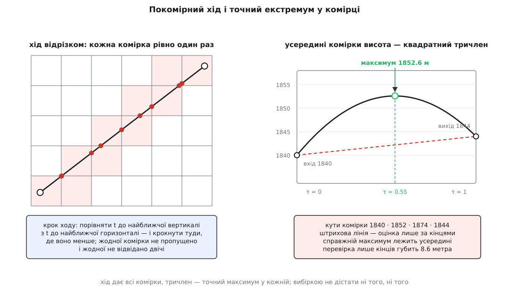
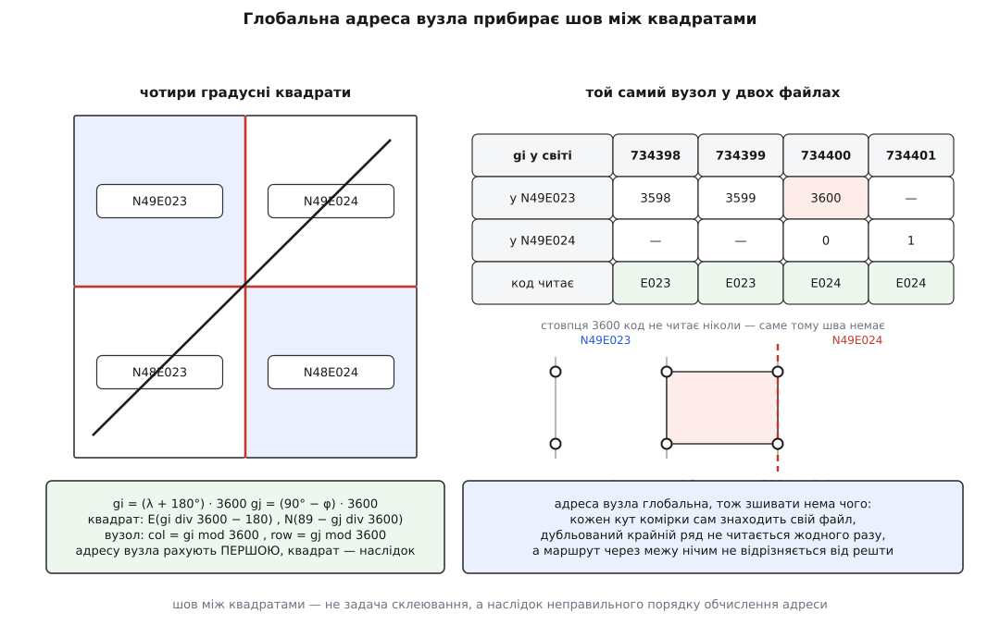

# ⚙️ Профіль висот уздовж маршруту: кеш квадратів, хід сіткою, точний максимум

Тут зібрано робочий C++, який бере маршрут — ламану з пар «широта, довгота» — а віддає не ряд вибраних точок, а **ряд інтервалів із точними межами висоти рельєфу** в кожному, і на цій основі відповідає на два питання, заради яких профіль і будують: чи вистачає запасу над землею й чи видно одну точку з іншої. Три рішення в ньому відрізняються від очевидних, і саме вони відділяють правильну відповідь від правдоподібної.

## Задача

На вході — вершини маршруту: пари (широта, довгота) у [WGS-84](root:math-geometry/wgs84-datum). На диску — тека з градусними файлами `.hgt`: квадрати 1° × 1°, у кожному 3601 × 3601 знакових шістнадцятибітних висот у метрах, big-endian, рядки з півночі на південь, значення −32768 означає прогалину. Разом на регіон це десятки гігабайтів, і в пам'ять вони не влазять.

Від коду вимагають чотирьох речей одночасно.

**Не пропустити жодної комірки.** Перешкода завширшки з одну комірку — насип, скеля, щогла — має потрапити у відповідь, а не провалитися між точками вибірки.

**Дати точний максимум, а не оцінку.** Реконструкція всередині комірки відома аналітично, тож питати її вибіркою — це самому собі створювати похибку там, де її могло не бути.

**Не збрехати ні на межі квадратів, ні на прогалині.** Обидва місця дають правдоподібне число замість правильного й не викликають ані винятку, ані попередження.

**Укластися в мілісекунди на сотню кілометрів** — інакше планувальник маршруту не зможе перерахувати профіль, поки оператор тягне точку мишею.

## Три рішення, на яких усе тримається

**Адресу вузла рахують ПЕРШОЮ, квадрат — наслідок.** Звичний хід думки такий: знайти потрібний файл, відкрити його, узяти в ньому рядок і стовпець. З цього хибного порядку й народжується весь клас помилок «шов»: комірка на межі квадратів має кути в двох різних файлах, і код, який спершу вибрав файл, змушений щось із цим робити. Тут порядок обернено. Є **одна глобальна сітка вузлів** на всю планету, вузол має глобальну адресу (gi, gj), а який файл його обслуговує — обчислюється з цієї адреси в останню чергу. Комірка на межі просто бере чотири кути, кожен із яких сам знаходить свій файл. Шва тут не існує як поняття: немає моменту, у який його можна було б завести.

**Хід сіткою замість рівномірного кроку.** Рівномірний крок або пропускає комірки, або кілька разів питає ту саму, і жодне згущення кроку не дає гарантії: комірку, зрізану біля кута, відрізок перетинає на довжині, яка може бути як завгодно малою, тож будь-який фіксований крок її прогледить. Хід від перетину до перетину з лініями сітки — той самий, що в растеризації відрізка, — дає **кожну перетнуту комірку рівно один раз** і разом із нею параметри входу й виходу. Це алгоритм [Аманатідеса й Ву](https://www.eecs.yorku.ca/~amana/research/) (J. Amanatides, A. Woo, *A Fast Voxel Traversal Algorithm for Ray Tracing*, Proc. Eurographics '87, Amsterdam, серпень 1987) — він писався для трасування променя крізь воксельну сітку, і задача тут та сама з точністю до розмірности.

**Екстремум у комірці беруть точно, а не вибіркою.** Білінійна реконструкція має вигляд h = h₀₀ + c₁u + c₂v + c₃uv, а вздовж відрізка u й v лінійні за параметром. Підстановка дає **квадратний тричлен від параметра** — і його найбільше та найменше значення на відрізку [0, 1] знаходять формулою, а не пошуком: кінці плюс щонайбільше одна внутрішня точка, де похідна нульова. Одне ділення замість десятка вибірок, і відповідь при цьому не наближена, а точна.



*Хід дає повний список комірок, тричлен дає точний максимум у кожній. Вибірка з фіксованим кроком не дає ні першого, ні другого — і мовчки повертає менше число.*

## Кеш градусних квадратів

Файл відображають у пам'ять, а не читають у буфер: [сторінковий збій](root:sf-os/page-fault) підтягне лише ті сторінки, яких код торкнувся, а під тиском пам'яті ядро викине їх само, бо вони чисті й мають копію на диску. Механіка [відображення файла в пам'ять](root:sys-unix/mmap-model) тут працює саме так, як задумана, — а скільки на цьому насправді заощаджено, залежить від напрямку маршруту, і нижче це пораховано точно.

:::code proj-terrain-profile/cpp/kesh-hradusnykh-kvadrativ.cpp

Три деталі варті окремого слова.

`kMinResident = 4` — не запобіжник від дурня, а точна межа. Комірка, що стоїть рівно в куті градусного квадрата, має чотири кути в чотирьох різних файлах; менша межа означала б, що читання четвертого кута витісняє квадрат, з якого щойно взято перший, і кожна така комірка коштувала б чотирьох `mmap` замість нуля.

`missing_` — негативний кеш, і без нього код над морем працює втричі повільніше, ніж над сушею. Океанські квадрати у сховищі просто відсутні; без пам'яті про це кожна вибірка йде в `open()`, отримує `ENOENT` і платить за системний виклик. Це та сама причина, з якої [кеш](root:hw-arch/cache) взагалі мусить пам'ятати не лише влучання, а й промахи.

Межа кеша в байтах на 64-бітній машині обмежує не стільки пам'ять, скільки **кількість живих відображень і дескрипторів, які через них тримають файли**: сторінки самі по собі чисті й ядро забирає їх без нашої участи. Тому лічильник байтів тут — проксі, і чесно це знати: справжня стеля, у яку впирається довгий маршрут, — не резидентна пам'ять, а адресний простір і таблиця відображень процесу.

## Глобальна адреса вузла

Ось те місце, де рішення про порядок обчислення дає свій ужиток.

```
gi = (λ + 180°) · 3600        стовпець у світі, на схід від −180°
gj = (90° − φ)  · 3600        рядок у світі, на південь від +90°

квадрат:  lon = gi div 3600 − 180 ,  lat = 89 − gj div 3600
вузол:    col = gi mod 3600 ,        row = gj mod 3600
```

Зсуви на +180° і +90° стоять у цих формулах не для краси. Цілочислове ділення в C++ відкидає дріб **до нуля**, а не вниз: `-1 / 3600` дає `0`, а не `-1`. Тому в сирих градусах квадрат на захід від Гринвіча вибрався б на градус східніше, ніж треба, а на південь від екватора — на градус північніше, і ця помилка не відтворилася б у жодному тесті, поставленому в Європі. Зсунута сітка робить обидві координати невід'ємними, і питання зникає разом із гілкою, яка мала б його розв'язувати. Той самий рядок нормалізації gi по модулю світу потрібен саме на цю тему: після переходу через 180-й меридіан адреса комірки може вийти від'ємною, і без нормалізації ділення знову збрехало б.

Тепер головне. `col = gi mod 3600` ніколи не дорівнює 3600. Отже дубльований крайній стовпець кожного файла — той самий, що існує і як стовпець 3600 західного квадрата, і як стовпець 0 східного, — **читається рівно з одного місця**. Ані подвійного врахування межової лінії, ані розриву на стику: обидві помилки потребують коду, який їх робить, а такого коду тут нема.



*Шов виникає тоді, коли спершу вибирають файл, а потім шукають у ньому вузол. У зворотному порядку зшивати нема чого.*

## Комірка й точний екстремум у ній

:::code proj-terrain-profile/cpp/komirka-i-tochnyi.cpp

Число c₃ = h₀₀ − h₁₀ − h₀₁ + h₁₁ і є тим, через що ця морока має сенс. Воно міряє **перекіс** комірки — наскільки чотири кути не лежать в одній площині. На рівному схилі воно близьке до нуля, поверхня майже плоска, і вздовж відрізка висота майже лінійна: кінці дають усе. На зламі гребеня воно велике, і різниця стає відчутною.

**Комірка на плечі гребеня, крок 30 м: кути 1840, 1852, 1874, 1844 метра; відрізок іде повною діагоналлю з першого кута в четвертий.**

```
c₁ = 1852 − 1840 =  12
c₂ = 1874 − 1840 =  34
c₃ = 1840 − 1852 − 1874 + 1844 = −42

A = −42 · 1 · 1 = −42        B = 12 + 34 = 46        C = 1840

кінці:      h(0) = 1840        h(1) = −42 + 46 + 1840 = 1844
вершина:    τ* = −46 / (2·(−42)) = 0.5476
            h(τ*) = −42·0.2999 + 46·0.5476 + 1840 = 1852.6

максимум за кінцями:  1844 м
справжній максимум:   1852.6 м
різниця:               8.6 м
```

Вісім із половиною метрів на одній комірці — це більше, ніж уся похибка сучасних глобальних наборів, і ці метри губляться не в даних, а в тому, як їх спитали. Загальна межа тут проста: відхилення параболи від хорди не перевищує |A|/4, а |A| ≤ |c₃|, тож помилка «лише за кінцями» обмежена чвертю перекосу комірки. Властивості самого правила реконструкції розібрано в [білінійній інтерполяції](root:math-numeric/bilinear-interpolation), а форму вершини параболи дає звичайне [квадратне рівняння](root:math-algebra/quadratic-equations).

> 🔧 **Навіщо це.** Спокуса замінити тричлен вибіркою — «візьму п'ять точок усередині комірки, вистачить» — коштує дорожче й водночас дає гірше. П'ять вибірок означають п'ять обчислень білінійної форми з перерахунком u й v, тобто близько півсотні операцій; тричлен — це три коефіцієнти, два кінці, одне ділення й одна підстановка, десь двадцять п'ять. І вибірка з кроком Δτ принципово недобирає до |A|·Δτ²/4: на комірці з прикладу вище це ще пів метра, на різкому зламі гребеня — метр із гаком. Тричлен не недобирає нічого, бо він максимум не наближає, а знаходить.

## Хід сіткою

:::code proj-terrain-profile/cpp/khid-sitkoiu.cpp

Увесь алгоритм — у порівнянні `tmx < tmy`. Кожна з двох величин каже, скільки ще параметра лишилося до найближчої лінії сітки свого напрямку; менша й визначає, крізь яке ребро відрізок вийде з поточної комірки. Після кроку відповідна величина зростає рівно на «ціну» однієї комірки в цьому напрямку — а ціна стала, бо комірки однакові.

Три ситуації, у яких наївний варіант ламається, тут закриті будовою. Вертикальний або горизонтальний відрізок дає нескінченність замість `tdx` чи `tdy` — порівняння з нескінченністю коректне, і хід іде однією віссю без жодної особливої гілки. Точна діагональ, де `tmx == tmy`, бере `else`-гілку, потім наступного разу — `if`-гілку з тим самим t, і видає одну комірку з нульовою довжиною влучання: марна, але не помилкова, і `cellRange` на ній просто двічі порахує ту саму точку. А відрізок, що не виходить за межі однієї комірки, дає `steps == 0` і рівно одне влучання [0, 1].

## Профіль і два запити

Ребро маршруту в координатах «широта–довгота» — це не велике коло. Різниця росте як квадрат довжини ребра, і на дистанціях, які реально літають, вона вже не косметична.

**Ребро 100 км строго на схід, широта 50°.**

```
1° довготи на 50°   = 111.32 · cos 50° = 71.56 км
Δλ = 100 / 71.56    = 1.3975°          = 0.024391 рад

відхилення великого кола від прямої в координатах:
Δφ ≈ (Δλ² / 16) · sin 2φ = (5.949·10⁻⁴ / 16) · 0.9848 = 3.662·10⁻⁵ рад
у метрах            = 3.662·10⁻⁵ · 6 371 000 = 233 м
```

Двісті тридцять метрів убік — це вісім комірок сітки: профіль побудують уздовж лінії, якою апарат не полетить. Тому довгі ребра ріжуть на шматки, кожна вершина яких лежить **точно** на великому колі, і лише всередині шматка йдуть прямою. Квадратична залежність тут працює на нас: десятикілометровий шматок дає в сто разів менше відхилення, тобто 2.3 метра — менше за десяту частину комірки, і далі дрібнити нема сенсу.

:::code proj-terrain-profile/cpp/profil-i-dva-zapyty.cpp

Профіль — це послідовність **ділянок**, а не точок. Кожна ділянка відповідає одній перетнутій комірці, і в ній лежать точні межі висоти рельєфу.

:::code proj-terrain-profile/cpp/profil-i-dva-zapyty-2.cpp

Тепер два запити, заради яких усе це й будувалося.

:::code proj-terrain-profile/cpp/profil-i-dva-zapyty-3.cpp

Поправка b = d₁·d₂/(2kR) — це висота, на яку поверхня планети піднімається над хордою, проведеною між кінцями траси; для радіо атмосфера злегка загинає промінь донизу, і це враховують, збільшуючи радіус у k = 4/3 разів, щоб промінь далі рахувати прямим.

**Траса 20 км, точка посередині, канал 2.4 ГГц.**

```
λ = 3·10⁸ / 2.4·10⁹ = 0.125 м

здуття:       b  = 10 000 · 10 000 / (2 · 1.3333 · 6 371 000) =  5.9 м
перша зона:   F₁ = √(0.125 · 10 000 · 10 000 / 20 000)        = 25.0 м
робоча вимога: 0.6 · F₁                                        = 15.0 м
──────────────────────────────────────────────────────────────────────
рельєф має лежати нижче за лінію візування на                   20.9 м
```

Майже двадцять один метр, з яких плоска геометрична перевірка не бачить жодного. Скільки саме простору навколо лінії має бути вільним і звідки береться множник 0.6 — предмет [зон Френеля](root:com-medium/fresnel-zones); тут важить лише те, що обидві поправки залежать від відстані й додаються до висоти рельєфу, а не віднімаються від висоти антен.

## Складність і числа

Робота на ребро — рівно кількість перетнутих комірок, і вона рахується наперед:

```
комірок = |Δgi| + |Δgj| + 1
```

На кожну комірку — чотири читання вузлів (майже завжди в один і той самий квадрат, тобто через memo без жодного пошуку в таблиці) і близько двадцяти операцій із рухомою комою на тричлен. Пошуків, дерев і сортувань немає ніде.

**Ребро 100 км під азимутом 45°, широта 50°, сітка 1″.**

```
1″ по меридіану  = 30.89 м            1″ по паралелі = 30.89 · cos 50° = 19.85 м
північна складова = 70.71 км  → Δgj = 70 710 / 30.89 = 2289 комірок
східна складова   = 70.71 км  → Δgi = 70 710 / 19.85 = 3562 комірки
разом                                                 ≈ 5852 комірки
```

Звідси й порядки часу — не з вимірювання на чужій машині, а з рахунку операцій, який кожен перевірить на своїй:

```
арифметика ходу й тричленів   ≈ 1.2·10⁵ операцій        десятки мікросекунд
читання 23 408 вузлів по 2 Б  ≈ 46 КіБ корисних даних   одиниці мікросекунд
сторінкові збої, файл у RAM   ≈ 2 300 · 1…3 мкс         2…7 мс      ← панує
сторінкові збої, холодний SSD ≈ 2 300 · 4 КіБ           десятки мілісекунд
```

Останні два рядки й пояснюють, де насправді живе вартість. Рядок квадрата 3601 × 3601 займає 7202 байти, тобто майже дві сторінки по 4 КіБ; сусідні рядки завжди лежать у різних сторінках. Діагональне ребро перетинає 2289 рядків — отже чіпає близько 2300 сторінок, тобто **дев'ять мегабайтів із двадцяти п'яти**, хоча корисних даних читає сорок шість кілобайтів. Ліниве відображення економить дуже багато на ребрі «схід–захід», яке сидить у кількох рядках, і майже нічого — на діагональному. Знати це варто до того, як обирати підказку ядру: для маршрутного ходу рядки йдуть монотонно, і попереднє читання допомагає, а `MADV_RANDOM`, поставлений «щоб не читало зайвого», його вимикає й робить гірше.

Для порівняння, рівномірна вибірка з кроком 20 метрів дала б на тих самих ста кілометрах 5000 звертань — той самий порядок роботи. Тобто хід сіткою не коштує дорожче; він коштує стільки ж і при цьому відповідає точно, тоді як вибірка з тим самим бюджетом лишає неспитаною щонайменше сьому частину комірок — а насправді більше, бо частина звертань припадає на комірки, уже відвідані сусіднім кроком.

## Де це ламається

**Прогалина, що потрапила в арифметику.** Одне значення −32768 в білінійній суміші дає висоту близько −8000 метрів. Далі трактом іде запас у вісім кілометрів, і жодна перевірка діапазону цього не спіймає, бо число саме собою правдоподібне за типом. Тому `readCell` віддає `false`, а не «щось замість». І тому ж у `ProfileSpan` є окреме поле `known`: підставити нуль означало б оголосити рівень моря, а протягнути попереднє значення — вигадати рельєф, якого ніхто не міряв.

**Крок вибірки більший за крок сітки.** Профіль виходить гладкий, правдоподібний і без перешкоди, яка на маршруті стоїть. Хід сіткою знімає це остаточно, але варто розуміти, чому саме він, а не просто менший крок: комірка, зрізана біля кута, перетинається відрізком на довжині, яка може бути як завгодно малою, тож **жоден** фіксований крок не гарантує її відвідин.

**Плоска відстань замість великого кола.** Довжину ділянки міряють лінійкою по меркаторівському екрану або за теоремою Піфагора просто в градусах — і східна складова виходить більшою за справжню в 1/cos φ разів, тобто на широті 50° у півтора раза. Профіль розтягується, і кожна перешкода на ньому стоїть не там, де насправді. Тут довжину ребра дає центральний кут ([відстань великого кола](root:math-geometry/great-circle-distance)), а не різниця координат.

**Пряма в координатах замість великого кола.** Тонший різновид тієї самої помилки: довжину порахували правильно, а сам профіль побудували вздовж прямої в широті-довготі. На ребрі 100 км це до 233 метрів убік — вісім комірок повз ту гору, задля якої профіль і будували.

**Байти прочитано не в тому порядку.** Висота 300 (0x012C) стає 11265, а прогалина −32768 (0x8000) — висотою 128 метрів, яку жодна перевірка не відрізнить від справжньої. Механіка підміни — у [порядку байтів](root:sf-algorithms/bits-bytes-endianness).

**Приведення до цілого замість `floor`.** `(int)(-0.5)` дорівнює нулю, а не мінус одиниці: приведення відкидає дробову частину до нуля, а не вниз. Тут це знешкоджено зсувами сітки, які роблять обидві координати невід'ємними, — але варто комусь почати рахувати комірки прямо в градусах або пропустити нормалізацію після 180-го меридіана, і хід почнеться в сусідній комірці, а квадрат вибереться на градус не туди. Помилка не відтворюється в Європі, де все додатне, і саме тому доживає до польових випробувань.

**Витіснення квадрата, чий покажчик ще тримають.** Тут його немає з двох причин відразу: `HgtLibrary::node` копіює висоту негайно й покажчика назовні не віддає, а межа `kMinResident` не дає викинути жоден із чотирьох квадратів, які може одночасно потребувати комірка в куті. Забути друге — і код працюватиме бездоганно скрізь, крім рівно тих комірок, що лежать у кутах градусних квадратів.

**Немає негативного кеша.** Над морем, над полярними широтами й будь-де за межами покриття зйомки кожна вибірка робить приречений `open()`. Профіль прибережного маршруту стає в рази повільнішим за той самий маршрут суходолом — і причина в лічильнику системних викликів, а не в даних.

**Сіткові координати в одинарній точності.** Глобальна адреса вузла — число порядку 7·10⁵, і у `float` сусідні представні значення там стоять через 1/16. Локальна координата всередині комірки, отримана відніманням, квантується грубими сходинками: тричлен рахує екстремум не в тій точці, а результат лишається правдоподібним. Порятунок не в «акуратному округленні», а в тому, щоб великі числа жили в `double`, а параметр усередині комірки був свій і малий. Загальна механіка втрати значущих цифр на відніманні близьких величин — у [числах із рухомою комою](root:hw-arch/floating-point).

**180-й меридіан.** Без нормалізації різниці по довготі ребро з 179.9° на −179.9° перетинає не двісті метрів, а майже весь світ — і хід чесно пройде 2.6 мільйона комірок, доки не скінчиться терпіння того, хто на це дивиться.

**Максимум узято за істину.** Профіль дає точну верхню межу **реконструкції**, а не рельєфу. До неї ще додаються похибка самої моделі, невидимий між вузлами гребінь і дрейф висотоміра, і складати їх треба явно, як у будь-якому [бюджеті похибок](root:math-probability/error-budget). Точність цього коду означає лише те, що він не додає до цих похибок своєї власної, — і це єдине, чого від коду взагалі можна вимагати.
